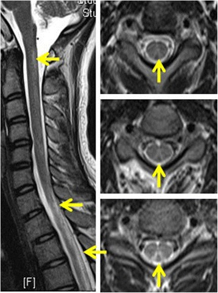
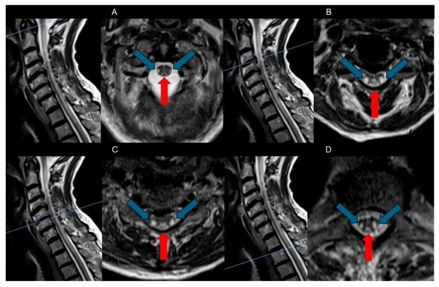
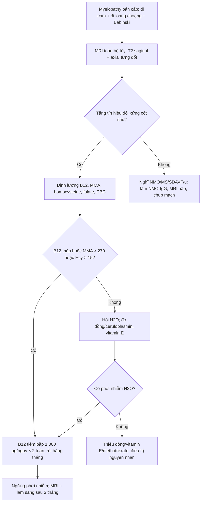
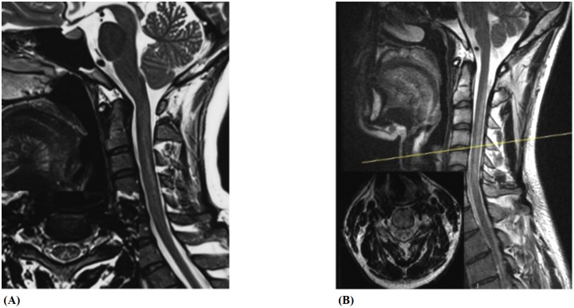
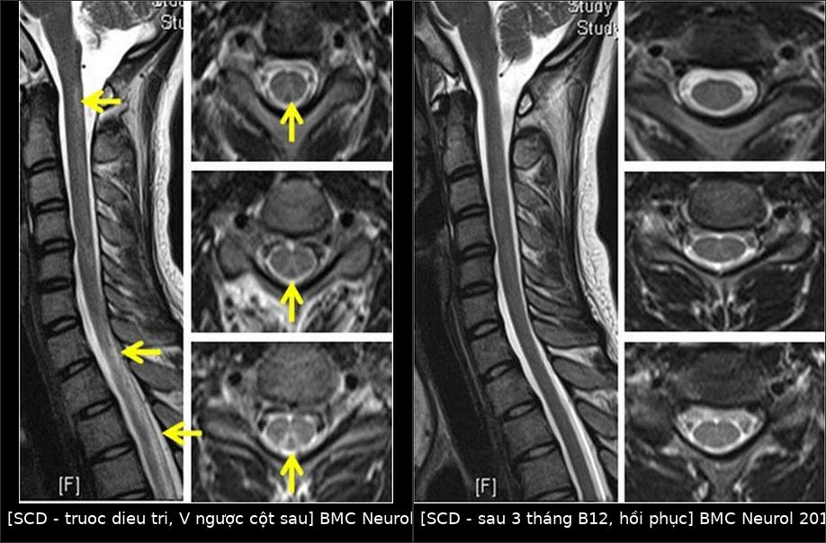

# 281 — Thoái hóa tủy kết hợp bán cấp do thiếu vitamin B12 / Subacute combined degeneration (SCD)

**Tags:** `pattern:tang-tin-hieu-t2` `pattern:doi-xung` `pattern:cot-sau` `pattern:tuy-doc-dai` `pattern:myelopathy` `vung:thankinh` `vung:tuy-song` `protocol:MRI-tuy-song` `protocol:B12` `protocol:MMA-homocysteine`
**Mức chắc chắn (certainty):** tổng hợp y văn (literature synthesis) — 1 tổng quan hệ thống về MRI và điều trị SCD (PMC12468238), 1 đoàn hệ so sánh SCD do N₂O với SCD không do N₂O (50 vs 48 bệnh nhân, PMC7884630), 1 nghiên cứu so sánh N₂O-SCD với SCD do thiếu B12 (23 vs 20, PMC12066286), 1 ca N₂O có B12 **bình thường** kèm hồi phục MRI sau 3 tháng (PMC5745895) và 1 ca **thiếu đồng** bắt chước SCD (PMC11805716). Câu nào là suy luận được ghi **[suy luận]**.

> **Vì sao bài này quan trọng:** SCD là **nguyên nhân tủy sống hồi phục được** nếu nhận ra sớm — nhưng **B12 máu bình thường không loại trừ** (ca PMC5745895 có **B12 800 pg/mL**, Hcy **8 µmol/L** mà vẫn SCD nặng vì N₂O), và **thiếu đồng** cho hình ảnh **không phân biệt được** trên MRI (PMC11805716). Bỏ sót → liệt hai chi, mất kiểm soát cơ tròn; điều trị sai hướng (ví dụ chỉ bổ sung folate, hoặc coi là bệnh tủy do chèn ép) → tổn thương không hồi phục.

## 1. Tổng quan bệnh học – cơ chế hình ảnh

### 1.1. Thiếu B12 làm hỏng myelin theo hai đường

- **B12 (cobalamin)** là cofactor của **methionine synthase** (homocysteine → methionine) và **methylmalonyl-CoA mutase** (methylmalonyl-CoA → succinyl-CoA).
- **Đường 1 — giảm methyl hóa myelin:** thiếu B12 → **homocysteine tăng**, **S-adenosyl-methionine (SAM) giảm** → myelin protein/lipid **không được methyl hóa** → myelin **mỏng, không ổn định**.
- **Đường 2 — ngộ độc methylmalonic acid (MMA):** MMA tích tụ → **ức chế tổng hợp myelin**, gây **phù và thoái hóa dạng bọt (spongiform)** sợi trục.
- **Vì sao gọi "kết hợp" (combined):** tổn thương **cột sau** (cảm giác sâu: rung, bản thể, sờ tinh tế) **và cột bên** (bó corticospinal: yếu, tăng phản xạ, Babinski) cùng lúc — mất cảm giác + dấu hiệu **thần kinh trung ương**, khác hẳn bệnh rễ/thần kinh ngoại vi thuần túy.
- **Vì sao bắt đầu ở tủy ngực trên:** các sợi **dài, myelin dày, nhu cầu chuyển hóa cao** dễ tổn thương nhất; từ đây tổn thương **lan lên cổ hoặc xuống** theo chiều dọc (PMC12468238).
- **Khoảng 30%** bệnh nhân thiếu B12 có **bệnh thần kinh ngoại vi** kèm theo → thể **myeloneuropathy** với cả dấu hiệu **trung ương và ngoại vi** (PMC12468238).

### 1.2. TẠI SAO tăng tín hiệu T2 đối xứng ở cột sau

- **T2-weighted MRI** nhạy với **nước tự do**: vùng myelin bị phù/thoái hóa dạng bọt làm **tăng nước ngoại bào** → **tăng tín hiệu T2**.
- **Đối xứng vì tổn thương theo bó giải phẫu**, không theo mạch máu: hai **bó Goll** (cột sau trong) nằm sát nhau ở rãnh giữa sau → trên mặt cắt **trục** tạo hình **chữ V ngược ("inverted V")** hoặc **"tai thỏ" (inverted rabbit ears)** — hai "tai" sáng đối xứng hai bên đường giữa (PMC12468238, PMC5745895).
- **Sagittal T2:** dải tăng tín hiệu **dọc dài**, thường **liên tục qua nhiều đốt sống** (ca PMC5745895: **C1–T12**).
- **Thường KHÔNG ngấm thuốc:** hàng rào máu–tủy không bị phá vỡ đáng kể; **ngấm thuốc nhẹ hiếm gặp** (PMC12468238). Vì vậy **không cần tiêm cản quang để chẩn đoán**; ngấm thuốc mạnh gợi ý nguyên nhân khác (viêm tủy, NMO, u).
- **Tủy không giãn, không teo sớm:** khác với u trong tủy (giãn tủy) và bệnh mạn (teo muộn).

*Hình 1 — Nữ 20 tuổi, dị cảm và đi loạng choạng 15 ngày sau lạm dụng N₂O: (trái) T2 sagittal tổn thương dọc dài; (phải) ba mặt cắt axial cho thấy **tăng tín hiệu đối xứng cột sau** — dấu **"chữ V ngược"/"tai thỏ"**. Nguồn: BMC Neurol 2017, PMC5745895, CC BY 4.0 — ảnh nguyên bản.*

### 1.3. Số liệu định lượng cốt lõi

- **Ngưỡng xét nghiệm (PMC12468238):** **B12 < 200 pg/mL**; **MMA > 270 nmol/L**; **homocysteine > 15 µmol/L**; **MCV > 115 fL** (đại hồng cầu); bạch cầu **đa nhân ưa kiềm**.
- **B12 bình thường vẫn có thể thiếu mô:** trong SCD do N₂O, **B12 trung vị 218 pg/mL** (IQR 121–350) — **nằm trong khoảng bình thường** — so với **96 pg/mL** (IQR 50–170) ở SCD không do N₂O (p < 0,05) (PMC7884630). Ca PMC5745895 có **B12 800 pg/mL**, **Hcy 8 µmol/L**, **folate 4,40 ng/mL** (thấp).
- **Dịch tễ — hai nhóm tuổi khác nhau:** SCD do N₂O **21,4 ± 4,7 tuổi** (50 bệnh nhân); SCD không do N₂O **62,0 ± 11,4 tuổi** (48 bệnh nhân) (PMC7884630).
- **Tiên lượng:** khoảng **90%** điều trị **ổn định hoặc cải thiện**; hồi phục hoàn toàn có thể xảy ra nhưng không phải quy luật (PMC12468238).

## 2. Mẫu hình + chẩn đoán phân biệt theo vị trí (Gamut)

### 2.1. Theo vị trí tủy

- **Cột sau (dorsal columns):** dấu **"chữ V ngược"/"tai thỏ"**, đối xứng, thường **ngực trên → cổ** — mẫu hình **đặc hiệu nhất** của SCD.
- **Cột bên (lateral corticospinal):** tăng tín hiệu kèm theo → **"combined"**; nếu **chỉ cột bên** phải nghĩ nguyên nhân khác (xơ cứng rải rác bên, nhồi máu tủy).
- **Tủy cổ + ngực liên tục (longitudinally extensive):** ca PMC5745895 **C1–T12** — cần phân biệt **viêm tủy ngang dọc dài/NMO**, nhưng NMO thường **trung tâm/asymmetric**, có **NMO-IgG**, ngấm thuốc.
- **Nhu mô não:** tổn thương chất trắng **lan tỏa/rải rác** có thể gặp và **hồi phục sau bổ sung B12** (PMC12468238).

### 2.2. Theo nguyên nhân (gamut nguyên nhân)

- **Thiếu hấp thu:** **thiếu máu Biermer/pernicious anemia** (kháng thể kháng intrinsic factor, teo niêm mạc dạ dày), **cắt dạ dày**, bệnh Crohn/celiac, **metformin**, **ức chế bơm proton (PPI)** kéo dài.
- **Ăn chay tuyệt đối** kéo dài (B12 chỉ có trong thức ăn động vật).
- **Bệnh di truyền:** **hội chứng Imerslund–Gräsbeck** (khiếm khuyết receptor cubilin, trẻ em), thiếu transcobalamin.
- **N₂O (khí cười):** **oxy hóa không hồi phục cobalt** của B12 → **ức chế methionine synthase** dù B12 miễn dịch vẫn "bình thường" → thể SCD **trẻ, nặng, kèm loạn thần/giảm nhận thức** (PMC5745895, PMC12066286).
- **Bắt chước không do B12:** **thiếu đồng** (myelopathy cột sau + thiếu máu/giảm bạch cầu), **thiếu vitamin E**, **myelopathy do methotrexate** — MRI **không phân biệt được** với SCD (PMC12468238, PMC11805716).

*Hình 2 — SCD ở nữ 74 tuổi: (A–D) các mặt cắt sagittal T2 và axial tương ứng; **mũi tên đỏ** chỉ cột sau, **mũi tên xanh** chỉ cột bên — tổn thương **đối xứng cả hai cột**. Nguồn: Brain Sci 2025, PMC12468238, CC BY 4.0 — ảnh nguyên bản.*

## 3. Bảng so sánh phân biệt (ma trận đối chiếu)

| Thực thể (entity) | Hình ảnh điển hình | Chốt vào (rule-in) | Chốt loại (rule-out) | Gợi ý xác nhận |
|---|---|---|---|---|
| **SCD do thiếu B12** | T2 tăng tín hiệu **đối xứng cột sau** ("V ngược"), ± cột bên; dọc dài; **không ngấm thuốc**; tủy không giãn | **Đối xứng + cột sau + B12 thấp/MMA–Hcy tăng** | Tổn thương **một bên/không đối xứng** hoặc **giãn tủy** → nghĩ u/viêm | B12, **MMA > 270 nmol/L**, Hcy > 15 µmol/L, anti-IF |
| **SCD do N₂O** | Giống hệt SCD; có thể **dọc dài hơn**, kèm tổn thương não; bệnh nhân **trẻ** | **Tiền sử khí cười + B12 "bình thường" + Hcy/MMA tăng** | Không có phơi nhiễm và B12 thấp → thể kinh điển | Hỏi kỹ **"bóng cười"/whippets**; MMA/Hcy; theo dõi sau ngừng |
| **Thiếu đồng (copper deficiency)** | **Không phân biệt được** với SCD trên MRI: cột sau ± cột bên | **B12 bình thường + không đáp ứng B12 + giảm đồng/ceruloplasmin** | Đồng bình thường → loại trừ | Đồng huyết thanh, ceruloplasmin, CBC (thiếu máu/giảm bạch cầu) |
| **Rò động–tĩnh mạch màng cứng (SDAVF)** | T2 tăng tín hiệu tủy **dọc dài**, **phù tủy**, **dòng chảy (flow voids)** quanh tủy; thường **nam lớn tuổi**, tiến triển | **Flow voids + phù tủy + tuổi lớn + nặng dần khi gắng sức** | Không flow void, đối xứng cột sau → SCD | MR/CTA tủy; chụp mạch; **không dùng corticoid mù** |
| **Viêm tủy thị thần kinh (NMO)** | **LETM ≥ 3 đốt**, tổn thương **trung tâm**, ngấm thuốc, có thể asymmetric | **NMO-IgG dương + LETM trung tâm + viêm thị thần kinh** | Đối xứng cột sau, không ngấm thuốc → SCD | NMO-IgG/AQP4, MRI não + tủy, dịch não tủy |
| **Xơ cứng rải rác (MS)** | Ổ **bất đối xứng**, **ngoại vi**, ngắn (**< 2 đốt**), hình bầu dục; tổn thương não đặc trưng | **Ổ bất đối xứng + tiền sử từng đợt + Dawson fingers** | Đối xứng cột sau dọc dài → SCD | MRI não + tủy, dịch não tủy (OCB) |
| **Tabes dorsalis (giang mai)** | Teo cột sau **muộn**, tủy **teo**, không phù; kèm **Argyll Robertson**, đau chói | **Huyết thanh/CSF giang mai dương + mất phản xạ gân gối** | Không có bằng chứng giang mai → loại trừ | VDRL/TPHA, CSF |

## 4. Protocol chẩn đoán + điều trị + theo dõi

### 4.1. MRI — cách chụp để không bỏ sót

- **MRI toàn bộ tủy sống** (cổ + ngực; thêm thắt lưng nếu triệu chứng), **T2 sagittal** + **T2 axial từng đốt** (không chỉ sagittal — **"chữ V ngược" chỉ thấy trên axial**).
- **STIR/T2 fat-sat** để phân biệt phù tủy với mỡ; **T1 ± gadolinium** chỉ khi nghi viêm/u (SCD điển hình **không ngấm thuốc**).
- **Không cần cản quang để chẩn đoán SCD** (PMC12468238); ngấm thuốc mạnh **không** thuộc SCD điển hình.

### 4.2. Xét nghiệm tối thiểu (theo thứ tự ưu tiên)

1. **CBC + MCV** (đại hồng cầu **> 115 fL**, đa nhân ưa kiềm).
2. **B12 huyết thanh** — nhưng **không dừng lại nếu bình thường**: làm **MMA** (> 270 nmol/L) và **homocysteine** (> 15 µmol/L).
3. **Folate**, **anti-intrinsic factor**, **gastrin** (nghi Biermer).
4. **Đồng/ceruloplasmin**, **vitamin E** nếu B12 bình thường hoặc không đáp ứng điều trị.
5. **Hỏi phơi nhiễm N₂O** (bóng cười/whippets) — chi phí bằng 0, giá trị cao (PMC7884630, PMC5745895).

### 4.3. Điều trị (theo PMC12468238)

| Tình huống | Đường | Liều |
|---|---|---|
| **SCD/thiếu B12 có triệu chứng thần kinh** | **Tiêm bắp (IM)** ưu tiên | **1.000 µg mỗi ngày** × 2 tuần (hoặc cách ngày), sau đó **1.000 µg mỗi tháng** |
| Thiếu B12 không biến chứng | IM hoặc uống | **1.000 µg/tuần × 1 tháng**, rồi **hàng tháng** |
| Kém hấp thu | Uống liều cao | **1.000–2.000 µg/ngày** |
| **Nguyên nhân N₂O** | IM + **ngừng phơi nhiễm tuyệt đối** | Như trên; ngừng N₂O là điều kiện **bắt buộc** |

- **Thời gian:** **suốt đời** nếu nguyên nhân không hồi phục (cắt dạ dày, Biermer); đến khi sửa được nguyên nhân với thể hồi phục.
- **Theo dõi:** lâm sàng + **MRI lặp sau 3 tháng** — ca PMC5745895 hồi phục **cảm giác, dáng đi, nhận thức (MMSE 23 → 30)** và **MRI sạch tổn thương sau 3 tháng**.

## 5. Biến thể bình thường và cạm bẫy

- **Cạm bẫy 1 — "B12 bình thường là loại trừ":** ca PMC5745895 có **B12 800 pg/mL** và **Hcy 8 µmol/L** vẫn SCD do N₂O; trong đoàn hệ N₂O, **B12 trung vị 218 pg/mL** nằm trong khoảng bình thường (PMC7884630). **Luôn hỏi tiền sử khí cười** ở người trẻ có myelopathy cột sau.
- **Cạm bẫy 2 — bổ sung folate đơn thuần:** folate thấp (4,40 ng/mL trong ca PMC5745895) có thể **che/ làm nặng** thiếu B12 về mặt huyết học; **điều trị folate mà không B12 có thể làm tổn thương thần kinh tiến triển** [suy luận từ cơ chế methyl hóa].
- **Cạm bẫy 3 — thiếu đồng bắt chước SCD:** MRI **không phân biệt được**; bệnh nhân **không đáp ứng B12** và hồi phục với **bổ sung đồng** (PMC11805716). Ở người **đã phẫu thuật dạ dày/ruột**, nghĩ đến **cả đồng** (PMC12468238).
- **Cạm bẫy 4 — SDAVF bị điều trị như SCD:** dòng chảy quanh tủy + phù tủy + nam lớn tuổi; **corticoid có thể làm nặng**; cần **chụp mạch** trước khi kết luận [suy luận].
- **Cạm bẫy 5 — MRI bình thường sớm (clinical–radiological dissociation):** có ca **triệu chứng rõ mà MRI chưa đổi**; không loại trừ SCD bằng một MRI âm tính, nhất là khi xét nghiệm chuyển hóa dương (PMC7076925).
- **Cạm bẫy 6 — "chữ V ngược" không chỉ của SCD:** có thể gặp trong **thiếu đồng**, **thiếu vitamin E**, **myelopathy do methotrexate**; hình ảnh **gợi ý**, xét nghiệm **quyết định**.

*Hình 3 — (A) SCD do thiếu B12 nguyên phát; (B) SCD do lạm dụng N₂O có tổn thương lan rộng hơn, kèm mặt cắt axial. Nguồn: Front Immunol 2025, PMC12066286, CC BY 4.0 — ảnh nguyên bản.*

## 6. Tự lượng giá — Blind Quiz

**Ca 1 — Nữ 20 tuổi, dị cảm hai chân và tay, đi loạng choạng 15 ngày. B12 máu 800 pg/mL.**

- Gợi ý: bệnh nhân dùng **100–200 "bóng cười" mỗi ngày** hơn 1 năm; B12 **800 pg/mL** (211–911), Hcy **8 µmol/L**.
- Câu hỏi: mô tả dấu hiệu trên axial? Vì sao B12 bình thường mà vẫn SCD? Xét nghiệm nào xác nhận và điều trị ra sao?

<b>Bấm để hiện đáp án (findings + chẩn đoán)</b>

- Dấu hiệu: **tăng tín hiệu T2 đối xứng cột sau** hình **"chữ V ngược"/"tai thỏ"**, dải dọc dài trên sagittal (C1–T12).
- Vì sao B12 bình thường: **N₂O oxy hóa không hồi phục cobalt** → bất hoạt B12 tại mô dù miễn dịch đo được vẫn bình thường; **MMA/Hcy** mới phản ánh thiếu chức năng.
- Xác nhận: **MMA > 270 nmol/L**, **Hcy > 15 µmol/L**, tiền sử N₂O; loại trừ thiếu đồng.
- Điều trị: **ngừng N₂O tuyệt đối** + **B12 tiêm bắp 1 mg/ngày**; ca này hồi phục và MRI sạch sau **3 tháng**.
- Nguồn ảnh: BMC Neurol 2017, PMC5745895, CC BY 4.0.

**Ca 2 — Cùng bệnh nhân sau 3 tháng điều trị: chụp lại MRI.**

- Gợi ý: bệnh nhân đã ngừng N₂O và tiêm B12; triệu chứng cảm giác/dáng đi hồi phục, MMSE **23 → 30**.
- Câu hỏi: hình bên phải khác bên trái thế nào? Điều này nói gì về tiên lượng và về thời điểm chụp lại?

<b>Bấm để hiện đáp án (findings + chẩn đoán)</b>

- Dấu hiệu: **(trái) trước điều trị** — dải tăng tín hiệu dọc tủy và "V ngược" cột sau; **(phải) sau 3 tháng** — **hết tăng tín hiệu**, cột sau trở về bình thường.
- Ý nghĩa: SCD là **tổn thương myelin hồi phục được** nếu điều trị sớm và **loại bỏ nguyên nhân**; MRI hồi phục **song song** với lâm sàng.
- Thời điểm: chụp lại **3 tháng** sau điều trị là mốc hợp lý; hồi phục hoàn toàn không loại trừ cần theo dõi tiếp nếu nguyên nhân không sửa được.
- Nguồn ảnh: BMC Neurol 2017, PMC5745895, CC BY 4.0 — ảnh ghép letterbox, giữ nguyên tỉ lệ.

**Ca 3 — Nam 32 tuổi nông dân: dị cảm, mất cảm giác rung, tăng phản xạ, đi mất thăng bằng. B12 bình thường, không đáp ứng B12.**

- Gợi ý: không dùng rượu, không khí cười; **B12 bình thường**; đã tiêm B12 **không cải thiện**.
- Câu hỏi: hai xét nghiệm cần làm thêm? Vì sao không được kết luận SCD? Điều trị khác gì?

<b>Bấm để hiện đáp án (findings + chẩn đoán)</b>

- Dấu hiệu: MRI có thể **giống SCD** (cột sau ± cột bên) — hình ảnh **không phân biệt** được với SCD.
- Cần làm: **đồng huyết thanh + ceruloplasmin** (và **vitamin E**, CBC tìm thiếu máu/giảm bạch cầu) — ca PMC11805716 là **thiếu đồng**, hồi phục hoàn toàn nhờ **bổ sung đồng uống**.
- Vì sao không kết luận SCD: B12 bình thường + **không đáp ứng B12** → phải tìm nguyên nhân khác trước khi tiếp tục B12 vô ích.
- Điều trị: **bổ sung đồng** theo nguyên nhân; không tăng liều B12.
- Nguồn ảnh: Brain Sci 2025, PMC12468238, CC BY 4.0 (ảnh minh họa SCD điển hình; ca mô tả lấy từ PMC11805716).

## Bài liên quan chéo
- [200 – Tổng quan hệ Thần kinh](../200-tong-quan-he-than-kinh/lesson.md)
- [265 – Ngộ độc khí cười (N₂O) ở tủy](../265-ngo-doc-khi-cuoi-tuy/lesson.md)
- [267 – Presyrinx và tủy mềm hồi phục](../267-presyrinx-va-tuy-mem-hoi-phuc/lesson.md)
- [280 – Bệnh tủy do thiếu đồng](../280-benh-tuy-thieu-dong/lesson.md)

## Ảnh
- Tên file: `281_slug_Modality_SourceID.jpg`; nguồn + giấy phép từng ảnh trong `images/CREDITS.md`.
- Ảnh ghép `images/composite_scd-truoc-sau.jpg` tạo bằng `tools/make_composite.py` (letterbox, giữ tỉ lệ).

> Không dùng để chẩn đoán độc lập khi chưa có người hướng dẫn.
