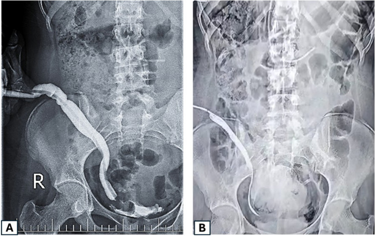
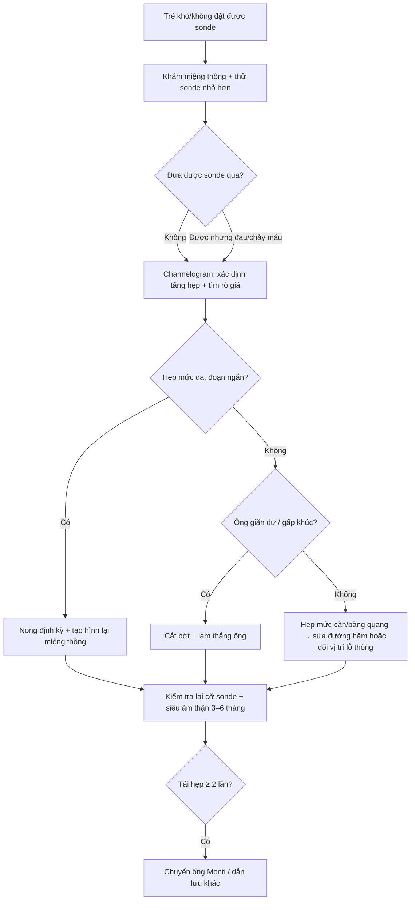
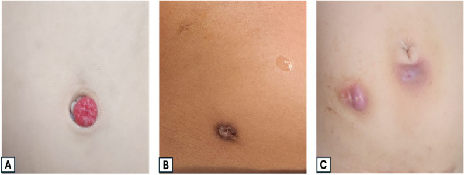

# 3001 — Hẹp lỗ thông Mitrofanoff ở trẻ / Mitrofanoff stomal stenosis in children

**Tags:** `pattern:hep` `pattern:hep-lo-thong` `vung:thanh-bung` `vung:bang-quang` `protocol:channelogram` `protocol:VCUG`
**Mức chắc chắn (certainty):** tổng hợp y văn (literature synthesis) — số liệu chính từ **1 loạt mổ tiến cứu–hồi cứu 44 trẻ** so sánh ống niệu quản vs ống ruột thừa (Mansy M et al., *BMC Surg* 2026, PMC12933896) và **1 tổng quan kỹ thuật–kết cục** ở người trưởng thành có tổng hợp nhiều loạt (Alsulihem A & Corcos J, *Urol Ann* 2022, PMC9472303); phần hình ảnh dựa trên chính các hình trong 2 bài đó. Số nào nguồn không nêu thì ghi **"chưa rõ"**, không bịa.

## 1. Tổng quan bệnh học – cơ chế hình ảnh

- **Định nghĩa (nguyên lý Mitrofanoff):** tạo một **ống thông tiểu có kiểm soát (continent catheterizable channel — CCC)** nối **bàng quang** với **da thành bụng**, dùng một đoạn ruột — thường là **ruột thừa (appendicovesicostomy)** — cấy vào bàng quang theo kiểu **van lật niêm mạc dưới niêm (submucosal tunneled flap valve)**. Đoạn ruột thừa được lật ngược, đầu gốc cắm vào bàng quang, đầu ngọn đưa ra da. Chỉ định: **bàng quang thần kinh** (thoát vị tủy–màng tủy), **phức hợp lộn bàng quang–niệu đạo**, **hội chứng bụng nhão (prune belly)**, **van niệu đạo sau**, hoặc trẻ **không thể đặt sonde qua niệu đạo** (béo phì, dị tật, ghép, khuyết tật vận động).
- **"Hẹp lỗ thông" (stomal stenosis) là gì:** hẹp **lòng ống thông** — thường ở **lớp da** (skin level), nhưng có thể ở **mức cân (fascia)** hoặc **mức bàng quang**. Ngưỡng thực hành: hẹp khi trẻ **phải dùng sonde nhỏ hơn cỡ thường dùng**, **đau/chảy máu khi đặt**, hoặc **không đưa được sonde qua** dù đã thử đúng tư thế.
- **TẠI SAO hẹp lại hay gặp ở ĐÚNG lỗ thông:** lỗ thông là nơi **duy nhất của ống thông chịu 3 lực cùng lúc** — (1) **thiếu máu cục bộ** do căng/thắt mạc treo ruột thừa hoặc do phải **cắt đôi niệu quản** ở 2 điểm (nguồn nuôi mạch bị tổn thương), (2) **viêm mạn do ẩm ướt + nước tiểu**, (3) **chấn thương cơ học lặp lại** của sonde. Sẹo xơ co → vòng hẹp. Vì vậy nguồn nhấn mạnh **để sonde lưu 2–3 tuần** sau mổ cho niêm mạc biểu mô hóa và **chống hẹp** (Mansy M et al. 2026).
- **TẠI SAO ống niệu quản hẹp ít hơn ống ruột thừa — và tại sao vẫn không nên mặc định chọn niệu quản:** ống niệu quản **hẹp 9,1% (1/11)** so với **18,2% (6/33)** ở ống ruột thừa (P = 0,003), nhưng ống niệu quản lại **hạt granuloma nhiều hơn: 27,3% (3/11) vs 9,1% (3/33)** (P = 0,043) và **cần can thiệp lần hai 45,5% vs 30,3%** (Mansy M et al. 2026). Đọc bảng này đúng cách: **"hẹp" không phải biến chứng duy nhất**, và tỉ lệ hẹp **không đồng nghĩa ít phải mổ lại**.
- **Dịch tễ định lượng (vì sao phải biết trước khi tư vấn gia đình):** nguy cơ hẹp trong các loạt dao động **6,8%–54%**; tỉ lệ **mổ lại vì biến chứng 20%–67%** (Alsulihem A & Corcos J 2022). Chỉnh sửa **ở mức da (skin-level revision) chiếm tới 41%** số bệnh nhân trong một loạt lớn. Nghĩa là: **hẹp lỗ thông là biến chứng phổ biến nhất của phẫu thuật này**, và phần lớn xử lý được **bằng can thiệp nhỏ ở da**, không cần mở bụng lại.
- **Vị trí lỗ thông quyết định nguy cơ (con số đáng nhớ):** lỗ thông **ở rốn** có tỉ lệ hẹp **86%** so với **36%** khi đặt ở **hạ vị thấp** trong một loạt được tổng hợp lại; nhóm **bàng quang thần kinh** có hẹp tới **60%** (Alsulihem A & Corcos J 2022). Cơ chế: rốn là **nếp da lõm, ẩm, khó vệ sinh, sẹo co theo trục rốn** — đẹp về thẩm mỹ nhưng đổi bằng nguy cơ hẹp.
- **So sánh vật liệu ống thông (bảng số của tổng quan):**

| Vật liệu ống | Hẹp ống (channel stenosis) | Mổ lại chung | Ghi chú |
|---|---|---|---|
| **Ruột thừa** | **17,2%** | **29,9%** | Chọn đầu tay; miệng nối da kiểu **V-flap / VZQ** |
| **Ruột non tái cấu hình (ileal/Yang-Monti)** | **22,7%** | **50,7%** (P = 0,003) | Ống dài hơn → dễ **gấp khúc**, thêm nguy cơ són (incontinence 36,0% vs 19,5%) |
| **Da làm ống** | **100%** (hẹp trong trung bình **24 ngày**) | — | **Không dùng** ở trẻ |
| **Kock pouch (van lồng ruột non)** | **2,6%** | — | Hẹp ít nhưng kiểm soát kém hơn, ít dùng ở trẻ |

*(số trong bảng: Alsulihem A & Corcos J 2022, tổng hợp nhiều loạt)*

- **Vai trò của hình ảnh — và giới hạn của nó:** **channelogram/pouchogram** (bơm thuốc tan trong nước qua lỗ thông) trả lời **4 câu**: (1) ống thông **hẹp ở tầng nào** (da / cân / bàng quang), (2) **dài bao nhiêu cm** và có **gấp khúc–giãn dư (redundant)** không, (3) thuốc có **thoát ra ngoài lòng ống** (đường rò giả — false passage) không, (4) **bàng quang** có trào ngược (VUR) và có **túi thừa/đọng nước** không. **Nhưng**: hẹp **ngay tại lỗ da** thường **thấy bằng mắt và đầu dò**; chụp hình ảnh **không thay thế** nội soi bàng quang khi cần.

## 2. Mẫu hình + chẩn đoán phân biệt theo mức hẹp (Gamut)

**Câu hỏi thực hành:** trẻ **không đặt được sonde** — hẹp ở đâu, và có phải hẹp thật không?

**Trục A — theo 3 mức giải phẫu** (mỗi mức một cách xử lý khác nhau):

1. **Mức da (skin level)** — hay gặp nhất; thấy **lỗ nhỏ, viền xơ trắng, chảy máu khi nong**; xử lý: **nong ± tạo hình lại miệng thông (meatal refashioning / V-flap)**; ca loạt 44 trẻ ghi nhận hẹp **được xử lý bằng tạo hình lại miệng thông** (Mansy M et al. 2026).
2. **Mức cân (fascial level)** — ống thông bị **kẹp giữa 2 bờ cân**; sonde qua được lớp da nhưng **dừng ở độ sâu 2–4 cm**; xử lý: **mở rộng lỗ cân** hoặc chuyển vị trí lỗ thông.
3. **Mức bàng quang (vesical level)** — hẹp **chỗ ống cắm vào bàng quang** hoặc **đường hầm dưới niêm quá chặt**; thường kèm **són nước tiểu** hoặc **ứ nước**; xử lý: **sửa lại đường hầm**, không nong được.

**Trục B — theo cơ chế "không đặt được sonde" (gamut, xếp theo tần suất):**

- **Hẹp lỗ thông** (bài này).
- **Hạt granuloma / viêm quanh miệng thông** — **9,1%–27,3%** tuỳ vật liệu ống (Mansy M et al. 2026); đau, chảy máu, cản sonde.
- **Ống thông giãn dư–gấp khúc (redundant/kinked channel)** — lòng ống **bình thường nhưng đường đi quanh co**; sonde "đi vòng" rồi tắc; đây là **chẩn đoán hình ảnh**, không phải hẹp.
- **Đường rò giả (false passage)** — sonde chọc ra **ngoài lòng ống**, thường do **nong quá tay**; bơm thuốc thấy **thuốc ngoài lòng ống**.
- **Sỏi/tinh thể trong ống hoặc bàng quang** — sỏi bàng quang sau tăng dung tích gặp **10,5%–52%** (theo bài [691](../691-soi-bang-quang-va-soi-quanh-catheter-o-tre/lesson.md)).
- **Túi thừa/đọng nước trong bàng quang** → sonde không vào hết, dễ nhiễm trùng.

**Mnemonic "STOMA"** khi khám trẻ khó đặt sonde: **S**kin (da, sẹo co) · **T**unnel (đường hầm dưới niêm) · **O**bstruction (sỏi, granuloma) · **M**easure (đo cỡ sonde đang dùng vs sonde trước đó) · **A**natomy (channelogram: chiều dài, gấp khúc, rò giả).

## 3. Bảng so sánh phân biệt (ma trận đối chiếu)

| Thực thể (entity) | Hình ảnh / lâm sàng điển hình | Chốt vào (rule-in) | Chốt loại (rule-out) | Gợi ý xác nhận |
|---|---|---|---|---|
| **Hẹp lỗ thông mức da** | Lỗ nhỏ, viền xơ; **sonde cỡ trước không vào**, sonde nhỏ hơn vào được; channelogram: **thắt hình phễu ngay tại da** | **Thắt ngay miệng thông + sonde nhỏ hơn qua được** | Thuốc qua dễ dàng, ống đều cỡ → không hẹp | Nhìn + đầu dò mềm; channelogram ít cần |
| **Hẹp mức cân** | Sonde vào **2–4 cm rồi dừng**; da bình thường; channelogram: **thắt tại bờ cân**, đoạn trên giãn | **Điểm dừng cố định ở cùng độ sâu + thắt trên phim** | Thắt ở da hoặc ở bàng quang → tầng khác | Channelogram nghiêng + đo độ sâu |
| **Hẹp mức bàng quang / đường hầm chặt** | Đau sâu, **són nước tiểu**, nhiễm trùng tái diễn; channelogram: **thắt ở chỗ cắm vào bàng quang** | **Thắt đoạn trong bàng quang + són/ứ** | Ống đều, không són → không phải | Channelogram + nội soi bàng quang |
| **Ống giãn dư / gấp khúc** | Sonde **luồn được nhưng phải xoay/lách**; channelogram: **ống dài, lượn sóng, giãn > cỡ bình thường** | **Thuốc qua được nhưng đường đi quanh co, giãn** | Có **thắt khu trú** → hẹp thật | Channelogram thì đầy (hình A dưới) |
| **Đường rò giả (false passage)** | Đau, chảy máu, sonde "trôi" không vào bàng quang; **nước tiểu không ra** dù đã đẩy sâu | **Thuốc ngoài lòng ống / không vào bàng quang** | Thuốc chỉ trong lòng ống → không rò giả | Channelogram **bơm tay, áp lực thấp** |
| **Són nước tiểu do hẹp (overflow)** | Ướt giữa 2 lần đặt sonde, bàng quang căng; hẹp + **áp lực trong bàng quang cao** | **Bàng quang căng + hẹp trên channelogram** | Bàng quang rỗng, són do van → nguyên nhân khác | Siêu âm thể tích tồn dư + channelogram |
| **Granuloma / viêm quanh miệng thông** | Khối đỏ mọng, dễ chảy máu; **9,1%–27,3%** tuỳ ống | **Khối mô mềm đỏ tại miệng thông** | Không có khối, chỉ có vòng xơ → hẹp | Nhìn; cắt bỏ + mô bệnh nếu tái phát |

*(A) Chụp thuốc cản quang đường xuống qua lỗ thông: **ống niệu quản giãn, dài, lượn** — lòng ống **không hẹp** nhưng đường đi quanh co làm đặt sonde khó. (B) Sau khi **làm thẳng và cắt bớt** đoạn dư: ống ngắn, thẳng, sonde qua dễ. Đây là ví dụ kinh điển của "khó đặt sonde **không phải vì hẹp**". Nguồn: Mansy M et al., *BMC Surg* 2026 (PMC12933896), Fig. 4, CC BY 4.0.*

### Ba dấu hiệu hay nhầm trên channelogram

- **Giãn ≠ hẹp:** ống giãn dư gây **khó đặt sonde** nhưng **không cần nong** — nong chỉ làm tăng giãn và tạo rò giả; xử lý là **cắt bớt + làm thẳng** (hình trên).
- **Thắt ở da + ống phía trên giãn:** dấu hiệu **hẹp có triệu chứng** (áp lực cao phía trên) — đây mới là đối tượng của **nong/tạo hình miệng thông**.
- **Thuốc ngoài lòng ống:** **rò giả do nong** — dấu hiệu **ngừng nong ngay**, đặt sonde dẫn lưu và để yên 2–4 tuần (mốc "để yên" theo nguyên tắc chung của rò giả; **nguồn đã đọc không nêu mốc cụ thể** — ghi rõ **chưa rõ**).

## 4. Protocol chụp + phân độ + flowchart

**A. Channelogram / pouchogram (khảo sát chuẩn):**

1. **Chuẩn bị:** làm trống bàng quang nếu được; đặt **sonde nhỏ nhất vừa lỗ thông** (đừng nong trước khi chụp — nong sẽ **che mất mức hẹp thật**); ghi lại **cỡ sonde (Fr)** đang dùng ở nhà.
2. **Thuốc:** **iod tan trong nước**, pha loãng; **bơm tay, áp lực thấp, chậm**, dừng ngay khi trẻ đau nhiều.
3. **Tư thế:** AP + nghiêng (hoặc chếch 30°) — hẹp **mức cân** thường chỉ lộ trên phim nghiêng; **đo chiều dài ống (cm)** và **cỡ chỗ hẹp nhất (mm)**.
4. **Thì đầy bàng quang:** đánh giá **VUR**, **túi thừa**, **thể tích**, và **rò ra ngoài bàng quang**; nếu cần, chụp **sau khi rút sonde** để xem **són** (không phải hẹp).
5. **Bổ sung:** **siêu âm thận–bàng quang** mỗi lần đánh giá (hẹp lâu → **ứ nước thận, suy thận** — biến chứng "im lặng"); **VCUG** khi nghi trào ngược; **nội soi bàng quang** khi cần sinh thiết/sửa đường hầm.

**B. Phân tầng xử lý (bậc thang — mỗi bậc xác nhận lại bằng channelogram):**

- **Số mốc thực hành lấy từ nguồn:** lưu sonde sau mổ **2–3 tuần**; **hẹp được xử lý bằng tạo hình lại miệng thông** trong loạt 44 trẻ; **can thiệp lần hai 30,3% (ống ruột thừa) và 45,5% (ống niệu quản)**; theo dõi trung bình **19,2 ± 8,8** và **21,1 ± 8,4 tháng** (Mansy M et al. 2026).
- **Ngưỡng "đủ tốt" sau can thiệp:** trẻ **đặt sonde không đau bằng cỡ sonde đã dùng trước khi hẹp**, **không són giữa 2 lần đặt**, **siêu âm thận không ứ nước**, **không nhiễm trùng tiểu tái diễn**. Không có thang điểm chuẩn hóa cho hẹp lỗ thông trong các nguồn đã đọc (**chưa rõ**) — đừng gán điểm giả.

## 5. Biến thể bình thường và cạm bẫy

- **Cạm bẫy 1 — nong trước khi chụp:** nong làm **mất dấu thắt thật**; phim sẽ "bình thường" trong khi trẻ vẫn khó đặt sonde. **Chụp trước, nong sau.**
- **Cạm bẫy 2 — nong một ống giãn dư:** ống giãn dư (hình A ở mục 3) **không hẹp**; nong chỉ làm **giãn thêm và tạo rò giả**. Đây là lỗi hay gặp vì "khó đặt sonde" bị mặc định là "hẹp".
- **Cạm bẫy 3 — chỉ nhìn lỗ thông:** hẹp **mức cân** có **da hoàn toàn bình thường**. Nếu sonde dừng ở **cùng một độ sâu** mỗi lần → phải chụp nghiêng.
- **Cạm bẫy 4 — bỏ qua thận:** hẹp lâu ngày + bàng quang áp lực cao → **ứ nước thận và suy thận tiến triển âm thầm**. Mỗi lần khám phải **siêu âm thận**, đừng chỉ nhìn lỗ thông.
- **Cạm bẫy 5 — són nước tiểu bị đọc là "hỏng van":** són có thể do **hẹp gây ứ và trào** (overflow) — sửa hẹp trước, đừng vội mổ làm lại van.
- **Biến thể "bình thường" cần nhớ:** **miệng thông hơi lõm, niêm mạc hồng, không chảy máu khi đặt sonde cỡ thường** = bình thường; **hạt granuloma nhỏ, không đau, không cản sonde** có thể theo dõi — không phải mọi granuloma đều cần cắt.
- **Phản biện nguồn (cửa 3):** loạt 44 trẻ là **1 trung tâm, hồi cứu, thời gian theo dõi ngắn (≈ 20 tháng)** — tỉ lệ hẹp **18,2%** không đại diện cho mọi kỹ thuật; con số **86% vs 36%** theo vị trí rốn/hạ vị lấy từ **loạt khác được tổng hợp lại**, không phải từ loạt 44 trẻ. Bài ghi rõ để tránh trích dẫn chéo nguồn.

## 6. Tự lượng giá — Blind Quiz

**Ca 1 — Trẻ 11 tuổi, bàng quang thần kinh, ống Mitrofanoff bằng niệu quản; 2 tháng nay đặt sonde khó, phải xoay nhiều lần. Nhìn phim trước.**

- Câu hỏi: Ống thông có hẹp không? Vì sao vẫn khó đặt sonde? Xử lý là nong hay làm gì khác?

<b>Bấm để hiện đáp án (findings + chẩn đoán)</b>

- **Findings:** (A) ống **giãn, dài, lượn sóng** — **không có đoạn thắt khu trú**; thuốc xuống bàng quang bình thường.
- **Chẩn đoán:** **ống thông giãn dư/gấp khúc (redundant channel)** — **không phải hẹp**. Khó đặt sonde vì **đường đi quanh co**, không phải vì lòng hẹp.
- **Xử lý:** **cắt bớt đoạn dư + làm thẳng ống** (B) — **KHÔNG nong** (nong sẽ làm giãn thêm, tăng nguy cơ rò giả).
- **Nguồn ảnh:** Mansy M et al., *BMC Surg* 2026 (PMC12933896), Fig. 4, CC BY 4.0.

**Ca 2 — Cùng nhóm bệnh nhi: 3 hình miệng thông. Hình nào cần can thiệp ngay?**

- Câu hỏi: Mô tả (A), (B), (C). Hình nào là **hẹp**, hình nào là **granuloma**, hình nào là **viêm quanh miệng thông**? Xử lý khác nhau thế nào?

<b>Bấm để hiện đáp án</b>

- (A) **Granuloma**: khối mô đỏ, mọng, lồi tại miệng thông → cắt bỏ + **làm chín miệng thông** nếu tái phát.
- (B) **Hẹp miệng thông**: lỗ **co nhỏ, viền xơ nhạt**, sau appendicovesicostomy → **nong ± tạo hình lại miệng thông**.
- (C) **Viêm quanh miệng thông**: đỏ, phù quanh lỗ, đau khi đặt sonde → điều trị viêm/ẩm da trước, đánh giá lại cỡ sonde.
- **Số liệu đi kèm:** hẹp **18,2%** (ống ruột thừa) vs **9,1%** (ống niệu quản); granuloma **9,1% vs 27,3%** (Mansy M et al. 2026).
- **Nguồn ảnh:** Mansy M et al. 2026 (PMC12933896), Fig. 3, CC BY 4.0.

**Ca 3 — Trẻ 6 tuổi, đặt sonde vào 3 cm thì dừng, da quanh lỗ thông bình thường, không chảy máu.**

- Câu hỏi: Nghĩ tầng hẹp nào? Cần chụp gì, tư thế nào, và đo 2 con số gì? Có cần nong ngay không?

<b>Bấm để hiện đáp án</b>

- Nghĩ **hẹp mức cân (fascial level)** — vì **điểm dừng cố định ở cùng độ sâu** mà **da bình thường**.
- Chụp **channelogram có phim nghiêng/chếch 30°** (hẹp mức cân thường chỉ lộ trên phim nghiêng); đo **độ sâu điểm hẹp (cm từ da)** và **cỡ lòng chỗ hẹp nhất (mm)**; kèm **siêu âm thận** để loại ứ nước.
- **Không nong ngay** trước khi chụp: nong sẽ che mất dấu thắt và có thể tạo **rò giả**. Sau khi xác định: mở rộng lỗ cân / sửa đường hầm (mục 4).

## Bài liên quan chéo
- [600 – Tổng quan Nhi khoa](../600-tong-quan-nhi-khoa/lesson.md)
- [691 – Sỏi bàng quang & sỏi quanh catheter ở trẻ bàng quang thần kinh](../691-soi-bang-quang-va-soi-quanh-catheter-o-tre/lesson.md)
- [672 – Biến chứng muộn sau tái tạo bàng quang](../672-bien-chung-muon-sau-tai-tao-bang-quang/lesson.md)
- [677 – Chăm sóc ống dẫn lưu trên xương mu ở trẻ](../677-cham-soc-ong-dan-luu-tren-xuong-mu-o-tre/lesson.md)
- [189 – Đánh giá trước ghép thận bằng quang thần kinh](../189-danh-gia-truoc-ghep-than-bang-quang-than-kinh/lesson.md)
- [1625 – Rò ruột–khí quyển sau bụng mở ở trẻ](../1625-ro-ruot-khi-quen-o-tre/lesson.md) (biến chứng thành bụng khác)

## Ảnh
- 2 ảnh tải từ Europe PMC (open access, CC BY 4.0) ngày 2026-10-27; giấy phép từng file ghi trong `images/CREDITS.md`.
- **Không có composite**: ảnh giữ nguyên bản (A/B và A/B/C) để không làm mất mốc so sánh trước–sau.
- AuntMinnie / Elsevier: **chỉ dẫn link, không tải**.

> Không dùng để chẩn đoán độc lập khi chưa có người hướng dẫn.
