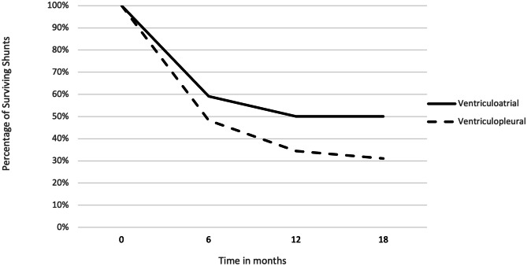
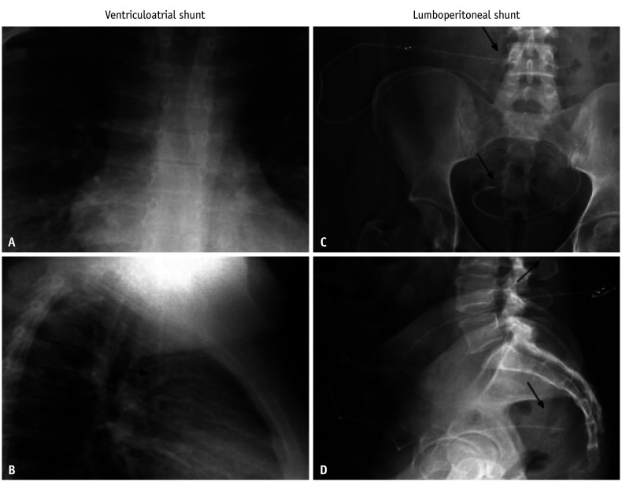
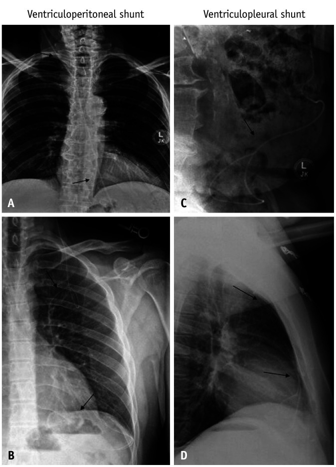
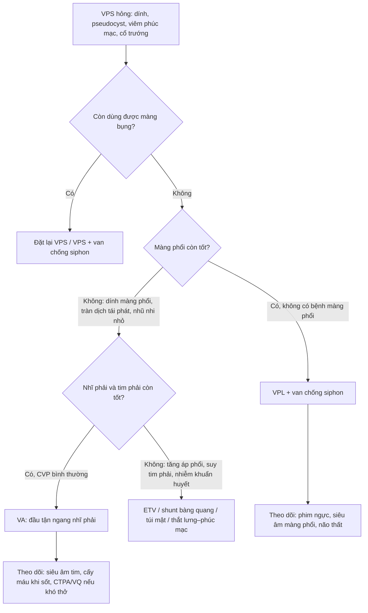
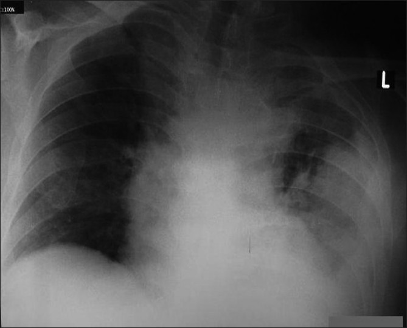
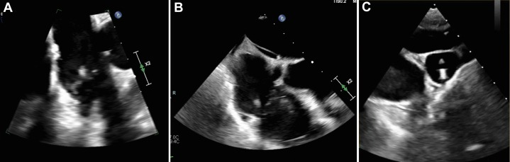
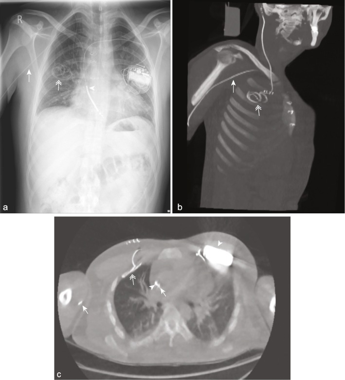

# 3002 — Shunt não thất–màng phổi & não thất–tĩnh mạch khi shunt ổ bụng thất bại / Ventriculopleural and ventriculoatrial shunts after peritoneal failure

**Tags:** `pattern:hong-thiet-bi` `pattern:tu-dich` `pattern:huyet-khoi` `pattern:nhiem-trung` `vung:shunt` `vung:mang-phoi` `vung:tim` `protocol:shunt-series` `protocol:ULD-CT` `protocol:sieut-am-tim` `anatomy:shunt-nao-that`
**Mức chắc chắn (certainty):** tổng hợp y văn (literature synthesis) — tổng quan hình ảnh shunt (Singh A et al., *Korean J Radiol* 2026, PMC13437215), tổng quan tràn dịch màng phổi sau shunt màng phổi kèm 5 ca (Küpeli E et al., *Ann Thorac Med* 2010, PMC2930656), nghiên cứu liều cực thấp cho shunt (Ryan DJ et al., *Eur Radiol Exp* 2021, PMC8236421), cộng các ca nguyên văn về huyết khối/viêm nội tâm mạc/tăng áp phổi. Số nào nguồn không nêu ghi **"chưa rõ"** — không bịa.

> Bài này bàn **hai đích thay thế** khi ổ bụng không còn dùng được: **shunt não thất–màng phổi (ventriculopleural shunt — VPL)** và **shunt não thất–tĩnh mạch (ventriculoatrial shunt — VA)**. Biến chứng muộn của shunt ổ bụng (gãy/ly giãn, pseudocyst, nhiễm trùng) ở [252](../252-bien-chung-muon-cua-shunt-nao-that/lesson.md); chấn thương đầu ở trẻ có shunt ở [251](../251-chan-thuong-dau-tre-shunt-va-roi-loan-dong-mau/lesson.md). Bài **không** bàn kỹ thuật mổ — chỉ đọc hình, chọn đường và nhận diện biến chứng.

## 1. Tổng quan bệnh học – cơ chế hình ảnh

- **Vì sao phải đổi đích:** shunt não thất–ổ bụng (ventriculoperitoneal shunt — VPS) là lựa chọn đầu tay nhưng **hỏng 30–40% trong năm đầu và khoảng 50% đến năm thứ hai** ở trẻ; **biến chứng ổ bụng gặp 5–47%** (Kim YH et al., *Korean J Neurotrauma* 2020, PMC7607039). Khi màng bụng "mất" — **dính sau viêm phúc mạc/mổ bụng, pseudocyst tái phát, cổ trướng, thẩm phân phúc mạc, suy dinh dưỡng/protein thấp** — phải chọn đích khác: **màng phổi (VPL)**, **nhĩ phải (VA)**, bàng quang, túi mật, hoặc **mở thông não thất III qua nội soi (ETV)**.
- **Ngưỡng định lượng quan trọng nhất — lượng dịch cần hấp thu:** sản xuất dịch não tủy ở người **khỏe mạnh ~0,33 mL/phút ≈ 475 mL/24 giờ**, nhưng ở **bệnh nhân não úng thủy 1,37–1,57 mL/phút ≈ 1.970–2.260 mL/24 giờ** (Olakorede I et al., *Brain Commun* 2025, PMC11822472). Đây là **con số quyết định**: màng phổi một bên không thể hấp thu 2 L/ngày như màng bụng, nên **VPL chỉ dung nạp được khi lưu lượng dịch não tủy đủ thấp hoặc có van chống siphon**. Con số giáo khoa "500 mL/ngày × 3–4 lần thay" bị tổng quan 2023 coi là **quan niệm cũ** (Yamada S, Mase M, *Neurol Med Chir* 2023, PMC10166604) — nên dùng như **bậc độ lớn**, không phải hằng số chính xác.
- **TẠI SAO VPL gây tràn dịch màng phổi:** dịch não tủy vào khoang màng phổi được hấp thu qua **lỗ bạch mạch của lá thành**. Hấp thu có **trần**; khi lưu lượng vào > trần hấp thu → dịch tích lại. Hai cơ chế được nêu: **(a) giảm khả năng hấp thu** do màng phổi đã tổn thương (viêm màng phổi cũ, phơi nhiễm dịch não tủy mạn) và **(b) dẫn lưu quá mức** (Küpeli E et al. 2010, PMC2930656).
- **Trần hấp thu của màng phổi — con số quyết định thứ hai (cửa 1 của Argon):** bình thường màng phổi **sinh dịch 0,01 mL/kg/giờ** (người 60 kg ≈ **15 mL/ngày**) và **dẫn lưu bạch mạch tối đa 0,28 mL/kg/giờ** — **gấp 28 lần** (ERJ Open Res 2024, PMC11440405). Nhưng thứ cần hấp thu là **DNT**: người lớn **600–750 mL/ngày** ≈ **0,42–0,52 mL/kg/giờ ở 60 kg**, tức **cùng bậc với trần 0,28** → **hệ số an toàn dưới 2 lần**, và **trần đó đo ở người lớn/động vật, chưa có giá trị chuẩn ở trẻ**. Với trẻ **10 kg**, nếu chỉ sinh **1/3** lượng DNT người lớn (≈ **8–10 mL/giờ**) thì trần **0,28 × 10 = 2,8 mL/giờ** vẫn **thấp hơn nhu cầu 3–4 lần** — đây là **ước tính minh họa (suy luận)**, không phải số đo, nhưng khớp với thực tế **trẻ nhỏ chịu kém hơn**.
- **TẠI SAO áp lực âm trong khoang màng phổi là con dao hai lưỡi:** ở **dung tích cặn chức năng (FRC)**, áp lực khoang màng phổi **âm** (cân bằng giữa lực đàn hồi co phổi và lực nở lồng ngực) — tổng quan sinh lý 2024 dùng đúng gradient này để giải thích **rò dưỡng–màng phổi**: *khoang dưới nhện dương áp → màng phổi âm áp → dịch não tủy chảy theo gradient* (ERJ Open Res 2024, PMC11440405). Với shunt, **ΔP = ICP − P_màng phổi**, nên **chênh áp qua shunt tăng thêm** khi bệnh nhân ngồi/đứng — dịch chảy nhanh hơn, dễ **dẫn lưu quá mức**. Vì vậy shunt màng phổi **nên có van chống siphon (anti-siphon device)**; trong loạt 52 trẻ dùng van chống siphon chỉ **1 ca phải mổ lại vì tràn dịch**, so với **20% phải sửa shunt vì tràn dịch có triệu chứng** ở loạt 59 ca không/không rõ van chống siphon (cả hai loạt dẫn trong *Ann Thorac Med* 2010, PMC2930656).
- **Loạt trẻ 2024 (Red Cross, Cape Town) — bằng chứng mới nhất, đọc đúng chiều:** **43 trẻ / 59 lần đặt** shunt ngoài phúc mạc (**25 VA, 32 VPL**); VPL tuổi trung vị **5,3** (0,5–13,4), đã qua trung vị **4,5 lần** mổ shunt trước đó; **mổ lại 65,5%** (VA 45,5%); **trung vị sống 5 tháng** (VA 13,5); sống **62,1 / 48,3 / 34,5 / 31,0%** ở **3 / 6 / 12 / 18 tháng**; hỏng do **tắc 26,3%, tràn dịch có triệu chứng 36,8%, nhiễm shunt 15,8%, di lệch đầu xa 15,8%, mủ màng phổi 5,3%**; **tràn dịch không triệu chứng 18,8%**, **có triệu chứng 15,6%** (đều phải mổ lại); **nhiễm shunt 15,6%** (VA **4%**); **tràn khí màng phổi 6,3%**; trung vị tới mổ lại **157 ngày**; **57,9%** ca mổ lại VPL **quay về VP** khi ổ phúc mạc hồi phục; trung tâm **chỉ đặt VPL cho trẻ > 4 tuổi**, nhóm Forte khuyến nghị **chọn VA thay VPL ở trẻ < 5 tuổi** (Childs Nerv Syst 2024, PMC10973063).

*Đường liền = shunt não thất–nhĩ (VA), đường đứt = shunt não thất–màng phổi (VPL); trục tung **% shunt còn sống**, trục hoành **tháng**. Hai đường tách rõ ở **6–12 tháng** (VA 59,1% → 50,0% so với VPL 48,3% → 34,5%); VPL còn **31,0% ở 18 tháng**. Đây là **loạt hồi cứu một trung tâm, cỡ mẫu nhỏ** — dùng để **tư vấn**, không phải để khẳng định VPL luôn kém hơn VA. Nguồn: Childs Nerv Syst 2024 (PMC10973063), CC BY 4.0.*
- **TẠI SAO VA sinh huyết khối:** dịch não tủy **làm thay đổi nội mạc** và mang **thromboplastin/serotonin** → huyết khối tại chỗ và tổn thương nội mạc lan; đầu catheter cử động trong **nhĩ phải** va vào thành và van ba lá (Kim YH et al. 2020, PMC7607039; Gościniak P et al., *Medicina* 2022, PMC8877788). Hệ quả theo thứ tự thời gian: **huyết khối đầu catheter → viêm nội tâm mạc nhiễm khuẩn (infective endocarditis — IE)/sùi van ba lá → thuyên tắc phổi tái diễn → tăng áp lực động mạch phổi huyết khối mạn (CTEPH)**.
- **TẠI SAO VA có thể "thông mà không chạy":** dịch não tủy phải chảy **ngược áp lực tĩnh mạch trung tâm (central venous pressure — CVP)**. Khi CVP tăng (suy tim phải, tăng áp phổi), **chênh áp bằng 0 hoặc âm** → shunt còn thông nhưng không dẫn lưu → **tăng áp lực nội sọ**. Ca nguyên văn: nữ 19 tuổi có VA, áp lực tĩnh mạch cảnh **12–13 mmHg**, sức cản đầu ra đo được **20 cmH₂O ≈ 15 mmHg**; van chỉnh nhiều lần vẫn không cải thiện, nitroglycerin hạ được áp lực nội sọ (dùng như nghiệm pháp chẩn đoán), acetazolamid giảm triệu chứng (Norager NH et al., *J Neurosurg Case Lessons* 2025, PMC12377171).
- **TẠI SAO nhiễm trùng VA nguy hiểm hơn nhiễm trùng VPS:** nhiễm khuẩn huyết từ đầu catheter **gieo liên tục vào tuần hoàn** → **sùi van ba lá, thuyên tắc phổi nhiễm khuẩn, phình mạch nhiễm khuẩn**, và **viêm cầu thận do shunt (shunt nephritis)** — bệnh phức hợp miễn dịch do nhiễm vi khuẩn độc lực thấp mạn tính. Ca nguyên văn: nam 31 tuổi có VA, nhiễm *S. aureus* nhạy methicillin, siêu âm tim qua thực quản thấy **sùi 11 mm trên van ba lá** + khối nhỏ ở đầu catheter tại **ngã ba tĩnh mạch chủ trên – nhĩ phải**; điều trị **rút shunt + 6 tuần oxacillin + rifampin** (Passey S et al., *JACC Case Rep* 2025, PMC11830242).
- **Tỷ lệ định lượng (để tư vấn, không để hù):** tràn dịch **có triệu chứng phải sửa shunt 20%** ở trẻ (Hoffman, 59 ca VPL; **một nửa là nhũ nhi**) và **4,5%** ở người lớn (Megison, 88 ca VPL); biến chứng chung của VPL ở người lớn **24%** (Megison, dẫn trong Küpeli E et al. 2010, PMC2930656): tụ dịch dưới màng cứng/máu tụ **5,6%**, tắc đầu gần **6,8%**, tràn dịch **4,5%**, di trú catheter **2,2%**, nhiễm trùng **2,2%**, tràn khí màng phổi **1,1%**, dính màng phổi không đặt được **1,2%**.
- **Với VA, con số gộp rất thấp:** **biến chứng huyết khối–tắc mạch < 1%** trong y văn tổng hợp (Kim YH et al., *Korean J Neurotrauma* 2020, PMC7607039).
- **Nhưng loạt nhỏ trẻ em gần đây cao hơn nhiều:** **25% (2/8) có biến chứng huyết khối** (Kendirlioglu BC et al., *North Clin Istanb* 2026, PMC13591038) — **khoảng tin cậy rất rộng**, phải nói rõ khi tư vấn.

## 2. Mẫu hình + chẩn đoán phân biệt theo vị trí (gamut)

**Câu hỏi thực hành:** đầu catheter **nằm ở đâu**, và bệnh nhân **đang thiếu dẫn lưu hay đang bị dẫn lưu quá mức**? Hai trục này tạo gamut.

**Trục A — VPL (đầu xa trong khoang màng phổi)**

1. **Tràn dịch/tràn khí–dịch do shunt (CSF hydrothorax):** dịch **trong suốt, transudate**, thường bên đặt catheter; **nhỏ và không triệu chứng = dấu shunt đang chạy**, không phải hỏng (Küpeli E et al. 2010).
2. **Tràn dịch có triệu chứng/tăng áp lực khoang màng phổi (tension hydrothorax):** khó thở, giảm oxy máu, lệch trung thất — cấp cứu.
3. **Tràn khí màng phổi** (thủ thuật, catheter xuyên màng phổi tạng).
4. **Rò shunt–phế quản (shunt-bronchial fistula):** catheter ăn mòn vào nhu mô phổi → **ho ra dịch não tủy rồi nuốt vào dạ dày**, viêm phổi tái diễn; nghiệm pháp hạt nhân cho thấy hoạt độ đi **màng phổi → khí quản → phế quản → dạ dày → ruột** (Katsevman GA et al., *World Neurosurg X* 2020, PMC6909168).
5. **Nhiễm trùng khoang màng phổi/viêm màng phổi do shunt:** dịch **đục, neutrophilic**, có thể tái phát dù đã điều trị (Abdalla AA et al., *Cureus* 2021, PMC7954663 — *Cutibacterium acnes*).
6. **Dẫn lưu quá mức → hội chứng nắp sọ lún (sinking skin flap):** rút dịch màng phổi bằng ống dẫn lưu có hút → **áp lực âm tăng thêm** → nắp sọ lún; ca nguyên văn: lún sau đặt ống 2 ngày, **ngừng hút + tăng áp lực van → nắp sọ phồng lại trong 24 giờ** (Liang SQ et al., *J Med Case Rep* 2024, PMC11669209).

**Trục B — VA (đầu xa trong nhĩ phải/tĩnh mạch lớn)**

1. **Huyết khối nhĩ/tĩnh mạch quanh catheter:** khối không ngấm thuốc trong lòng nhĩ, có thể **canxi hóa ống catheter** sau nhiều năm.
2. **Viêm nội tâm mạc nhiễm khuẩn:** sùi trên van ba lá/đầu catheter, cấy máu dương tính, **sốt + thổi tâm thu mới**.
3. **Viêm cầu thận do shunt:** suy thận, protein niệu, hồng cầu niệu sau nhiều năm nhiễm khuẩn độc lực thấp.
4. **CTEPH/tăng áp phổi:** khó thở tiến triển **nhiều năm sau đặt shunt**, thường **không có triệu chứng nhiễm trùng** (Gościniak P et al. 2022).
5. **VA "thông nhưng không dẫn lưu" do CVP cao:** đau đầu/tăng áp lực nội sọ, van đã chỉnh nhiều lần.
6. **Di trú đầu xa:** vào **xoang vành (coronary sinus)**, động mạch phổi, hoặc tĩnh mạch chủ trên gây hội chứng tắc tĩnh mạch chủ trên.
7. **Loạn nhịp/perforation** do đầu catheter cử động trong nhĩ.

*X-quang ngực: (A) thẳng và (B) nghiêng — catheter shunt não thất–**tĩnh mạch** đi dọc cổ vào tĩnh mạch cảnh trong, **đầu tận dừng ngang mức nhĩ phải** (mũi tên). (C, D) là shunt thắt lưng–phúc mạc để so sánh đường đi. **Đọc sai vị trí đầu tận** (vào xoang vành/thất phải) là nguyên nhân hỏng shunt và loạn nhịp. Nguồn: Singh A et al., Korean J Radiol 2026, PMC13437215 Fig. 3, CC BY-NC 4.0.*

**Trục C — đích khác (biết để loại trừ):** shunt não thất–bàng quang (nhiễm trùng, sỏi quanh catheter), shunt–túi mật (viêm đường mật), shunt thắt lưng–phúc mạc (tụ dịch, tắc).

## 3. Bảng so sánh phân biệt (ma trận đối chiếu)

| Thực thể (entity) | Hình ảnh điển hình | Chốt vào (rule-in) | Chốt loại (rule-out) | Gợi ý xác nhận |
|---|---|---|---|---|
| **VPL — tràn dịch do shunt, không biến chứng** | Dịch **lượng ít–vừa**, một bên, **không triệu chứng**; đầu catheter nằm trong khoang màng phổi; **CT/phim so với phim cũ không đổi** | **Đầu catheter trong khoang màng phổi + dịch nhỏ, bệnh nhân không khó thở** | Dịch tăng nhanh, đục, sốt → nhiễm trùng; dịch hai bên → nguyên nhân khác | So phim cũ; siêu âm màng phổi; **không chọc dò nếu không triệu chứng** |
| **VPL — tràn dịch có triệu chứng/tăng áp lực** | Dịch **nhiều**, đẩy lệch trung thất, xẹp phổi; khó thở, giảm oxy | **Khó thở + dịch nhiều + cải thiện sau rút dịch** | Dịch nhỏ, không triệu chứng → không can thiệp | Siêu âm; chọc hút **số lượng vừa phải**, theo dõi nắp sọ |
| **VPL — nhiễm trùng khoang màng phổi** | Dịch **đục, vách hóa**, có thể tràn khí; sốt, tăng bạch cầu | **Cấy dịch/DNT cùng loại vi khuẩn + dịch neutrophilic** | Dịch trong, transudate, không sốt → không nhiễm | Cấy máu + cấy dịch; **rút shunt là bắt buộc** khi nhiễm |
| **VPL — dẫn lưu quá mức** | **Nắp sọ lún**, não thất khe; đau đầu tư thế; sau khi rút dịch màng phổi | **Nắp sọ lún + thời điểm ngay sau chọc/rút dịch** | Nắp sọ lún do mất dịch não tủy nơi khác/rò → tìm rò | Ngừng hút, **tăng áp lực van**, chụp CT sọ |
| **VA — huyết khối quanh catheter** | Khối **không ngấm thuốc** trong nhĩ phải, bao quanh catheter; có thể canxi hóa ống | **Khuyết thuốc ôm catheter trong nhĩ** | Sùi di động + cấy máu (+) → IE, không chỉ huyết khối | Siêu âm tim (TTE → TEE), CT tĩnh mạch |
| **VA — viêm nội tâm mạc nhiễm khuẩn** | **Sùi di động trên van ba lá/đầu catheter** (ca: 11 mm), thổi tâm thu, sốt | **Sùi + cấy máu (+) cùng vi khuẩn** | Cấy máu âm nhiều lần + không sùi → huyết khối vô khuẩn | **TEE** (nhạy hơn TTE), cấy máu 3 lần trước kháng sinh |
| **VA — "thông nhưng không dẫn lưu" do CVP cao** | Shunt **không tắc** trên hình, não thất vẫn giãn; **CVP/JVP cao**; sức cản đầu ra tăng | **Đo CVP/JVP cao + chênh áp đầu ra thấp** | Shunt tắc thật (không thấy thuốc qua) → sửa shunt | Đo CVP trước mổ; nghiệm pháp nitroglycerin; siêu âm tim |
| **VA — CTEPH** | **Thiếu máu phổi dạng mảng/đoạn** trên CTPA, giãn thất phải; V/Q scan khuyết tưới; mPAP tăng | **Khuyết tưới V/Q + CTPA có huyết khối tổ chức hóa + mPAP > 20 mmHg** | CTPA bình thường + V/Q bình thường → loại CTEPH | V/Q scan, CTPA, thông tim phải |

*Bốn panel X-quang ngực/bụng: (A, B) shunt não thất–ổ bụng — mũi tên chỉ catheter xa đi từ ngực xuống ổ bụng, đầu tận trong phúc mạc; (C, D) shunt não thất–**màng phổi** — mũi tên chỉ catheter đi dọc cổ–ngực, **đầu tận nằm trong khoang màng phổi** (D là tư thế nghiêng). Đọc VPL khác VPS ở chỗ **không có đoạn catheter trong ổ bụng** và đầu tận dừng trên cơ hoành. Nguồn: Singh A et al., Korean J Radiol 2026, PMC13437215 Fig. 2, CC BY-NC 4.0.*

### Ba câu hỏi cố định khi đọc phim shunt có đích "lạ"
1. **Đích có đúng không?** — VPL: đầu tận **trong khoang màng phổi, trên cơ hoành**; VA: đầu tận **ngang nhĩ phải, không vào xoang vành/thất phải**.
2. **Đích có đang bị "quá tải" không?** — VPL: **dịch màng phổi**; VA: **huyết khối/sùi/tăng áp phổi**.
3. **Còn dẫn lưu được không?** — não thất có giãn lại so phim cũ? van có đổi cài đặt? Đừng chỉ nhìn catheter "còn nguyên".

## 4. Protocol chụp + hệ phân độ/điểm chuẩn hóa

- **Bước 1 — phim shunt series (skull + ngực + bụng, 2 tư thế khi cần):** xác định **đường đi, mối nối, đầu tận**; là phương thức tốt nhất cho **gãy catheter** (Singh A et al. 2026). Nhược điểm: **không thấy dịch, không thấy huyết khối, không thấy sùi**.
- **Bước 2 — CT liều cực thấp toàn thân (ultralow-dose CT — ULD-CT) khi nghi hỏng shunt:** liều hiệu dụng **0,16 mSv (0,07–0,17) so với 0,25 mSv (0,06–1,69) của shunt series** (p = 0,002), **thấy toàn bộ đường đi và mô quanh catheter tốt hơn**, đặc biệt lồng ngực–bụng (Ryan DJ et al. 2021, PMC8236421). Đây là lựa chọn thay thế **giảm 36% liều** mà tăng thông tin — nhưng **không thay thế** đánh giá lâm sàng.
- **Bước 3 — siêu âm màng phổi (VPL):** xác nhận **dịch, thể tích, vách, vị trí đầu catheter**, hướng dẫn chọc hút. **Luôn đo lại sau chọc** và theo dõi dấu hiệu nắp sọ lún.
- **Bước 4 — siêu âm tim/TEE (VA):** tìm **sùi, huyết khối, hở van ba lá, áp lực động mạch phổi**. TTE trước, **TEE khi nghi IE hoặc TTE không kết luận** (ca sùi 11 mm chỉ thấy rõ trên TEE — Passey S et al. 2025).
- **Bước 5 — xét nghiệm "không thể thiếu" trước khi kết luận nhiễm:** **cấy máu 2–3 lần trước kháng sinh** + **cấy dịch não tủy qua van**; với VPL thêm **cấy dịch màng phổi**. Nhiễm trùng shunt **8–12%**, phần lớn trong **6 tháng đầu** (Küpeli E et al. 2010).
- **Bước 6 — hình ảnh chức năng khi còn nghi ngờ:** **shuntogram hạt nhân** (thấy thuốc đi qua đường shunt; ca rò phế quản thấy thuốc vào khí quản–dạ dày — Katsevman GA et al. 2020); **CT tĩnh mạch/CTPA** khi nghi tắc tĩnh mạch chủ trên hoặc CTEPH; **V/Q scan** khi nghi CTEPH.
- **Bước 7 — đo áp lực trước khi chọn VA:** đo **CVP/JVP** và đánh giá chức năng tim phải; **thông tim phải** nếu nghi tăng áp phổi. Ngưỡng tham chiếu từ ca nguyên văn: **JVP 12–13 mmHg** đủ để làm shunt ngừng dẫn lưu dù van mở (Norager NH et al. 2025).

**Sơ đồ chọn đích khi VPS thất bại**

**Ngưỡng xử trí tràn dịch sau VPL (lấy từ loạt 32 VPL ở trẻ)** — dùng để quyết định, thay vì "thấy dịch là chọc":
- **Không triệu chứng, lượng ít** → **theo dõi, không can thiệp**: **6/32 (18,8%)** tràn dịch không triệu chứng **không cần can thiệp gì**.
- **Có triệu chứng** (khó thở, giảm SpO₂, đẩy trung thất) → **chọc hút/dẫn lưu KHÔNG hút + nâng áp lực van**; **5/32 (15,6%)** thuộc nhóm này và **đều phải mổ lại**.
- **Tái diễn hoặc không cải thiện sau 1–2 lần dẫn lưu** → **bỏ VPL**: **57,9%** quay về **VP** khi ổ phúc mạc hồi phục; còn lại chuyển **VA** hoặc **ETV**. Trung vị tới mổ lại **157 ngày** (nhóm chuyển hẳn sang VP) và **16 ngày** (nhóm còn phải dùng shunt ngoài phúc mạc) — **biến chứng không chỉ xảy ra sớm** (Childs Nerv Syst 2024, PMC10973063).
- **Quy tắc an toàn tuyệt đối:** nếu đã đặt ống dẫn lưu ngực ở bệnh nhân VPL → **KHÔNG hút**; ca gốc cho thấy hút ống ngực gây **tụt vạt da trong 2 ngày**, và **ngừng hút + nâng áp lực van → vạt da nở lại trong 24 giờ** (Liang SQ et al. 2024, PMC11669209).

**Phân tầng biến chứng (dùng Clavien–Dindo cho can thiệp, không phải "độ nặng shunt"):** tràn dịch nhỏ không triệu chứng = **không can thiệp**; tràn dịch có triệu chứng = **chọc hút** (grade I–II); nhiễm trùng/viêm màng phổi hoặc sùi van = **rút shunt + kháng sinh** (grade III); tăng áp lực khoang màng phổi/sốc nhiễm khuẩn = **cấp cứu** (grade IV–V). Không có hệ phân độ riêng cho VPL/VA trong y văn đã đọc — **ghi "chưa rõ"** thay vì bịa thang điểm.

## 5. Biến thể bình thường và cạm bẫy

- **"Tràn dịch nhỏ = shunt đang chạy", không phải shunt hỏng.** Tổng quan *Ann Thorac Med* 2010 nhấn mạnh: dịch ít, không triệu chứng thường **tự hết**; chọc hút chỉ vì "thấy dịch trên phim" là **can thiệp oan** và có thể gây nắp sọ lún. Loạt trẻ 2024 định lượng đúng nhóm này: **18,8%** tràn dịch **không triệu chứng**, không cần can thiệp, so với **15,6% có triệu chứng** (Childs Nerv Syst 2024, PMC10973063).
- **Chọc/rút dịch màng phổi ở bệnh nhân VPL có thể gây nắp sọ lún trong 24 giờ** — nếu phải rút: **không hút áp lực âm mạnh, rút chậm, tăng áp lực van, theo dõi thần kinh** (Liang SQ et al. 2024).
- **VA còn "thông" trên hình không loại trừ hỏng chức năng:** CVP cao làm **mất chênh áp**; phải đo áp lực, không chỉ nhìn catheter.
- **Catheter VA cũ để lại có thể canxi hóa và gây IE sau 30 năm** — ca nam 41 tuổi, catheter VA đặt từ năm 12 tuổi, còn sót đoạn trong nhĩ, nhập viện với **viêm nội tâm mạc do enterococcus + hở ba lá**, phải **mở xương ức + tuần hoàn ngoài cơ thể** để lấy (Gopal VV et al., *Asian J Neurosurg* 2016, PMC4802946). Bài học: **không để lại đoạn catheter "vô hại"**.
- **Đầu catheter VA vào xoang vành** (coronary sinus) có thể trông "đúng vị trí" trên phim ngực nhưng **không dẫn lưu đúng**; cần phim nghiêng/CT hoặc siêu âm tim để xác định.
- **Đừng nhầm "dịch màng phổi" với "dịch dưới màng cứng"**: tụ dịch dưới màng cứng sau đặt shunt gặp **~5,6%** ở loạt VPL người lớn (Megison) — đọc CT sọ, không chỉ ngực.
- **Bẫy "satisfaction of search":** thấy sùi van ba lá rồi dừng — phải tìm thêm **huyết khối tĩnh mạch, ổ nhiễm trùng ngoài tim, và nhiễm trùng shunt** (cấy DNT).
- **Đừng mặc định "dịch màng phổi = nhiễm trùng":** trong loạt VPL ở trẻ, **mủ màng phổi chỉ 3,1%** trong khi **tràn dịch do DNT 15,6%**; nhưng **nhiễm shunt 15,6%** có thể biểu hiện **chỉ bằng dịch mới + đau đầu**, không sốt rõ → **cấy DNT + cấy dịch màng phổi trước khi kết luận** (Childs Nerv Syst 2024, PMC10973063).
- **Đừng quên trần hấp thu khi tư vấn:** VPL là hệ thống **"chạy sát trần"** (trần bạch mạch **0,28 mL/kg/giờ** so với DNT **600–750 mL/ngày** ở người lớn); ở trẻ **< 4–5 tuổi** hoặc có **bệnh phổi/dính màng phổi**, tỷ lệ thất bại cao đến mức nhiều trung tâm **chọn VA trước** (Childs Nerv Syst 2024, PMC10973063).

## 6. Tự lượng giá — Blind Quiz

**Ca 1 — Nam 75 tuổi, đặt VPL sau khi VPS nhiễm trùng; 20 ngày sau khó thở, không sốt.**

- Gợi ý lâm sàng: khó thở tiến triển, không sốt, đã có shunt màng phổi.
- Câu hỏi: Dịch nằm bên nào? Có bằng chứng nhiễm không? Ba chẩn đoán phân biệt và bước xử trí đầu tiên?

<b>Bấm để hiện đáp án (findings + chẩn đoán)</b>

- Dấu hiệu: **tràn dịch màng phổi trái lượng lớn**, mờ đáy phổi trái, không thấy mức khí–dịch; đầu catheter màng phổi bên phải vẫn tại chỗ.
- Chẩn đoán: **tràn dịch do shunt màng phổi** (CSF hydrothorax) có triệu chứng. Dịch là **exudate tế bào lympho**, cấy âm; bệnh nhân đáp ứng sau **2 lần chọc hút**, không tái phát sau 1 năm.
- Phân biệt: nhiễm trùng/viêm màng phổi (sốt, dịch đục, neutrophilic), suy tim (dịch hai bên, BNP cao), tắc shunt (não thất giãn).
- Nguồn: Küpeli E et al., Ann Thorac Med 2010, PMC2930656 Fig. 2, CC BY 4.0 (trường hợp 2).

**Ca 2 — Nam 31 tuổi có VA, sốt dai dẳng dù đã dùng oxacillin; cấy máu *S. aureus* nhạy methicillin.**

- Gợi ý lâm sàng: shunt tĩnh mạch, nhiễm khuẩn huyết tái phát.
- Câu hỏi: Cấu trúc bất thường nằm ở van nào, kích thước bao nhiêu? Vì sao **phải rút shunt**? Kháng sinh bao lâu?

<b>Bấm để hiện đáp án</b>

- Dấu hiệu: **sùi 11 mm di động trên van ba lá** (A, B) và **khối nhỏ ở đầu catheter tại ngã ba tĩnh mạch chủ trên – nhĩ phải** (C).
- Chẩn đoán: **viêm nội tâm mạc nhiễm khuẩn do shunt não thất–tĩnh mạch**. Điều trị: **rút shunt + oxacillin + rifampin 6 tuần**; không thể chữa khỏi nếu để dị vật.
- Vì sao: đầu catheter là **dị vật tiếp xúc trực tiếp với tuần hoàn** → sùi hình thành trên van và catheter, kháng sinh đơn thuần không diệt được màng sinh học.
- Nguồn: Passey S et al., JACC Case Rep 2025, PMC11830242 Fig. 1, CC BY-NC-ND 4.0 (dùng nguyên bản).

**Ca 3 — Bệnh nhân có VPL mới đặt, cần xác định đầu catheter nằm ở đâu trước khi rút ống dẫn lưu màng phổi.**

- Gợi ý lâm sàng: sau đặt VPL, có ống dẫn lưu màng phổi, cần chứng minh vị trí đầu catheter.
- Câu hỏi: Phim ngực (a) có đủ để khẳng định đầu catheter **trong khoang màng phổi** không? CT (b, c) thêm được thông tin gì? Liều CT này so với shunt series?

<b>Bấm để hiện đáp án</b>

- Dấu hiệu: phim ngực chỉ thấy **đầu catheter dạng mũi tên đôi ở vùng giữa phổi phải**, không phân biệt được với nhu mô/mao mạch; **CT liều cực thấp đa bình diện** thấy rõ catheter chạy trong **khoang màng phổi** và đầu tận **nằm trên thùy trên phổi phải**, không có tràn khí.
- Ý nghĩa: ULD-CT **0,16 mSv** so với **0,25 mSv** của shunt series, và **nhìn được toàn bộ đường đi** (Ryan DJ et al. 2021).
- Cạm bẫy: kết luận "đầu catheter trong phổi" trên phim ngực là **không đủ** — cần CT hoặc siêu âm.
- Nguồn: Ryan DJ et al., Eur Radiol Exp 2021, PMC8236421 Fig. 5, CC BY 4.0.

## Bài liên quan chéo
- [252 – Biến chứng muộn của shunt não thất](../252-bien-chung-muon-cua-shunt-nao-that/lesson.md)
- [251 – Chấn thương đầu ở trẻ có shunt hoặc rối loạn đông máu](../251-chan-thuong-dau-tre-shunt-va-roi-loan-dong-mau/lesson.md)
- [093 – Hội chứng tĩnh mạch chủ trên](../093-hoi-chung-tinh-mach-chu-tren/lesson.md) (VA lâu năm → hẹp/tắc tĩnh mạch chủ trên)
- [3043 – Hẹp–tắc tĩnh mạch chủ trên lành tính ở trẻ sau catheter trung tâm](../3043-hep-tinh-mach-chu-tren-tre/lesson.md) (đánh giá SVC **trước** khi đặt VA)
- [070 – Thuyên tắc phổi & bệnh tim–phổi cấp](../070-thuyen-tac-phoi-dmc-cap/lesson.md) (CTEPH sau VA)
- [200 – Tổng quan hệ Thần kinh](../200-tong-quan-he-than-kinh/lesson.md)

## Ảnh
- Ảnh lấy từ bài **mở** qua PMC ngày 2026-10-27; giấy phép từng file trong `images/CREDITS.md`.
- Không có `composite_*.jpg`: 3 trong 5 ảnh là **CC BY-NC-ND** (cấm tạo tác phẩm phái sinh) nên không ghép; ảnh CC BY dùng **nguyên bản** để thống nhất cách trình bày.
- Radiopaedia/AuntMinnie: **chỉ dẫn link**, không tải.

> Không dùng để chẩn đoán độc lập khi chưa có người hướng dẫn.
