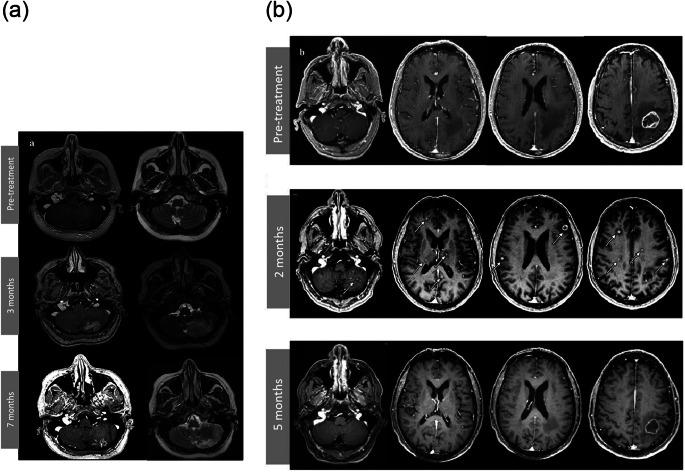
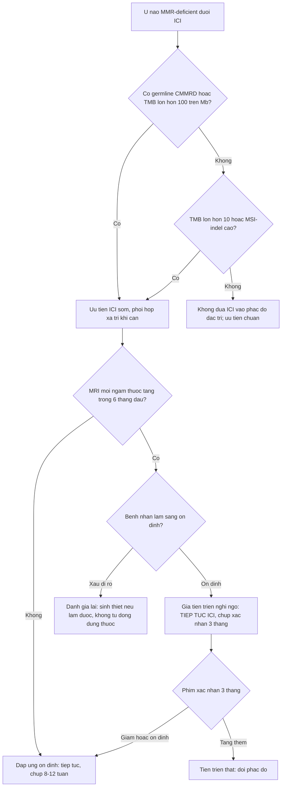
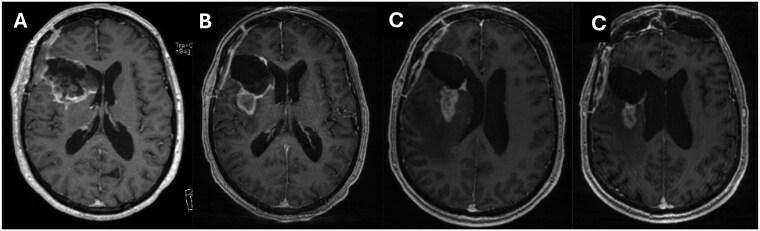

# 3003 — Ức chế điểm kiểm soát miễn dịch ở u não CMMRD/MMR-deficient: chọn bệnh nhân, phác đồ, độc tính & cách đọc đáp ứng trên MRI

**Tags:** `pattern:u-nao` `pattern:gia-tien-trien` `pattern:dap-ung-muon` `vung:nao` `score:iRANO` `score:RANO-2.0` `protocol:MRI-nao-doi-quang` `protocol:ICI`
**Mức chắc chắn (certainty):** tổng hợp y văn (literature synthesis) — ghép ba tầng nguồn: (a) tổng quan quản lý CMMRD của hai consortium IRRDC/C4CMMRD, *Fam Cancer* 2026 (PMC13303765, CC BY 4.0); (b) hệ thống 40 nghiên cứu ICI ở u não nhi, *J Neurooncol* 2026 (PMC13179885, CC BY 4.0); (c) dữ liệu bộ gen CMMRD-HGG, *iScience* 2026 (PMC12964222, CC BY 4.0) + hai nghiên cứu giả tiến triển đối chọi nhau (PMC12263762, PMC12850524, CC BY 4.0). Không có ca nguyên văn riêng của nhóm; mọi số liệu giữ nguyên từ bài gốc.

> **Bài này trả lời câu hỏi thực hành của bác sĩ CĐHA:** *khi một trẻ CMMRD được truyền nivolumab/pembrolizumab, ai thực sự đáp ứng, và tại sao "u to lên" trên MRI tháng thứ 2 KHÔNG đồng nghĩa thất bại?*
> Bài nền về bệnh học và lịch tầm soát là [690 – CMMRD](../690-cmmrd-tam-soat-wb-mri-o-tre/lesson.md); bài này **không lặp lại** phần tầm soát, chỉ phủ phần **điều trị miễn dịch + đọc đáp ứng**.

## 1. Tổng quan — vì sao u CMMRD "nóng" với ICI, và vì sao MRI không nhìn thấy đáp ứng

- **Bệnh học:** CMMRD do **đột biến lưỡng alen (biallelic) gen sửa chữa lệch (mismatch repair — MLH1/MSH2/MSH6/PMS2)** → sai sót lặp vi vệ tinh không được sửa → **hypermutation**. U não là ung thư hay gặp nhất và là nguyên nhân tử vong chính; **ung thư mới trung bình mỗi ~2 năm** (PMC13303765).
- **Ngưỡng định lượng quyết định "ai đáp ứng" — gánh nặng đột biến (tumour mutational burden, TMB):**
  - Trong **25 u thần kinh đệm bậc cao CMMRD**, TMB trung bình **159,1 ± 170,2 đột biến/Mb**; **94,4%** đạt ngưỡng hypermutation (**> 10/Mb**) và **17/18 (94,4%)** đạt **ultra-hypermutation (> 100/Mb)**; u có thêm đột biến **POLD1** somatic còn cao hơn (**310,6 ± 157,0/Mb**) (PMC12964222).
  - Ngưỡng tuyển bệnh nhân của thử nghiệm nhi khoa là **MMR-deficiency và/hoặc TMB ≥ 5 đột biến/Mb** (NCT02992964, dẫn trong PMC13303765).
  - So sánh: u não nhi **không chọn biomarker** có TMB thấp, tế bào lympho xâm nhập ít ("cold") → **ORR ≤ 6%**, **PFS 1–3 tháng** (PMC13179885).
- **TẠI SAO đáp ứng không thấy được bằng hình thái:** TMB cao → nhiều **neoantigen** → lympho T xâm nhập u → viêm tại chỗ. Trên MRI, **ngấm thuốc chỉ phản ánh hàng rào máu–não (BBB) bị phá vỡ**, còn **T2/FLAIR phản ánh nước (phù)** — *không phải* mật độ tế bào u. Vì vậy **cả đáp ứng lẫn giả tiến triển đều có thể làm ngấm thuốc tăng**: viêm do lympho + phù quanh u trông giống hệt u tiến triển. Đó là lý do phải dùng **tiêu chuẩn đáp ứng miễn dịch (iRANO)**, không dùng RECIST/RANO thuần.
- **Cơ chế giả tiến triển (pseudoprogression, PsP) sau ICI:** thâm nhiễm lympho T + phù do cytokine làm tăng thể tích biểu kiến **rồi tự thoái triển** khi viêm lắng; **không có tăng sinh tế bào u**. Khác PsP sau hóa–xạ: sau hóa–xạ là **tổn thương mạch/hoại tử**, sau ICI là **viêm miễn dịch** (PMC13589733).
- **Ngưỡng thời gian nằm lòng:** cửa sổ PsP sau ICI là **trong 6 tháng đầu** (hiếm khi muộn hơn); **đáp ứng có thể xuất hiện MUỘN** — trong thử nghiệm hypermutant nhi, **ORR ban đầu 20% nhưng đáp ứng tốt nhất sau điều trị (iBOR) 50%**, tức một nửa đáp ứng chỉ hiện ra sau khi đã "tiến triển" trên phim (PMC13179885).

## 2. Mẫu hình + chẩn đoán phân biệt theo bậc thang sinh học (Gamut)

**Câu hỏi lọc:** *"U này có thiếu hụt sửa chữa lệch/hypermutation thật không — và đang ở dòng điều trị thứ mấy?"* — sinh học quyết định đáp ứng, **không phải mô học**.

- **Bậc 1 — CMMRD (MMR lưỡng alen, germline):** đáp ứng cao nhất. Registry IRRDC (38 bệnh nhân, **31 u CNS**): nivolumab hoặc pembrolizumab cho **ORR 64% ở u CNS**, **100% ở u đặc ngoài CNS**, **0% ở u huyết học**; sống còn ở nhóm CNS tái phát/tiến triển **39,3% (KTC 95%: 36,3–42,3)**; **TMB cao và MSI là yếu tố tiên đoán độc lập** (PMC13303765).
- **Bậc 2 — thiếu hụt replication-repair khác (POLE/POLD1) và u siêu đột biến:** thử nghiệm hypermutant nhi (nivolumab 3 mg/kg mỗi 2 tuần): **iBOR 50%**, **sống còn toàn bộ 2 năm ~50%**, đáp ứng tập trung ở **ultra-hypermutant/MSI-indel cao** (PMC13179885).
- **Bậc 3 — "MSI-H" đơn thuần ở u não nhi:** **KEYNOTE-051** (n = 7; 6 u CNS): **ORR 0%** (KTC 95%: 0–41), **DCR 14%**, **PFS 1,7 tháng**, **OS 7,7 tháng** — nhưng **1 ca GBM đạt đáp ứng hoàn toàn muộn sau tiến triển ban đầu**, duy trì đến chu kỳ 20 (PMC13179885). Bài học: nhãn "MSI-H" **không** bảo đảm hành vi như ung thư đại tràng người lớn.
- **Bậc 4 — không chọn biomarker:** u thần kinh đệm cầu não lan tỏa (DIPG), HGG tái phát, medulloblastoma, ependymoma: **PFS 1,4–1,7 tháng**, không khác chứng lịch sử; độc tính **grade ≥ 3: 14,1% (nivolumab) vs 27,2% (nivolumab + ipilimumab)** (CheckMate-908, dẫn trong PMC13179885).
- **Mnemonic 4 câu hỏi:** **T**MB (≥ 5 → > 10 → > 100/Mb) · **M**SI/indel signature · **G**ermline (CMMRD/Lynch?) · **T**iming (dòng điều trị sớm hay đã thất bại nhiều dòng).

## 3. Bảng so sánh phân biệt (ma trận đối chiếu)

| Thực thể (entity) | Hình ảnh / bối cảnh điển hình | Chốt vào (rule-in) | Chốt loại (rule-out) | Gợi ý xác nhận |
|---|---|---|---|---|
| **CMMRD-HGG đáp ứng ICI** | U não trẻ, nhiều ổ hoặc tái phát sớm; trên MRI **ngấm thuốc tăng rồi giảm**, có thể **xuất hiện tổn thương mới thoáng qua** | **Germline MMR lưỡng alen + TMB > 100/Mb + tổn thương mới/ngấm tăng trong 6 tháng đầu rồi thoái triển KHÔNG đổi điều trị** | **Tăng liên tục ≥ 3 tháng kèm suy lâm sàng** → tiến triển thật | iRANO: chụp xác nhận **≥ 3 tháng** sau lần "tiến triển" đầu |
| **Hypermutant/POLE-POLD1 (không CMMRD)** | Khối đơn ổ, trẻ lớn/người trẻ; TMB cao nhưng không có bệnh cảnh đa polyp/café-au-lait | **TMB > 10/Mb + signature POLE/POLD1 + đáp ứng muộn (iBOR > ORR ban đầu)** | TMB thấp + không xâm nhập lympho → không chỉ định | NGS tumor–normal (TMB, MSI, signature) |
| **GBM người lớn không chọn biomarker** | Khối hoại tử trung tâm, ngấm vòng; **PsP sau hóa–xạ trong 12 tuần đầu** | **PsP sau hóa–xạ: ngấm tăng ≤ 12 tuần rồi giảm, không đổi điều trị** | **PsP do ICI đơn thuần: rất hiếm** — 55 bệnh nhân GBM, **0 ca** PsP do ICI đơn trị (PMC12850524) | DSC-MRI: rCBV **tăng** → tiến triển; **thấp** → hoại tử/xạ |
| **U não nhi "MSI-H" nhưng không hypermutant** | Tổn thương đơn ổ, không đặc hiệu | **MSI-H + TMB thấp + không có germline MMRD** | **ORR 0%, PFS 1,7 tháng → không hứa hẹn với gia đình** | Đối chiếu TMB tuyệt đối, không chỉ nhãn MSI |
| **U huyết học CNS (lymphoma thứ phát)** | Ngấm đồng nhất quanh não thất, hạn chế khuếch tán | **Xác định bằng mô bệnh + dòng tế bào** | **0% đáp ứng ICI trong registry CMMRD** → ưu tiên hóa trị như lymphoma thường | Sinh thiết/mô bệnh, immunophenotype |

*(a) Tổn thương di căn tiểu não trái: T1 sau tiêm + T2 **trước điều trị**, sau **3 tháng ICI** (ngấm thuốc và phù TĂNG), sau **7 tháng** (tự cải thiện, không đổi phác đồ). (b) Tổn thương di căn đỉnh trái: **trước điều trị**, sau **2 tháng** (nhiều ổ mới rải rác — mũi tên trắng), sau **5 tháng** (các ổ mới BIẾN MẤT). Nguồn: *J Neurooncol* 2025 (PMC12263762), CC BY 4.0; ảnh nguyên bản, không crop.*

## 4. Protocol chụp + hệ đáp ứng iRANO/RANO 2.0

### 4.1 Protocol MRI theo dõi ICI ở u não

| Thời điểm | Chuỗi xung bắt buộc | Ngưỡng / lý do |
|---|---|---|
| Trước liều đầu (baseline) | T1 sau tiêm **1 mm** 3D, T2/FLAIR, DWI/ADC, DSC (nếu có) | Baseline **trong 1–2 tuần** trước liều 1; không dùng phim sau mổ còn máu tụ làm mốc |
| Mỗi **8–12 tuần** | Như trên + **cùng liều thuốc cản quang, cùng máy, cùng mặt phẳng** | So sánh thể tích, không so đường kính đơn thuần |
| Khi nghi "tiến triển" < 6 tháng | Lặp lại **≥ 3 tháng** sau (hoặc sớm hơn nếu lâm sàng xấu) | Đây chính là **định nghĩa thực hành của iRANO** |
| Sau 6 tháng | RANO 2.0 thường quy | PsP muộn rất hiếm; tiến triển thật phải xử trí như u |

### 4.2 Bậc thang quyết định (Mermaid)

### 4.3 Liều & an toàn (số liệu từ thử nghiệm nhi)

- **Nivolumab 3 mg/kg TM mỗi 2 tuần** (liều khuyến cáo pha 2 ở trẻ, không có DLT khi xác nhận liều) — dẫn trong PMC13179885.
- **Pembrolizumab 2 mg/kg (tối đa 200 mg) mỗi 3 tuần**, tối đa 35 chu kỳ (KEYNOTE-051) — dẫn trong PMC13179885.
- **Độc tính:** grade ≥ 3 **14,1%** (nivolumab đơn trị) và **27,2%** (phối hợp ipilimumab); **không có tử vong do điều trị** trong các cohort nhi (PMC13179885). Thực hành thực tế: **irAE 44%**, grade ≥ 3 **~20%**, **irAE liên quan tới PFS/OS tốt hơn** (aHR 0,35 và 0,33) — tức irAE **không phải lý do ngừng sớm** nếu kiểm soát được.
- **irAE nội sọ hay gặp nhất: viêm tuyến yên (hypophysitis)** — tuyến yên **to thoáng qua, ngấm đều, cuống tuyến yên dày nhẹ, hố yên không giãn**; đặc trưng với ipilimumab là **giảm ngấm vùng trước tuyến yên + T2 giảm tín hiệu** (xơ hóa) (PMC13589733). Phải so baseline, kẻo bỏ sót.
- **Nguyên tắc điều trị CMMRD (ERN GENTURIS–C4CMMRD):** u thần kinh đệm bậc thấp → **mổ**; HGG → **TRÁNH temozolomide** (không hiệu quả trong bối cảnh MMR mất, chỉ tăng đột biến) và **dùng miễn dịch**; **xạ trị không chống chỉ định**; ghép tế bào gốc đồng loài **làm phức tạp ICI về sau** → phải bàn trong nhóm chuyên gia (PMC13303765).

## 5. Biến thể bình thường và cạm bẫy

- **Cạm bẫy 1 — quy công sai cho thuốc:** hình "ngấm tăng rồi giảm" sau **hóa–xạ + ICI** thường là **giả tiến triển do xạ**, không phải do ICI. Trong 55 bệnh nhân GBM, **không có ca PsP nào do ICI đơn trị**; ca minh họa dưới đây là PsP **sau xạ + durvalumab** (PMC12850524). → Muốn quy cho ICI phải có **thay đổi ngoài trường xạ** hoặc **tổn thương mới ở nơi chưa xạ**.
- **Cạm bẫy 2 — PsP có triệu chứng:** iRANO gợi ý loại trừ PsP khi bệnh nhân có khiếm khuyết thần kinh mới; nhưng trong 102 bệnh nhân người lớn, **9,8% có PsP** và **40% trong số đó CÓ triệu chứng**, tất cả đều cải thiện với corticoid (PMC12263762). → **Triệu chứng không tự động loại trừ PsP** — nhưng phải loại trừ chèn ép/giãn não thất cấp.
- **Cạm bẫy 3 — "đáp ứng giả" do corticoid/bevacizumab:** giảm ngấm thuốc nhanh sau corticoid là **hiệu ứng hàng rào máu–não**, không phải u nhỏ đi. Ghi rõ liều corticoid mỗi lần chụp.
- **Cạm bẫy 4 — co giật:** ngấm thuốc vỏ não/khoang dưới nhện thoáng qua sau cơn động kinh tự hết khi kiểm soát co giật (PMC13589733) — đừng đọc là di căn màng não.
- **Cạm bẫy 5 — tăng sinh nhanh (hyperprogression):** một số u **tăng tốc** sau liều ICI đầu; phân biệt với PsP bằng **thời gian nhân đôi thể tích** và **suy lâm sàng**, không bằng một lần chụp.
- **Cạm bẫy 6 — phản biện từ dữ liệu thật:** trong **8 trẻ CMMRD tái phát HGG** ở Paris, ICI **thất bại**: tiến triển **trong 2 tháng**, **6/8 tử vong, trung vị 5,2 tháng** sau bắt đầu ICI (PMC13303765). → **Đáp ứng 64% của registry IRRDC không tái lập được ở mọi bối cảnh** — khác biệt lớn nhất là **thời điểm dùng** (sớm, ít dòng điều trị, u nhỏ) và **gánh nặng u**. Đừng hứa hẹn với gia đình dựa trên con số 64%.

## 6. Tự lượng giá — Blind Quiz

**Ca 1 — Trẻ 11 tuổi CMMRD (MSH6 lưỡng alen), GBM tái phát đang nivolumab. Nhìn 2 mốc thời gian ở hàng (b), mô tả trước khi đọc đáp án:**

- Câu hỏi: Tổn thương thay đổi thế nào từ mốc 1 → 2 → 3? Nếu chỉ có phim tháng thứ 2, bạn sẽ kết luận gì? Dấu hiệu nào trên phim **không** cho phép phân biệt?

<b>Bấm để hiện đáp án (findings + chẩn đoán)</b>

- **Findings:** hàng (a) tiểu não trái — ngấm thuốc + phù T2 **tăng ở tháng 3**, **giảm rõ ở tháng 7**. Hàng (b) đỉnh trái — **nhiều ổ ngấm thuốc MỚI ở tháng 2** (mũi tên trắng), **biến mất ở tháng 5**.
- **Chẩn đoán:** **giả tiến triển do ICI** — không đổi phác đồ, tổn thương tự thoái triển.
- **Vì sao không phân biệt được bằng hình thái:** ngấm thuốc = rò rỉ hàng rào máu–não; T2/FLAIR = nước. Cả viêm miễn dịch lẫn u tiến triển đều làm hai thứ này tăng → phải dùng **thời gian + iRANO**.
- **Phản biện (bắt buộc):** nếu bệnh nhân này **đã xạ trị** vào vùng đó, PsP có thể do xạ; bằng chứng quy cho ICI chỉ mạnh khi tổn thương **mới ngoài trường xạ** như hàng (b).
- Nguồn ảnh: *J Neurooncol* 2025 (PMC12263762), CC BY 4.0.

**Ca 2 — Người lớn GBM mới chẩn đoán, sau mổ + hóa–xạ đồng thời với durvalumab (ICI). So sánh 4 mốc A→D:**

- Câu hỏi: "U to ra" ở B–C là tiến triển hay giả tiến triển? Yếu tố nào quyết định cách gọi tên? Vì sao không được ghi "giả tiến triển do ICI"?

<b>Bấm để hiện đáp án (findings + chẩn đoán)</b>

- **Findings:** (A) trước hóa–xạ + ICI; (B) 2 tháng sau kết thúc — **ngấm nốt tăng**; (C) 2,5 tháng — **tăng thêm**; (D) 4 tháng — **giảm**, không đổi điều trị.
- **Chẩn đoán:** **giả tiến triển sau hóa–xạ** (thời điểm ≤ 12 tuần sau xạ là cửa sổ kinh điển). Vì có **xạ đồng thời**, không được quy cho ICI.
- **Vì sao quan trọng:** chính vì bẫy này mà nghiên cứu 55 bệnh nhân GBM kết luận **không có PsP do ICI đơn trị** — nghĩa là "PsP do ICI" ở GBM thường là **do xạ được quy nhầm** (PMC12850524).
- **Ngưỡng:** PsP sau hóa–xạ hầu như **trong 12 tuần** sau xạ; PsP do ICI **trong 6 tháng** sau liều đầu.
- Nguồn ảnh: *Neuro-Oncology Advances* 2026 (PMC12850524), CC BY 4.0.

**Ca 3 — Trẻ 8 tuổi, u nguyên bào thần kinh đệm MSI-H nhưng TMB 3,2 đột biến/Mb, gia đình hỏi "cho cháu miễn dịch được không?"**

<b>Bấm để hiện đáp án</b>

- **Trả lời:** **không nên hứa hẹn**. Cohort nhi MSI-H của KEYNOTE-051: **ORR 0%**, DCR 14%, PFS **1,7 tháng**, OS **7,7 tháng**; chỉ **1 ca** GBM đáp ứng muộn kéo dài (PMC13179885).
- **Lý do sinh học:** "MSI-H" là nhãn **chẩn đoán phân tử**, không phải nhãn **sinh học miễn dịch** — thiếu **ultra-hypermutation (> 100/Mb)** và thiếu xâm nhập lympho thì không sinh neoantigen đủ mạnh.
- **Việc phải làm:** xác nhận **TMB tuyệt đối + signature + MMR germline** trước khi bàn ICI; nếu âm → điều trị chuẩn, không trì hoãn.

## Bài liên quan chéo
- [690 – CMMRD: u não, đa polyp, café-au-lait & lịch tầm soát](../690-cmmrd-tam-soat-wb-mri-o-tre/lesson.md) — bài nền về bệnh học và tầm soát
- [200 – Tổng quan hệ Thần kinh](../200-tong-quan-he-than-kinh/lesson.md) — bảng DDx theo vùng
- [213 – U não](../213-u-nao/lesson.md) — tiếp cận khối u trong trục, ngấm thuốc/hoại tử
- [201 – Protocol sọ não](../201-protocol-so-nao/lesson.md) — chuỗi xung và liều cản quang
- [241 – HR-VWMI đọc ngấm thành mạch](../241-hr-vwmri-doc-ngam-thanh-mach/lesson.md) — kỹ thuật phân giải cao cho thành mạch
- [242 – PACNS: duy trì & theo dõi](../242-pacns-duy-tri-theo-doi/lesson.md) — ví dụ khác về "điều trị miễn dịch + theo dõi hình ảnh"

> Không dùng để chẩn đoán độc lập khi chưa có người hướng dẫn. Quyết định dùng/ngừng ICI và xử trí irAE thuộc nhóm đa chuyên khoa (nhi – ung thư – thần kinh – nội tiết).
