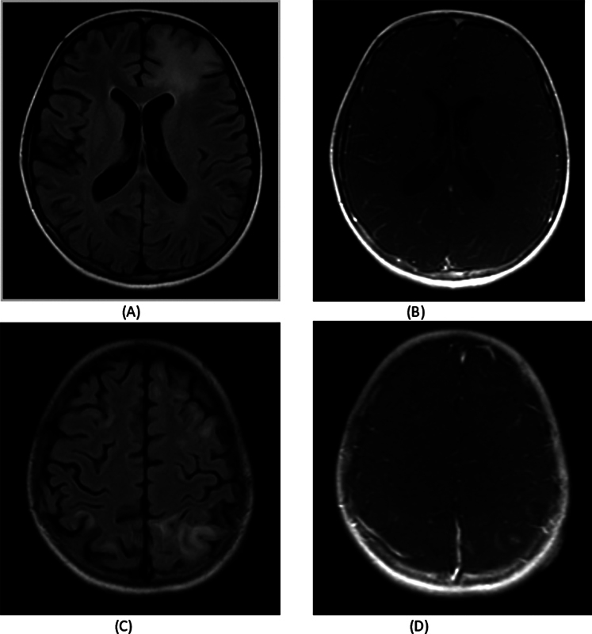
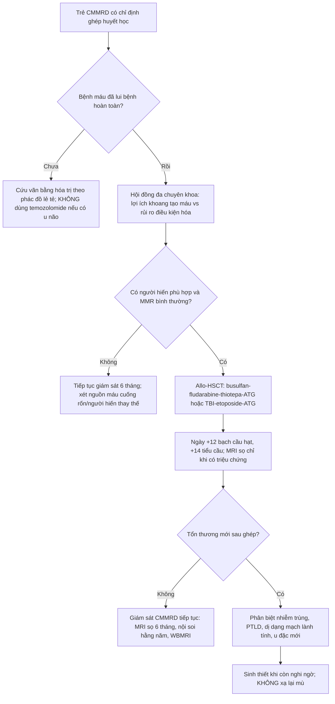
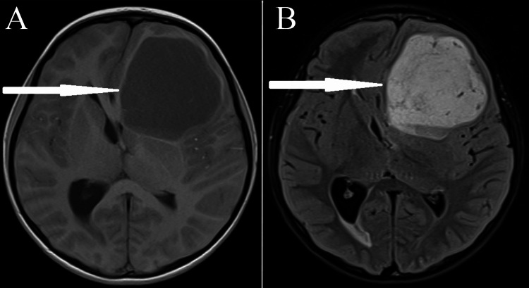
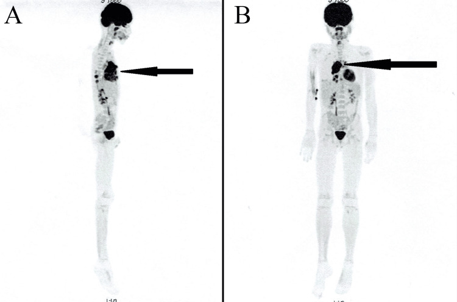

# 3004 — Ghép tế bào gốc đồng loài ở trẻ CMMRD: thay "nhà máy tạo máu" chứ không thay được mô đích / Allogeneic HSCT in constitutional mismatch repair deficiency

**Tags:** `pattern:di-truyen-ung-thu` `pattern:da-u-dong-thoi` `pattern:u-nao` `pattern:da-u-toan-than` `vung:nao` `vung:toan-than` `vung:dai-trang` `vung:trung-that` `score:nguy-co-tich-luy` `protocol:MRI-so-nao-6-thang` `protocol:WBMRI` `protocol:HSCT` `incidentaloma:DVA`

**Mức chắc chắn (certainty):** tổng hợp y văn (literature synthesis) — đọc trực tiếp toàn văn 6 bài mở qua Europe PMC/PMC (ERN GENTURIS 2024; *J Clin Oncol* 2021; *Neurooncol Adv* 2024; *Fam Cancer* 2026; *J Korean Neurosurg Soc* 2025; *Cureus* 2024) + 1 ca nguyên văn có ảnh (*Indian J Radiol Imaging* 2024). **3 ca nguyên văn** dùng cho Blind Quiz. Phần "chọn người hiến" là **suy luận** (inference), ghi rõ tại chỗ — không có khuyến cáo chính thức riêng.

## 1. Tổng quan bệnh học – cơ chế hình ảnh

### 1.1. Vì sao gọi là "thiếu hụt sửa chữa lệch bẩm sinh" và vì sao nó sinh ung thư sớm

- **CMMRD** (constitutional mismatch repair deficiency) = **đột biến biallelic (homozygous hoặc compound heterozygous)** một trong 4 gen sửa chữa lệch (mismatch repair, MMR): **MLH1, MSH2, MSH6, PMS2**. Bố/mẹ dị hợp cùng gen đó = **Lynch syndrome** (ung thư đại tràng/nội mạc tử cung ở tuổi trưởng thành). Con nhận **cả hai alen hỏng** → mất hoàn toàn chức năng MMR ngay từ hợp tử (ERN GENTURIS 2024, PMC11607302).
- **PMS2 chiếm ~60–65%** các ca CMMRD; MLH1/MSH2 (thường thể homozygous missense) cho kiểu hình **nặng nhất, khởi phát sớm nhất**; PMS2 nói chung **nhẹ hơn nhưng không đồng nhất** (thể cắt ngắn/truncating nặng hơn missense) (*J Korean Neurosurg Soc* 2025, PMC12062528).
- **Cơ chế "hypermutation":** khi MMR hỏng, lỗi sao chép (đặc biệt ở các đoạn lặp vi vệ tinh — microsatellite) **không được sửa** → mỗi lần phân bào tích lũy thêm đột biến → **tumor mutational burden (TMB) rất cao**, **MSI-high**, nhiều **neoantigen**. Đây là lý do kép: (a) ung thư xuất hiện **sớm và dày**; (b) u **đáp ứng mạnh với ức chế điểm kiểm soát miễn dịch (ICI)** — nhưng cũng là lý do **temozolomide phải tránh** (thuốc alkyl hóa gây thêm đột biến trên nền MMR hỏng → **siêu đột biến và kháng trị**; ERN GENTURIS 2024, Rec. 6).
- **Vì sao "mỗi 2 năm một ung thư mới":** tổn thương nằm trong **mọi mô có phân bào** (não, đại tràng, tủy xương, đường niệu, nội mạc tử cung) → u **đồng thời (synchronous)** và **nối tiếp (metachronous)** là quy luật, không phải ngoại lệ. IRRDC ghi **106 bệnh nhân** với **> 40 loại u khác nhau** (*JCO Precis Oncol* 2022, PMC8906457).

### 1.2. Ngưỡng định lượng bắt buộc (dùng để tư vấn và để đọc phim)

| Chỉ số | Con số | Nguồn |
|---|---|---|
| Nguy cơ ung thư tích lũy | **> 90% ở 18 tuổi**, **~100% ở 40 tuổi** | JKNS 2025 (PMC12062528) |
| Tuổi chẩn đoán ung thư đầu tiên (trung vị) | **9,2 tuổi** (khoảng **1,7–39,5**) | JCO 2021 (PMC8407605) — 110 bệnh nhân/193 u ác |
| Phân bố u | **CNS 51%** (trong đó **glioblastoma 66%** u CNS), **huyết học ~18%** (trong đó **T-lymphoblastic lymphoma 43%**), phần còn lại tiêu hóa và khác | Cureus 2024 tổng hợp IRRDC (PMC11380470) |
| U **đồng thời/nối tiếp** | Trung bình **một u mới mỗi ~2 năm** | JKNS 2025 |
| Tỉ lệ ca CMMRD trong nhóm nghi NF1 mà gen NF1/SPRED1 âm tính | **0,41%** | Eur J Hum Genet (theo JKNS 2025) |

### 1.3. Vì sao HSCT — và vì sao HSCT **không** chữa được CMMRD

Đây là **điểm lõi của bài**, và là chỗ hay bị hiểu sai khi tư vấn gia đình:

1. **Tủy xương là khoang duy nhất "thay được".** Ung thư máu (ALL, AML, lymphoma) sinh ra từ **tế bào gốc tạo máu của người bệnh** — tế bào này mang **đột biến biallelic MMR**. Ghép tế bào gốc đồng loài (allo-HSCT) **thay toàn bộ khoang tạo máu** bằng tế bào của người hiến **có MMR bình thường** → **loại bỏ nguồn gốc của bạch cầu/lymphoma tương lai**, đồng thời tạo **hiệu ứng ghép chống u (GvL)**.
2. **Nhưng não, đại tràng, đường niệu, nội mạc tử cung KHÔNG được thay.** Tế bào thần kinh đệm, biểu mô ruột vẫn **mang đột biến biallelic** → **nguy cơ u đặc không giảm**. Vì vậy HSCT là **dự phòng một phần, không phải chữa khỏi**: báo cáo ca của Mandryk cho thấy bệnh nhân sau ghép **vẫn tiếp tục mọc polyp đại tràng mỗi lần nội soi** (*Cureus* 2024, PMC11380470).
3. **Nghịch lý của giám sát:** trong 110 bệnh nhân IRRDC, khi theo protocol giám sát, **100% u tiêu hóa và 75% u não** được phát hiện **khi chưa có triệu chứng**, nhưng **chỉ 16% u huyết học** được phát hiện như vậy (**P < .001**) — vì ung thư máu **không có "khối" để chụp** ở giai đoạn sớm. Đây chính là lý do **HSCT có chỗ đứng riêng**: nó dự phòng đúng cái khoang mà hình ảnh **không** bắt được sớm.
4. **Giá trị sống còn của giám sát (để so sánh, không phải của HSCT):** 5 năm OS **90% (KTC 78,6–100)** khi u được phát hiện **không triệu chứng** so với **50% (39,2–63,7)** khi có triệu chứng (**P = .001**); riêng u CNS **72% vs 33%** (**P = .04**) (JCO 2021).

### 1.4. Vì sao **MRI** là phương thức giám sát, không phải CT (vật lý + ALARA)

- Trẻ CMMRD cần **MRI sọ mỗi 6 tháng từ 2–20 tuổi, sau đó hằng năm** — tức **36–40 lần chụp** trong đời. Với **CT sọ**, mỗi lần ~**2 mSv** (trẻ nhỏ còn cao hơn theo kV/mAs nếu không cá thể hóa) → **tích lũy 70–80 mSv** chỉ riêng giám sát, trên một quần thể **đã có đột biến sửa chữa DNA** (nhạy cảm bức xạ về mặt lý thuyết). **MRI không dùng tia ion hóa** → lựa chọn bắt buộc (ALARA).
- **Vì sao DWI là chuỗi xung "phát hiện":** u bậc cao CMMRD **giàu tế bào** (tỉ lệ nhân/bào tương cao, màng tế bào cản trở chuyển động Brown của nước) → **ADC thấp**, khác với **phù vận mạch quanh u** (ADC cao). Trong một não **đã có nhiều tổn thương nền** (DVA, nhồi máu cũ, tổn thương chất trắng không đặc hiệu), **ADC định lượng** là cách duy nhất phân biệt "mô đặc" với "nước".
- **Vì sao WBMRI (whole-body MRI) thay PET-CT ở trẻ:** WBMRI dùng **STIR/T2 fat-sat + DWI** không cần thuốc, không tia → phù hợp **tầm soát định kỳ**; PET-CT để dành cho **đánh giá một tổn thương đã biết** (như ca quiz 2) và cho **theo dõi đáp ứng**, vì tổng liều bức xạ của PET-CT lặp lại ở trẻ là không chấp nhận được.

## 2. Mẫu hình + chẩn đoán phân biệt theo vị trí (gamut)

- **Khuôn 1 — "Trẻ có nhiều vết café-au-lait + u não bậc cao thể hang"**: gamut **CMMRD (HGG)** vs **NF1 (glioma đường thị/đám rối)** vs **HGG lẻ tẻ** vs **u nguyên bào thần kinh đệm đa ổ sau xạ**. Chốt: **café-au-lait + tiền sử lymphoma/leukemia hoặc nhiều polyp + anh/chị em bị u** → xét CMMRD; **NF1** có **u đường thị, neurofibroma, glioma thể lông** chứ **không** có T-LBL. Bẫy dịch tễ: **0,41%** trẻ nghi NF1 mà gen âm tính thực ra là CMMRD.
- **Khuôn 2 — "Nhiều ổ T2/FLAIR sáng, không ngấm thuốc, ở chất trắng dưới vỏ"** (ảnh mục 3): gamut **tổn thương không ung thư của CMMRD (DVA, cavernoma, giả viêm)** vs **di căn/tái phát** vs **ADEM** vs **PML** vs **viêm mạch**. Chốt: **không ngấm, không hạn chế khuếch tán, ổn định hoặc biến mất theo thời gian** → không phải u.
- **Khuôn 3 — "Khối trung thất trước ở trẻ 2–8 tuổi"**: gamut **T-lymphoblastic lymphoma (CMMRD)** vs **lymphoma Hodgkin** vs **u tế bào mầm** vs **u tuyến ức**. Chốt: **khối lớn, xâm lấn, tràn dịch màng phổi, kèm giảm IgA** → T-LBL; **sinh thiết + IHC MMR (mất MLH1/PMS2/MSH2/MSH6)** là bước bắt buộc.
- **Khuôn 4 — "Đa polyp đại tràng ở trẻ < 18 tuổi"**: gamut **CMMRD** vs **FAP (APC)** vs **MUTYH-associated polyposis** vs **Peutz-Jeghers**. Chốt: **> 10 polyp tuyến tính từ tuổi 6–10 + tiền sử u não/lymphoma** → CMMRD; **FAP** có **hàng trăm polyp + u mô mềm/osteoma**.
- **Khuôn 5 — "Tổn thương MỚI sau ghép tế bào gốc"**: gamut **tái phát lymphoma** vs **u đặc mới (HGG, CRC)** vs **bệnh tăng sinh sau ghép (PTLD)** vs **nhiễm (áp-xe nấm, Aspergillus)** vs **dị dạng mạch lành tính**. Chốt: **ngấm thuốc dạng vòng + hạn chế khuếch tán trung tâm + giảm tín hiệu T2** → áp-xe; **ngấm đồng nhất + phù + ADC thấp** → u; **"ngấm" kiểu DVA (dạng đầu sao) + không phù** → mạch máu.

## 3. Bảng so sánh phân biệt (ma trận đối chiếu)

| Thực thể (entity) | Hình ảnh điển hình | Chốt vào (rule-in) | Chốt loại (rule-out) | Gợi ý xác nhận |
|---|---|---|---|---|
| **HGG trong CMMRD** | Khối **bán cầu** (không ưu tiên hố sau), **thể hang/hỗn hợp nang–đặc**, phù quanh u, **ADC thấp**; có thể **đa ổ/đồng thời** | **U đặc ADC thấp + café-au-lait/tiền sử T-LBL + nhiều DVA** | **Tổn thương không ngấm, ADC cao, ổn định 6 tháng** → không phải u | Sinh thiết + **IHC 4 protein MMR** (mất biểu hiện) + NGS germline |
| **T-LBL trung thất (CMMRD)** | Khối **trung thất trước lớn**, xâm lấn, **tràn dịch màng phổi**, hạch cổ | **Khối trung thất + tế bào T non + giảm IgA** | **U tuyến ức có vôi hóa, không xâm lấn** → nghĩ u tuyến ức | Sinh thiết, tủy đồ, **IHC MMR trên mô u** |
| **DVA nhiều ổ (dấu hiệu hình ảnh của CMMRD)** | Nhiều **"đầu sao" (caput medusae)** tĩnh mạch dẫn lưu về xoang; **ngấm thì muộn**, không phù, không chiếm chỗ | **Nhiều DVA > 2 ổ ở trẻ có u** | **Một DVA đơn độc** = biến thể bình thường | **MRI + đối quang** (SWI/CE-T1); không cần can thiệp |
| **Cavernoma** | **"Popcorn"** tín hiệu hỗn hợp, **viền hemosiderin SWI/T2***, không phù | **Viền hemosiderin + không phù + không ngấm** | **Ngấm thuốc + phù + ADC thấp** → u | **SWI** là chuỗi quyết định |
| **Tổn thương chất trắng không đặc hiệu** | Ổ **T2/FLAIR sáng, không ngấm**, có thể **biến mất sau 2 năm** | **Không ngấm + không hạn chế khuếch tán + tự thoái triển** | **To ra, ngấm, ADC giảm** → tái phát/u mới | MRI lặp 3–6 tháng, cùng mặt cắt |
| **PTLD sau ghép** | Khối **quanh não thất/ổ mắt/hạch**, ngấm đồng nhất, sau **EBV** | **EBV PCR dương + sau ghép + nhiều ổ** | **EBV âm, tổn thương đơn độc dạng mạch** → không phải PTLD | PCR EBV, sinh thiết |
| **Áp-xe nấm sau ghép** | **Ngấm vòng**, **hạn chế khuếch tán trung tâm**, khí có thể có | **Giảm miễn dịch + sốt + ADC rất thấp trong ổ** | **Không hạn chế khuếch tán, không ngấm** → loại | Chọc hút/cấy, galactomannan |

- Ảnh minh họa cho khuôn 2 và nguyên lý "u đặc vs tổn thương không đặc hiệu": xem mục 6, ca 3.

## 4. Protocol chụp + hệ phân độ/điểm chuẩn hóa + quy trình ghép

### 4.1. Bộ giám sát chuẩn (ERN GENTURIS 2024 / C4CMMRD — bảng ngưỡng)

| Cơ quan | Phương thức | Tần suất | Ngưỡng/ghi chú |
|---|---|---|---|
| Toàn thân | Khám lâm sàng | **Mỗi 6 tháng** từ lúc chẩn đoán | Giáo dục triệu chứng: khó thở/HCC (lymphoma trung thất), chảy máu trực tràng (đại tràng) |
| Não | **MRI sọ có + không đối quang** (gồm **DWI/ADC, SWI, T2***) | **Mỗi 6 tháng từ 2–20 tuổi**, **hằng năm sau 20** | Bắt đầu **ngay khi chẩn đoán** nếu < 2 tuổi và có triệu chứng |
| Toàn thân | **WBMRI** (STIR + DWI) | **Ít nhất 1 lần** lúc chẩn đoán; hằng năm là **tuỳ chọn** (bằng chứng còn yếu) | Phát hiện u bậc thấp không triệu chứng + **dị dạng mạch** |
| Đại tràng | Nội soi đại tràng | **Hằng năm từ 6 tuổi**; **mỗi 6 tháng khi đã có polyp** | Cắt polyp lạnh/EMR; **không** thay bằng CT |
| Dạ dày–tá tràng | Nội soi trên (tới tá tràng) | **Hằng năm từ 10 tuổi** (hoặc đồng thời với nội soi đại tràng) | Nhìn toàn bộ tá tràng + nhú Vater |
| Ruột non | Video capsule | **Hằng năm từ 10 tuổi** | |
| Máu | Công thức máu | **Mỗi 6 tháng sau 1 tuổi** | Chỉ phát hiện muộn — lý do chính của HSCT |
| Bụng | Siêu âm bụng | **Mỗi 6 tháng sau 1 tuổi** (tuỳ chọn) | Hạch/khối, gan lách |
| Phụ khoa | Khám + siêu âm đầu dò | **Hằng năm từ 20 tuổi** | Cắt tử cung dự phòng sau khi hoàn tất sinh sản |
| Niệu | Cytology + tổng phân tích nước tiểu; siêu âm bụng–chậu | **Hằng năm từ 10 tuổi**; siêu âm từ 20 tuổi | Ung thư niệu mạc (phổ Lynch) |

### 4.2. HSCT: đâu là chỗ đứng trong quyết định (không có "chỉ định tự động")

- **Khuyến cáo chính thức duy nhất:** "CMMRD **có lẽ không phải** là chống chỉ định của ghép tế bào gốc tạo máu **nếu có chỉ định**" — **ERN GENTURIS 2024, Rec. 5 (mức Moderate)** (PMC11607302). Nghĩa là: **không có** khuyến cáo "ghép cho mọi trẻ CMMRD", mà **ghép khi có chỉ định huyết học** (ALL/AML/lymphoma nguy cơ cao, tái phát, hoặc cần cứu vãn).
- **Vì sao không ghép dự phòng đại trà:** lợi ích chỉ nằm ở khoang tạo máu, trong khi **rủi ro của chính ghép** (nhiễm trùng, GVHD, suy sinh dục, ung thư thứ hai do điều kiện hóa) lại rơi vào một đứa trẻ **đã có nguy cơ 100% u đặc**. Đây là **cân nhắc cá thể hóa trong hội đồng đa chuyên khoa** (ERN GENTURIS Rec. 2).
- **Điều kiện hóa (dữ liệu từ 2 anh em ruột, ca nguyên văn):**

| Bệnh nhân | Bệnh | Điều kiện hóa | Tế bào gốc | Diễn biến |
|---|---|---|---|---|
| 1 (T-LBL 3,5 tuổi; GBM đồng thời 7,5 tuổi) | T-LBL tái phát + GBM trái | **Busulfan 0,8 mg/kg + fludarabine 5 × 30 mg/m² + thiotepa 2 × 5 mg/kg + ATG 45 mg/kg** | Máu ngoại vi, **6,06 × 10⁶ CD34+/kg**, người hiến **9/10 HLA** | Bạch cầu **ngày +12**, tiểu cầu **+14**; **GVHD ruột độ II**; ra viện **ngày +51**; lui bệnh lymphoma **3 năm** |
| 2 (T-LBL trung thất 2,5 tuổi; tái phát 4,5 tuổi) | T-LBL tái phát | **TBI + etoposide 60 mg/kg + ATG 45 mg/kg** | Máu ngoại vi, **7,92 × 10⁶ CD34+/kg**, người hiến không cùng huyết thống | **GVHD da độ II** ngày +14; ra viện **ngày +72**; lui bệnh **3 năm**; **suy giáp** và **suy thượng thận** cần thay thế |

- **Số liệu ghép ở CMMRD nói chung (rất mỏng, phải nói rõ):** ngoài 2 ca trên, y văn có **ca MSH6** (Ripperger; lui bệnh sau ghép, sau đó **ung thư đại tràng đôi bên ở 13 tuổi** → cắt đại tràng + cắt trực tràng), **ca PMS2** (Leenders; **lui bệnh 2 gần 4 năm**), và trong loạt **88 trẻ T-LBL có 8 ca CMMRD**, **1 ca** ghép đồng loài sau tái phát **lui bệnh 7 năm** (tổng hợp trong *Cureus* 2024). **Không có RCT, không có đoàn hệ ghép đủ lớn** → mọi khuyến cáo đều là **ý kiến chuyên gia**.
- **Chọn người hiến (suy luận — chưa có khuyến cáo riêng):** anh/chị/em ruột có **25%** khả năng cũng là CMMRD → **phải xét gen trước khi dùng làm người hiến**; ghép từ một người hiến **cũng biallelic MMR** sẽ **tái lập đúng khoang bệnh** và vô nghĩa về mặt dự phòng. Ưu tiên người hiến **không mang hai alen hỏng**; nếu chỉ có người hiến dị hợp (Lynch) thì cần hội đồng quyết định vì dữ liệu an toàn dài hạn chưa có.

### 4.3. Đọc phim sau ghép: mốc thời gian

- **Ngày 0 = truyền tế bào gốc.** Mọc mảnh ghép: **bạch cầu hạt ngày +12**, **tiểu cầu ngày +14** (2 ca trên).
- **Trước +30 ngày:** ưu tiên **nhiễm trùng** (trung tính), **không** kết luận tái phát chỉ vì một ổ ngấm thuốc mới.
- **+30 đến +100 ngày:** cửa sổ của **PTLD (EBV)** và **GVHD**; khối mới + EBV PCR dương → PTLD.
- **Sau +100 ngày:** u đặc mới (HGG, CRC) là **diễn tiến tự nhiên của CMMRD**, không phải "thất bại của ghép".

### 4.4. Hệ phân độ dùng khi có u (không có RADS riêng cho CMMRD)

- **U não:** dùng **RANO 2.0 / iRANO** như mọi u thần kinh đệm (xem bài 3003 cho cách đọc đáp ứng ICI và giả tiến triển).
- **Đáp ứng ICI:** **iRANO** — không gọi tiến triển trong **8 tuần đầu** nếu lâm sàng ổn định, cần xác nhận bằng lần chụp kế tiếp.
- **Thể trạng:** **Lansky (< 16 tuổi) / Karnofsky** trước ghép; **HCT-CI** (hematopoietic cell transplantation comorbidity index) để dự phòng biến chứng.
- **Độc tính:** **CTCAE v5.0** cho GVHD và nhiễm trùng.

## 5. Biến thể bình thường và cạm bẫy

- **Biến thể bình thường dễ nhầm:**
  1. **DVA đơn độc** là biến thể giải phẫu (**1–3%** dân số), **không** phải dấu hiệu bệnh — chỉ **nhiều DVA** mới là gợi ý CMMRD.
  2. **Tổn thương chất trắng nhỏ, không ngấm** ở trẻ có thể là **giãn khoang quanh mạch (perivascular space)** — theo dõi, không sinh thiết.
  3. **Tủy xương đỏ tái hoạt động sau ghép** trên WBMRI (tăng tín hiệu STIR/DWI đối xứng, theo phân bố xương) — **không** phải di căn; đối chiếu **công thức máu và thời điểm ghép**.
- **Cạm bẫy (pitfall):**
  1. **Gọi NF1 rồi dừng lại.** Café-au-lait + u não ở trẻ = nghĩ NF1, nhưng **CMMRD chiếm 0,41%** nhóm nghi NF1 mà gen âm tính. Bỏ sót = **không giám sát, không tư vấn di truyền cho anh chị em** (nguy cơ 25% mỗi người).
  2. **Sinh thiết/u não mà không nhuộm 4 protein MMR.** Mất biểu hiện MLH1/PMS2/MSH2/MSH6 trên mô u là **dấu hiệu sàng lọc rẻ nhất**; bỏ qua = mất cơ hội chẩn đoán sớm cả gia đình.
  3. **Dùng temozolomide.** Trên nền MMR hỏng, thuốc alkyl hóa **tạo thêm đột biến** → kháng trị và **siêu đột biến**; ERN GENTURIS **khuyến cáo tránh** (Rec. 6, Strong).
  4. **Coi "tổn thương mới sau ghép = tái phát".** Ca 2 đã có **một tổn thương thùy thái dương trái sau ghép, mổ ra là dị dạng mạch máu lành tính** (*Cureus* 2024). Sinh thiết/cắt bỏ khi còn nghi ngờ, **không xạ lại mù**.
  5. **Nghĩ HSCT "chữa khỏi" CMMRD.** Sau ghép, **polyp đại tràng vẫn mọc** (ca 1: **5 polyp, 4 cắt** ở lần soi gần nhất) → **nội soi hằng năm vẫn bắt buộc**.
  6. **Bỏ MRI sọ vì "đã ghép".** U não **không** giảm nguy cơ sau ghép; lịch **6 tháng** không đổi.
  7. **Dùng aspirin dự phòng ung thư đại tràng.** Khác Lynch, ở CMMRD **ERN GENTURIS không khuyến cáo aspirin** vì lo ngại **u não và DVA** (nguy cơ chảy máu).
  8. **Xạ trị bị coi là chống chỉ định.** Không đúng: ERN GENTURIS **Rec. 4 (Moderate)** — CMMRD **có lẽ không phải** chống chỉ định xạ trị khi có chỉ định.
- **Phản biện trung thực nguồn:** toàn bộ "hiệu quả của HSCT" trong CMMRD dựa trên **báo cáo ca và loạt nhỏ**, có **thiên lệch công bố** (ca thành công dễ được báo). Con số **3 năm lui bệnh** ở 2 anh em **không** chứng minh được lợi ích sống còn; bài báo gốc tự kết luận "**lợi ích có thể hạn chế** vì không làm giảm u không huyết học". Vì vậy trong tư vấn phải nói rõ: **HSCT là quyết định cá thể, không phải chuẩn điều trị**.

## 6. Tự lượng giá — Blind Quiz ngay trên trang tĩnh

**Ca 1 — Bé trai 7,5 tuổi, đã điều trị T-lymphoblastic lymphoma, nay đau đầu và yếu nửa người phải**

- Gợi ý lâm sàng: **T-LBL** lúc 3,5 tuổi, tái phát; **nhiều vết café-au-lait**; anh/em ruột cũng bị lymphoma trung thất.
- Câu hỏi: (a) Mô tả tổn thương trên T1 (A) và T2 (B)? (b) Ba chẩn đoán phân biệt? (c) Xét nghiệm nào xác định **hội chứng nền** và vì sao nó đổi hoàn toàn kế hoạch điều trị?

<b>Bấm để hiện đáp án (findings + chẩn đoán)</b>

- Dấu hiệu: **khối lớn thùy trán trái**, **thành phần nang giảm tín hiệu T1 (A) và tăng tín hiệu rất mạnh T2 (B)**, phần đặc bám thành; **hiệu ứng khối rõ**: đẩy lệch đường giữa sang phải, chèn ép sừng trán não thất bên trái.
- Chẩn đoán: **glioblastoma (HGG) đồng thời với CMMRD** — trẻ có T-LBL + café-au-lait + anh/em bị u = **phải xét CMMRD**, không chỉ "HGG lẻ tẻ".
- Vì sao đổi kế hoạch: (1) **tránh temozolomide** (MMR hỏng → siêu đột biến, kháng trị); (2) **ICI (PD-1) là lựa chọn ưu tiên**, tốt nhất trong thử nghiệm lâm sàng; (3) **xét gen cho cả gia đình** và **đưa vào protocol giám sát 6 tháng**; (4) cân nhắc **allo-HSCT** cho bệnh máu.
- Nguồn ảnh: *Cureus* 2024;16:e66441, Figure 2 — PMC11380470, **CC BY 4.0** (Mandryk M et al.).

**Ca 2 — Bé trai 7 tuổi, khó thở khi nằm, mặt và cổ phù nhẹ**

- Gợi ý lâm sàng: tiền sử **lymphoma tế bào T**; hiện **hội chứng tĩnh mạch chủ trên**; không sốt.
- Câu hỏi: (a) Vị trí và ý nghĩa ổ tăng chuyển hóa? (b) Vì sao không dùng PET-CT để **giám sát định kỳ** ở trẻ CMMRD? (c) Bước tiếp theo trước khi kết luận tái phát?

<b>Bấm để hiện đáp án (findings + chẩn đoán)</b>

- Dấu hiệu: **ổ tăng chuyển hóa rất mạnh, lớn, ở trung thất trước** (nhìn rõ cả mặt bên A và mặt trước B); não và bàng quang là **tập trung sinh lý** (không phải di căn).
- Chẩn đoán: **tái phát T-lymphoblastic lymphoma trung thất** — phù hợp hội chứng tĩnh mạch chủ trên.
- Vì sao không dùng PET-CT định kỳ: **liều bức xạ tích lũy** ở trẻ cần 36–40 lần chụp trong đời; **WBMRI (STIR + DWI)** là công cụ tầm soát, PET-CT để **đánh giá một tổn thương đã biết**.
- Trước khi kết luận: **sinh thiết + tủy đồ + IHC MMR**, vì "tổn thương ngấm thuốc/tăng chuyển hóa mới" sau điều trị có thể là **viêm, PTLD hoặc u thứ hai** — ba hướng điều trị khác nhau hoàn toàn.
- Nguồn ảnh: *Cureus* 2024;16:e66441, Figure 3 — PMC11380470, **CC BY 4.0** (Mandryk M et al.).

**Ca 3 — Bé gái 9 tuổi, CMMRD đã biết, đi khám định kỳ, không triệu chứng thần kinh**

- Gợi ý lâm sàng: **T-cell acute lymphoblastic lymphoma** trước đó, **thiếu hụt IgA chọn lọc**, bố mẹ **hôn nhân cận huyết**; em ruột có **cavernoma cầu não** và lymphoma.
- Câu hỏi: (a) Các ổ T2/FLAIR sáng có ngấm thuốc không? (b) Đây có phải di căn/tái phát? (c) Em ruột có cavernoma cầu não — mối liên hệ với CMMRD là gì?

<b>Bấm để hiện đáp án (findings + chẩn đoán)</b>

- Dấu hiệu: **nhiều ổ tăng tín hiệu T2/FLAIR ở vỏ và dưới vỏ hai bán cầu trán–đỉnh** (A, C); **ảnh sau tiêm (B, D) KHÔNG ngấm thuốc**; theo dõi 2 năm, **ổ bên phải mất đi, ổ trán trái tồn tại**.
- Chẩn đoán: **tổn thương chất trắng KHÔNG do ung thư trong CMMRD** — không phải di căn, không phải ADEM; theo dõi, **không sinh thiết, không xạ**.
- Liên hệ cavernoma: CMMRD có **bất thường mạch máu bẩm sinh** (cavernoma, **nhiều DVA**) — đây là **dấu hiệu hình ảnh hỗ trợ chẩn đoán** và là **lý do không dùng aspirin** dự phòng.
- Nguồn ảnh: *Indian J Radiol Imaging* 2024;34:562–565, Figure 1 — PMC11188719, **CC BY-NC-ND** (Siju J et al.) — **ảnh nguyên bản, không crop, không ghép**.

## Bài liên quan chéo
- [3003 – Ức chế điểm kiểm soát miễn dịch ở u não CMMRD/MMR-deficient](../3003-uc-che-diem-kiem-soat-u-nao-cmmrd/lesson.md)
- [690 – CMMRD: tầm soát bằng WBMRI ở trẻ](../690-cmmrd-tam-soat-wb-mri-o-tre/lesson.md)
- [199 – Quy trình xét nghiệm gen tầm soát gia đình](../199-quy-trinh-xet-nghiem-gen-tam-soat-gia-dinh/lesson.md)
- [213 – U não](../213-u-nao/lesson.md)
- [197 – Xạ trị trong Li-Fraumeni](../197-xa-tri-li-fraumeni/lesson.md)
- [600 – Tổng quan Nhi khoa](../600-tong-quan-nhi-khoa/lesson.md)

## Ảnh
- `images/3004_hsct-cmmrd_MRI_cureus-f002.jpg` — MRI sọ T1/T2: glioblastoma trán trái ở trẻ CMMRD (ca 1).
- `images/3004_hsct-cmmrd_PET-CT_cureus-f003.jpg` — PET-CT: tái phát T-LBL trung thất (ca 2).
- `images/3004_hsct-cmmrd_MRI-IJRI-f001.jpg` — nhiều ổ T2/FLAIR không ngấm thuốc ở trẻ CMMRD (ca 3).
- Nguồn + giấy phép từng ảnh: `images/CREDITS.md`; link gốc: `sources.md`.

> Không dùng để chẩn đoán độc lập khi chưa có người hướng dẫn.
