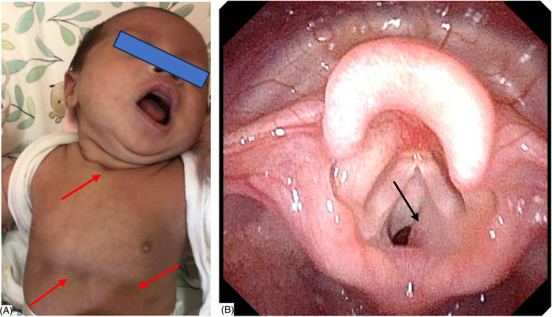
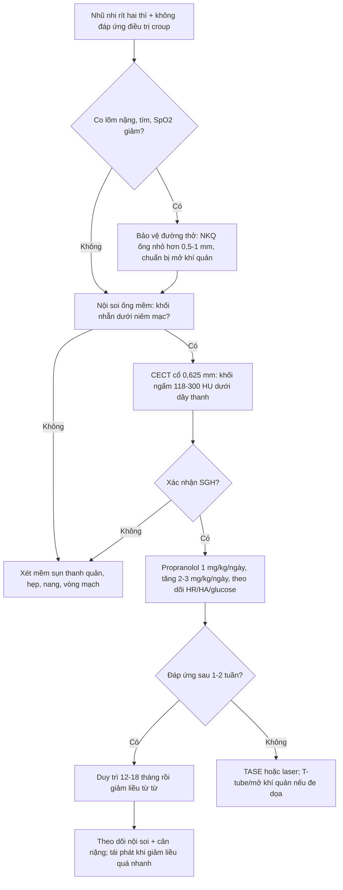
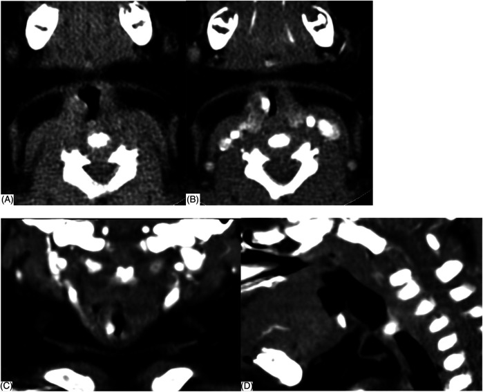
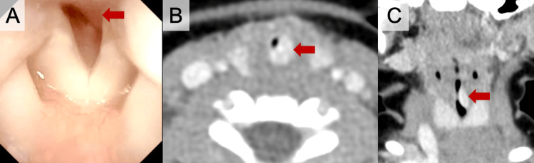

# 3005 — U máu dưới thanh môn ở nhũ nhi: rít HAI thì + u máu vùng râu, propranolol & khi nào can thiệp

**Tags:** `pattern:rit-thi-hit-vao` `pattern:rit-hai-thi` `pattern:khoi-duoi-thanh-mon` `pattern:u-mau` `vung:duong-tho` `vung:thanh-quan` `vung:co` `anatomy:thanh-quan` `protocol:noi-soi-ong-mem` `protocol:CT-co-can-quang` `protocol:propranolol`
**Mức chắc chắn (certainty):** tổng hợp y văn (literature synthesis) — ghép **loạt 25 ca trong 10 năm** (Front Pediatr 2025, PMC12162989), **đoàn hệ 798 trẻ u máu** (Acta Paediatr 2026, PMC13250966), **ca điều trị sớm tránh mở khí quản** (Cureus 2025, PMC12580773), **3 ca đặt T-tube + propranolol** (J Bras Pneumol 2022, PMC8964104) và **10 ca kháng propranolol được nút mạch xơ** (Front Oncol 2023, PMC10018163). Không có ca do nhóm tự chụp.

> **Câu hỏi thực hành:** bé gái **2 tháng tuổi**, **rít thì hít vào rồi thành rít HAI thì trong 2 tuần**, nặng lên khi khóc và bú; **đã 2 lần điều trị "viêm phế quản" không đỡ**; không sốt, không u máu da rõ. Câu hỏi: **đây có phải mềm sụn thanh quản không, có cần nội soi/CT không, và khi nào bắt đầu propranolol thay vì chờ tự thoái triển?**
> Bài chốt **ba quyết định**: **(1) rít hai thì + không đáp ứng điều trị "croup/viêm phế quản" ở trẻ < 6 tháng = soi đường thở; (2) khối dưới niêm mạc ngấm mạnh 118–300 HU dưới dây thanh = u máu dưới thanh môn; (3) propranolol là điều trị đầu tay — không chờ tự thoái triển khi còn tắc nghẽn, và không sinh thiết khối mạch máu**. Nối [694 – Mềm sụn thanh quản ở nhũ nhi](../694-mem-sun-thanh-quan-o-nhu-nhi/lesson.md), [612 – Cấp cứu đường thở trên trẻ em](../612-cap-cuu-duong-tho-tren-tre-em/lesson.md), [602 – Khí phế quản mềm](../602-tracheobronchomalacia-o-tre-bpd/lesson.md).

## 1. Tổng quan bệnh học – cơ chế hình ảnh: vì sao 1–2 mm u đã gây suy hô hấp

- **Bản chất:** u máu dưới thanh môn (subglottic hemangioma, SGH) là **u máu nhũ nhi (infantile hemangioma, IH)** — u mạch lành tính **GLUT1 dương**, xuất hiện sau sinh, **tăng sinh mạnh trong 3–9 tháng đầu** rồi **thoái triển chậm trong nhiều năm**. IH gặp ở **2–5% trẻ sinh sống**; **u máu đường thở chỉ chiếm 1,6%** trong 798 trẻ được theo dõi u máu (Acta Paediatr 2026, PMC13250966); SGH chiếm **1,5% các dị tật thanh quản bẩm sinh** (J Bras Pneumol 2022, PMC8964104).
- **TẠI SAO vị trí dưới thanh môn lại nguy hiểm:** dưới thanh môn là **vòng sụn nhẫn kín, không giãn được** — khác với mũi/hầu mềm. Theo định luật Poiseuille, **sức cản đường thở tỉ lệ nghịch với lũy thừa bậc 4 của bán kính (R ∝ 1/r⁴)**. Ở nhũ nhi, đường kính dưới thanh môn chỉ **~4–5 mm**; u dày thêm **1 mm** làm **giảm một nửa bán kính → sức cản tăng ~16 lần**. Vì vậy khối **1,89–12 mm** (trung bình **6,77 ± 2,53 mm**) đã đủ gây suy hô hấp.
- **TẠI SAO rít HAI thì:** tổn thương **cố định** ở vòng sụn nhẫn cản trở cả thì hít vào và thở ra; khác **mềm sụn thanh quản** (sa động) chỉ rít **thì hít vào**. Trong loạt 25 ca, **rít 25/25**, suy hô hấp **13/25**, co lõm ba hõm **10/25**, ho "sủa" **9/25**, bú khó **8/25**, tím **2/25**, khàn giọng **2/25**.
- **Dịch tễ – chân dung:** **nữ:nam = 17:8**; tuổi khởi phát **1 ngày – 8 tháng, trung vị 33 ngày**; **96% (24/25) < 6 tháng**, **16% (4/25) có triệu chứng ngay khi sinh**; tuổi chẩn đoán trung vị **3 tháng**. Y văn: **80–90% xuất hiện trong 6 tháng đầu**, tuổi chẩn đoán trung bình **3,6 tháng**.
- **TẠI SAO dễ chẩn đoán nhầm:** **92% (23/25) từng bị chẩn đoán khác** — **22 ca "nhiễm hô hấp"** (viêm phế quản/viêm phổi/viêm thanh quản cấp), **5 ca mềm sụn thanh quản**, 1 nang thanh quản, 1 hen. Lý do: rít + ho + ran ngáy **giống croup**, nhưng **không sốt, không đáp ứng kháng sinh/khí dung, và nặng dần theo tuần**.
- **Dấu hiệu da định hướng:** **24% (6/25)** có u máu ở nơi khác (cổ, lưng/mông, tay–vai, môi/lưỡi/mí). **U máu đoạn vùng râu (segmental beard distribution)** có nguy cơ u máu đường thở **33,3%**; u máu đoạn vùng mặt/cổ **không vùng râu** nguy cơ **11,5%**; **38,5%** trẻ có u máu đường thở chỉ có **u máu khu trú quanh môi/mũi** (PMC13250966).
- **Hình ảnh học — vì sao CECT là chốt:** trên CLVT không cản quang, khối **49,36 ± 13,66 HU (23–78 HU)** — **không đủ** để phân biệt với mô mềm; sau cản quang, khối **ngấm mạnh 227,40 ± 46,45 HU (118–300 HU)**, **ngấm nhanh thì động mạch**, bờ rõ, nằm **dưới niêm mạc**. Trên nội soi ống mềm: khối **nhẵn, tròn, dưới niêm mạc**, màu **hồng (84%)**, **tím/xanh (8%)**, **đỏ tươi (8%)**; **dễ chảy máu khi đụng** — **không sinh thiết**.
- **TẠI SAO không chờ "tự thoái triển":** u tăng sinh **nhanh nhất 3–9 tháng**, đúng lúc đường thở nhỏ nhất; **không điều trị, tử vong có thể tới ~50%** do tắc nghẽn (J Bras Pneumol 2022). Propranolol làm khối **co lại trong vài ngày tới vài tuần**, nên **điều trị sớm là cấp cứu mềm**, không phải "theo dõi thẩm mỹ".

## 2. Mẫu hình + chẩn đoán phân biệt theo tuổi và pha tiếng rít (Gamut)

- **Quy tắc định khu bằng pha:**
  - **Thì hít vào:** tắc nghẽn **ngoài lồng ngực** — mềm sụn thanh quản, liệt dây thanh, nang thung lũng, hẹp thanh môn.
  - **Thì thở ra:** tắc nghẽn **trong lồng ngực** — khí phế quản mềm, chèn ép mạch máu, u khí quản.
  - **Hai thì:** tổn thương **cố định** thanh môn/dưới thanh môn — **SGH**, hẹp dưới thanh môn, vòng mạch, hẹp khí quản.
- **Gamut theo tuổi:**
  - **Sơ sinh – 2 tuần:** mềm sụn thanh quản, liệt dây thanh, hẹp thanh quản bẩm sinh, nang thung lũng.
  - **1–6 tháng:** **SGH (đỉnh)**, hẹp dưới thanh môn mắc phải sau đặt nội khí quản, nang dưới thanh môn.
  - **6 tháng – 3 tuổi:** **croup** virus, viêm thanh quản co thắt, dị vật, u nhú thanh quản.
  - **> 3 tuổi:** u nhú, hẹp khí quản, vòng mạch, u trung thất.
- **Gamut theo bối cảnh:** **u máu da vùng râu + rít hai thì** → SGH; **tiền sử đặt nội khí quản** → hẹp/nang dưới thanh môn; **sốt + ho sủa + khởi phát nhanh** → croup; **bú khó + rít hai thì + không thay đổi theo tư thế** → vòng mạch (phải CTA).
- **Mnemonic "BEARD":** **B**iphasic stridor, **E**nhancing subglottic mass, **A**ge < 6 months, **R**efractory "croup", **D**ermal hemangioma (beard) — đủ 3/5 là chỉ định soi + CECT.

## 3. Bảng so sánh phân biệt (ma trận đối chiếu)

| Thực thể (entity) | Hình ảnh điển hình | Chốt vào (rule-in) | Chốt loại (rule-out) | Gợi ý xác nhận |
|---|---|---|---|---|
| **U máu dưới thanh môn (SGH)** | Khối **nhẵn dưới niêm mạc** dưới dây thanh, **ngấm mạnh 118–300 HU**, bờ rõ, **không xâm lấn sụn**; nội soi khối hồng/tím, mềm, dễ chảy máu | **Rít hai thì tiến triển ở trẻ < 6 tháng + khối ngấm mạnh dưới thanh môn + u máu da (24%)** | Không ngấm, bờ xâm lấn, sụn bị phá → nghĩ u khác | Nội soi ống mềm + CECT; **không sinh thiết**; propranolol thử |
| **Mềm sụn thanh quản** | Nắp thanh môn **hình omega**, mô phễu sa vào lòng **thì hít vào**; không khối cố định | **Rít THÌ HÍT VÀO, giảm khi nằm nghiêng, khởi phát ≤ 2 tuần tuổi** | Rít hai thì + khối cố định + ngấm thuốc → SGH | Nội soi động (DISE); không cần CECT thường quy |
| **Hẹp dưới thanh môn** | Hẹp **vòng sụn nhẫn**, không khối ngấm; có thể xơ sau đặt nội khí quản | **Tiền sử đặt nội khí quản + rít hai thì cố định + không ngấm thuốc** | Khối ngấm mạnh, mềm, thay đổi theo propranolol → SGH | Nội soi; đo đường kính; phân độ Myer–Cotton |
| **Croup virus** | Hẹp dưới thanh môn lan tỏa đối xứng, **"steeple sign"** trên X-quang; không khối khu trú | **Sốt + ho sủa + khởi phát 1–2 ngày, tuổi 6 tháng–3 tuổi** | Không sốt, kéo dài nhiều tuần, nặng dần → SGH | Lâm sàng; X-quang cổ mềm; nội soi nếu không điển hình |
| **Nang dưới thanh môn** | **Nang thành mỏng, dịch, không ngấm**, thường sau đặt nội khí quản | **Tiền sử đặt nội khí quản + khối dạng nang không ngấm** | Khối đặc ngấm mạnh → SGH | Nội soi; chọc hút/trích nang |
| **U nhú thanh quản** | Nhiều **nốt sùi "mào gà"** trên dây thanh, lan rộng; không ngấm mạnh | **Khàn giọng kéo dài + nhiều nốt + người lớn/trẻ lớn** | Khối đơn độc dưới thanh môn, trẻ < 6 tháng → SGH | Nội soi + sinh thiết (được phép) |
| **Vòng mạch / chèn ép mạch** | Khí quản **hẹp do mạch vòng**, thấy trên CTA/MRA; không khối trong lòng | **Rít hai thì + bú khó + không đổi theo propranolol** | Không có vòng mạch, có khối trong lòng → SGH | CTA/MRA; siêu âm tim; nội soi |

*Loạt 25 ca (Front Pediatr 2025, PMC12162989): **(A)** bé gái 40 ngày với rít, suy hô hấp và **co lõm ba hõm (mũi ức, liên sườn, trên ức)** — dấu hiệu tắc nghẽn đường thở trên nặng; **(B)** nội soi ống mềm — **khối nhẵn, màu hồng, lồi vào lòng dưới thanh môn phải**, che gần kín đường thở. Nguồn: CC BY 4.0, nguyên bản.*

## 4. Protocol chẩn đoán + điều trị

- **Bước 0 — đánh giá đường thở trước mọi thứ:** nếu **co lõm nặng, tím, SpO₂ giảm, kiệt sức** → **bảo vệ đường thở** (nội khí quản ống nhỏ hơn 0,5–1 mm, chuẩn bị mở khí quản); **không đặt ống mù khi chưa biết tổn thương vì có thể gây chảy máu u**. Trong loạt 25 ca, **24% (6/25) đã phải đặt nội khí quản** trước chẩn đoán; 4 ca **cai ống sau 3–7 ngày propranolol**.
- **Bước 1 — nội soi ống mềm (flexible fiberoptic laryngoscopy, FFL):** xác định **vị trí, bên, màu, độ che lấp lòng**. Khối **nhẵn, dưới niêm mạc, hồng/tím, mềm, dễ chảy máu**; **không sinh thiết**. Nếu trẻ không hợp tác → soi dưới gây mê nhẹ, giữ tự thở.
- **Bước 2 — CECT cổ–ngực (lát 0,625 mm, dựng vành + đứng):** xác định **kích thước, độ lan lên dây thanh/xuống khí quản, mức hẹp > 70%**, loại **vòng mạch/hẹp sụn/u khác**; đo **HU trước và sau cản quang** (ngấm **118–300 HU** là chốt). Không dùng MRI thường quy cấp cứu (chậm, cần an thần sâu).
- **Bước 3 — propranolol (điều trị đầu tay):**
  - **Khởi đầu 1 mg/kg/ngày** chia 2–3 lần; nếu dung nạp, **tăng lên 2 mg/kg/ngày (ngày 4)** rồi **3 mg/kg/ngày** trong 1–3 tuần.
  - **Theo dõi HR, HA, glucose** trước và **1–3 giờ sau liều đầu**; thận trọng ở trẻ **sinh non, nhẹ cân, bú kém** (hạ đường huyết).
  - **Duy trì tới khi u thoái triển** — thường **12–18 tháng**, các loạt ca dùng **2 năm**; giảm liều từ từ, không ngừng đột ngột (nguy cơ bùng phát).
  - **80% trẻ u máu đường thở chỉ cần propranolol** (PMC13250966); loạt 25 ca **23/25 khỏi** (1 tử vong do bất thường đa gen, 1 mất theo dõi).
- **Bước 4 — khi propranolol thất bại/không dung nạp:**

| Lựa chọn | Chỉ định | Số liệu / lưu ý |
|---|---|---|
| **Nút mạch xơ qua ống thông (TASE)** | U **kháng propranolol**, còn tắc nghẽn | **10/101 ca** SGH; **Pingyangmycin + PVA 300–500 µm**; đường kính **8,5 → 2 mm**; không biến chứng nặng (PMC10018163) |
| **Corticosteroid toàn thân** | Cầu nối khi không có propranolol/không dung nạp | Tác dụng chậm, nhiều tác dụng phụ; **không dùng dài hạn** |
| **Laser CO₂ / phẫu thuật** | Tổn thương **khu trú**, thất bại nội khoa | Nguy cơ **hẹp thanh quản do sẹo**, chảy máu; chọn ca kỹ |
| **Mở khí quản / T-tube** | Tắc nghẽn đe dọa tính mạng, không kiểm soát được | T-tube silicon **8 mm** + propranolol → cai ống, đóng lỗ mở khí quản (PMC8964104); **mở khí quản có biến chứng cai ống** |
| **Theo dõi đơn thuần** | **Chỉ khi** u nhỏ, không tắc nghẽn, trẻ lớn, đã qua đỉnh tăng sinh | Không áp dụng cho trẻ < 6 tháng còn triệu chứng |

- **Theo dõi:** cân nặng, bú, SpO₂; nội soi lại **2–4 tuần** sau khởi trị nếu còn triệu chứng; **không cần CECT lặp lại thường quy** — dùng nội soi + lâm sàng. **PHACES**: nếu u máu đoạn mặt lớn → **MRI/MRA não, siêu âm tim, khám mắt**, vì bất thường động mạch có thể chống chỉ định can thiệp.

## 5. Biến thể bình thường và cạm bẫy

- **Bẫy số 1 — "croup tái phát":** **92%** ca trong loạt 25 từng bị chẩn đoán nhiễm hô hấp; **croup không kéo dài nhiều tuần và không nặng dần**. Trẻ **< 6 tháng** rít + không sốt + thất bại điều trị → **soi đường thở**.
- **Bẫy số 2 — gọi là mềm sụn thanh quản vì "rít thì hít vào":** SGH **có thể chỉ rít thì hít vào giai đoạn đầu**, nhưng khi lớn lên thành **hai thì**; **không giảm khi nằm nghiêng**, **không đáp ứng propranolol**.
- **Bẫy số 3 — CECT không cản quang "bình thường":** khối chỉ **23–78 HU** trước cản quang, **dễ bị đọc là mô mềm bình thường**; **bắt buộc thì động mạch** và đo HU sau cản quang.
- **Bẫy số 4 — sinh thiết khối:** khối **mạch máu, dễ chảy máu**, sinh thiết có thể gây **chảy máu đường thở không kiểm soát**; chẩn đoán bằng **nội soi + CECT + đáp ứng propranolol**.
- **Bẫy số 5 — bỏ sót PHACES:** u máu **đoạn** vùng mặt/cổ có thể kèm **bất thường động mạch não, tim, mắt, xương ức**; **không can thiệp mù** khi chưa khảo sát mạch.
- **Bẫy số 6 — hạ đường huyết do propranolol:** trẻ **sinh non/nhẹ cân/bú kém**; cho bú đều, đo glucose, **không bỏ bữa**; ngừng thuốc đột ngột có thể gây **bùng phát u**.
- **Cạm bẫy mặt cắt:** trên CT **một lát ngang**, khối dưới thanh môn có thể bị đọc là **dày niêm mạc đối xứng**; luôn dựng **mặt phẳng vành/đứng** để thấy khối **một bên** và mức hẹp.

## 6. Tự lượng giá — Blind Quiz

**Ca 1 — Bé gái 40 ngày, rít + co lõm ba hõm, đã điều trị "viêm phế quản" 2 lần.**

- Câu hỏi: Dấu hiệu nào trên ảnh A cho biết mức độ nặng? Ảnh B cho thấy gì và vì sao không sinh thiết?

<b>Bấm để hiện đáp án (findings + chẩn đoán)</b>

- Dấu hiệu (findings): **(A)** **co lõm ba hõm** (mũi ức, liên sườn, trên ức) khi khóc — tắc nghẽn đường thở trên nặng; **(B)** khối **nhẵn, màu hồng, dưới niêm mạc**, lồi vào lòng dưới thanh môn phải, che gần kín đường thở.
- Chẩn đoán (diagnosis): **u máu dưới thanh môn** — xác nhận bằng CECT (khối ngấm mạnh) và đáp ứng propranolol.
- Vì sao không sinh thiết: khối **mạch máu, dễ chảy máu**, có thể gây tắc đường thở cấp; chẩn đoán dựa vào **nội soi + CECT + đáp ứng thuốc**.
- Nguồn ảnh: Front Pediatr 2025 (PMC12162989), CC BY 4.0.

**Ca 2 — Cùng bệnh nhân, CECT cổ.**

- Câu hỏi: Mô tả khối trên 4 panel. Vì sao phải đo HU trước và sau cản quang?

<b>Bấm để hiện đáp án</b>

- Dấu hiệu (findings): **(A)** không cản quang — khối **đồng tỷ trọng mô mềm**; **(B)** ngang sau cản quang — khối **ngấm mạnh**, bờ rõ, nằm dưới niêm mạc thành bên phải; **(C)** vành và **(D)** đứng — thấy **độ lan dọc và mức hẹp lòng**.
- Chẩn đoán (diagnosis): **SGH** — trong loạt, khối **49,36 ± 13,66 HU** trước và **227,40 ± 46,45 HU** sau cản quang (dải **118–300 HU**), kích thước **1,89–12 mm**.
- Vì sao: trước cản quang khối **không đặc hiệu**; **ngấm mạnh thì động mạch** mới phân biệt với **hẹp sụn/nang/dị vật**.
- Nguồn ảnh: Front Pediatr 2025 (PMC12162989), CC BY 4.0.

**Ca 3 — Bé gái 41 ngày, sinh 31 tuần 5 ngày, rít hai thì, pH 7,181, PaCO₂ 81,6 mmHg.**

- Câu hỏi: Vì sao đây không phải mềm sụn thanh quản? Bước tiếp theo và liều propranolol?

<b>Bấm để hiện đáp án</b>

- Dấu hiệu (findings): **(A)** nội soi — khối **nhẵn, đỏ, không loét**, dưới niêm mạc; **(B, C)** CECT — khối **ngấm mạnh**, **hẹp > 70%** lòng, **~10 mm** theo chiều dọc, không lan lên khí quản.
- Chẩn đoán (diagnosis): **SGH** — khí máu **pH 7,181, PaCO₂ 81,6 mmHg, PaO₂ 43 mmHg, HCO₃⁻ 30,5** = **toan hô hấp** do tắc nghẽn.
- Vì sao không phải mềm sụn: rít **hai thì**, **khối cố định**, không giảm khi thay đổi tư thế.
- Điều trị: đặt nội khí quản bảo vệ đường thở, **propranolol 1 mg/kg/ngày → 2 mg/kg/ngày ngày 4**, theo dõi HR/HA/glucose; **cai ống ngày 10, không cần mở khí quản**.
- Nguồn ảnh: Cureus 2025 (PMC12580773), CC BY 4.0.

## Bài liên quan chéo
- [600 – Tổng quan Hệ Nhi khoa](../600-tong-quan-nhi-khoa/lesson.md)
- [694 – Mềm sụn thanh quản ở nhũ nhi](../694-mem-sun-thanh-quan-o-nhu-nhi/lesson.md)
- [612 – Cấp cứu đường thở trên trẻ em](../612-cap-cuu-duong-tho-tren-tre-em/lesson.md)
- [602 – Khí phế quản mềm ở trẻ/BPD](../602-tracheobronchomalacia-o-tre-bpd/lesson.md)
- [603 – Pierre Robin & tắc nghẽn đường thở trên](../603-pierre-robin-tac-nghen-duong-tho/lesson.md)
- [611 – Rò khí nặng/PIE & tràn khí áp lực ở nhũ nhi](../611-ro-khi-nang-pie-tran-khi-ap-luc-nhu-nhi/lesson.md)

## Ảnh
- 3 ảnh, tất cả **CC BY 4.0** (Front Pediatr 2025: 2 ảnh; Cureus 2025: 1 ảnh) — **nguyên bản**, không crop/ghép; chi tiết trong `images/CREDITS.md`.
- Không tạo composite vì hai bài gốc là hai bệnh cảnh khác nhau (loạt 25 ca vs ca đơn).

> Không dùng để chẩn đoán độc lập khi chưa có người hướng dẫn.
