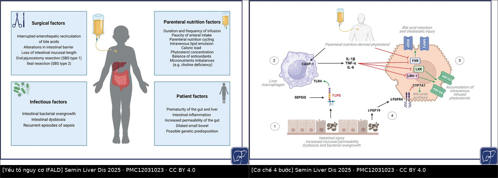
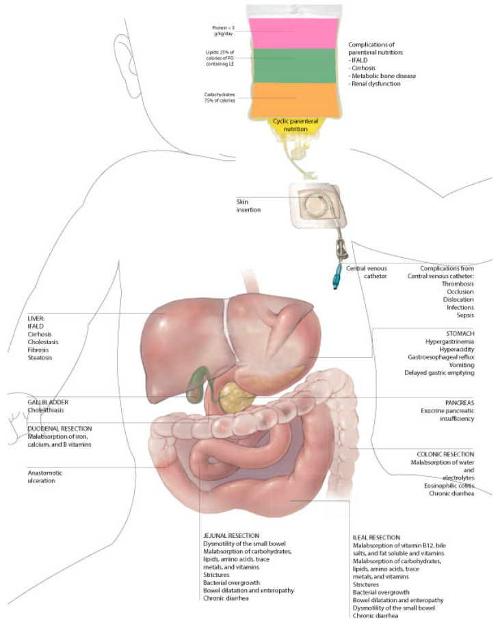
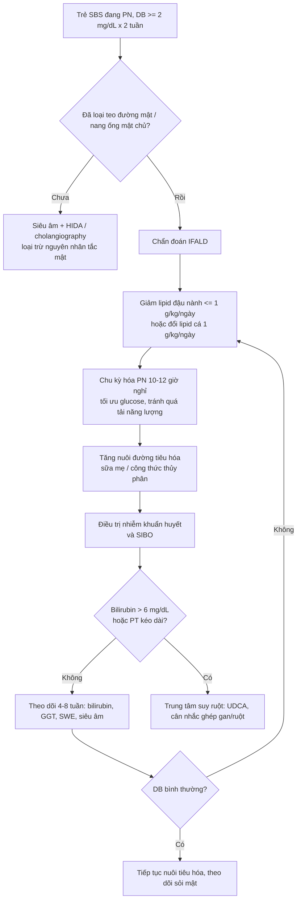
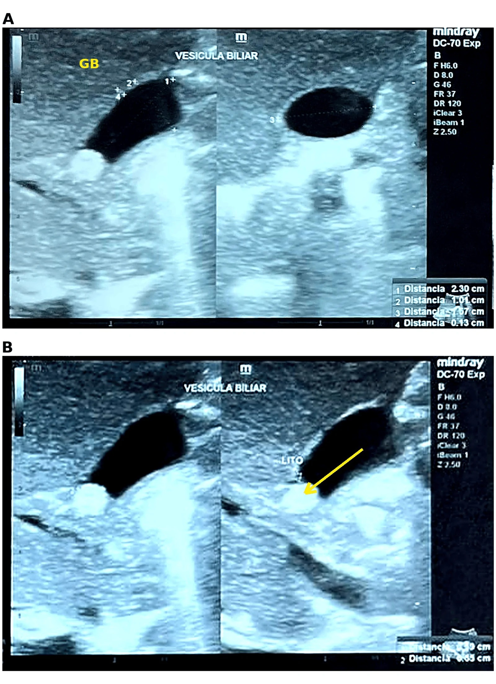
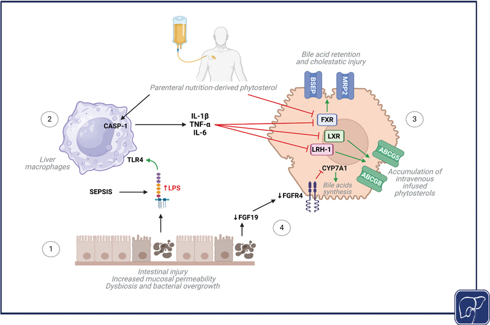

# 3006 — Hội chứng ruột ngắn & bệnh gan do nuôi dưỡng tĩnh mạch ở trẻ: bản đồ cắt ruột, ngưỡng bilirubin trực tiếp & khi nào đổi lipid

**Tags:** `pattern:ruot-ngan` `pattern:vang-da-u-mat` `pattern:gan-to` `pattern:soi-tui-mat` `pattern:gian-ruot` `vung:ruot-non` `vung:gan` `vung:duong-mat` `anatomy:ruot-non` `score:IFALD` `protocol:sieu-am-bung` `protocol:MRI-ruot` `protocol:elastography` `incidentaloma:khong`
**Mức chắc chắn (certainty):** tổng hợp y văn (literature synthesis) — ghép **tổng quan 2023 về SBS nhi** (Nutrients 2023, PMC10221592), **tổng quan cơ chế – điều trị IFALD** (Semin Liver Dis 2025, PMC12031023), **đoàn hệ 24 trẻ Đài Loan** (Biomed J 2025, PMC12332206), **ca sỏi mật tồn tại sau khi hết ứ mật** (Cureus 2026, PMC13696064), **SWE gan ở trẻ đẻ non** (Am J Perinatol 2025, PMC12234155), **tổng quan bệnh đường mật nhi** (World J Gastroenterol 2024, PMC10989494) và **tổng quan nuôi dưỡng đường tiêu hóa ở trẻ ứ mật** (Nutrients 2025, PMC12158089). Không có ca do nhóm tự chụp.

> **Câu hỏi thực hành:** bé gái **2 tháng tuổi**, sinh non **28 tuần**, **viêm ruột hoại tử** phải cắt **35 cm ruột non** + van hồi manh tràng, đang nuôi dưỡng tĩnh mạch (PN) **7 tuần**, nay **vàng da tăng dần, phân bạc màu, gan 3 cm dưới bờ sườn**. Siêu âm không thấy túi mật to, không giãn đường mật. Câu hỏi: **đứt ruột ngắn hay ứ mật do PN, hay cả hai; có bỏ sót teo đường mật không; và bước tiếp theo là gì?**
> Bài chốt **ba quyết định**: **(1) bilirubin trực tiếp ≥ 2 mg/dL kéo dài 2 tuần ở trẻ PN ≥ 14 ngày = IFALD cho tới khi loại trừ nguyên nhân khác; (2) siêu âm + xét nghiệm phải loại teo đường mật (biliary atresia) TRƯỚC, vì cửa sổ mổ hẹp; (3) điều trị IFALD là can thiệp vào PN (giảm lipid đậu nành, đổi lipid cá, chu kỳ hóa) + nuôi đường tiêu hóa, không phải “chờ hết vàng da”.**

## 1. Tổng quan bệnh học – cơ chế hình ảnh: vì sao mất ruột lại thành bệnh gan

- **Định nghĩa hội chứng ruột ngắn (short bowel syndrome — SBS):** tình trạng kém hấp thu do **mất đoạn ruột non về mặt giải phẫu hoặc chức năng**, không đủ duy trì cân bằng đạm – dịch – điện giải – vi chất nếu không có bù trợ giúp. Định nghĩa dùng trong dịch tễ nhi: **ruột còn lại < 25% chiều dài dự kiến theo tuổi thai**, **hoặc** cần PN **> 42 ngày** sau khi mất chức năng/cắt ruột (Nutrients 2023, PMC10221592).
- **Tần suất – con số thật:** SBS ngoại khoa gặp **0,7% (7/1000)** ở trẻ **rất nhẹ cân (VLBW)** và **1,1% (11/1000)** ở trẻ **cực nhẹ cân (ELBW)**; **96%** các ca này do **viêm ruột hoại tử (necrotizing enterocolitis — NEC)**. Tại Ý, suy ruột (intestinal failure) gặp **0,1% trẻ sinh sống (26/30.353)** và **0,5% trẻ nhập NICU (26/5.088)** (PMC10221592). Đây không phải bệnh “cỡ trung tâm hiếm gặp”.
- **Chiều dài ruột non bình thường để đối chiếu:** trẻ **đủ tháng ~150–250 cm** (y văn cũ 176–305 cm do đo sau tử vong); ruột **tăng gấp đôi chiều dài trong 3 tháng cuối thai kỳ** (PMC10221592). Vì vậy **số cm tuyệt đối vô nghĩa nếu không hiệu chỉnh theo tuổi thai** — đây là lý do dùng **tỉ lệ còn lại/dự kiến**.
- **TẠI SAO mất ruột lại ứ mật — chuỗi 4 bước (Hình 1):**
  1. **Mất niêm mạc + mất tính liên tục ruột** → tăng tính thấm, **loạn khuẩn và phát triển quá mức vi khuẩn ruột non (small intestinal bacterial overgrowth — SIBO)** → **lipopolysaccharide (LPS)** vào tuần hoàn cửa;
  2. **LPS gắn TLR4 trên đại thực bào gan** → **CASP-1** hoạt hóa → **IL-1β, TNF-α, IL-6**;
  3. Cytokine **ức chế FXR/LXR** → **giảm BSEP và MRP2** (bơm bài tiết acid mật ra ống mật) → **ứ acid mật trong gan** — đây là **ứ mật do vận chuyển**, không phải do tắc cơ học;
  4. **Phytosterol từ lipid đậu nành** tích lũy (đối kháng FXR, ức chế ABCG5/ABCG8) + **giảm FXR/FGF19** do **mất hồi tràng** (không còn tín hiệu ức chế tổng hợp acid mật) → **tổng hợp acid mật tăng + bài tiết giảm** (Semin Liver Dis 2025, PMC12031023 — Hình 1).
- **TẠI SAO hình ảnh học lại khó:** giai đoạn **cấp/hoạt động** của IFALD là **ứ mật trong tiểu quản và viêm cửa** — **gan có thể bình thường trên siêu âm**; giai đoạn **mạn** mới có **mỡ hóa, phù tế bào gan và xơ hóa cửa** (PMC12031023). Vì vậy **men gan và bilirubin không tương quan chặt với mô học**; khi cần đánh giá giai đoạn mạn, **sinh thiết, hình ảnh gan hoặc đàn hồi (elastography) mới là công cụ đáng tin**.
- **Ngưỡng định nghĩa IFALD (dùng được ngay trên giường):**
  - **Bilirubin trực tiếp (direct bilirubin — DB) ≥ 2 mg/dL kéo dài 2 tuần liên tiếp** ở trẻ cần PN dài hạn (định nghĩa Lacaille, PMC10221592);
  - hoặc **DB > 1,0–2,0 mg/dL và > 20% tổng bilirubin**, ở trẻ **đã nhận PN ≥ 14 ngày** và **đã loại trừ nguyên nhân ứ mật khác** (PMC12031023);
  - **IFALD nặng / bệnh gan giai đoạn cuối:** **bilirubin > 6 mg/dL kéo dài** + **thời gian prothrombin kéo dài** (PMC10221592).
- **Tần suất và yếu tố đẩy nhanh:** IFALD gặp **40–60%** trẻ phụ thuộc PN dài hạn; **mỗi đợt nhiễm khuẩn huyết làm tăng 3,2 lần nguy cơ vàng da**; NEC non tháng là ổ nguy cơ (PMC10221592). Trong đoàn hệ **24 trẻ SBS** (Đài Loan), **IFALD 58,3%**, **chỉ 29,2% đạt tự chủ đường tiêu hóa (enteral autonomy)** sau **10,1 ± 7,3 tháng** PN, **21% tử vong do nhiễm khuẩn huyết**; **tỉ lệ chiều dài ruột còn lại/dự kiến > 25%** là yếu tố dự báo tự chủ mạnh nhất (PMC12332206).
- **Đàn hồi gan lượng hóa được:** ở **37 trẻ đẻ non 23–35 tuần + 12 trẻ đủ tháng**, **SWE gan trung vị 1,22 m/s (IQR 1,19–1,26)** và **không đổi theo tuổi thai, cân nặng, thời điểm đo** (p = 0,158); SWE **tương quan yếu nhưng có ý nghĩa với bilirubin trực tiếp > 1,0 mg/dL (r = 0,37; p = 0,041)** (PMC12234155). Đây là nền để hiểu vì sao **một ngưỡng SWE duy nhất không dùng để chẩn đoán**, nhưng **xu hướng theo thời gian ở cùng một trẻ** thì có ích.

*Trái: 4 nhóm yếu tố (phẫu thuật, nhiễm trùng, dinh dưỡng tĩnh mạch, bệnh nhân). Phải: mô hình 4 bước — tổn thương niêm mạc → LPS/TLR4 → cytokine → ức chế FXR/LXR/BSEP/MRP2 và tích lũy phytosterol. Nguồn: Semin Liver Dis 2025, PMC12031023, CC BY 4.0. Ảnh ghép letterbox, không crop.*

## 2. Mẫu hình + chẩn đoán phân biệt theo vị trí cắt ruột (Gamut)

- **Mẫu hình 1 — “vàng da ứ mật ở trẻ đang PN”:** trẻ **PN ≥ 14 ngày + DB ≥ 2 mg/dL** → gamut: **IFALD**, **teo đường mật**, **nang ống mật chủ**, **viêm gan sơ sinh**, **hội chứng Alagille**, **bệnh xơ nang**, **ứ mật do bùn mật (inspissated bile)**, **sỏi mật**, **nhiễm trùng huyết**. **IFALD là chẩn đoán loại trừ** — không được gắn nhãn trước khi loại teo đường mật.
- **Mẫu hình 2 — bản đồ biến chứng theo vị trí cắt (Hình 2):**

| Vị trí cắt | Mất chức năng chính | Biến chứng hình ảnh – lâm sàng |
|---|---|---|
| **Hỗng tràng (jejunal resection)** | Rối loạn nhu động, hấp thu carbohydrat/đạm/vi chất | **Giãn ruột + ruột non dài ra (bowel dilatation/enteropathy)**, **SIBO**, tiêu chảy mạn |
| **Hồi tràng (ileal resection)** | Mất hấp thu **vitamin B12, muối mật, vitamin tan trong mỡ** | **SIBO**, giãn ruột, tiêu chảy mạn, **thiếu B12** |
| **Mất van hồi manh tràng** | Mất “cửa chặn” + mất hấp thu B12 | **SIBO nặng hơn**, **thời gian quá cảnh ngắn**, tiêu chảy |
| **Cắt đại tràng** | Mất hấp thu nước – điện giải | Tiêu chảy, **nhiễm khuẩn huyết**, **D-lactic acidosis** nếu còn đại tràng nối tiếp |
| **Cắt tá tràng** | Mất hấp thu sắt, calci, vitamin B | Thiếu máu, **loãng xương**, loét miệng nối |
| **PN dài hạn** | Gan – mật, xương, thận | **IFALD**, **bùn/sỏi túi mật**, **bệnh xương do PN**, rối loạn chức năng thận |

  *(Nguồn: Nutrients 2023, PMC10221592 — Hình 2 dưới đây)*

*Bản đồ giải phẫu: mỗi đoạn ruột bị cắt → nhóm thiếu hụt tương ứng; cột phải là biến chứng của PN. Nguồn: Nutrients 2023, PMC10221592, CC BY 4.0.*

- **Mẫu hình 3 — “ruột giãn + chậm lớn + bụng chướng”:** giãn ruột non mạn (> 3 cm ở trẻ lớn, nhưng **ngưỡng theo tuổi chưa được chuẩn hóa — cần tra**) → **SIBO**, **D-lactic acidosis** (nhiễm toan chuyển hóa có khoảng trống anion, thường sau bữa ăn nhiều carbohydrat), **tắc ruột do dính**, **hẹp miệng nối**.
- **Mẫu hình 4 — “mất đường vào tĩnh mạch”:** huyết khối – tắc **tĩnh mạch trung tâm** nhiều đoạn → không còn chỗ nuôi PN → chỉ định **ghép ruột**; đây là biến chứng **quyết định tử vong** chứ không phải bản thân chiều dài ruột.

## 3. Bảng so sánh phân biệt (ma trận đối chiếu)

| Thực thể (entity) | Hình ảnh điển hình | Chốt vào (rule-in) | Chốt loại (rule-out) | Gợi ý xác nhận |
|---|---|---|---|---|
| **IFALD** | Gan to nhẹ, **echo gan tăng** so với vỏ thận, **bùn/sỏi túi mật**, không giãn đường mật; giai đoạn mạn: **bờ gan gồ ghề + lách to + SWE tăng** | **PN ≥ 14 ngày + DB ≥ 2 mg/dL × 2 tuần + đã loại trừ teo đường mật** | **Túi mật bình thường + không dấu hiệu tắc mật + DB < 1 mg/dL** → ít nghĩ IFALD | Bilirubin phân đoạn, GGT, SWE, sinh thiết khi cần |
| **Teo đường mật (biliary atresia)** | **Dấu dây tam giác (triangular cord sign) > 3–4 mm** trước tĩnh mạch cửa phải, **không thấy ống mật chủ**, **ĐM gan > 1,5 mm**, nang nhỏ rốn gan, **đa lách (polysplenia)** | **Phân bạc màu + DB tăng + dây tam giác dương tính + không thấy túi mật** | **Thấy ống mật chủ bình thường + túi mật co bóp được** → ít nghĩ teo đường mật | Siêu âm lặp sau 4 giờ nhịn ăn; HIDA; sinh thiết/ cholangiography |
| **Nang ống mật chủ (choledochal cyst)** | **Nang dạng túi/ống ở rốn gan**, giãn đường mật trong gan, **không có dây tam giác** | **Nang dạng kén + nối với đường mật** | **Không thấy nang + đường mật trong gan bình thường** | MRCP/ERCP, cholangiography |
| **Ứ mật do bùn mật (inspissated bile syndrome)** | **Bùn mật đặc trong túi mật/ống mật chủ**, có thể giãn nhẹ; **dây tam giác âm tính** | **Trẻ đang PN + bùn mật thấy rõ + hết sau khi giảm PN/tăng nuôi tiêu hóa** | **Dây tam giác dương + không thấy ống mật chủ** → nghĩ teo đường mật | Siêu âm lặp, theo dõi bilirubin |
| **Sỏi túi mật ở trẻ PN** | **Echo dày có bóng lưng trong lòng túi mật**, thành mỏng; có thể **tồn tại dù bilirubin đã về bình thường** | **Sỏi thấy rõ + bóng lưng** (ca 5 tháng: sỏi **6,5 mm**, túi mật **2,30 × 1,17 cm**, thành **0,13 cm**) | **Không bóng lưng = bùn mật/polyp**, không phải sỏi | Siêu âm lặp 4–6 tuần; cắt túi mật nếu triệu chứng/biến chứng |
| **Viêm gan sơ sinh / Alagille** | Gan to, echo thô; **Alagille: đốt sống cánh bướm, hẹp ĐM phổi, nốt vàng da** | **Alagille: đặc điểm syndromic + thiếu ống mật gian tiểu thùy trên sinh thiết** | **Không có đặc điểm syndromic, GGT rất cao** → nghĩ tắc mật ngoài gan | Sinh thiết, gen JAG1/NOTCH2 |
| **SIBO / D-lactic acidosis** | Giãn ruột non, mức khí–dịch, thành ruột dày nhẹ; **không có mức nước–khí tự do** | **Giãn ruột + chậm lớn + toan chuyển hóa + đáp ứng kháng sinh/metronidazole** | **Giãn ruột đơn thuần không triệu chứng** → theo dõi | Cấy dịch ruột non, khí thở, lactate D |

## 4. Protocol chụp + hệ phân độ & thuật toán điều trị

- **Siêu âm bụng (đầu tay, ALARA):** trẻ **nhịn ăn 3–4 giờ** trước khi đánh giá túi mật; đo **chiều dài, đường kính ngang, độ dày thành túi mật**, tìm **sỏi (echo + bóng lưng)**, **bùn mật**, **giãn đường mật trong/ngoài gan**, **kích thước gan – lách**, **đường kính tĩnh mạch cửa**, cổ trướng, tuần hoàn bàng hệ. Với nghi teo đường mật: đo **dây tam giác trước tĩnh mạch cửa phải (ngưỡng > 3–4 mm)**, **ĐM gan > 1,5 mm**, tìm **đa lách** (**độ đặc hiệu 100% nhưng độ nhạy chỉ 10%**) (World J Gastroenterol 2024, PMC10989494).
- **Đàn hồi gan (SWE):** lấy **≥ 10 lần đo**, báo **trung vị + IQR**; ở trẻ đẻ non nền là **1,22 m/s (IQR 1,19–1,26)** và **không đổi theo tuổi thai** — nên **so chuỗi theo thời gian ở cùng trẻ**, không so với ngưỡng người lớn (PMC12234155).
- **Chụp ruột cản quang (upper GI + small bowel follow-through với thuốc tan trong nước):** đo **chiều dài ruột non còn lại từ dây chằng Treitz**, đánh giá **đường kính (giãn)**, **thời gian quá cảnh**, **hẹp miệng nối**, **van hồi manh tràng còn hay mất**. Không dùng baryt nếu nghi thủng.
- **MRI ruột (enterography) khi cần:** tránh bức xạ ở trẻ phải chụp lặp nhiều lần; đánh giá **giãn – dày thành – tăng tín hiệu thành** (viêm/SIBO) và **dịch tự do**.
- **X-quang bụng:** chỉ để tìm **tắc ruột, thủng, mức khí–dịch**; **không** dùng để đo chiều dài ruột.
- **Phân độ IFALD (theo giai đoạn, không phải RADS):**

| Giai đoạn | Mô học | Hình ảnh / xét nghiệm |
|---|---|---|
| **1 — cấp/hoạt động** | Ứ mật tiểu quản, nút mật ống mật cửa, viêm cửa, phản ứng ống mật | **Siêu âm thường bình thường**; DB tăng, GGT tăng |
| **2 — mạn** | **Mỡ hóa, phồng tế bào gan, xơ hóa quanh cửa** | **Gan echo tăng/không đều, bờ gồ ghề, lách to, SWE tăng**; có thể **bilirubin bình thường** |

  *(Nguồn: Semin Liver Dis 2025, PMC12031023)*

- **Thuật toán xử trí (cập nhật 2025):**

- **Con số điều trị cần nhớ:**
  - Đổi từ **lipid đậu nành 3 g/kg/ngày** sang **lipid cá (FO-LE) tối đa 1 g/kg/ngày**: **44 trẻ** đảo ngược ứ mật **nhanh gấp 6 lần** và **giảm tử vong** so với **49 ca chứng lịch sử** vẫn dùng SO-LE 3 g/kg/ngày (PMC12031023);
  - **Chu kỳ hóa PN trung bình 12 ngày** cải thiện **AST, GGT, bilirubin toàn phần**, không khác biệt các men khác (PMC12031023);
  - **Teduglutide (đồng vận GLP-2)** **0,025–0,05 mg/kg/ngày** có liên quan **giảm thể tích PN** ở trẻ (PMC10221592) — **chưa có dữ liệu sống còn dài hạn**;
  - **Tự chủ đường tiêu hóa 29,2%** sau **10,1 ± 7,3 tháng** khi **tỉ lệ ruột còn lại/dự kiến > 25%** (PMC12332206).

## 5. Biến thể bình thường và cạm bẫy

- **Gan “sáng” ở sơ sinh là chủ quan:** bình thường **echo gan ≥ vỏ thận**; đừng gọi “gan nhiễm mỡ” chỉ vì gan sáng hơn nhu mô thận cùng độ sâu — phải so **cùng độ sâu, cùng gain**, và đối chiếu **gan – thận phải**.
- **Không thấy túi mật ≠ teo đường mật:** trẻ **đang nhịn ăn/PN** có túi mật **xẹp, khó thấy**; phải **lặp siêu âm sau 3–4 giờ** và tìm **dây tam giác** thay vì kết luận sớm.
- **Dây tam giác giả:** thành tĩnh mạch cửa dày, hạch rốn gan, hoặc **dây xơ sau viêm** có thể giả dương; ngưỡng **> 3–4 mm** và **vị trí ngay trước tĩnh mạch cửa phải** mới có giá trị (PMC10989494).
- **Bilirubin bình thường không loại trừ bệnh gan mạn:** ở giai đoạn 2 (mỡ hóa/xơ), **men gan và bilirubin có thể bình thường** trong khi mô học đã xấu — cần **SWE/sinh thiết** (PMC12031023).
- **Sỏi mật có thể tồn tại sau khi hết ứ mật:** ca trẻ sinh non **PN-associated cholestasis** đã hết về sinh hóa nhưng **sỏi 6,5 mm vẫn còn lúc 5 tháng**, cuối cùng phải **cắt túi mật** (PMC13696064) — **theo dõi sỏi cả khi bilirubin đã bình thường**.
- **“IFALD” là chẩn đoán loại trừ:** gắn nhãn IFALD khi chưa loại **teo đường mật** là bỏ lỡ **cửa sổ mổ Kasai**; thời điểm mổ quyết định tiên lượng (World J Gastroenterol 2024 — **ngưỡng ngày cụ thể chưa đối chiếu trong bài này**).
- **SIBO vs tắc ruột:** giãn ruột non mạn với mức khí–dịch **không đồng nghĩa tắc**; tắc thật có **mức nước–khí thẳng, quai giãn cấp, mất nhu động** và **đau bụng cấp**.

## 6. Tự lượng giá — Blind Quiz

**Ca 1 — Trẻ sinh non 27 tuần, tiền sử NEC cắt ruột, PN 5 tháng, bilirubin trực tiếp đã về bình thường. Siêu âm bụng vì “theo dõi”.**

- Gợi ý lâm sàng: không đau bụng, không sốt, ăn đường miệng đã tăng; xét nghiệm gan bình thường.
- Câu hỏi: mô tả 2 panel; cấu trúc tăng âm trong lòng túi mật là gì? Có cần mổ ngay không? 3 chẩn đoán phân biệt?

<b>Bấm để hiện đáp án (findings + chẩn đoán)</b>

- **Findings:** (A) túi mật **2,30 cm chiều dài, 1,17 cm đường kính ngang, thành 0,13 cm** — không dày, không dịch quanh túi mật; (B) **một cấu trúc tăng âm ~6,5 mm trong lòng túi mật, có bóng lưng** (mũi tên vàng, chữ “LITO”), ống mật chủ không giãn.
- **Chẩn đoán:** **sỏi sắc tố đơn độc tồn tại sau khi ứ mật do PN đã hết** — biến chứng muộn của IFALD/PN dài hạn, không phải bùn mật (bùn không có bóng lưng rõ).
- **Phân biệt:** bùn mật (echo thấp, không bóng lưng, di động chậm), polyp túi mật (dính thành, không bóng lưng), sỏi thật (bóng lưng, di động khi đổi tư thế).
- **Xử trí:** sỏi **không triệu chứng** → theo dõi siêu âm định kỳ; ca này sỏi **tồn tại qua nhiều lần siêu âm** và được **cắt túi mật mở** — chỉ định dựa trên **sỏi tồn tại + nguy cơ biến chứng**, không dựa trên bilirubin.
- **Nguồn ảnh:** Cureus 2026, PMCID **PMC13696064**, **CC BY 4.0** (nguyên bản, giữ nhãn của tác giả).

**Ca 2 — Trẻ 3 tháng, PN 8 tuần sau cắt 40 cm ruột non, vàng da tăng, phân bạc màu. Siêu âm: không thấy túi mật, dây tăng âm 5 mm trước tĩnh mạch cửa phải.**

- Câu hỏi: dấu hiệu trên gợi ý gì? Vì sao **không được** kết luận ngay “ứ mật do PN”? Cần làm gì trong 24–48 giờ?

<b>Bấm để hiện đáp án (findings + chẩn đoán)</b>

- **Findings:** **dây tam giác (triangular cord sign) 5 mm** ngay trước tĩnh mạch cửa phải + **không thấy túi mật** + phân bạc màu + DB tăng = **teo đường mật cho tới khi loại trừ**.
- **Vì sao không kết luận IFALD:** trẻ **đang PN** nên có **đủ hai bệnh cùng lúc**; IFALD là **chẩn đoán loại trừ**, còn teo đường mật có **cửa sổ mổ hẹp** — bỏ sót là mất cơ hội Kasai.
- **Việc cần làm:** siêu âm lặp sau nhịn ăn, **xét nghiệm GGT/bilirubin phân đoạn/đông máu**, **HIDA hoặc sinh thiết/cholangiography** theo trung tâm; **không trì hoãn vì “đang PN”**.
- **Cơ chế (Hình):** LPS → TLR4 → **IL-1β/TNF-α/IL-6** → **giảm BSEP/MRP2** → ứ acid mật; **phytosterol** từ lipid đậu nành ức chế FXR thêm. Vì vậy **giảm lipid đậu nành/đổi lipid cá** là can thiệp cơ chế, không phải “hạ men gan”.
- **Nguồn ảnh:** Semin Liver Dis 2025, PMCID **PMC12031023**, **CC BY 4.0**.

## Bài liên quan chéo
- [693 – Theo dõi sau cắt u gan ở trẻ](../693-theo-doi-sau-cat-u-gan-o-tre/lesson.md)
- [641 – Theo dõi hậu phẫu Kasai](../641-theo-doi-hau-phau-kasai/lesson.md)
- [646 – Hội chứng khoang bụng ở trẻ](../646-hoi-chung-khoang-bung-o-tre/lesson.md)
- [1804 – Suy giáp tiêu thụ do u mạch máu ngoài gan](../1804-suy-giap-tieu-thu-do-u-mach-mau-ngoai-gan/lesson.md)
- [630 – U bụng nhi: neuroblastoma vs Wilms](../630-u-bung-nhi-neuroblastoma-vs-wilms/lesson.md)
- [176 – TIPS/DIPS theo dõi shunt](../176-tips-dips-theo-doi-shunt/lesson.md)

## Ảnh
- `3006_ruot-ngan_so-do_PMC10221592-F1.jpg` — bản đồ biến chứng theo vị trí cắt ruột.
- `3006_ifald_yeu-to_PMC12031023-F3.jpg` + `3006_ifald_co-che_PMC12031023-F4.jpg` — ghép thành `composite_ifald_yeu-to-co-che.jpg`.
- `3006_ifald_sieu-am-tui-mat_PMC13696064-F1.jpg` — siêu âm sỏi túi mật.
- Nguồn, giấy phép từng ảnh: `images/CREDITS.md`; link bài gốc: `sources.md`.

> Không dùng để chẩn đoán độc lập khi chưa có người hướng dẫn.
