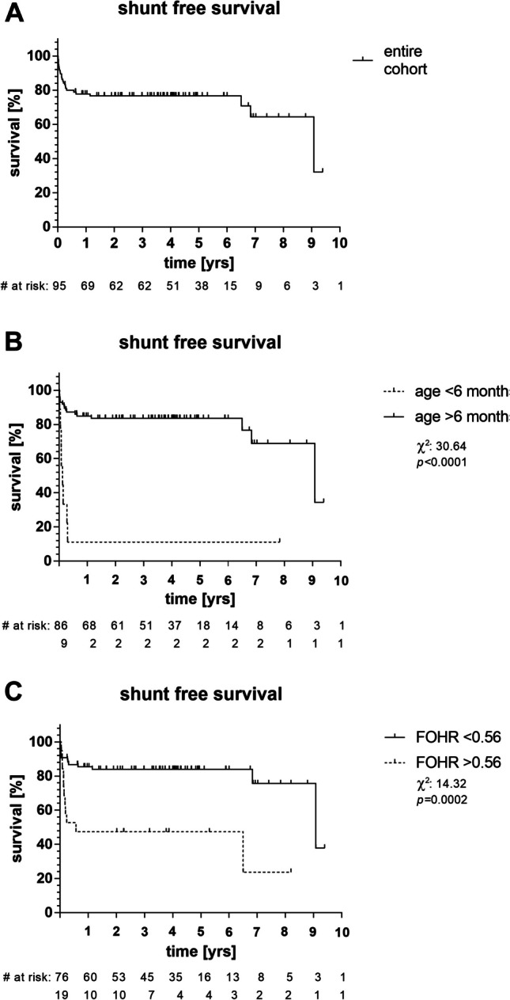
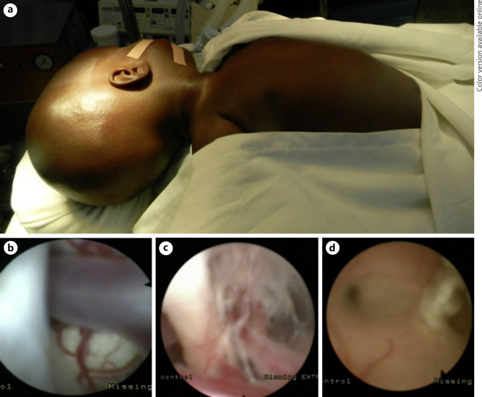
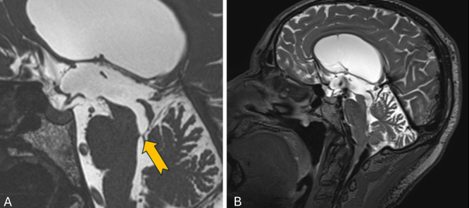
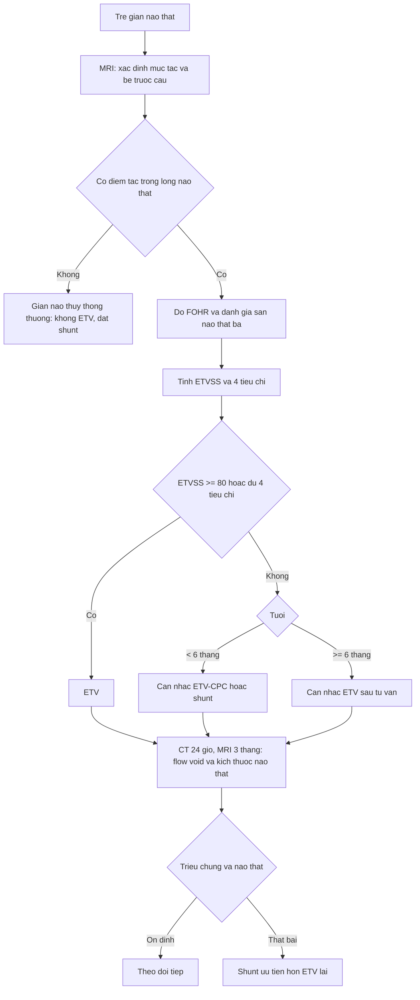
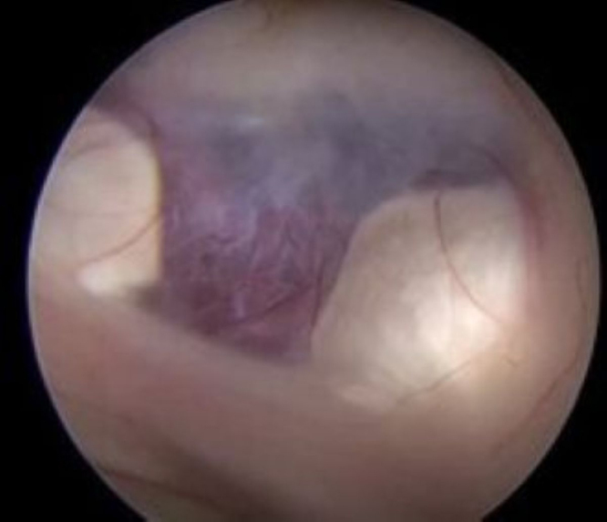
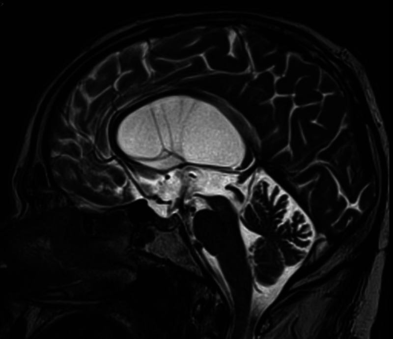
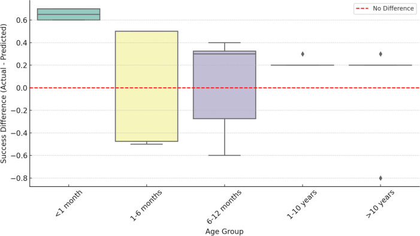

# 3007 — Mở thông não thất III qua nội soi ở trẻ (ETV/ETV-CPC): chọn bệnh nhân bằng MRI + điểm ETVSS, và đọc đúng "lỗ thông" sau mổ / Endoscopic third ventriculostomy in children: patient selection, ETV Success Score, and imaging of the stoma

**Tags:** `pattern:gian-nao-that` `pattern:tac-nghen-dong-chay` `pattern:tac-cong-sylvius` `pattern:thoat-vi-hanh-nhan` `vung:nao-that` `vung:be-truoc-cau` `vung:cong-sylvius` `anatomy:san-nao-that-ba` `score:ETVSS` `score:FOHR` `incidentaloma:khong` `protocol:MRI-lat-mong` `protocol:FIESTA-CISS` `protocol:phase-contrast` `protocol:CT-so-nao` `protocol:noi-soi-than-kinh`

**Mức chắc chắn (certainty):** tổng hợp y văn (literature synthesis) — số liệu lấy từ các bài **open-access đã đọc toàn văn**: Møen EN et al., *Brain Spine* 2025;5:104291 (PMC12171757, CC BY 4.0 — **127 ca** tại một trung tâm + **tổng quan hệ thống 64 báo cáo/8.409 ca**); Tatoshvili D et al., *Childs Nerv Syst* 2024;41:57 (PMC11649818, CC BY 4.0 — **95 ETV**, mô hình **lâm sàng + FOHR + sàn não thất phồng**, AUC **0,8082**); Krause M et al., *Childs Nerv Syst* 2024;41:72 (PMC11681997, CC BY 4.0 — **54 trẻ**, bảng ETVSS của Kulkarni); Castro P et al., *Childs Nerv Syst* 2025;41:250 (PMC12310776, CC BY 4.0 — **NSQIP-P: 2.543 ETV vs 10.135 shunt**); Diallo O et al., *Pediatr Neurosurg* 2023;58:38–44 (PMC10064391, CC BY 4.0 — **199 nhũ nhi ETV/CPC** ở Mali); Van Rijen SRM et al., *Childs Nerv Syst* 2025;41:115 (PMC11836075, CC BY 4.0 — **54 trẻ < 3 tháng**); Ahmed I et al., *Surg Neurol Int* 2025;16:205 (PMC12134809, CC BY-NC-SA 4.0 — **663 ca thất bại ETV**); Łajczak A et al., *Childs Nerv Syst* 2025;41:297 (PMC12479695, CC BY 4.0 — meta **machine learning**); Neri N et al., *J Neurosurg Case Lessons* 2025;10(3):CASE2531 (PMC12278952, CC BY-NC-ND 4.0 — **ca nguyên văn "flow void giả"**). Bài **không** có ca nguyên văn riêng của nhóm; ca 1–3 là ca nguyên văn/minh họa của nguồn, ghi rõ Fig.

> **Câu hỏi gốc của bài:** bé **4 tháng tuổi**, **đầu to nhanh**, MRI thấy **giãn ba não thất, cống Sylvius hẹp, bể trước cầu còn thông**. Ba câu hỏi: (1) **có làm ETV được không**, hay phải **đặt shunt**; (2) nếu làm **ETV**, **khả năng thành công bao nhiêu %** và tính bằng **điểm nào**; (3) sau mổ, trên MRI thấy **"vệt đen" ở sàn não thất ba** — đó là **lỗ thông thật hay chỉ là dòng chảy giả**?

## 1. Tổng quan — vì sao "chọc một lỗ ở sàn não thất ba" lại chữa được não úng thủy

**A. Bệnh học (pathology) và cơ chế:**

- **Định nghĩa:** **mở thông não thất III qua nội soi (endoscopic third ventriculostomy, ETV)** = **tạo lỗ thủng ở sàn não thất ba** để dịch não tủy (DNT) từ **não thất ba chảy thẳng vào bể trước cầu**, **bỏ qua cống Sylvius và não thất IV**. Đây là **dẫn lưu sinh lý nội sọ**, không đặt ống nước ngoài.
- **Điều kiện để ETV "chữa được":** (1) **tắc nghẽn NẰM TRONG** đường DNT (cống Sylvius, não thất IV, lỗ thoát não thất IV, nang Blake/Dandy–Walker) — tức **giãn não thủy tắc nghẽn (obstructive/non-communicating)**; (2) **hấp thu DNT ở màng nhện còn tốt**; (3) **bể trước cầu THÔNG** để DNT có chỗ đi. Thiếu (2) hoặc (3) → ETV **thất bại sớm**, dù mổ kỹ thuật tốt.
- **Vì sao giãn não thủy "thông thương" (communicating) không hợp ETV:** tắc nghẽn ở **màng nhện/hấp thu**, không phải ở đường dẫn — mở lỗ sàn não thất ba **không giải quyết được** chỗ tắc. Đây là **lý do số một** khiến ETV thất bại vì **chọn sai bệnh nhân**, không phải vì kỹ thuật.
- **ETV-CPC (ETV + đốt đám rối mạch mạc):** thêm **đốt đám rối mạch mạc (choroid plexus cauterization)** để **giảm sản xuất DNT**; dùng chủ yếu ở **nhũ nhi** — nhóm mà ETV đơn thuần có tỉ lệ thất bại cao nhất. Trong loạt **199 nhũ nhi** ở Mali: **47% (94/199) không cần shunt** sau ETV/CPC; tỉ lệ thành công **69%** ở **6–12 tháng**, **54%** ở **3–6 tháng**, chỉ **29%** ở **≤ 3 tháng**; nhiễm trùng sau mổ **1%**, tử vong 12 tháng **8%** (PMC10064391).
- **Vì sao tuổi là yếu tố mạnh nhất:** ở trẻ rất nhỏ, **màng nhện chưa trưởng thành/hấp thu kém** và **đầu chưa cốt hóa** nên **áp lực nội sọ thay đổi nhanh**; trong loạt **95 ETV** của PMC11649818, **trẻ > 6 tháng** có **tỉ lệ không phải đặt shunt sau 1 năm 84,8%** so với **11,1%** ở **trẻ < 6 tháng** (P < 0,001) — chênh lệch **lớn nhất trong mọi biến số**.

*Kaplan–Meier **thời gian không phải đặt shunt** sau ETV (95 ca). (A) Toàn bộ: **1 năm 77,8%**, **5 năm 76,6%** — nghĩa là **thất bại muộn ít** sau khi đã qua 1 năm đầu. (B) Theo tuổi: **> 6 tháng 84,8% / 83,5%** (1 năm / 5 năm) so với **11,1% / 11,1%** ở **< 6 tháng** (χ² = 30,64; P < 0,001). (C) Theo **FOHR**: **≤ 0,56 → 85,4% / 83,9%** so với **47,4% / 47,4%** khi **> 0,56** (χ² = 14,32; P < 0,001). Nguồn: Tatoshvili D et al., Childs Nerv Syst 2024;41:57, PMC11649818 Fig. 1, CC BY 4.0.*
- **Vì sao phải có mô hình dự báo:** ETV **thất bại muộn** (tháng–năm) và **thất bại sớm** đều dẫn tới **đặt shunt**; biết trước xác suất giúp **tư vấn gia đình** và **chọn ETV hay shunt ngay từ đầu**. Công cụ chuẩn là **ETV Success Score (ETVSS) của Kulkarni** (tuổi + nguyên nhân + đã có shunt trước đó), tổng **0–100**: **90–100 = khả năng cao**, **70–80 = trung bình**, **≤ 60 = thấp** (bảng trong PMC11681997, Table 1). Nghiên cứu **54 trẻ** cho thấy thành công thực tế **88%** so với **73%** ETVSS dự báo (p = 0,035), và **nhóm > 1 tuổi gần 100%** (PMC11681997) → **ETVSS dự báo khá "bi quan" ở trẻ nhỏ**, nhưng vẫn là **công cụ tư vấn chuẩn**.
- **Vì sao ảnh hưởng của "hình thái" quan trọng hơn "kích thước":** **sàn não thất ba phồng xuống (bulged lamina terminalis/floor)** = còn **chênh áp lực trong–ngoài** → dễ chọc và **dự báo thành công** (**OR 4,59**, 95% CI 1,15–19,6); **não thất càng giãn lớn (FOHR cao > 0,56)** lại **dự báo xấu hơn** (**1 năm không shunt 47,4% vs 85,4%**) (PMC11649818). Nghĩa là **"não thất to" không đồng nghĩa "ETV dễ thành công"**.
- **Vì sao "flow void" là dấu hiệu trung tâm sau mổ:** dòng DNT **qua lỗ thông** có **vận tốc cao, chảy rối** → **mất tín hiệu (signal void)** trên **T2/FIESTA** theo **nguyên lý dephase spin chuyển động nhanh**. Nhưng **mất tín hiệu cũng xuất hiện** khi **sàn não thất ba mỏng rung theo mạch đập** hoặc **DNT chảy qua lỗ Monro** — đó là **"flow void giả (pseudo-flow void)"**, không phải lỗ thông thật (PMC12278952). Vì vậy **đọc flow void một mình là bẫy**.

**B. Ngưỡng định lượng bắt buộc (cửa 1 Argon):**

| Đại lượng | Con số đã kiểm chứng | Ý nghĩa thực hành |
|---|---|---|
| Thành công gộp | **73,4%** (64 báo cáo, **8.409 ca**); biến chứng **11,6%** (PMC12171757) | Con số để **tư vấn**: 3/4 thành công |
| Tại một trung tâm | **78,7%** thành công, **21,3%** biến chứng (**127 ca**, tuổi 0–86) (PMC12171757) | Trung tâm nhỏ có thể **ngang chuẩn** |
| Biến chứng cụ thể | **rò DNT 3,94%**, **nhiễm trùng 3,94%**, **dùng EVD 3,94%**, **biến chứng 30 ngày 21,26%** (PMC12171757) | Phần lớn **thoáng qua**, không di chứng |
| Cải thiện triệu chứng | **83,3%** giảm triệu chứng ở lần tái khám đầu (thường 3 tháng) (PMC12171757) | Đánh giá **lâm sàng trước**, không chỉ ảnh |
| Trẻ < 6 tháng | **1 năm không shunt 11,1%** vs **84,8%** ở > 6 tháng; **5 năm 11,1% vs 83,5%** (P < 0,001) (PMC11649818) | **Tuổi là biến số mạnh nhất** |
| FOHR | **≤ 0,56 → 85,4%** không shunt/1 năm vs **47,4%** khi **> 0,56** (P < 0,001); **OR 6,09** (2,16–16,33) (PMC11649818) | Đo **FOHR** trên MRI trước mổ |
| Mô hình 4 biến | **tuổi > 6 tháng OR 29,25**; **sàn não thất phồng OR 4,59**; **FOHR nhỏ**; **không tắc lỗ não thất IV OR 0,31**; **AUC 0,8082** (PMC11649818) | Đủ 4 tiêu chí → **92%** không shunt |
| ETVSS | **0–100**; **≥ 80 → 84%** không shunt trong loạt 95 ca (PMC11649818) | Mô hình 4 biến **nhỉnh hơn** ETVSS (92% vs 84%) |
| ETVSS — thành phần | Tuổi: **< 1 tháng 0 · 1–<6 tháng 10 · 6–<12 tháng 30 · 1–<10 tuổi 40 · ≥ 10 tuổi 50**; nguyên nhân: **sau nhiễm trùng 0 · MMC/IVH/u không phải tuyến tùng 10 · khác 30 · hẹp cống/u tuyến tùng 40**; **đã có shunt 0, chưa có 10** (PMC11681997, Table 1) | Cộng điểm **trước khi mổ** |
| ETV-CPC ở nhũ nhi | **47% (94/199)** không shunt; **69% / 54% / 29%** theo **6–12 / 3–6 / ≤ 3 tháng** (PMC10064391) | Ở **≤ 3 tháng**, ETV/CPC vẫn **chỉ ~1/3** |
| Trẻ < 3 tháng | **54 ca**: **42** cần điều trị vĩnh viễn (**28 shunt, 14 ETV**); **thất bại shunt 32,1%**, **thất bại ETV 50%** (PMC11836075) | Nhóm này **khó nhất**, tỉ lệ thất bại cao |
| 30 ngày sau mổ (NSQIP-P) | **≤ 6 tháng: mổ lại 17,4% vs shunt 4,8%**, nhập viện lại **15,7% vs 6,1%**, co giật **6,3% vs 0,4%** (P < 0,001); **≥ 2 tuổi: tử vong 0,4% vs 1,5%** (PMC12310776) | **ETV "trả giá" ngắn hạn ở trẻ nhỏ**, lợi ở trẻ lớn |
| Thất bại ETV rồi làm gì | **663 ca**: **ETV lại 33,18%** (thất bại **74,98%**) vs **shunt 66,81%** (thất bại **22,26%**); **chảy máu khi ETV lần đầu → ưu tiên shunt** (P < 0,05) (PMC12134809) | **Thất bại ETV → shunt là lựa chọn chắc hơn** |
| Mô hình máy học | **4 nghiên cứu/3.087 trẻ**: **AUC gộp 0,63** (0,56–0,70), **I² 96%**; nhóm có ảnh **0,74** (PMC12479695) | **Chưa vượt** ETVSS; **đừng tin "AI chọn bệnh"** |

**C. TẠI SAO ảnh trông như vậy (vật lý hình ảnh):**

- **Sàn não thất ba phồng xuống** trên T2 sagittal = **chênh áp lực** giữa não thất và bể trước cầu; **mất phồng** = hai khoang **đã cân bằng** → ETV **ít lợi**.
- **Mất tín hiệu (flow void) trên T2/FIESTA** là **hiện tượng vật lý**: spin nước chuyển động **nhanh và rối** ra khỏi mặt cắt trong **thời gian TE** → **không thu được tín hiệu**. Vì vậy **flow void KHÔNG đặc hiệu cho lỗ thông** — **rung sàn não thất ba** (mỏng, đập theo mạch) và **dòng qua lỗ Monro** cũng tạo flow void (PMC12278952).
- **Phase-contrast (cine) MRI / time-SLIP** đo **vận tốc và hướng dòng** thay vì chỉ "có/không tín hiệu" → phân biệt **dòng thật qua lỗ** với **rung thành** (PMC12278952).
- **CT sau mổ 24 giờ:** đánh giá **máu tụ, tràn khí, giãn não thất cấp**, và **vị trí lỗ thông**; **không** đánh giá được **chức năng** lỗ thông.
- **Kích thước não thất giảm CHẬM:** não thất có thể **không nhỏ lại sớm** dù ETV thông; **giảm FOHR** là dấu hiệu **theo dõi**, không phải điều kiện thành công tức thì.
- **FOHR** = **(đường kính lớn nhất sừng trán + sừng chẩm) / (2 × đường kính lưỡng đỉnh)** — đo trên **MRI 3D tái định dạng trục song song sàn thể chai** (định nghĩa của PMC11649818).

## 2. Mẫu hình + chẩn đoán phân biệt theo vị trí (Gamut)

**A. Theo VỊ TRÍ TẮC (quyết định ETV có hợp không):**

- **Tắc ở cống Sylvius (aqueductal stenosis):** giãn **não thất bên + não thất ba**, **não thất IV bình thường** — **ứng viên tốt nhất** cho ETV.
- **Tắc ở não thất IV / lỗ thoát não thất IV (4th ventricle outlet obstruction):** giãn **cả bốn não thất**; ETV vẫn làm được nhưng **kết quả kém hơn** (**OR 0,31** cho "không tắc lỗ IV" trong mô hình = **tắc lỗ IV làm giảm khả năng thành công**) (PMC11649818).
- **Nang Blake / Dandy–Walker:** giãn não thất + **bể lớn sau**; cần **đánh giá bể trước cầu** trước khi chọc sàn.
- **U vùng tuyến tùng / u mạch mạc (tectal glioma):** tắc do **chèn ép cống**; ETV **vừa giải áp vừa sinh thiết** — nhưng **không sinh thiết mù** u tuyến tùng.
- **Chiari II / thoát vị tủy–màng não (MMC):** giải phẫu **lệch**, sàn não thất ba **khó tiếp cận**; ETV **không phải lựa chọn đầu tay**, ETV-CPC còn **tranh luận**.
- **Giãn não thủy thông thương (communicating) / sau xuất huyết nặng / sau viêm màng não:** **không hợp ETV** — tắc ở **hấp thu**.
- **Sau xuất huyết não thất (IVH) ở trẻ non tháng:** **máu + xơ** làm **bể trước cầu dính**; ETV thành công thấp, **ưu tiên shunt/ETV-CPC theo trung tâm**.

*Bộ ảnh **ETV/CPC ở nhũ nhi** (loạt 199 trẻ tại Mali). (a) **Đầu to, thóp căng** — hình thái lâm sàng của giãn não thủy nhũ nhi. (b) Sau khi **mở sàn não thất ba**, thấy **thân nền (basilar trunk)** trong bể trước cầu. (c) **Mô sẹo trong bể nền** — đây là lý do **thất bại chức năng** dù lỗ mở kỹ thuật tốt. (d) **Cống Sylvius bị bít bởi màng** (mũi tên trắng). Bài học: **thấy được lỗ mở chưa đủ** — phải **bể trước cầu thông và không dính**. Nguồn: Diallo O et al., Pediatr Neurosurg 2023;58:38–44, PMC10064391 Fig. 2, CC BY 4.0.*

**B. Theo BỆNH CẢNH lâm sàng:**

- **Nhũ nhi đầu to nhanh, thóp căng** → giãn não thủy tắc nghẽn; **siêu âm qua thóp** trước, MRI khi cần mổ.
- **Trẻ lớn: đau đầu buổi sáng, nôn, phù gai** → tắc nghẽn mạn; **ETV tỉ lệ thành công cao**.
- **Đang có shunt, shunt hỏng** → có thể **ETV thay shunt** ("shunt independence"), nhưng **tiền sử shunt là yếu tố nguy cơ thất bại** (PMC12171757).
- **Sau mổ ETV: sốt, đau đầu, tri giác xấu** → **nhiễm trùng/rò DNT/máu tụ**; **CT cấp**.
- **Sau mổ nhiều tháng: triệu chứng quay lại** → **hẹp lỗ thông (stoma closure)** hoặc **tắc mới**; MRI + phase-contrast.

**C. Gamut phân biệt các "bẫy hình ảnh" sau mổ:**

- **Lỗ thông thật:** flow void **tại sàn não thất ba**, **liên tục với bể trước cầu**, não thất **giảm dần**, **lâm sàng cải thiện**.
- **Flow void giả:** tín hiệu mất **do rung sàn mỏng** hoặc **dòng qua lỗ Monro** — **không có lỗ thật** (PMC12278952).
- **Hẹp lỗ thông muộn:** flow void **mất**, **não thất giãn lại**, **triệu chứng quay lại**.
- **Máu tụ dưới màng cứng / tụ dịch dưới màng cứng sau ETV:** **giảm áp quá mức** → **đau đầu mới**, **liệt nửa người**; CT/MRI.
- **Tràn khí nội sọ (pneumocephalus):** khí **rất tối (khoảng −1.000 HU)**, vài ngày sau mổ, thường tự hết.

## 3. Bảng so sánh phân biệt (ma trận đối chiếu)

| Thực thể (entity) | Hình ảnh điển hình | Chốt vào (rule-in) | Chốt loại (rule-out) | Gợi ý xác nhận |
|---|---|---|---|---|
| **Giãn não thủy tắc nghẽn do hẹp cống (ETV tốt nhất)** | Giãn **não thất bên + III**, **não thất IV bình thường**, **sàn III phồng xuống** | **Chênh áp trong–ngoài + bể trước cầu thông** | **Giãn cả 4 não thất + bể dính** → cân nhắc khác | MRI sagittal T2/FIESTA; ETVSS |
| **Tắc lỗ thoát não thất IV (4th VOO)** | Giãn **cả bốn não thất**, **mái não thất IV phồng**, bể lớn sau | **Tắc tại lỗ thoát IV** | **Cống thông, não thất IV bình thường** | MRI 3D; **ETV kém hơn (OR 0,31)** |
| **Giãn não thủy thông thương** | Giãn **đối xứng cả hệ**, **không thấy mức tắc**, rãnh não **xóa** | **Không có điểm tắc + hấp thu kém** | **Có mức tắc rõ** → ETV được | **Không ETV**; test hấp thu/ shunt |
| **U tuyến tùng / u tectal** | Khối **vùng tuyến tùng**, giãn não thất, **cống bị chèn** | **Khối + giãn não thất trên** | **Không khối** → hẹp cống đơn thuần | MRI + **sinh thiết trong mổ** (không mù) |
| **Chiari II / MMC** | **Tiểu não thấp**, não thất IV dài hẹp, **giãn não thất** | **Dị tật Chiari II + MMC** | **Giải phẫu bình thường** | MRI toàn trục; **ETV không phải first-line** |
| **Sau xuất huyết não thất (PHH)** | **Máu/xơ trong não thất**, **bể trước cầu dính**, não thất giãn | **Tiền sử IVH + dính bể** | **Bể thông, không IVH** | MRI; **thành công thấp**, ưu tiên shunt |
| **Shunt hỏng (shunt malfunction)** | Catheter **đứt/tắc**, não thất **giãn lại** | **Không dòng qua catheter + giãn lại** | **Catheter còn dòng, não thất không đổi** | X-quang shunt + MRI; có thể **ETV thay shunt** |
| **Thất bại ETV (hẹp lỗ thông)** | **Mất flow void**, não thất **giãn lại**, **bể trước cầu không thấy dòng** | **Triệu chứng quay lại + mất flow void** | **Flow void còn + lâm sàng ổn** | MRI + **phase-contrast**; **shunt tốt hơn ETV lại** (74,98% vs 22,26% thất bại) |

*Nam **67 tuổi**, giãn ba não thất tắc nghẽn mạn, hẹp cống Sylvius. (A) **FIESTA sagittal**: **vách** ở chỗ nối cống – não thất IV (mũi tên vàng). (B) **MRI sagittal đường giữa**: **dòng chảy rối mất tín hiệu mạnh (flow void)** lan khắp **bể gian cuống và não thất ba** — ban đầu được đọc là **mở thông não thất tự phát (spontaneous third ventriculostomy)**. **Nội soi cho thấy sàn não thất ba còn nguyên, không có lỗ** (xem ảnh nội soi ca 1). Bài học: **flow void không đồng nghĩa lỗ thông thật**. Nguồn: Neri N et al., J Neurosurg Case Lessons 2025;10(3):CASE2531, PMC12278952 Fig. 2, CC BY-NC-ND 4.0 (nguyên bản).*

**Điểm ETVSS (Kulkarni) — cộng trước khi mổ (PMC11681997, Table 1):**

| Thành phần | Điểm |
|---|---|
| **Tuổi** | **< 1 tháng = 0** · **1–< 6 tháng = 10** · **6–< 12 tháng = 30** · **1–< 10 tuổi = 40** · **≥ 10 tuổi = 50** |
| **Nguyên nhân** | **Sau nhiễm trùng = 0** · **MMC / IVH / u không phải tuyến tùng = 10** · **khác = 30** · **hẹp cống / u tuyến tùng = 40** |
| **Đã có shunt trước đó** | **Có = 0** · **Chưa = 10** |
| **Tổng** | **0–100**: **90–100 = cao**, **70–80 = trung bình**, **≤ 60 = thấp** |

## 4. Protocol chụp + chọn bệnh nhân + theo dõi

**A. MRI trước mổ (bộ tối thiểu):**

1. **T2 sagittal đường giữa** (và **3D T2/FIESTA/CISS**): **sàn não thất ba có phồng không**, **độ dày sàn**, **bể trước cầu có thông không**, **cống Sylvius**, **lỗ thoát não thất IV**, **mái não thất IV**.
2. **T1 3D sau tiêm (±)**: loại **u vùng tuyến tùng/tectal**, **màng nhện dày**.
3. **Đo FOHR** trên **MRI 3D tái định dạng trục**; ghi **giá trị** (ngưỡng **0,56**).
4. **Đánh giá bể trước cầu**: **mất tín hiệu DNT** hoặc **màng dày** = **nguy cơ thất bại cao** → cân nhắc **ETV-CPC** hoặc **shunt**.
5. **Tính ETVSS** + **4 tiêu chí** (tuổi > 6 tháng, FOHR ≤ 0,56, sàn phồng, không tắc lỗ IV).
6. **Siêu âm qua thóp** ở nhũ nhi: **bề dày vỏ não**, **kích thước não thất**, theo dõi **trước/sau** không bức xạ.

**B. Sau mổ:**

1. **CT sọ 24 giờ**: **máu tụ, tràn khí, giãn cấp**, vị trí lỗ thông.
2. **MRI ở 3 tháng (và khi triệu chứng quay lại)**: **flow void tại sàn**, **kích thước não thất/FOHR**, **bể trước cầu**; **phase-contrast** khi **flow void không rõ** hoặc **nghi flow void giả**.
3. **Lâm sàng là trọng tài**: **thóp, chu vi đầu, nôn, phù gai, phát triển**; **83,3%** cải thiện sớm, nhưng **thất bại có thể muộn**.
4. **Khi thất bại:** **MRI xác nhận** rồi chọn **shunt** (thất bại **22,26%**) hay **ETV lại** (thất bại **74,98%**); **có chảy máu trong lần ETV đầu → ưu tiên shunt** (PMC12134809).

**C. Ngưỡng hành động:**

| Tình huống | Hành động |
|---|---|
| **ETVSS ≥ 80 hoặc đủ 4 tiêu chí** | **ETV là lựa chọn đầu** (92% không shunt trong loạt 95 ca) |
| **ETVSS ≤ 60 hoặc < 6 tháng** | **Tư vấn rõ**: **1 năm không shunt chỉ ~11%**; cân nhắc **ETV-CPC** hoặc **shunt** |
| **≤ 3 tháng** | **ETV/CPC thành công chỉ ~29%**; **thất bại ETV 50%** ở loạt 54 ca < 3 tháng |
| **Giãn não thủy thông thương** | **Không ETV**; **shunt** |
| **Bể trước cầu dính / sau IVH** | **ETV ít lợi**; **shunt** hoặc **ETV-CPC** theo trung tâm |
| **Sau mổ: không flow void nhưng lâm sàng tốt, não thất giảm** | **Theo dõi** — **không mổ lại chỉ vì thiếu flow void** |
| **Sau mổ: có flow void nhưng não thất giãn lại + triệu chứng** | **Nghi flow void giả/hẹp lỗ**; **phase-contrast + xem lại nội soi** |
| **Thất bại ETV** | **Shunt** (thất bại 22,26%) **hơn ETV lại** (74,98%) |

**D. Sơ đồ quyết định:**

## 5. Biến thể bình thường và cạm bẫy

**A. Biến thể bình thường (normal variant):**

- **Mở thông não thất tự phát (spontaneous third ventriculostomy)** thật: **hiếm**, sàn **thủng thật**, **lâm sàng ổn định lâu dài**; phân biệt với **flow void giả** bằng **nội soi/phase-contrast**.
- **Lỗ Monro rộng, dòng chảy mạnh** tạo **flow void ở vùng lỗ Monro** — **không phải lỗ sàn**.
- **Não thất giảm không đối xứng** sau mổ (do **dẫn lưu một bên**) — theo dõi, không can thiệp ngay.
- **Tràn khí nội sọ ít** sau nội soi — tự hết trong vài ngày.
- **Chu vi đầu chững lại** sau vài tuần ở trẻ nhũ nhi — không phải thất bại nếu **thóp mềm, phát triển tốt**.

**B. Cạm bẫy (pitfall):**

- **"Có flow void = ETV thành công":** ca 67 tuổi trong PMC12278952 có **flow void rất mạnh** nhưng **sàn não thất ba nguyên vẹn** — **flow void do rung sàn mỏng/dòng qua lỗ Monro**. Phải **kết hợp lâm sàng + não thất + phase-contrast**.
- **"Não thất còn to = thất bại":** giảm kích thước **chậm**; đánh giá **xu hướng FOHR** và **lâm sàng**, không cắt một thời điểm.
- **Chọn ETV cho giãn não thủy thông thương:** thất bại **sớm**; phải **tìm điểm tắc** trước.
- **Bỏ qua tuổi:** **< 6 tháng** là **yếu tố nguy cơ mạnh nhất** (1 năm không shunt **11,1%**); tư vấn sai khiến gia đình **kỳ vọng quá cao**.
- **Đặt ETV khi bể trước cầu dính** (sau IVH/viêm màng não): lỗ mở **không dẫn được** → thất bại.
- **Sinh thiết mù u tuyến tùng:** nguy cơ **chảy máu**; ETV có thể kèm **sinh thiết có định vị**.
- **Dùng "AI/mô hình" thay ETVSS:** AUC gộp **0,63**, **chưa vượt** ETVSS (PMC12479695) — **không thay thế đánh giá lâm sàng–hình ảnh**.
- **Quên biến chứng giảm áp:** **máu tụ/tụ dịch dưới màng cứng** sau ETV → **đau đầu mới, liệt**; **CT ngay**.
- **Satisfaction of search:** thấy hẹp cống rồi **không đọc lỗ thoát não thất IV và bể trước cầu** → chọn sai bệnh nhân.

## 6. Tự lượng giá — Blind Quiz

**Ca 1 — Nam 67 tuổi, giãn ba não thất mạn; MRI có "flow void" mạnh ở sàn não thất ba, được cho là mở thông tự phát. Nội soi nói gì?**

- Hỏi: (1) Hình nội soi mô tả gì? (2) Vì sao MRI lại có flow void? (3) Làm gì để phân biệt thật/giả trước mổ?

<b>Bấm để hiện đáp án (findings + chẩn đoán)</b>

- **(1)** **Sàn não thất ba mỏng nhưng KHÔNG có lỗ thông** — không phải mở thông tự phát; sau đó bệnh nhân được **ETV thật**.
- **(2)** **Flow void** trên T2 có thể do **sàn não thất ba mỏng rung theo mạch đập** hoặc **dòng DNT qua lỗ Monro**, không phải dòng qua lỗ sàn (PMC12278952).
- **(3)** **Phase-contrast/time-SLIP MRI** đo **vận tốc–hướng dòng**; **nội soi** vẫn là **tiêu chuẩn vàng** xác nhận lỗ thông.
- **Nguồn:** Neri N et al., J Neurosurg Case Lessons 2025;10(3):CASE2531, PMC12278952 Fig. 3, CC BY-NC-ND 4.0.

**Ca 2 — Trẻ nhũ nhi đầu to, giãn não thất; sau ETV, MRI T2 sagittal cho thấy dòng chảy qua sàn não thất ba.**

- Hỏi: (1) Dấu hiệu nào nói lỗ thông **đang hoạt động**? (2) Có cần mổ lại nếu não thất chưa nhỏ lại ngay? (3) Theo dõi bằng gì?

<b>Bấm để hiện đáp án</b>

- **(1)** **Flow void liên tục tại sàn não thất ba, thông với bể trước cầu** trên T2 sagittal (ảnh sau ETV của cùng ca).
- **(2)** **Không** — não thất và **FOHR** giảm **chậm**; quyết định dựa trên **lâm sàng + xu hướng FOHR**, không dựa một lần chụp.
- **(3)** **Chu vi đầu/thóp**, **MRI 3 tháng**, và **phase-contrast** khi nghi ngờ; **tái khám ngay** nếu nôn, lơ mơ, phù gai.
- **Nguồn:** Neri N et al., J Neurosurg Case Lessons 2025;10(3):CASE2531, PMC12278952 Fig. 5, CC BY-NC-ND 4.0.

**Ca 3 — Trẻ 4 tháng, hẹp cống Sylvius, sàn não thất ba phồng, FOHR 0,62, chưa có shunt. Tính ETVSS và quyết định.**

- Hỏi: (1) ETVSS = bao nhiêu? (2) Xếp nhóm nào? (3) Có nên làm ETV đơn thuần?

<b>Bấm để hiện đáp án</b>

- **(1)** Tuổi **1–<6 tháng = 10** + nguyên nhân **hẹp cống = 40** + **chưa có shunt = 10** → **ETVSS = 60**.
- **(2)** **≤ 60 = khả năng thành công thấp**; **FOHR 0,62 > 0,56** cũng là yếu tố **xấu** (1 năm không shunt **47,4%**).
- **(3)** **Tư vấn kỹ**: cân nhắc **ETV-CPC** (nhóm 3–6 tháng: **54%** không shunt) hoặc **shunt**; nếu vẫn chọn ETV, **theo dõi sát** vì thất bại có thể sớm.
- **Nguồn bảng ETVSS:** Krause M et al., Childs Nerv Syst 2024;41:72, PMC11681997 Table 1, CC BY 4.0; biểu đồ: cùng bài, Fig. 1 (chênh lệch thành công thực tế – dự báo theo tuổi).

## Bài liên quan chéo
- [218 – Thoát vị não & não úng thủy](../218-thoat-vi-nao-ung-thuy/lesson.md) — **não thất giãn cấp** và thoát vị, bối cảnh cấp cứu trước khi mổ.
- [252 – Biến chứng muộn của shunt não thất](../252-bien-chung-muon-cua-shunt-nao-that/lesson.md) — **phía bên kia** của quyết định: nếu chọn shunt thì theo dõi gì.
- [3002 – Shunt não thất–màng phổi/tĩnh mạch](../3002-shunt-nao-that-mang-phoi-tinh-mach/lesson.md) — khi **ổ bụng không dùng được**, và **ETV là lựa chọn "không đặt shunt"**.
- [3034 – Chảy máu não thất (IVH) & não úng thủy sau xuất huyết](../3034-chay-mau-nao-that-ivh-nao-ung-thuy/lesson.md) — nguồn **PHH** — nhóm **ETV kém hiệu quả**.
- [3040 – Chết não ở trẻ em](../3040-chet-nao-tre-em/lesson.md) — cùng nguyên tắc "**trẻ không phải người lớn thu nhỏ**", dùng **tiêu chuẩn theo tuổi**.
- [3041 – Shunt não thất–nhĩ (VA)](../3041-shunt-nao-that-nhi/lesson.md) — bậc thang **khi shunt phúc mạc thất bại**.
- [657 – Dị dạng hố sau: Joubert/rhombencephalosynapsis](../657-di-dang-ho-sau-joubert-rhombencephalo/lesson.md) — **giải phẫu hố sau** ảnh hưởng đường vào và bể trước cầu.
- [201 – Protocol sọ não](../201-protocol-so-nao/lesson.md) — **protocol MRI sọ** nền tảng.

## Ảnh
- 5 ảnh, tải từ **PMC CDN** của bài open access, **không chỉnh sửa pixel**; nguồn + giấy phép từng file trong `images/CREDITS.md`.
- Tên file: `3007_etv_<nội dung>_<SourceID>.jpg`; **không** tạo ảnh ghép (MRI sagittal, ảnh nội soi, biểu đồ — khác modality).
- Ảnh **không** tải: Radiopaedia (chỉ dẫn link), AuntMinnie (chỉ dẫn link) — xem `sources.md`.

> Không dùng để chẩn đoán độc lập khi chưa có người hướng dẫn.
