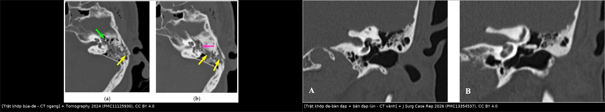
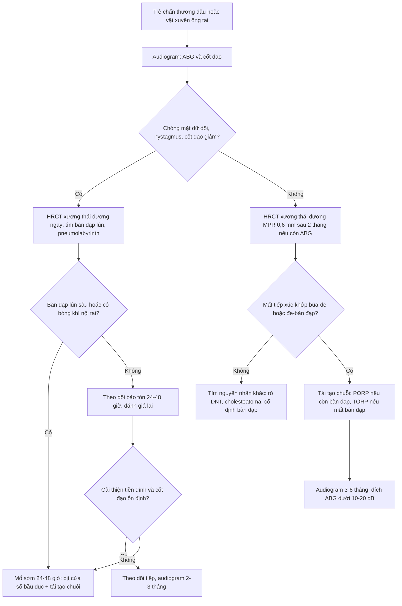
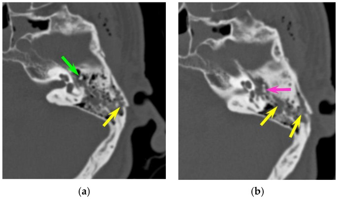
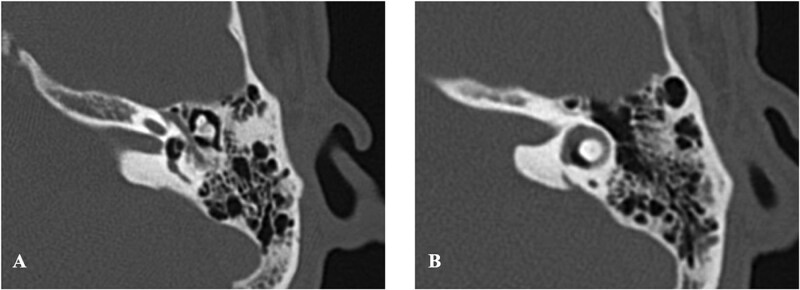
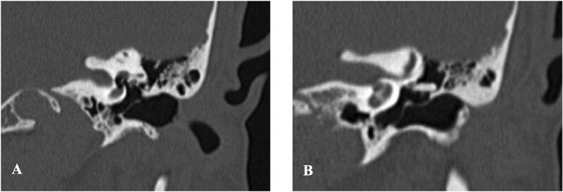
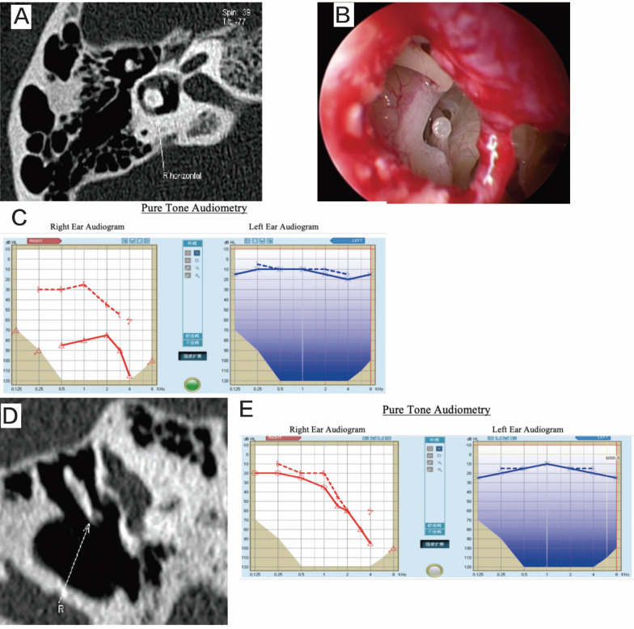

# 3008 — Trật/gián đoạn chuỗi xương con sau chấn thương xương thái dương ở trẻ: HRCT đọc khớp búa–đe–bàn đạp, phân biệt máu tụ tai giữa & khi nào tái tạo chuỗi

**Tags:** `pattern:gian-doan-xuong-con` `pattern:trat-khop` `pattern:di-lich-xuong-con` `pattern:di-tai-giua` `pattern:pneumolabyrinth` `pattern:ro-me-dao` `vung:tai-giua` `vung:xuong-thai-duong` `vung:tai-trong` `anatomy:chuoi-xuong-con` `protocol:HRCT-xuong-thai-duong` `protocol:MPR-nghieng` `protocol:noi-soi-tai-giua`
**Mức chắc chắn (certainty):** tổng hợp y văn (literature synthesis) — ghép **loạt 116 bệnh nhân/126 xương thái dương vỡ có 22 trẻ em** (Tomography 2024, PMC11125930), **15 ca trật chuỗi xương con được phân loại Type I/II** (Int J Med Sci 2024, PMC11539377), **ca trật bàn đạp–tiền đình có rò mê đạo + pneumolabyrinth** (J Surg Case Rep 2026, PMC13354537) và **2 ca đối cực: mổ sớm vs theo dõi** (Medicine 2026, PMC13337014). Không có ca do nhóm tự chụp.

> **Câu hỏi thực hành:** bé trai **8 tuổi** ngã cầu thang, chảy máu tai phải, hết chóng mặt sau 3 ngày, nhưng **6 tháng sau vẫn nghe kém bên phải**, nói "tiếng nhỏ hơn bên trái", không chảy tai. Câu hỏi: **máu tụ tai giữa đã tan lâu rồi mà vẫn điếc dẫn truyền — nguyên nhân là gì, chụp gì, đọc gì, và có mổ được không?**
> Bài chốt **bốn quyết định**: **(1) điếc dẫn truyền tồn tại > 2 tháng sau chấn thương = nghi trật chuỗi xương con, kể cả khi CT lúc cấp cứu "không thấy gì"; (2) HRCT xương thái dương phải dựng lại MPR 0,6 mm đúng trục khớp búa–đe và trục bàn đạp, không đọc trên lát 1 mm ngang đơn thuần; (3) phân biệt 3 kiểu trật (búa–đe, đe–bàn đạp, bàn đạp–tiền đình) vì tiên lượng và đường mổ khác nhau; (4) có **pneumolabyrinth** hoặc bàn đạp lún sâu vào tiền đình = rò mê đạo, cần quyết định mổ sớm trong 24–48 giờ, không chờ.** Nối [208 – Rò dịch não tủy qua xương đá ở trẻ](../208-ro-dich-nao-tuy-xuong-da/lesson.md), [1704 – Viêm tai giữa mạn/cholesteatoma ở trẻ](../1704-vtg-man-cholesteatoma-tre-cay-oc-tai/lesson.md), [1713 – Cholesteatoma xương đá](../1713-cholesteatoma-xuong-da-o-tre/lesson.md), [600 – Tổng quan Hệ Nhi khoa](../600-tong-quan-nhi-khoa/lesson.md).

## 1. Tổng quan bệnh học – cơ chế hình ảnh: vì sao mất 1 khớp = mất 30–60 dB

- **Chuỗi xương con là bộ biến đổi trở kháng (impedance matching).** Sóng âm trong không khí gặp màng nhĩ (diện tích lớn) rồi truyền qua **cán búa → thân đe → nhánh dài đe → khớp đe–bàn đạp → bàn đạp → cửa sổ bầu dục** (diện tích nhỏ). Tỷ lệ diện tích màng nhĩ/cửa sổ bầu dục cùng đòn bẩy xương con khuếch đại áp lực **~17–22 lần**, tương đương **~25–27 dB**; mất toàn bộ chuỗi nối → **khoảng trống khí–xương (air–bone gap, ABG) tới ~60 dB** (trần của điếc dẫn truyền). Vì vậy **một khớp lệch 1–2 mm** không phải "chuyện nhỏ": nó cắt đúng chỗ khuếch đại.
- **TẠI SAO xương đe là "mắt yếu" (weak link):** xương búa được giữ bởi **dây chằng trước/ngoài + gân cơ căng màng nhĩ**; xương bàn đạp được bảo vệ bởi **dây chằng vòng + cơ bàn đạp**; còn **nhánh dài xương đe** chỉ nối với bàn đạp bằng một khớp nhỏ, không có gân riêng → khi đầu bị va đập, quán tính làm xương đe "đi trước" phần còn lại (định luật I Newton, mô tả của Hough) → **trật khớp đe–bàn đạp là kiểu hay gặp nhất trong chấn thương xuyên thấu**, còn **trật khớp búa–đe hay gặp trong chấn thương đầu**.
- **Tần suất thực tế (định lượng):**
  - Trong **126 xương thái dương vỡ** của 116 bệnh nhân chấn thương sọ mặt, **11 (8,7%) có tổn thương chuỗi xương con**: **khớp búa–đe 6 ca**, **trật toàn bộ xương đe 3 ca**, **trật khớp đe–bàn đạp 2 ca** (PMC11125930).
  - **Trẻ em bị nhiều hơn người lớn: 3/22 (13,7%) vs 8/104 (7,7%)**, tuy chưa đạt ý nghĩa thống kê (p > 0,05). Cơ chế ở trẻ chủ yếu là **ngã (54,5%)** và **tai nạn xe (27,3%)**, không khác người lớn (PMC11125930).
  - Trong **15 ca trật chuỗi xương con** được mổ: **9 do chấn thương đầu**, **6 do vật xuyên qua ống tai** (tăm bông, cành cây, đũa); **53,3% điếc dẫn truyền, 40% điếc hỗn hợp, 6,7% điếc sâu**; **ù tai 60%**, **chóng mặt 33,3%** (PMC11539377). Y văn cũ: **160/166 ca (96%)** trật xương con do chấn thương đầu; loạt **42 ca** có **39 (92,8%)** do chấn thương đầu.
  - **Đây là chẩn đoán bị bỏ sót nhiều nhất trên CT cấp cứu: bác sĩ trực bỏ sót 8/11 (72,7%) ca trật chuỗi xương con**, trong khi vẫn phát hiện đúng 92,8% ca "có vỡ xương thái dương" (PMC11125930).
- **TẠI SAO hình ảnh lại khó:** xương đe/bàn đạp là các cấu trúc **1–3 mm** nằm trong tai giữa đầy khí; khớp bình thường chỉ là một **khe sụn mỏng**, nên "trật" thường biểu hiện bằng **khe khớp rộng ra, mất tiếp xúc, hoặc trục xương đe đổi hướng** chứ không có đường vỡ rõ. **Máu tụ tai giữa (hemotympanum) che lấp** thêm, đặc biệt là **hai trụ xương bàn đạp** vốn rất nhỏ. Vì vậy: **chụp đúng lúc + dựng đúng mặt phẳng** quan trọng hơn độ phân giải danh nghĩa.
- **Thời điểm chẩn đoán — con số quyết định:** trật xương con gây **điếc dẫn truyền kéo dài nhiều tháng đến nhiều năm**; khoảng trễ từ chấn thương đến chẩn đoán + điều trị trong y văn là **5–6 năm** (PMC11125930). Khuyến cáo thực hành: **mọi trẻ còn điếc dẫn truyền sau 2 tháng** (khi máu tụ tai giữa đã tan) **phải chụp HRCT xương thái dương**, kể cả trường hợp chấn thương đầu **không có đường vỡ** trên CT sọ.
- **Trẻ em khác người lớn ở đâu:** xương thái dương trẻ **dẻo hơn, ít cốt hóa hơn**, triệu chứng **kín đáo** (trẻ không than đau, không mô tả được ù tai) → dễ bỏ qua; nhưng **chấn thương sọ não đi kèm lại rất nặng**: loạt **323 trẻ vỡ xương thái dương** có **xuất huyết nội sọ 62%** (dẫn trong PMC11125930). Vì vậy đọc HRCT xương thái dương ở trẻ **luôn kèm đọc nhu mô não**.

## 2. Mẫu hình + chẩn đoán phân biệt theo vị trí và cơ chế (Gamut)

- **Định khu theo khớp bị tổn thương (quyết định đường mổ):**
  - **Khớp búa–đe (incudomalleolar):** đầu xương búa tách khỏi thân xương đe; hay gặp **chấn thương đầu**; trên CT ngang thấy **khoảng cách đầu búa–thân đe tăng, hai mặt khớp không còn song song**.
  - **Khớp đe–bàn đạp (incudostapedial):** nhánh dài xương đe rời khỏi đầu xương bàn đạp, thường **lệch lên trên ra trước**; hay gặp **chấn thương xuyên thấu ống tai** (tăm bông) và cả chấn thương đầu.
  - **Toàn bộ xương đe (incus dislocation):** thân đe di lệch khỏi ổ, có thể nằm trong sào bào/xoang nhĩ; thường kèm trật một trong hai khớp.
  - **Bàn đạp–tiền đình (stapediovestibular luxation):** **bàn đạp lún vào tiền đình** (thể trong) hoặc bị kéo ra ngoài (thể ngoài, hiếm hơn); đây là **rò mê đạo (perilymphatic fistula)** cho đến khi được bịt.
- **Định khu theo cơ chế:**
  - **Chấn thương đầu/ngã:** trật **búa–đe** hoặc trật đe, thường kèm vỡ xương đá; có thể **không có đường vỡ**.
  - **Vật xuyên ống tai (tăm bông, cành cây, bút):** trật **đe–bàn đạp** và **bàn đạp–tiền đình**, kèm **rách màng nhĩ**, **pneumolabyrinth**, **điếc tiếp nhận/chóng mặt**.
  - **Chấn thương xoắn/ép (torsion):** vỡ/xoắn xương bàn đạp, gãy cánh bàn đạp — hiếm, thường do thao tác trong ống tai.
- **Gamut theo hình ảnh "tai giữa mờ/dày" sau chấn thương:** **máu tụ tai giữa**, **dịch tai do rò DNT**, **phù niêm mạc**, **mảnh xương nhỏ**, **trật chuỗi xương con**, **cholesteatoma bội nhiễm** (nếu tiền sử lâu).
- **Mnemonic "O.S.S.I.C.L.E":** **O**ssicular dislocation (đe–bàn đạp), **S**tapes luxation (pneumolabyrinth), **S**ubluxation búa–đe, **I**ncus dislocation, **C**onductive hearing loss kéo dài, **L**ong delay (5–6 năm), **E**ffusion/hemotympanum che lấp.

## 3. Bảng so sánh phân biệt (ma trận đối chiếu)

| Thực thể (entity) | Hình ảnh điển hình | Chốt vào (rule-in) | Chốt loại (rule-out) | Gợi ý xác nhận |
|---|---|---|---|---|
| **Trật khớp đe–bàn đạp** | Nhánh dài đe mất tiếp xúc đầu bàn đạp, **lệch lên trên**, khe khớp rộng | **Điếc dẫn truyền + tiền sử xuyên ống tai/tăm bông + mất tiếp xúc trên MPR nghiêng** | Còn tiếp xúc rõ ở mọi mặt phẳng, ABG < 10 dB → không phải nguyên nhân | MPR 0,6 mm trục khớp; nội soi tai giữa khi mổ |
| **Trật khớp búa–đe** | **Đầu búa tách khỏi thân đe**, hai mặt khớp không song song, khoảng cách tăng | **Chấn thương đầu + ABG dẫn truyền + bất thường khớp búa–đe** | Chỉ có máu tụ, khớp còn tiếp xúc → chờ 2 tháng chụp lại | CT ngang + MPR theo trục khớp búa–đe |
| **Trật toàn bộ xương đe** | Thân đe **ra khỏi ổ**, nằm trong xoang nhĩ/sào bào, xoay trục | **Thấy xương đe "lạc chỗ" + mất chuỗi nối** | Xương đe đúng vị trí, chỉ nghiêng nhẹ do tư thế | MPR đa mặt phẳng; so bên đối diện |
| **Trật bàn đạp–tiền đình (thể trong)** | **Bàn đạp lún vào tiền đình**, có thể **bóng khí trong tiền đình/ống bán khuyên = pneumolabyrinth**; ống bán khuyên ngang bị xâm lấn | **Chóng mặt dữ dội + nystagmus + ABG/điếc tiếp nhận + bóng khí nội tai** | Không có bóng khí, bàn đạp đúng vị trí, triệu chứng tiền đình nhẹ và giảm nhanh | HRCT ngang + vành; đối chiếu audiogram |
| **Máu tụ tai giữa (hemotympanum)** | Tai giữa **đặc, đồng tỷ trọng mô mềm**, không thấy rõ chuỗi; **tan dần trong ~2 tháng** | **Tiền sử chấn thương gần đây + màng nhĩ tím + ABG phục hồi** | Còn mờ/ABG **sau 2 tháng** → phải tìm trật chuỗi, không quy cho máu tụ | Chụp lại sau 2 tháng; MRI T1 có thể thấy máu |
| **Rò dịch não tủy (CSF leak)** | **Nước trong tai giữa/sào bào**, có thể **defect trần sào bào/trần xoang nhĩ**, chảy dịch trong suốt qua mũi | **Chảy dịch trong + beta-2 transferrin + khuyết xương trần** | Dịch đục/máu, không khuyết xương, không chảy liên tục | CT ± CT cisternography; hội chẩn tai–thần kinh |
| **Vỡ ốc tai (otic capsule-violating)** | Đường vỡ **qua ốc tai/tiền đình**, **pneumolabyrinth**, điếc tiếp nhận nặng | **Bóng khí nội tai + đường vỡ qua vỏ ốc tai** | Chỉ vỡ xương đá ngoài vỏ ốc tai, không bóng khí | HRCT; MRI T2/FLAIR nếu nghi rò |
| **Điếc dẫn truyền không do chấn thương** | Chuỗi **liên tục**, có **cố định bàn đạp**, dị tật bẩm sinh, cholesteatoma, xơ tai | **Không tiền sử chấn thương, ABG từ nhỏ, hình ảnh dị tật/u** | Tiền sử chấn thương rõ + mất tiếp xúc khớp → trật | Audiogram, CT, nội soi; cân nhắc dị tật bẩm sinh |

*Trái: **(a, b)** CT ngang xương thái dương trái ở bệnh nhân đa chấn thương — **đầu xương búa (mũi tên xanh) tách khỏi thân xương đe (mũi tên hồng)**, đường vỡ dọc (mũi tên vàng) → **trật khớp búa–đe**. Phải: **(A, B)** CT vành xương thái dương trái — **(A)** bàn đạp lún vào tiền đình (mũi tên vàng); **(B)** **mất liên tục khớp đe–bàn đạp**, nhánh dài đe hướng lên trên về phía đoạn nhĩ dây VII. Nguồn: Tomography 2024 (PMC11125930) và J Surg Case Rep 2026 (PMC13354537), **CC BY 4.0**, ảnh ghép letterbox.*

### Dấu hiệu đọc chuẩn xác trên HRCT
- **Đếm 3 khớp, không đếm 1:** búa–đe, đe–bàn đạp, bàn đạp–cửa sổ bầu dục. Một ca "bình thường" phải thấy **cả ba** trên MPR; chỉ đọc một khớp là bỏ sót kiểu trật còn lại.
- **So bên đối diện** ở cùng mặt phẳng, cùng độ dày lát cắt — khớp bên lành là "thước đo" tốt nhất cho khe khớp và trục xương đe.
- **Pneumolabyrinth** = **vài bóng khí đen (khí) trong tiền đình/ống bán khuyên/ốc tai** — dấu hiệu **rò mê đạo**, không phải "khí bình thường"; xuất hiện ở **~8%** các vỡ xương thái dương và **~50%** các vỡ xâm lấn vỏ ốc tai (ước tính trong PMC11125930).
- **Tràn dịch/máu tai giữa không loại trừ trật chuỗi** — nhưng **che lấp**; nếu lâm sàng vẫn điếc dẫn truyền sau khi dịch tan, chụp lại là bắt buộc.

## 4. Protocol chụp – phân loại – quyết định điều trị

- **Bước 1 — Audiogram trước mọi thứ:** đo **khí đạo và cốt đạo (0,5–4 kHz)**, tính **ABG**. ABG **> 10 dB** kèm **cốt đạo bình thường** = điếc dẫn truyền; **cốt đạo giảm** = có tổn thương tai trong (tiên lượng xấu hơn, đặc biệt trong trật bàn đạp–tiền đình).
- **Bước 2 — HRCT xương thái dương đúng chuẩn (theo PMC11125930):**
  - Thu thể tích **lát ≤ 1 mm** (thực tế 0,4–1 mm).
  - **Dựng lại MPR 0,6 mm, khoảng cách 0,5 mm, thuật toán xương** — đây là bộ thông số đã dùng để phát hiện các ca bị bỏ sót.
  - **Mặt phẳng ngang = mặt phẳng ống bán khuyên ngang**; **vành vuông góc với ống bán khuyên ngang**; thêm **Stenvers (vành chếch)** và **Pöschl (dọc chếch)** khi cần; **MPR nghiêng theo trục khớp búa–đe và song song trục bàn đạp** để thấy khe khớp.
  - **Không cản quang** nếu chỉ tìm trật chuỗi; **có cản quang** khi nghi tổn thương mạch (động mạch cảnh trong, xoang bên) hoặc khối.
- **Bước 3 — Phân loại để chọn đường mổ:**

| Kiểu tổn thương | Xử trí điển hình | Số liệu / lưu ý |
|---|---|---|
| **Trật búa–đe / đe–bàn đạp / trật đe, bàn đạp còn tốt (Type I)** | **Tái tạo chuỗi bằng PORP** (nếu còn cấu trúc trên bàn đạp) hoặc **TORP** (nếu mất bàn đạp) | 10 ca Type I: **PORP 8, TORP 2**; **ABG ≤ 10 dB ở 50% (5/10), ≤ 20 dB ở 100% (10/10)** (PMC11539377) |
| **Trật bàn đạp–tiền đình, bàn đạp còn nguyên, lún nông, cốt đạo ổn định (Type II "nhẹ")** | **Theo dõi bảo tồn**: nghỉ ngơi, corticoid toàn thân, theo dõi thính lực/tiền đình — **có thể tự bịt lỗ bầu dục** | Ca 25 tuổi: trật một phần **phía sau** bàn đạp, cốt đạo bình thường, chóng mặt giảm ngày 5 → **nghe 15 dB sau 2 tháng**, màng nhĩ tự liền (PMC13337014) |
| **Trật bàn đạp–tiền đình lún sâu/toàn bộ, cốt đạo xấu đi, chóng mặt nặng** | **Mổ sớm (trong 24–48 giờ đến vài ngày)**: lấy bàn đạp ra khỏi tiền đình, **bịt cửa sổ bầu dục bằng mỡ/cân**, tái tạo chuỗi | Ca 49 tuổi: lún **toàn bộ** bàn đạp, cốt đạo tăng → **mổ ngày 3**, hết chóng mặt sau 1 ngày, ABG đóng hoàn toàn sau 3 tháng (PMC13337014) |
| **Pneumolabyrinth ± rách màng nhĩ do vật xuyên** | **Vá rò + tái tạo chuỗi** (piston/fascia), vá màng nhĩ; kháng sinh dự phòng viêm màng não | Ca 38 tuổi: trật đe–bàn đạp + bàn đạp lún sâu + bóng khí; **mổ ngày 5**, bịt cân + piston Teflon, **hết chóng mặt, ABG đóng, giữ cốt đạo** (PMC13354537) |
| **Điếc tiếp nhận sâu đã có từ trước** | **Không hứa hẹn cải thiện thính lực**; vẫn bịt rò để phòng viêm màng não | 2/5 ca Type II điếc sâu **không cải thiện** sau mổ (PMC11539377); bóng khí lan **cả tiền đình + ốc tai** → **48%** cải thiện nếu chỉ ở tiền đình, gần như không cải thiện nếu lan ốc tai (meta Hidaka, dẫn trong PMC11539377) |

- **Bốn yếu tố quyết định mổ sớm hay theo dõi** (tổng hợp từ 2 ca đối cực, PMC13337014): **(1)** độ sâu và hướng lún của bàn đạp trên HRCT; **(2)** lún **một phần** hay **toàn bộ**; **(3)** có **giảm cốt đạo** hay không; **(4)** mức độ và **tốc độ cải thiện** của triệu chứng tiền đình trong **24–48 giờ đầu**. Lún nông + cốt đạo ổn định + chóng mặt giảm nhanh → theo dõi an toàn; lún sâu/toàn bộ + cốt đạo xấu đi → mổ sớm.
- **Mốc thời gian thực hành:** chờ **2 tháng** cho máu tụ tai giữa tan rồi chụp/đánh giá lại nếu chỉ có điếc dẫn truyền đơn thuần; nhưng **nghi rò mê đạo (pneumolabyrinth, chóng mặt dữ dội, cốt đạo giảm) thì không chờ** — quyết định trong **24–48 giờ**.

## 5. Biến thể bình thường và cạm bẫy

- **Bẫy 1 — "CT cấp cứu bình thường":** **72,7% trật chuỗi bị bỏ sót** ở lần đọc đầu (PMC11125930) vì lát dày, mặt phẳng không đúng, hoặc máu tụ che. **CT bình thường không loại trừ** — nếu còn ABG sau 2 tháng, chụp lại đúng protocol.
- **Bẫy 2 — quy mọi thứ cho "máu tụ tai giữa":** máu tụ **tan trong ~2 tháng**; **ABG tồn tại sau mốc này** là dấu hiệu phải tìm trật chuỗi, không phải "chờ thêm".
- **Bẫy 3 — chỉ đọc mặt phẳng ngang:** khớp **đe–bàn đạp** gần như **không thể đánh giá đủ** nếu không có **MPR nghiêng/ vành**; khớp **búa–đe** lại dễ thấy trên ngang. Bỏ một mặt phẳng = bỏ một kiểu trật.
- **Bẫy 4 — subluxation rất kín đáo:** chỉ **tăng nhẹ khoảng cách mặt khớp** mà không di lệch rõ — dễ đọc là bình thường. Luôn **so bên đối diện** và đo trên MPR mỏng.
- **Bẫy 5 — bỏ sót tổn thương nặng hơn bên cạnh (satisfaction of search):** trẻ vỡ xương thái dương có **xuất huyết nội sọ tới 62%** (loạt 323 trẻ) và **liệt dây VII 7–10%** các ca vỡ; đọc xương xong phải **đọc nhu mô não, ống dây VII, xoang tĩnh mạch, động mạch cảnh trong**.
- **Bẫy 6 — nhầm với bệnh không do chấn thương:** trẻ **điếc dẫn truyền từ nhỏ**, chuỗi **liên tục** nhưng **cố định bàn đạp** hoặc dị tật bẩm sinh — hỏi kỹ tiền sử, so phim cũ, đừng mổ "trật chuỗi" khi thật ra là cố định.
- **Bẫy 7 — hứa hẹn quá mức khi đã điếc tiếp nhận:** nếu **cốt đạo đã mất** (đặc biệt bóng khí lan vào ốc tai), mổ chủ yếu để **bịt rò/phòng viêm màng não**, không phải để "hồi phục thính lực". Tư vấn đúng để gia đình không thất vọng.

## 6. Tự lượng giá — Blind Quiz

**Ca 1 — Bệnh nhân đa chấn thương, chảy máu tai trái. Nhìn hai lát CT ngang, mô tả trước khi đọc đáp án.**

- Câu hỏi 1: Hai mốc giải phẫu nào đang **mất tiếp xúc**? Đây là kiểu trật nào?
- Câu hỏi 2: Vì sao bệnh nhân này có thể vẫn "bình thường" về thính lực lúc nằm viện, và khi nào cần chụp lại?

<b>Bấm để hiện đáp án (findings + chẩn đoán)</b>

- Dấu hiệu (findings): **(a)** đầu xương búa (mũi tên xanh) **tách khỏi thân xương đe** (mũi tên hồng), hai mặt khớp không còn áp sát; đường vỡ dọc xương đá (mũi tên vàng). **(b)** xác nhận khoảng cách bất thường, xương đe xoay trục.
- Chẩn đoán (diagnosis): **trật khớp búa–đe** sau vỡ xương thái dương — kiểu hay gặp trong **chấn thương đầu** (6/11 ca trật chuỗi trong loạt này).
- Vì sao có thể "bình thường" lúc đầu: bệnh nhân đa chấn thương, **đặt nội khí quản** nên không đo được thính lực (37/116 ca trong loạt); triệu chứng bị che bởi chấn thương khác.
- Khi nào chụp lại: **audiogram khi tỉnh + HRCT MPR 0,6 mm nếu ABG còn sau 2 tháng**; đừng chờ "vài năm" như khoảng trễ 5–6 năm đã báo cáo.
- Nguồn ảnh: Tomography 2024 (PMC11125930), CC BY 4.0.

**Ca 2 — Nam 38 tuổi, cành cây xuyên ống tai trái, chóng mặt + điếc trái. CT ngang và vành:**

- Câu hỏi 3: Mũi tên/bóng khí nằm ở đâu? Dấu hiệu này tương ứng với tổn thương gì?
- Câu hỏi 4: Nếu CT vành cho thấy thêm mất liên tục khớp đe–bàn đạp, thứ tự xử trí là gì?

<b>Bấm để hiện đáp án</b>

- Dấu hiệu: **(A)** bàn đạp bị đẩy **vào tiền đình**; **bóng khí trong tiền đình** và **(B)** trong **ống bán khuyên ngang** = **pneumolabyrinth** → **rò mê đạo**. CT vành: **(A)** bàn đạp lún; **(B)** **nhánh dài xương đe mất tiếp xúc đầu bàn đạp**, hướng lên trên.
- Chẩn đoán: **trật bàn đạp–tiền đình + trật khớp đe–bàn đạp + rò mê đạo** sau chấn thương xuyên thấu.
- Thứ tự xử trí: **(1)** hội chẩn tai–thần kinh, kháng sinh dự phòng viêm màng não; **(2)** mổ **trong vài ngày** (ca này mổ ngày 5 sau khi triệu chứng không giảm): **lấy bàn đạp ra khỏi tiền đình, bịt cửa sổ bầu dục bằng cân/mỡ**, đặt **piston Teflon** giữa mỏm đậu và cửa sổ đã bịt; **(3)** vá màng nhĩ; **(4)** audiogram 6 tuần — ca này **ABG đóng, cốt đạo không giảm**.
- Nguồn ảnh: J Surg Case Rep 2026 (PMC13354537), CC BY 4.0. *Lưu ý: bệnh nhân người lớn; hình ảnh và nguyên tắc áp dụng tương tự ở trẻ, nhưng trẻ có nguy cơ viêm màng não cao hơn và khó hợp tác khi thăm khám.*

**Ca 3 — Bệnh nhân trật bàn đạp–tiền đình có pneumolabyrinth: trước và sau mổ.**

- Câu hỏi 5: Trên **(A)** bóng khí nằm ở đâu? **(B)** mô tả gì? Vì sao **(D)** là bằng chứng "đã xử lý đúng"?
- Câu hỏi 6: Ba yếu tố tiên lượng hồi phục thính lực ở nhóm có pneumolabyrinth?

<b>Bấm để hiện đáp án</b>

- Dấu hiệu: **(A)** bóng khí trong **tiền đình/ống bán khuyên** (mũi tên); **(B)** hình mổ: **bàn đạp lún sâu vào tiền đình**; **(C)** điếc hỗn hợp nặng trước mổ; **(D)** HRCT sau mổ: **bóng khí đã hết**, bàn đạp được đặt lại/bịt; **(E)** audiogram sau mổ có cải thiện một phần.
- Chẩn đoán: trật bàn đạp–tiền đình có **pneumolabyrinth**; bàn đạp được **lấy ra, bịt tiền đình bằng mỡ, đặt lại** — chóng mặt hết, thính lực cải thiện không hoàn toàn.
- Ba yếu tố tiên lượng (Tsubota, dẫn trong PMC11539377): **mức cốt đạo sau chấn thương**, **khoảng thời gian từ chấn thương đến mổ**, **có tổn thương bàn đạp hay không**. Bóng khí **chỉ ở tiền đình** → **48%** cải thiện; lan **cả ốc tai** → gần như không (meta Hidaka).
- Nguồn ảnh: Int J Med Sci 2024 (PMC11539377), CC BY 4.0.

## Bài liên quan chéo

- [208 – Rò dịch não tủy qua xương đá ở trẻ](../208-ro-dich-nao-tuy-xuong-da/lesson.md)
- [1704 – Viêm tai giữa mạn tính & cholesteatoma ở trẻ](../1704-vtg-man-cholesteatoma-tre-cay-oc-tai/lesson.md)
- [1713 – Cholesteatoma xương đá ở trẻ](../1713-cholesteatoma-xuong-da-o-tre/lesson.md)
- [235 – Xương thái dương & xoang: cholesteatoma trên DWI](../235-xuong-thai-duong-xoang/lesson.md)
- [600 – Tổng quan Hệ Nhi khoa](../600-tong-quan-nhi-khoa/lesson.md)

> Không dùng để chẩn đoán độc lập khi chưa có người hướng dẫn.
