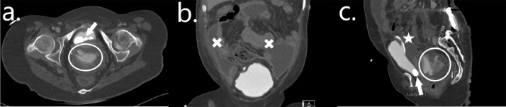
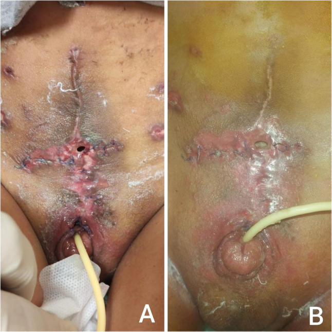
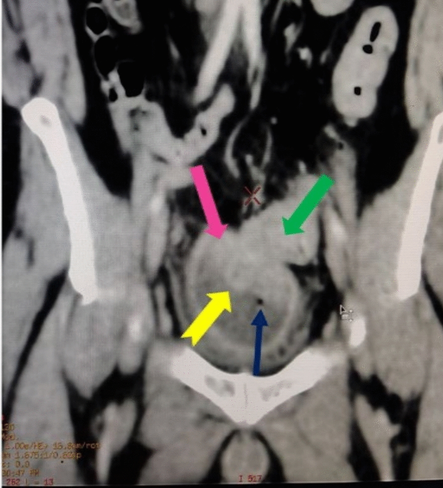
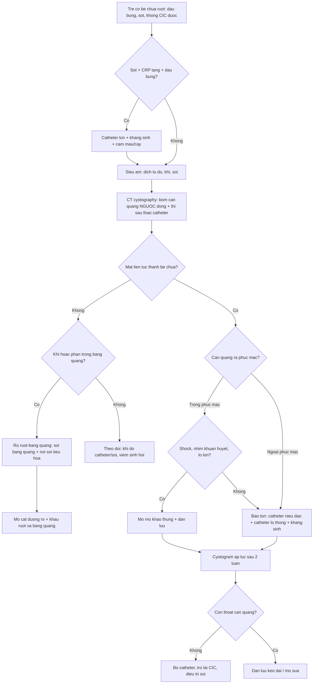

# 3009 — Dò bàng quang–ruột và dò bàng quang–da sau tăng dung tích bàng quang ở trẻ / Vesicoenteric and vesicocutaneous fistula after augmentation cystoplasty

**Tags:** `pattern:ro-do` `pattern:khi-trong-bang-quang` `pattern:thoat-can-quang` `vung:tiet-nieu` `vung:bang-quang` `anatomy:bang-quang-thanh-kinh` `protocol:CT-cystogram` `protocol:VCUG` `protocol:noi-soi-bang-quang` `score:Clavien-Dindo`
**Mức chắc chắn (certainty):** tổng hợp y văn (literature synthesis) — ghép **cohort 22 trẻ tăng dung tích bàng quang theo dõi 13,4 ± 5,9 năm** (Sci Rep 2024, PMC10879155), **tổng quan biến chứng ở bệnh nhân spina bifida** (Transl Androl Urol 2016, PMC4739984), **loạt 20 trẻ exstrophy được ileocystoplasty + tạo hình cổ bàng quang** (BMC Urol 2026, PMC13378153), **loạt 4 ca thủng bàng quang** (Radiol Case Rep 2022, PMC9465360), **16 ca thủng trong phúc mạc điều trị bảo tồn** (Healthcare 2025, PMC12250053), **ca rò đại tràng–bàng quang người lớn** (J Med Case Rep 2026, PMC13245075) và **ca 30 tuổi exstrophy có rò bàng quang–da** (Urol Case Rep 2017, PMC5397601). Không có ca do nhóm tự chụp.

> **Câu hỏi thực hành:** bé gái **18 tuổi**, spina bifida, đã **tăng dung tích bàng quang bằng hồi tràng + Mitrofanoff**, vào viện vì **đau bụng + chướng**, có **sỏi bàng quang** trên phim cũ, **không sốt**, xét nghiệm bình thường. Không CIC được 24 giờ vì đau. Câu hỏi: **đây là thủng tự phát, rò miệng nối, hay chỉ là bí tiểu do bỏ CIC — và chụp gì để trả lời?**
> Bài chốt **ba quyết định**: **(1) khí trong bàng quang sau tăng dung tích = phải chứng minh rò, không được mặc định là "nhiễm trùng tiểu"; (2) rò miệng nối sớm và rò da quanh chân catheter thường tự lành với dẫn lưu bàng quang đủ rộng — rò bàng quang–ruột thật thì không; (3) phân biệt rò / thủng / chấn thương catheter trên CT cystography có bơm ngược cản quang, không dựa vào thì bài tiết.** Nối [672 – Biến chứng muộn sau tái tạo bàng quang bằng ruột](../672-bien-chung-muon-sau-tai-tao-bang-quang/lesson.md), [3001 – Hẹp lỗ thông Mitrofanoff](../3001-hep-lo-thong-mitrofanoff-o-tre/lesson.md), [691 – Sỏi bàng quang & sỏi quanh catheter](../691-soi-bang-quang-va-soi-quanh-catheter-o-tre/lesson.md), [635 – Dị tật hệ tiết niệu nhi](../635-di-tat-tiet-nieu-nhi-SFU-VUR-PUV/lesson.md).

## 1. Tổng quan bệnh học – cơ chế hình ảnh: vì sao đường nối ruột–bàng quang là điểm yếu

- **Ba thực thể phải tách bạch trước khi nói tới hình ảnh:** **(a) rò (fistula)** = đường thông có biểu mô hóa giữa lòng bể chứa và ruột/da/âm đạo, tồn tại nhiều ngày–nhiều tuần; **(b) dò miệng nối (anastomotic leak)** = hở cấp tại đường khâu, chưa có đường thông ổn định, thường trong **7–14 ngày đầu**; **(c) thủng (perforation)** = mất liên tục thành bể chứa **không có đường thông ra cơ quan khác**, gây thoát nước tiểu vào phúc mạc/ngoài phúc mạc — đã có bài riêng [672](../672-bien-chung-muon-sau-tai-tao-bang-quang/lesson.md). Ba thực thể này **trùng triệu chứng nhưng khác quyết định mổ**.
- **Tần suất thực tế:** trong **22 trẻ** tăng dung tích bàng quang (hồi tràng 19, sigma 3) theo dõi **13,4 ± 5,9 năm**, có **1 (4,5%) dò miệng nối ruột–bàng quang** sớm (đáp ứng với đặt Foley, không mổ) và **1 (4,5%) thủng tự phát** ở đoạn ruột tăng dung tích sau **3,4 năm**, kèm **nhiễm khuẩn huyết E. coli**, phải mổ mở (PMC10879155). Tổng quan ở bệnh nhân spina bifida nêu **thủng 2–13%** với **tử vong tới 25%** (PMC4739984) — đây là lý do **không được xem nhẹ đau bụng ở trẻ có bể chứa ruột**.
- **Rò bàng quang–da sau tăng dung tích:** loạt **20 trẻ exstrophy** được ileocystoplasty + tạo hình cổ bàng quang + lỗ thông tự CIC có **1 (5%) rò bàng quang–da** xuất hiện **trong 7 ngày** sau mổ, trên nền **nhiễm trùng vết mổ**, và **lành sau 21 ngày** chỉ với chăm sóc vết thương + dẫn lưu (PMC13378153). Dung tích bể chứa tăng từ **60,2 mL → 348,5 mL** (p < 0,001) — tức là **rò không nhất thiết là thất bại của phẫu thuật**.
- **TẠI SAO đường nối ruột–bàng quang dễ hở:** đoạn ruột được **detubular hóa và khâu vào vòm bàng quang**, nên **bờ khâu là vùng phân thủy mạch** giữa mạc treo ruột và thành bàng quang; **căng mạc treo, xoắn mảnh ghép, hẹp cuống mạch, thiếu máu mép khâu** → hoại tử niêm mạc → hở. Thêm vào đó, bể chứa ruột **tiết chất nhầy** và có **sỏi** (36,4% trong cohort, y văn **10,5–52%**) — sỏi cọ xát + nhiễm khuẩn mạn là **hai yếu tố làm mỏng và rách thành** về sau.
- **TẠI SAO rò bàng quang–ruột lại gây "khí trong bàng quang":** áp lực đại tràng cao hơn áp lực bể chứa khi bể chứa được dẫn lưu tốt, nên **khí và phân đi từ ruột vào bàng quang** → **pneumaturia** (đái ra hơi), **fecaluria** (đái ra phân), nhiễm khuẩn niệu **đa loại vi khuẩn đường ruột**. Ngược lại, nếu dòng nước tiểu đổ **vào đại tràng** (bể chứa nối đại tràng, rò lớn) thì bệnh nhân có **tiêu chảy nước + toan chuyển hóa tăng Cl⁻** do đại tràng tái hấp thu Cl⁻/NH₄⁺ và mất HCO₃⁻ — đây là **dấu hiệu sinh hóa** của rò, không phải dấu hiệu hình ảnh.
- **TẠI SAO phải bơm cản quang NGƯỢC dòng:** rò có **lưu lượng thấp** và **gradient áp lực nhỏ**; thì bài tiết (excretory phase) làm cản quang bị pha loãng và không tạo đủ áp lực để vào đường rò. Vì vậy **CT cystography phải đặt catheter, bơm cản quang pha loãng ngược dòng tới khi bể chứa căng, rồi chụp thêm thì sau tháo bỏ/ngồi–đứng**; đây cũng là lý do **siêu âm và CT bài tiết bình thường không loại trừ rò**. Trong loạt 4 ca thủng, tác giả nhấn mạnh **stress retrograde cystography có phim sau đi tiểu là phương pháp kinh điển**, còn **CT cystography ngày càng thay thế** vì thấy được cả ổ phúc mạc và tạng lân cận (PMC9465360).
- **Ngưỡng phân biệt trong phúc mạc / ngoài phúc mạc:** **~60%** thủng bàng quang là **ngoài phúc mạc** (điều trị bảo tồn bằng dẫn lưu), **~90%** thủng do chấn thương có **gãy khung chậu**, và thủng bàng quang chiếm tới **10%** chấn thương bụng (PMC9465360). Với bể chứa ruột, **thủng thường ở vòm/phần trong phúc mạc** vì đó là nơi mảnh ghép ruột nằm tự do trong ổ bụng.

## 2. Mẫu hình + chẩn đoán phân biệt theo vị trí và thời điểm (Gamut)

- **Theo thời điểm:**
  - **Sớm ≤ 30 ngày:** **dò miệng nối ruột–bàng quang**, rò quanh chân catheter/lỗ thông, rò vết mổ (bàng quang–da), nhiễm trùng vết mổ, tắc ruột sớm.
  - **Muộn > 30 ngày:** **rò do sỏi cọ xát**, rò do catheter lưu lâu (SPC, catheter qua lỗ thông), rò do **u tại đường nối**, rò sau xạ trị vùng chậu, rò trên nền **bệnh ruột viêm (Crohn)** hoặc túi thừa.
- **Theo vị trí đường rò:**
  - **Đường nối ruột–bàng quang (vesicoenteric):** khí/phân trong bàng quang, nhiễm khuẩn niệu đa loại, đau hạ vị; đây là thể **duy nhất bắt buộc phải mổ** nếu không tự đóng.
  - **Thành bụng/da (vesicocutaneous):** nước tiểu chảy qua vết mổ hoặc cạnh lỗ thông CIC — thể hay gặp ngay sau mổ và thường **tự lành**.
  - **Âm đạo (vesicovaginal):** đái ra nước liên tục qua âm đạo, đặc biệt ở trẻ có bể chứa lớn chèn ép.
  - **Niệu đạo (urethrocutaneous):** ở bệnh nhân exstrophy đã tạo hình niệu đạo — ca 30 tuổi trong y văn có **đồng thời rò bàng quang–da và rò niệu đạo–da** sau khi sỏi làm vỡ bàng quang (PMC5397601).
- **Theo cơ chế khởi phát:** **thiếu máu mép khâu** (sớm), **sỏi** (muộn), **áp lực catheter** (muộn), **nhiễm trùng mạn**, **xạ trị**, **bệnh ruột viêm**, **chấn thương**.
- **Mnemonic "LEAKS":** **L**eak miệng nối (sớm), **E**rosion do sỏi, **A**p lực catheter (SPC/lỗ thông), **K**hối u tại đường nối, **S**au xạ trị / bệnh ruột viêm.

## 3. Bảng so sánh phân biệt (ma trận đối chiếu)

| Thực thể (entity) | Hình ảnh điển hình | Chốt vào (rule-in) | Chốt loại (rule-out) | Gợi ý xác nhận |
|---|---|---|---|---|
| **Rò bàng quang–ruột (vesicoenteric fistula)** | **Khí trong lòng bể chứa** (không do vừa đặt catheter), ruột **dính thành bàng quang**, đường rò thấy trên CT cystography; có thể **phân trong bàng quang** | **Khí + phân trong bàng quang + ruột dính thành + đái ra hơi/phân** | Chỉ có khí, không có đường rò, sau vừa soi/bơm khí → **khí do can thiệp**, không phải rò | CT cystography bơm ngược + soi bàng quang; nội soi tiêu hóa nếu cần |
| **Dò miệng nối ruột–bàng quang (sớm)** | Thoát cản quang tại **đường khâu vòm bàng quang** trong **7–14 ngày**, kèm dịch quanh bàng quang; không thấy đường thông tới lòng ruột | **Thoát cản quang đúng đường khâu + mổ ≤ 14 ngày + sốt/đau** | Đường rò rõ tới lòng ruột + khí/phân → **rò thật**, không chỉ là dò miệng nối | CT cystography; theo dõi đáp ứng với dẫn lưu Foley |
| **Rò bàng quang–da (vesicocutaneous)** | Nước tiểu qua **vết mổ/lỗ thông**; CT cystography thấy **đường rò từ vòm bàng quang ra cân–da** | **Rò tại vết mổ trong 7 ngày + nhiễm trùng vết mổ + bể chứa vẫn giữ dung tích** | Rò từ **niệu quản** hoặc từ **miệng nối niệu quản–bàng quang** → vị trí cao hơn, khác xử trí | Bơm xanh methylen qua catheter; CT cystography |
| **Thủng tự phát (bài 672)** | **Thoát cản quang + dịch tự do**, **không có đường rò tới ruột/da**; thường có sỏi, bể chứa căng | **Thoát cản quang + dịch tự do + đau bụng cấp ± sốc** | Có đường thông tới lòng ruột → **rò**, không phải thủng đơn thuần | CT cystography; phân biệt trong/ngoài phúc mạc |
| **Thủng do catheter (balloon/stylet)** | Lỗ thủng **ngay tại vị trí bóng catheter**, thường **vòm sau** khi bơm bóng quá căng hoặc đẩy stylet; xảy ra **ngay sau đặt catheter** | **Thời điểm trùng khớp đặt catheter + lỗ thủng đúng vị trí bóng** | Thủng ở vòm trước/xa catheter + sỏi lớn → **tự phát** | Soi bàng quang thấy lỗ + vị trí bóng; CT cystography |
| **Viêm bàng quang sinh hơi (emphysematous cystitis)** | **Khí trong THÀNH bàng quang** (dạng bọt) ± khí trong lòng; thành dày; bệnh nhân **đái tháo đường/giảm miễn dịch** | **Khí trong thành + thành dày + cấy nước tiểu dương** | Khí chỉ trong lòng, thành mỏng, không đường rò → **khí do can thiệp/rò** | CT cửa sổ mềm; cấy máu/nước tiểu |
| **Rò bàng quang–âm đạo** | Nước tiểu qua âm đạo; CT cystography thấy đường rò **ra sau, dưới** | **Đái không kiểm soát qua âm đạo + đường rò thành sau** | Rò ra da/thành trước → **bàng quang–da** | Soi âm đạo + bơm xanh methylen |
| **Nhiễm trùng tiểu đơn thuần trên bể chứa ruột** | Thành dày, cặn, **không khí**, **không thoát cản quang** | **Cấy dương + sốt + không khí + không thoát cản quang** | Có khí/thoát cản quang → phải loại rò trước khi gọi "nhiễm trùng đơn thuần" | Cấy nước tiểu; CT cystography nếu tái phát |

*Bệnh nhân nữ **18 tuổi**, spina bifida, đã **ileocystoplasty + Mitrofanoff**; đau bụng + chướng, xét nghiệm bình thường, không CIC được 24 giờ. **(a)** trục ngang: **nhiều sỏi** trong bể chứa (mũi tên trắng) và **catheter** trong lòng; **(b)** thì vành: **dịch tự do** trong phúc mạc (×), bể chứa ngấm cản quang; **(c)** thì đứng: **thoát cản quang hoạt động** (vòng tròn) ra phúc mạc, bóng catheter (sao). Đây là **thủng trong phúc mạc tự phát**, không phải rò — phân biệt bằng **không có đường thông tới ruột**. Nguồn: Radiol Case Rep 2022 (PMC9465360), **CC BY 4.0**, nguyên bản.*

*Bé gái trong loạt **20 trẻ exstrophy** được **ileocystoplasty + tạo hình cổ bàng quang + lỗ thông tự CIC**. **(A)** ngày 7 sau mổ: nhiễm trùng vết mổ, **lỗ rò bàng quang–da** giữa đường mổ (đầu dò trong lỗ thông); **(B)** ngày 21: **rò đã tự lành**, lỗ thông CIC hoạt động. Bài học: rò da sớm **không đồng nghĩa thất bại** — dẫn lưu + chăm sóc vết thương là đủ. Nguồn: BMC Urol 2026 (PMC13378153), **CC BY-NC-ND 4.0**, nguyên bản, không crop/ghép.*

*Ảnh tham chiếu **dấu hiệu**, không phải bệnh cảnh nhi: bệnh nhân **42 tuổi** (viêm túi thừa đại tràng sigma, **KHÔNG** tăng dung tích bàng quang), rò đại tràng–bàng quang **~5 cm** sau **10 năm** chẩn đoán muộn. CT vành: thành sau bàng quang dày (mũi tên hồng), **đại tràng sigma dính thành bàng quang** (mũi tên xanh lá), **khí trong lòng bàng quang** (mũi tên xanh dương — dấu hiệu đặc hiệu của thông thương ruột–bàng quang), khối giả lòng trong bàng quang do **quai sigma thoát vị** (mũi tên vàng). Nguồn: J Med Case Rep 2026 (PMC13245075), **CC BY-NC-ND 4.0**, nguyên bản.*

### Đọc "khí trong bàng quang" cho đúng
- **Khí + phân trong bàng quang** = gần như chắc chắn **rò ruột–bàng quang**; **khí đơn thuần** có thể do **vừa đặt catheter, vừa soi bàng quang, bơm khí qua lỗ thông, hoặc viêm bàng quang sinh hơi**.
- **Vị trí khí:** khí tự do nổi lên **phần trước trên** khi nằm ngửa; khí **trong thành** (dạng bọt, theo thành) gợi ý **viêm bàng quang sinh hơi** ở bệnh nhân đái tháo đường/giảm miễn dịch.
- **Không có khí không loại trừ rò:** rò nhỏ, dính chặt, hoặc bể chứa được dẫn lưu liên tục có thể **không thấy khí** — phải bơm cản quang ngược dòng.

## 4. Protocol chẩn đoán – quyết định điều trị

- **Bước 0 — nhận diện bệnh nhân "im lặng":** trẻ spina bifida/bể chứa ruột **mất cảm giác đau tạng**, nên thủng/rò có thể chỉ biểu hiện **sốt, nôn, li bì, tăng CRP, toan chuyển hóa, vô niệu**. Ngưỡng cảnh báo: **CRP tăng + đau bụng không rõ nguyên nhân + không CIC được** → chụp ngay, không chờ "theo dõi 24 giờ".
- **Bước 1 — siêu âm tại giường:** dịch tự do, khí trong lòng/thành bể chứa, sỏi, dày thành, đường rò ra da. Siêu âm **không loại trừ** rò.
- **Bước 2 — CT cystography (chìa khóa):**
  - Đặt catheter **qua đường niệu đạo hoặc qua lỗ thông** (nếu có Mitrofanoff), **bơm cản quang pha loãng ngược dòng** tới khi bể chứa căng; chụp **trục ngang + vành + đứng**, thêm **thì sau tháo bỏ catheter/ngồi–đứng** để bắt rò lưu lượng thấp.
  - Đọc **5 điểm**: (1) thành bể chứa có mất liên tục? (2) cản quang ra **phúc mạc** hay **ngoài phúc mạc**? (3) có **đường thông tới lòng ruột/da/âm đạo**? (4) có **sỏi/dị vật** tại lỗ rò? (5) có **quai ruột dính thành** hay **khối lòng trong bàng quang**?
  - CT bài tiết đơn thuần **không đủ** — trong ca 42 tuổi, chẩn đoán chỉ được đặt sau khi thấy **khí trong bàng quang + ruột dính thành** trên CT có cản quang (PMC13245075).
- **Bước 3 — soi bàng quang + nghiệm pháp xanh methylen:** xác định **vị trí lỗ rò**, loại trừ **sỏi làm tổn thương niêm mạc**, và đánh giá **miệng nối ruột–bàng quang**. Ở ca 30 tuổi exstrophy, **soi bàng quang qua chính đường rò** đã xác định được rò niệu đạo–da phối hợp và lỗ thông bị tắc (PMC5397601).
- **Bước 4 — quyết định theo loại tổn thương:**

| Tình huống | Xử trí đầu tay | Số liệu / lưu ý |
|---|---|---|
| **Dò miệng nối ruột–bàng quang sớm, bệnh nhân ổn định** | **Dẫn lưu bàng quang đủ rộng (Foley lớn/qua lỗ thông) + kháng sinh + nuôi ăn** | Trong cohort 22 trẻ, **1/22 (4,5%)** dò miệng nối và **tự khỏi sau khi đặt Foley** (PMC10879155) |
| **Rò bàng quang–da sớm sau mổ** | **Chăm sóc vết thương + dẫn lưu + kháng sinh**; theo dõi 2–3 tuần | **1/20 (5%)**, xuất hiện **≤ 7 ngày**, **lành sau 21 ngày** (PMC13378153) |
| **Thủng trong phúc mạc, bệnh nhân ổn định, lỗ nhỏ** | **Bảo tồn: catheter niệu đạo cỡ lớn + catheter lỗ thông + kháng sinh** | **15/16 (94%)** thành công, biến chứng **25%**, catheter **trung vị 18 ngày** (PMC12250053) |
| **Thủng trong phúc mạc có sốc/nhiễm khuẩn huyết/lỗ lớn** | **Mổ mở khâu thủng + dẫn lưu** | Mổ ngay **giảm tử vong 59%** so với trì hoãn (PMC12250053 dẫn) |
| **Rò ruột–bàng quang thật, kéo dài** | **Mổ: cắt đường rò, khâu ruột + bàng quang, có thể chen vạt cơ** | Ca 30 tuổi: **vạt cơ thẳng bụng** che cả rò bàng quang–da và niệu đạo–da (PMC5397601) |
| **Rò do sỏi** | **Lấy sỏi + dẫn lưu**, sửa thành bể chứa nếu mỏng | Sỏi **36,4%** cohort; y văn **10,5–52%** (PMC10879155) |
| **Rò do xạ trị/bệnh ruột viêm** | **Chuyển hướng nước tiểu** (dẫn lưu qua da/nephrostomy) trước, sửa thì sau | Mô xạ xơ, khâu trực tiếp thất bại cao |

- **Bước 5 — xác nhận lành trước khi bỏ catheter:** **cystogram/cystography áp lực (stress) sau 2 tuần** — trong ca 18 tuổi, phim áp lực sau **2 tuần** không còn thoát cản quang, bệnh nhân trở lại CIC và **tán sỏi 6 tuần** sau (PMC9465360). **Không bỏ catheter chỉ vì hết đau.**

## 5. Biến thể bình thường và cạm bẫy

- **Bẫy 1 — "khí là do nhiễm trùng tiểu":** trẻ CIC **đưa khí vào bàng quang mỗi lần đặt catheter**, nên khí đơn thuần **không đặc hiệu**. Chỉ chốt rò khi có **khí + phân**, **ruột dính thành**, hoặc **đường rò trên CT cystography**.
- **Bẫy 2 — bỏ sót vì bệnh nhân "không đau":** bể chứa ruột **mất cảm giác**, thủng có thể biểu hiện **li bì, nôn, toan chuyển hóa, vô niệu**. Trong loạt thủng, một bệnh nhân **tỉnh táo, xét nghiệm bình thường** mà vẫn có thoát cản quang hoạt động (PMC9465360) — **đừng lấy xét nghiệm bình thường làm lý do không chụp**.
- **Bẫy 3 — chỉ chụp CT bài tiết:** cản quang bài tiết bị pha loãng, rò lưu lượng thấp **không hiện**. Phải **bơm ngược dòng** và chụp **thì sau tháo catheter**.
- **Bẫy 4 — bóng catheter giả tạo đường rò:** bóng catheter bơm căng trong **cổ bàng quang/niệu đạo** có thể tạo hình ảnh "khoảng trống" giả và **giả thoát cản quang**. Luôn ghi **vị trí bóng**, bơm bóng trong lòng bể chứa.
- **Bẫy 5 — sỏi che lỗ rò:** sỏi lớn ở vòm/đường nối có thể **che đường rò** và gây **nhiễm khuẩn tái phát**; nếu sỏi + nhiễm khuẩn tái phát, **soi bàng quang tìm lỗ rò** dù CT âm.
- **Bẫy 6 — nhầm rò với dò miệng nối:** dò miệng nối **đáp ứng dẫn lưu** và **tự đóng**; rò ruột–bàng quang thật **không đóng** vì có **biểu mô hóa và chênh áp lực**. Đặt catheter đúng là **nghiệm pháp chẩn đoán và điều trị**.
- **Bẫy 7 — quên rò thứ hai:** bệnh nhân exstrophy/đã mổ nhiều lần có thể có **rò bàng quang–da VÀ rò niệu đạo–da** cùng lúc (PMC5397601); soi và bơm xanh methylen **toàn bộ đường tiết niệu** trước khi đóng.
- **Bẫy 8 — đóng rò trong mô viêm/xạ:** khâu trực tiếp trên nền **nhiễm trùng mô xạ** thất bại cao; cần **vạt cơ (thẳng bụng, gracilis)** hoặc **chuyển hướng nước tiểu tạm**.

## 6. Tự lượng giá — Blind Quiz

**Ca 1 — Nữ 18 tuổi, spina bifida, ileocystoplasty + Mitrofanoff, đau bụng + chướng, không CIC được 24 giờ, không sốt.**

- Câu hỏi 1: Mô tả **ba dấu hiệu** trên (a), (b), (c). Đây là **rò** hay **thủng**? Trong hay ngoài phúc mạc?
- Câu hỏi 2: Vì sao có thể **không mổ** ở bệnh nhân này, và cần làm gì trước khi bỏ catheter?

<b>Bấm để hiện đáp án (findings + chẩn đoán)</b>

- Dấu hiệu (findings): **(a)** nhiều **sỏi cản quang** trong bể chứa + catheter trong lòng; **(b)** **dịch tự do** trong phúc mạc (×) + bể chứa ngấm cản quang; **(c)** **thoát cản quang hoạt động** ra phúc mạc (vòng tròn) + bóng catheter (sao).
- Chẩn đoán (diagnosis): **thủng trong phúc mạc tự phát** của bàng quang tăng dung tích, có sỏi — **không có đường rò tới ruột**.
- Vì sao bảo tồn được: bệnh nhân **ổn định huyết động, không sốt, đau giảm sau khi đặt catheter qua Mitrofanoff**; nhóm **15/16 (94%)** thủng trong phúc mạc lỗ nhỏ điều trị bảo tồn thành công, catheter **trung vị 18 ngày** (PMC12250053).
- Trước khi bỏ catheter: **cystogram áp lực sau 2 tuần** phải **hết thoát cản quang**; sau đó **tán sỏi** (ca gốc tán sỏi 6 tuần sau).
- Nguồn ảnh: Radiol Case Rep 2022 (PMC9465360), CC BY 4.0.

**Ca 2 — Bé gái exstrophy, ngày 7 sau ileocystoplasty + tạo hình cổ bàng quang: sốt, vết mổ chảy nước tiểu.**

- Câu hỏi: Chẩn đoán? Có cần mổ lại ngay không? Vì sao?

<b>Bấm để hiện đáp án</b>

- Dấu hiệu: **(A)** nhiễm trùng vết mổ + **lỗ rò bàng quang–da** giữa đường mổ; **(B)** ngày 21 rò **đã tự lành**, lỗ thông CIC hoạt động.
- Chẩn đoán: **rò bàng quang–da sớm sau tăng dung tích bàng quang** (1/20 = 5% trong loạt).
- Không mổ lại: rò **nông, bể chứa còn dung tích tốt** (60,2 → 348,5 mL) và **đáp ứng chăm sóc vết thương + dẫn lưu**; can thiệp sớm chỉ đặt lại khi rò **rộng, không liền sau 3–4 tuần** hoặc có **hở cân–bể chứa lớn**.
- Nguồn ảnh: BMC Urol 2026 (PMC13378153), CC BY-NC-ND 4.0.

**Ca 3 — Nam 42 tuổi, đái ra hơi và phân 3 tháng, đau hạ vị tái phát. CT bụng–chậu có cản quang.**

- Câu hỏi: Ba dấu hiệu chốt rò ruột–bàng quang trên ảnh? Vì sao bài này vẫn hữu ích cho bệnh nhi dù bệnh nhân là người lớn?

<b>Bấm để hiện đáp án</b>

- Dấu hiệu: **khí trong lòng bàng quang** (mũi tên xanh dương), **đại tràng dính thành bàng quang** (xanh lá), **thành bàng quang dày** (hồng); thêm **khối giả lòng** do quai sigma thoát vị (vàng).
- Chẩn đoán: **rò đại tràng–bàng quang** (người lớn, viêm túi thừa; rò ~5 cm sau 10 năm chẩn đoán muộn).
- Vì sao hữu ích cho nhi: **dấu hiệu hình ảnh của rò ruột–bàng quang giống nhau** ở mọi lứa tuổi; điều **khác** là bối cảnh (trẻ: sau tăng dung tích/sỏi/xạ; người lớn: túi thừa/ung thư) và **ngưỡng can thiệp** (trẻ ưu tiên dẫn lưu trước).
- Nguồn ảnh: J Med Case Rep 2026 (PMC13245075), CC BY-NC-ND 4.0.

## Bài liên quan chéo
- [672 – Biến chứng muộn sau tái tạo bàng quang bằng ruột: sỏi, thủng tự phát, ung thư](../672-bien-chung-muon-sau-tai-tao-bang-quang/lesson.md) (thủng tự phát, sỏi, ung thư tại đường nối)
- [3001 – Hẹp lỗ thông Mitrofanoff ở trẻ](../3001-hep-lo-thong-mitrofanoff-o-tre/lesson.md) (biến chứng của lỗ thông tự CIC)
- [691 – Sỏi bàng quang & sỏi quanh catheter ở trẻ bàng quang thần kinh](../691-soi-bang-quang-va-soi-quanh-catheter-o-tre/lesson.md) (sỏi làm rách thành)
- [635 – Dị tật hệ tiết niệu nhi: SFU, VUR, PUV](../635-di-tat-tiet-nieu-nhi-SFU-VUR-PUV/lesson.md)
- [642 – Biến chứng muộn sau chấn thương đường tiết niệu dưới ở trẻ](../642-bien-chung-muon-chan-thuong-nieu-dao-nhi/lesson.md)
- [189 – Đánh giá tiết niệu trước ghép thận ở bàng quang thần kinh/tái tạo](../189-danh-gia-truoc-ghep-than-bang-quang-than-kinh/lesson.md)

> Không dùng để chẩn đoán độc lập khi chưa có người hướng dẫn.
