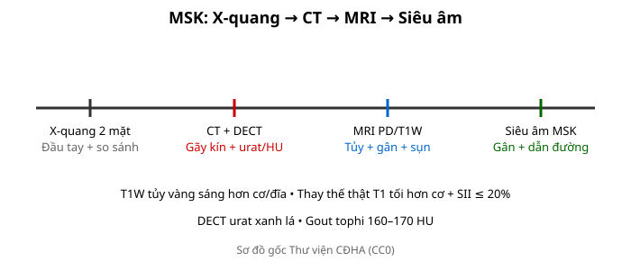
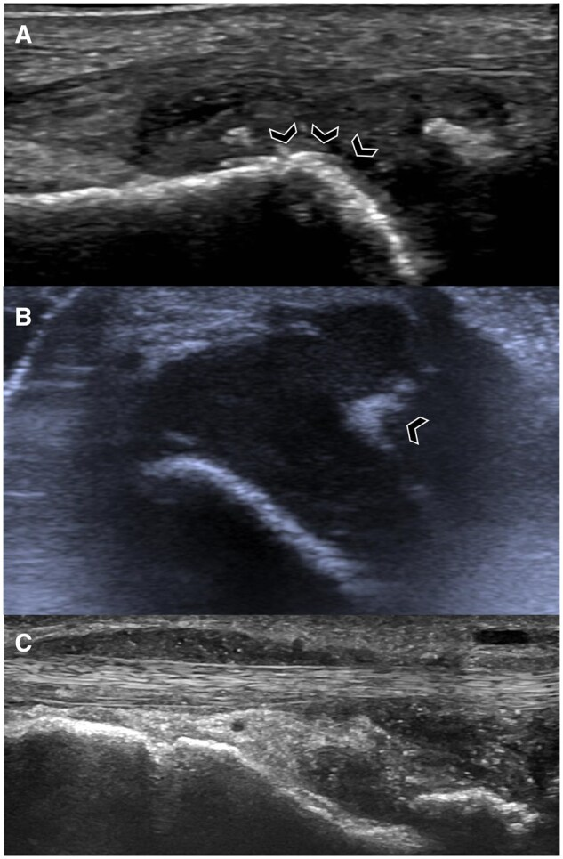
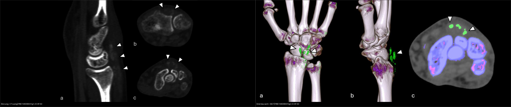
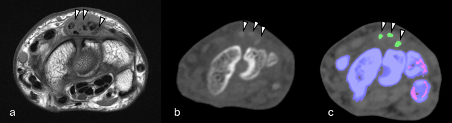
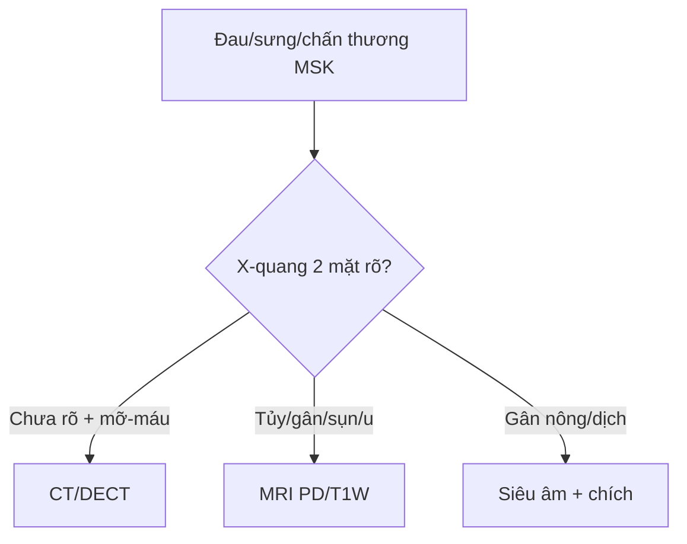
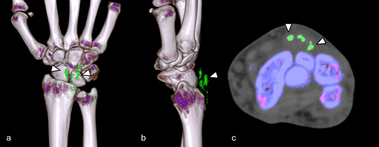
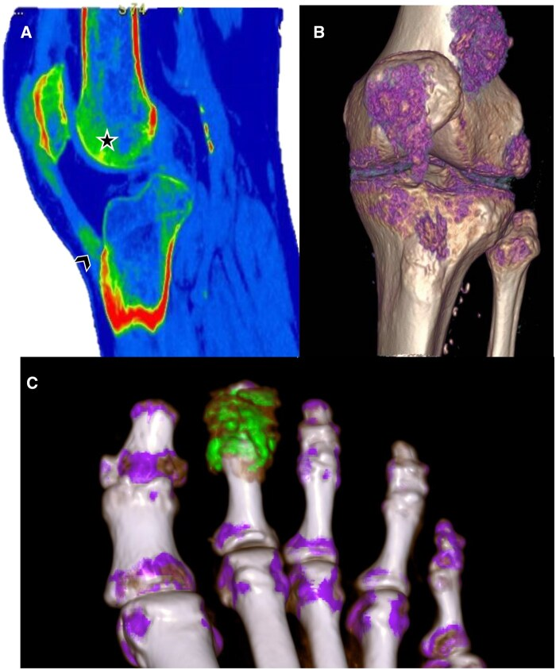
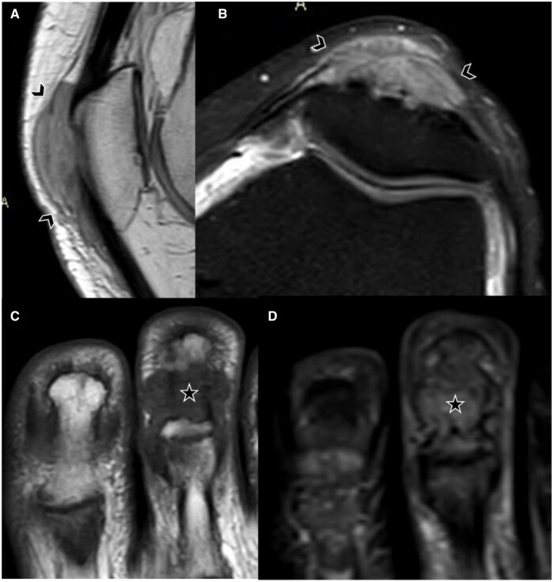

# 301 — Protocol MSK: X-quang, DECT, MRI & siêu âm / MSK protocol

**Tags:** `pattern:protocol-msk` `vung:co-xuong-khop` `protocol:XR-CT-MRI-US`
**Mức chắc chắn (certainty):** tổng hợp y văn (literature synthesis) — nhóm tự biên từ y văn mở, chưa gắn ca nguyên văn đơn lẻ.

## 1. Tổng quan — đúng phương thức mới thấy bệnh + T1W là chuỗi sống còn

- X-quang 2 bình diện là đầu tay mọi đau-sưng-chấn thương xương khớp — TẠI SAO phải 2 mặt + so sánh bên đối diện: 1 mặt bỏ sót 10–50% (trật vai sau, gãy thuyền, bờm mỡ).
- CT lát mỏng + DECT (hai mức năng lượng): gãy kín đáo + phân biệt urat (xanh lá) vs canxi — TẠI SAO DECT thấy tinh thể: urat và canxi suy giảm tia X khác nhau ở 2 mức năng lượng.
- MRI PD fat-sat + T1W: tủy vàng trưởng thành (80% mỡ) T1W luôn sáng hơn cơ/đĩa đệm — thay thế thật (u/mủ) T1 tối hơn cơ + SII ≤ 20%.

*Sơ đồ gốc Thư viện CĐHA, CC0.*

## 2. Gamut chỉ định theo phương thức (Gamut)

- **X-quang 2 mặt + stress/so sánh:** gãy, trật, OA/RA, u (Lodwick) — đầu tay.
- **CT + DECT:** gãy kín (mâm chày, gót, thuyền), urat vs canxi, nidus < 2 cm.
- **MRI PD/T1W + gadolinium:** tủy, gân, sụn chêm/viền, u lan mềm, nhiễm trùng.
- **Siêu âm MSK:** gân Achilles/chóp xoay + tràn dịch + dẫn đường chích/sinh thiết.

*Siêu âm đầu dò cao tần — (A) tràn dịch khớp bàn chân chứa **hạt urat tăng echo (MSU aggregates)** + **dấu "mặt đôi" (double contour sign)** (mũi tên, lớp tinh thể urat phủ trên sụn); (B) hạt urat trong dịch khớp và dọc bao khớp; (C) **dấu "bão tuyết" (snowstorm)** trong bao gân. Nguồn: Wali L et al., Rheumatol Adv Pract 2025, PMC12137905 Fig. 2, CC BY-NC 4.0 (nguyên bản).*

## 3. Bảng phương thức-chỉ định

| Phương thức | Tìm gì | Chốt vào (rule-in) | Chốt loại (rule-out) | Ngưỡng |
|---|---|---|---|---|
| X-quang 2 mặt | Gãy + Lodwick + khe khớp | **Bờm mỡ sau/mỡ-máu = gãy phạm khớp** | 1 mặt bình thường ≠ loại trừ | So sánh đối bên |
| CT + DECT | Gãy kín + urat | **Mỡ khớp −50 đến −100 HU; tophi 160–170 HU xanh lá** | Không vỡ vỏ → bong gân | Lát mỏng 0,5 mm |
| MRI PD/T1W | Tủy + gân + sụn | **T1 tối hơn cơ + SII ≤ 20% = thay thế thật** | T1 ≥ cơ + SII > 20% → phù/tủy đỏ | TE dài > 60 ms (magic angle) |
| Siêu âm | Gân + dịch + canxi | **Mất sợi + dịch = đứt; double contour = gout** | Sợi còn → viêm | Đầu dò ≥ 12 MHz |

*Trái: CT cửa sổ xương cổ tay — ổ **tăng đậm độ (high-density foci)** dọc gân duỗi = tophi (không phân biệt được urat với canxi). Phải: **DECT tô màu** — **acid uric hiện màu xanh** ở khoang duỗi IV = gouty tophi (chốt nguyên lý: hai mức năng lượng tách urat khỏi canxi). Nguồn: PMC12603964 Fig. 1 & 2, Cureus 2025, CC BY 4.0. Ảnh ghép letterbox, giữ nguyên tỷ lệ.*

*Cùng mặt cắt cổ tay: tophi **giảm–trung gian tín hiệu trên T1W MRI (a)**, **hơi tăng đậm độ trên CT (b)**, **hiện rõ nhất trên DECT tô màu (c)** — minh họa vì sao **đúng phương thức mới thấy bệnh**. Nguồn: PMC12603964 Fig. 4, Cureus 2025, CC BY 4.0.*

## 4. Protocol chuẩn

- Chấn thương: X-quang 2 mặt → CT khi mỡ-máu/mỡ sau; khớp mạn: X-quang + siêu âm → MRI; u: X-quang (Lodwick) → MRI toàn tổn thương + ngực (di căn).

## 5. Cạm bẫy

- **1 mặt X-quang** bỏ sót trật sau/gãy thuyền — 2 mặt + chuyên biệt là luật.
- **MRI không T1W** mất chuẩn tủy sống còn — PD sáng không phân biệt thay thế/phù.
- **Siêu âm phụ thuộc người làm** — gân sâu (chậu, háng) vẫn cần MRI.

## 6. Tự lượng giá — Blind Quiz

**Ca 1 — Bệnh nhân sưng–đau cổ tay mạn, CT thấy ổ tăng đậm độ dọc gân duỗi. Đọc DECT, trả lời tại sao phải chọn đúng phương thức.**

- Hỏi: ổ đậm độ thô trên CT là urat hay canxi? DECT cho biết gì thêm? Vì sao MRI T1 có thể không thấy?

<b>Bấm để hiện đáp án (findings + chẩn đoán)</b>

- Dấu hiệu (findings): DECT tô màu (3D *a,b* + axial *c*) — **acid uric hiện màu xanh** ở khoang duỗi IV = **gouty tophi**.
- Chẩn đoán (diagnosis): **gout** (tophi). **CT đậm độ thô không phân biệt urat/canxi**; **DECT tách được vì urat và canxi suy giảm tia X khác nhau ở 2 mức năng lượng**; MRI T1 chỉ thấy khối tín hiệu trung gian, không đặc hiệu.
- Nguồn: PMC12603964 Fig. 2, Cureus 2025, CC BY 4.0.

**Ca 2 — Đau gối chưa rõ nguyên nhân: DECT khớp gối (hình dưới) có gì; cần tương quan gì?**

<b>Bấm để hiện đáp án (findings + chẩn đoán)</b>

- Dấu hiệu (findings): DECT — **lắng đọng tinh thể MSU (monosodium urate) hiện màu xanh**, cả **trong khớp (dấu sao)** lẫn **trong gân (mũi tên)**.
- Chẩn đoán (diagnosis): **gout** — DECT định vị ổ urat trong khớp và gân; lưu ý **artefact do khớp nhân tạo (beam-hardening)** có thể làm giảm chất lượng DECT (Fig. 7 bài gốc) — phải đọc kèm bối cảnh.
- Nguồn: Wali L et al., Rheumatol Adv Pract 2025, PMC12137905 Fig. 5, CC BY-NC 4.0 (nguyên bản).

**Ca 3 — Cùng bệnh nhân Ca 1 nhưng nhìn hình dạng đầu tophi trên MRI. Mô tả và phân biệt với khối u.**

<b>Bấm để hiện đáp án (findings + chẩn đoán)</b>

- Dấu hiệu (findings): **khối dạng tiểu thùy tín hiệu trung gian** (A,B) bào mòn mặt trước xương bánh chè = tophus; (C) khối trong khớp bào mòn và phá hủy khớp bàn đốt II/dòng tận cùng; (D) thay đổi tín hiệu khu trú + phù ít trên chuỗi nhạy dịch.
- Chẩn đoán (diagnosis): **gouty tophi**. MRI mô tả vị trí/bào mòn nhưng **không đặc hiệu tinh thể** — chốt bằng US (double contour) hoặc DECT (urat xanh); phân biệt khối u sụn/mềm bằng bối cảnh + acid uric.
- Nguồn: Wali L et al., Rheumatol Adv Pract 2025, PMC12137905 Fig. 8, CC BY-NC 4.0 (nguyên bản).

**Ca 4 — Đối chiếu cuối: bên nào chỉ ra acid uric? Vì sao "không loại trừ bằng X-quang/CT thô"?** *(Bảng mục 3.)*

<b>Bấm để hiện đáp án (findings + chẩn đoán)</b>

- **Trái = CT thô:** ổ tăng đậm độ không đặc hiệu (có thể urat, canxi, máu). **Phải = DECT:** acid uric **tô xanh** → urat.
- Chốt: **DECT là chuỗi tô màu tinh thể** (urat xanh lá, canxi xanh dương); **1 mặt / CT thô bình thường ≠ loại trừ**.
- Nguồn: PMC12603964 Fig. 1 & 2, Cureus 2025, CC BY 4.0.

## Bài liên quan chéo
- [300 – Tổng quan MSK](../300-tong-quan-he-co-xuong-khop/lesson.md)
- [310 – Xương phụ](../310-giai-phau-xuong-khop-va-bien-the/lesson.md) (vỏ kín)
- [320 – Gãy & trật khớp](../320-gay-xuong-trat-khop-cap-cuu/lesson.md) (mỡ-máu)

> Không dùng để chẩn đoán độc lập khi chưa có người hướng dẫn.
