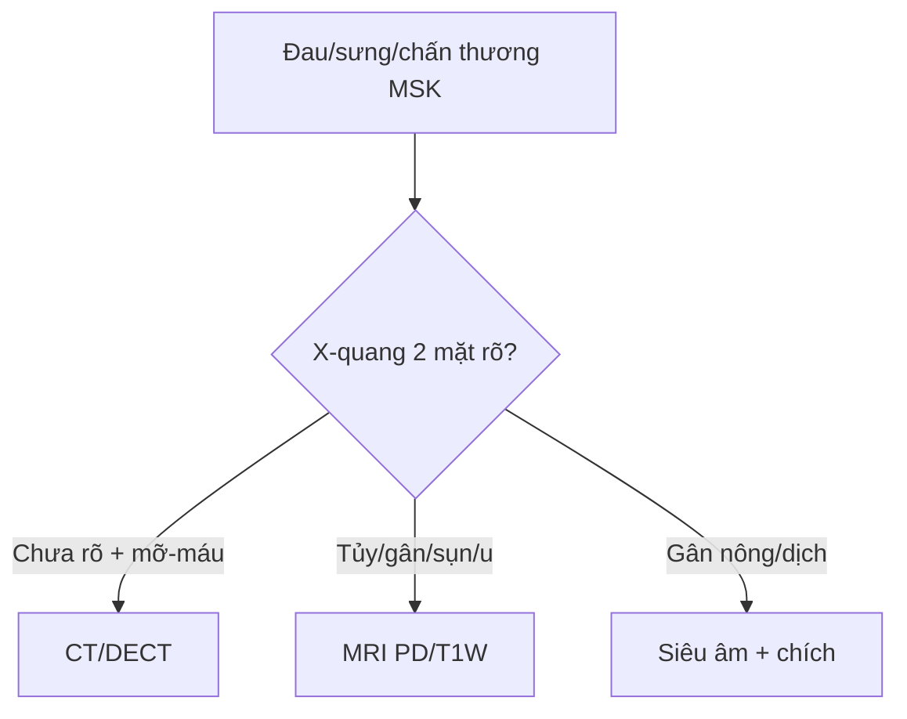

# 301 — Protocol MSK: X-quang, DECT, MRI & siêu âm / MSK protocol

**Tags:** `pattern:protocol-msk` `vung:co-xuong-khop` `protocol:XR-CT-MRI-US`
**Mức chắc chắn (certainty):** tổng hợp y văn (literature synthesis) — nhóm tự biên từ y văn mở, chưa gắn ca nguyên văn đơn lẻ.

## 1. Tổng quan — đúng phương thức mới thấy bệnh + T1W là chuỗi sống còn

- X-quang 2 bình diện là đầu tay mọi đau-sưng-chấn thương xương khớp — TẠI SAO phải 2 mặt + so sánh bên đối diện: 1 mặt bỏ sót 10–50% (trật vai sau, gãy thuyền, bờm mỡ).
- CT lát mỏng + DECT (hai mức năng lượng): gãy kín đáo + phân biệt urat (xanh lá) vs canxi — TẠI SAO DECT thấy tinh thể: urat và canxi suy giảm tia X khác nhau ở 2 mức năng lượng.
- MRI PD fat-sat + T1W: tủy vàng trưởng thành (80% mỡ) T1W luôn sáng hơn cơ/đĩa đệm — thay thế thật (u/mủ) T1 tối hơn cơ + SII ≤ 20%.

*Sơ đồ gốc Thư viện CĐHA, CC0.*

## 2. Gamut chỉ định theo phương thức (Gamut)

- **X-quang 2 mặt + stress/so sánh:** gãy, trật, OA/RA, u (Lodwick) — đầu tay.
- **CT + DECT:** gãy kín (mâm chày, gót, thuyền), urat vs canxi, nidus < 2 cm.
- **MRI PD/T1W + gadolinium:** tủy, gân, sụn chêm/viền, u lan mềm, nhiễm trùng.
- **Siêu âm MSK:** gân Achilles/chóp xoay + tràn dịch + dẫn đường chích/sinh thiết.

## 3. Bảng phương thức-chỉ định

| Phương thức | Tìm gì | Chốt vào (rule-in) | Chốt loại (rule-out) | Ngưỡng |
|---|---|---|---|---|
| X-quang 2 mặt | Gãy + Lodwick + khe khớp | **Bờm mỡ sau/mỡ-máu = gãy phạm khớp** | 1 mặt bình thường ≠ loại trừ | So sánh đối bên |
| CT + DECT | Gãy kín + urat | **Mỡ khớp −50 đến −100 HU; tophi 160–170 HU xanh lá** | Không vỡ vỏ → bong gân | Lát mỏng 0,5 mm |
| MRI PD/T1W | Tủy + gân + sụn | **T1 tối hơn cơ + SII ≤ 20% = thay thế thật** | T1 ≥ cơ + SII > 20% → phù/tủy đỏ | TE dài > 60 ms (magic angle) |
| Siêu âm | Gân + dịch + canxi | **Mất sợi + dịch = đứt; double contour = gout** | Sợi còn → viêm | Đầu dò ≥ 12 MHz |

## 4. Protocol chuẩn

- Chấn thương: X-quang 2 mặt → CT khi mỡ-máu/mỡ sau; khớp mạn: X-quang + siêu âm → MRI; u: X-quang (Lodwick) → MRI toàn tổn thương + ngực (di căn).

## 5. Cạm bẫy

- **1 mặt X-quang** bỏ sót trật sau/gãy thuyền — 2 mặt + chuyên biệt là luật.
- **MRI không T1W** mất chuẩn tủy sống còn — PD sáng không phân biệt thay thế/phù.
- **Siêu âm phụ thuộc người làm** — gân sâu (chậu, háng) vẫn cần MRI.

## 6. Tự lượng giá — Blind Quiz

**Ca 1 — Đau gối sau ngã, X-quang thẳng bình thường:** đủ chưa? Thiếu gì? *(Bảng mục 3.)*

<b>Bấm để hiện đáp án</b>

- **Chưa đủ:** thêm lateral cross-table (mỡ-máu) + CT/MRI khi sưng to (gãy mâm chày kín 15%).

**Ca 2 — Tủy đùi T1 tối hơn cơ + SII 10%:** thay thế thật hay phù? *(Bảng mục 3.)*

<b>Bấm để hiện đáp án</b>

- **Thay thế thật (u/mủ):** T1 < cơ + SII ≤ 20% — sinh thiết/cấy (phù là T1 ≥ cơ + SII > 20%).

## Bài liên quan chéo
- [300 – Tổng quan MSK](../300-tong-quan-he-co-xuong-khop/lesson.md)
- [310 – Xương phụ](../310-giai-phau-xuong-khop-va-bien-the/lesson.md) (vỏ kín)
- [320 – Gãy & trật khớp](../320-gay-xuong-trat-khop-cap-cuu/lesson.md) (mỡ-máu)

> Không dùng để chẩn đoán độc lập khi chưa có người hướng dẫn.
