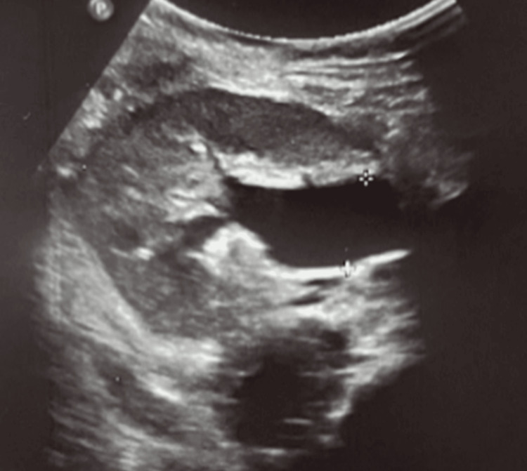
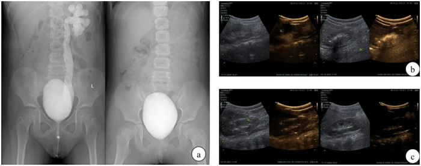
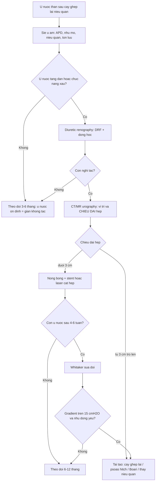
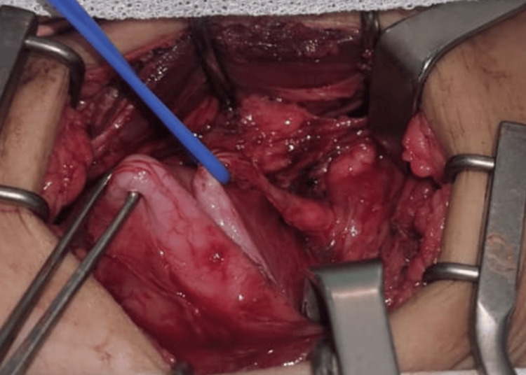
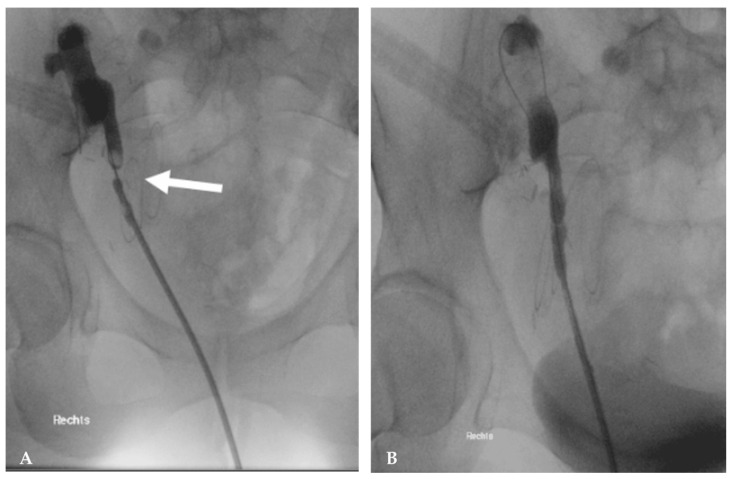

# 3010 — Hẹp miệng nối niệu quản–bàng quang sau cấy ghép lại niệu quản ở trẻ / Ureterovesical anastomotic stricture after ureteral reimplantation

**Tags:** `pattern:hep-mien-noi` `pattern:u-nuoc-than` `pattern:thoat-nuoc-tieu` `vung:tiet-nieu` `vung:bang-quang` `vung:nieu-quan` `anatomy:UVJ` `protocol:MR-urography` `protocol:CT-urography` `protocol:Whitaker` `protocol:nong-bong` `score:Clavien-Dindo`
**Mức chắc chắn (certainty):** tổng hợp y văn (literature synthesis) — ghép **meta-analysis 9 nghiên cứu/655 trẻ Cohen vs Lich–Gregoir** (Transl Pediatr 2026, PMC13559125), **179 trẻ nội soi bàng quang–khí PL vs Cohen** (Front Pediatr 2026, PMC13433845), **65 nhũ nhi ≤ 36 tháng tắc đoạn cuối niệu quản bẩm sinh (POM)** (J Clin Med 2026, PMC13513172), **nghiệm pháp Whitaker sửa đổi 105 đơn vị thận sau cấy ghép lại niệu quản** (Transl Androl Urol 2026, PMC13458501), **tổng quan biến chứng phẫu thuật sau ghép thận nhi** (J Clin Med 2026, PMC12842314), **107 trẻ ghép thận không đặt stent** (Pediatr Transplant 2026, PMC13473721), **11 trẻ nong bóng nội soi POM** (Medicina 2025, PMC11944046) và **ca hẹp đoạn cuối niệu quản 1 cm ở trẻ 8 tuổi ghép thận** (Cureus 2026, PMC13142765). Không có ca do nhóm tự chụp.

> **Câu hỏi thực hành:** bé gái **8 tuổi**, ghép thận **4 tháng**, siêu âm định kỳ thấy **ứ nước thận mức độ trung bình**, creatinin **tăng nhẹ**; **chụp niệu quản ngược dòng không kết luận được chỗ hẹp**; không sốt, không đau. Câu hỏi: **ứ nước này là tắc thật hay chỉ là "giãn tồn tại" sau mổ — và khi nào được nong bóng, khi nào phải mổ lại?**
> Bài chốt **ba quyết định**: **(1) ứ nước sau cấy ghép lại niệu quản KHÔNG đồng nghĩa tắc — phải chứng minh bằng động học/pressure–flow, không mổ theo siêu âm; (2) hẹp ngắn < 3 cm → nong bóng/laser nội soi; hẹp dài, tái phát hoặc thiếu máu → mổ lại; (3) hẹp sớm < 3 tháng thường do kỹ thuật/thiếu máu, hẹp muộn ≥ 6 tháng thường do xơ/nhiễm/thải ghép — cơ chế quyết định cách sửa.** Nối [635 – Dị tật hệ tiết niệu nhi](../635-di-tat-tiet-nieu-nhi-SFU-VUR-PUV/lesson.md), [642 – Biến chứng muộn sau chấn thương đường tiết niệu dưới](../642-bien-chung-muon-chan-thuong-nieu-dao-nhi/lesson.md), [189 – Đánh giá tiết niệu trước ghép thận](../189-danh-gia-truoc-ghep-than-bang-quang-than-kinh/lesson.md), [691 – Sỏi bàng quang ở trẻ bàng quang thần kinh](../691-soi-bang-quang-va-soi-quanh-catheter-o-tre/lesson.md), [3009 – Dò sau tăng dung tích bàng quang](../3009-do-bang-quang-ruot-sau-tang-dung-tich-bang-quang-o-tre/lesson.md).

## 1. Tổng quan bệnh học – cơ chế hình ảnh: vì sao "giãn" không bằng "tắc"

- **Định nghĩa:** hẹp miệng nối niệu quản–bàng quang (ureterovesical anastomotic stricture) là **hẹp lòng tại chỗ niệu quản được cấy lại vào bàng quang**, gây **chênh áp lực thận–bàng quang** và **ứ nước tiến triển**, khác với **giãn không tắc** (dilated but unobstructed) — nơi lòng niệu quản rộng nhưng **không có gradient áp lực** và **chức năng thận ổn định**. Phân biệt hai thực thể này là **toàn bộ nội dung bài**.
- **Tần suất thật:** trong **179 trẻ** nội soi bàng quang–khí, **tắc miệng nối 1/179 (0,6%)**, ứ nước **2/179**, thoát nước tiểu **7/179** (PMC13433845). Trong **65 nhũ nhi** mổ vì POM, **không ca nào tắc lại** sau **40,0 ± 17,4** và **46,5 ± 21,1** tháng (PMC13513172). Meta-analysis **9 nghiên cứu/655 trẻ** cho thấy **tắc/ứ nước OR 1,15 (KTC 95% 0,34–3,83)** giữa Cohen và Lich–Gregoir — tức **biến cố hiếm và tương đương** (PMC13559125). **Ghép thận** là bối cảnh nặng hơn: **hẹp niệu quản tới 5%** ở trẻ ghép thận (PMC12842314); loạt **107 trẻ ghép không stent** có **3,7% (4/107)** biến chứng niệu, **2,8% (3/107) phải mổ**, **hẹp/tắc 2,8%** (2 chỗ nối bể–niệu quản, 1 do sỏi bít), **rò 0%** (PMC13473721).
- **TẠI SAO miệng nối lại hẹp:** niệu quản đoạn cuối nuôi bởi **đám rối mạch mạc treo niệu quản**; bóc tách, **tạo hình thu nhỏ (tapering)**, hoặc **kéo căng** khi chuyển đường đi đều làm **giảm tưới máu mép khâu** → **loét → xơ → hẹp**. Theo **định luật Poiseuille**, **sức cản tỉ lệ nghịch với bán kính mũi 4 (R ∝ 1/r⁴)**: lòng giảm từ **3 mm còn 1,5 mm** làm sức cản tăng **~16 lần** — nên **hẹp 1–2 mm** đã đủ gây ứ nước và tăng creatinin.
- **TẠI SAO ứ nước KHÔNG chứng minh tắc:** bể thận–niệu quản là **hệ đàn hồi**, "giãn" là hiện tượng **thể tích**, không phải **áp lực**. Sau cấy ghép lại, miệng nối **không còn cơ chế van**, niệu quản có thể **giãn tồn tại** hàng tháng dù **không tắc**; ngược lại, **hẹp mới hình thành** có thể chưa làm giãn bể thận nếu **bể thận xơ, không đàn hồi**. Vì vậy phải dùng **động học (diuretic renography)** hoặc **đo áp lực trực tiếp (Whitaker)**.
- **Ngưỡng áp lực của Whitaker sửa đổi (số liệu 105 đơn vị thận sau cấy ghép lại):** **Type I** — chênh áp bể thận–bàng quang **ổn định ở mức nền**, áp lực tuyệt đối **< 22 cmH₂O**, niệu quản hiện rõ khi bơm; **Type II** — chênh áp **tăng dần trong lúc bơm nhưng nhu động còn**, cuối nghiệm pháp **chênh ≤ 15 cmH₂O** và **áp lực tuyệt đối ≤ 22 cmH₂O**; **Type III** — chênh áp **luôn > 15 cmH₂O** kèm **nhu động yếu/mất** → **tắc**. Tỷ lệ **Type I 69,52% · Type II 22,86% · Type III 7,62%**; **áp lực bể thận trung vị 20,00 (16,00–25,50) cmH₂O**, **bàng quang 14,00 (9,50–20,00)**, **chênh 5,00 (2,00–9,00)**; **giá trị tiên đoán âm 85,71–91,43%** (PMC13458501).
- **TẠI SAO "hẹp < 3 cm" là ngưỡng nội soi:** đoạn hẹp ngắn cho phép **nong bóng/laser cắt hẹp** mà vẫn giữ được **chiều dài niệu quản** và **nguồn máu**; hẹp dài hơn thì **nội soi thất bại cao** vì mô xơ tái tạo, phải **tái tạo niệu quản** (nối lại, psoas hitch, Boari). Ở trẻ ghép thận, tổng quan nêu rõ **< 3 cm → nội soi; > 3 cm → phẫu thuật tái tạo** (PMC12842314).
- **TẠI SAO phải phân biệt hẹp sớm và muộn:** **< 3 tháng** hẹp do **kỹ thuật/thiếu máu** (phù nề, khâu căng, xoắn) — có thể **tự cải thiện** hoặc đáp ứng nong; **≥ 6 tháng** hẹp do **xơ hóa, nhiễm trùng, bệnh mạch tiến triển, thải ghép** (PMC12842314); nguyên nhân quyết định **có nên chờ, nong hay mổ**.

## 2. Mẫu hình + chẩn đoán phân biệt theo thời điểm và cơ chế (Gamut)

- **Theo thời điểm:**
  - **Sớm ≤ 4 tuần:** **phù nề miệng nối**, cục máu đông, **xoắn/gập niệu quản**, rò nước tiểu, ứ nước do **bàng quang còn yếu/tăng áp**.
  - **Trung gian 1–6 tháng:** **hẹp do thiếu máu – xơ**, sỏi hình thành trên stent, **chèn ép bởi lymphocele/urinoma**.
  - **Muộn > 6 tháng:** **hẹp xơ trưởng thành**, hẹp do **BK virus**, thải ghép mạn, hẹp do **trào ngược – nhiễm trùng lặp lại**.
- **Theo cơ chế:**
  - **Nội tại:** thiếu máu mép khâu, hẹp do khâu quá chặt, **tunnel quá hẹp** ở Lich–Gregoir, **tapering** làm lòng nhỏ.
  - **Ngoại lai:** **gập/góc** khi chuyển đường (Cohen xuyên tam giác), **chèn ép** bởi mạch, lymphocele, hematoma, **dính sau mổ**.
  - **Trong lòng:** sỏi, cục máu, **mảnh mô hoại tử**.
  - **Toàn thân/bệnh nền:** **BK nephropathy**, thải ghép, thiếu máu nuôi do xơ vữa mạch ghép.
- **Theo vị trí hẹp (quyết định kỹ thuật):**
  - **Tại miệng nối (UVJ):** hay sau cấy ghép lại; nong bóng hoặc **tái cấy ghép**.
  - **Ngay trên miệng nối 1–2 cm:** hay sau **tapering**; cần **cắt đoạn hẹp + nối lại**.
  - **Đoạn giữa/dài:** thường do **xơ sau xạ/chấn thương**; cần **tái tạo dài** (Boari, psoas hitch, thay niệu quản).
- **Mnemonic "STRICTURE":** **S**tent (sỏi trên stent), **T**ension/xoắn, **R**adiation/xơ, **I**schaemia (thiếu máu), **C**ohen re-route (gập), **T**apering (lòng nhỏ), **U**rinary leak (xơ sau rò), **R**ejection/BK, **E**xtrinsic (lymphocele, hematoma).

## 3. Bảng so sánh phân biệt (ma trận đối chiếu)

| Thực thể (entity) | Hình ảnh điển hình | Chốt vào (rule-in) | Chốt loại (rule-out) | Gợi ý xác nhận |
|---|---|---|---|---|
| **Hẹp miệng nối (anastomotic stricture)** | Siêu âm: **ứ nước tăng dần** theo lần chụp; CT/MR urography: **chỗ hẹp khu trú, thành dày**, niệu quản trên **giãn**; chụp ngược dòng thấy **cản quang không qua được** | **Chỗ hẹp + gradient áp lực > 15 cmH₂O (Whitaker type III) + chức năng thận giảm/xấu đi theo thời gian** | Ứ nước **ổn định nhiều lần**, creatinin ổn, không gradient → **giãn không tắc** | Siêu âm lặp + diuretic renography; Whitaker sửa đổi; CT/MR urography |
| **Giãn không tắc (dilated but unobstructed)** | Bể thận/niệu quản **rộng nhưng không tăng thêm**, **vỏ thận dày bình thường**, không chỗ hẹp rõ | **Kích thước ổn định ≥ 6 tháng + độ lọc/tưới máu ổn + không gradient** | **Tăng dần + chỗ hẹp + chức năng giảm** → hẹp thật | Diuretic renography 2 lần; Whitaker nếu còn nghi |
| **Gập/xoắn niệu quản (kinking)** | Niệu quản **góc nhọn, chữ S** ngay trên miệng nối; CT vành/đứng thấy rõ | **Góc gập tại chỗ chuyển đường + ứ nước ngay sau mổ** | Chỗ hẹp **nhẵn, đối xứng, không gập** → hẹp xơ | CT urography đa bình diện; soi + chụp ngược dòng |
| **Sỏi niệu quản trên stent** | **Cản quang trong lòng** ± bóng lưng trên siêu âm; thường ở **đầu stent** | **Sỏi thấy rõ + đau quặn/thoát nước tiểu** | Không cản quang, chỉ hẹp lòng → hẹp miệng nối | CT KUB liều thấp; soi lấy sỏi |
| **Cục máu đông** | Khối **không cản quang** trong lòng, thay đổi giữa 2 lần chụp | **Sau mổ/thủ thuật + đái máu + khối di động** | Khối **cố định, ngấm thuốc** → u/mô | Siêu âm lặp; bơm rửa; soi |
| **Chèn ép ngoài (lymphocele, hematoma, urinoma)** | Khối **dịch quanh thận/niệu quản** đẩy lệch niệu quản; **không có tổn thương lòng** | **Khối dịch + niệu quản bị đẩy + hẹp do chèn** | Hẹp **trong lòng** tại miệng nối → hẹp thật | CT/MR; siêu âm Doppler; dẫn lưu khối dịch |
| **Rò nước tiểu/hoại tử niệu quản** | **Thoát cản quang** ngoài lòng, **dịch quanh thận**, có thể **thiếu đoạn niệu quản** | **Thoát cản quang + sốt/đau + tăng creatinin dịch ổ bụng** | Không thoát cản quang → không rò | CT urography muộn/CT cystography; chụp ngược dòng |
| **Trào ngược tái phát (VUR)** | **Cản quang đi ngược lên** khi bơm bàng quang; niệu quản giãn **theo thì bơm**, hết khi thôi bơm | **Trào ngược thấy rõ trên VCUG/ceVUS** | Không trào ngược, nhưng ứ nước **khi bàng quang rỗng** → tắc | VCUG/ceVUS; đo dung tích và áp lực bàng quang |
| **Bí tiểu/tăng áp bàng quang (sau Lich–Gregoir)** | **Hai bên ứ nước**, bàng quang **căng**, thành dày; hết sau khi thông tiểu | **Bàng quang căng + ứ nước hai bên + giảm sau thông tiểu** | Ứ nước **một bên**, bàng quang rỗng → hẹp miệng nối | Đo thể tích tồn lưu; bàng quang đồ; thông tiểu |
| **Thải ghép/BK (không tắc)** | Thận **to, phù**, tăng tín hiệu T2; **không có chỗ hẹp**; DWI hạn chế khuếch tán không đặc hiệu | **Sinh thiết/thải ghép + BK viremia + không gradient** | Có **chỗ hẹp + gradient** → tắc | Sinh thiết ghép, BK PCR, siêu âm Doppler |

*Bé gái **8 tuổi**, ghép thận; siêu âm **4 tháng** sau ghép: **ứ nước 1,9 cm** (thước đo) nhưng **không thấy niệu quản giãn rõ** — đây chính là cạm bẫy "ứ nước không tương xứng với mức giãn". Chẩn đoán cuối cùng là **hẹp đoạn ngắn ~1 cm cách chỗ cắm vào bàng quang**, phải mổ mới xác định. Nguồn: Cureus 2026 (PMC13142765), **CC BY 4.0**, nguyên bản.*

*(a) VCUG trước mổ: **trào ngược độ IV–V bên trái** với niệu quản giãn, ngoằn ngoèo; (a, phải) VCUG **6 tháng sau** cấy ghép lại: **không còn trào ngược**, nhưng **niệu quản vẫn còn giãn nhẹ** — minh họa rằng **hết trào ngược không đồng nghĩa hết giãn**. (b, c) ceVUS trước và sau mổ. Nguồn: Front Pediatr 2026 (PMC13433845), **CC BY 4.0**, nguyên bản.*

### Ba câu hỏi trước khi gọi là "hẹp"
1. **Có chỗ hẹp thật không?** (CT/MR urography hoặc chụp ngược dòng — không chỉ siêu âm).
2. **Có gradient áp lực không?** (diuretic renography; Whitaker nếu còn nghi).
3. **Chức năng thận có xấu đi theo thời gian không?** (creatinin/eGFR, độ lọc trên renography, độ dày vỏ).

## 4. Protocol chẩn đoán – theo dõi – can thiệp

- **Theo dõi sau cấy ghép lại (không ghép thận):** siêu âm **1 tháng, 3 tháng, 6 tháng**, sau đó **mỗi 6–12 tháng**; chụp bàng quang–niệu quản ngược dòng **chỉ khi có chỉ định** (nhiễm trùng tiểu sốt, ứ nước tăng). Trong loạt 179 trẻ, **siêu âm + VCUG/ceVUS** là đủ để phát hiện **1 ca tắc miệng nối** và **7 ca thoát nước tiểu** (PMC13433845).
- **Bước 1 — siêu âm có đo lường:** đo **đường kính bể thận trước–sau (APD)**, **độ dày nhu mô**, **đường kính niệu quản**, **thể tích tồn lưu**; so với lần trước. Trong 65 nhũ nhi, APD giảm từ **22,1 → 9,0 mm** (TPL) và **21,2 → 10,0 mm** (LLG) sau mổ — tức là **APD giảm là dấu hiệu thành công**, không phải "hết giãn hoàn toàn" (PMC13513172).
- **Bước 2 — đánh giá chức năng/động học:** **diuretic renography** (MAG3/DTPA) khi ứ nước kéo dài; ghi **độ lọc tương đối (DRF)**, thời gian bán thải, đáp ứng lợi tiểu. DRF trong loạt POM **38,0 → 40,3%** và **38,8 → 40,9%** — **DRF được bảo tồn** là mục tiêu (PMC13513172).
- **Bước 3 — khi hình ảnh không kết luận:** **nghiệm pháp Whitaker sửa đổi** (đo áp lực bể thận–bàng quang khi bơm dung dịch tốc độ tăng dần, kèm hình ảnh); **Type III (> 15 cmH₂O + nhu động yếu/mất) = tắc**, **Type I/II = không tắc**. Đây là công cụ **loại trừ tắc** tốt nhất (giá trị tiên đoán âm **85,71–91,43%**) và giúp **quyết định rút ống thông niệu quản qua da** (PMC13458501).
- **Bước 4 — can thiệp theo độ dài và cơ chế:**

| Tình huống | Lựa chọn | Số liệu / lưu ý |
|---|---|---|
| **Hẹp sớm < 4 tuần, chỉ phù nề** | **Chờ + theo dõi 4–6 tuần**, điều trị nhiễm trùng, đảm bảo dẫn lưu | Đừng can thiệp vào "hẹp" mới hình thành trong 2 tuần đầu |
| **Hẹp ngắn < 3 cm tại miệng nối** | **Nong bóng ± stent** hoặc **laser cắt hẹp (endoureterotomy) + stent** | Ngưỡng **< 3 cm → nội soi; > 3 cm → tái tạo** (PMC12842314) |
| **Hẹp sau nong tái phát / hẹp dài** | **Tái cấy ghép lại niệu quản** (trong/ngoài bàng quang); **psoas hitch/Boari** nếu thiếu chiều dài | Ở trẻ ghép thận, **hẹp/tắc 2,8%** và **2/3 ca phải mổ** trong loạt không stent (PMC13473721) |
| **Hẹp do thiếu máu, hoại tử đoạn dài** | **Cắt đoạn + nối lại** hoặc **thay niệu quản** (ileal ureter) | Ca Whitaker type III gradient **28 cmH₂O** + nhu động mất do **xạ trị** → **thay niệu quản bằng hồi tràng** (PMC13458501) |
| **Hẹp kèm sỏi** | **Lấy sỏi + nong/sửa miệng nối** | Sỏi là nguyên nhân **1/3 ca tắc** trong loạt ghép không stent (PMC13473721) |
| **Hẹp + bàng quang áp lực cao** | **Điều trị bàng quang trước** (CIC, kháng cholinergic, tăng dung tích) rồi đánh giá lại | Bí tiểu sau Lich–Gregoir **6,4% vs 1,7%** (Cohen) — **OR 0,32** (PMC13559125) |
| **Nong bóng ở trẻ nhỏ** | Hiệu quả **~83%** nhưng **biến chứng 73%** (C–D IIIb **50%**: vỡ bóng, di trú stent, hẹp lại) | 11 trẻ POM, nong bóng + stent (PMC11944046) — **chọn bệnh nhân kỹ** |

- **Bước 5 — theo dõi sau can thiệp:** siêu âm **1, 3, 6 tháng**; **rút stent 4–6 tuần**; chụp kiểm tra nếu ứ nước không giảm; **đo creatinin/eGFR** mỗi lần. Sau nong bóng thất bại **2 lần** → **chuyển mổ tái tạo**, không nong lần 3.

## 5. Biến thể bình thường và cạm bẫy

- **Bẫy 1 — mổ theo siêu âm:** **ứ nước tồn tại hàng tháng** sau cấy ghép lại là bình thường; trong loạt 65 nhũ nhi, APD sau mổ vẫn còn **9–10 mm** dù **không ca nào tắc lại** (PMC13513172). Chỉ can thiệp khi **ứ nước tăng dần + chức năng giảm + có chỗ hẹp**.
- **Bẫy 2 — "hẹp" trong 2 tuần đầu:** phù nề miệng nối sau mổ **tự giảm**; chụp ngay trong 2 tuần dễ **đọc quá** thành hẹp. Chờ **4–6 tuần** trước khi kết luận (trừ khi có **rò, sốt, vô niệu**).
- **Bẫy 3 — Cohen làm khó đường ngược dòng:** cấy ghép **xuyên tam giác** làm lỗ niệu quản **lệch vị trí**, đặt catheter ngược dòng khó; nếu không lên được, dùng **đường qua da (nephrostomy) + chụp ngược dòng** thay vì kết luận "không tắc".
- **Bẫy 4 — tapering tạo hình giả hẹp:** đoạn niệu quản được **thu nhỏ** có lòng **hẹp hơn bình thường** nhưng **không tắc**; đọc trên CT dễ nhầm. Đối chiếu **hình dạng đều, nhẵn, không gradient**.
- **Bẫy 5 — bàng quang căng giả tắc:** **bí tiểu sau Lich–Gregoir (6,4%)** gây **ứ nước hai bên** và tăng creatinin; thông tiểu/đặt CIC thì hết. Luôn kiểm tra **thể tích tồn lưu** trước khi kết luận hẹp.
- **Bẫy 6 — stent che hẹp:** stent **mở lòng** nên hình ảnh có thể **bình thường** dù hẹp đang hình thành; đánh giá lại **sau rút stent**.
- **Bẫy 7 — nephrostomy làm mất dấu hiệu:** ống thông qua da **giải áp** → bể thận **xẹp**, hẹp không lộ; phải **kẹp ống/chụp có áp lực** mới thấy.
- **Bẫy 8 — quy mọi suy ghép cho tắc:** creatinin tăng sau ghép thận có thể do **thải ghép, BK nephropathy, độc calcineurin, hẹp động mạch ghép**; **không có chỗ hẹp + không gradient** thì **không mổ**.

## 6. Tự lượng giá — Blind Quiz

**Ca 1 — Bé gái 8 tuổi, ghép thận 4 tháng, ứ nước 1,9 cm, creatinin tăng nhẹ, chụp ngược dòng không kết luận.**

- Câu hỏi 1: Vì sao **ứ nước 1,9 cm mà không thấy niệu quản giãn** lại là dấu hiệu đáng lo, không phải dấu hiệu yên tâm?
- Câu hỏi 2: Bước tiếp theo hợp lý là gì, và chẩn đoán cuối cùng là gì?

<b>Bấm để hiện đáp án (findings + chẩn đoán)</b>

- Dấu hiệu: **ứ nước 1,9 cm** đo bằng thước trên siêu âm, **niệu quản không giãn rõ**; chụp ngược dòng **không xác định được chỗ hẹp**.
- Vì sao đáng lo: ứ nước **tăng dần + creatinin tăng** dù không thấy giãn niệu quản gợi ý **hẹp đoạn ngắn sát chỗ cắm** — cản quang không vào được đoạn trên nên **không thấy giãn**; đây là kiểu "hẹp kín" dễ bị bỏ.
- Diễn biến: **mổ thăm dò** phát hiện **hẹp đoạn ngắn ~1 cm cách chỗ cắm vào bàng quang** (ảnh dưới); xử trí **tái cấy ghép lại niệu quản + stent JJ**, sau đó chức năng ghép ổn định.

*Trong mổ: **hẹp đoạn ngắn** của niệu quản ngay sát chỗ cắm vào bàng quang (đoạn niệu quản mảnh, xơ); trên là niệu quản giãn. Đây là lý do **chụp ngược dòng không thấy hẹp**: đầu catheter không vượt qua được chỗ hẹp để bơm đoạn trên. Nguồn: Cureus 2026 (PMC13142765), CC BY 4.0.*

- Bài học: **không kết luận "không tắc" chỉ vì chụp ngược dòng không thấy chỗ hẹp**; khi lâm sàng và chức năng xấu đi, cần **CT/MR urography hoặc Whitaker**, và **mổ thăm dò** là lựa chọn hợp lý.
- Nguồn ảnh: Cureus 2026 (PMC13142765), CC BY 4.0.

**Ca 2 — Trẻ trào ngược độ IV–V một bên, được cấy ghép lại niệu quản; so sánh VCUG trước và sau mổ.**

- Câu hỏi: **(a)** Hai điểm khác nhau giữa hai phim? **(b)** Niệu quản còn giãn nhẹ sau mổ có phải là hẹp không?

<b>Bấm để hiện đáp án</b>

- Khác biệt: trước mổ **trào ngược độ IV–V** với niệu quản **giãn, ngoằn ngoèo**; sau mổ **không còn trào ngược**, bể thận **nhỏ lại**, nhưng niệu quản **vẫn còn giãn nhẹ**.
- Còn giãn **không phải hẹp**: đây là **giãn tồn tại** do thành niệu quản mất trương lực sau thời gian dài trào ngược; trong loạt 179 trẻ, **chỉ 1 ca tắc miệng nối (0,6%)** và **2 ca ứ nước**, tức **giãn đơn thuần là phổ biến hơn tắc** (PMC13433845).
- Xác nhận: siêu âm lặp **ổn định**, DRF **không giảm**, không có chỗ hẹp trên CT/MR urography.
- Nguồn ảnh: Front Pediatr 2026 (PMC13433845), CC BY 4.0.

**Ca 3 — Hẹp niệu quản đoạn chậu sau mổ; chụp ngược dòng qua da trước và sau nong bóng.**

- Câu hỏi: **(A)** Dấu hiệu nào xác định chỗ hẹp? **(B)** Vì sao nong bóng được chọn ở ca này, và tiêu chí nào khiến phải chuyển mổ?

<b>Bấm để hiện đáp án</b>

- (A) Cột cản quang **hẹp không đều** tại một điểm (mũi tên), niệu quản trên **giãn**; (B) sau nong, cản quang **qua được** và lòng rộng hơn.
- Chọn nong: **hẹp ngắn (< 3 cm), một ổ, không thiếu máu/hoại tử** — ngưỡng **< 3 cm nội soi, > 3 cm tái tạo** (PMC12842314).
- Chuyển mổ khi: hẹp **> 3 cm**, **tái phát sau 2 lần nong**, có **thiếu đoạn/hoại tử**, hoặc **nhu động mất + gradient cao** (Whitaker type III) — ca xạ trị gradient **28 cmH₂O** phải **thay niệu quản bằng hồi tràng** (PMC13458501).
- Lưu ý ở trẻ: nong bóng **thành công ~83%** nhưng **biến chứng tới 73%**, nửa là **Clavien–Dindo IIIb** (vỡ bóng, di trú stent, hẹp lại) — cần chọn bệnh nhân và theo dõi sát (PMC11944046).
- Nguồn ảnh: J Clin Med 2026 (PMC12842314), CC BY 4.0 (hình được bài tổng quan dùng lại từ nguồn CC BY 4.0, có ghi công trong bài gốc).

## Bài liên quan chéo
- [635 – Dị tật hệ tiết niệu nhi: ứ nước SFU, trào ngược VUR, van niệu đạo sau](../635-di-tat-tiet-nieu-nhi-SFU-VUR-PUV/lesson.md)
- [642 – Biến chứng muộn sau chấn thương đường tiết niệu dưới ở trẻ](../642-bien-chung-muon-chan-thuong-nieu-dao-nhi/lesson.md) (hẹp niệu đạo sau chấn thương)
- [189 – Đánh giá tiết niệu trước ghép thận ở bàng quang thần kinh/tái tạo](../189-danh-gia-truoc-ghep-than-bang-quang-than-kinh/lesson.md)
- [691 – Sỏi bàng quang & sỏi quanh catheter ở trẻ bàng quang thần kinh](../691-soi-bang-quang-va-soi-quanh-catheter-o-tre/lesson.md) (sỏi bít miệng nối)
- [3009 – Dò bàng quang–ruột và dò bàng quang–da sau tăng dung tích bàng quang](../3009-do-bang-quang-ruot-sau-tang-dung-tich-bang-quang-o-tre/lesson.md) (rò nước tiểu sau mổ)
- [582 – Biến chứng tiêu hóa–niệu sau xạ trị phụ khoa](../582-bien-chung-tieu-hoa-nieu-sau-xa-tri-phu-khoa/lesson.md) (hẹp niệu quản sau xạ, tạo hình niệu quản)

> Không dùng để chẩn đoán độc lập khi chưa có người hướng dẫn.
