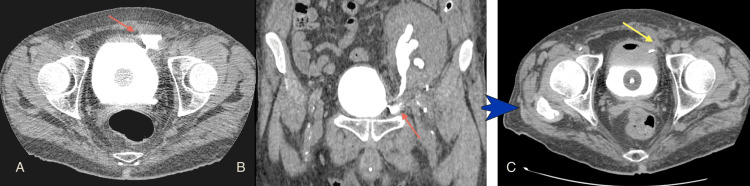
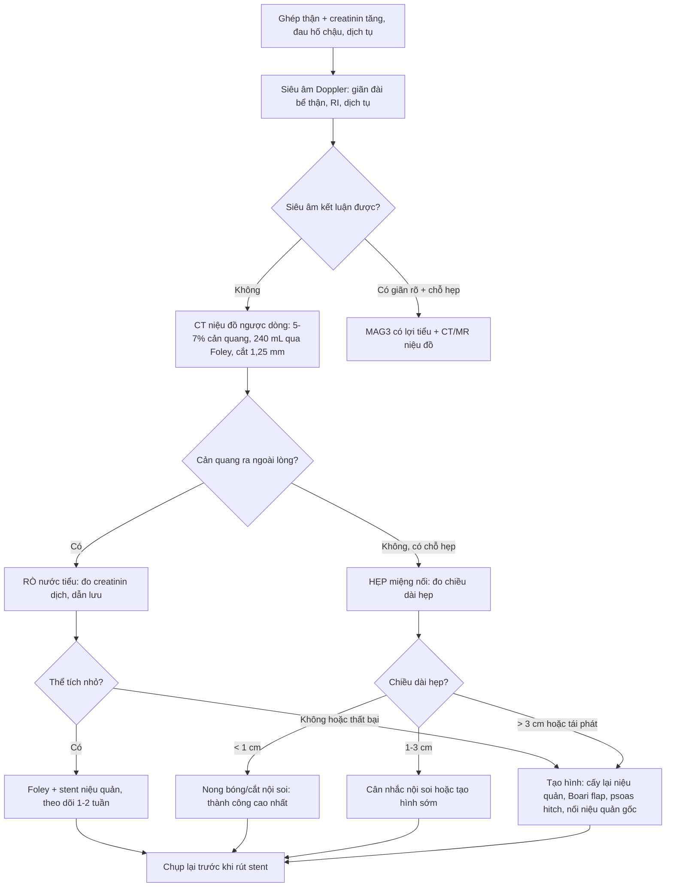
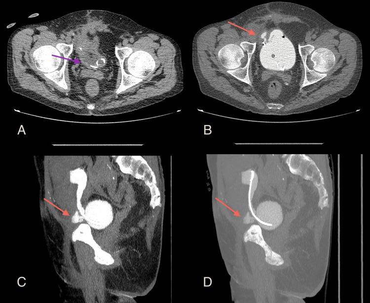
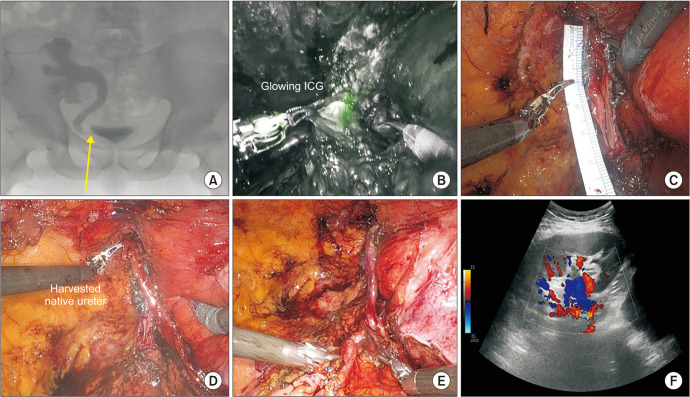
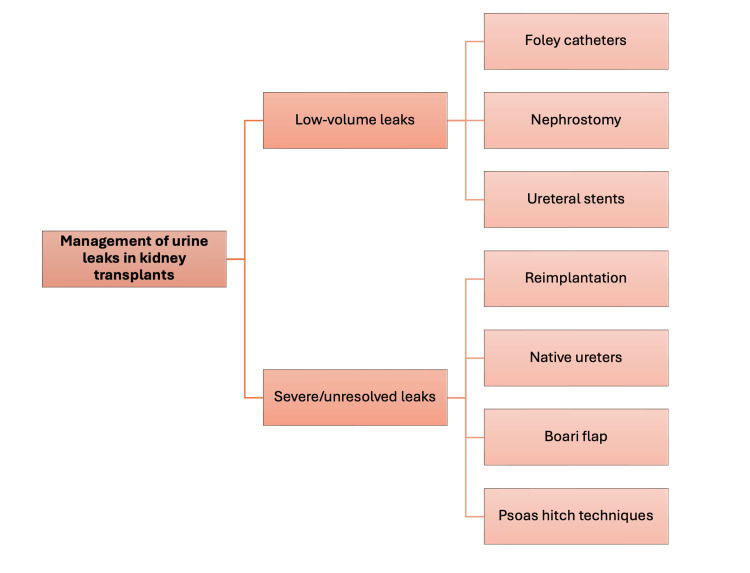

# 3011 — Biến chứng niệu quản sau ghép thận: hẹp miệng nối & rò nước tiểu

**Tags:** `pattern:hep-miet-noi` `pattern:ro-nuoc-tieu` `pattern:urinoma` `pattern:gian-dai-he-nieu` `pattern:hep-do-thieu-mau` `vung:than-ghep` `vung:he-nieu` `vung:tieu-khung` `protocol:CT-urography` `protocol:MAG3` `score:Clavien-Dindo`
**Mức chắc chắn (certainty):** tổng hợp y văn (literature synthesis) — ghép **loạt 4 ca rò nước tiểu được chẩn đoán bằng CT niệu đồ ngược dòng** (Cureus 2026, PMC12989737), **loạt 29 ca hẹp niệu quản mảnh ghép được tái tạo bằng robot** (Eur Urol Open Sci 2025, PMC12169748), **15 ca tái tạo niệu quản robot** (Investig Clin Urol 2025, PMC11729223), **tổng quan biến chứng phẫu thuật sau ghép thận ở trẻ** (J Clin Med 2026, PMC12842314) và **ca rò niệu – ruột ở ghép thận en-bloc nhi** (Front Pediatr 2021, PMC8310905). Không có ca do nhóm tự chụp.

> **Câu hỏi thực hành:** nam **48 tuổi**, ghép thận **1 tháng**, **đau âm ỉ vùng hố chậu ghép**, siêu âm thấy **ứ nước nhẹ + một lớp dịch dưới thận ghép**, creatinin **tăng ít**. Câu hỏi: **ứ nước này là tắc thật hay giãn sinh lý, dịch kia là urinoma hay lymphocele, và chụp gì để trả lời trong một lần?**
> Bài chốt **ba quyết định**: **(1) rò hay hẹp — phân biệt bằng THỜI ĐIỂM + vị trí trên niệu đồ; (2) chụp gì khi siêu âm không kết luận — CT niệu đồ ngược dòng; (3) bậc thang điều trị — dẫn lưu/stent trước, tạo hình khi hẹp dài > 1–3 cm hoặc thất bại nội soi.** Nối [190 – Sỏi đường niệu trên & sỏi thận ghép](../190-soi-nieu-quan-than-ghep-bang-quang-than-kinh/lesson.md), [189 – Đánh giá tiết niệu trước ghép thận](../189-danh-gia-truoc-ghep-than-bang-quang-than-kinh/lesson.md), [672 – Biến chứng muộn sau tái tạo bàng quang](../672-bien-chung-muon-sau-tai-tao-bang-quang/lesson.md).

## 1. Tổng quan bệnh học – cơ chế hình ảnh: vì sao đoạn niệu quản SÁT BÀNG QUANG luôn là điểm yếu

- **Giải phẫu quyết định tất cả:** niệu quản mảnh ghép **không còn nguồn máu từ bể thận–niệu quản gốc**; toàn bộ nuôi dưỡng đi **ngược dòng từ các nhánh động mạch thận**. Đoạn **xa nhất (sát miệng nối bàng quang)** là nơi **áp lực tưới thấp nhất** → thiếu máu → **hoại tử đầu xa** hoặc **xơ hóa** về sau. Vì vậy gần như mọi biến chứng niệu quản đều xảy ra **tại hai miệng nối**.
- **Hai hậu quả của cùng một cơ chế thiếu máu:**
  - **Sớm (tuần đầu – tháng đầu):** thiếu máu/hoại tử hoặc **hở miệng nối** → **rò nước tiểu** → **urinoma**, rò ra vết mổ, hoặc rò vào ổ bụng.
  - **Muộn (nhiều tháng):** mô thiếu máu lành bằng **xơ** → **hẹp miệng nối** (thường tại **ureterovesical junction, UVJ**).
- **TẠI SAO nước tiểu rò nhiều mà creatinin máu có thể chỉ tăng nhẹ:** nước tiểu rò vào **khoang ngoài phúc mạc/hố chậu** được **hấp thu lại vào tuần hoàn** qua phúc mạc và mô lỏng lẻo — giống một "lọc hồi lưu" tự nhiên. Vì vậy **creatinin máu không phản ánh đủ mức rò**; dấu hiệu chốt là **dịch tụ có creatinin cao gấp nhiều lần huyết thanh** và **lượng nước tiểu qua dẫn lưu/vết mổ tăng**.
- **TẠI SAO siêu âm đầu tay vẫn không đủ:** sau ghép, **đài bể thận giãn do mất trương lực** khá thường gặp → **ứ nước không đồng nghĩa tắc**; ngược lại, **rò nhỏ** có thể **không làm giãn** hệ niệu. Hai ca trong loạt Cureus 2026 đến với **siêu âm không kết luận**, và chính **CT niệu đồ ngược dòng** mới định vị được chỗ rò.
- **Ngưỡng định lượng phải thuộc:**

| Biến chứng | Tần suất được báo | Nguồn |
|---|---|---|
| **Hẹp niệu quản mảnh ghép** | **0,6–10,5%**; loạt khác **2–13%**; "tới 10%" | PMC12169748; PMC11729223 |
| **Rò nước tiểu** | **0–9,3%**; loạt khác **1,2–8,9%** | PMC12169748; PMC12989737 |
| **Trào ngược bàng quang–niệu quản (VUR)** | **1–86%** (khác nhau theo cách đo); loạt khác **2–79%** | PMC12169748; PMC11729223 |
| **Biến chứng niệu ở trẻ ghép thận** | **1,3–30%**; biến chứng phẫu thuật chung **tới 15,4%** | PMC12842314 |

- **TẠI SAO con số dao động lớn (0,6–10,5%):** khác nhau ở **định nghĩa hẹp** (chỉ hẹp có can thiệp hay mọi hẹp trên hình ảnh), **thời gian theo dõi**, và **kỹ thuật miệng nối** (Lich–Gregoir, Politano–Leadbetter, nối với niệu quản gốc). Vì vậy **không trích một con số duy nhất** khi tư vấn.

## 2. Mẫu hình + chẩn đoán phân biệt theo thời điểm và vị trí (gamut)

- **Gamut theo thời điểm (hỏi "bao lâu sau ghép" trước khi đọc ảnh):**

| Thời điểm | Thực thể hay gặp | Vì sao |
|---|---|---|
| **< 1 tháng** | **Rò miệng nối**, **hoại tử đầu xa niệu quản**, **urinoma**, huyết khối/tắc stent, nhiễm trùng vết mổ | Miệng nối chưa lành + thiếu máu đầu xa |
| **1–6 tháng** | **Hẹp miệng nối do thiếu máu–xơ**, **chèn ép bởi lymphocele**, xoắn mảnh ghép, hẹp do stent | Lymphocele thường xuất hiện **~6 tuần** sau ghép; xơ hóa tiến triển |
| **> 6 tháng** | **Hẹp xơ muộn**, **hẹp do BK polyomavirus**, sỏi, VUR, hẹp tái phát sau can thiệp | Tổn thương mạn của niệu quản/đường tiết niệu |

- **Gamut theo vị trí (quyết định kiểu mổ):**
  - **Miệng nối UVJ (hay nhất):** hẹp/rò ngay trên bàng quang → nội soi/nong hoặc **cấy lại niệu quản (ureteroneocystostomy)**; đủ dài thì **Boari flap**, **psoas hitch**.
  - **Niệu quản giữa:** thường do **thiếu máu đoạn dài** hoặc **chèn ép**; nếu còn đủ dài → **nối niệu quản–niệu quản với niệu quản gốc (native ureter)**.
  - **Miệng nối bể thận–niệu quản (khi nối với niệu quản gốc):** rò sớm (ca 59 tuổi trong loạt Cureus) — dễ nhầm với rò dịch bạch huyết vì **dịch tụ quanh rốn thận**.
  - **Trong bàng quang:** hẹp lỗ niệu quản cấy vào bàng quang, VUR, sỏi quanh stent.

## 3. Bảng so sánh phân biệt (ma trận đối chiếu)

| Thực thể (entity) | Hình ảnh điển hình | Chốt vào (rule-in) | Chốt loại (rule-out) | Gợi ý xác nhận |
|---|---|---|---|---|
| **Rò miệng nối UVJ (sớm)** | Dịch tụ **dưới–bên thận ghép**, sát bàng quang; CT niệu đồ ngược dòng: **thuốc cản quang ra ngoài lòng niệu quản ngay tại miệng nối** | **Cản quang ngoài lòng tại miệng nối + dịch tụ creatinin cao** | **Không có cản quang ngoài lòng khi bàng quang đã đầy đủ** → loại rò | **CT niệu đồ ngược dòng** (bơm qua Foley) ± chọc hút dịch đo creatinin |
| **Rò miệng nối bể thận–niệu quản gốc** | Dịch tụ **quanh rốn thận**, không sát bàng quang; thường **2 tuần** sau ghép | **Rò ở cực trên + creatinin dịch cao** | Dịch tụ **đơn thuần quanh thận, không thấy đường rò** → nghĩ lymphocele/máu tụ | CT niệu đồ ngược dòng + thì muộn; có thể cần chụp qua dẫn lưu |
| **Hẹp miệng nối do thiếu máu (muộn)** | **Giãn đài bể thận** + **chỗ hẹp ngắn tại UVJ**, niệu quản trên hẹp **nhẵn**, không có khối | **Hẹp ngắn tại miệng nối + giãn trên chỗ hẹp + không có nguyên nhân ngoài** | **Không giãn sau khi bàng quang rỗng, không có chênh áp** → giãn không tắc | CT niệu đồ/MR niệu đồ; MAG3 bài tiết; đo chênh áp khi chọc dò |
| **Hẹp do lymphocele chèn ép** | **Khối dịch không ngấm** đè đẩy niệu quản, **hẹp dài, mềm, di lệch trục** | **Khối dịch chèn + hẹp đúng đoạn bị đè** | Khối dịch **không liên quan trục niệu quản** → loại | Siêu âm + CT; **điều trị khối dịch trước** (dẫn lưu/xơ hóa) rồi đánh giá lại |
| **Urinoma kín (không thấy đường rò)** | Khối dịch **tròn, sát miệng nối**, vỏ mỏng; không cản quang trong lúc bơm ngược dòng (rò đã bít tạm) | **Dịch creatinin ≫ huyết thanh** + vị trí sát miệng nối | Dịch **creatinin ≈ huyết thanh** → lymphocele/huyết thanh | **Chọc hút + xét nghiệm creatinin dịch**; CT có dẫn lưu |
| **Hẹp do BK polyomavirus** | Hẹp **lan tỏa/đoạn dài**, thành niệu quản dày, kèm **hẹp bể thận** | **BK trong máu/nước tiểu dương + hẹp lan tỏa** | **Hẹp ngắn khu trú tại miệng nối** → nghĩ thiếu máu | BK viral load; tránh nong đơn thuần khi virus đang hoạt động |
| **Sỏi / stent vôi hóa** | **Cản quang trong lòng** niệu quản, bóng sáng trên KUB, **vôi hóa quanh stent lưu lâu** | **Hình cản quang trong lòng + bóng sáng trên X-quang** | Cản quang **lòng niệu quản đều, không có bóng rời** → loại | CT liều thấp; soi niệu quản ([190](../190-soi-nieu-quan-than-ghep-bang-quang-than-kinh/lesson.md)) |
| **Giãn không tắc (biến thể)** | Giãn **toàn bộ** đài bể thận, **không có chỗ hẹp**, niệu quản xuống bàng quang **rộng đều** | **Giãn giảm sau khi bàng quang rỗng/đi tiểu + không có chỗ chuyển tiếp** | **Có chỗ hẹp khu trú + chênh áp** → tắc thật | MAG3 có lợi tiểu; theo dõi, **không đặt stent theo siêu âm đơn thuần** |

*Cureus 2026 (PMC12989737), CC BY 4.0: nam 48 tuổi, **1 tháng** sau ghép, đau âm ỉ hố chậu, urinoma do rò **miệng nối niệu quản–bàng quang**. **(A)** lát ngang và **(B)** tái tạo vành — **thuốc cản quang nằm NGOÀI hệ niệu** ngay chỗ niệu quản vào bàng quang (mũi tên đỏ); **(C)** sau điều trị bảo tồn + **đặt stent niệu quản**, chụp lại **không còn rò** (mũi tên vàng). Đây là mẫu hình "rò = cản quang ra ngoài", khác hoàn toàn "hẹp = cản quang dừng lại".*

## 4. Protocol chụp + ngưỡng xử trí

- **Bước 1 — siêu âm Doppler mảnh ghép (đầu tay, 24/7):** đo **kích thước đài bể thận (mm)**, **chỉ số trở kháng (RI)**, tìm **dịch tụ quanh thận**, đánh giá **tưới máu**. Siêu âm **không kết luận** → bước 2.
- **Bước 2 — CT niệu đồ NGƯỢC DÒNG (retrograde MDCT urography) — kỹ thuật theo loạt Cureus 2026:**
  - **Dung dịch cản quang iod pha loãng 5–7%** (pha với nước muối), bơm **qua Foley**.
  - **~240 mL, chia 4 lần × 60 mL**, bơm đầy bàng quang + niệu quản ghép; **ngưỡng đủ để đánh giá ~250 mL** (dưới ngưỡng này dễ **âm giả**).
  - Cắt **1,25 mm**, từ **mào chậu tới mấu chuyển nhỏ**, tái tạo **ngang – vành – dọc**; bệnh nhân **nằm ngửa hoặc sấp**; **không cần chụp sau tháo bàng quang**.
  - Giá trị: **định vị chính xác chỗ rò/hẹp** và **phân biệt rò với hẹp** trong cùng một lần chụp — đúng nhóm bệnh nhân **siêu âm không kết luận**.
- **Bước 3 — khi cần chức năng:** **MAG3 có lợi tiểu** (đánh giá bài tiết và tháo nước), **MR niệu đồ** nếu cần tránh bức xạ (trẻ, thai), **chọc dò ổ dịch** đo **creatinin dịch** (chốt urinoma).
- **Bậc thang điều trị rò (theo sơ đồ bài gốc và loạt ca):**

| Mức | Cách xử trí | Số liệu/điều kiện |
|---|---|---|
| **Rò thể tích nhỏ** | **Foley dẫn lưu** ± **dẫn lưu thận qua da** ± **stent niệu quản** | Ca 48 tuổi khỏi bằng bảo tồn + stent; ca 46 tuổi cần **dẫn lưu urinoma qua CT** trước |
| **Rò nặng/không giải quyết** | **Cấy lại niệu quản (reimplantation)**, **nối với niệu quản gốc**, **Boari flap**, **psoas hitch** | Ca 46 tuổi: **Politano–Leadbetter**, còn rò **tháng 1–2** rồi hết **tháng 3**; ca 49 tuổi: **rò đôi sau Boari flap** |
- **Ngưỡng chọn can thiệp HẸP (theo EAU, trích trong PMC12169748):**
  - **< 1 cm:** nong bóng/cắt nội soi là lựa chọn đầu, **tỉ lệ thành công cao nhất**.
  - **1–3 cm:** vẫn có thể nội soi nhưng **thành công < 50%** khi > 1 cm → **cân nhắc sớm tạo hình**.
  - **> 3 cm, tái phát sau nội soi, giải phẫu phức tạp:** **tạo hình niệu quản** (không nong lặp lại vô hạn).
  - **Thành công nội soi ban đầu ~60%** (tổng quan hệ thống); một loạt báo **24% nội soi so với 81% mổ mở**; biến chứng nội soi **9%** (nặng **2%**).
- **Kết quả tạo hình (để tư vấn):** **29 ca tái tạo bằng robot**, theo dõi trung vị **18 tháng (IQR 13–34): 97% không còn dẫn lưu thận/JJ**; biến chứng **21% Clavien–Dindo ≤ 2** và **10% ≥ 3**; **1 ca (3%) nhiễm khuẩn huyết do stent lệch ngày 7**. Loạt **15 ca** khác: **6/6 ca hẹp miệng nối hết hẹp**, nằm viện **5,9 ± 4,5 ngày**, rút sonde niệu đạo **15,1 ± 5,4 ngày**, rút stent niệu quản **4,9 ± 1,5 tuần**.

## 5. Biến thể bình thường và cạm bẫy

- **Bẫy số 1 — "ứ nước = tắc, đặt stent":** giãn đài bể thận **không tắc** sau ghép khá phổ biến (mất trương lực, bàng quang đầy). Chốt bằng **giãn giảm sau đi tiểu/bàng quang rỗng**, **không có chỗ chuyển tiếp**, và **MAG3 có lợi tiểu** — không can thiệp chỉ vì siêu âm.
- **Bẫy số 2 — lymphocele đóng vai "hẹp":** khối dịch **chèn ép niệu quản** tạo hẹp **dài, mềm, di lệch trục**; nong niệu quản lúc này **thất bại**. Điều trị **khối dịch trước** (dẫn lưu/xơ hóa), rồi đánh giá lại.
- **Bẫy số 3 — urinoma vs lymphocele vs máu tụ vs áp-xe:** siêu âm đều là "khối dịch". Chốt bằng **creatinin dịch ≫ huyết thanh** (urinoma), **HU** (máu tụ tươi **~85 HU** trong một ca báo cáo), và **khí/bờ dày** (áp-xe).
- **Bẫy số 4 — âm giả vì bàng quang chưa đầy:** bơm **dưới ~250 mL** dễ bỏ sót rò nhỏ; phải bơm **đủ 240 mL chia 4 lần** rồi chụp, và bơm thêm nếu bệnh nhân dung nạp.
- **Bẫy số 5 — thận gốc còn bài tiết:** bệnh nhân **không cắt thận gốc** vẫn có nước tiểu riêng; đừng quy mọi dịch tụ cho mảnh ghép mà bỏ qua đường niệu thận gốc.
- **Bẫy số 6 — bóng Foley che miệng nối:** bóng Foley bơm căng tại cổ bàng quang có thể **che/chèn miệng nối**, tạo hình giả hẹp hoặc giả rò; rút/hạ bóng rồi chụp lại.
- **Bẫy số 7 — "satisfaction of search":** thấy hẹp là dừng; phải đọc tiếp **sỏi, stent gãy/vôi hóa, khối dịch chèn, VUR** — và ngược lại thấy rò vẫn phải tìm **hẹp phía dưới** vì hai thứ thường đi cùng.
- **Cạm bẫy mặt cắt:** trên lát ngang, **thuốc cản quang đậm đặc trong bể thận** có thể giả "sỏi cản quang"; luôn đối chiếu **cửa sổ xương + tái tạo vành/dọc** và thì **trước cản quang**.

## 6. Tự lượng giá — Blind Quiz

**Ca 1 — 1 tháng sau ghép, đau hố chậu, siêu âm không kết luận.**

- Gợi ý lâm sàng: nam 48 tuổi, ghép thận 1 tháng, đau âm ỉ; siêu âm thấy dịch quanh mảnh ghép nhưng không rõ nguyên nhân.
- Câu hỏi: (A) và (B) cho thấy gì? Vì sao phải bơm **đủ ~240 mL**? Điều trị nào đã giúp ca này khỏi?

<b>Bấm để hiện đáp án (findings + chẩn đoán)</b>

- Dấu hiệu (findings): **(A)** lát ngang và **(B)** tái tạo vành — **thuốc cản quang ra ngoài lòng hệ niệu** ngay chỗ niệu quản vào bàng quang (mũi tên đỏ), tạo ổ dịch cạnh bàng quang; **(C)** sau **bảo tồn + stent niệu quản**, chụp lại **không còn cản quang ngoài lòng** (mũi tên vàng).
- Chẩn đoán (diagnosis): **rò nước tiểu tại miệng nối niệu quản–bàng quang (urinoma)**.
- Vì sao bơm đủ: dưới **~250 mL**, áp lực trong hệ niệu không đủ để **cản quang vào chỗ rò nhỏ** → **âm giả**; bài gốc dùng **240 mL chia 4 lần × 60 mL**.
- Nguồn ảnh: Cureus 2026 (PMC12989737), CC BY 4.0.

**Ca 2 — Sau cấy lại niệu quản, vẫn còn rò: đọc theo tháng.**

- Gợi ý lâm sàng: nam 46 tuổi, rò dai dẳng từ miệng nối, đã **dẫn lưu urinoma qua CT** và **cấy lại niệu quản kiểu Politano–Leadbetter**; tháng thứ 2 sau mổ vẫn rò.
- Câu hỏi: Vì sao (A) **không** thấy rò còn (B) thấy rõ? Rò sau tạo hình như vậy xử trí thế nào?

<b>Bấm để hiện đáp án</b>

- Dấu hiệu (findings): **(A)** bàng quang **rỗng**, chỉ thấy bóng Foley và đầu xa stent (mũi tên tím) → **không có cản quang để lộ đường rò**; **(B)** sau bơm ngược dòng — **cản quang tụ ngoài bàng quang tại miệng nối** (mũi tên đỏ); **(C, D)** tái tạo dọc và **MIP** cho thấy đường rò và stent.
- Chẩn đoán (diagnosis): **rò miệng nối còn tồn tại sau cấy lại niệu quản** — trong loạt ca, rò **giảm dần qua tháng 1–3** với điều trị bảo tồn.
- Vì sao: vách rò cần thời gian xơ bít; **chụp khi bàng quang rỗng là âm giả kinh điển**.
- Nguồn ảnh: Cureus 2026 (PMC12989737), CC BY 4.0.

**Ca 3 — Hẹp miệng nối: nhìn bằng niệu đồ bàng quang và chọn bậc điều trị.**

- Gợi ý lâm sàng: bệnh nhân ghép thận, hẹp niệu quản tái phát sau các can thiệp nội soi thất bại.
- Câu hỏi: (A) cho thấy tổn thương gì, ở đâu? Với **hẹp > 3 cm hoặc tái phát**, chọn nong tiếp hay tạo hình?

<b>Bấm để hiện đáp án</b>

- Dấu hiệu (findings): **(A)** niệu đồ bàng quang ngược dòng — **chỗ hẹp đoạn ngắn tại vùng miệng nối** của thận ghép (mũi tên vàng), đài bể thận giãn phía trên. Các panel B–F là thì mổ: **(B)** tiêm **xanh indocyanine** qua dẫn lưu thận để đánh giá tưới máu niệu quản, **(C)** đo chiều dài đoạn niệu quản cần thay, **(D)** lấy **niệu quản gốc**, **(E)** miệng nối sau tạo hình.
- Chẩn đoán (diagnosis): **hẹp miệng nối niệu quản mảnh ghép** — điều trị bằng **tái tạo niệu quản** (cấy lại/nối với niệu quản gốc).
- Vì sao không nong tiếp: hẹp **tái phát sau nội soi** và **đoạn tổn thương dài** → theo EAU **tạo hình ngay**; trong loạt 29 ca, **97% không còn stent/dẫn lưu thận ở 18 tháng**.
- Nguồn ảnh: Investig Clin Urol 2025 (PMC11729223), CC BY-NC 4.0.

**Ca 4 — Sơ đồ quyết định (tự kiểm tra trước khi đọc đáp án).**

- Câu hỏi: Với **rò thể tích nhỏ**, ba lựa chọn đầu tiên là gì? Với **rò nặng/không giải quyết**, bốn kiểu tạo hình nào?

<b>Bấm để hiện đáp án</b>

- Rò nhỏ: **Foley dẫn lưu**, **dẫn lưu thận qua da (nephrostomy)**, **stent niệu quản**.
- Rò nặng/không giải quyết: **cấy lại niệu quản (reimplantation)**, **nối với niệu quản gốc (native ureters)**, **Boari flap**, **psoas hitch**.
- Nguồn ảnh: Cureus 2026 (PMC12989737), CC BY 4.0 — sơ đồ do tác giả bài gốc tạo.

## Bài liên quan chéo
- [100 – Tổng quan hệ Bụng](../100-tong-quan-he-bung/lesson.md)
- [190 – Sỏi đường niệu trên & sỏi thận ghép ở bàng quang thần kinh](../190-soi-nieu-quan-than-ghep-bang-quang-than-kinh/lesson.md)
- [189 – Đánh giá tiết niệu trước ghép thận ở bàng quang thần kinh/tái tạo](../189-danh-gia-truoc-ghep-than-bang-quang-than-kinh/lesson.md)
- [672 – Biến chứng muộn sau tái tạo bàng quang](../672-bien-chung-muon-sau-tai-tao-bang-quang/lesson.md)
- [191 – Vá lại rò niệu–sinh dục thất bại: chọn lại đường mổ](../191-va-lai-ro-nieu-sinh-duc-that-bai/lesson.md)
- [1660 – Stent niệu quản lưu quên & kết vôi](../1660-stent-nieu-quan-luu-quen/lesson.md)
- [133 – Hẹp miệng nối & cholangiopathy thiếu máu sau ghép gan](../133-hep-mieng-noi-duong-mat-sau-ghep/lesson.md) (cùng nguyên lý "miệng nối thiếu máu")

## Ảnh
- 5 ảnh: **4 ảnh CC BY 4.0** (Cureus 2026, PMC12989737) + **1 ảnh CC BY-NC 4.0** (Investig Clin Urol 2025, PMC11729223) — **nguyên bản**, không crop/ghép; chi tiết trong `images/CREDITS.md`.
- **Không dùng ảnh** của Eur Urol Open Sci 2025 (PMC12169748, **CC BY-NC-ND**) và Front Pediatr 2021 (PMC8310905, CC BY nhưng khác bệnh cảnh nhi en-bloc) — chỉ dẫn link trong `sources.md`.

> Không dùng để chẩn đoán độc lập khi chưa có người hướng dẫn.
