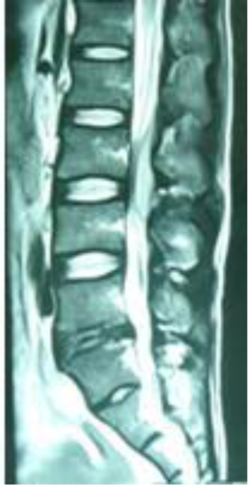
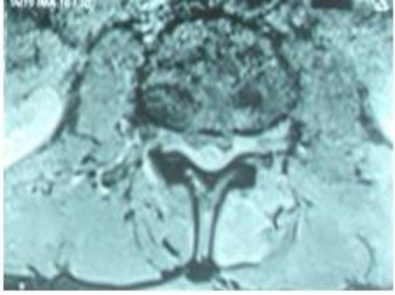
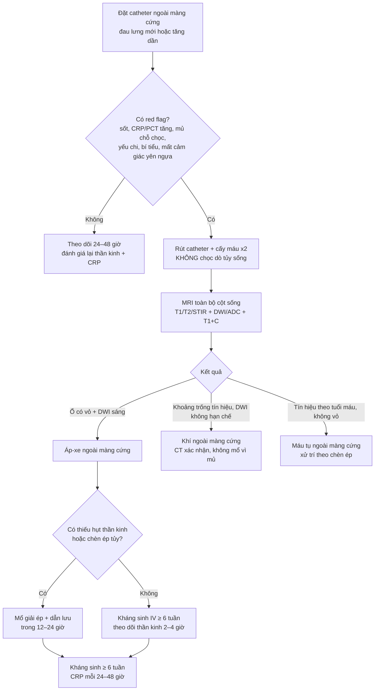
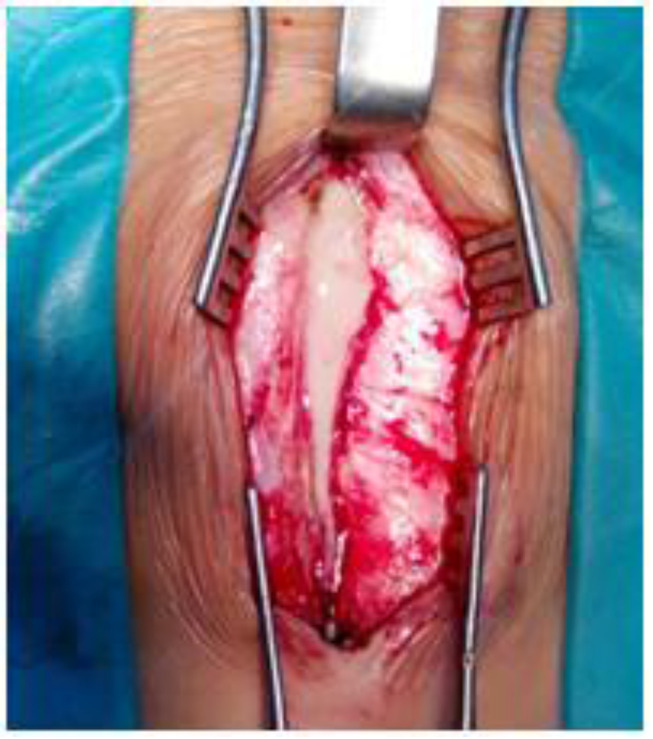
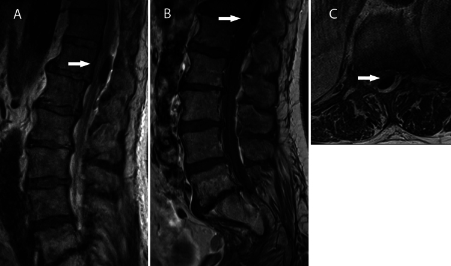
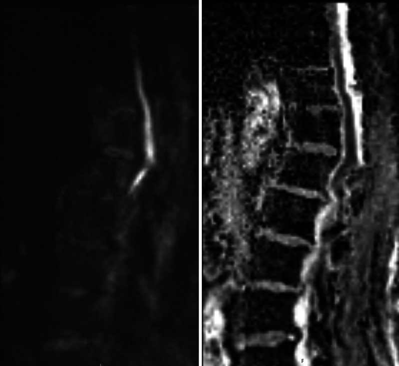

# 3012 — Áp-xe ngoài màng cứng sau gây tê/gây mê ngoài màng cứng / Spinal epidural abscess after neuraxial anesthesia

**Tags:** `pattern:ap-xe-ngoai-mang-cung` `pattern:viem-dia-dem` `pattern:khi-ngoai-mang-cung` `vung:tuy-song` `vung:cot-song-that-lung` `score:ASIA` `protocol:MRI-tuy-co-gadolinium` `protocol:DWI`
**Mức chắc chắn (certainty):** tổng hợp y văn (literature synthesis) — **ca nguyên văn** PMC8128129 (sản phụ 31 tuổi, catheter ngoài màng cứng L3–4 lưu 51 giờ → áp-xe, có 3 ảnh) đặt trong khung số liệu của 2 tổng quan SEA (PMC7595828, PMC7733760) và 1 ca đối chứng **khí ngoài màng cứng giả áp-xe** (PMC13455440).

> **Bài này là “đường vào thứ hai” của [258 – Áp-xe ngoài màng cứng do loét tì đè](../258-apxe-ngoai-mang-cung-loet-ti-de-cung-cut/lesson.md).** 258 phủ đường lây **liên tục từ ổ loét**; bài này phủ đường vào **do thủ thuật ngoài màng cứng** — ổ nhiễm nằm ngay sau lưng, đau hậu phẫu che lấp, và câu hỏi thực hành khác hẳn: **khi nào rút catheter, khi nào chụp MRI, khi nào mổ**. Nối tiếp [222 – Viêm đốt sống–đĩa đệm](../222-viem-dot-song/lesson.md), [250 – Lao nội tủy & lao màng tủy](../250-lao-noi-tuy-va-lao-mang-tuy/lesson.md), [228 – Thoát vị đĩa đệm thắt lưng](../228-thoat-vi-dia-dem-that-lung-pfirrmann-modic/lesson.md).

## 1. Tổng quan bệnh học – cơ chế hình ảnh

- **Vì sao catheter là cửa vào, không phải “vết chọc vô khuẩn”:** đầu catheter đi qua **da → mô dưới da → dây chằng → khoảng ngoài màng cứng**, mang theo **hệ vi khuẩn da** (*Staphylococcus aureus* chiếm **> 50%**, Gram âm **15–20%**). Khoảng ngoài màng cứng **không có mạch máu nuôi**, chỉ có **đám rối tĩnh mạch không van (Batson)** và mô mỡ → hàng rào miễn dịch yếu, vi khuẩn **bám màng sinh học (biofilm) trên catheter** rồi lan theo **mô mềm dọc ống sống** chứ không khu trú tại lỗ chọc.
- **Vì sao thời gian lưu catheter là yếu tố nguy cơ số một:** catheter càng lâu, đoạn nằm trong khoang càng dài, biofilm càng dày; **lưu > 3 ngày** là ngưỡng nguy cơ được nhắc trong y văn, ca PMC8128129 lưu **51 giờ** (48 giờ sau mổ + 3 giờ chuyển dạ) và đã đủ gây áp-xe. Yếu tố nguy cơ khác: **ung thư, nhiễm khuẩn toàn thân/ổ chọc, suy giảm miễn dịch, đái tháo đường, chấn thương/mổ cột sống trước đó**, và **quy trình vô khuẩn không đầy đủ** (ca này **không mặc áo choàng vô khuẩn**).
- **Tần suất — vì sao vẫn phải nhớ dù rất hiếm:**
  - Khảo sát Đức 2004: **1/1930** thủ thuật đặt catheter ngoài màng cứng.
  - Hoa Kỳ: **0,2–1/10.000** ca/năm, tăng lên **2,5–3/10.000** ca/năm ở các loạt gần đây.
  - Sản khoa: **1/255.000** (Moen, Thụy Điển 1990–1999) và **1/506.000** (Tang) sản phụ gây tê vùng — nhưng **tử vong 2–20%** khi đã hình thành áp-xe, nên “hiếm” không đồng nghĩa “bỏ qua được”.
- **Vì sao chẩn đoán muộn là quy luật:** **đau lưng gặp tới 90%** ca SEA, nhưng **đau lưng sau sinh/mổ là triệu chứng bình thường**; **sốt chỉ ~25–50%** và ca này **3 ngày đầu hoàn toàn không sốt**. Tam chứng kinh điển **chỉ 8–15%**. Vì vậy mốc thực hành là: **đau lưng tăng dần + CRP/PCT tăng + không có ổ nhiễm nào khác → MRI cột sống**, không chờ đủ tam chứng.
- **TẠI SAO MRI là chuẩn — vật lý của mủ trong khoang ngoài màng cứng:**
  - **T1W:** mủ **đồng/giảm tín hiệu** so với tủy — gần như không thấy.
  - **T2W:** mủ **tăng tín hiệu gần bằng dịch não tủy** → “hòa” vào CSF, **dễ bỏ sót** nếu chỉ đọc T2.
  - **T1W + gadolinium:** **viền ngấm thuốc dạng vòng** quanh ổ không ngấm = áp-xe có vỏ; **ngấm lan tỏa không vỏ = phlegmon**. Đây là dấu hiệu định vị và quyết định dẫn lưu.
  - **DWI/ADC:** mủ nhớt **hạn chế khuếch tán** → DWI sáng, ADC tối; giúp tách **áp-xe** khỏi **máu tụ** (không hạn chế) và **khí** (khoảng trống tín hiệu, không hạn chế).
  - **CT:** thấy **khí, phá xương, hẹp ống sống** nhưng **không phân biệt mủ với phù/dịch**; X-quang thường bình thường.
- **“Khí cũng giả được áp-xe”:** ca PMC13455440 — nam 68 tuổi, catheter **ngực T11–12**, đau dữ dội + liệt hai chi dưới **đột ngột trong lúc bơm bolus**; MRI có **khối sau ngoài màng cứng chèn ép nón tủy**, bị đọc là áp-xe và **mổ ngay** → thực tế là **khí ngoài màng cứng (pneumorrhachis)** do bọt khí trong cassette bơm. DWI **không hạn chế** là mấu chốt phân biệt trước mổ.
- **Số liệu xét nghiệm dùng để theo dõi:** CRP **tăng gấp đôi mỗi 8 giờ**, đỉnh **36–50 giờ**, **nửa đời 19 giờ** sau khi loại ổ nhiễm → đo lại **mỗi 24–48 giờ**; CRP **> 10 mg/L + ESR > 30 mm/h** cho độ nhạy **> 95%** (không đặc hiệu). Ca PMC8128129: **WBC 16,6 G/L, CRP 112,7 mg/L, PCT 0,42 ng/mL**, cấy máu *S. aureus*.

*Sản phụ 31 tuổi, catheter ngoài màng cứng L3–4 lưu 51 giờ; MRI 5 ngày sau đặt cho thấy **ổ dịch ngoài màng cứng L3–4** (mũi tên) đẩy bao tủy ra trước. Ảnh nguyên bản, không cắt. Nguồn: Nguyen LD et al, *Int Med Case Rep J* 2021;14:301–305 (PMC8128129), Fig. 1, CC BY-NC 4.0.*

## 2. Mẫu hình + chẩn đoán phân biệt theo vị trí (gamut)

- **Theo mốc thời gian sau thủ thuật — quyết định gamut trước, chẩn đoán sau:**
  - **< 72 giờ:** **máu tụ ngoài màng cứng** (chọc vào đám rối tĩnh mạch), **khí ngoài màng cứng** (bơm khí/lọt khí), **đau đầu sau chọc màng cứng (PDPH)**, **viêm màng não** (nếu chọc thủng màng cứng), **đau cơ–cân do tư thế**.
  - **3–10 ngày:** **áp-xe ngoài màng cứng** (đỉnh ~ngày 3–7), **viêm đĩa đệm–đốt sống** (nếu catheter đi qua đĩa hoặc lây liên tục), **phlegmon ngoài màng cứng**, **máu tụ bội nhiễm**.
  - **> 2 tuần:** viêm xương/đĩa đệm tiến triển, áp-xe mạn, di chứng thần kinh do chèn ép kéo dài.
- **Theo tầng đặt catheter — quyết định kiểu thiếu hụt:**
  - **Thắt lưng:** hội chứng **đuôi ngựa** (yếu hai chi, mất cảm giác yên ngựa, bí tiểu, giảm trương lực hậu môn).
  - **Ngực:** chèn ép **tủy** → **mức cảm giác**, liệt hai chi, rối loạn cơ tròn; nguy cơ **liệt/tử vong cao hơn** vì tủy chỉ chịu được vài giờ chèn ép.
  - **Cổ (hiếm):** liệt tứ chi, suy hô hấp.
- **Theo hình thái trên MRI — quyết định điều trị:**
  - **Ổ có vỏ (rim-enhancing collection)** + hạn chế khuếch tán → **áp-xe**, chỉ định **dẫn lưu** khi chèn ép/thiếu hụt thần kinh.
  - **Phlegmon** (ngấm lan tỏa, không vỏ) → có thể **kháng sinh đơn thuần** nếu **không thiếu hụt** và theo dõi sát.
  - **Khí** (khoảng trống tín hiệu, không ngấm, không hạn chế khuếch tán) → **pneumorrhachis**, không phải nhiễm khuẩn; **CT xác nhận**.
  - **Máu tụ** (giữ hình, tín hiệu theo tuổi máu, không vỏ) → không kháng sinh, xử trí theo chèn ép.
- **Gợi nhớ 4 nhóm sau gây tê vùng — “MÁU – MỦ – KHÍ – MÀNG”:** **MÁU** tụ, **MỦ** (áp-xe/phlegmon), **KHÍ** (pneumorrhachis), **MÀNG** não (viêm màng não do chọc thủng). Mỗi nhóm có **một câu hỏi chốt** riêng: có hạn chế khuếch tán? có vỏ ngấm? có khoảng trống tín hiệu? có cứng gáy/sợ ánh sáng?
- **Bẫy vị trí:** ổ áp-xe có thể **nhảy cách (skip lesion)** — ca tiêm chích ma túy tới **~20%**; vì vậy **MRI toàn bộ cột sống**, không chỉ vùng đau.

## 3. Bảng so sánh phân biệt (ma trận đối chiếu)

| Thực thể (entity) | Hình ảnh/lâm sàng điển hình | Chốt vào (rule-in) | Chốt loại (rule-out) | Gợi ý xác nhận |
|---|---|---|---|---|
| Áp-xe ngoài màng cứng sau catheter (SEA) | Ổ sau ngoài màng cứng, **viền ngấm thuốc**, DWI sáng/ADC tối; đau lưng tăng dần ngày 3–7, sốt muộn | **Viền ngấm + hạn chế khuếch tán + CRP/PCT tăng** | **Không vỏ, không hạn chế khuếch tán, khởi phát tức thì ngay khi bơm** → khí/máu tụ | MRI toàn bộ cột sống có gadolinium + DWI; cấy máu ×2 **trước** kháng sinh |
| Máu tụ ngoài màng cứng | Khối giữ hình, **tín hiệu theo tuổi máu** (cấp: T2 tối; bán cấp: T1 sáng), không vỏ; đau **đột ngột** | **Khởi phát tức thì + chống đông/rối loạn đông + không sốt** | **Vỏ ngấm + DWI sáng + sốt/CRP tăng** → áp-xe (hoặc máu tụ bội nhiễm) | INR/tiểu cầu; MRI lặp lại sau 24–48 giờ nếu nghi bội nhiễm |
| Khí ngoài màng cứng (pneumorrhachis) | **Khoảng trống tín hiệu** trên mọi chuỗi, không ngấm, **không hạn chế khuếch tán**; liệt xuất hiện **trong lúc bơm** | **CT thấy khí + DWI không hạn chế + bối cảnh bơm bolus** | **DWI sáng/ADC tối + viền ngấm** → mủ, không phải khí | CT cột sống ngay; kiểm tra cassette/bơm |
| Viêm màng não sau chọc màng cứng | Cứng gáy, sợ ánh sáng, sốt; MRI **ngấm màng não lan tỏa**, không có ổ dịch khu trú | **Hội chứng màng não + CSF đục/pleocytosis** | **Có ổ dịch ngoài màng cứng có vỏ** → áp-xe, không chỉ viêm màng não | Chọc dò **chỉ khi đã loại trừ áp-xe/khi không có chèn ép**; cấy CSF |
| Viêm đĩa đệm–đốt sống | Đĩa **T2 tăng**, phù tủy xương hai bờ đốt sống, ngấm thuốc; đau kiểu “đau sâu, về đêm” | **Phù + ngấm hai bờ đốt sống + hẹp khe đĩa** | **Đĩa bình thường + ổ dịch ngoài màng cứng riêng** → áp-xe đơn thuần | MRI + cấy máu/sinh thiết xương; CT thấy phá xương muộn |

- Ảnh ghép đối chiếu: bài này dùng **cặp ảnh đơn cùng chuỗi** (không ghép) vì 2 nguồn có giấy phép **CC BY-NC** và **CC BY-NC-ND** — ảnh NC-ND **không được cắt/ghép**, chỉ hiển thị nguyên bản.

*Cùng bệnh nhân: axial MRI cho thấy ổ dịch **chiếm toàn bộ phần sau ống sống**, bao tủy bị đẩy ra trước — mức chèn ép tương ứng với yếu chi **2/5 bên trái, 3/5 bên phải** trước mổ. Ảnh nguyên bản. Nguồn: Nguyen LD et al, *Int Med Case Rep J* 2021;14:301–305 (PMC8128129), Fig. 2, CC BY-NC 4.0.*

## 4. Protocol chụp + hệ phân độ/điểm chuẩn hóa

- **Ai chụp, chụp khi nào:** bất kỳ bệnh nhân **đau lưng mới/tăng dần sau đặt catheter ngoài màng cứng**, kèm **≥ 1** dấu hiệu: sốt, **CRP/PCT tăng**, chảy mủ ở chỗ chọc, yếu chi, rối loạn tiểu tiện, mất cảm giác yên ngựa → **MRI trong 12–24 giờ**, không chờ đủ tam chứng và **không chờ hết đau hậu phẫu**.
- **Protocol MRI tối thiểu:** **toàn bộ cột sống** (cổ–ngực–thắt lưng) sagittal **T1W, T2W, STIR/T2 fat-sat**, **axial T2W qua tầng tổn thương**, **DWI (b = 800–1000) + ADC**, và **T1W fat-sat sau gadolinium**. Đo **chiều dài ổ theo trục dọc (mm)**, **diện tích chèn ép trên axial (mm² hoặc % ống sống)**, ghi **mức chèn ép nón tủy/đuôi ngựa**. Ca PMC8128129: ổ **L3–4**, MRI 5 ngày sau đặt.
- **Trước MRI:** **cấy máu ×2 + cấy dịch/đầu catheter** (không hoãn MRI để chờ kết quả); **không chọc dò tủy sống** khi nghi áp-xe ngoài màng cứng (nguy cơ đưa mủ vào khoảng dưới nhện). Ca này **rút catheter ngày 2**, chảy mủ tại lỗ chọc ngày 7 — dịch mủ tự thoát ra ngoài là **dấu hiệu muộn**, không phải điều kiện để chẩn đoán.
- **Theo dõi thần kinh:** đánh giá **ASIA/AIS** + **sức cơ 0–5 từng nhóm** + **cảm giác yên ngựa** + **thể tích tồn lưu bàng quang (PVR)** mỗi **2–4 giờ** trong 48 giờ đầu sau khi có triệu chứng; **PVR > 200 mL** là ngưỡng nghi hội chứng đuôi ngựa.
- **Ngưỡng rút catheter:** rút **ngay khi hết chỉ định giảm đau**; **không giữ catheter qua đêm “cho tiện”** sau mổ lấy thai — đây chính là bài học của ca PMC8128129 (giữ 48 giờ sau mổ để giảm đau, trong khi catheter đã có từ chuyển dạ). Nếu nghi nhiễm: **rút + cấy đầu catheter**, không bơm thêm thuốc qua catheter.
- **Điều trị:** **kháng sinh ≥ 6 tuần** (có thể 6 tuần–nhiều tháng; theo CRP và ổ nhiễm), **phối hợp vancomycin + cephalosporin/piperacillin–tazobactam** theo kinh nghiệm; **mổ giải ép + dẫn lưu** khi có **thiếu hụt thần kinh** hoặc chèn ép tủy; **cửa sổ hồi phục hẹp**: thiếu hụt **< 36–72 giờ** mới có khả năng hồi phục tốt, **mổ sớm (< 12–48 giờ)** cải thiện kết cục.
- **Phân độ dùng trong bài:** **ASIA/AIS** cho mức tổn thương tủy; **Gleave–Macfarlane CES-I/CES-R** khi ổ ở thắt lưng gây đuôi ngựa (xem [3013](../3013-hoi-chung-duoi-ngua-sau-mo-cot-song/lesson.md)).

## 5. Biến thể bình thường và cạm bẫy

- **Đau lưng hậu phẫu/hậu sinh là biến thể “bình thường”** — nhưng đau **tăng dần theo ngày**, kèm **đau lan theo rễ**, hoặc **không giảm khi dùng giảm đau thường quy** phải coi là bất thường. Ca PMC8128129: đau tăng dần 3 ngày, **không sốt** → đã bị bỏ qua cho tới khi sốt 39–40 °C ngày 5.
- **Không sốt không loại trừ áp-xe:** sốt chỉ **~25%** (có nguồn tới 50%); ở sản phụ, **tăng thân nhiệt do vỡ ối/sinh** càng làm mờ dấu hiệu.
- **Đau đầu sau chọc màng cứng (PDPH) làm nhiễu:** PDPH **giảm khi nằm**, tăng khi đứng; áp-xe **không đổi theo tư thế** và kèm dấu hiệu nhiễm trùng. Không dùng PDPH để trấn an khi có **bất kỳ dấu thần kinh khu trú**.
- **Khí ngoài màng cứng giả áp-xe** (PMC13455440): **khởi phát tức thì trong lúc bơm**, MRI có “khối” nhưng **DWI không hạn chế**; nếu không nghĩ tới, bệnh nhân bị mổ mở ống sống không cần thiết. **CT là chốt** khi MRI mơ hồ.
- **Máu tụ bội nhiễm:** khối máu tụ có thể **ngấm viền** sau vài ngày do viêm → đừng loại trừ áp-xe chỉ vì “tín hiệu giống máu”; **so sánh DWI + CRP + cấy**.
- **Sai sót “thỏa mãn tìm kiếm” (satisfaction of search):** đã thấy **viêm đĩa đệm** hoặc **thoát vị đĩa đệm** thì vẫn phải **dò toàn bộ khoang ngoài màng cứng** — ổ áp-xe có thể nằm cách xa tầng đĩa bệnh lý.
- **Ảnh giả do kim/catheter:** đường tín hiệu thẳng, mảnh, xuyên qua mô mềm → đừng đọc là “dò mủ”; đối chiếu lát cắt liền kề và ảnh không có kim.

## 6. Tự lượng giá — Blind Quiz

**Ca 1 — Sản phụ 31 tuổi, sinh mổ dưới gây tê ngoài màng cứng, ngày 5 đau lưng tăng dần + sốt 39–40 °C. Nhìn ảnh trước, mô tả trước.**

- Gợi ý lâm sàng: catheter L3–4 lưu **51 giờ**; 3 ngày đầu **không sốt**, chỉ đau lưng; ngày 7 chảy mủ ở lỗ chọc, yếu chi dưới.
- Câu hỏi: Ổ dịch nằm **khoang nào**, tầng nào? Nêu 3 chẩn đoán phân biệt và **một dấu hiệu trên MRI** giúp chốt. Bước tiếp theo **trước khi** cho kháng sinh là gì?

<b>Bấm để hiện đáp án (findings + chẩn đoán)</b>

- Dấu hiệu: ổ dịch **sau ngoài màng cứng L3–4**, đẩy bao tủy ra trước (mũi tên); axial cho thấy ổ chiếm gần toàn bộ phần sau ống sống.
- Chẩn đoán: **áp-xe ngoài màng cứng sau catheter ngoài màng cứng**, *S. aureus* — mủ nhớt hạn chế khuếch tán (DWI sáng/ADC tối) và có **viền ngấm thuốc**; đau lưng 90%, sốt muộn.
- Phân biệt: **máu tụ** (khởi phát tức thì, tín hiệu theo tuổi máu, không vỏ), **khí ngoài màng cứng** (khoảng trống tín hiệu, không hạn chế khuếch tán), **viêm màng não** (hội chứng màng não, không ổ khu trú).
- Việc phải làm trước kháng sinh: **cấy máu ×2** + cấy đầu catheter; **không chọc dò tủy sống**; **MRI toàn bộ cột sống** (ổ nhảy cách ~20%).

- Trong mổ: **mủ đặc ngoài màng cứng** được lấy bỏ + rửa khoang; xác nhận chẩn đoán bằng **cấy mủ** (*S. aureus*, trùng cấy máu).
- Nguồn: Nguyen LD et al, *Int Med Case Rep J* 2021;14:301–305 (PMC8128129), Fig. 1–3, CC BY-NC 4.0.

**Ca 2 — Nam 68 tuổi, catheter ngoài màng cứng NGỰC, liệt hai chi dưới đột ngột ngay trong lúc bơm bolus.**

- Câu hỏi: Vì sao “khối” này **không phải áp-xe** dù chèn ép nón tủy? Chuỗi xung nào chốt?

<b>Bấm để hiện đáp án (findings + chẩn đoán)</b>

- Dấu hiệu: **khoảng trống tín hiệu** trong khối sau ngoài màng cứng T11–12 (khí), chèn ép nón tủy; **DWI (b = 800) không có ổ sáng, ADC không tối** → không phải mủ.
- Chẩn đoán: **pneumorrhachis ngoài màng cứng** do khí trong cassette bơm (bộ phát hiện bọt khí bị tắt). Mổ giải ép cho hồi phục nhanh, nhưng **chẩn đoán đúng trước mổ nhờ CT/DWI**.
- Bài học: khởi phát **tức thì trong lúc bơm** + **DWI không hạn chế** + **CT thấy khí** = không phải áp-xe; đừng để “MRI có khối” dẫn thẳng tới mổ vì mủ.
- Nguồn: Sommernes JH et al, *J Neurosurg Case Lessons* 2026;12(6):CASE26351 (PMC13455440), Fig. 1–2, CC BY-NC-ND 4.0 (ảnh nguyên bản, không cắt/ghép).

**Ca 3 — Cùng bệnh nhân Ca 1: ảnh axial trước mổ.**

- Câu hỏi: Mức chèn ép tương ứng với **thang sức cơ nào**? Khi nào phải mổ thay vì tiếp tục kháng sinh?

<b>Bấm để hiện đáp án (findings + chẩn đoán)</b>

- Dấu hiệu: ổ dịch **chiếm toàn bộ phần sau ống sống**, bao tủy đẩy ra trước; tương ứng yếu **2/5 trái, 3/5 phải**, giảm phản xạ gân.
- Ngưỡng mổ: **có thiếu hụt thần kinh hoặc chèn ép tủy** → giải ép + dẫn lưu; **cửa sổ hồi phục < 36–72 giờ**, mổ sớm (< 12–48 giờ) tốt hơn. Kháng sinh đơn thuần chỉ khi **không thiếu hụt** và ổ nhỏ, theo dõi sát.
- Sau mổ: kháng sinh **≥ 6 tuần**, CRP mỗi **24–48 giờ**; ca này hồi phục hoàn toàn sau 5 ngày.
- Nguồn: Nguyen LD et al, *Int Med Case Rep J* 2021;14:301–305 (PMC8128129), Fig. 2–3, CC BY-NC 4.0.

## Bài liên quan chéo
- [258 – Áp-xe ngoài màng cứng do loét tì đè cùng cụt](../258-apxe-ngoai-mang-cung-loet-ti-de-cung-cut/lesson.md) — đường lây liên tục, cùng khung MRI/DWI
- [3013 – Hội chứng đuôi ngựa sau mổ cột sống](../3013-hoi-chung-duoi-ngua-sau-mo-cot-song/lesson.md) — phân biệt tụ máu–phù–áp-xe–thoát vị tái phát
- [222 – Viêm đốt sống–đĩa đệm](../222-viem-dot-song/lesson.md)
- [228 – Thoát vị đĩa đệm thắt lưng & Pfirrmann/Modic](../228-thoat-vi-dia-dem-that-lung-pfirrmann-modic/lesson.md)
- [250 – Lao nội tủy & lao màng tủy](../250-lao-noi-tuy-va-lao-mang-tuy/lesson.md)
- [220 – Ống sống tủy: giải phẫu cắt lớp](../220-ong-song-tuy/lesson.md)

## Ảnh
- 5 ảnh, tải từ Europe PMC/PMC, giấy phép từng file trong `images/CREDITS.md`: PMC8128129 (CC BY-NC 4.0, 3 ảnh) và PMC13455440 (CC BY-NC-ND 4.0, 2 ảnh — **hiển thị nguyên bản, không cắt/ghép**).
- Không dùng ảnh từ nguồn không rõ giấy phép; không có ảnh nào bị crop/kéo giãn.

> Không dùng để chẩn đoán độc lập khi chưa có người hướng dẫn.
