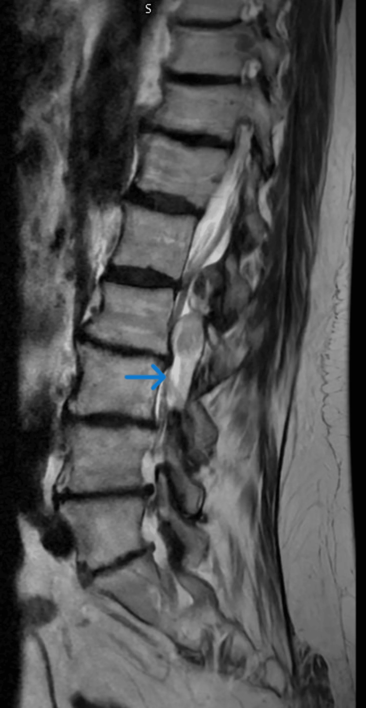
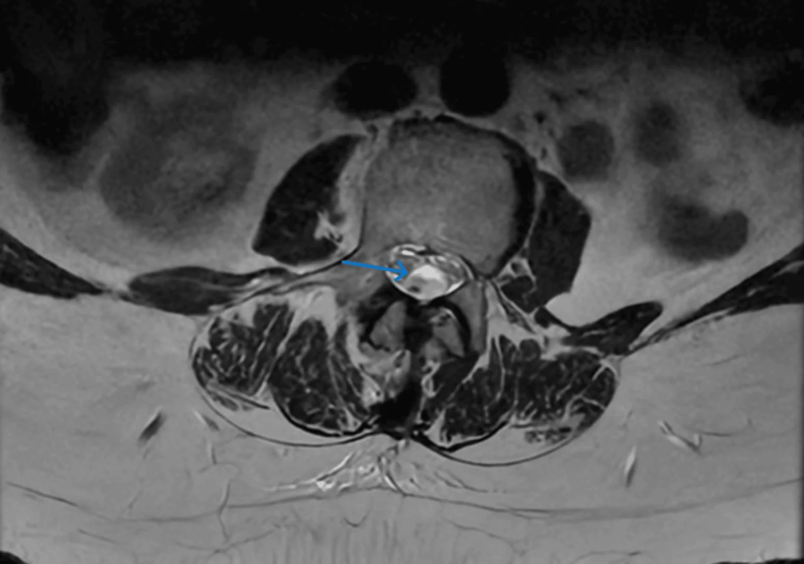
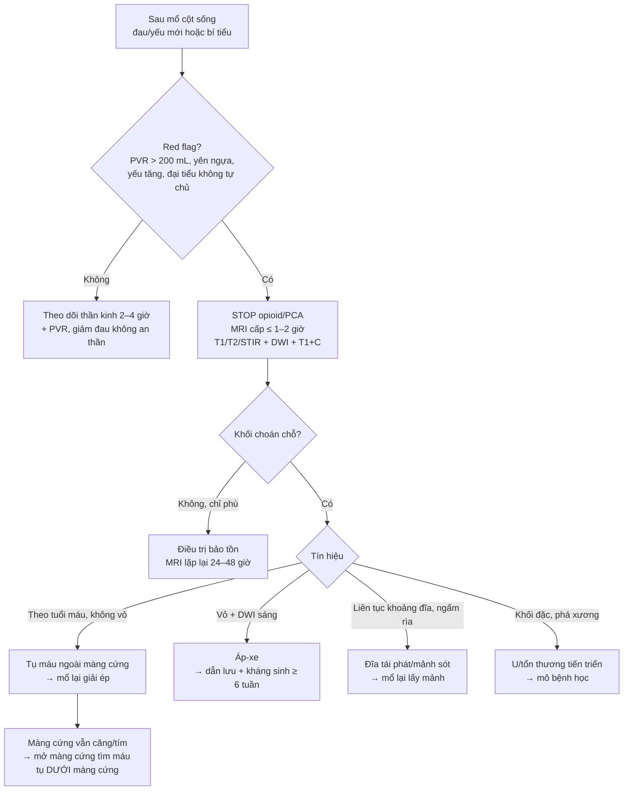
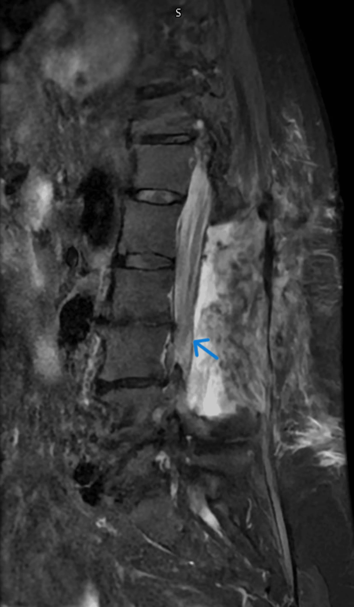
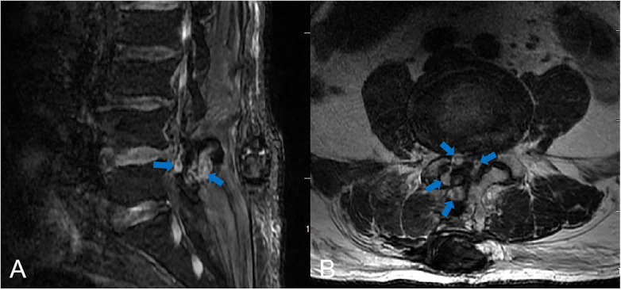
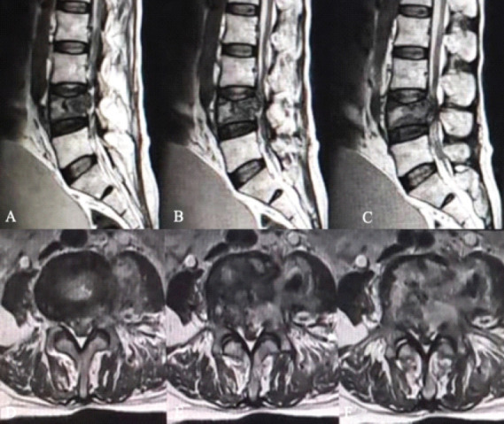

# 3013 — Hội chứng đuôi ngựa sau mổ cột sống: máu tụ – phù – mủ – đĩa tái phát / Postoperative cauda equina syndrome

**Tags:** `pattern:hep-ong-song` `pattern:tu-mau-ngoai-mang-cung` `pattern:tu-mau-duoi-mang-cung` `pattern:phu-tuy` `pattern:ap-xe-ngoai-mang-cung` `vung:cot-song-that-lung` `vung:duoi-ngua` `score:ASIA` `score:CES-I-CES-R` `protocol:MRI-cot-song` `protocol:MRI-tuong-phan`
**Mức chắc chắn (certainty):** tổng hợp y văn (literature synthesis) — khung số liệu từ **tổng quan CES 2026** (PMC13265969), **cohort 2947 ca giải ép thắt lưng** (PMC13054050) và 3 ca nguyên văn có ảnh (PMC13508563 tụ máu **dưới** màng cứng giả ngoài màng cứng; PMC12975604 tụ máu ngoài màng cứng **muộn ngày 5**; PMC13348372 đuôi ngựa sau **sinh thiết xương**).

> **Bài này là phần “chuyện sau mổ” của [228 – Thoát vị đĩa đệm thắt lưng](../228-thoat-vi-dia-dem-that-lung-pfirrmann-modic/lesson.md)** và là **chẩn đoán phân biệt** của [258 – Áp-xe ngoài màng cứng](../258-apxe-ngoai-mang-cung-loet-ti-de-cung-cut/lesson.md) + [3012 – Áp-xe sau gây tê ngoài màng cứng](../3012-apxe-ngoai-mang-cung-sau-gay-te-ngoai-mang-cung/lesson.md). Điểm khác biệt cốt lõi: sau mổ, **đau lưng và yếu nhẹ là “bình thường”**, nên phải có **ngưỡng** để tách biến chứng cần mổ lại khỏi diễn tiến hậu phẫu thường.

## 1. Tổng quan bệnh học – cơ chế hình ảnh

- **Giải phẫu quyết định toàn bộ bài:** tủy sống tận cùng ở **nón tủy L1–L2**; dưới đó ống sống chỉ còn **đuôi ngựa** — các rễ **L2–S5** xếp thành bó, không có tủy, **không có hàng rào máu–tủy kiểu tủy**. Vì vậy chèn ép gây **đau rễ + yếu chi dưới kiểu ngoại vi + rối loạn cơ tròn**, nhưng **không có “mức cảm giác” tủy**; dấu hiệu sớm nhất thường là **bí tiểu không đau (painless retention)** — người bệnh **không tự báo** vì không đau.
- **Cơ chế chèn ép → mất chức năng:** chèn ép cơ học làm **giảm tưới máu rễ** (rễ nằm trong dịch não tủy, nuôi dưỡng chủ yếu bằng khuếch tán) → **phù → thiếu máu → hủy myelin/axon**. Vì là tổn thương **thiếu máu–chèn ép**, **thời gian** quan trọng hơn **mức độ**: chèn ép nhẹ kéo dài có thể tệ hơn chèn ép mạnh được giải phóng sớm.
- **Bốn cơ chế sau mổ, mỗi cơ chế có “đồng hồ” riêng:**
  - **Máu tụ ngoài màng cứng (postoperative spinal epidural hematoma — PSEH):** đám rối tĩnh mạch ngoài màng cứng **không van**, khoang chết sau cắt cung sau, **tăng huyết áp lúc rút ống/thức tỉnh** và **rối loạn đông** đẩy máu vào khoang → chèn ép **giờ đến ngày 1–5** (ca PMC12975604: **ngày 5**).
  - **Phù tủy/đuôi ngựa do thao tác:** phù do kéo – đốt – rửa, **đỉnh 24–72 giờ**, **không có khối choán chỗ**, thường **tự giảm** nếu không chèn ép thêm.
  - **Nhiễm trùng (áp-xe/phlegmon, viêm đĩa đệm):** **ngày 3–10**, có **vỏ ngấm + hạn chế khuếch tán**, kèm CRP/PCT tăng; đây là cầu nối sang bài [3012](../3012-apxe-ngoai-mang-cung-sau-gay-te-ngoai-mang-cung/lesson.md) và [222](../222-viem-dot-song/lesson.md).
  - **Thoát vị tái phát/mảnh đĩa sót – thao tác sai tầng – u tiến triển:** ngay sau mổ hoặc vài ngày; **mảnh đĩa** liên tục với khoang đĩa, **không ngấm thuốc** (khác mô sẹo ngấm đều).
- **TẠI SAO MRI phân biệt được — vật lý tín hiệu:**
  - **Máu tụ:** tín hiệu **thay đổi theo tuổi máu** — cấp (< 48 giờ, deoxyhemoglobin): **T1 đồng, T2 rất tối**; bán cấp sớm (3–7 ngày, methemoglobin nội bào): **T1 sáng, T2 tối**; bán cấp muộn: **T1 sáng, T2 sáng**. Không vỏ ngấm, **không hạn chế khuếch tán** (trừ khi bội nhiễm).
  - **Phù:** **T2/STIR tăng**, T1 đồng/giảm, **ngấm thuốc nhẹ lan tỏa** ở rễ, **không có khối** đẩy bao tủy.
  - **Áp-xe:** **viền ngấm dạng vòng**, lòng không ngấm, **DWI sáng/ADC tối** — mủ nhớt hạn chế khuếch tán.
  - **Đĩa tái phát:** **T2 đồng/tăng**, bờ rõ, **liên tục với khoảng đĩa**, **ngấm thuốc vành/rìa** (mô hạt), không ngấm trung tâm.
  - **Sẹo xơ:** **ngấm thuốc đều, muộn**, không có hiệu ứng choán chỗ rõ — cần **MRI có tương phản** mới tách được sẹo với đĩa tái phát.
- **Số liệu định lượng phải nhớ:**
  - **CES:** **1–3/100.000 dân/năm**; **< 2%** thoát vị đĩa đệm thắt lưng; nhưng chiếm tỷ lệ **kiện tụng cao nhất** trong bệnh lý cột sống.
  - **PSEH cần mổ lại: 2,3%** (68/2947 ca vi phẫu giải ép hẹp ống sống) — **không hề hiếm** như cảm giác lâm sàng.
  - **Yếu tố nguy cơ PSEH:** **tăng huyết áp trước mổ OR 6,24 (95% CI 2,51–15,52)**; **thời gian mổ OR 1,01/phút** (trung vị **116 phút** ở ca PSEH vs **86–90 phút** ở nhóm chứng); **mổ nhiều tầng 37% vs 24%**.
  - **Ngưỡng hành động:** **PVR > 200 mL** nghi CES; giải ép **< 48 giờ** cải thiện bàng quang/vận động/cảm giác/tình dục; **CES-I giải ép < 24 giờ** hồi phục bàng quang tốt hơn; **CES-R** (bí tiểu không đau, mất cảm giác bàng quang) tiên lượng xấu **dù mổ sớm**.
  - **Ca tụ máu dưới màng cứng (PMC13508563):** nữ **73 tuổi**, **apixaban**, yếu chi + bí tiểu; **mổ giải ép 9 giờ** sau khởi phát; hồi phục hoàn toàn **3 tháng**.

*Nữ 73 tuổi đang dùng apixaban: khối **sau ống sống L1–L3** (mũi tên) bị đọc là **tụ máu ngoài màng cứng**; mổ vào thấy **màng cứng căng, tím, không đập** → mở màng cứng lấy **máu tụ DƯỚI màng cứng**. Ảnh nguyên bản. Nguồn: Altunbi B et al, *Cureus* 2026;18(7):e113446 (PMC13508563), Fig. 1, CC BY 4.0.*

## 2. Mẫu hình + chẩn đoán phân biệt theo vị trí (gamut)

- **Theo mốc thời gian sau mổ — “đồng hồ” gợi ý nguyên nhân:**
  - **0–6 giờ:** **máu tụ** (đang chảy), **mảnh đĩa sót**, **thao tác sai tầng**, **thiếu máu rễ do kéo dài**.
  - **6–72 giờ:** **máu tụ** (biểu hiện muộn), **phù tủy/đuôi ngựa**, **tụ máu dưới màng cứng** (hiếm, hay bị đọc nhầm).
  - **3–10 ngày:** **áp-xe/phlegmon**, **viêm đĩa đệm**, **tụ máu biểu hiện rất muộn** (ca PMC12975604: **ngày 5**).
  - **> 2 tuần:** **sẹo xơ chèn ép**, **giả màng não (pseudomeningocele)**, **u tiến triển/tái phát**, **di chứng thiếu máu rễ**.
- **Theo vị trí khối trên axial — quyết định đường mổ lại:**
  - **Sau (dorsal):** máu tụ từ đám rối tĩnh mạch sau, sau cắt cung sau — hay gặp nhất; **dẫn lưu qua đường mổ cũ**.
  - **Trước (ventral):** mảnh đĩa, xương, u; **không tiếp cận được bằng đường sau đơn thuần** nếu khối lớn.
  - **Chu vi (circumferential):** máu tụ lan tỏa, áp-xe; **nguy cơ chèn ép nặng, cần mổ sớm**.
  - **Dưới màng cứng (subdural):** hiếm, **MRI không phân biệt được với ngoài màng cứng**; dấu hiệu **màng cứng căng, tím, mất đập sau khi đã giải ép ngoài màng cứng** là chốt trong mổ.
- **Theo hình thái tín hiệu — 5 nhóm “MÁU – PHÙ – MỦ – ĐĨA – U”:** **MÁU** (theo tuổi máu, không vỏ), **PHÙ** (T2/STIR tăng, không khối), **MỦ** (vỏ + DWI), **ĐĨA** (liên tục khoảng đĩa, ngấm rìa), **U** (khối đặc, phá xương, ngấm không đều).
- **Bẫy vị trí “điểm mù” của MRI hậu phẫu:** phần sau ống sống bị **artifact kim loại/dụng cụ** làm mất tín hiệu → **luôn xem STIR, T2 không fat-sat, và các lát cắt trên–dưới ổ mổ**; nếu vẫn mờ và lâm sàng nặng → **CT myelography** (khi MRI chống chỉ định) hoặc **mổ thăm dò**.
- **Bẫy “bình thường hóa” sau mổ:** mọi bệnh nhân đều có **đau và hạn chế vận động** vài ngày đầu, nên **không triệu chứng nào tự nó “đủ nhẹ để bỏ qua”** — chỉ có **tập hợp red flag + PVR + mốc thời gian** mới quyết định chụp; ngược lại, **đừng chụp MRI chỉ vì lo lắng** khi thần kinh và PVR bình thường (tránh mổ lại không cần thiết vì “có lớp dịch hậu phẫu”).

## 3. Bảng so sánh phân biệt (ma trận đối chiếu)

| Thực thể (entity) | Hình ảnh/lâm sàng điển hình | Chốt vào (rule-in) | Chốt loại (rule-out) | Gợi ý xác nhận |
|---|---|---|---|---|
| Tụ máu ngoài màng cứng sau mổ (PSEH) | Khối sau ống sống, **tín hiệu theo tuổi máu**, không vỏ; đau tăng + yếu trong **0 giờ–5 ngày** | **Khối choán chỗ mới + tín hiệu máu + không hạn chế khuếch tán** | **Vỏ ngấm + DWI sáng + CRP tăng** → áp-xe; **liên tục khoảng đĩa** → đĩa tái phát | MRI cấp; INR/tiểu cầu; mổ lại giải ép nếu có thiếu hụt |
| Tụ máu **dưới** màng cứng | Cùng hình ảnh “khối sau” như ngoài màng cứng; **không có dấu hiệu đặc hiệu trên MRI**; thường ở người **chống đông** | **Sau khi đã giải ép ngoài màng cứng, màng cứng vẫn căng/tím/không đập** | **Màng cứng trở lại hồng, đập bình thường sau giải ép** → không phải dưới màng cứng | Mở màng cứng đường giữa khi nghi ngờ; MRI hậu phẫu xác nhận |
| Phù tủy/đuôi ngựa do thao tác | **T2/STIR tăng lan tỏa**, không khối, ngấm nhẹ; đau giảm dần | **Không có khối đẩy bao tủy + đỉnh 24–72 giờ + cải thiện theo thời gian** | **Khối choán chỗ rõ + đẩy bao tủy** → máu tụ/đĩa/áp-xe | MRI lặp lại 24–48 giờ nếu xấu đi; theo dõi thần kinh |
| Áp-xe ngoài màng cứng hậu phẫu | Ổ có **vỏ ngấm**, DWI sáng; sốt/CRP tăng xuất hiện **sau 3–10 ngày** | **Vỏ + hạn chế khuếch tán + hội chứng nhiễm trùng** | **Không vỏ, không hạn chế khuếch tán, khởi phát tức thì** → máu tụ | MRI + cấy máu, cấy dịch/mô; kháng sinh ≥ 6 tuần + dẫn lưu |
| Thoát vị tái phát/mảnh đĩa sót | Khối **trước/trước bên**, **liên tục với khoảng đĩa**, T2 đồng/tăng, **ngấm rìa** | **Vị trí + liên tục khoảng đĩa + ngấm rìa** | **Ngấm đều muộn, không liên tục đĩa** → sẹo xơ | MRI có tương phản; so ảnh mổ; mổ lại lấy mảnh |
| U/tổn thương xâm lấn tiến triển | Khối đặc, **phá xương**, ngấm không đều; có thể sau **sinh thiết** | **Phá xương + ngấm không đều + tiền sử ung thư** | **Tín hiệu máu thuần + không phá xương** → máu tụ | MRI + CT xương; mô bệnh học |

*Cùng bệnh nhân: axial T2 tại L3 — **đuôi ngựa bị đẩy ra trước**, khối sau ống sống (mũi tên). Có **nang khớp L1–2** đi kèm đóng vai trò **“vật gây nhiễu”** khiến báo cáo ban đầu chọn ngoài màng cứng. Ảnh nguyên bản. Nguồn: Altunbi B et al, *Cureus* 2026;18(7):e113446 (PMC13508563), Fig. 2, CC BY 4.0.*

## 4. Protocol chụp + hệ phân độ/điểm chuẩn hóa

- **Ai chụp — ngưỡng không chờ:** sau mổ cột sống, **bất kỳ** dấu hiệu sau → **MRI cấp trong 1–2 giờ**: **bí tiểu mới/PVR > 200 mL**, **mất cảm giác yên ngựa**, **yếu chi dưới mới hoặc tăng**, **đau lan hai chân mới**, **mất trương lực hậu môn**, **đại tiện không tự chủ**. Không “chờ đỡ phù hậu phẫu”.
- **Protocol MRI:** **T1W, T2W sagittal + axial**, **STIR/T2 fat-sat** (bắt phù + giảm artifact), **DWI/ADC** (mủ), **T1W + gadolinium** (sẹo vs đĩa tái phát, vỏ áp-xe). **Không cần gadolinium để cấp cứu máu tụ** — nhưng cần khi nghi nhiễm hoặc phân biệt sẹo/đĩa. Ghi rõ: **mức chèn ép tối đa (mm hoặc % diện tích ống sống)**, **chiều dài khối theo trục dọc**, **tín hiệu T1/T2**, **có/không vỏ ngấm**, **có/không hạn chế khuếch tán**.
- **Khi MRI chống chỉ định:** **CT myelography** (thấy chèn ép, không phân biệt mủ/máu); **CT thường** chỉ để loại trừ khối xương/di lệch dụng cụ.
- **Phân độ & ngưỡng — dùng đúng tên:**
  - **ASIA/AIS** cho mức tổn thương (nếu tổn thương lan lên tủy); **sức cơ 0–5** từng nhóm.
  - **Gleave–Macfarlane:** **CES-I** = còn cảm giác bàng quang + còn một phần kiểm soát tiểu (rối loạn kiểu tiểu); **CES-R** = **bí tiểu không đau, mất cảm giác bàng quang, mất trương lực cơ tròn**. **CES-I là “cửa sổ” để mổ**, CES-R tiên lượng xấu dù mổ.
  - **PVR > 200 mL** = ngưỡng nghi; **đo lại sau khi thông tiểu** để tránh nhiễm trùng do ứ đọng.
- **Thời điểm mổ lại:** **giải ép < 24–48 giờ**; **CES-I < 24 giờ** hồi phục bàng quang tốt hơn; có thiếu hụt thần kinh + khối choán chỗ → **mổ lại ngay**, không “thử corticoid”.
- **Trước mổ:** dừng/đảo **chống đông**, kiểm tra **INR/tiểu cầu**, kiểm soát **huyết áp** (tránh tăng huyết áp khi rút ống — yếu tố nguy cơ PSEH), thông tiểu theo dõi **PVR**, không dùng an thần che lấp đánh giá thần kinh.

## 5. Biến thể bình thường và cạm bẫy

- **“Đau hậu phẫu bình thường” là cạm bẫy số một:** đau **tăng dần theo ngày**, **lan hai chân**, kèm **yếu mới** hoặc **bí tiểu** không phải diễn tiến thường — ca PMC12975604 có **5 ngày hồi phục tốt** rồi đột ngột **đau + yếu hai chi + mất cảm giác yên ngựa + đại tiện không tự chủ**.
- **MRI hậu phẫu sớm “luôn có gì đó”:** dịch/khí/mô hạt sau mổ làm **dày khoang ngoài màng cứng**; đừng đọc mọi lớp dịch là máu tụ. Chốt bằng **so với lâm sàng + tín hiệu máu + chèn ép bao tủy thực sự**.
- **Artifact kim loại che lấp:** dụng cụ cố định làm **mất tín hiệu vùng mổ** → xem **STIR** và **lát cắt ngoài vùng dụng cụ**; nếu vẫn không yên tâm, **CT myelography**.
- **Nang khớp (facet cyst) là “vật gây nhiễu” kinh điển:** trong ca PMC13508563, nang khớp L1–2 + vẹo cột sống khiến báo cáo chọn **ngoài màng cứng**; **nang khớp không gây màng cứng căng/tím** — dấu hiệu trong mổ mới đúng.
- **Tụ máu dưới màng cứng ≠ ngoài màng cứng:** MRI **không phân biệt được** (cùng dạng “liềm/biconvex sau”); nếu sau khi lấy máu tụ ngoài màng cứng **màng cứng vẫn căng, không đập, màu tím** → **mở màng cứng đường giữa**; đừng đóng lại và chờ.
- **Chống đông “bình thường” không loại trừ chảy máu:** bệnh nhân dùng **DOAC** có **INR/APTT bình thường** vẫn chảy máu đáng kể (apixaban trong ca PMC13508563); hỏi kỹ **thuốc và thời điểm liều cuối**.
- **Bí tiểu do opioid > CES:** opioid gây bí tiểu, nhưng **PVR > 200 mL + mất cảm giác yên ngựa** thì **không quy cho thuốc**; và **không đặt catheter rồi bỏ theo dõi**.
- **Sai tầng/“đã mổ đúng tầng”**: nếu triệu chứng không khớp hình ảnh, **đếm lại đốt sống từ C2** trên sagittal toàn cột sống và đối chiếu **marker/fluoroscopy** trong mổ.

## 6. Tự lượng giá — Blind Quiz

**Ca 1 — Nữ 73 tuổi dùng apixaban, đau lưng đột ngột rồi yếu chân phải + bí tiểu. Nhìn ảnh trước.**

- Câu hỏi: Khối ở khoang nào? Vì sao **không thể chốt ngoài màng cứng** chỉ bằng MRI này? Dấu hiệu nào trong mổ buộc phải mở màng cứng?

<b>Bấm để hiện đáp án (findings + chẩn đoán)</b>

- Dấu hiệu: khối **sau ống sống L1–L3** chèn ép bao tủy; axial L3 cho thấy **đuôi ngựa bị đẩy ra trước**; có **nang khớp L1–2** gây nhiễu.
- Chẩn đoán: **tụ máu dưới màng cứng tự phát** (không phải ngoài màng cứng) — MRI **không phân biệt được** hai khoang; **màng cứng căng, tím, mất đập sau khi đã giải ép ngoài màng cứng** là chốt → mở màng cứng đường giữa, lấy máu tụ.
- Xử trí: giải ép **9 giờ** sau khởi phát; hồi phục hoàn toàn **3 tháng**; **khởi động lại apixaban sau 2 tuần** khi MRI xác nhận đã giải ép hoàn toàn.

- MRI **2 tuần** sau mổ: máu tụ đã lấy hết, **bao tủy trở lại hình dạng bình thường** — mốc để quyết định dùng lại chống đông.
- Nguồn: Altunbi B et al, *Cureus* 2026;18(7):e113446 (PMC13508563), Fig. 1–2, 4, CC BY 4.0.

**Ca 2 — Nam 69 tuổi, mổ nội soi lấy đĩa L4–5, ngày 5 đột ngột đau lưng + yếu hai chân + mất cảm giác yên ngựa.**

- Câu hỏi: Vì sao “ngày 5” vẫn có thể là biến chứng cấp? Nêu 3 việc phải làm ngay và 1 điều **không** được làm.

<b>Bấm để hiện đáp án (findings + chẩn đoán)</b>

- Dấu hiệu: **khối ngoài màng cứng L4–5 tăng tín hiệu trên T2 fat-sat**, chèn ép bao tủy; bệnh cảnh **đau + yếu hai chi + yên ngựa + đại tiện không tự chủ**.
- Chẩn đoán: **tụ máu ngoài màng cứng hậu phẫu muộn (delayed POSEH)** — PSEH có thể biểu hiện **ngày 1–5**, không chỉ vài giờ đầu.
- Phải làm: **ngừng opioid/PCA**, **MRI cấp**, **mổ lại giải ép ngay** (± kiểm soát huyết áp, đông máu). **Không** được: chờ đỡ phù hoặc cho corticoid rồi theo dõi.
- Kết cục: mổ lấy nhiều cục máu; **yếu chân trái cải thiện nhưng rối loạn đại tiểu vẫn tồn tại** — nhấn mạnh **giá của sự chậm trễ**.
- Nguồn: Li H et al, *Front Surg* 2026;13:1737628 (PMC12975604), Fig. 4, CC BY 4.0.

**Ca 3 — Nam 60 tuổi, tổn thương L4 chưa rõ bản chất, sinh thiết qua cuống; ngày 4 đau tăng + yếu hai chân + bí tiểu.**

- Câu hỏi: Đây là biến chứng gì và nguyên nhân nào **không phải máu tụ**? Điều gì quyết định chẩn đoán cuối?

<b>Bấm để hiện đáp án (findings + chẩn đoán)</b>

- Dấu hiệu: **xẹp thân đốt L4 tiến triển** + **khối mô mềm ngoài màng cứng sau** chèn ép đuôi ngựa (các panel sagittal/axial T2).
- Chẩn đoán: **hội chứng đuôi ngựa cấp sau sinh thiết xương**, do **mô u (non-Hodgkin lymphoma) + máu tụ tại đường sinh thiết**, không phải áp-xe; chẩn đoán cuối nhờ **mô bệnh học**.
- Bài học: sau **sinh thiết xương/xâm lấn**, **đau tăng + yếu mới** phải chụp MRI cấp; **khối mô mềm sau đốt sống bệnh lý** có thể là **u lan ra**, không chỉ máu tụ.
- Nguồn: Gohil KR et al, *J Orthop Case Rep* 2026;16(7):340–346 (PMC13348372), Fig. 3, CC BY-NC 4.0.

## Bài liên quan chéo
- [228 – Thoát vị đĩa đệm thắt lưng & Pfirrmann/Modic](../228-thoat-vi-dia-dem-that-lung-pfirrmann-modic/lesson.md)
- [258 – Áp-xe ngoài màng cứng do loét tì đè](../258-apxe-ngoai-mang-cung-loet-ti-de-cung-cut/lesson.md)
- [3012 – Áp-xe ngoài màng cứng sau gây tê ngoài màng cứng](../3012-apxe-ngoai-mang-cung-sau-gay-te-ngoai-mang-cung/lesson.md)
- [222 – Viêm đốt sống–đĩa đệm](../222-viem-dot-song/lesson.md)
- [223 – Chấn thương tủy sống](../223-chan-thuong-tuy-so/lesson.md)
- [220 – Ống sống tủy: giải phẫu cắt lớp](../220-ong-song-tuy/lesson.md)

## Ảnh
- 5 ảnh, tải từ Europe PMC/PMC, giấy phép từng file trong `images/CREDITS.md` (CC BY 4.0, CC BY-NC 4.0); ảnh giữ **nguyên bản**, không crop/kéo giãn.
- Không có ảnh composite: các nguồn là ảnh lâm sàng đơn, khác chuỗi xung/khác bệnh nhân — ghép sẽ gây hiểu nhầm “cùng một ca”.

> Không dùng để chẩn đoán độc lập khi chưa có người hướng dẫn.
