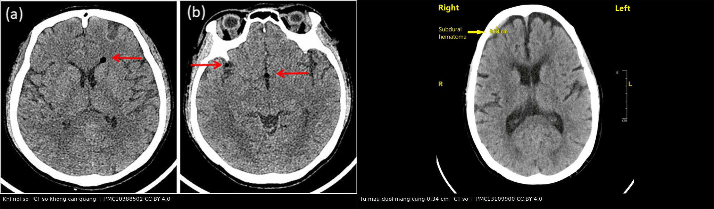
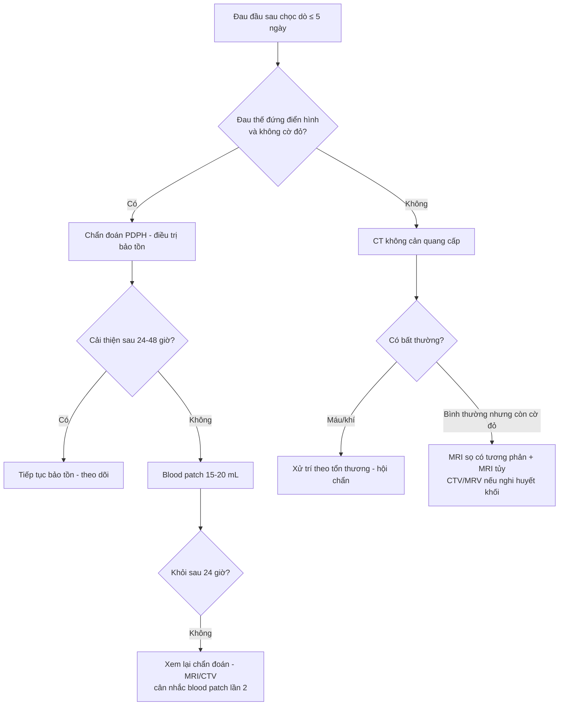
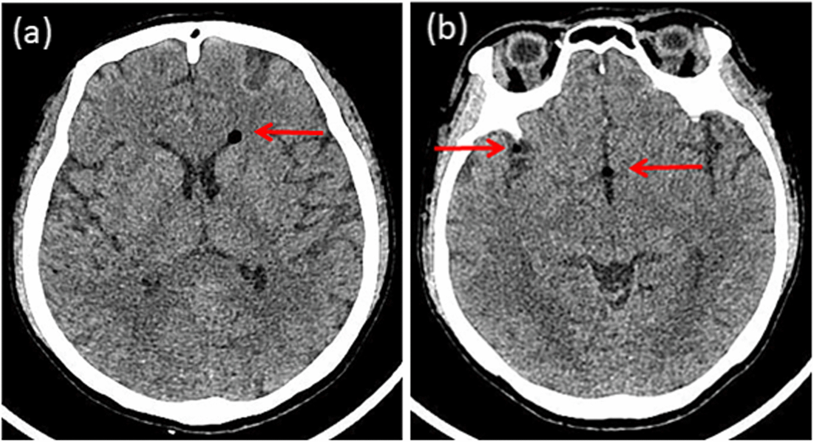
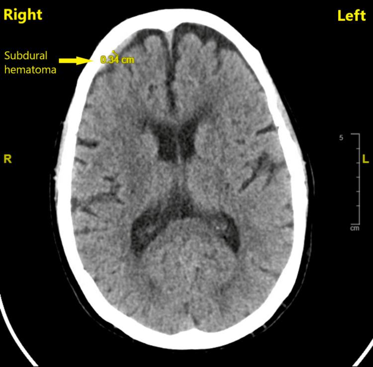
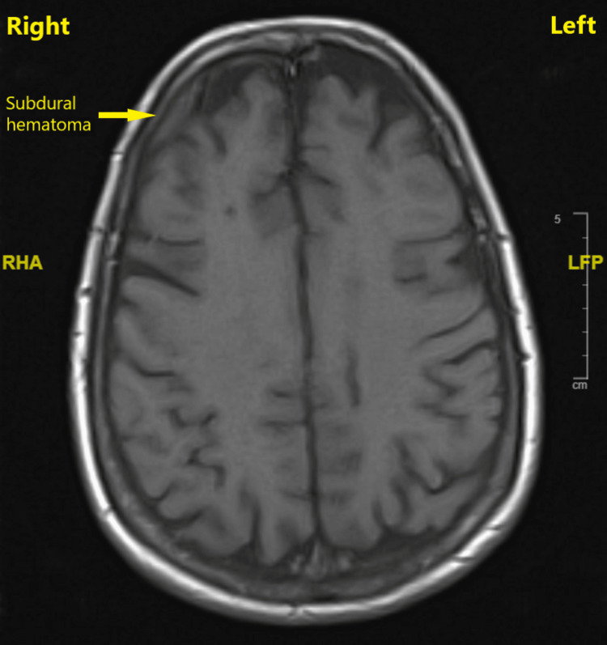
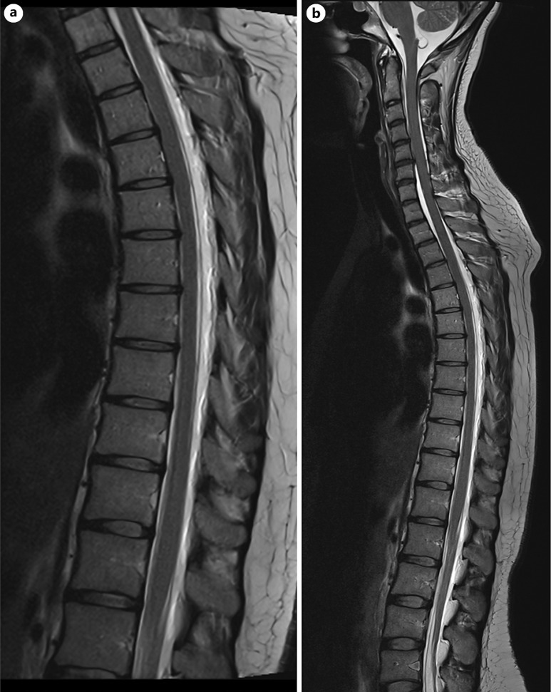
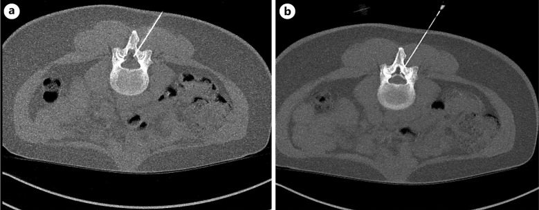

# 3014 — Đau đầu sau chọc dò tủy sống (PDPH): khi nào chụp, khi nào blood patch, biến chứng nội sọ

**Tags:** `pattern:dau-dau-the-dung` `pattern:ro-dich-nao-tuy` `pattern:tu-mau-duoi-mang-cung` `pattern:khi-noi-so` `pattern:liec-day-vi` `vung:cot-song-that-lung` `vung:noi-so` `score:ICHD-3` `protocol:MRI-so-nao-tuong-phan` `protocol:blood-patch`
**Mức chắc chắn (certainty):** tổng hợp y văn (literature synthesis) — khung số liệu lấy từ **tổng quan PDPH 2026** (PMC13148558), **cập nhật xử trí sản khoa** (PMC13221105), **cohort 285 lần chọc dò** (PMC9281177), **cohort 1305 ca mổ lấy thai** (PMC13429089) và **3 ca nguyên văn có ảnh** (PMC10388502 khí nội sọ; PMC13109900 tụ máu dưới màng cứng; PMC13472611 liệt dây VI + blood patch dưới CT). Nhãn này vì bài ghép nhiều nguồn, không phải một ca duy nhất.

> **Bài này là phần “biến chứng sau thủ thuật” của [3012 – Áp-xe sau gây tê ngoài màng cứng](../3012-apxe-ngoai-mang-cung-sau-gay-te-ngoai-mang-cung/lesson.md)** và [3013 – Đuôi ngựa sau mổ cột sống](../3013-hoi-chung-duoi-ngua-sau-mo-cot-song/lesson.md). Điểm khác biệt cốt lõi: sau chọc dò, **đau đầu là triệu chứng chính**, hình ảnh nội sọ thường **bình thường** — nên điều trị theo lâm sàng, và chỉ chụp khi có **cờ đỏ** hoặc đau kéo dài.

## 1. Tổng quan bệnh học – cơ chế hình ảnh

- **Chuỗi sự kiện:** chọc thủng màng cứng → **rò dịch não tủy (DNT) liên tục** ra khoang ngoài màng cứng → giảm thể tích DNT → theo **học thuyết Monro–Kellie** (hộp sọ kín: não + máu + DNT có tổng thể tích cố định) → **giãn tĩnh mạch và tăng thể tích máu nội sọ bù trừ**, đồng thời **não tụt xuống (brain sag)** vì mất lực nổi của DNT. Chính **kéo căng màng não và các dây thần kinh sọ** — không phải “viêm màng não” — tạo ra cơn đau.
- **TẠI SAO đau theo tư thế:** khi đứng, cột dịch não tủy tạo **gradient áp lực thủy tĩnh dương** giữa khoang dưới nhện thắt lưng và nội sọ, làm **rò nhanh hơn** và **tụt não nhiều hơn**; khi nằm, gradient giảm → đau dịu trong **≤ 15 phút**. Đây là lý do tiêu chuẩn chẩn đoán dùng **thời gian 15 phút**, không dùng “đau khi đứng” chung chung.
- **TẠI SAO liệt dây VI (abducens):** dây VI có **đường chạy nội sọ dài nhất**, đi qua **ống Dorello** và bị **căng dọc theo bờ xương đá** khi não tụt; dây không có vỏ myelin dày như các dây khác nên dễ tổn thương do kéo. Vì vậy liệt VI là dấu hiệu **gián tiếp của tụt não**, không phải tổn thương thân não.
- **TẠI SAO tụ máu dưới màng cứng (SDH):** não tụt kéo căng **tĩnh mạch cầu nối (bridging veins)** từ vỏ não vào xoang màng cứng → rách → máu tụ. Nguy cơ tăng ở **người già (não teo, tĩnh mạch căng sẵn)**, người **chống đông**, và khi rò kéo dài — đây là lý do **PDPH ở người ≥ 50 tuổi tuy hiếm nhưng nặng hơn**.
- **TẠI SAO có khí nội sọ (pneumocephalus):** kỹ thuật **mất lực cản bằng không khí (loss of resistance to air)** bơm khí vào khoang ngoài màng cứng; khi màng cứng thủng, khí đi vào khoang dưới nhện và **ngược dòng lên nội sọ**. Khí **hấp thụ tia rất mạnh** nên trên CT có **HU âm sâu** — ca PMC10388502 đo **−982 đến −464 HU**.
- **Vật lý tín hiệu — phân biệt dịch, máu, khí trên CT không cản quang:**
  - **Khí:** **−1000 đến −400 HU**, đen tuyệt đối, thường ở khoang dưới nhện/não thất.
  - **DNT/dịch màng não (hygroma):** **0–15 HU**, đồng đậm độ dịch não tủy, hình liềm.
  - **Máu tụ cấp (< 48 giờ):** **60–80 HU**, tăng đậm độ so với nhu mô; **bán cấp** giảm dần về **đồng đậm độ** nên **dễ bỏ sót trên CT muộn** → phải MRI.
  - Trên MRI: **màng não dày ngấm thuốc đối xứng (pachymeningeal enhancement)**, **tụt não (sagging)**, **giãn xoang tĩnh mạch**, **dịch dưới màng cứng** — bộ dấu hiệu của **hạ áp lực nội sọ**.
- **Số liệu định lượng phải nhớ:**
  - **Tần suất theo kim:** kim **cắt (cutting) 10–40%**; kim **đầu bút chì (pencil-point) 25–27G: < 3%**; **chọc dò ngoài ý muốn (UDP) bằng kim Tuohy cỡ lớn: 50–85%**; kỹ thuật **dural puncture epidural (DPE): 0,5–2%**.
  - **Chọc dò tủy sống chẩn đoán (cohort 285 ca):** PDPH **29,5%**, khởi phát trung bình **1,7 ± 0,8 ngày**, kéo dài **2,4 ± 2,1 ngày**.
  - **Gây tê tủy sống mổ lấy thai (1305 ca):** PDPH **1,5%**; **56%** khởi phát trong **24–48 giờ**.
  - **Tiêu chuẩn ICHD-3:** đau đầu khởi phát **trong 5 ngày** sau chọc dò; **nặng lên trong 15 phút** khi ngồi/đứng và **dịu trong 15 phút** khi nằm; kèm ≥ 1 trong **cứng cổ, ù tai, giảm thính lực, sợ ánh sáng, buồn nôn**; **tự khỏi trong 2 tuần** hoặc sau blood patch.
  - **Blood patch ngoài màng cứng (EBP):** thành công **70–90%**; **26,8%** tái phát sau EBP, trong đó **60%** cần EBP lần 2; thể tích **15–20 mL** (tối ưu quanh **20 mL**), thực hiện khi thất bại điều trị bảo tồn **24–48 giờ**.
  - **Siêu âm đường kính bao dây thần kinh thị (ONSD):** **ΔONSD ≥ 0,40 mm** sau EBP dự báo cải thiện sớm với **AUC 0,96** (95% CI 0,87–1,00), **độ nhạy 100%**, **độ đặc hiệu 83%** — công cụ theo dõi, **không thay** đánh giá lâm sàng.

## 2. Mẫu hình + chẩn đoán phân biệt theo vị trí (gamut)

- **Mẫu hình cốt lõi:** **đau đầu thế đứng + tiền sử chọc dò trong 5 ngày + không dấu thần kinh khu trú**. Nếu đúng mẫu hình này và không cờ đỏ → **chẩn đoán lâm sàng, không cần chụp**.
- **Gamut theo “đồng hồ” sau chọc dò:**
  - **0–48 giờ:** PDPH đơn thuần; **khí nội sọ** (nếu dùng kỹ thuật không khí); **tụ máu ngoài màng cứng cột sống** (đau lưng + yếu chân — xem 3013).
  - **48 giờ–2 tuần:** PDPH kéo dài; **tụ máu dưới màng cứng** (đau đổi tính chất, không còn đứng rõ); **huyết khối xoang tĩnh mạch não (CVST)**; **viêm màng não** (sốt, cứng cổ, rối loạn ý thức).
  - **> 2 tuần:** rò DNT dai dẳng; **giả màng não (pseudomeningocele)**; CVST muộn; **SDH mạn**; đau đầu do nguyên nhân khác (tăng huyết áp thai kỳ, migraine).
- **Gamut theo “hình thái đau đầu” — dùng để phát hiện ca không điển hình:**
  - **Đau thế đứng thuần, đổi ngay khi nằm:** PDPH.
  - **Đau thế đứng + đau đầu kiểu tăng áp lực (nôn, nhìn mờ):** **khí nội sọ** hoặc **SDH** — hai biến chứng có cơ chế ngược nhau nhưng cùng biểu hiện.
  - **Đau liên tục, không giảm khi nằm, kèm liệt VI/song thị:** hạ áp lực nội sọ nặng hoặc **CVST** — phải chụp.
  - **Đau + sốt + cứng cổ:** **viêm màng não** — chọc dò lại và kháng sinh, **không blood patch trước khi loại trừ nhiễm trùng**.
- **Gamut theo bối cảnh sản khoa:** PDPH phải phân biệt với **tiền sản giật/sản giật**, **CVST**, **xuất huyết nội sọ**, **viêm màng não**, **migraine** — vì tất cả đều có thể xảy ra trong 6 tuần hậu sản.

## 3. Bảng so sánh phân biệt (ma trận đối chiếu)

| Thực thể (entity) | Hình ảnh/lâm sàng điển hình | Chốt vào (rule-in) | Chốt loại (rule-out) | Gợi ý xác nhận |
|---|---|---|---|---|
| PDPH đơn thuần | Đau thế đứng, khởi phát ≤ 5 ngày, dịu ≤ 15 phút khi nằm; CT/MRI **bình thường** | **Quan hệ thời gian với chọc dò + đau thế đứng điển hình + không cờ đỏ** | **Đau liên tục không đổi tư thế + dấu thần kinh khu trú** → không phải PDPH đơn thuần | Chẩn đoán lâm sàng theo ICHD-3; không chụp nếu không cờ đỏ |
| Tụ máu dưới màng cứng | Hình **liềm** dưới màng cứng, **60–80 HU** (cấp) hoặc đồng đậm độ (bán cấp); đau **mất tính thế đứng** | **Hình liềm + tăng đậm độ trên CT + đau đổi tính chất** | **Khí HU âm** → khí nội sọ; **dịch 0–15 HU** → hygroma, không phải máu | CT không cản quang cấp; MRI T1/T2 nếu CT muộn/âm tính mà lâm sàng nặng |
| Huyết khối xoang tĩnh mạch não | Đau **liên tục**, tăng khi nằm/nghiêng, có thể co giật, nhìn mờ; **không giảm rõ khi nằm** | **Khuyết thuốc trong xoang trên CTV/MRV + đau không kiểu thế đứng** | **CTV bình thường + đau thế đứng điển hình** → PDPH | **CTV/MRV** (không dùng CT thường để loại trừ); D-dimer hỗ trợ |
| Khí nội sọ | Khí **HU âm** trong khoang dưới nhện/não thất; đau thế đứng **hoặc** đau kiểu tăng áp lực | **HU âm (−1000 đến −400) + tiền sử kỹ thuật bơm khí** | **Không có khí trên CT** → loại trừ | CT không cản quang; theo dõi vì khí tự hấp thụ |
| Viêm màng não sau chọc dò | Sốt, cứng cổ, sợ ánh sáng, rối loạn ý thức; dịch não tủy **bạch cầu tăng, protein tăng, glucose giảm** | **Hội chứng nhiễm trùng + dịch não tủy viêm** | **Không sốt, dịch não tủy bình thường** → loại trừ | Chọc dò lại (nếu an toàn) + cấy; kháng sinh sớm |
| Đau đầu do tiền sản giật | Đau đầu + **HA ≥ 140/90**, protein niệu, phù, tăng men gan; thường **không liên quan tư thế** | **HA cao + protein niệu + thay đổi thị lực** | **HA bình thường, đau thế đứng thuần** → ít nghĩ tiền sản giật | Xét nghiệm tiền sản giật, theo dõi sản khoa |
| Hạ áp lực nội sọ tự phát (SIH) | Cùng hình ảnh MRI như PDPH nhưng **không có tiền sử chọc dò**; có thể có **dịch tủy sống rò tự phát** | **MRI hạ áp lực + không tiền sử thủ thuật** | **Có tiền sử chọc dò trong 5 ngày** → PDPH | MRI sọ + tủy có tương phản; tìm rò bằng MR/CT myelography |

*Trái: khí nội sọ (mũi tên) — **HU âm** trong khoang dưới nhện. Phải: **tụ máu dưới màng cứng 0,34 cm** bán cầu phải, không lệch đường giữa. Hai ca khác nhau, cùng một cơ chế: mất thể tích dịch não tủy. Ảnh nguyên bản, ghép letterbox. Nguồn: PMC10388502 (CC BY 4.0) và PMC13109900 (CC BY 4.0).*

## 4. Protocol chụp + hệ phân độ/điểm chuẩn hóa

- **Ai chụp — không chụp thường quy:** PDPH điển hình, không cờ đỏ → **không cần CT/MRI**. Chỉ chụp khi có **một trong các cờ đỏ**:
  - Đau **không còn kiểu thế đứng**, đau **tăng dần**, đau **về đêm**.
  - **Sốt, cứng cổ, rối loạn ý thức, co giật** (nhiễm trùng/CVST).
  - **Dấu thần kinh khu trú**: liệt dây sọ (đặc biệt **VI**), yếu chi, rối loạn ngôn ngữ, nhìn đôi.
  - **Không cải thiện sau 1 tuần** điều trị bảo tồn hoặc **tái phát sau EBP**.
  - **Chấn thương đầu** kèm theo, **chống đông**, hoặc **≥ 50 tuổi** (nguy cơ SDH cao hơn).
- **Chọn modality theo câu hỏi lâm sàng:**
  - **CT không cản quang:** bước đầu để loại trừ **chảy máu/SDH** và phát hiện **khí nội sọ**; nhanh, nhưng **âm tính không loại trừ CVST** và **kém nhạy với SDH bán cấp**.
  - **MRI sọ có tương phản (gadolinium):** chuẩn để thấy **màng não dày ngấm thuốc**, **tụt não**, **giãn xoang**, **dịch dưới màng cứng** — nên làm khi đau kéo dài, CT âm tính, hoặc nghi SIH.
  - **MRI tủy sống T2 + MR myelography:** tìm **vị trí rò** và **dịch ngoài màng cứng** (ca PMC13472611 thấy **dịch ngoài màng cứng lan dọc** trên T2 sagittal).
  - **CTV/MRV:** bắt buộc khi nghi **CVST** — CT thường **không đủ**.
  - **CT myelography:** khi MRI chống chỉ định hoặc cần định vị rò chính xác trước can thiệp.
- **Blood patch — chỉ định và kỹ thuật:**
  - **Chỉ định:** PDPH **trung bình–nặng** hoặc thất bại điều trị bảo tồn **24–48 giờ**, có ảnh hưởng chức năng (không ngồi dậy được, không chăm con được).
  - **Thể tích:** **15–20 mL** máu tự thân (tối ưu quanh **20 mL**), tiêm **tại hoặc sát tầng chọc dò**; có thể dùng **hướng dẫn CT/fluoroscopy** khi khó hoặc khi cần nhắm đúng vị trí rò (ca PMC13472611: EBP dưới CT ngày **15** hậu sản, khỏi hoàn toàn trong **2 tuần**).
  - **Hiệu quả:** **70–90%**; tái phát **26,8%**, trong đó **60%** cần lần 2.
  - **Theo dõi hiệu quả khách quan:** **ΔONSD ≥ 0,40 mm** sau 2 giờ (AUC 0,96) — hữu ích khi bệnh nhân khó mô tả đau, nhưng **chưa thay thế** đánh giá lâm sàng.
- **Điều trị bảo tồn (trước và song song):** nằm nghỉ, **hydrat hóa**, **paracetamol/NSAID**, **caffeine**; tránh **vận động mạnh, rặn, nâng vật nặng** trong 4–6 tuần; **không dùng** steroid thường quy.
- **Sơ đồ xử trí:**

## 5. Biến thể bình thường và cạm bẫy

- **“Đau đầu thế đứng = PDPH” là bẫy nguy hiểm nhất:** khí nội sọ (ca PMC10388502) và **SDH** đều có thể biểu hiện **đau thế đứng**; hỏi thêm **kỹ thuật chọc (không khí hay nước muối)**, **đau đầu có đổi tính chất không**, và **có dấu thần kinh mới không**.
- **Khí nội sọ có thể tự khỏi** — ca PMC10388502 khỏi hoàn toàn sau **2 tuần** với nằm nghỉ, hydrat hóa, giảm đau, oxy; **không cần** can thiệp nếu không có dấu tăng áp lực nội sọ.
- **SDH ở người già có thể rất mỏng (0,34 cm) và không lệch đường giữa**, nên **CT ban đầu dễ bị đọc là bình thường**; nếu đau kéo dài, **MRI** hoặc **CT lặp lại** mới thấy rõ.
- **CT bình thường không loại trừ CVST:** phải **CTV/MRV**; đau kiểu **không thế đứng** là manh mối.
- **Blood patch không phải “chữa khỏi ngay mọi đau đầu”:** **26,8%** tái phát; nếu đau **không đổi tư thế** sau EBP, phải **xem lại chẩn đoán** thay vì làm EBP lần 3 mù quáng.
- **Chống chỉ định/ổ nhiễm:** **không blood patch** khi nghi **nhiễm trùng tại chỗ chọc, nhiễm trùng huyết, sốt chưa rõ nguyên nhân** — có thể đưa vi khuẩn vào khoang ngoài màng cứng (xem [3012](../3012-apxe-ngoai-mang-cung-sau-gay-te-ngoai-mang-cung/lesson.md)).
- **Biến chứng của chính EBP:** đau lưng thoáng qua, **chậm nhịp tim thoáng qua**, **co giật** (đã báo cáo trong hạ áp lực nội sọ có SDH mạn — PMC13224276), **tăng thể tích/SDH**; biến chứng thần kinh vĩnh viễn **rất hiếm** nhưng phải tư vấn trước.
- **Cạm bẫy “satisfaction of search” ở sản khoa:** thấy PDPH rồi bỏ qua **tiền sản giật/CVST** vì đã có “chẩn đoán giải thích được”; luôn kiểm **HA, protein niệu, dấu thần kinh** trước khi gắn nhãn.

## 6. Tự lượng giá — Blind Quiz

**Ca 1 — Sản phụ 24 tuổi, đau đầu thế đứng 2 giờ sau sinh thường, có gây tê ngoài màng cứng.**

- Gợi ý: gây tê ngoài màng cứng bằng **kỹ thuật mất lực cản với không khí**; đau đầu thế đứng + cứng cổ + thay đổi thính giác.
- Câu hỏi: Bất thường trên CT là gì? Đậm độ đo được bao nhiêu? Vì sao đau đầu **vẫn kiểu thế đứng**? Xử trí?

<b>Bấm để hiện đáp án (findings + chẩn đoán)</b>

- **Dấu hiệu:** nhiều ổ **giảm đậm độ rất mạnh (khí)** trong khoang dưới nhện/nhu mô, mũi tên đỏ; tác giả đo **−982 đến −464 HU** → **khí nội sọ (pneumocephalus)**, không phải nhồi máu.
- **Chẩn đoán:** **PDPH kết hợp khí nội sọ** sau gây tê ngoài màng cứng dùng kỹ thuật không khí. Đau vẫn kiểu thế đứng vì **vẫn còn rò DNT**; khí là “bệnh thứ hai” chồng lên.
- **Xử trí:** nằm nghỉ, hydrat hóa, giảm đau, **oxy**; ca này khỏi hoàn toàn sau **2 tuần**. Không cần chọc dẫn lưu khí nếu không có dấu tăng áp lực nội sọ.
- **Bài học:** đau thế đứng sau gây tê **không đồng nghĩa chỉ có hạ áp lực**; CT sọ giúp phát hiện khí.
- Nguồn ảnh: BMC Pregnancy Childbirth 2023 (PMC10388502), Fig. 1, CC BY 4.0.

**Ca 2 — Nữ 73 tuổi, đau đầu thế đứng sau gây tê tủy sống 25G pencil-point, không đỡ khi điều trị bảo tồn.**

- Gợi ý: mổ thay khớp háng; đau đầu thế đứng dai dẳng; không dấu thần kinh khu trú.
- Câu hỏi: Mô tả tổn thương? Đo kích thước? Vì sao người già dễ bị? Bước tiếp theo?

<b>Bấm để hiện đáp án (findings + chẩn đoán)</b>

- **Dấu hiệu:** dải **tăng đậm độ hình liềm** dưới màng cứng bán cầu **phải**, đo **0,34 cm**, **không lệch đường giữa** (mũi tên vàng).
- **Chẩn đoán:** **tụ máu dưới màng cứng (SDH)** do rò DNT kéo dài — biến chứng hiếm nhưng nặng ở người cao tuổi.
- **Vì sao người già:** não teo → tĩnh mạch cầu nối **căng sẵn** và khoảng dưới nhện rộng hơn → chỉ cần tụt não nhẹ là rách tĩnh mạch.
- **Xử trí:** ca này **theo dõi sát** (SDH mỏng, không lệch đường giữa) và **blood patch** vì PDPH không đỡ; đau hết ngay, SDH không xấu thêm. Nếu SDH dày/lệch đường giữa hoặc tri giác xấu → **hội chẩn ngoại thần kinh**.
- Đối chiếu MRI 6 giờ sau — tổn thương **không tiến triển**, xác nhận máu tụ mạn tính ổn định:

- Nguồn ảnh: Cureus 2026;18(3) (PMC13109900), Fig. 1–2, CC BY 4.0.

**Ca 3 — Nữ 33 tuổi, ngày 12 hậu sản: đau đầu thế đứng, cứng cổ, ù tai và nhìn đôi ngang.**

- Gợi ý: gây tê ngoài màng cứng giảm đau chuyển dạ; CT sọ ban đầu bình thường; triệu chứng dai dẳng dù điều trị bảo tồn.
- Câu hỏi: Dấu hiệu trên MRI tủy? Vì sao nhìn đôi ngang? Can thiệp nào được thực hiện?

<b>Bấm để hiện đáp án (findings + chẩn đoán)</b>

- **Dấu hiệu:** **dịch tăng tín hiệu T2 ngoài màng cứng lan dọc** mặt sau ống sống (a: thắt lưng; b: toàn trục ngực–thắt lưng) — tương ứng **rò DNT dai dẳng**. MRI sọ cho thấy dấu hiệu **hạ áp lực nội sọ**; không có tụ dịch dưới màng cứng lớn.
- **Nhìn đôi ngang:** **liệt dây VI** do kéo căng khi não tụt (đường chạy nội sọ dài nhất).
- **Can thiệp:** **blood patch ngoài màng cứng có hướng dẫn CT** tại vị trí rò, ngày **15** hậu sản → khỏi hoàn toàn trong **2 tuần**.

- **Bài học:** PDPH kèm **liệt dây sọ** là cờ đỏ → cần **MRI sọ + tủy có tương phản**, và **EBP nhắm vị trí rò** khi thất bại bảo tồn.
- Nguồn ảnh: Case Rep Ophthalmol 2026;17:837–844 (PMC13472611), Fig. 2–3, CC BY-NC 4.0 (nguyên bản).

## Bài liên quan chéo
- [3012 – Áp-xe ngoài màng cứng sau gây tê ngoài màng cứng](../3012-apxe-ngoai-mang-cung-sau-gay-te-ngoai-mang-cung/lesson.md)
- [3013 – Hội chứng đuôi ngựa sau mổ cột sống](../3013-hoi-chung-duoi-ngua-sau-mo-cot-song/lesson.md)
- [258 – Áp-xe ngoài màng cứng do lây từ ổ loét tì đè](../258-apxe-ngoai-mang-cung-loet-ti-de-cung-cut/lesson.md)
- [249 – Rò động mạch cảnh–xoang hang sau chấn thương](../249-ro-dong-mach-canh-xoang-hang-chan-thuong/lesson.md)

## Ảnh
- Tên file: `3014_*.jpg`; composite: `images/composite_bien-chung-noi-so.jpg` (tạo bằng `tools/make_composite.py`, letterbox, không crop).
- Nguồn + giấy phép từng ảnh: `images/CREDITS.md`; link gốc trong `sources.md`.
- Ảnh PMC13472611 là **CC BY-NC 4.0** — dùng cho giáo dục phi thương mại, giữ nguyên bản.

> Không dùng để chẩn đoán độc lập khi chưa có người hướng dẫn.
