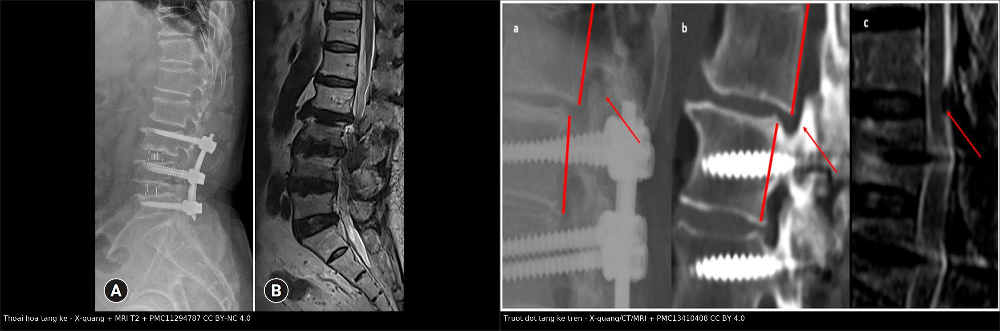
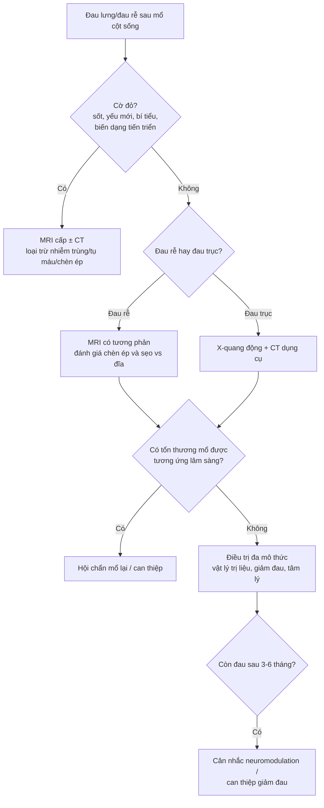
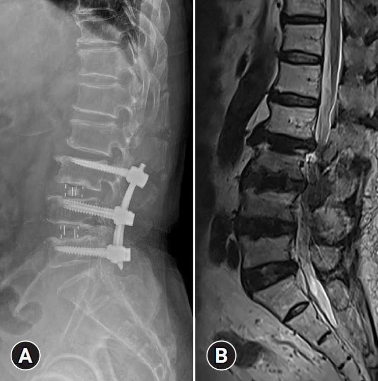
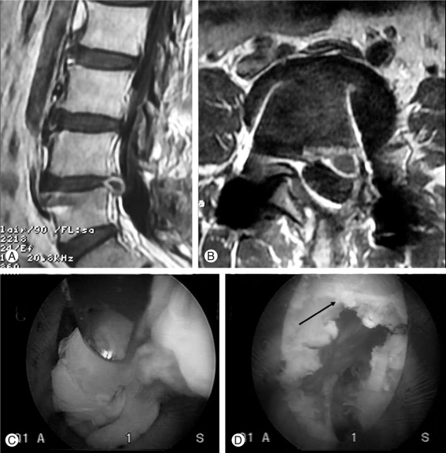
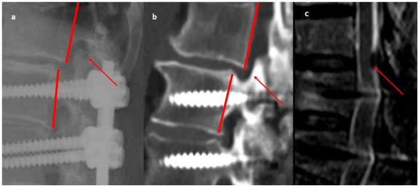

# 3015 — Hội chứng đau sau mổ cột sống (FBSS): sẹo xơ – đĩa tái phát – tầng kế cận – dụng cụ hỏng

**Tags:** `pattern:dau-sau-mo` `pattern:seo-xo-ngoai-mang-cung` `pattern:dia-tai-phat` `pattern:thoai-hoa-tang-ke` `pattern:long-vit` `pattern:gia-khop` `pattern:viem-dia-dem` `vung:cot-song-that-lung` `score:VAS` `score:ODI` `protocol:MRI-cot-song-tuong-phan` `protocol:CT-xoay-dung-cu`
**Mức chắc chắn (certainty):** tổng hợp y văn (literature synthesis) — khung số liệu lấy từ **cohort toàn quốc 1.029.500 ca mổ thắt lưng** (PMC13454489), **cohort 1233 ca giải ép không dụng cụ** (PMC13263612), **150 ca mổ lại** (PMC13489680), **95 ca hồi cứu đa trung tâm** (PMC12956404), **tổng quan tự sự 2024** (PMC11294787) và **ca nguyên văn có ảnh** (PMC3047892). Nhãn này vì bài ghép nhiều nguồn.

> **Bài này là phần “đau mạn sau mổ” của [3013 – Đuôi ngựa sau mổ cột sống](../3013-hoi-chung-duoi-ngua-sau-mo-cot-song/lesson.md)** và nối tiếp [228 – Thoát vị đĩa đệm thắt lưng](../228-thoat-vi-dia-dem-that-lung-pfirrmann-modic/lesson.md). Khác biệt cốt lõi: 3013 là **cấp cứu trong giờ–ngày**; 3015 là **đau kéo dài hàng tháng–năm**, nơi câu hỏi không phải “có chèn ép không” mà là **“có tổn thương còn mổ được không, hay đau đã thành bệnh cảnh mạn”**.

## 1. Tổng quan bệnh học – cơ chế hình ảnh

- **Định nghĩa và tên gọi:** **FBSS** là đau lưng/đau rễ **tồn tại, tái phát hoặc mới xuất hiện** sau ≥ 1 lần mổ cột sống, **không do bệnh lý mới độc lập**. Thuật ngữ mới **PSPS-2 (persistent spinal pain syndrome type 2)** được ưu tiên vì trung tính hơn, nhưng “FBSS” vẫn là từ khóa y văn.
- **TẠI SAO đau kéo dài — bốn cơ chế chồng lấp:**
  - **Cơ học:** mất/hỏng cấu trúc đĩa–khớp, **mất vững**, **giả khớp (pseudoarthrosis)**, **dụng cụ hỏng** → đau khi tải.
  - **Thần kinh:** **chèn ép rễ còn lại** (giải ép chưa đủ, mảnh đĩa sót, hẹp tầng kế cận) hoặc **đau rễ không chèn ép** do tổn thương rễ mạn.
  - **Sẹo xơ:** mô hạt xơ **dính màng cứng và rễ**, co kéo + giải phóng chất trung gian viêm → đau và hạn chế vận động; **83,3%** bệnh nhân FBSS có **sẹo xơ ngoài màng cứng nặng** trên nội soi ngoài màng cứng (epiduroscopy).
  - **Trung ương/hóa học:** mẫn cảm trung ương sau đau kéo dài — giải thích vì sao **mổ sửa không phải lúc nào cũng hết đau**.
- **TẠI SAO MRI có tương phản phân biệt được sẹo và đĩa tái phát:** mô sẹo xơ **giàu mạch máu + mô hạt**, không có hàng rào máu–mô đĩa nên **ngấm thuốc sớm và đều** (thường trong **20–30 phút**); mảnh đĩa thoát vị **không có mạch máu**, chỉ **ngấm rìa** ở mô hạt quanh chu vi, **không ngấm trung tâm**. Vì vậy cần **T1 sau tiêm muộn**, không đánh giá trên ảnh tiêm thì sớm.
- **TẠI SAO tín hiệu đĩa thay đổi sau mổ:** đĩa thoái hóa mất nước → **T2 tối** (mất tín hiệu “đĩa sáng”); sau lấy đĩa, khoang đĩa **hẹp** và có thể có **dịch/tổ chức hạt**; **mảnh đĩa tái phát** thường **T2 đồng/tăng nhẹ** so với đĩa thoái hóa và **liên tục với khoảng đĩa**.
- **TẠI SAO CT là chuẩn cho dụng cụ:** kim loại gây **giả ảnh (metal artifact)** trên MRI; **CT cửa sổ xương lát mỏng, dựng ảnh đa mặt phẳng (MPR)** thấy **vùng sáng quanh vít (halo)**, **gãy vít/thanh**, **di lệch cage**, **giả khớp** và **liền xương**.
- **Số liệu định lượng phải nhớ:**
  - **Tần suất:** **10–40%** sau mổ cột sống (y văn); **26,7%** (274.955/1.029.500 ca, Hàn Quốc, định nghĩa gộp mã bệnh + mổ lại); **13,9%** (172/1233) sau **giải ép không dụng cụ**.
  - **Nguyên nhân ở nhóm mổ lại (n = 150):** **sẹo xơ ngoài màng cứng 28%**, **đĩa tái phát 26%**, **mảnh đĩa sót 24%**, **giả khớp/hỏng dụng cụ 16%**, **mổ sai tầng 6%**.
  - **Sau giải ép không dụng cụ (n = 1233):** **đĩa tái phát 36,0%**, **giải ép chưa đủ 23,8%**, **viêm đĩa đệm 22,7%**.
  - **Biến chứng mổ lại:** **46%** (69/150) có biến chứng chu phẫu; **rách màng cứng 16%** là thường gặp nhất.
  - **Kết cục mổ lại:** **62%** hết đau sau 3 tháng, **70%** sau 12 tháng và duy trì đến 24 tháng; **VAS 7,22 ± 0,89 → 0,98 ± 0,75**; **ODI 66,30 ± 9,06 → 7,77 ± 3,55** (p = 0,001) — tức **mổ lại có ích nhưng 30% vẫn còn đau**.
  - **Thời gian:** trung bình **2,3 năm** từ mổ đầu đến mổ lại (95 ca).
  - **Thoái hóa tầng kế cận (ASD):** tỷ lệ mổ lại gộp **8%** (95% CI 6,5–9,8%; 55 nghiên cứu, 1940 bệnh nhân); **cấu trúc cố định càng dài, nguy cơ càng cao** (P = 0,0001). Tổng quan khác nêu **22–36%** ASD và **> 20%** phải mổ lại — chênh lệch do định nghĩa và thời gian theo dõi, không mâu thuẫn.
  - **Yếu tố nguy cơ trước mổ:** tuổi, **bệnh đa dây thần kinh ngoại biên**, **béo phì**, **đái tháo đường**, **tăng huyết áp**, **hút thuốc**; **vận động vừa 500–1499 MET-phút/tuần** có tính bảo vệ.

## 2. Mẫu hình + chẩn đoán phân biệt theo vị trí (gamut)

- **Mẫu hình cốt lõi:** đau **lưng và/hoặc chân** sau mổ, **không tương xứng** với mức chèn ép trên hình ảnh, hoặc **tái phát sau một khoảng ổn định**. Câu hỏi đầu tiên: **đau rễ (radicular) hay đau trục (axial)?**
- **Gamut theo thời điểm sau mổ:**
  - **< 3 tháng:** **mảnh đĩa sót**, **giải ép chưa đủ**, **máu tụ**, **nhiễm trùng sớm**, **đau rễ do thao tác**; MRI sớm có **ngấm thuốc hậu phẫu bình thường** — dễ đọc quá mức.
  - **3–12 tháng:** **đĩa tái phát**, **sẹo xơ**, **viêm đĩa đệm muộn**, **giả khớp** (nếu có cố định).
  - **> 1–2 năm:** **thoái hóa tầng kế cận**, **hỏng dụng cụ**, **gãy xương quanh dụng cụ**, **hẹp tái phát**, **đau mạn trung ương**.
- **Gamut theo vị trí tổn thương trên trục:**
  - **Tại tầng mổ:** sẹo xơ, đĩa tái phát/mảnh sót, hẹp lỗ liên hợp còn lại, giả khớp.
  - **Tầng kế cận (trên/dưới):** **thoái hóa tầng kế cận**, **trượt đốt**, **gãy đốt trên dụng cụ (junctional fracture)**, **hẹp ống sống**.
  - **Ngoài cột sống:** **khớp háng, khớp cùng chậu, cơ hình lê, bệnh mạch máu** — nguồn đau hay bị bỏ sót khi đã có “chẩn đoán sẵn” FBSS.
- **Gamut theo hình thái trên MRI:**
  - **Khối choán chỗ + ngấm rìa + liên tục khoảng đĩa:** đĩa tái phát.
  - **Mô ngấm đều, bám màng cứng, không hiệu ứng choán chỗ:** sẹo xơ.
  - **Dịch + vỏ ngấm + hạn chế khuếch tán:** nhiễm trùng (viêm đĩa đệm/áp-xe).
  - **Phù tủy xương quanh vít + vùng sáng quanh vít:** **long vít/nhiễm trùng** — cần CT + CRP.
  - **Hẹp ống sống/lỗ liên hợp tại tầng kế cận + mất chiều cao đĩa:** thoái hóa tầng kế cận.

## 3. Bảng so sánh phân biệt (ma trận đối chiếu)

| Thực thể (entity) | Hình ảnh/lâm sàng điển hình | Chốt vào (rule-in) | Chốt loại (rule-out) | Gợi ý xác nhận |
|---|---|---|---|---|
| Sẹo xơ ngoài màng cứng | Mô **ngấm thuốc đều, sớm**, bám màng cứng, **không hiệu ứng choán chỗ rõ**; đau âm ỉ, không theo rễ | **Ngấm đều + không liên tục khoảng đĩa + không đẩy bao tủy** | **Khối có hiệu ứng choán chỗ + ngấm rìa** → đĩa tái phát | MRI T1 sau tiêm muộn (20–30 phút); so MRI nền sau mổ |
| Đĩa tái phát | Khối **trước/trước bên**, **liên tục với khoảng đĩa**, T2 đồng/tăng, **ngấm rìa** | **Liên tục khoảng đĩa + ngấm rìa + chèn ép rễ tương ứng lâm sàng** | **Ngấm đều muộn, tách khỏi khoảng đĩa** → sẹo | MRI có tương phản; đối chiếu ảnh mổ |
| Mảnh đĩa sót | Khối **rời**, thường **trong ống sống/lỗ liên hợp**, ngay sau mổ; đau rễ **sớm, không cải thiện** | **Khối rời khỏi khoảng đĩa + đau rễ ngay sau mổ** | **Không có khối + đau trục** → không phải mảnh sót | MRI sớm; mổ thăm dò nếu lâm sàng rõ |
| Thoái hóa tầng kế cận | **Hẹp đĩa, xơ hóa, trượt đốt, hẹp ống sống** ở tầng trên/dưới dụng cụ; đau xuất hiện **sau ≥ 1–2 năm** | **Tổn thương mới tại tầng kế cận + thời gian phù hợp** | **Tổn thương tại tầng mổ** → không phải ASD | X-quang động + MRI; CT nếu cần xương |
| Giả khớp (pseudoarthrosis) | **Khe sáng giữa các đốt/cage không liền xương**, **di lệch động**, đau khi tải | **Không liền xương trên CT ≥ 6–12 tháng + di lệch động** | **Cầu xương liên tục** → loại trừ | CT MPR + X-quang động |
| Long vít/hỏng dụng cụ | **Vùng sáng quanh vít**, gãy vít/thanh, cage di lệch; đau tăng dần | **Halo quanh vít + gãy/di lệch trên CT** | **Vít nguyên vẹn, không halo** → loại trừ | CT cửa sổ xương + giảm giả ảnh; so phim cũ |
| Nhiễm trùng (viêm đĩa đệm/áp-xe) | **Dịch + vỏ ngấm + hạn chế khuếch tán**, phù mô mềm; **sốt, CRP tăng** | **DWI sáng/ADC tối + hội chứng nhiễm trùng** | **Không vỏ, không hạn chế khuếch tán** → loại trừ | MRI + CRP/PCT + cấy (xem 3012/3013) |
| Mổ sai tầng | **Tổn thương chưa được giải ép vẫn còn**, tầng mổ **không có bệnh lý** | **Đối chiếu phim trước mổ + báo cáo mổ + hình ảnh hiện tại** | **Tầng mổ đúng bệnh lý và đã giải ép** → loại trừ | So phim cũ; CT xác định tầng dụng cụ |

*Trái: cột sống thắt lưng đã cố định L3–L5, **đĩa L3–L4 trên thoát vị** (A: X-quang; B: MRI T2). Phải: **trượt đốt tầng kế cận trên** (a: X-quang; b: CT; c: MRI) — cùng cơ chế tăng tải tại điểm dừng của cấu trúc cố định. Ảnh nguyên bản, ghép letterbox. Nguồn: PMC11294787 (CC BY-NC 4.0) và PMC13410408 (CC BY 4.0).*

## 4. Protocol chụp + hệ phân độ/điểm chuẩn hóa

- **Ai chụp — đừng chụp mù:** chụp khi đau **ảnh hưởng chức năng**, có **dấu thần kinh mới**, **đau rễ rõ**, **nghi nhiễm trùng/dụng cụ hỏng**, hoặc **trước khi cân nhắc mổ lại**. Đau trục đơn thuần, không dấu thần kinh, hình ảnh cũ ổn định → **không chụp lặp lại**.
- **Thứ tự modality theo câu hỏi:**
  - **X-quang thắt lưng + phim động (cúi–ưỡn):** bước đầu rẻ, thấy **di lệch động, mất vững, gãy dụng cụ, trượt đốt**.
  - **CT lát mỏng cửa sổ xương + MPR (giảm giả ảnh kim loại):** chuẩn cho **long vít, gãy vít/thanh, giả khớp, liền xương, hẹp xương, gãy đốt kế cận**.
  - **MRI thắt lưng có tương phản (T1, T2, STIR, T1 + gadolinium muộn):** chuẩn cho **sẹo vs đĩa tái phát**, **hẹp ống sống/lỗ liên hợp**, **phù tủy**, **nhiễm trùng** (thêm DWI/ADC). **Bắt buộc có tương phản** khi câu hỏi là sẹo vs đĩa.
  - **MRI toàn trục hoặc CT myelography:** khi có **dị tật, cong vẹo, nhiều tầng** hoặc **MRI chống chỉ định**.
  - **Điện cơ (EMG/NCS):** phân biệt **đau rễ thực thể** với **đau trục/đau mạn trung ương**; **block chẩn đoán** (rễ, khớp mặt, đĩa) khi hình ảnh không tương xứng.
- **Đo và ghi bắt buộc trong báo cáo:** tầng và **mức độ hẹp ống sống (mm hoặc % diện tích)**, **mức chèn ép lỗ liên hợp**, **tín hiệu đĩa T2 (Pfirrmann)**, **có/không ngấm thuốc trung tâm**, **vị trí và tình trạng dụng cụ**, **góc/thông số sagittal** (nếu có cố định dài).
- **Phân độ & thang điểm dùng trong theo dõi:**
  - **VAS/NRS** đau lưng và đau chân **riêng**; **ODI** (0–100%) chức năng; **EQ-5D** chất lượng sống.
  - **Oswestry/ODI** là chuẩn trong các cohort mổ lại: ca mẫu **66,30 → 7,77** sau 24 tháng cho thấy mức cải thiện có thể rất lớn khi **chọn đúng tổn thương mổ được**.
  - **Phân loại nguyên nhân** theo nhóm: **thần kinh (chèn ép) – cơ học (mất vững/giả khớp/dụng cụ) – sẹo xơ – nhiễm trùng – trung ương**.
- **Sơ đồ tiếp cận:**

## 5. Biến thể bình thường và cạm bẫy

- **Ngấm thuốc hậu phẫu là bình thường:** trong **6–8 tuần đầu**, mô hạt và phản ứng viêm ngấm thuốc lan tỏa — **đừng gọi là sẹo xơ bệnh lý** hay đĩa tái phát nếu chưa có khối choán chỗ. Nên có **MRI nền sau mổ** khi theo dõi dài hạn.
- **Giả ảnh kim loại** làm mất tín hiệu quanh dụng cụ và tạo “khối giả”; luôn xem **STIR/T2 không fat-sat**, các lát **trên–dưới ổ mổ**, và **CT** khi câu hỏi là dụng cụ.
- **Sẹo xơ có thể ngấm thuốc không đều** ở vùng xơ hóa mạch máu — **không** chỉ dựa vào một ổ ngấm thuốc; cần **hình thái + hiệu ứng choán chỗ + liên tục khoảng đĩa**.
- **Đau trục sau cố định dài:** đừng quy hết cho “FBSS”; kiểm tra **gãy xương quanh dụng cụ, mất cân bằng sagittal, khớp cùng chậu** — những nguyên nhân **mổ được** dễ bỏ sót.
- **“Đau rễ không chèn ép”** là thực thể: hình ảnh sạch + đau rễ điển hình → **EMG/NCS và block chẩn đoán**, không mổ theo hình ảnh.
- **Satisfaction of search:** thấy đĩa tái phát rồi dừng, bỏ qua **giả khớp/hỏng dụng cụ/tầng kế cận** ở cùng phim — luôn đọc **toàn bộ cấu trúc cố định và hai tầng kế cận**.
- **Không phải mọi đau sau mổ đều cần mổ lại:** **30%** vẫn đau dù đã mổ lại đúng tổn thương; tư vấn **kỳ vọng thực tế** và **điều trị đa mô thức** là một phần của “protocol”.

## 6. Tự lượng giá — Blind Quiz

**Ca 1 — Nam 56 tuổi, đau lưng và đau chân trái tăng dần 2 năm sau cố định cột sống thắt lưng.**

- Gợi ý: đã cố định **L3–L5** 2 năm trước; đau mới xuất hiện, lan chân trái theo rễ.
- Câu hỏi: Bất thường nằm ở tầng nào? Cơ chế? Đây là “thất bại của mổ” hay bệnh lý mới?

<b>Bấm để hiện đáp án (findings + chẩn đoán)</b>

- **Dấu hiệu:** (A) X-quang nghiêng: dụng cụ vít–thanh **L3–L5**; (B) MRI T2: **thoát vị đĩa L3–L4** — tầng **ngay trên** cấu trúc cố định, chèn ép rễ.
- **Chẩn đoán:** **thoái hóa tầng kế cận (adjacent segment degeneration)** với đĩa thoát vị L3–L4. Cơ chế: tầng kế cận phải **tăng biên độ và tải** vì tầng dưới đã mất vận động → thoái hóa và thoát vị nhanh hơn.
- **Trả lời câu hỏi:** đây là **bệnh lý mới tại tầng kế cận**, không phải “mổ hỏng” — nhưng vẫn thuộc phổ FBSS vì đau tái phát sau mổ.
- Nguồn ảnh: J Yeungnam Med Sci 2024;41(3):166–178 (PMC11294787), Fig. 1, CC BY-NC 4.0.

**Ca 2 — Nam 45 tuổi, đau rễ L5 trái tái phát 8 tháng sau mổ lấy đĩa L4–L5.**

- Gợi ý: mổ mở lấy đĩa L4–L5 trước đó; đau rễ tái phát cùng bên, không sốt.
- Câu hỏi: Hai bất thường trên MRI? Làm sao phân biệt sẹo xơ với đĩa tái phát? Có cần tiêm tương phản?

<b>Bấm để hiện đáp án (findings + chẩn đoán)</b>

- **Dấu hiệu:** (A) sagittal T2 và (B) axial T2: **khối đĩa tái phát L4–L5** cùng **mô xơ quanh màng cứng (peridural scar)**; (C, D) hình nội soi xác nhận mô sẹo và mảnh đĩa.
- **Phân biệt:** sẹo **ngấm thuốc đều, sớm, không hiệu ứng choán chỗ**; đĩa tái phát **ngấm rìa, không ngấm trung tâm, liên tục khoảng đĩa, đẩy bao tủy**.
- **Trả lời:** **có** — MRI **T1 sau tiêm gadolinium muộn (20–30 phút)** là cần thiết; đây là câu hỏi kinh điển của FBSS và **không thể** trả lời chỉ bằng T2.
- Nguồn ảnh: Asian Spine J 2011;5(1):1–9 (PMC3047892), Fig. 5, CC BY-NC 3.0.

**Ca 3 — Nữ 66 tuổi, đau lưng dữ dội 2 năm sau cố định ngực–thắt lưng vì chấn thương; không sốt.**

- Gợi ý: cố định dài; đau tăng khi đứng và khi đổi tư thế; không dấu nhiễm trùng.
- Câu hỏi: Dấu hiệu chính trên 3 modality? Vì sao CT cần thiết dù đã có MRI? Nguy cơ nếu bỏ qua?

<b>Bấm để hiện đáp án (findings + chẩn đoán)</b>

- **Dấu hiệu:** (a) X-quang nghiêng: **trượt đốt tầng kế cận trên** ngay trên đốt được cố định (đường đỏ); (b) CT sagittal: xác nhận **di lệch và thoái hóa cấu trúc xương**; (c) MRI: **hẹp ống sống** tại tầng tương ứng.
- **Vì sao CT:** MRI bị **giả ảnh kim loại** và không đánh giá tốt **di lệch xương/gãy/liền xương**; CT là chuẩn cho **hình thái xương và dụng cụ**.
- **Nguy cơ:** trượt tiến triển → **hẹp ống sống, gãy xương quanh dụng cụ, mất cân bằng sagittal**; cần **đánh giá sớm** trước khi có thiếu hụt thần kinh.
- Nguồn ảnh: J Clin Med 2026;15(14):5416 (PMC13410408), Fig. 1, CC BY 4.0.

## Bài liên quan chéo
- [3013 – Hội chứng đuôi ngựa sau mổ cột sống](../3013-hoi-chung-duoi-ngua-sau-mo-cot-song/lesson.md)
- [3012 – Áp-xe ngoài màng cứng sau gây tê ngoài màng cứng](../3012-apxe-ngoai-mang-cung-sau-gay-te-ngoai-mang-cung/lesson.md)
- [228 – Thoát vị đĩa đệm thắt lưng (Pfirrmann/Modic)](../228-thoat-vi-dia-dem-that-lung-pfirrmann-modic/lesson.md)
- [258 – Áp-xe ngoài màng cứng do lây từ ổ loét tì đè](../258-apxe-ngoai-mang-cung-loet-ti-de-cung-cut/lesson.md)

## Ảnh
- Tên file: `3015_*.jpg`; composite: `images/composite_thoai-hoa-tang-ke.jpg` (letterbox, không crop).
- Nguồn + giấy phép từng ảnh: `images/CREDITS.md`; link gốc trong `sources.md`.
- Ảnh PMC11294787 và PMC3047892 là **CC BY-NC** — chỉ dùng giáo dục phi thương mại, giữ nguyên bản.

> Không dùng để chẩn đoán độc lập khi chưa có người hướng dẫn.
