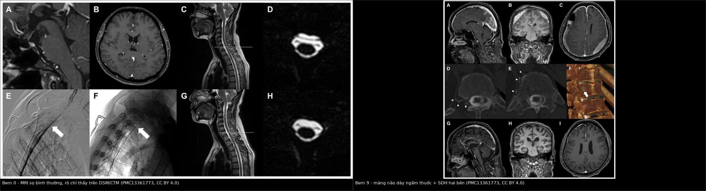
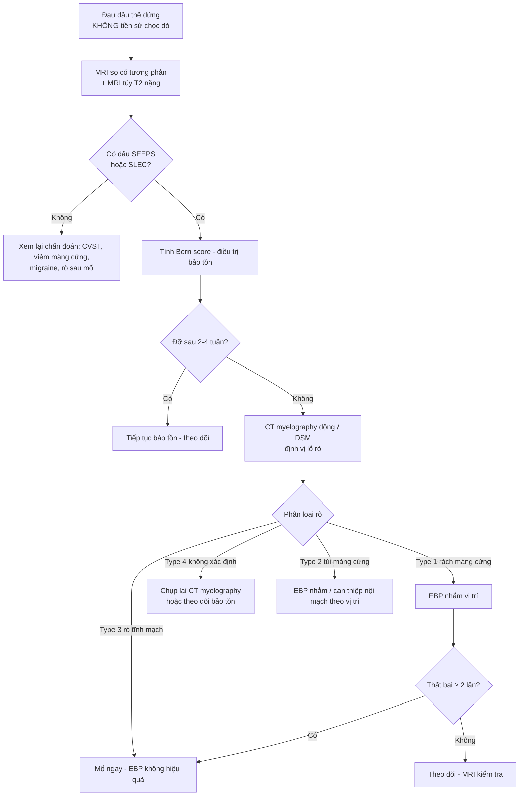
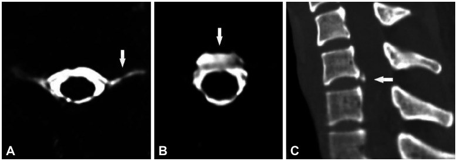
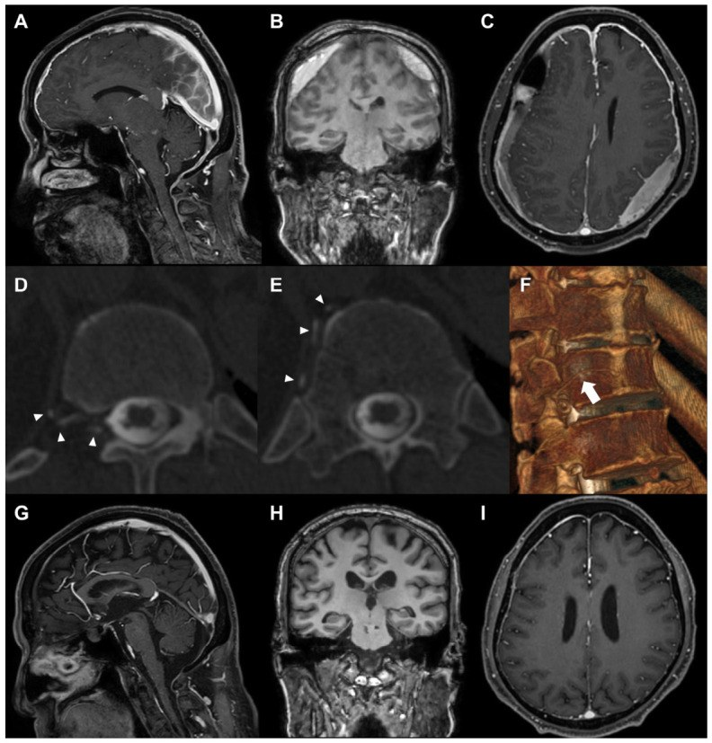
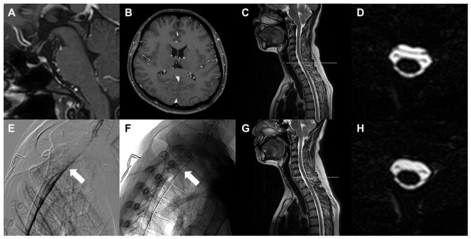
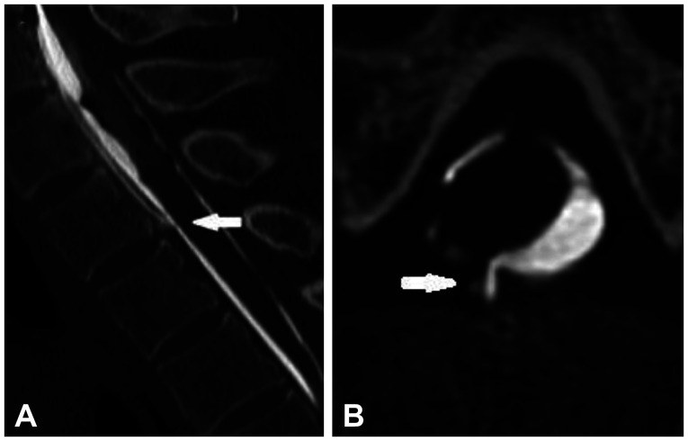

# 3016 — Hạ áp lực nội sọ tự phát (SIH): MRI sọ, định vị rò bằng CT myelography động, blood patch mù vs nhắm vị trí, khi nào mổ

**Tags:** `pattern:dau-dau-the-dung` `pattern:ro-dich-nao-tuy` `pattern:phu-nao-tut` `pattern:tu-mau-duoi-mang-cung` `vung:cot-song-nguc` `vung:noi-so` `score:Bern` `score:SIH-RADS` `protocol:MRI-so-tuong-phan` `protocol:CT-myelography-dong` `protocol:blood-patch`
**Mức chắc chắn (certainty):** tổng hợp y văn (literature synthesis) — ghép **nghiên cứu định vị rò bằng CT myelography siêu nhanh** (PMC13161547), **cohort mổ 23 ca** (PMC13361773), **tái thẩm định Bern score** (PMC12569410), **thang SIH-EBP** (PMC12718939), **cohort tuyến ba 33 ca** (PMC13193629), **tổng quan xu hướng** (PMC13112762) và **2 ca nguyên văn có ảnh** trong PMC13361773. Không phải một ca đơn lẻ nên không gắn nhãn ca nguyên văn.

> **Bài này là “bản không có tiền sử chọc dò” của [3014 – PDPH](../3014-dau-dau-sau-choc-do-tuy-song/lesson.md).** Cùng một chuỗi bệnh sinh (mất thể tích dịch não tủy), nhưng **ba điểm khác quyết định xử trí**: (1) không có mốc thời gian thủ thuật để chẩn đoán → phải **tìm bằng chứng rò**; (2) lỗ rò **tự phát thường ở ngực trên**, không ở thắt lưng → **blood patch mù tại thắt lưng hay thất bại**; (3) **rò dịch não tủy–tĩnh mạch (type 3) gần như không đáp ứng blood patch** → cần mổ.

## 1. Tổng quan bệnh học – cơ chế hình ảnh

- **Định nghĩa:** SIH (spontaneous intracranial hypotension) là hội chứng do **rò dịch não tủy (cerebrospinal fluid, CSF) tự phát** từ khoang dưới nhện ống sống, **không có tiền sử chọc dò, chấn thương hay phẫu thuật cột sống**. Tiêu chuẩn **ICHD-3 (7.2.3)**: đau đầu thế đứng + ≥ 1 trong **cứng cổ, ù tai, giảm thính lực, buồn nôn, sợ ánh sáng, chóng mặt**; kèm **áp lực mở thấp (< 60 mmH₂O)** hoặc **bằng chứng rò trên hình ảnh**. Điểm chốt: **hình ảnh là tiêu chuẩn chẩn đoán, không phải xét nghiệm phụ**.
- **Dịch tễ:** **3–5/100.000 người/năm** (Mỹ), nữ nhiều hơn nam, đỉnh **40 tuổi**; tỉ lệ thật **bị đánh giá thấp** vì chẩn đoán muộn và nhầm với migraine (PMC13112762).
- **Chuỗi sự kiện (giải thích mọi dấu hiệu trên MRI):** rò CSF → **giảm thể tích CSF** → theo **học thuyết Monro–Kellie** (hộp sọ kín, tổng thể tích não + CSF + máu là hằng số) → **tăng thể tích máu nội sọ bù trừ** → **giãn tĩnh mạch màng cứng, cương tuyến yên, giãn xoang tĩnh mạch**, đồng thời **não tụt xuống (brain sag)** vì mất lực nổi.
- **TẠI SAO màng cứng dày ngấm thuốc (pachymeningeal enhancement) — dấu hiệu nhạy nhất:** màng cứng **không có hàng rào máu–não**; khi các tĩnh mạch màng cứng giãn, gadolinium **thoát vào mô kẽ màng cứng** → ngấm thuốc **đối xứng, dày đều, liên tục, KHÔNG chui vào rãnh cuộn não**. Đây là lý do nó khác **ngấm thuốc màng mềm (leptomeningeal)** của viêm màng não mủ/di căn — vốn **đi theo bờ não và rãnh**.
- **TẠI SAO tụt não đo được bằng số:** mất CSF làm não hạ xuống theo trục → **bể trên yên (suprasellar cistern) ≤ 4 mm**, **bể trước cầu (prepontine cistern) ≤ 5 mm**, **khoảng vú–cầu (mamillopontine distance) ≤ 6,5 mm** — đây chính là 3 trong 6 hạng mục của **thang Bern**.
- **TẠI SAO có dịch/máu dưới màng cứng:** não tụt kéo căng **tĩnh mạch cầu nối (bridging veins)** → rách → máu; hoặc chỉ là **dịch rỉ (hygroma)** do chênh áp lực. Trên CT không cản quang: **hygroma 0–15 HU** (đồng đậm độ CSF) vs **máu tụ cấp 60–80 HU**; bán cấp về đồng đậm độ → **dễ đọc là bình thường**.
- **TẠI SAO MRI âm tính ở bệnh nhân vẫn đang rò:** cơ chế bù trừ (tăng sản xuất CSF/giảm lưu lượng rò) làm các dấu hiệu “phản ứng” **mờ dần theo thời gian**. Trong cohort tái thẩm định, **Bern score đạt đỉnh 3,97 vào ngày thứ 50** rồi **giảm dần** (PMC12569410) — nên **MRI muộn âm tính không loại trừ SIH**.
- **Số liệu định lượng phải nhớ:**
  - **Thang Bern (0–9 điểm), 6 hạng mục:** giãn tĩnh mạch **2**; màng não dày ngấm thuốc **2**; bể trên yên **≤ 4 mm = 2**; dịch dưới màng cứng **1**; bể trước cầu **≤ 5 mm = 1**; khoảng vú–cầu **≤ 6,5 mm = 1**. Phân tầng: **≤ 2 = thấp**, **3–4 = trung bình**, **≥ 5 = cao**.
  - **Hiệu lực Bern (45 ca SIH vs 45 chứng, PMC12569410):** ngưỡng gốc **≥ 3 → độ nhạy 42,2%, độ đặc hiệu 95,6%**, **AUC 0,775**; ngưỡng **≥ 5 → nhạy 22,2%, đặc hiệu 100%**; ngưỡng tối ưu theo Youden **≥ 2 → nhạy 66,7%, đặc hiệu 84,4%**. Kết luận của tác giả: **không dùng Bern đơn thuần để sàng lọc**.
  - **Độ nhạy từng dấu hiệu trên MRI sọ:** màng não dày ngấm thuốc **56–59%**, dịch dưới màng cứng **31–36%**, tụt não **44–51%** (tổng hợp trong PMC12569410).
  - **CT myelography siêu nhanh (51 ca, PMC13161547):** kỹ thuật thành công **90,2%** (46/51); **định vị được lỗ rò 95,7%** (44/46); **ngực 95,0%**, trong đó **ngực trên 70%**; **cổ 5,0%**, **thắt lưng 0%**; liều hiệu dụng **23,2 ± 12,1 mSv** (5,1–50,5).
  - **Giá trị của hình ảnh không xâm lấn để “đoán” vị trí rò:** chỉ **12,5%** (5/40) khớp **chính xác** với vị trí thật trên CT myelography → **không đặt blood patch nhắm theo MR myelography**.
  - **Blood patch (EBP) trong SIH:** thang **SIH-EBP ≥ 3** dự báo đáp ứng lần 1 **80,0% vs 41,7%** (P = 0,006); ngưỡng tối ưu **≥ 2, AUC 0,77** (nhạy 52,6%, đặc hiệu 90,0%) (PMC12718939).
  - **Cohort tuyến ba 33 ca (PMC13193629):** đau đầu thế đứng **91%**, màng não dày **90%**, cương tuyến yên **59%**, dịch ngoài màng cứng cột sống **52%**; EBP làm **hết đau lúc xuất viện 80% vs 31%** (P = 0,005) so với điều trị bảo tồn.
  - **Kết quả mổ (23 ca, PMC13361773):** NRS **4,6 → 1,4**; số giờ đứng được/ngày **3 → 12 giờ**; Bern **3,4 → 0,9**; **đau đầu dội ngược (rebound headache) 52,2%**; type 3 **lớn tuổi hơn** (65,3 vs 38,2; P < 0,01).

## 2. Mẫu hình + chẩn đoán phân biệt theo vị trí (gamut)

- **Mẫu hình cốt lõi:** **đau đầu thế đứng + không tiền sử chọc dò + MRI sọ có ≥ 1 dấu hiệu SEEPS**. Mnemonic **SEEPS**: **S**ubdural fluid, **E**nhancement of pachymeninges, **E**ngorgement of venous sinuses, **P**ituitary hyperemia, **S**agging of brain.
- **Gamut theo vị trí lỗ rò** (dùng để chọn tầm chụp — **đừng mặc định thắt lưng**):
  - **Ngực trên (C7/T1–T3/T4): ~70%** — vị trí hay gặp nhất, và **hay bị bỏ sót** vì MR myelography thấy dịch lan xuống thấp hơn lỗ rò.
  - **Ngực giữa – ngực dưới:** ~25%.
  - **Cổ:** ~5% (thường ở C5/6, C6/7).
  - **Thắt lưng:** **0%** trong cohort 44 ca định vị được — nếu “nghi rò thắt lưng”, phải xem lại.
- **Gamut theo cơ chế (phân loại Schievink — quyết định điều trị):**
  - **Type 1 — rách màng cứng mặt trước (ventral dural tear):** thường do **gai xương/đĩa đệm canxi đâm thủng**; đáp ứng một phần với EBP nhắm; **mổ khi thất bại ≥ 2 lần EBP nhắm**.
  - **Type 2 — rò bên qua túi màng cứng (meningeal diverticula):** túi giãn bẩm sinh; EBP nhắm hoặc đặt bóng/stent nội mạch tùy vị trí.
  - **Type 3 — rò dịch não tủy–tĩnh mạch (CSF–venous fistula):** CSF chảy trực tiếp vào **tĩnh mạch cạnh sống** → **mất CSF nhanh, hình ảnh sọ rất nặng**; **EBP hầu như không hiệu quả** → **mổ ngay khi chẩn đoán**, không cần thử EBP trước.
  - **Type 4 — không xác định (indeterminate).**
- **Gamut đau đầu thế đứng (orthostatic headache):** SIH; **PDPH** (3014); rò sau **mổ nền sọ/mở xoang**; **dẫn lưu quá mức van shunt**; mất nước; **huyết khối xoang tĩnh mạch não (CVST)** — đau có thể kiểu tư thế; u hố sau/giãn não thất cấp.
- **Gamut dày màng cứng (pachymeningeal enhancement):** SIH; **viêm màng cứng tăng sinh (IgG4, lao, giang mai)**; **di căn màng cứng**; sau phẫu thuật; sau thẩm phân; **hội chứng tăng áp lực nội sọ tự phát** (khác chiều).

## 3. Bảng so sánh phân biệt (ma trận đối chiếu)

| Thực thể (entity) | Hình ảnh/lâm sàng điển hình | Chốt vào (rule-in) | Chốt loại (rule-out) | Gợi ý xác nhận |
|---|---|---|---|---|
| **SIH** | Đau đầu thế đứng không tiền sử chọc dò; **màng não dày ngấm thuốc đối xứng + tụt não + giãn xoang**; có thể **SDH/hygroma** | **≥ 1 dấu SEEPS + dịch ngoài màng cứng lan dọc trên MR myelography** | **Màng não ngấm thuốc theo rãnh cuộn não (màng mềm) + sốt** → không phải SIH | MRI sọ có tương phản + MRI tủy T2 nặng; **CT myelography động/DSM để định vị** |
| **PDPH** (3014) | Cùng hình ảnh MRI như SIH, nhưng **có chọc dò trong 5 ngày** | **Quan hệ thời gian với chọc dò + đau thế đứng điển hình** | **Không tiền sử thủ thuật** → SIH | Chẩn đoán lâm sàng theo ICHD-3; chụp khi có cờ đỏ |
| **Rò dịch não tủy–tĩnh mạch (type 3)** | Hình ảnh sọ **rất nặng** (Bern cao, SDH tái phát) nhưng **EBP lặp lại thất bại**; thường **ngực dưới/ngực giữa**, tuổi cao hơn | **Thấy thuốc từ khoang dưới nhện chảy vào tĩnh mạch cạnh sống trên CT myelography nằm nghiêng** | **Không thấy đường thông vào tĩnh mạch** → type 1/2 | CT myelography **tư thế nằm nghiêng**; **mổ ngay**, không thử thêm EBP |
| **Rách màng cứng do gai xương (type 1)** | **Gai xương/đĩa canxi** chạm mặt sau thân đốt; dịch ngoài màng cứng **khu trú ngang mức gai** | **Gai xương/đĩa canxi đối diện chỗ rò + dịch ngoài màng cứng khu trú** | **Dịch lan dọc nhiều tầng không có gai xương** → nghĩ type 2/4 | CT myelography + CT xương cùng tư thế |
| **Huyết khối xoang tĩnh mạch não (CVST)** | Đau **liên tục**, tăng khi nằm, có thể co giật/nhìn mờ; **không giảm rõ khi nằm** | **Khuyết thuốc trong xoang trên CTV/MRV** | **CTV/MRV bình thường + đau thế đứng thuần** → SIH | CTV/MRV (CT thường **không đủ**) |
| **Viêm màng cứng tăng sinh (IgG4/lao)** | Màng cứng dày **khu trú hoặc không đối xứng**, có thể **hẹp lỗ thần kinh**, đau **không kiểu tư thế** | **Dày màng cứng không đối xứng + tổn thương thần kinh khu trú + IgG4/lao dương** | **Ngấm thuốc đối xứng + đau thế đứng + đáp ứng EBP** → SIH | MRI + sinh thiết màng cứng; xét nghiệm IgG4, AFB |
| **Di căn màng cứng** | Nốt/dày **không đều**, **ngấm thuốc màng mềm**, có khối nguyên phát | **Nốt màng cứng + ngấm theo rãnh + tiền sử ung thư** | **Đối xứng, đều, không nốt** → SIH | MRI + tế bào học dịch não tủy |
| **Dẫn lưu quá mức van shunt** | Cùng hình ảnh hạ áp lực; **có shunt hoạt động** | **Van shunt + não thất nhỏ + đau thế đứng** | **Không có shunt** → SIH | Kiểm tra van, X-quang shunt series |

*Trái: **Bern 0** — MRI sọ bình thường, nhưng rò vẫn thấy trên chụp tủy (DSM/CT myelography) ở bệnh nhân 55 tuổi đau đầu thế đứng dai dẳng. Phải: **Bern 9** — màng não dày ngấm thuốc, tụ máu dưới màng cứng hai bên, giãn xoang; bệnh nhân 67 tuổi đã **2 lần khoan dẫn lưu SDH và 5 lần EBP** trước khi được chẩn đoán rò type 3. Nguồn: J Clin Med 2026 (PMC13361773), CC BY 4.0; ảnh nguyên bản, ghép letterbox.*

## 4. Protocol chụp + hệ phân độ/điểm chuẩn hóa

- **Bước 1 — MRI sọ có tương phản (chuẩn vàng chẩn đoán):** T1 sau tiêm **3 bình diện** (đo màng cứng, xoang, tuyến yên), T2, **SWI** (tìm **hemosiderin/superficial siderosis** ở ca mạn). **Đo và ghi số 3 khoảng:** bể trên yên, bể trước cầu, khoảng vú–cầu → tính **Bern**.
- **Bước 2 — MRI tủy T2 nặng (MR myelography, không cần tương phản):** tìm **dịch ngoài màng cứng lan dọc (spinal longitudinal extradural collection, SLEC)** và mức dịch nhiều nhất. **Nhớ: đây KHÔNG phải công cụ định vị** — chỉ 12,5% khớp chính xác vị trí rò.
- **Bước 3 — định vị rò (khi cân nhắc EBP nhắm hoặc mổ):**
  - **CT myelography động/siêu nhanh (ultrafast/dynamic CT myelography):** bơm thuốc cản quang nội tủy, chụp nhanh nhiều pha; **thành công kỹ thuật 90,2%**, **định vị 95,7%**; liều **23,2 ± 12,1 mSv** — phải giải thích liều trước khi làm.
  - **Digital subtraction myelography (DSM):** độ phân giải thời gian cao nhất, nhưng **2D** và có **“shoulder problem”** (rò ngực trên/cổ dưới bị vai che) → **thường phối hợp với CT myelography**.
  - **Tư thế:** **nằm nghiêng (lateral decubitus) hoặc sấp** tùy nghi type 3 (rò tĩnh mạch chỉ chảy khi tư thế làm tăng chênh áp).
  - **SIH-RADS** (Spontaneous Intracranial Hypotension Reporting and Data System) dùng để chuẩn hóa báo cáo: **5 = thấy đường thông thẳng giữa khoang dưới nhện và ổ thuốc ngoài màng cứng**; **4 = thuốc rò quanh mức thoát vị tủy**; **1 = âm tính** (mô tả 2–3 chưa rõ trong nguồn đã đọc — cần tra bản gốc SIH-RADS).
- **Bước 4 — điều trị theo bậc:**
  - **Bảo tồn:** nằm nghỉ, hydrat hóa, caffeine, giảm đau; **tránh rặn/nâng nặng**.
  - **EBP mù tại thắt lưng:** vẫn là bước đầu ở nhiều nơi (rẻ, ít xâm lấn) nhưng **tỉ lệ thành công thấp hơn PDPH** và **không sửa được rò type 3**. Dùng **thang SIH-EBP** để tư vấn: **≥ 3 điểm → đáp ứng lần 1 ~80%**; **< 3 → ~42%**.
  - **EBP nhắm vị trí (targeted EBP):** sau khi định vị bằng CT myelography; là **điều kiện tiên quyết trước khi cân nhắc mổ type 1** (thường sau **≥ 2 lần** thất bại).
  - **Mổ (dural repair/ligation):** **type 1** sau ≥ 2 EBP nhắm thất bại; **type 3 mổ ngay khi chẩn đoán** (EBP không hiệu quả về cơ chế). Kết quả cohort: NRS **4,6 → 1,4**, giờ đứng **3 → 12 giờ/ngày**; **52,2% đau đầu dội ngược** sau mổ (tự giới hạn, không phải thất bại).
- **Sơ đồ xử trí:**

## 5. Biến thể bình thường và cạm bẫy

- **Bern 0 KHÔNG loại trừ SIH.** Ca 55 tuổi trong PMC13361773 có **MRI sọ hoàn toàn bình thường (Bern 0)** mà vẫn rò type 1; chẩn đoán chỉ nhờ **DSM/CT myelography**. Vì vậy: **đau đầu thế đứng điển hình + MRI âm tính → vẫn phải chụp tủy**.
- **MRI muộn dễ âm tính:** Bern đạt đỉnh **ngày 50** rồi giảm; bệnh nhân được chụp sau nhiều tháng có thể **chỉ còn Bern 1–2**. Hỏi **thời điểm chụp so với khởi phát** trước khi bác bỏ chẩn đoán.
- **Đừng “chữa” SDH mà bỏ rò:** ca type 3 đã **khoan dẫn lưu SDH 2 lần** và **5 lần EBP** trước khi được định vị rò. Ở người già có SDH “tự phát”, **luôn hỏi đau đầu thế đứng** trước khi khoan — nếu không, SDH tái phát.
- **MR myelography không định vị được lỗ rò:** dịch ngoài màng cứng **lan xuống thấp hơn** lỗ rò theo trọng lực; chỉ **12,5%** khớp chính xác. Đặt EBP theo “chỗ dịch nhiều nhất” là **nhắm sai**.

*(A) Ổ dịch ngoài màng cứng lớn nhất trên MR myelography; (B) chỗ dịch dày nhất; (C) gai xương/đĩa canxi rõ nhất trên CT xương — ba “manh mối” này thường **không trùng** vị trí rò thật. Nguồn: J Clin Neurol 2026;22:355–363 (PMC13161547), Fig. 1, CC BY-NC 4.0.*
- **“Shoulder problem” của DSM:** rò ở **ngực trên và cổ dưới** bị bóng vai che → nếu DSM âm tính mà lâm sàng mạnh, **làm CT myelography**.
- **Đau đầu dội ngược sau vá (52,2%)** là hiện tượng **tăng áp lực tạm thời**, không phải rò tái phát → **không vội làm EBP lần nữa**; theo dõi, có thể dùng acetazolamide theo chỉ định chuyên khoa.
- **Biến chứng mạn nếu bỏ sót:** **superficial siderosis**, **sa sút trí tuệ thể trán–thái dương**, **teo cơ hai tay (bibrachial amyotrophy)**, **CVST**, **thoát vị não** — đây là lý do **không được “sống chung” với SIH** nhiều năm.
- **Cạm bẫy chẩn đoán phân biệt:** gắn nhãn “migraine/lo âu/mất nước” cho đau đầu thế đứng ở người trẻ là sai lầm hay gặp nhất; và ngược lại, **dày màng cứng không đối xứng + đau liên tục** phải nghĩ **viêm màng cứng/IgG4/di căn**, không phải SIH.

## 6. Tự lượng giá — Blind Quiz

**Ca 1 — Nam 67 tuổi, 4 tháng đi lại khó, đau đầu thế đứng và sa sút nhận thức. Đã 2 lần khoan dẫn lưu SDH và 5 lần blood patch.**

- Gợi ý: SDH tái phát nhiều lần dù đã dẫn lưu; không có tiền sử chọc dò tủy sống.
- Câu hỏi: Mô tả 3 dấu hiệu trên A–C? Bern score bao nhiêu? Vì sao blood patch thất bại 5 lần? Bước tiếp theo?

<b>Bấm để hiện đáp án (findings + chẩn đoán)</b>

- **Dấu hiệu:** (A) **màng não dày ngấm thuốc** dọc lều và liềm; (B, C) **tụ máu dưới màng cứng mạn hai bên**, xoang tĩnh mạch giãn, não tụt → **Bern 9/9**.
- **(D, E)** CT myelography **tư thế nằm nghiêng**: thuốc thoát từ **túi màng cứng T12–L1 phải vào tĩnh mạch cạnh sống** → **rò dịch não tủy–tĩnh mạch (type 3)**; (F) dựng hình 3D xương xác nhận mức rò.
- **Vì sao 5 lần EBP thất bại:** rò **đổ trực tiếp vào tĩnh mạch**, máu ngoài màng cứng **không bịt được đường thông nội mạch** — EBP không hiệu quả về mặt cơ chế ở type 3.
- **Xử trí:** **mổ ligation đường rò** ngay khi chẩn đoán (không cần thử thêm EBP). (G–I) MRI sau mổ: **hết dày màng cứng, hết SDH, Bern về 0**.
- Nguồn ảnh: J Clin Med 2026;15:4972 (PMC13361773), Fig. 4, CC BY 4.0.

**Ca 2 — Nữ 55 tuổi, đau đầu thế đứng dai dẳng nhiều tháng. MRI sọ bình thường.**

- Gợi ý: đã được chẩn đoán migraine và điều trị nhiều tháng không đỡ; không sốt, không dấu thần kinh khu trú.
- Câu hỏi: MRI sọ có loại trừ SIH không? Bern score? Cần làm gì tiếp?

<b>Bấm để hiện đáp án (findings + chẩn đoán)</b>

- **Dấu hiệu:** (A, B) màng não **không dày**, không tụt não, không dịch dưới màng cứng → **Bern 0**; (C, D) MRI tủy **không thấy bất thường rõ**.
- **Chẩn đoán:** vẫn là **SIH type 1** — (E) **DSM** thấy dòng thuốc thoát ra (mũi tên), (F) **CT myelography** xác nhận vị trí rách màng cứng; (G, H) sau vá: hết rò.
- **Bài học:** **Bern 0 không loại trừ SIH** (độ nhạy ngưỡng ≥ 3 chỉ 42,2%); **đau đầu thế đứng điển hình + MRI âm tính vẫn phải chụp tủy động**.
- Nguồn ảnh: J Clin Med 2026;15:4972 (PMC13361773), Fig. 3, CC BY 4.0.

**Ca 3 — Nữ 42 tuổi, đau đầu thế đứng 8 tháng, 4 lần blood patch mù tại thắt lưng không đỡ.**

- Gợi ý: MR myelography thấy dịch ngoài màng cứng nhiều nhất ở **ngực dưới**, nhưng vị trí này không khớp với lỗ rò thật.
- Câu hỏi: Dấu hiệu trên A và B? Đây là SIH-RADS mấy? Vì sao blood patch mù thất bại?

<b>Bấm để hiện đáp án (findings + chẩn đoán)</b>

- **Dấu hiệu:** (A) mặt phẳng **dọc**: **đường thông thẳng** giữa ổ thuốc **trong màng cứng** và **ngoài màng cứng** (mũi tên); (B) mặt phẳng **ngang**: thuốc ngoài màng cứng tụ cạnh ống sống → **SIH-RADS 5**.
- **Vì sao thất bại:** lỗ rò ở **ngực trên** (70% các ca), trong khi blood patch mù được đặt ở **thắt lưng** → máu không tới được chỗ rách; và MR myelography **chỉ khớp chính xác 12,5%**.
- **Xử trí:** **EBP nhắm vị trí** dưới hướng dẫn CT/fluoroscopy tại đúng mức; nếu thất bại ≥ 2 lần → cân nhắc **vá màng cứng**.
- Nguồn ảnh: J Clin Neurol 2026;22:355–363 (PMC13161547), Fig. 2, CC BY-NC 4.0 (nguyên bản, không crop).

## Bài liên quan chéo
- [3014 – Đau đầu sau chọc dò tủy sống (PDPH)](../3014-dau-dau-sau-choc-do-tuy-song/lesson.md) — bản “có tiền sử chọc dò”, cùng cơ chế
- [3013 – Hội chứng đuôi ngựa sau mổ cột sống](../3013-hoi-chung-duoi-ngua-sau-mo-cot-song/lesson.md) — biến chứng cột sống hậu phẫu
- [3012 – Áp-xe ngoài màng cứng sau gây tê ngoài màng cứng](../3012-apxe-ngoai-mang-cung-sau-gay-te-ngoai-mang-cung/lesson.md) — chống chỉ định EBP khi nhiễm trùng
- [258 – Áp-xe ngoài màng cứng do lây từ ổ loét tì đè](../258-apxe-ngoai-mang-cung-loet-ti-de-cung-cut/lesson.md)
- [200 – Tổng quan hệ Thần kinh](../200-tong-quan-he-than-kinh/lesson.md)

## Ảnh
- Tên file: `3016_*.jpg`; composite: `images/composite_bern-0-vs-9.jpg` (tạo bằng `tools/make_composite.py`, letterbox, không crop/kéo giãn).
- Nguồn + giấy phép từng ảnh: `images/CREDITS.md`; link gốc trong `sources.md`.
- Ảnh PMC13361773 là **CC BY 4.0** (ghép composite được); ảnh PMC13161547 là **CC BY-NC 4.0** — dùng cho giáo dục phi thương mại, giữ nguyên bản.

> Không dùng để chẩn đoán độc lập khi chưa có người hướng dẫn.
