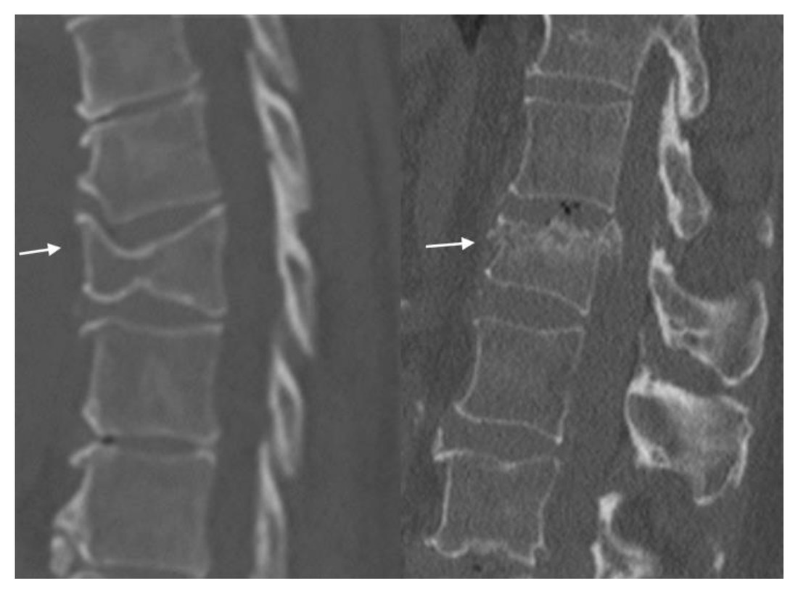
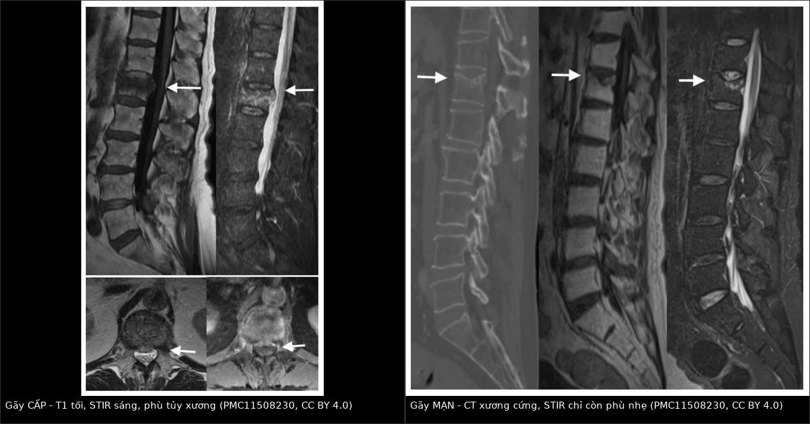
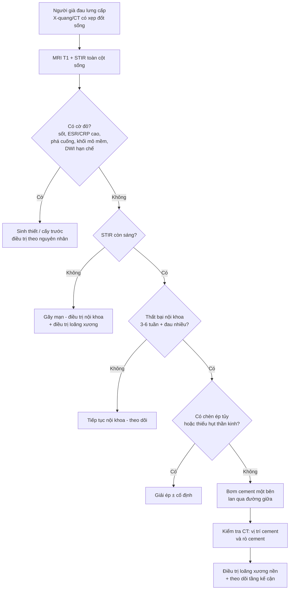
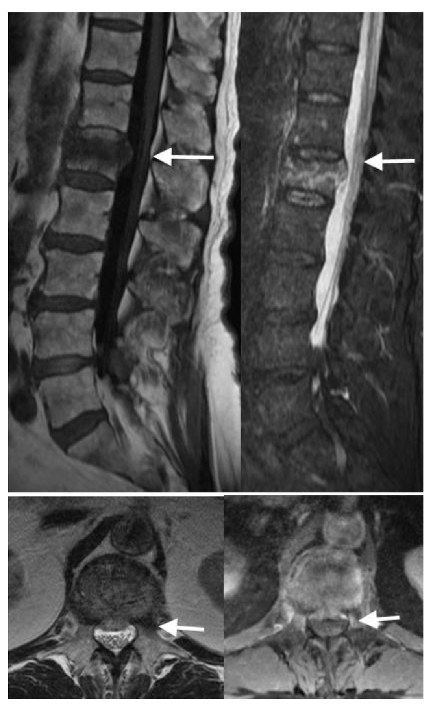
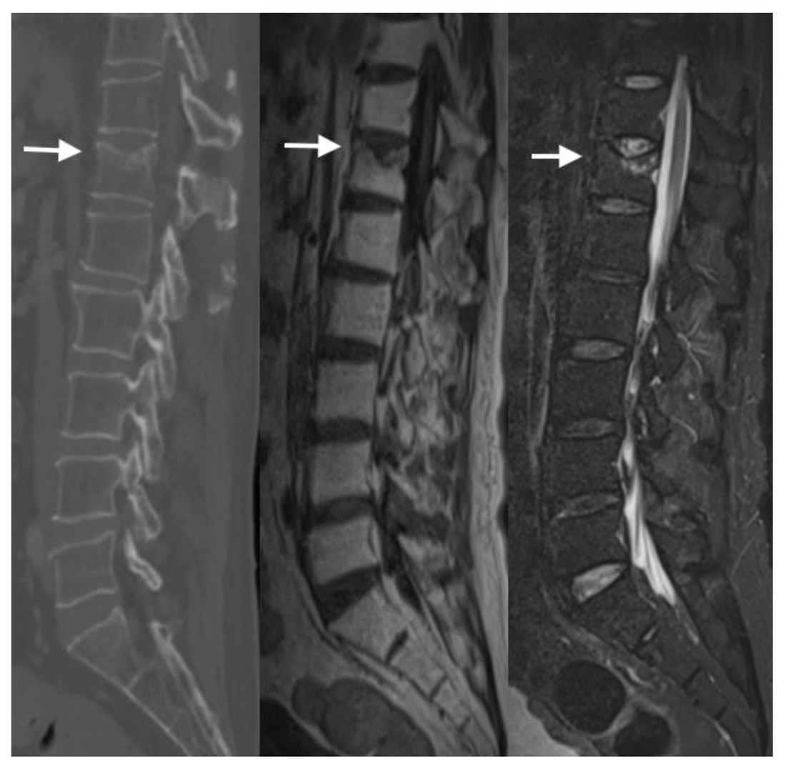
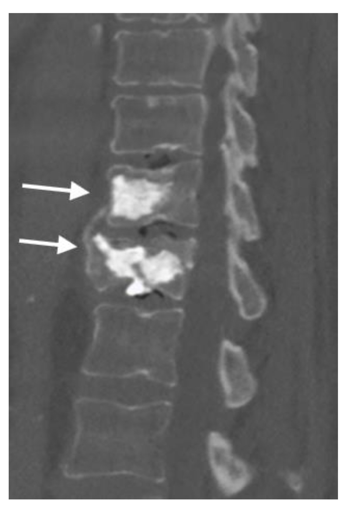
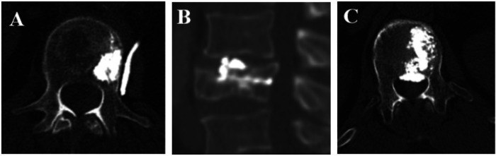

# 3017 — Gãy nén đốt sống do loãng xương: cấp – mạn – bệnh lý trên MRI/STIR, chỉ định bơm xi măng, rò cement

**Tags:** `pattern:gay-nen` `pattern:xep-dot-song` `pattern:phu-tuy-xuong` `pattern:ro-cement` `vung:cot-song-nguc` `vung:cot-song-that-lung` `score:Genant` `protocol:MRI-STIR` `protocol:vertebroplasty` `incidentaloma:gay-dot-song`
**Mức chắc chắn (certainty):** tổng hợp y văn (literature synthesis) — ghép **tổng quan chẩn đoán hình ảnh gãy nén** (PMC11508230, có ảnh), **phân tích gộp 9 RCT kyphoplasty vs vertebroplasty** (PMC13480986), **cohort 425 ca bơm xi măng một bên** (PMC13099904), **cohort 153 ca so sánh VP ± dụng cụ** (PMC13435515) và **loạt 4 ca gãy bệnh lý bị chẩn đoán nhầm là loãng xương** (PMC13288042). Nhiều nguồn, không phải một ca → không gắn nhãn ca nguyên văn.

> **Bài này trả lời câu hỏi thực hành hay gặp nhất ở người già đau lưng cấp: “có bơm xi măng hay không?”** Câu trả lời **không** nằm ở mức xẹp trên X-quang, mà ở **còn phù tủy xương trên STIR hay không** — và ở việc đã **loại trừ gãy bệnh lý/nhiễm trùng** chưa. Nối [3015 – FBSS](../3015-hoi-chung-dau-sau-mo-cot-song/lesson.md) (gãy tầng kế cận sau dụng cụ) và [309 – Loét tì đè & viêm xương tủy](../309-loet-ti-de-viem-xuong-tuy-spina-bifida-nguoi-lon/lesson.md) (nhiễm trùng xương).

## 1. Tổng quan bệnh học – cơ chế hình ảnh

- **Dịch tễ:** loãng xương ảnh hưởng **~21,7% người cao tuổi** trên toàn cầu (PMC13435515); **gãy nén đốt sống (osteoporotic vertebral compression fracture, OVCF)** là loại gãy xương do loãng xương hay gặp nhất và là **biến cố mở đầu “thác đổ gãy xương” (fracture cascade)** — mỗi gãy làm tăng nguy cơ gãy tiếp.
- **Cơ chế:** mất khối lượng xương trabecular + mỏng vỏ xương → thân đốt sống **chịu lực nén kém**, trong khi cột trước chịu tải nhiều hơn cột sau → **gãy hình nêm (wedge)** mặt trước là kiểu phổ biến nhất; lực đủ mạnh hơn → **biconcave** (lõm hai mặt khớp) hoặc **crush** (xẹp toàn bộ); vỡ cả thành sau → **burst**.
- **TẠI SAO MRI/STIR là trọng tài “cấp hay mạn”:** gãy cấp gây **phù tủy xương (bone marrow edema)** = tăng nước tự do + tăng tưới máu/viêm → **T1 giảm tín hiệu** (nước kéo dài T1) và **STIR tăng tín hiệu rất mạnh** (chuỗi nhạy nước + **xóa tín hiệu mỡ tủy** nên chỉ còn nước là sáng). Gãy mạn: tủy **xơ hóa/xẹp + thay mỡ** → **STIR không còn sáng** (xơ: tối; mỡ: bị xóa tín hiệu).
- **TẠI SAO “còn sáng STIR” chưa chắc là “gãy mới trong 2 tuần”:** phù tủy **giảm dần trong nhiều tuần đến nhiều tháng**; trong ca minh họa của PMC11508230, đốt sống gãy **vẫn còn phù nhẹ trên STIR sau nhiều tháng**, chỉ là **giảm rõ so với phim trước**. Vì vậy phải hỏi **thời điểm khởi phát đau** và **so phim cũ**, không chỉ nhìn STIR.
- **TẠI SAO gãy lành tính vẫn ngấm thuốc:** phản ứng viêm/sửa chữa làm **tăng tưới máu** trong thân đốt → **ngấm thuốc không đều, “loang lổ”** sau tiêm. Đây là **phản ứng bình thường**, **không đồng nghĩa gãy ác tính** nếu không có dấu hiệu khác (PMC11508230, Fig. 8).
- **TẠI SAO Kümmell khác gãy thường:** thiếu máu vùng thân đốt → **hoại tử vô khuẩn, không liền xương** → tạo **khe khí trong đốt sống (intravertebral vacuum)**: trên CT là **khí −1000 đến −400 HU** (đen tuyệt đối), trên MRI là **khe dịch T2 sáng**. Đây là **gãy không liền**, đau dai dẳng, **xẹp tiến triển** — chỉ định can thiệp khác gãy cấp thường.
- **TẠI SAO bơm xi măng giảm đau:** PMMA **ổn định vi cấu trúc** đốt sống bị nứt (giảm vi chuyển động của mảnh gãy) + **nhiệt/độc tính hóa học** lên đầu mút thần kinh trong xương; giảm đau thường **trong 24–72 giờ**, và so với điều trị nội khoa, cải thiện đau – chức năng – chất lượng sống rõ **trong 3 tháng đầu** (PMC11508230).
- **Số liệu định lượng phải nhớ:**
  - **Phân độ Genant (mức mất chiều cao):** **độ 1 < 25%**, **độ 2 = 25–40%**, **độ 3 > 40%**; **độ 0 = bình thường**.
  - **Phân tích gộp 9 RCT (1.116 bệnh nhân, tuổi trung bình 71,6; PMC13480986):** VAS và ODI **tương đương** giữa kyphoplasty (KP) và vertebroplasty (VP); **rò cement thấp hơn có ý nghĩa ở KP**; **thời gian mổ 48 phút (KP) vs 37 phút (VP)**; biến chứng nặng **không khác biệt**, thuyên tắc phổi **1 ca mỗi nhóm** ở nghiên cứu Dohm.
  - **Cohort 425 ca VP một bên (PMC13099904):** VAS **7,63 ± 0,84 → 3,31 ± 1,06**, mức giảm trung bình **4,32 ± 1,38**; **biến chứng 45,4%** (chủ yếu **rò cement**, **không có di chứng thần kinh vĩnh viễn**).
  - **Vị trí cement quyết định giảm đau (cùng cohort):** vùng **4 (bờ bên đối diện) giảm VAS 5,48 ± 1,00**, vùng **1 (bờ bên cùng phía chọc) chỉ 2,41 ± 0,73** → **cần lan qua đường giữa**, không chỉ bơm một chỗ.
  - **VP + dụng cụ (153 ca, PMC13435515):** VP + vít xi măng giảm **xẹp cột trước** ở 6 tháng, **OR hiệu chỉnh 0,147** (95% CI 0,043–0,502; P = 0,0022); **lỏng vít 6/75** ca, không phải mổ lại.
  - **Gãy bệnh lý bị chẩn đoán nhầm (4 ca, PMC13288042):** 1 **nhiễm khuẩn sinh mủ**, 1 **lao cột sống**, 1 **brucella**, 1 **đa u tủy**; **DWI phân biệt ác tính vs loãng xương: độ nhạy 86%, độ đặc hiệu 91%**.

## 2. Mẫu hình + chẩn đoán phân biệt theo vị trí (gamut)

- **Mẫu hình cốt lõi:** người **> 60 tuổi**, đau lưng **cấp, tăng khi đứng/ngồi, giảm khi nằm**, **không sốt**, **không dấu thần kinh**, X-quang/CT có **xẹp hình nêm**; MRI **STIR sáng** ở đúng mức xẹp.
- **Gamut theo hình thái (giúp đoán cơ chế):**
  - **Wedge (nêm trước):** loãng xương điển hình, cột trước chịu nén.
  - **Biconcave (lõm hai mặt khớp):** loãng xương, đĩa đệm đẩy vào thân đốt.
  - **Crush (xẹp toàn bộ):** loãng xương nặng hoặc bệnh lý; **phải loại trừ ác tính**.
  - **Burst (vỡ thành sau):** chấn thương năng lượng cao; **nguy cơ chèn ép tủy** — khác hoàn toàn OVCF đơn thuần.

*Trái: **T8 xẹp hình nêm** mức trung bình. Phải: **L1 gãy vỡ (burst) bờ trên, mất chiều cao ~40%**. Xương **giảm mật độ lan tỏa** — nền loãng xương rõ. Nguồn: J Imaging 2024;10:244 (PMC11508230), Fig. 2, CC BY 4.0.*

- **Gamut theo tín hiệu STIR (quyết định can thiệp):**
  - **STIR sáng mạnh, T1 tối:** OVCF **cấp/bán cấp**; gãy **bệnh lý do ung thư**; **viêm đĩa–đốt sống**; **Kümmell đang hoạt động**.
  - **STIR không sáng (hoặc sáng rất nhẹ), T1 tối + xơ:** OVCF **mạn/đã liền**; **di căn xơ hóa** (ít gặp).
  - **STIR sáng + T1 sáng:** thay mỡ (gãy cũ đã lành) hoặc **hemangioma** — không phải gãy cấp.
- **Gamut “gãy bệnh lý giả loãng xương” — 4 nhóm phải loại trừ trước khi bơm cement:** **đa u tủy/di căn**, **lao cột sống**, **brucella**, **nhiễm khuẩn sinh mủ**. Dấu hiệu gợi ý: **tổn thương cuống sống (pedicle sign)**, **bờ sau thân đốt lồi ra (posterior convex)**, **khối mô mềm cạnh sống**, **lan ngoài màng cứng**, **nhiều tầng**, **phá vỏ xương**, **bất thường dịch tễ/sốt**, **ESR/CRP tăng, A/G giảm**.

## 3. Bảng so sánh phân biệt (ma trận đối chiếu)

| Thực thể (entity) | Hình ảnh điển hình | Chốt vào (rule-in) | Chốt loại (rule-out) | Gợi ý xác nhận |
|---|---|---|---|---|
| **OVCF cấp/bán cấp** | Xẹp nêm/biconcave, **STIR sáng mạnh**, T1 tối; **không phá cuống, không khối mô mềm** | **STIR sáng đúng mức xẹp + đau cấp + không cờ đỏ** | **Phá cuống/bờ sau lồi/khối cạnh sống** → không phải OVCF đơn thuần | MRI T1 + STIR; **DXA**; theo dõi 4–6 tuần |
| **OVCF mạn/đã liền** | Xẹp giữ nguyên, **xơ hóa**, **STIR không sáng**, T1 tối | **STIR âm + phim cũ không đổi + đau cơ học mạn** | **STIR sáng mạnh** → còn hoạt động | So phim cũ; **không bơm cement** |
| **Kümmell (hoại tử vô khuẩn)** | **Khe khí (−1000 đến −400 HU) hoặc khe dịch T2 sáng** trong thân đốt; xẹp tiến triển | **Khe khí/khe dịch trong đốt + xẹp tăng dần** | **Khe khí + phá hủy cuống/mô mềm + ESR cao** → nghĩ nhiễm trùng (ca brucella) | CT (khí) + MRI (dịch); cân nhắc sinh thiết |
| **Gãy do ung thư (di căn/đa u tủy)** | **Phá cuống (pedicle sign)**, **bờ sau lồi**, khối mô mềm, nhiều tầng; **T1 thay tủy lan rộng**; **DWI hạn chế** | **Phá cuống/bờ sau lồi/khối cạnh sống + DWI hạn chế (Se 86%, Sp 91%)** | **Khe khí + không phá cuống + STIR đúng mức xẹp** → ít nghĩ ác tính | MRI + **DWI/ADC**; **điện di miễn dịch**, sinh thiết khi bơm cement |
| **Viêm đĩa–đốt sống (sinh mủ)** | **Hẹp đĩa + phù hai đốt kề + phá mặt khớp + mô mềm cạnh sống**; sốt, ESR/CRP cao | **Phù/hủy hai bờ đốt kề đĩa + sốt + CRP > 10 mg/L** | **Chỉ một đốt, đĩa bình thường** → OVCF | MRI + **cấy máu/sinh thiết**; **không bơm cement trước khi loại trừ** |
| **Lao cột sống** | Xẹp **một hoặc nhiều đốt**, **áp-xe cạnh sống**, **phá hủy mặt khớp**, đĩa có thể còn | **Áp-xe cạnh sống + phá hủy + T-SPOT dương + ESR cao** | **Không áp-xe, không phá hủy** → OVCF | MRI + **T-SPOT**, sinh thiết (Langhans, AFB) |
| **Brucella cột sống** | Xẹp + **khe giống Kümmell**, **bào mòn bờ đốt**, đau tăng dần | **Dịch tễ (chăn nuôi/sữa tươi) + huyết thanh brucella dương + ESR 50** | **Huyết thanh âm + không bào mòn** → ít nghĩ brucella | **Rose Bengal/huyết thanh**, MRI |
| **Burst do chấn thương** | Vỡ **thành sau**, mảnh xương vào ống sống, hẹp ống sống | **Mảnh thành sau + hẹp ống sống + cơ chế chấn thương** | **Thành sau nguyên vẹn** → OVCF | CT dựng hình + MRI (đánh giá tủy) |

*Trái: **gãy CẤP** — T1 tối, **STIR sáng mạnh** trong thân đốt L1, kèm hình ảnh cắt ngang cho thấy **mảnh thành sau đẩy vào ống sống 0,6 cm**. Phải: **gãy MẠN** — CT xương **cứng/xơ**, T1 tối do xơ, **STIR chỉ còn phù nhẹ** (đã giảm rõ so với phim trước). Nguồn: J Imaging 2024;10:244 (PMC11508230), CC BY 4.0; ảnh nguyên bản, ghép letterbox.*

## 4. Protocol chụp + hệ phân độ/điểm chuẩn hóa

- **Trình tự chẩn đoán:**
  1. **X-quang cột sống (thẳng + nghiêng):** phát hiện xẹp, đo chiều cao, so phim cũ.
  2. **CT cột sống:** đánh giá **vỏ xương, cuống sống, thành sau, khe khí**; cần khi nghi bệnh lý hoặc trước can thiệp.
  3. **MRI toàn cột sống T1 + STIR (bắt buộc trước khi quyết định bơm cement):** xác định **còn phù tủy hay không**, tìm **tổn thương thứ hai**, **chèn ép tủy**, **áp-xe/mô mềm**.
  4. **MRI có tương phản:** **chỉ khi nghi nhiễm trùng/ác tính** — nhớ **gãy lành tính vẫn ngấm thuốc**, nên **không dùng ngấm thuốc đơn thuần để chẩn đoán ác tính**.
  5. **DXA + FRAX:** xác định loãng xương, quyết định điều trị nền (không bỏ qua — bơm cement không điều trị loãng xương).
- **Phân độ Genant** (mất chiều cao thân đốt so với đốt kề): **độ 1 < 25%**, **độ 2 25–40%**, **độ 3 > 40%**; ghi kèm **kiểu** (nêm/biconcave/crush) và **mức**.
- **Chỉ định bơm xi măng (vertebroplasty/kyphoplasty):**
  - **OVCF cấp/bán cấp có phù tủy trên STIR**, đau **trung bình–nặng**, **thất bại điều trị nội khoa 3–6 tuần** (giảm đau, dụng cụ chỉnh hình, tập).
  - **Kümmell/không liền xương** có khe khí/dịch, xẹp tiến triển, đau dai dẳng.
  - **Không có dấu thần kinh khu trú**, **không nhiễm trùng**, **không rối loạn đông máu**.
- **Chống chỉ định / chuyển mổ hở:**
  - **Nhiễm trùng tại chỗ hoặc toàn thân**, **sốt chưa rõ nguyên nhân**.
  - **Burst có mảnh thành sau chèn ép tủy, hẹp ống sống, thiếu hụt thần kinh** → **giải ép ± cố định**, không bơm đơn thuần.
  - **Gãy bệnh lý chưa có chẩn đoán mô học** — nếu vẫn can thiệp, **làm sinh thiết tủy xương trong lúc bơm** (khuyến cáo của PMC13288042).
  - **Rối loạn đông máu nặng**, **dị ứng thuốc cản quang/cement**.
- **Kỹ thuật & chất lượng:**
  - **Một bên (unipedicular)** là chuẩn; kiểm tra **lan qua đường giữa** trên AP.
  - **Vị trí cement quan trọng hơn thể tích:** vùng **4 (bờ bên đối diện)** giảm đau tốt nhất (**5,48 điểm VAS**), vùng **1 (cùng phía chọc) kém nhất (2,41)**.
  - **KP vs VP:** hiệu quả đau – chức năng **tương đương**, **KP ít rò cement hơn**, mổ **lâu hơn ~11 phút** (48 vs 37).
  - **Xẹp cột trước tiến triển sau VP:** cân nhắc **VP + vít xi măng** (OR 0,147 cho xẹp cột trước ở 6 tháng) ở ca mất vững.
- **Sơ đồ quyết định:**

## 5. Biến thể bình thường và cạm bẫy

- **Ngấm thuốc không phải là ác tính.** Gãy lành tính **ngấm thuốc loang lổ** do tăng tưới máu; dùng ngấm thuốc đơn thuần để chẩn đoán ung thư là **dương tính giả** (PMC11508230, Fig. 8).
- **STIR sáng không đồng nghĩa “mới trong 2 tuần”.** Phù tủy tồn tại **nhiều tuần đến nhiều tháng**; ca gãy mạn vẫn còn **phù nhẹ** trên STIR. Hỏi **ngày khởi phát đau** + **so phim cũ** trước khi kết luận cấp.
- **Khe khí trong đốt sống không chỉ là Kümmell.** Ca **brucella** (74 tuổi, ESR 50 mm/h) bị chẩn đoán nhầm **Kümmell** vì có **khe giống dịch trong đốt + bào mòn bờ đốt**. Khe khí + **bào mòn/phá hủy + ESR cao** → **nghĩ nhiễm trùng**, không bơm cement đơn thuần.
- **Bốn ca gãy bệnh lý bị bơm cement như gãy loãng xương** (nhiễm khuẩn sinh mủ, lao, brucella, đa u tủy): điểm chung là **không sốt, không phá hủy rõ, không khối mô mềm** → “quá sạch” cũng là cạm bẫy. **Cờ đỏ theo PMC13288042:** **ESR > 30 mm/h**, **CRP > 10 mg/L**, **A/G < 1,5**, **phá vỏ/cuống/mô mềm cạnh sống**, **không khớp giữa lâm sàng – xét nghiệm – hình ảnh** → **sinh thiết tủy xương khi bơm cement**.
- **Rò cement — 45,4% trên hình ảnh nhưng phần lớn im lặng:** phân biệt **rò tĩnh mạch** (nguy cơ **thuyên tắc phổi**, có thể xuất hiện **muộn 2 năm**), **rò vào đĩa đệm** (nguy cơ **gãy tầng kế cận**), **rò ngoài màng cứng** (nguy cơ **chèn ép tủy**), **rò cạnh sống**. Báo cáo **vị trí + hướng rò** trên CT kiểm tra, không chỉ ghi “có rò”.
- **Bơm nhiều cement không đồng nghĩa giảm đau nhiều:** **phân bố** (lan qua đường giữa) quan trọng hơn **thể tích**; bơm thêm chỉ tăng nguy cơ rò.
- **Bỏ qua điều trị loãng xương nền:** bơm cement chỉ chữa **một đốt đang đau**; không dùng bisphosphonate/denosumab + canxi/vitamin D + tập tải trọng thì **gãy tầng kế cận** là hệ quả tất yếu (xem 3015).
- **Không bơm cement cho gãy burst có mảnh thành sau** — nguy cơ **đẩy mảnh vào ống sống**; ca có **retropulsion 0,6 cm** trong bài là ví dụ phải đánh giá thần kinh trước.

## 6. Tự lượng giá — Blind Quiz

**Ca 1 — Nữ 72 tuổi, đau lưng cấp 3 tuần sau bê vật nặng, không sốt, không yếu chân. X-quang thấy L1 xẹp.**

- Gợi ý: mất chiều cao khoảng 25–40%; đau tăng khi đứng, giảm khi nằm; chưa dùng giảm đau đều.
- Câu hỏi: Mô tả tín hiệu trên T1 và STIR? Có gì ở lát cắt ngang? Có chỉ định bơm cement ngay không?

<b>Bấm để hiện đáp án (findings + chẩn đoán)</b>

- **Dấu hiệu:** (trên trái) **T1 giảm tín hiệu** trong thân L1; (trên phải) **STIR tăng tín hiệu mạnh** → **phù tủy xương = gãy cấp/bán cấp**; (dưới trái) lát T2 ngang: **mảnh thành sau đẩy vào ống sống 0,6 cm**, hẹp ống sống mức trung bình, **chen chật rễ đuôi ngựa**; (dưới phải) T1 sau tiêm: **ngấm thuốc không đều — phản ứng, bình thường**.
- **Chẩn đoán:** **OVCF cấp L1, Genant độ 2, có retropulsion 0,6 cm nhưng chưa có thiếu hụt thần kinh**.
- **Xử trí:** **chưa bơm cement ngay** — cần (1) **khám thần kinh** kỹ, (2) **thử nội khoa 3–6 tuần** nếu đau kiểm soát được; nếu đau không kiểm soát và **không có chèn ép tủy** → **vertebroplasty/kyphoplasty**; nếu **yếu chân/bí tiểu** → **giải ép**.
- Nguồn ảnh: J Imaging 2024;10:244 (PMC11508230), Fig. 7, CC BY 4.0.

**Ca 2 — Nam 78 tuổi, đau lưng âm ỉ 1 năm, không đợt cấp. X-quang T12 xẹp nhẹ, không thay đổi so với 2 năm trước.**

- Gợi ý: đau kiểu cơ học, không đau về đêm, không sụt cân; đã vật lý trị liệu nhiều đợt.
- Câu hỏi: Tín hiệu STIR nói gì? Có chỉ định bơm xi măng không? Vì sao?

<b>Bấm để hiện đáp án (findings + chẩn đoán)</b>

- **Dấu hiệu:** (trái) CT: **xẹp nhẹ bờ trên T12, bờ xương cứng/xơ**; (giữa) T1: **giảm tín hiệu do xơ**; (phải) STIR: **chỉ còn phù nhẹ**, **giảm rõ so với phim trước**.
- **Chẩn đoán:** **OVCF mạn/đang lành, không còn hoạt động mạnh**.
- **Xử trí:** **không bơm xi măng** — không còn phù tủy đáng kể, đau mạn không do vi chuyển động của ổ gãy mới; điều trị **loãng xương nền + tập + giảm đau**, tìm nguyên nhân đau khác (hẹp ống sống, đau cơ, gãy tầng khác).
- **Bài học:** **STIR là trọng tài**, không phải mức xẹp trên X-quang.
- Nguồn ảnh: J Imaging 2024;10:244 (PMC11508230), Fig. 9, CC BY 4.0.

**Ca 3 — Nữ 80 tuổi, sau bơm xi măng T11–T12 vì gãy nén. CT kiểm tra 1 ngày sau.**

- Gợi ý: hết đau nhiều sau 24 giờ; không khó thở, không yếu chân; kiểm tra vị trí cement theo quy trình.
- Câu hỏi: Cement đã lấp đúng chưa? Cần tìm gì trên CT kiểm tra?

<b>Bấm để hiện đáp án (findings + chẩn đoán)</b>

- **Dấu hiệu:** cement lấp **thân T11 (gãy nén) và T12 (gãy vỡ nhiều mảnh, mất chiều cao nhẹ)**; **không thấy cement vượt thành sau vào ống sống**, **không tràn vào đĩa** trên lát cạnh dọc này.
- **Cần tìm trên CT kiểm tra (4 hướng rò):** **tĩnh mạch cạnh sống** (nguy cơ thuyên tắc phổi, có thể xuất hiện muộn), **đĩa đệm** (nguy cơ gãy tầng kế cận), **ngoài màng cứng** (chèn ép tủy), **mô mềm cạnh sống**.
- **Đối chiếu 3 kiểu rò điển hình:**

  - (A) **rò tĩnh mạch** — im lặng nhưng nguy cơ **thuyên tắc phổi**; (B) **rò vào đĩa đệm** — nguy cơ **gãy tầng kế cận**; (C) **rò ngoài màng cứng** — nguy cơ **chèn ép tủy**, cần theo dõi thần kinh sát.
- Nguồn ảnh: J Imaging 2024;10:244 (PMC11508230), Fig. 16, CC BY 4.0; Front Surg 2026;13:1806822 (PMC13099904), Fig. 3, CC BY 4.0.

## Bài liên quan chéo
- [3015 – Hội chứng đau sau mổ cột sống (FBSS)](../3015-hoi-chung-dau-sau-mo-cot-song/lesson.md) — gãy tầng kế cận, gãy quanh dụng cụ
- [306 – Theo dõi sau SBRT di căn xương trong RCC](../306-theo-doi-sau-sbrt-di-can-xuong-rcc/lesson.md) — gãy bệnh lý do ung thư
- [309 – Loét tì đè & viêm xương tủy ở người lớn spina bifida](../309-loet-ti-de-viem-xuong-tuy-spina-bifida-nguoi-lon/lesson.md) — nhiễm trùng xương
- [302 – Nang sán xương cột sống ở trẻ](../302-nang-san-xuong-cot-song-o-tre/lesson.md) — tổn thương đốt sống khác loãng xương
- [300 – Tổng quan hệ Cơ – Xương – Khớp](../300-tong-quan-he-co-xuong-khop/lesson.md)

## Ảnh
- Tên file: `3017_*.jpg`; composite: `images/composite_gay-cap-vs-man-tinh.jpg` (tạo bằng `tools/make_composite.py`, letterbox, không crop/kéo giãn).
- Nguồn + giấy phép từng ảnh: `images/CREDITS.md`; link gốc trong `sources.md`.
- Cả 3 nguồn ảnh (PMC11508230, PMC13099904) đều **CC BY 4.0** — dùng và ghép được khi ghi nguồn.

> Không dùng để chẩn đoán độc lập khi chưa có người hướng dẫn.
