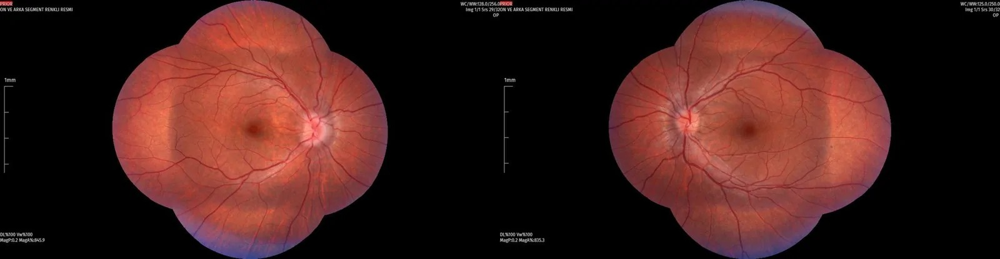
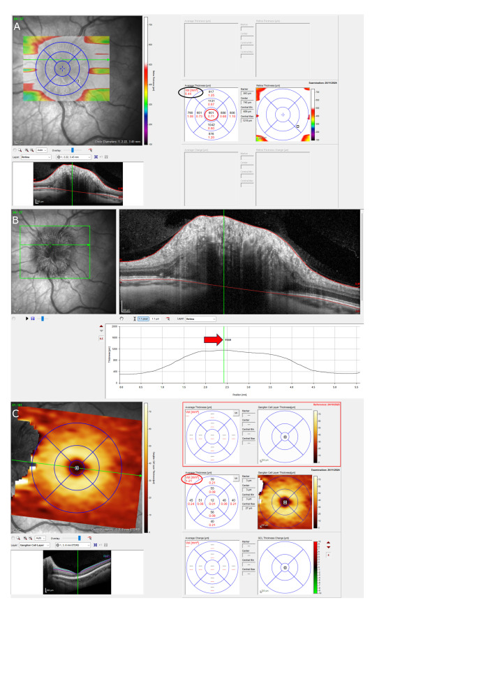
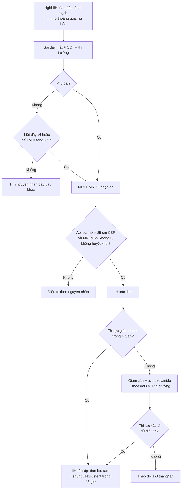
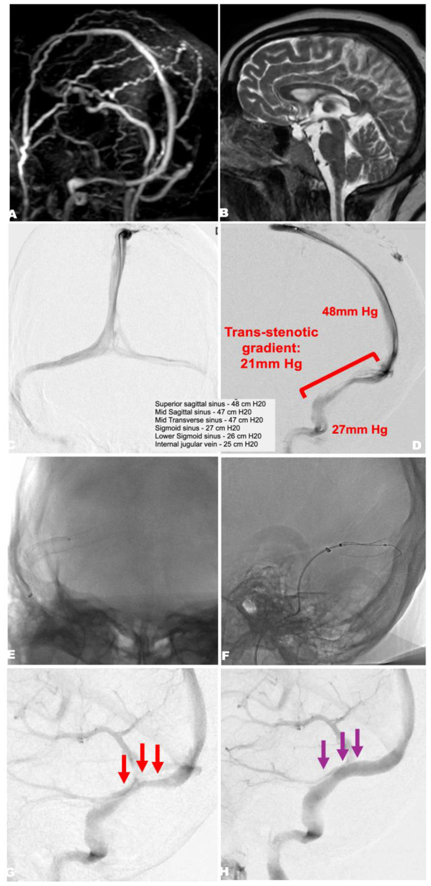
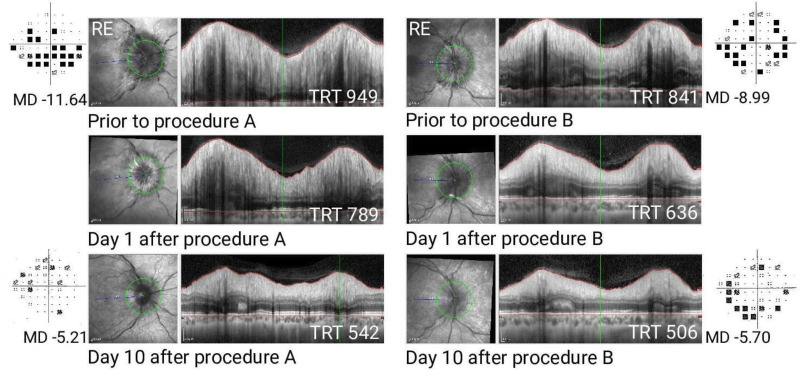
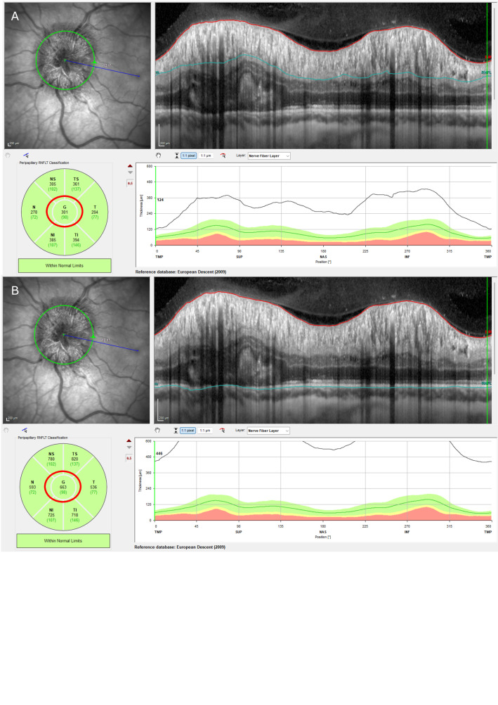

# 3018 — Tăng áp lực nội sọ tự phát (IIH) ở người lớn: phù gai, OCT, áp lực mở, acetazolamide, stent xoang vs shunt

**Tags:** `pattern:phu-gai-thi` `pattern:hep-xoang-tinh-mach` `vung:gai-thi` `vung:xoang-tinh-mach-doc` `anatomy:gai-thi` `score:Frisen` `protocol:OCT-RNFL` `protocol:MRV`
**Mức chắc chắn (certainty):** tổng hợp y văn (literature synthesis) — ghép **đồng thuận quản lý IIH của Anh** (PMC6166610, 2018), **tổng quan cơ chế – điều trị 2026** (PMC13524410), **tổng quan hệ thống stent xoang trong IIH tối cấp** (PMC13174952), **protocol thử nghiệm IIH Intervention** (PMC13436069), **bài quan điểm stent vs shunt** (PMC13018796) và **nghiên cứu OCT phân biệt phù gai** (PMC13692888). Nhiều nguồn, không phải một ca → không gắn nhãn ca nguyên văn.

> **Bài này trả lời câu hỏi hay gặp nhất ở phòng chụp: “phù gai hai bên này là IIH hay giả phù gai — và có cần can thiệp mạch máu không?”** Chốt không nằm ở ảnh MRI đẹp mà ở **áp lực mở khi chọc dò tủy sống (opening pressure)**, **chiều dày lớp sợi thần kinh võng mạc (RNFL) trên OCT** và **tốc độ mất thị trường**. Nối [3016 – Hạ áp lực nội sọ tự phát](../3016-ha-ap-luc-noi-so-tu-phat/lesson.md) (đối cực), [234 – Theo dõi đa phương thức tăng áp lực nội sọ ở trẻ](../234-tang-ap-luc-noi-so-theo-doi-da-phuong-thuc-nhi/lesson.md) và [433 – Phù đĩa thị & drusen](../433-phu-dia-thi-drusen/lesson.md).

## 1. Tổng quan bệnh học – cơ chế hình ảnh

- **Định nghĩa:** tăng áp lực nội sọ (intracranial pressure, ICP) **không có nguyên nhân thực thể** — không u, không giãn não thất, không huyết khối xoang, dịch não tủy (CSF) bình thường. Tiêu chuẩn Friedman dùng **áp lực mở > 25 cm CSF (250 mmH₂O)**; đo một lần không đủ, phải đặt trong bối cảnh lâm sàng – hình ảnh – thị trường (PMC6166610).
- **Dịch tễ:** nữ béo trong tuổi sinh sản là nhóm điển hình. Tại Anh, tỉ lệ mắc tăng **108%** từ **2,6/100.000 (2002)** lên **4,69/100.000 (2016)**; ở nữ 16–44 tuổi là **7,69/100.000** (PMC13524410). Đồng thuận Anh ghi nhận tỉ lệ hiệu chỉnh tuổi – giới **2,4/100.000** giai đoạn 2002–2014 (PMC6166610) — hai con số khác nhau vì khác cách hiệu chỉnh, không phải mâu thuẫn.
- **Sinh lý bệnh (còn tranh luận):** **hẹp xoang tĩnh mạch màng cứng** làm tăng áp lực tĩnh mạch nội sọ → giảm hấp thu CSF qua hạt màng nhện và mạch bạch huyết; béo phì và các yếu tố chuyển hóa (GLP-1, 11β-HSD1) làm nặng thêm. Hẹp xoang gặp ở **tới ~90%** bệnh nhân IIH (PMC13174952), nhưng **có thể là hậu quả của tăng ICP** chứ không luôn là nguyên nhân — đây là lý do không được đặt stent chỉ vì thấy hẹp.
- **TẠI SAO gai thị phù:** bao màng nhện quanh thần kinh thị thông với khoang dưới nhện nội sọ; ICP cao → dịch dồn vào khoang quanh thị → **ứ trệ vận chuyển sợi trục (axoplasmic stasis)** → phù trục thần kinh và **phù gai** hai bên. Vì vậy phù gai là dấu hiệu **gián tiếp của áp lực**, không phải tổn thương tại mắt.
- **TẠI SAO OCT đo được phù gai:** OCT là giao thoa kế ánh sáng cận hồng ngoại, phân giải trục **~5 µm** (Spectralis ~3,9 µm), đo chiều dày giữa màng giới hạn trong (ILM) và màng sắc tố – biểu mô (RPE/BM). Phù = **nước ngoại bào + sợi trục căng** → RNFL dày lên; **tổng chiều dày võng mạc (total retinal thickness, TRT)** ở đĩa thị cũng tăng. Khi phù kéo dài, tế bào hạch mất dần → **lớp tế bào hạch (GC-IPL) mỏng** và RNFL teo — dấu hiệu tổn thương **không hồi phục**.
- **TẠI SAO MRI thấy “giọt nước mắt”:** CSF rất sáng trên T2W; ICP cao đẩy CSF vào bao quanh thị → **giãn bao thần kinh thị**, **gai thị lồi vào nhãn cầu**, **đáy nhãn cầu dẹt**, **tuyến yên dẹt/treo rỗng (empty sella)**, **xoang ngang hẹp**. Các dấu hiệu này **không đặc hiệu** — phải loại trừ u, huyết khối xoang, giãn não thất.
- **TẠI SAO không chụp CT:** IIH là bệnh của **nữ trẻ**; CT sọ không trả lời được câu hỏi mô mềm/xoang và làm tăng liều bức xạ. **MRI + MRV** là lựa chọn đầu tay (PMC6166610).
- **Số liệu định lượng phải nhớ:**
  - **Áp lực mở:** **> 25 cm CSF = 250 mmH₂O** ở người lớn (PMC6166610); **≥ 28 cm CSF** ở trẻ **không béo**, **> 25 cm** ở trẻ béo (tiêu chuẩn Friedman kinh điển, trích qua PMC6166610/PMC13692888).
  - **OCT trong IIH:** ví dụ của protocol IIH Intervention — **RNFL toàn cầu 301 µm** (bình thường ~100 µm), **TRT 656 µm**, **thể tích đầu thần kinh thị 8,44 mm³**, **chiều dày trung tâm đầu thị 901 µm** (PMC13436069).
  - **Sau can thiệp:** TRT **949 → 789 → 542 µm** (ngày 0 → 1 → 10) và thị trường **MD −11,64 → −5,21 dB**; mắt còn lại **841 → 636 → 506 µm**, **MD −8,99 → −5,70 dB** (PMC13018796).
  - **OCT phân biệt phù gai (nhóm nhi):** RNFL trung bình **129,85 ± 51,08 µm** ở phù gai vs **99,89 ± 11,29 µm** ở trẻ khỏe mạnh; **RNFL dưới AUC 0,848** cho phù gai; **RNFL mũi AUC 0,699** khi phân biệt phù gai với giả phù gai do drusen (PMC13692888). Đây là số của **trẻ** — không suy ra ngưỡng người lớn.
  - **IIH tối cấp (fulminant):** **2–3%** ca IIH, mất thị lực nặng trong **4 tuần**; stent xoang trong **48 giờ** ở ca được chọn (PMC13174952).

## 2. Mẫu hình + chẩn đoán phân biệt theo vị trí (gamut)

- **Mẫu hình cốt lõi:** nữ **20–45 tuổi**, **BMI > 30**, **đau đầu** kiểu tăng áp lực (nặng hơn khi nằm, sáng sớm), **ù tai theo nhịp mạch**, **nhìn mờ thoáng qua**, **song thị ngang do liệt dây VI**, **không sốt, không dấu thần kinh khu trú**; soi đáy mắt **phù gai hai bên**; MRI không có u/giãn não thất; **áp lực mở > 25 cm CSF**.
- **Gamut theo hình ảnh gai thị:**
  - **Phù gai hai bên đối xứng:** IIH, huyết khối xoang màng cứng, tăng huyết áp ác tính, bệnh não do thuốc (tetracycline, vitamin A, isotretinoin), thiếu máu, ngưng thở khi ngủ, suy thận.
  - **Phù gai một bên/không đối xứng:** IIH (có thể không đối xứng), u hốc mắt, viêm thần kinh thị, thiếu máu cục bộ thần kinh thị trước (AION), nhiễm trùng.
  - **Giả phù gai (pseudopapilledema):** **drusen đĩa thị (optic disc drusen, ODD)**, **PHOMS** (peripapillary hyperreflective ovoid mass-like structure), đĩa thị chật — **không có phù thật**, không mất thị trường kiểu ám điểm.
  - **Bờ gai mờ + xuất huyết quanh gai:** IIH nặng, huyết khối xoang, tăng huyết áp ác tính.
- **Gamut “phù gai + bệnh nền”:** thiếu máu (Hb thấp), suy thận, suy giáp, tăng canxi, bệnh Lyme, giang mai, sarcoidose, lupus — hỏi và xét nghiệm theo lâm sàng; IIH chỉ được chẩn đoán sau khi loại trừ.
- **Phân biệt IIH có/không phù gai:** **IIH không phù gai** (IIHWOP) vẫn có áp lực mở cao và đau đầu, nhưng **không có phù gai**; cần **liệt dây VI** hoặc dấu hiệu MRI tăng ICP để hỗ trợ, và **không mặc định can thiệp ngoại khoa** (PMC6166610).

## 3. Bảng so sánh phân biệt (ma trận đối chiếu)

| Thực thể (entity) | Hình ảnh điển hình | Chốt vào (rule-in) | Chốt loại (rule-out) | Gợi ý xác nhận |
|---|---|---|---|---|
| **IIH** | Phù gai hai bên, MRI: bao thị giãn, gai lồi, đáy nhãn cầu dẹt, treo rỗng tuyến yên; **hẹp xoang ngang** trên MRV | **Áp lực mở > 25 cm CSF + MRI/MRV bình thường (không u, không huyết khối) + phù gai** | **Sốt, dấu thần kinh khu trú, huyết khối xoang, u não** → không phải IIH | Chọc dò tủy sống đo áp lực; MRV; OCT RNFL; thị trường 24-2 |
| **Huyết khối xoang màng cứng** | Phù gai hai bên; **khuyết thuốc xoang** trên MRV/CTV; nhồi máu tĩnh mạch, xuất huyết | **Khuyết lấp đầy xoang + yếu tố nguy cơ (thuốc tránh thai, thai kỳ, đông máu)** | **Xoang thông hoàn toàn trên MRV có tương phản** | MRV/CTV có tương phản; D-dimer; tầm soát tăng đông |
| **Giả phù gai do drusen (ODD)** | Gai lồi, bờ mờ; **B-scan siêu âm: echo dày trong gai**; OCT: **PHOMS**, không có phù trục thật | **Echo dày trên B-scan + autofluorescence + không mất thị trường kiểu ám điểm** | **OCT có phù RNFL thật + bao thị giãn + áp lực mở cao** → không phải ODD đơn thuần | B-scan 10–20 MHz; OCT; chụp autofluorescence |
| **Viêm thần kinh thị (optic neuritis)** | Phù gai **một bên**, đau khi liếc, giảm thị lực nhanh, **RAPD**; MRI: ngấm thuốc thần kinh thị | **Đau khi vận nhãn + RAPD + ngấm thuốc thần kinh thị** | **Phù hai bên không đau, thị lực bình thường** → ít nghĩ viêm | MRI hốc mắt có tương phản; OCT; kháng thể MOG/NMO nếu nghi |
| **Thiếu máu cục bộ thần kinh thị trước (AION)** | Phù gai **một bên**, **mất thị trường ngang trên/dưới**, đĩa thị nhợt, **không đau** | **Mất thị trường kiểu altitudinal + tuổi > 50 + yếu tố mạch máu** | **Phù hai bên + thị trường ám điểm trung tâm/co đồng tâm** → nghĩ IIH | Soi đáy mắt, thị trường; CRP/ESR nếu nghi arteritis |
| **Tăng huyết áp ác tính** | Phù gai hai bên + **xuất huyết/tơ huyết thanh**, hẹp tiểu động mạch | **HA ≥ 180/120 mmHg + tổn thương cơ quan đích** | **HA bình thường nhiều lần** → loại trừ | Đo HA; urê/creatinine; soi đáy mắt |
| **Bệnh não do thuốc/tăng canxi/thiếu máu** | Phù gai hai bên, không hẹp xoang | **Dùng tetracycline/vitamin A/isotretinoin, canxi cao, Hb thấp** | **Không dùng thuốc, xét nghiệm bình thường** | Bệnh sử thuốc; canxi, Hb, chức năng thận |

*Ảnh đáy mắt màu hai bên của bệnh nhi nữ được chẩn đoán IIH: **phù gai Frisén độ 1**, bờ gai mờ nhẹ, mạch máu bị che một phần. Đây là mức **sớm nhất** — dễ bị đọc là “gai bình thường” nếu không so sánh hai bên và không đo OCT. Nguồn: BMC Ophthalmol 2026 (PMC13692888), Fig. 1, CC BY 4.0.*

## 4. Protocol chụp + hệ phân độ/điểm chuẩn hóa

- **Trình tự chẩn đoán (không nhảy bước):**
  1. **Soi đáy mắt giãn đồng tử + chụp ảnh màu**: xác nhận phù gai, ghi **Frisén 0–5**, tìm xuất huyết, tơ huyết thanh, teo gai.
  2. **Thị lực, đồng tử (RAPD), thị trường tự động 24-2 hoặc 30-2**: ghi **MD (mean deviation)** và **PSD**; thị trường là thước đo **chức năng**, OCT là thước đo **cấu trúc**.
  3. **OCT đĩa thị**: vòng quét chuẩn quanh gai (đường kính **3,45 mm**, **768 A-scan**), đo **RNFL toàn cầu + 4 góc**, **TRT**, **thể tích đầu thần kinh thị**; chụp **GC-IPL** vùng hoàng điểm để phát hiện mất tế bào hạch sớm. Chụp lại **cùng máy, cùng thuật toán** để so sánh.
  4. **MRI sọ + MRV** (TOF và/hoặc có tương phản): loại trừ u, giãn não thất, huyết khối xoang; tìm dấu hiệu tăng ICP (bao thị giãn, gai lồi, đáy nhãn cầu dẹt, treo rỗng tuyến yên, hẹp xoang ngang).
  5. **Chọc dò tủy sống**: đo **áp lực mở bằng thước nước (cm CSF)**, bệnh nhân nằm nghiêng, chân duỗi, thư giãn, **tránh Valsalva**; lấy CSF làm tế bào, protein, glucose, vi sinh; **không đo khi đã có phù gai nặng mà chưa loại trừ u/giãn não thất**.
  6. **Tầm soát nguyên nhân thứ phát**: thuốc, thiếu máu, suy thận, cường cận giáp, ngưng thở khi ngủ, bệnh mô liên kết; **thử thai** trước khi kê acetazolamide.

*Hai số đo OCT của cùng đầu thần kinh thị trong phù gai: **thể tích đầu thị 8,44 mm³** (khoanh đen) và **chiều dày trung tâm 901 µm** (khoanh đỏ). Đây là các tham số **bổ sung cho RNFL**, giúp theo dõi phù gai khi RNFL đã bị ảnh hưởng bởi teo hoặc khi đĩa thị dị dạng. Nguồn: BMJ Open 2026;16:e111013 (PMC13436069), Fig. 3, CC BY 4.0.*

- **Phân độ Frisén (0–5):** 0 = gai bình thường; 1 = bờ mờ, quầng quanh gai; 2 = mờ rõ + mạch máu bị che một phần; 3 = mạch máu bị che nhiều, xuất huyết; 4 = gai lồi rõ, mạch máu khó thấy; 5 = gai lồi rất mạnh, mạch máu gần như không thấy. **Frisén ≥ 3** là ngưỡng được dùng trong protocol IIH Intervention để xác định **nguy cơ mất thị lực** (PMC13436069).
- **Điều trị theo bậc:**
  - **Giảm cân là điều trị duy nhất thay đổi bệnh nền**: tăng **5–15%** cân trong năm trước chẩn đoán; cần **giảm tới ~15%** để lui bệnh (PMC6166610). Phẫu thuật giảm béo có dữ liệu ủng hộ ở BMI cao.
  - **Acetazolamide**: khởi đầu **250–500 mg × 2/ngày**, tăng dần; **liều tối đa 4 g/ngày** (IIHTT: **44%** đạt 4 g/ngày, đa số dung nạp **1 g/ngày**); **48%** ngừng ở liều trung bình **1,5 g** vì tác dụng phụ (dị cảm, rối vị giác, mệt, tiêu chảy, sỏi thận, toan chuyển hóa) (PMC6166610).
  - **Đe dọa thị lực cấp:** dẫn lưu CSF tạm thời (lumbar drain) để câu giờ, rồi **can thiệp dứt điểm**: **shunt CSF** (VP được ưu tiên hơn LP vì ít phải sửa van hơn), **mở cửa sổ bao thần kinh thị (ONSF)**, hoặc **stent xoang tĩnh mạch** nếu có hẹp + chênh áp.
  - **Stent xoang**: đặt stent tự bung **8–10 mm** qua chỗ hẹp xoang ngang–sigma; **không có ngưỡng chênh áp được chấp nhận phổ quát** — protocol IIH Intervention **không đặt ngưỡng gradient** vì áp lực thay đổi theo gây mê (PMC13436069). Ca minh họa có gradient **21 mmHg (48 → 27 mmHg)** (PMC13174952). Sau stent cần **kháng kết tập tiểu cầu/kháng đông > 6 tháng**; **hẹp trong stent cần can thiệp lại ở ~1/3** ca (PMC6166610).
  - **ONSF**: kiểm soát phù gai nhanh nhưng **không giảm đau đầu toàn thể**; biến chứng tới **~40%** (bao gồm đóng lại lỗ mở, hiếm khi tắc động mạch trung tâm võng mạc) (PMC13174952).
  - **IIH tối cấp**: **2–3%** ca, mất thị lực trong **4 tuần**; stent xoang tối cấp trong **48 giờ** ở ca được chọn — 23 bệnh nhân/7 nghiên cứu, **≥ 75%** cải thiện phù gai và thị lực, đau đầu cải thiện **56–100%**, không tử vong do thủ thuật (PMC13174952).
- **Sơ đồ quyết định:**

## 5. Biến thể bình thường và cạm bẫy

- **Drusen đĩa thị (ODD) là cạm bẫy số 1.** Gai lồi, bờ mờ nhưng **không phải phù thật**; B-scan thấy **echo dày**, OCT thấy **PHOMS** và không có phù trục; bệnh nhân **không mất thị trường kiểu ám điểm**. Đặt stent hay shunt cho ODD là can thiệp oan. Ngược lại, **ODD có thể kèm IIH thật** — phải đo áp lực mở khi lâm sàng nghi.
- **OCT không thay thế thị trường.** RNFL dày do phù có thể **giảm sau điều trị** nhưng thị lực đã mất không hồi phục; ngược lại RNFL **mỏng** ở giai đoạn teo là dấu hiệu **tổn thương mạn**. Luôn đọc **cả RNFL, TRT, GC-IPL và MD**.
- **Hẹp xoang ngang không đồng nghĩa cần stent.** Hẹp gặp ở ~90% IIH và có thể **mất sau khi hạ áp lực** (chọc dò/điều trị nội khoa). Chỉ can thiệp khi có **hẹp thực sự + chênh áp + thất bại điều trị**, và hiểu rằng **ngưỡng chênh áp chưa được chuẩn hóa**.
- **Áp lực mở là một con số, không phải chân lý.** Đo sai tư thế, căng thẳng, Valsalva, béo bụng làm sai lệch; **áp lực bình thường không loại trừ IIH** nếu lâm sàng – hình ảnh điển hình và ngược lại. Đo lại khi nghi ngờ, đừng chẩn đoán chỉ dựa vào một lần.
- **Đừng bỏ qua liệt dây VI.** Song thị ngang là dấu hiệu **tăng ICP** có giá trị, đặc biệt ở **IIH không phù gai**; khám vận nhãn đầy đủ trước khi kết luận “không có dấu thần kinh”.
- **Bệnh nhân đã đặt shunt bị đau đầu: không tự động sửa shunt.** Đồng thuận Anh khuyến cáo **không sửa shunt thường quy nếu không có phù gai/nguy cơ mất thị lực**; đau đầu có thể do quá dẫn lưu, hội chứng đau đầu mạn, hoặc đau đầu do thuốc (PMC6166610).
- **Corticosteroid không phải điều trị chuẩn.** Đồng thuận **không khuyến cáo corticosteroid** cho IIH tối cấp vì thiếu bằng chứng và tác hại (tăng cân, loãng xương, loạn thần); ưu tiên **giảm áp lực cơ học** (shunt/ONSF/stent).
- **Thai kỳ:** IIH có thể nặng lên; **acetazolamide cần cân nhắc nguy cơ thai**, chọc dò và can thiệp vẫn thực hiện được khi cần; phối hợp sản – thần kinh – nhãn khoa (PMC6166610).

## 6. Tự lượng giá — Blind Quiz

**Ca 1 — Nữ 36 tuổi, béo phì, mất thị lực tiến triển 2 tháng, nặng lên rõ trong 2 tuần. Thị lực 20/200 mắt trái, mắt phải chỉ còn đếm ngón tay. Chọc dò: áp lực mở 46 cm H₂O.**

- Gợi ý: phù gai hai bên rất nặng (Frisén 4 mắt trái, 4+ mắt phải); không sốt, không liệt chi; MRI không có u.
- Câu hỏi: Hẹp ở đâu? Chênh áp bao nhiêu? Đây là thể IIH nào và cần làm gì trong 48 giờ?

<b>Bấm để hiện đáp án (findings + chẩn đoán)</b>

- **Dấu hiệu:** (A) MRA thì động mạch – tĩnh mạch: **hẹp khu trú xoang ngang phải**; (B) T2 cạnh dọc: **não “sụp” nhẹ**, não thất không giãn, phù hợp tăng ICP; (C, D) chụp xoang: hẹp xoang ngang – sigma phải với **gradient 21 mmHg (48 → 27 mmHg)**; (E, F) đặt stent tự bung qua chỗ hẹp; (G, H) trước/sau stent, dòng chảy qua xoang được mở rộng.
- **Chẩn đoán:** **IIH tối cấp (fulminant IIH)** — mất thị lực nhanh trong 4 tuần, phù gai nặng, hẹp xoang ngang có chênh áp.
- **Xử trí:** **giảm áp lực ngay** — dẫn lưu CSF tạm thời (lumbar drain) để bảo vệ thị lực trong lúc chuẩn bị; **stent xoang tối cấp** (trong 48 giờ) là lựa chọn hợp lý khi có hẹp + chênh áp; nếu không có điều kiện stent → **shunt CSF hoặc ONSF**. Không dùng corticosteroid đơn thuần.
- **Bài học:** đây là **cấp cứu nhãn khoa thần kinh**; chậm vài ngày có thể mất thị lực vĩnh viễn.
- Nguồn ảnh: Front Neurol 2026;17:1824887 (PMC13174952), Fig. 2, CC BY 4.0.

**Ca 2 — Bệnh nhi nữ, đau đầu tái diễn và nhìn mờ thoáng qua. Soi đáy mắt hai bên như hình.**

- Gợi ý: không sốt, không đau khi liếc mắt; thị lực còn tốt; không dùng thuốc.
- Câu hỏi: Mô tả gai thị và xếp độ Frisén? Cần làm gì tiếp theo để phân biệt phù gai thật với giả phù gai?

<b>Bấm để hiện đáp án (findings + chẩn đoán)</b>

- **Dấu hiệu:** gai thị hai bên **hồng, bờ mờ nhẹ, quầng quanh gai**, mạch máu bị che lấp một phần — **Frisén độ 1**.
- **Chẩn đoán:** **phù gai sớm hai bên**, phù hợp IIH nhưng **chưa đủ** để chẩn đoán.
- **Bước tiếp:** **OCT đĩa thị** (RNFL/TRT/PHOMS) + **B-scan siêu âm** tìm drusen + **MRI/MRV** + **chọc dò đo áp lực mở**. Nếu OCT có phù thật, bao thị giãn và áp lực mở > 25 cm CSF → IIH.
- **Cạm bẫy:** Frisén 1 rất dễ bị đọc là “gai bình thường”; **so sánh hai bên + OCT** giúp phát hiện.
- Nguồn ảnh: BMC Ophthalmol 2026 (PMC13692888), Fig. 1, CC BY 4.0.

**Ca 3 — Bệnh nhân IIH được can thiệp giảm áp. Trước can thiệp RNFL/TRT rất dày; sau 10 ngày như hình.**

- Gợi ý: bệnh nhân được can thiệp vì phù gai đe dọa thị lực; hình trên là mắt phải, dưới là ngày 1 và ngày 10.
- Câu hỏi: TRT thay đổi bao nhiêu? MD cải thiện bao nhiêu? Vì sao OCT lại quan trọng hơn “nhìn gai bằng mắt”?

<b>Bấm để hiện đáp án (findings + chẩn đoán)</b>

- **Dấu hiệu:** TRT **949 → 789 → 542 µm** (trước → ngày 1 → ngày 10); thị trường **MD −11,64 → −5,21 dB**. Mắt còn lại: **841 → 636 → 506 µm**, **MD −8,99 → −5,70 dB**.
- **Chẩn đoán:** **phù gai do IIH đáp ứng nhanh sau giảm áp lực** — cả cấu trúc (OCT) và chức năng (thị trường) đều cải thiện.
- **Vì sao OCT quan trọng:** đo **định lượng** mức phù (µm) và phát hiện **teo sợi thần kinh** sớm; mắt người chỉ thấy thay đổi khi đã rõ. Dùng cùng máy/thuật toán để so sánh.
- Nguồn ảnh: Pract Neurol 2026;26:142–145 (PMC13018796), Fig. 1, CC BY 4.0.

**Ca 4 — Kỹ thuật viên đo OCT đĩa thị ở bệnh nhân nghi IIH.**

- Gợi ý: đây là ảnh minh họa trong protocol nghiên cứu, không phải ca bệnh cụ thể.
- Câu hỏi: Con số **RNFL toàn cầu 301 µm** và **TRT 656 µm** nói gì? Ngưỡng bình thường của RNFL quanh gai ở người lớn vào khoảng bao nhiêu?

<b>Bấm để hiện đáp án (findings + chẩn đoán)</b>

- **Dấu hiệu:** RNFL toàn cầu **301 µm** (A) và TRT **656 µm** (B) — **dày gấp ~3 lần** giá trị bình thường.
- **Chẩn đoán:** **phù gai nặng** trên OCT; cần tương quan lâm sàng và áp lực mở.
- **Ngưỡng tham khảo:** giá trị RNFL bình thường **phụ thuộc máy, tuổi, dân số và đường kính đĩa thị** — repo **không đưa một ngưỡng người lớn duy nhất** vì chưa đối chiếu được bảng chuẩn của máy; nghiên cứu nhi trong bài dùng **99,89 ± 11,29 µm** ở trẻ khỏe mạnh (PMC13692888). Vì vậy hãy so với **bảng chuẩn của đúng máy** và **theo dõi xu hướng**; số **301 µm** là ví dụ của protocol, không phải ngưỡng chẩn đoán.
- **Lưu ý:** đây là ảnh minh họa kỹ thuật; **không dùng để chẩn đoán độc lập**.
- Nguồn ảnh: BMJ Open 2026;16:e111013 (PMC13436069), Fig. 2, CC BY 4.0.

## Bài liên quan chéo
- [3016 – Hạ áp lực nội sọ tự phát (SIH)](../3016-ha-ap-luc-noi-so-tu-phat/lesson.md) — đối cực: đau đầu thế đứng, không phù gai
- [234 – Theo dõi đa phương thức tăng áp lực nội sọ ở trẻ](../234-tang-ap-luc-noi-so-theo-doi-da-phuong-thuc-nhi/lesson.md) — khác ngưỡng áp lực và nguyên nhân
- [433 – Phù đĩa thị & drusen đĩa thị](../433-phu-dia-thi-drusen/lesson.md) — giả phù gai, cạm bẫy số 1 của IIH
- [432 – Vùng yên & tổn thương quanh yên](../432-vung-yen/lesson.md) — loại trừ u vùng yên trước khi chẩn đoán IIH
- [200 – Tổng quan hệ Thần kinh](../200-tong-quan-he-than-kinh/lesson.md)

## Ảnh
- Tên file: `3018_*.jpg`; nguồn + giấy phép từng ảnh trong `images/CREDITS.md`; link gốc trong `sources.md`.
- Cả 5 ảnh đều **CC BY 4.0** — dùng và trích dẫn được, giữ nguyên ảnh gốc (không crop/kéo giãn).
- Ảnh minh họa kỹ thuật (Ca 4) lấy từ **protocol nghiên cứu**, không phải ca bệnh — đã ghi rõ trong quiz.

> Không dùng để chẩn đoán độc lập khi chưa có người hướng dẫn.
