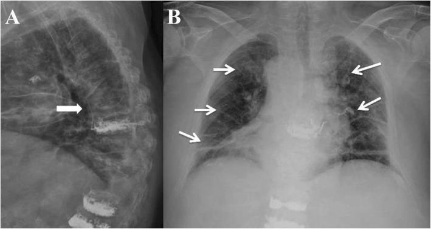
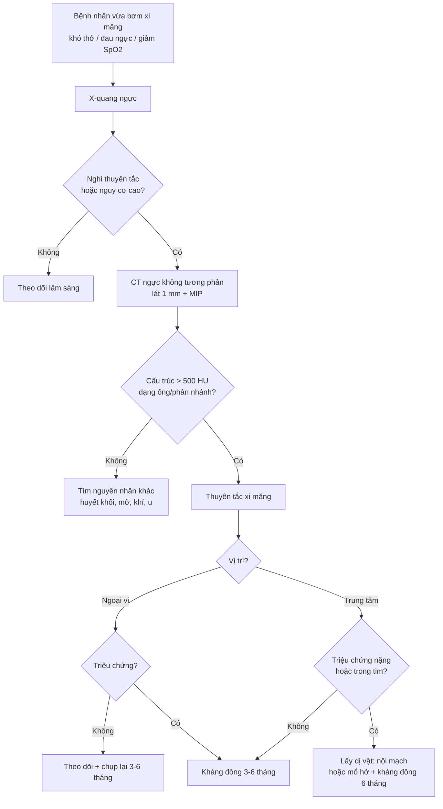
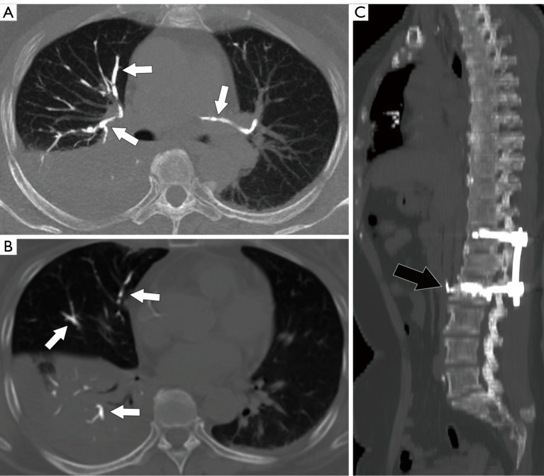
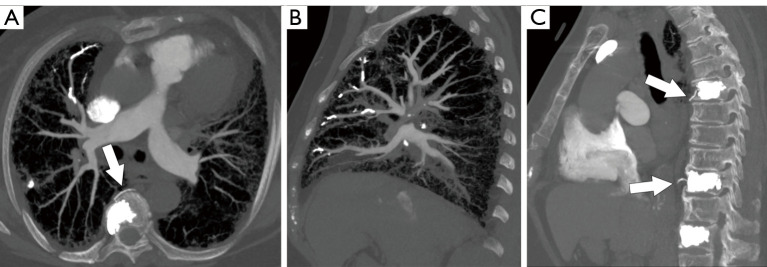
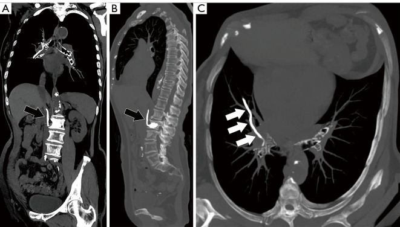

# 3019 — Thuyên tắc phổi do xi măng sau bơm đốt sống: đọc CT đúng, phân độ trung tâm/ngoại vi, khi nào chống đông – lấy dị vật

**Tags:** `pattern:thuyen-tac` `pattern:tang-dam-quang` `pattern:di-vat` `vung:dong-mach-phoi` `vung:cot-song` `protocol:CTPA` `protocol:vertebroplasty` `incidentaloma:thuyen-tac-phoi`
**Mức chắc chắn (certainty):** tổng hợp y văn (literature synthesis) — ghép **cohort 3.175 ca vertebroplasty** (PMC6884871), **nghiên cứu 373 ca PVP/PKP có CT ngực sau mổ** (PMC10102772), **tổng quan hệ thống 1.974 ca sau vít xi măng** (PMC9964565), **tổng quan quản lý thuyên tắc xi măng** (PMC5913032), **ca tiến triển muộn 5 năm** (PMC12663832) và **2 ca thủng tim** (PMC8867418). Nhiều nguồn, không phải một ca → không gắn nhãn ca nguyên văn.

> **Bài này trả lời câu hỏi thực hành: “bệnh nhân vừa bơm xi măng, khó thở — trên CT thấy vật cản quang trong động mạch phổi; đây là thuyên tắc xi măng hay huyết khối, và có cần can thiệp lấy ra không?”** Chốt nằm ở **hình dạng ống/phân nhánh + mật độ > 500 HU**, **vị trí trung tâm hay ngoại vi**, và **triệu chứng**. Nối [3017 – Gãy nén đốt sống & bơm xi măng](../3017-gay-nen-dot-song-loang-xuong-vertebroplasty/lesson.md) (nguồn gốc), [091 – Ho ra máu ồ ạt](../091-ho-ra-mau-oat-nut-mach-dong-mach-phe-quan/lesson.md) và [094 – Ho ra máu từ động mạch phổi](../094-phinh-gia-rasmussen-nut-mach-dong-mach-phoi/lesson.md).

## 1. Tổng quan bệnh học – cơ chế hình ảnh

- **Cơ chế:** polymethylmethacrylate (PMMA) được bơm vào thân đốt sống dưới áp lực. Nếu xi măng **rò vào tĩnh mạch đốt sống (basivertebral vein)**, **tĩnh mạch phân đoạn (segmental vein)**, **đám rối tĩnh mạch cạnh sống** hoặc **tĩnh mạch chủ dưới/azygos**, dòng máu đưa xi măng về **nhĩ phải → thất phải → động mạch phổi**. Đây là **dị vật**, không phải cục máu đông: xi măng không tan, không tiêu theo thời gian.
- **TẠI SAO CT thấy rõ:** PMMA pha **barium hoặc zirconium** có hệ số hấp thụ tia X rất cao; định nghĩa thực hành trên CT là **hình mật độ cao dạng ống, đường thẳng hoặc phân nhánh, đậm độ > 500 HU**, chạy **dọc theo đường đi của động mạch phổi** (PMC10102772). Mật độ cao hơn xương nhiều lần và thường gây **giả ảnh beam-hardening** hình tia.
- **TẠI SAO không cần CTPA để phát hiện:** xi măng đặc nên **CT không tương phản** đã thấy; CTPA hữu ích khi cần **phân biệt với huyết khối** (huyết khối là khuyết thuốc, không phải cấu trúc > 500 HU), đánh giá **giãn thất phải**, và tìm **huyết khối đồng thời**. Ca minh họa trong PMC10102772 cho thấy cả CT thường và CTPA đều thấy tổn thương.
- **TẠI SAO có ca “âm tính rồi dương tính muộn”:** xi măng có thể còn ở **tĩnh mạch cạnh sống/azygos** ngay sau mổ rồi **di chuyển dần** vào phổi trong vài ngày. Ca của PMC12663832: ngày 1 chỉ thấy xi măng ở **tĩnh mạch azygos**, **1 tuần sau** thấy **nhánh xi măng hai bên động mạch phổi**, và **5 năm sau vẫn ổn định**. Vì vậy **một phim ngay sau mổ âm tính không loại trừ** thuyên tắc muộn.
- **Dịch tễ – tần suất (khác nhau vì cách phát hiện):**
  - **CT ngực thường quy sau PVP/PKP:** **17,2%** (64/373 ca), trong đó **PVP 47/258** và **PKP 17/115**, khác biệt không có ý nghĩa (P = 0,460) (PMC10102772).
  - **Tổng quan hệ thống:** tần suất **3,5–28,6%**; **X-quang ngực** chỉ phát hiện **1–6,8%**, còn **CT** phát hiện tới **23%** (PMC5913032, PMC9964565).
  - **Sau vít xi măng (cement-augmented pedicle screw, CAPS):** **6%** (khoảng 0–28,6%); **có triệu chứng 1,3%**; **6 tử vong/1.974 ca** (PMC9964565).
- **Yếu tố nguy cơ – số liệu định lượng:**
  - **Thể tích xi măng:** thuyên tắc phổi **0%** khi bơm **< 3,5 cc**, **0,11%** khi **3,5–7,0 cc**, **0,9%** khi **> 7,0 cc** (P < 0,01) (PMC6884871).
  - **Kiểu rò:** rò qua **tĩnh mạch phân đoạn (type S) 4,9%**, qua **tĩnh mạch đốt sống (type B) 11,4%**, qua **khuyết vỏ xương (type C) 25% cạnh sống / 26% vào đĩa đệm / 0,7% ra sau** (PMC6884871).
  - **Vị trí bơm:** bơm ở **T9** làm tăng nguy cơ (OR **4,222**; 95% CI 1,490–11,966); xi măng ở **tĩnh mạch azygos** (OR **7,647**; 3,937–14,856) và **tĩnh mạch chủ dưới** (OR **42,701**; 7,525–242,302) là yếu tố nguy cơ mạnh nhất (PMC10102772).
  - **Kỹ thuật:** bơm chậm, xi măng độ nhớt cao, dừng ngay khi thấy rò, tránh bơm quá thể tích; các yếu tố này được khuyến cáo để giảm tần suất (PMC5913032).

## 2. Mẫu hình + chẩn đoán phân biệt theo vị trí (gamut)

- **Mẫu hình cốt lõi:** bệnh nhân **vừa bơm xi măng đốt sống (giờ đến vài tuần)**, **khó thở, đau ngực, ho, giảm SpO₂**, hoặc **hoàn toàn không triệu chứng**; X-quang/CT ngực có **đường mật độ cao dạng ống, phân nhánh** trong phổi.
- **Gamut theo vị trí (quyết định xử trí):**
  - **Trung tâm (central):** thân động mạch phổi, động mạch phổi phải/trái, động mạch thùy — nguy cơ **huyết động nặng**, cần xem xét **lấy dị vật**.
  - **Ngoại vi (peripheral):** động mạch phân đoạn và dưới phân đoạn — thường **không triệu chứng**, theo dõi.
  - **Trong tim (intracardiac):** nhĩ phải/thất phải — nguy cơ **thủng tim, tamponade**, cần can thiệp sớm.
- **Gamut theo hình ảnh “dị vật trong động mạch phổi”:** thuyên tắc xi măng, **thuyên tắc huyết khối**, thuyên tắc mỡ, thuyên tắc khí, thuyên tắc u, thuyên tắc nhiễm trùng, dị vật (catheter, coil), **vôi hóa hạch/động mạch**.
- **Phân nhóm quản lý (4 nhóm):** (1) ngoại vi không triệu chứng; (2) ngoại vi có triệu chứng; (3) trung tâm không triệu chứng; (4) trung tâm có triệu chứng (PMC5913032). Đây là **khung quyết định**, không phải phân độ chính thức theo thể tích.

## 3. Bảng so sánh phân biệt (ma trận đối chiếu)

| Thực thể (entity) | Hình ảnh điển hình | Chốt vào (rule-in) | Chốt loại (rule-out) | Gợi ý xác nhận |
|---|---|---|---|---|
| **Thuyên tắc xi măng** | **Dạng ống/đường thẳng/phân nhánh**, **> 500 HU**, chạy theo động mạch phổi; có thể thấy xi măng ở tĩnh mạch cạnh sống/azygos/IVC | **Tiền sử bơm xi măng + cấu trúc > 500 HU dạng nhánh trong động mạch phổi** | **Khuyết thuốc không đậm độ cao** → không phải xi măng | CT không tương phản + CTPA; MIP cạnh dọc/ngang để lần theo mạch |
| **Thuyên tắc huyết khối** | **Khuyết thuốc (filling defect)** trong lòng mạch, có thể tăng tỉ trọng nhẹ; giãn thất phải | **Khuyết thuốc + yếu tố nguy cơ huyết khối + D-dimer** | **Cấu trúc > 500 HU, hình nhánh cứng** → không phải huyết khối | CTPA; siêu âm tim; D-dimer |
| **Thuyên tắc mỡ** | Nhiều nốt mờ nhỏ/GGO, **không có cấu trúc đậm độ cao**; sau gãy xương lớn | **Hội chứng lâm sàng (giảm ý thức, chấm xuất huyết) + GGO rải rác** | **Cấu trúc cản quang dạng nhánh** → không phải mỡ | CT ngực; MRI sọ nếu có thần kinh |
| **Thuyên tắc khí** | **Khí trong động mạch phổi** (đen, −1.000 HU), có thể di chuyển | **Khí trong mạch + thủ thuật vừa làm** | **Mật độ cao > 500 HU** → không phải khí | CT cửa sổ phổi/mạch; nằm nghiêng trái |
| **Thuyên tắc u** | Bướu trong động mạch phổi, thường kèm u nguyên phát; có thể tăng ngấm thuốc | **U nguyên phát + bướu trong mạch + tăng ngấm thuốc** | **Không ngấm thuốc, mật độ rất cao** → nghĩ xi măng | CTPA; PET/CT nếu cần |
| **Vôi hóa hạch/động mạch** | Vôi hóa **điểm, thành mạch**, không phân nhánh theo lòng mạch | **Vôi hóa thành mạch/hạch, không đổi theo thời gian** | **Dạng ống phân nhánh trong lòng mạch** → không phải vôi | So phim cũ; CT không tương phản |
| **Dị vật khác (catheter/coil)** | Hình dạng nhân tạo, có thể thấy đầu catheter | **Tiền sử can thiệp + hình dạng vật thể** | **Không có tiền sử, mật độ xi măng** | CT + bệnh sử |

*Bệnh nhân nam 86 tuổi, khó thở và đau ngực sau PVP T8–T12–L1. (A) Nghiêng: **rò xi măng theo tĩnh mạch cạnh sống (type S)** (mũi tên). (B) Thẳng: **các nhánh mật độ cao dạng ống** rải khắp hai phổi, tương ứng động mạch phổi — thuyên tắc xi măng. Bệnh nhân được **thở oxy + chống đông**, không nặng thêm sau 3 ngày. Nguồn: J Orthop Surg Res 2019;14:406 (PMC6884871), Fig. 2, CC BY 4.0.*

## 4. Protocol chụp + hệ phân độ/điểm chuẩn hóa

- **Chụp gì, khi nào:**
  1. **X-quang ngực** sau mọi ca bơm xi măng (rẻ, sẵn có) — nhưng **độ nhạy thấp** (1–6,8%), chỉ dùng sàng lọc.
  2. **CT ngực không tương phản** khi **có triệu chứng** hoặc **nguy cơ cao** (bơm nhiều tầng, thể tích > 7 cc, thấy rò tĩnh mạch, bơm T9). Đây là **phương thức nhạy nhất**, phát hiện được **embolus ngoại vi < 4 mm** (PMC9964565).
  3. **CTPA** khi cần **phân biệt huyết khối**, đánh giá **giãn thất phải**, hoặc trước can thiệp lấy dị vật.
  4. **Siêu âm tim** khi nghi **xi măng trong tim** hoặc **thủng/thrombus buồng tim**.
- **Thông số CT:** lát **≤ 1 mm**, tái tạo **MIP cạnh dọc và cạnh ngang** theo trục mạch để lần theo tổn thương; cửa sổ trung thất và phổi; đọc **mật độ (HU)** để chốt.
- **Phân loại – ngưỡng xử trí:**
  - **Trung tâm:** thân động mạch phổi, động mạch phổi phải/trái, động mạch thùy.
  - **Ngoại vi:** động mạch phân đoạn/dưới phân đoạn.
  - **4 nhóm quản lý:** nhóm 1 (ngoại vi, không triệu chứng) → **theo dõi, không điều trị**; nhóm 2–3 (có triệu chứng ngoại vi hoặc trung tâm không triệu chứng) → **heparin ban đầu rồi kháng đông 3–6 tháng**; nhóm 4 (trung tâm, có triệu chứng) → **lấy dị vật** (ngoại khoa hoặc nội mạch) (PMC5913032).
  - **Lấy dị vật nội mạch:** dùng **snare** qua sheath lớn (ca báo cáo dùng **10F**), kéo xi măng về tĩnh mạch chậu và **cố định bằng stent** nếu không lấy ra được; sau đó **kháng đông 6 tháng**; theo dõi 1 năm không thấy thuyên tắc tái phát (PMC11445775).
  - **Mổ hở:** khi **xi măng trong nhĩ/thất gây thủng, tamponade**, hoặc dị vật lớn không lấy được bằng nội mạch. Hai ca **78 và 79 tuổi** bị **thủng tim sau PVP** cho thấy biến chứng này có thật và cần mổ cấp cứu (PMC8867418).
- **Theo dõi:** chụp lại **3–6 tháng** nếu còn dị vật; xi măng **không tan** nhưng có thể **ổn định nhiều năm** (ca 5 năm ổn định — PMC12663832); kháng đông không “làm tan” xi măng, chỉ phòng huyết khối trên bề mặt dị vật.
- **Sơ đồ quyết định:**

## 5. Biến thể bình thường và cạm bẫy

- **“Đậm độ cao” chưa chắc là xi măng.** Thuốc cản quang trong động mạch phổi trên CTPA cũng rất đậm; phải so **trước/sau tiêm**, đọc **hình dạng** (xi măng: ống, phân nhánh, bờ cứng; cản quang: đầy lòng mạch rồi rửa trôi) và hỏi **tiền sử bơm xi măng**.
- **X-quang âm tính không loại trừ.** Tổn thương **< 4 mm** hoặc ngoại vi dễ bị bỏ; nếu lâm sàng nghi, **chụp CT**.
- **Một phim ngay sau mổ âm tính cũng không loại trừ.** Xi măng có thể còn ở tĩnh mạch rồi **di chuyển sau vài ngày** (PMC12663832) — đau ngực/khó thở xuất hiện muộn vẫn phải nghĩ thuyên tắc.
- **Không triệu chứng không có nghĩa là không cần theo dõi.** Nhóm ngoại vi không triệu chứng thường lành, nhưng cần **hẹn chụp lại** và dặn bệnh nhân quay lại nếu khó thở; xi măng **không tự tiêu**.
- **Chống đông không “chữa” dị vật.** Kháng đông chỉ phòng **huyết khối thứ phát** trên bề mặt xi măng; với dị vật lớn trong **thân động mạch phổi/nhĩ phải**, phải **lấy ra** bằng nội mạch hoặc mổ.
- **Đừng nhầm với vôi hóa hạch.** Vôi hóa thường **điểm, thành mạch, không phân nhánh theo lòng mạch**; xi măng **theo đúng đường phân nhánh động mạch** và rất đậm.
- **Rò xi măng vào tĩnh mạch không đồng nghĩa đã thuyên tắc.** Type S/B chỉ là **nguy cơ**; phải tìm **embolus trong động mạch phổi** trên CT mới chẩn đoán thuyên tắc.
- **Bỏ sót thủng tim.** Đau ngực + tụt huyết áp + tiếng tim mờ sau bơm xi măng → **siêu âm tim khẩn**, tìm dị vật trong nhĩ/thất; đây là biến chứng **chết người** (PMC8867418).

## 6. Tự lượng giá — Blind Quiz

**Ca 1 — Nam 86 tuổi, khó thở và đau ngực sau bơm xi măng T8, T12, L1. X-quang ngực thẳng và nghiêng như hình.**

- Gợi ý: bệnh nhân bơm 3 tầng; không sốt; SpO₂ giảm nhẹ; không ho ra máu.
- Câu hỏi: Mô tả hai bất thường trên phim? Chúng liên quan thế nào? Bước tiếp theo là gì?

<b>Bấm để hiện đáp án (findings + chẩn đoán)</b>

- **Dấu hiệu:** (A) nghiêng: **xi măng rò theo tĩnh mạch cạnh sống (type S)**; (B) thẳng: **nhiều nhánh mật độ cao dạng ống** ở hai phổi, chạy theo động mạch phổi.
- **Chẩn đoán:** **thuyên tắc xi măng phổi** sau PVP nhiều tầng; ổ rò tĩnh mạch là nguồn.
- **Xử trí:** **CT ngực không tương phản** để xác định **trung tâm/ngoại vi** và mức lan; bệnh nhân này có triệu chứng nhẹ → **oxy + kháng đông**, theo dõi; nếu dị vật lớn ở trung tâm → cân nhắc lấy dị vật.
- **Bài học:** X-quang thấy được nhưng **không đủ** để quyết định; CT mới trả lời vị trí.
- Nguồn ảnh: J Orthop Surg Res 2019;14:406 (PMC6884871), Fig. 2, CC BY 4.0.

**Ca 2 — Nữ 57 tuổi, khó thở nhẹ 3 ngày sau PVP. CT ngực không tương phản (A, B) và MIP cạnh dọc (C).**

- Gợi ý: không tiêm thuốc cản quang; bệnh nhân vừa bơm xi măng 1 đốt.
- Câu hỏi: Vì sao không cần CTPA vẫn thấy tổn thương? Dấu hiệu nào xác nhận đây là xi măng chứ không phải huyết khối? Vị trí trung tâm hay ngoại vi?

<b>Bấm để hiện đáp án (findings + chẩn đoán)</b>

- **Dấu hiệu:** (A, B) **nhiều đường mật độ cao dạng ống/phân nhánh** trong động mạch phổi hai bên (mũi tên trắng); (C) MIP cạnh dọc: **xi măng trong tĩnh mạch azygos** (mũi tên đen) — nguồn di chuyển.
- **Chẩn đoán:** **thuyên tắc xi măng**, chủ yếu **ngoại vi** (động mạch phân đoạn/dưới phân đoạn) theo mô tả nguồn.
- **Vì sao thấy trên CT thường:** xi măng có **mật độ > 500 HU**, không cần cản quang; huyết khối là **khuyết thuốc**, không phải cấu trúc đậm độ cao.
- **Xử trí:** nhóm **ngoại vi, triệu chứng nhẹ** → theo dõi + kháng đông nếu có triệu chứng; hẹn chụp lại.
- Nguồn ảnh: Quant Imaging Med Surg 2023;13:2397–2407 (PMC10102772), Fig. 3, CC BY-NC-ND 4.0 — ảnh nguyên bản, không crop/ghép.

**Ca 3 — Nữ 80 tuổi, khó thở nhiều và đau ngực sau PVP. CTPA như hình.**

- Gợi ý: SpO₂ 88%, nhịp nhanh; siêu âm tim chưa thấy giãn thất phải rõ.
- Câu hỏi: Dị vật nằm ở đâu? Đây là nhóm nào trong 4 nhóm quản lý? Có chỉ định lấy dị vật không?

<b>Bấm để hiện đáp án (findings + chẩn đoán)</b>

- **Dấu hiệu:** (A) CTPA lát ngang: **khối mật độ rất cao trong động mạch phổi phải** (mũi tên), kèm nhánh xa; (B) coronal: **nhiều nhánh xi măng** theo mạch; (C) cạnh dọc: **xi măng ở tĩnh mạch cạnh sống/azygos**.
- **Chẩn đoán:** **thuyên tắc xi măng trung tâm có triệu chứng** (nhóm 4).
- **Xử trí:** **lấy dị vật** — nội mạch (snare) nếu kỹ thuật cho phép, hoặc **mổ hở** nếu dị vật lớn/dính; sau đó **kháng đông 6 tháng**; theo dõi siêu âm tim và CT.
- **Vì sao không chỉ chống đông:** dị vật lớn ở **thân/nhánh chính** có thể gây **tắc nghẽn cơ học** và **thủng tim**; chống đông không làm tan xi măng.
- Nguồn ảnh: Quant Imaging Med Surg 2023;13:2397–2407 (PMC10102772), Fig. 4, CC BY-NC-ND 4.0 — ảnh nguyên bản, không crop/ghép.

**Ca 4 — Bệnh nhân bơm xi măng nhiều tầng, CT cho thấy xi măng lan theo tĩnh mạch chủ dưới và các nhánh dài trong phổi.**

- Gợi ý: bơm xi măng nhiều đốt; bệnh nhân không triệu chứng nhưng CT thấy tổn thương.
- Câu hỏi: Vì sao xi măng đi được từ cột sống tới phổi? Đậm độ bao nhiêu thì gọi là xi măng? Nhóm này xử trí thế nào?

<b>Bấm để hiện đáp án (findings + chẩn đoán)</b>

- **Dấu hiệu:** (A) coronal: **xi măng theo tĩnh mạch chủ dưới** (mũi tên đen) và **nhánh dài trong động mạch phổi phải**; (B) sagittal: xi măng ở tĩnh mạch cạnh sống; (C) lát ngang: **nhánh dài mật độ cao** trong động mạch phổi.
- **Cơ chế:** rò vào **tĩnh mạch đốt sống/phân đoạn → đám rối cạnh sống → tĩnh mạch chủ dưới/azygos → nhĩ phải → động mạch phổi**.
- **Ngưỡng:** **> 500 HU**, dạng ống/phân nhánh theo đường mạch (PMC10102772).
- **Xử trí:** nếu **không triệu chứng, ngoại vi** → theo dõi; nếu **trung tâm** → cân nhắc lấy dị vật; luôn hẹn chụp lại vì xi măng **không tan**.
- Nguồn ảnh: Quant Imaging Med Surg 2023;13:2397–2407 (PMC10102772), Fig. 6, CC BY-NC-ND 4.0 — ảnh nguyên bản, không crop/ghép.

## Bài liên quan chéo
- [3017 – Gãy nén đốt sống do loãng xương & bơm xi măng](../3017-gay-nen-dot-song-loang-xuong-vertebroplasty/lesson.md) — kỹ thuật, rò xi măng, gãy tầng kế cận
- [091 – Ho ra máu ồ ạt & nút mạch động mạch phế quản](../091-ho-ra-mau-oat-nut-mach-dong-mach-phe-quan/lesson.md) — phân biệt nguồn phế quản
- [094 – Phình giả Rasmussen & nút mạch động mạch phổi](../094-phinh-gia-rasmussen-nut-mach-dong-mach-phoi/lesson.md) — tổn thương mạch phổi
- [020 – Nốt phổi](../020-not-phoi/lesson.md) — cạm bẫy nốt/vôi hóa trên CT
- [300 – Tổng quan hệ Cơ – Xương – Khớp](../300-tong-quan-he-co-xuong-khop/lesson.md)

## Ảnh
- Tên file: `3019_*.jpg`; nguồn + giấy phép từng ảnh trong `images/CREDITS.md`; link gốc trong `sources.md`.
- Ảnh PMC6884871 là **CC BY 4.0**; ảnh PMC10102772 là **CC BY-NC-ND 4.0** — dùng **nguyên bản**, **không crop, không ghép composite**, ghi nguồn đầy đủ.

> Không dùng để chẩn đoán độc lập khi chưa có người hướng dẫn.
