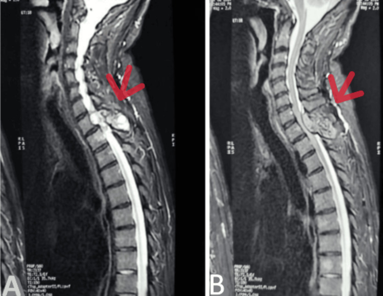
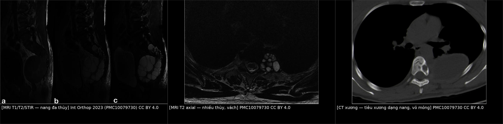
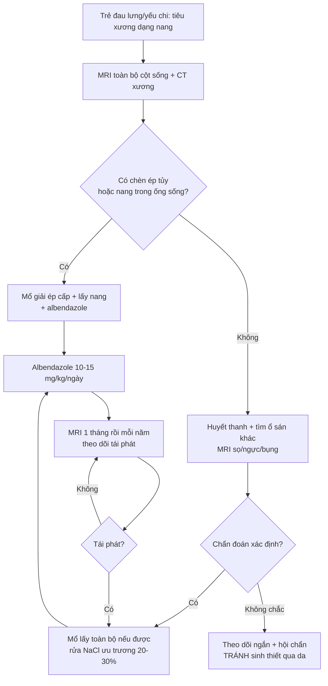
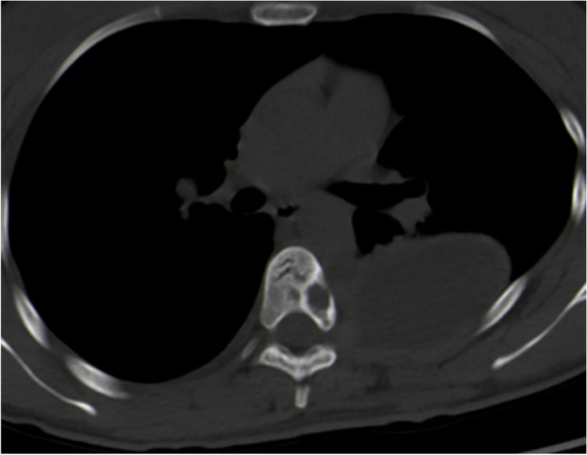
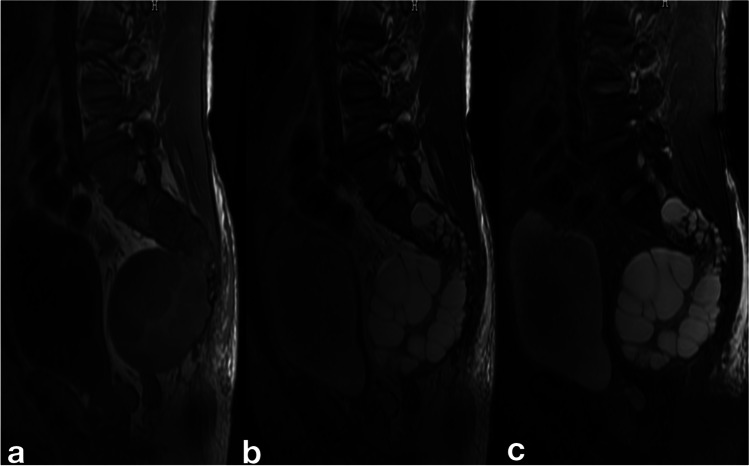
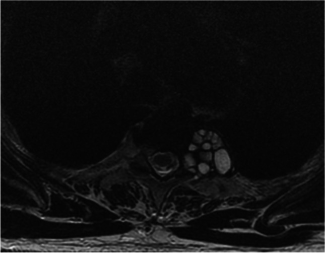

# 302 — Nang sán xương & cột sống ở trẻ: tiêu xương "chùm nho" & chèn ép tủy / Osseous & spinal hydatid disease in children

**Tags:** `pattern:tieu-xuong` `pattern:nang` `vung:cot-song` `vung:co-xuong-khop` `score:Braithwaite-Lees` `protocol:MRI-cot-song` `protocol:CT-xuong`
**Mức chắc chắn (certainty):** tổng hợp y văn (literature synthesis) — 1 review hệ cột sống + 3 đoàn hệ/ca bệnh có ảnh gốc; phần **đặc thù trẻ em** dựa trên các ca nhi được review trích dẫn và được ghi rõ là bằng chứng mức ca bệnh, không phải đoàn hệ nhi.

## 1. Tổng quan bệnh học – cơ chế hình ảnh

- **Tác nhân & đường vào:** *Echinococcus granulosus* (thể nang — CE) là chủ yếu; *E. multilocularis* (thể hang — AE) hiếm hơn nhưng cũng gây tổn thương xương. Ấu trùng theo đường máu tới xương; **xương chỉ chiếm 0,5–4% toàn bộ ca sán**, và **~45–50% ca xương nằm ở cột sống** (review PMC8142696; PMC10559363 ghi 45%).
- **Vì sao xương khác hoàn toàn nang sán ở gan/phổi:** xương **không có vỏ xơ (pericyst)** và không có khoang mềm để nang phồng lên. Các túi sán **mọc men theo bè xương (spongy bone)**, phá hủy từng bè một → hình **tiêu xương nhiều thùy, "chùm nho"**, bờ không có viền xơ đặc (non-sclerotic), **vỏ xương mỏng và phồng ra (cortical thinning)**, **không có phản ứng màng xương** (PMC10079730).
- **TẠI SAO hình ảnh như vậy:**
  - **X-quang:** vùng tiêu xương đa thùy, bờ mờ ("hazy"), **không có màng xương/không có gai xương**; **21,1% ca X-quang bình thường** trong đoàn hệ 44 ca (PMC10079730) — vì vậy **X-quang âm không loại trừ**.
  - **CT:** tổn thương **giảm đậm độ dạng nang, phồng xương, vách xương còn lại**, **không ngấm thuốc trung tâm**, chỉ có thể ngấm viền mỏng; vôi hóa gặp **13,2% trên X-quang nhưng 35% trên CT** (PMC10079730) — vôi hóa dạng **"cung đôi" (double layer arcuate)** được xem là khá đặc hiệu cho sán xương so với nang xương khác (PMC8142696 dẫn lại; PMC10079730).
  - **MRI:** nang chứa dịch → **T1 thấp, T2 rất cao**, các **vách/nang con T2 thấp** tạo hình **"chùm nho"/"bánh xe"**; không phù tủy lan rộng như viêm; sau tiêm chỉ **viền mỏng**. MRI là phương thức tốt nhất để đánh giá **chèn ép tủy, lan màng cứng và tái phát** (PMC8142696).
- **Ngưỡng định lượng dùng trong bài:** xương **0,5–4%** ca sán; cột sống **45–50%** ca xương; ngực **~50%**, lumbosacral **~29%**, thắt lưng **~21%** (PMC8142696); huyết thanh trong sán cột sống **Se 25% / Sp 56%** so với **Se 80–100% / Sp 88–96%** trong sán gan (PMC8142696); tái phát **30–100%**, **41%** trong 39 ca (PMC10559363), **52,2%** trong 44 ca (PMC10079730); mổ + hóa trị tái phát **5%** so với mổ đơn thuần **32%** (PMC8142696 dẫn Turgut).

## 2. Mẫu hình + chẩn đoán phân biệt theo vị trí (gamut)

- **Theo khoang giải phẫu (dùng cho mọi lứa tuổi, kể cả trẻ) — Braithwaite & Lees 5 type:**
  - **Type 1:** nang **trong tủy** (intramedullary) — cực hiếm.
  - **Type 2:** nang **trong màng cứng, ngoài tủy** (intradural extramedullary).
  - **Type 3:** nang **ngoài màng cứng, trong ống sống** (extradural intraspinal) — **hay gặp nhất**, 66,7% trong đoàn hệ 39 ca (PMC10559363).
  - **Type 4:** nang **trong thân đốt sống** (vertebral body), có thể lan ra cuống/cung sau.
  - **Type 5:** nang **cạnh sống** (paravertebral), có thể hình "quả tạ" (dumbbell).
- **Theo vị trí:** thân đốt sống (phổ biến) · **cung sau/cuống** (dễ nhầm u xương lành tính ở trẻ) · **ngoài màng cứng** (chèn ép tủy) · **cạnh sống/cơ dựng sống** · **xương chậu/xương đùi** (ổ chảo, cổ xương đùi).

*Tổn thương chiếm chỗ **khu trú ở mỏm gai D1** trên MRI sagittal — vị trí cung sau dễ bị đọc nhầm là u xương lành tính ở trẻ. Nguồn: Cureus 2025 (PMC12621072), Fig. 1 — CC BY 4.0.*

- **Gamut "tiêu xương dạng nang ở trẻ" (theo thứ tự cần loại trừ):** **lao cột sống (Pott)** · **Ewing sarcoma** · **nang xương phình mạch (ABC)** · **u tế bào khổng lồ (GCT)** · **di căn neuroblastoma** · **mô bào Langerhans (LCH)** · **viêm xương tủy** · **sán xương**.
- **Mẹo nhớ 4 dấu hiệu gợi ý sán xương:** **nang nhiều thùy + vỏ xương mỏng phồng + KHÔNG phản ứng màng xương + vôi hóa "cung đôi"** (kèm bối cảnh dịch tễ và tổn thương sán ở nơi khác).

## 3. Bảng so sánh phân biệt (ma trận đối chiếu)

| Thực thể (entity) | Hình ảnh điển hình | Chốt vào (rule-in) | Chốt loại (rule-out) | Gợi ý xác nhận |
|---|---|---|---|---|
| **Sán xương/cột sống** | Tiêu xương **nhiều thùy "chùm nho"**, vỏ xương mỏng phồng, **không màng xương**, vôi hóa "cung đôi", phần mềm cạnh sống dạng nang | **Nhiều thùy + không phản ứng màng xương + vôi hóa cung đôi + bối cảnh dịch tễ** | Phản ứng màng xương mạnh, phá hủy một khối đặc → nghĩ u ác | MRI + CT xương; huyết thanh (Se chỉ **25%** ở cột sống); **tránh sinh thiết/chọc hút** |
| **Lao cột sống (Pott)** | Hẹp/tiêu **đĩa đệm**, hai thân đốt kề nhau, áp-xe lạnh cạnh sống, vôi hóa ổ áp-xe | **Tiêu đĩa đệm + hai đốt kề + áp-xe lạnh** | Đĩa đệm còn nguyên, tổn thương nhiều thùy trong **một** thân đốt → nghĩ sán | X-quang + MRI; IGRA/PCR lao; **không dùng "đĩa còn nguyên" làm chốt tuyệt đối** (xem mục 5) |
| **Ewing sarcoma** | Tiêu xương **thấm thấu (permeative)**, phản ứng màng xương "vỏ hành", khối mô mềm lớn, sốt/đau | **Phản ứng màng xương + khối mô mềm đặc + tuổi 5–15** | Bờ địa phương hóa, không màng xương, dạng nang nhiều thùy → nghĩ sán/ABC | MRI, sinh thiết (bắt buộc với u ác) |
| **ABC (nang xương phình mạch)** | Nang **phồng xương**, mức dịch–dịch (fluid–fluid level), vỏ mỏng, trong cung sau/thân đốt | **Mức dịch–dịch + phồng xương + tuổi < 20** | Không mức dịch, có vôi hóa cung đôi, bối cảnh dịch tễ → nghĩ sán | MRI (fluid–fluid), CT |
| **Di căn neuroblastoma** | Tiêu xương thấm thấu nhiều đốt, khối cạnh sống, **canxi hóa mô mềm**, trẻ nhỏ | **Nhiều đốt + canxi hóa mô mềm + trẻ < 5 + ổ nguyên phát thượng thận** | Một ổ, dạng nang nhiều thùy, không ổ nguyên phát → nghĩ sán | MIBG, CT bụng, catecholamine |
| **GCT** | Tiêu xương **bờ rõ, không viền xơ**, đầu xương dài, tuổi 20–40 | **Bờ rõ + đầu xương + tuổi trưởng thành trẻ** | Nhiều thùy, vỏ mỏng, vôi hóa → nghĩ sán | MRI + sinh thiết |

*Trái: MRI T1/T2/STIR — nang đa thùy trong thân đốt và cạnh sống. Giữa: MRI T2 axial — nhiều thùy, vách mảnh. Phải: CT xương — tiêu xương dạng nang, vỏ xương mỏng, không phản ứng màng xương. Nguồn: Int Orthop 2023 (PMC10079730), CC BY 4.0; ảnh ghép letterbox, không crop.*

## 4. Protocol chụp + hệ phân độ/điểm chuẩn hóa

- **Chuỗi hình ảnh:** **MRI toàn bộ cột sống** (T1, T2, STIR, ± sau tiêm) là bắt buộc — đánh giá số tầng, **chèn ép tủy**, lan màng cứng, nang cạnh sống; **CT xương lát mỏng** để đánh giá vỏ xương/cung sau/vôi hóa và lập kế hoạch mổ; **X-quang** chỉ để định hướng (21,1% bình thường).
- **Huyết thanh:** ELISA/immunoblot — **độ nhạy chỉ 25%** trong sán cột sống; **trẻ có thể huyết thanh bình thường dù đang nhiễm** (PMC8142696). Vì vậy **huyết thanh âm không loại trừ**.
- **Chẩn đoán mô học:** ưu tiên **mô bệnh sau mổ**; **tránh sinh thiết/chọc hút qua da** vì nguy cơ **gieo rắc và sốc phản vệ** — khác với u xương thông thường (nơi sinh thiết là bắt buộc).
- **Phân độ:** **Braithwaite & Lees type 1–5** (mục 2) để chọn đường mổ và tiên lượng tái phát (thể trong màng cứng ít tái phát hơn).
- **Điều trị (nguyên tắc):**
  - **Phẫu thuật giải ép + lấy nang**: cắt cung sau/giải ép, cố gắng **lấy toàn bộ (total resection)**; đoàn hệ 39 ca đạt total **71,8%**, chỉ **12,9%** cần cố định cột sống (PMC10559363).
  - **Rửa NaCl ưu trương 20–30%** trong mổ để giảm gieo rắc (PMC12621072, PMC8142696); **không dùng formalin** (một ca tử vong do formalin trong y văn review).
  - **Albendazole 10–15 mg/kg/ngày** trước và sau mổ; các phác đồ đã công bố: **10 mg/kg/ngày × 4 tháng sau mổ** (PMC8142696) hoặc **800 mg/ngày × 3 tháng, nghỉ 15 ngày, lặp 3 đợt** ở người lớn (PMC12621072) — ở trẻ phải tính **theo cân nặng**.
  - **Bơm xi măng (bone cement) vào khoang sau cắt** là biện pháp được báo cáo làm **giảm tái phát** (PMC10079730).
- **Theo dõi:** MRI có cản quang **ngay sau mổ, 1 tháng, sau đó mỗi năm** (PMC10559363); mục tiêu phát hiện tái phát sớm — trung vị tái phát **12,8 tháng** (6–24 tháng).

## 5. Biến thể bình thường và cạm bẫy

- **X-quang bình thường:** **21,1%** ca trong đoàn hệ 44 ca (PMC10079730) — trẻ đau lưng kéo dài với X-quang "sạch" vẫn phải MRI nếu có cờ đỏ (đau đêm, yếu chi, sốt nhẹ, bối cảnh dịch tễ).
- **Đĩa đệm "còn nguyên" không loại trừ lao — và cũng không chốt được sán:** nhiều nguồn dạy rằng sán **thường không phá đĩa đệm** (PMC8142696: "in most cases, the intervertebral disc is not affected"; PMC9806501: đa số đĩa còn nguyên) nên đĩa nguyên = gợi ý sán, tiêu đĩa = gợi ý lao. **Nhưng chính review PMC8142696 ở đoạn khác lại viết nang "often affect the intervertebral discs"**, và đoàn hệ Trung Quốc ghi **hẹp đĩa ở 11 ca** (PMC10079730). Kết luận thực hành: **không dùng một dấu hiệu đĩa đệm để chốt**, phải phối hợp bờ tổn thương, màng xương, vôi hóa và xét nghiệm lao.
- **Cạm bẫy "u xương lành tính ở trẻ":** nang sán ở **cung sau/cuống** rất giống ABC hoặc LCH; thiếu mức dịch–dịch và có vôi hóa "cung đôi" là gợi ý sán.
- **Huyết thanh âm ở trẻ:** đã ghi nhận trẻ nhiễm vẫn huyết thanh bình thường (PMC8142696) — đừng loại trừ vì xét nghiệm âm.
- **Sinh thiết/chọc hút = nguy hiểm:** gây **gieo rắc và sốc phản vệ**; nếu buộc phải lấy mô, thực hiện trong mổ có kiểm soát và che chắn.
- **Vỡ nang trong mổ là yếu tố tái phát mạnh nhất:** **76,9%** ca tái phát có vỡ nang trong lần mổ đầu (PMC10559363); tổn thương **ngực** có nguy cơ tái phát gấp **2,35 lần** (95% CI 0,51–11).
- **Cạm bẫy hình ảnh:** nang sán **không ngấm thuốc trung tâm** — đừng đọc "hoại tử u" rồi chuyển hướng ung thư; ngược lại, khối **đặc ngấm thuốc** không phải sán.

## 6. Tự lượng giá — Blind Quiz

> Ảnh minh họa lấy từ đoàn hệ **người lớn** (19–68 tuổi) vì đây là nguồn có ảnh mở, giấy phép rõ; **mẫu hình giống ở trẻ**, nhưng đừng suy ra tỷ lệ tuổi từ ảnh.

**Ca 1 — CT xương ngực của bệnh nhân trưởng thành ở vùng dịch tễ sán. Nhìn ảnh, mô tả kiểu tiêu xương trước.**

- Câu hỏi: Kiểu tiêu xương? Có phản ứng màng xương không? Có dấu hiệu nào gợi ý nang chứ không phải u đặc?

<b>Bấm để hiện đáp án (findings + chẩn đoán)</b>

- **Dấu hiệu:** **tiêu xương dạng nang, phồng xương** ở thân đốt T9, **vỏ xương mỏng**, **không phản ứng màng xương**, kèm **túi nang trong mô mềm cạnh sống bên trái**.
- **Chẩn đoán:** **sán xương/cột sống (type 4 + type 5)** — mô bệnh sau mổ xác nhận.
- **Vì sao:** bè xương bị phá từng phần tạo nhiều thùy, không có vỏ xơ → không viền đặc, không màng xương.
- **Nguồn:** *Int Orthop* 2023 (PMC10079730), Fig. 2 — CC BY 4.0.

**Ca 2 — Cùng bệnh nhân, MRI được chỉ định. Đọc chuỗi xung trước khi mở đáp án.**

- Câu hỏi: Tín hiệu trên T1, T2 và STIR nói lên bản chất gì? Vì sao có "vách" tối bên trong?

<b>Bấm để hiện đáp án</b>

- **Dấu hiệu:** tổn thương **đa thùy**, **T1 thấp, T2 cao, STIR cao** (dịch), **vách tối** (mô xơ/bè xương còn lại) → hình "chùm nho".
- **Chẩn đoán:** nang sán đa thùy trong thân đốt + cạnh sống.
- **Vì sao:** dịch có T1 dài/T2 dài; vách xơ và bè xương còn lại có ít proton linh động → tối trên T2.
- **Nguồn:** *Int Orthop* 2023 (PMC10079730), Fig. 8 — CC BY 4.0.

**Ca 3 — MRI T2 axial của một ca sán cột sống. Tổn thương nằm ở khoang nào và vì sao phải mổ sớm?**

- Câu hỏi: Tổn thương nằm ở khoang nào? Nếu chọc hút để "xác định bản chất" thì nguy cơ gì?

<b>Bấm để hiện đáp án</b>

- **Dấu hiệu:** khối **nhiều thùy, vách mảnh**, nằm **cạnh sống và lan vào ống sống** gây chèn ép; tín hiệu dịch (T2 sáng).
- **Chẩn đoán:** nang sán **type 3/5** có thành phần trong ống sống — chỉ định **giải ép sớm** vì chèn ép tủy tiến triển.
- **Nguy cơ khi chọc hút:** **gieo rắc ký sinh và sốc phản vệ** do dịch nang rất sinh kháng nguyên → **không sinh thiết/chọc hút qua da**.
- **Nguồn:** *Int Orthop* 2023 (PMC10079730), Fig. 7 — CC BY 4.0. **Bằng chứng nhi:** review PMC8142696 ghi nhận một bé trai **8 tuổi** đau lưng **7 tháng**, yếu hai chân, đại tiểu tiện không tự chủ do sán thắt lưng ngoài màng cứng — ảnh minh họa ở đây là của đoàn hệ người lớn, không phải của bé.

## Bài liên quan chéo

- [300 – Tổng quan hệ Cơ – Xương – Khớp](../300-tong-quan-he-co-xuong-khop/lesson.md)
- [144 – Sán thể hang ở gan](../144-san-the-hang-o-gan/lesson.md)
- [139 – Sán lá gan & nang sán gan](../139-san-la-gan/lesson.md)
- [222 – Viêm đốt sống (spondylodiscitis) & lao cột sống](../222-viem-dot-song/lesson.md)
- [223 – Chấn thương tủy sống](../223-chan-thuong-tuy-so/lesson.md)
- [225 – Hội chứng tủy không hoàn toàn](../225-hoi-chung-tuy-khong-hoan-toan/lesson.md)
- [331 – U ác xương ở người lớn](../331-u-ac-nguoi-lon/lesson.md)
- [332 – U xương nguyên phát](../332-u-nguyen-phat/lesson.md)
- [640 – Khớp háng nhi: DDH, Perthes, SCFE & NAT](../640-khop-hang-nhi-DDH-Perthes-SCFE-va-NAT/lesson.md)

## Ảnh

- Tên file: `302_nang-san-xuong_<Modality>_<SourceID>.jpg`; nguồn + giấy phép từng ảnh ở `images/CREDITS.md`.
- Ảnh ghép `composite_302_nang-san-cot-song.jpg` tạo bằng `tools/make_composite.py` (letterbox nền đen, **không crop/kéo giãn**).

> Không dùng để chẩn đoán độc lập khi chưa có người hướng dẫn.
