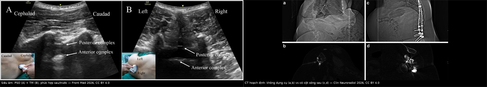
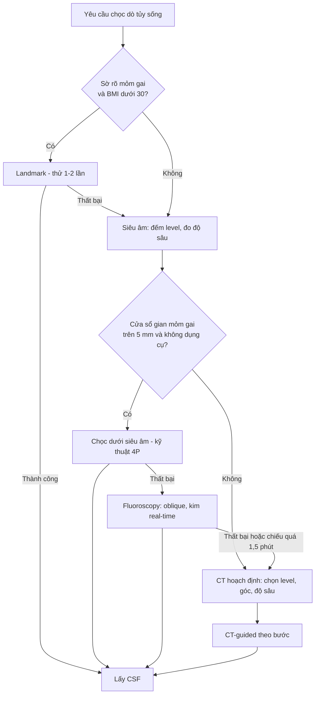
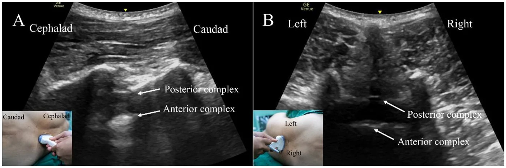
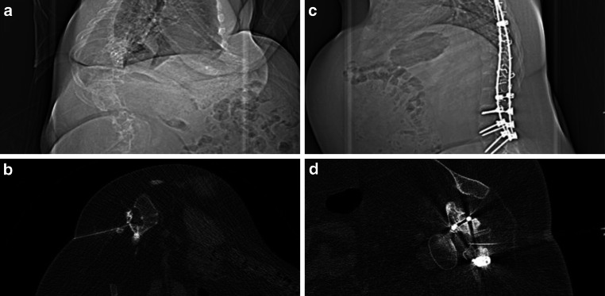

# 3020 — Chọc dò tủy sống khó dưới hướng dẫn hình ảnh: siêu âm, fluoroscopy hay CT?

**Tags:** `pattern:mat-moc-giai-phau` `pattern:khoang-gian-mom-gai-hep` `vung:cot-song-that-lung` `anatomy:ong-song-that-lung` `protocol:sieu-am-cot-song` `protocol:fluoroscopy` `protocol:CT-guided`
**Mức chắc chắn (certainty):** tổng hợp y văn (literature synthesis) — ghép **RCT siêu âm hỗ trợ chọc dò ở ngoại trú thần kinh** (PMC11933744), **RCT kỹ thuật paramedian cải biên dưới siêu âm** (PMC13581877), **ca loạt 2 bệnh nhân kỹ thuật “angle-free”** (PMC13678886), **hồi cứu CT-guided 458 lượt chọc** (PMC13319867), **so sánh fluoroscopy tư thế sấp vs nằm nghiêng** (PMC8594753), **kim atraumatic trong fluoroscopy** (PMC10230379) và **benchmark thời gian chiếu theo BMI** (PMC7964430). Nhiều thiết kế khác nhau, không phải một ca → không gắn nhãn ca nguyên văn.

> **Bài này trả lời câu hỏi đặt ra ngay khi bệnh nhân nằm sấp mà không sờ thấy mốm gai: “chọc mù tiếp, gọi siêu âm, hay đẩy xuống phòng fluoroscopy/CT?”** Chốt không nằm ở “máy nào xịn hơn” mà ở **tầng nào đang thất bại**: mất mốc (landmark) → **siêu âm**; có mốc nhưng đường kim bị chặn → **fluoroscopy**; biến dạng/xoay vẹo/dụng cụ → **CT**. Nối [3014 – Đau đầu sau chọc dò](../3014-dau-dau-sau-choc-do-tuy-song/lesson.md), [3016 – Hạ áp lực nội sọ tự phát](../3016-ha-ap-luc-noi-so-tu-phat/lesson.md) và [3018 – IIH người lớn](../3018-tang-ap-luc-noi-so-tu-phat-nguoi-lon/lesson.md) — ba bài mà **giá trị của một lần chọc dò thành công** quyết định chẩn đoán.

## 1. Tổng quan bệnh học – cơ chế hình ảnh

- **Đường kim bình thường (từ ngoài vào):** da → mô dưới da → dây chằng trên gai (supraspinous) → dây chằng gian gai (interspinous) → **dây chằng vàng (ligamentum flavum)** → khoảng ngoài màng cứng → **màng cứng (dura)** → màng nhện → **dịch não tủy (CSF)**. Mỗi lớp là một “cửa sổ” có đậm độ/tín hiệu riêng trên hình ảnh → đó là cơ sở để đo **độ sâu da → phức hợp sau** trước khi chọc.
- **Vì sao chọc mù thất bại:** kỹ thuật dựa mốc (landmark) cần **sờ được mỏm gai và khoảng gian gai**. Khi lớp mỡ dày, sờ chỉ cảm nhận được một vùng mềm đồng nhất → ước lượng đường giữa và độ sâu sai. Y văn ghi nhận **tới 30% mũi chọc mù đi lệch hướng**, tỉ lệ thành công chung **70–80%**; phân tích gộp cho thấy siêu âm hỗ trợ đạt **90–95%** (PMC11933744).
- **Vì sao siêu âm “nhìn xuyên” được mà tay thì không:** siêu âm không phụ thuộc lực ấn; đầu dò **2–5 MHz** (curvilinear) xuyên sâu **12–15 cm** ở người béo, đầu dò **6–13 MHz** (linear) cho người gầy. **Xương chặn sóng hoàn toàn (acoustic shadowing)** → chỉ **cửa sổ gian mỏm gai** (phần mô mềm giữa 2 mỏm gai) là nhìn được; vì vậy phép đo có giá trị phải lấy **đúng tại cửa sổ sẽ chọc**, không phải cạnh mỏm gai.
- **Ba lớp hồi âm trên trục dọc giữa (midline sagittal):** da/mô dưới da (hỗn hợp) → **phức hợp sau (posterior complex)** = dây chằng vàng + màng cứng, đường **tăng hồi âm dày** → **phức hợp trước (anterior complex)** = thành sau thân đốt + dây chằng dọc sau, đường tăng hồi âm thứ hai; **CSF là khoang trống không hồi âm** giữa hai đường. Đo **khoảng cách da → phức hợp sau (mm)** chính là độ sâu kim cần đi.
- **Vì sao đo được “cửa sổ hẹp” bằng số:** trên CT hoạch định, **chiều rộng gian mỏm gai** và **diện tích cắt ngang túi màng cứng** quyết định level nào chọc được. Trong ca loạt có biến dạng nặng, level tốt nhất chỉ rộng **4,6 mm** (L3–4 phải); ở ca 2, cửa sổ L4–5 có **bề rộng ngang 12,4 mm**, **chiều dài trên–dưới 8,2 mm** và đường chọc ngang **8,2 mm** (PMC13678886). Dưới **5 mm** thì “cảm giác kim” gần như vô dụng — phải có hình ảnh dẫn đường.
- **Vì sao fluoroscopy khác CT:** fluoroscopy cho **hình chiếu 2D tức thời** (nhìn được kim đi, chỉnh góc real-time, liều thấp) nhưng **không thấy mô mềm** → không biết túi màng cứng còn bao nhiêu, không thấy dây chằng vàng. CT cho **lát cắt thật**: thấy túi màng cứng, dụng cụ, độ sâu và góc; đổi lại **liều cao hơn** và **không real-time** (chọc theo bước, kiểm tra lại).
- **Số liệu định lượng phải nhớ:**
  - **Chọc mù:** thành công **70–80%**, tới **30%** mũi đi lệch (PMC11933744). Siêu âm hỗ trợ trong phân tích gộp: **90–95%**.
  - **RCT ngoại trú (n = 35):** landmark **91% (20/22)** vs siêu âm **100% (13/13)**, p > 0,05; thời gian **13 vs 19 phút** (p < 0,05). Nhóm nguy cơ cao (tuổi > 50, mổ lưng cũ, **BMI > 35**, n = 27): siêu âm **100% vs 88,2%** (p = 0,71), đau đầu sau chọc **0% vs 17,6%**, nhưng **chậm hơn 20 vs 13 phút** (p = 0,042); số lần chọc **1,5 vs 1,65** (p = 0,61) (PMC11933744).
  - **RCT kỹ thuật paramedian cải biên dưới siêu âm (n = 116):** lần chọc đầu thành công **63,79% vs 43,10%** (p = 0,026); trung vị số lần chọc **1 (1–2) vs 2 (1–3)** (p = 0,006); thời gian thủ thuật **76,5 vs 82,0 giây** (p = 0,031) (PMC13581877).
  - **CT-guided (458 lượt/44 bệnh nhân SMA):** thành công kỹ thuật **98,3% (449/458)**; có dụng cụ cột sống sau **97,1% vs 98,8%**; biến chứng **1,1% (5/458)**; thời gian chọc **11,9 vs 10,3 phút**, thủ thuật **16,3 vs 14,0 phút**; **liều hiệu dụng 2,22 vs 1,74 mSv** (p < 0,05) (PMC13319867).
  - **Fluoroscopy tư thế:** nằm nghiêng (LD) vs sấp — thành công **98,3% vs 89,1%** (p = 0,04); thời gian phòng **64,46 vs 77,77 phút** (p = 0,04); thời gian chiếu **0,97 vs 1,07 phút** (p = 0,21), DAP **43,18 vs 42,06** (p = 0,38) (PMC8594753).
  - **Kim atraumatic trong fluoroscopy (207 lượt):** thời gian chiếu trung vị **41 vs 48 giây**, DAP **3,28 vs 3,14**, số lần chọc **1,05 vs 1,02** — không tăng độ khó (PMC10230379).
  - **Benchmark theo BMI (584 bệnh nhân):** thời gian chiếu tăng có ý nghĩa theo BMI (P = 0,001); trung bình **1,07 phút** ở nữ (BMI 34,4) và **0,91 phút** ở nam (PMC7964430). Vượt xa mức này = đang dò mù trong fluoroscopy, nên chuyển CT.
  - **CT vs fluoroscopy ở người béo đã thất bại chọc mù:** CT **14 phút**, DLP **120 mGy·cm**, liều hiệu dụng **1,98 mSv**; fluoroscopy **12 phút**, DAP **10 Gy·cm²**, liều hiệu dụng **2,9 mSv** — cả hai đều thấp, CT không “đắt” hơn về liều trong nghiên cứu này (PMID 23729498).

## 2. Mẫu hình + chẩn đoán phân biệt theo tầng thất bại (gamut)

- **Nguyên tắc:** không chọn theo “thói quen khoa”, chọn theo **tầng nào hỏng**. Ba tầng: **(M) mốc – (Đ) đường – (ĐÍ) đích**.
- **Mất mốc (M) — sờ không tin được:** **BMI > 30–35**, phù toàn thân, sẹo mổ/ghép da vùng thắt lưng, dị tật nhẹ, bệnh nhân không ngồi được. → **Siêu âm đánh dấu + đo độ sâu** là bước rẻ nhất, không liều, làm ngay tại giường.
- **Đường kim bị chặn (Đ) — có mốc nhưng kim không qua:** thoái hóa nặng, dày/dính dây chằng, gai đôi, hẹp gian mỏm gai < 5 mm, đốt sống chồng (degenerative scoliosis mức trung bình). → **Fluoroscopy** (nghiêng/oblique mở cửa sổ, thấy kim theo thời gian thực) hoặc **CT** nếu cần thấy túi màng cứng.
- **Đích bất thường (ĐÍ) — biến dạng lớn, xoay vẹo, có dụng cụ:** **Cobb 83–90°**, cột sống sau mổ/dụng cụ (spondylodesis), cắt bán phần đốt sống, túi màng cứng teo nhỏ (L5–S1 ở người lớn), đứt dây chằng. → **CT hoạch định ± CT-guided**, kết hợp **siêu âm định vị** để chọn điểm vào.
- **Gamut theo bối cảnh lâm sàng:**
  - **Ngoại trú thần kinh, BMI bình thường, mốc rõ:** landmark là đủ; siêu âm **không** rút ngắn thời gian (13 vs 19 phút) (PMC11933744).
  - **Cấp cứu, nghi viêm màng não:** ưu tiên **nhanh + không trì hoãn kháng sinh**; siêu âm tại giường là lựa chọn hợp lý khi mốc mờ.
  - **Béo + suy hô hấp (không nằm sấp được):** chọc **tư thế nằm nghiêng** dưới fluoroscopy — thành công cao hơn nằm sấp (98,3% vs 89,1%) (PMC8594753).
  - **Trẻ bị SMA/thoái hóa cơ cần tiêm nội tủy lặp lại:** CT-guided có tỉ lệ thành công **98,3%** nhưng cộng dồn liều qua hàng trăm lượt → phải tối ưu protocol (PMC13319867).
  - **Sau mổ cột sống có dụng cụ, đau đầu/thấy mờ:** đừng chọc mù qua vùng dụng cụ; CT thấy túi màng cứng và khoảng an toàn.
- **Gợi nhớ 3 tầng:** **“Sờ – Đường – Đích”**: Sờ mất → siêu âm; Đường tắc → fluoroscopy; Đích méo → CT.

## 3. Bảng so sánh phân biệt (ma trận đối chiếu)

| Thực thể (entity) | Hình ảnh / kỹ thuật điển hình | Chốt vào (rule-in) | Chốt loại (rule-out) | Gợi ý xác nhận |
|---|---|---|---|---|
| **Landmark (chọc mù)** | Không hình ảnh; dựa mốm gai + khoảng gian gai | **Sờ rõ mỏm gai + BMI < 30 + không mổ lưng cũ** | **Mốc không sờ thấy, BMI > 35, sẹo mổ, biến dạng** → không nên là lựa chọn đầu | Thử 1–2 lần; thất bại → đổi tầng, không “cố” quá 3 lần |
| **Siêu âm hỗ trợ (US-assisted)** | Trục dọc giữa: phức hợp sau/trước, đo da → phức hợp sau; trục ngang: đường giữa | **Mốc mờ + cần đo độ sâu/đường giữa; làm tại giường** | **Cobb > 40°, dụng cụ cột sống, cửa sổ < 5 mm** → siêu âm không đủ, cần CT | Đo mm, đánh dấu da **ở đúng tư thế sẽ chọc** |
| **Fluoroscopy** | Chiếu 2D, oblique mở gian mỏm gai; thấy kim real-time | **Có mốc nhưng đường chặn; béo không nằm sấp được (LD)** | **Biến dạng xoay vẹo nặng, cần thấy túi màng cứng/dụng cụ** → CT | Thời gian chiếu > 1–1,5 phút (BMI > 30) = dừng, chuyển CT |
| **CT-guided** | Lát cắt thật: túi màng cứng, dụng cụ, góc và độ sâu | **Spondylodesis, Cobb lớn, túi màng cứng teo, thất bại 2 phương thức** | **Thai, trẻ nhỏ cần lặp nhiều lần, chỉ cần 1 lần chọc dễ** → ưu tiên siêu âm/fluoroscopy | Liều: ED **1,74–2,22 mSv**/lượt (PMC13319867); ghi DLP từng lượt |
| **CT + siêu âm định vị (kết hợp)** | CT chọn level + đo; siêu âm chọn điểm vào theo tư thế | **Biến dạng nặng nhưng vẫn muốn đường chọc “thẳng, không góc”** | **Bệnh nhân không hợp tác, không giữ tư thế** | Kỹ thuật 4P: Planning – Positioning – Perpendicular – Parallel |
| **Chọc dưới DSA/myelo (đặc biệt)** | Đặt kim dưới fluoroscopy rồi bơm thuốc cản quang | **Cần định vị rò CSF (SIH), chụp tủy** | **Chỉ cần lấy CSF xét nghiệm** → không cần cản quang | Xem bài [3016](../3016-ha-ap-luc-noi-so-tu-phat/lesson.md) |

*Trái: **A** trục dọc xiên (PSO) — phức hợp sau (dây chằng vàng + màng cứng) và phức hợp trước (thành sau thân đốt) là hai đường tăng hồi âm, khoảng không hồi âm giữa là CSF; **B** trục ngang (TM) xác định đường giữa. Ảnh nhỏ: hướng đầu dò. Phải: CT hoạch định — **(a,b)** không dụng cụ: đường kim thẳng, mốc rõ; **(c,d)** có cột sống sau (spondylodesis): cửa sổ bị dụng cụ che, phải chọn level và góc khác. Nguồn: Frontiers in Medicine 2026 (PMC13581877) Fig. 1 và Clinical Neuroradiology 2026 (PMC13319867) Fig. 2 — cả hai **CC BY 4.0**; ảnh ghép letterbox, không crop.*

### Đọc ảnh theo thứ tự (dùng cho mọi ca khó)

1. **Đếm level:** bắt đầu từ **khớp cùng–chậu (lumbosacral junction)** trượt lên, không đếm từ “chỗ cao nhất sờ thấy”.
2. **Đo cửa sổ:** bề rộng gian mỏm gai (mm) và độ sâu da → phức hợp sau (mm) **tại đúng level sẽ chọc**.
3. **Chọn đường:** trục dọc giữa cho biết độ nghiêng; trục ngang cho biết lệch trái/phải; nếu cửa sổ < 5 mm → chuyển CT.
4. **Đánh dấu + giữ nguyên tư thế:** đổi tư thế làm **da trượt trên mỏm gai** → dấu mất giá trị (đây là lý do kỹ thuật “angle-free” nhấn mạnh *positioning trước, marking sau*).

## 4. Protocol chụp / thủ thuật + ngưỡng quyết định

- **Siêu âm (đầu tay, không liều):**
  - Đầu dò **curvilinear 2–5 MHz** nếu BMI > 30; **linear 6–13 MHz** nếu gầy. Đặt **trục dọc xiên** song song trục ống sống để đếm level; xoay **90°** lấy trục ngang xác định đường giữa.
  - Tư thế **ngồi cúi** hoặc **nằm nghiêng gối sát bụng** — chọn tư thế **sẽ dùng để chọc** và đo tại đó.
  - Đo **da → phức hợp sau** (mm), ghi vào phiếu; dùng **gel vô khuẩn + bọc đầu dò** nếu chọc ngay dưới hướng dẫn.
  - Kỹ thuật **4P** (PMC13678886): **P**lanning (xem CT/MRI cũ, chọn level), **P**ositioning (chỉnh tư thế để đường chọc vuông góc với mặt giường), **P**erpendicular (kim vuông góc mặt da), **P**arallel (kim song song mặt sàn) → loại bỏ hoàn toàn góc nghiêng trước–sau/trong–ngoài.
- **Fluoroscopy:**
  - Tư thế **nằm nghiêng (LD)** nếu béo/không nằm sấp: thành công **98,3% vs 89,1%**, thời gian phòng ngắn hơn ~13 phút (PMC8594753).
  - Oblique **10–30°** để mở gian mỏm gai; kim **20–22G**, dài **9–15 cm** ở người béo; kiểm tra kim mỗi **5–10 mm** khi qua mô sâu.
  - **Kim atraumatic dùng được** trong fluoroscopy mà không tăng thời gian chiếu (41 vs 48 giây) hay số lần chọc → giảm đau đầu sau chọc (PMC10230379; xem [3014](../3014-dau-dau-sau-choc-do-tuy-song/lesson.md)).
  - **Ngưỡng dừng:** nếu thời gian chiếu **> 1–1,5 phút** ở BMI > 30 (benchmark 0,91–1,07 phút, PMC7964430) mà chưa vào → dừng, chuyển CT thay vì chiếu tiếp.
- **CT-guided:**
  - Chọn level trên **scout + lát cắt ngang**; đo **độ sâu, góc, khoảng cách tới túi màng cứng**; đánh dấu laser.
  - Vào kim theo bước, **kiểm tra lại bằng lát cắt mỏng** (không chiếu liên tục); ghi **DLP/CTDIvol** từng lượt.
  - Liều tham chiếu: **DLP ~120 mGy·cm, ED 1,74–2,22 mSv** (PMID 23729498; PMC13319867) — với bệnh nhân tiêm lặp lại (SMA) phải có **ngưỡng liều cộng dồn** và cân nhắc fluoroscopy cho lần sau.
- **Chống chỉ định / chuyển tuyến:** nhiễm trùng da vùng chọc, tăng áp lực nội sọ có nguy cơ tụt não (chụp CT trước), rối loạn đông máu chưa xử lý, bệnh nhân không hợp tác. Ngưỡng đông máu dùng trong thực hành (INR, tiểu cầu) **khác nhau giữa các hướng dẫn** — đối chiếu quy trình bệnh viện và bản gốc ASRA trước khi quyết định, không suy từ bài này.

## 5. Biến thể bình thường và cạm bẫy

- **Biến thể bình thường:**
  - **Gai đôi/khuyết cung sau (spina bifida occulta)** ở S1: cửa sổ “rộng bất thường” trên siêu âm nhưng **không có dây chằng vàng** → kim đi sâu hơn dự kiến; đừng lấy “cửa sổ rộng” làm dấu hiệu an toàn.
  - **Mỏm gai L5 ngắn, hướng ra sau** — dễ nhầm level; luôn đếm từ khớp cùng–chậu.
  - **Khoang ngoài màng cứng rộng ở người béo** → “mất lực cản” xảy ra sớm, kim còn cách CSF vài mm.
- **Cạm bẫy:**
  - **Đo ở tư thế này, chọc ở tư thế khác:** da trượt **1–2 cm** khi ngồi ↔ nằm nghiêng → điểm đánh dấu lệch khỏi cửa sổ. Đo và chọc **cùng tư thế**.
  - **Đầu dò nghiêng:** tâm đầu dò không chiếu đúng xuống da → sai đường vào (chính là hạn chế mà kỹ thuật “angle-free” sinh ra để khắc phục).
  - **Kim quá ngắn ở BMI > 35:** kim 9 cm có thể không tới khoang dưới nhện; đo độ sâu trước, chọn kim **≥ độ sâu + 2 cm**.
  - **Bơm khí để mất lực cản (loss of resistance to air)** có thể gây **khí nội sọ/đau đầu** — dùng **nước muối**.
  - **“Không có CSF” ≠ chọc sai:** có thể kim lệch sang bên (khoang ngoài màng cứng), hoặc túi màng cứng teo (L5–S1 người lớn) → kiểm tra level bằng hình ảnh trước khi chọc lại.
  - **Fluoroscopy thấy kim “đúng” mà vẫn khô:** hình 2D không loại trừ kim nằm trước/sau túi màng cứng → xoay C-arm hoặc chuyển CT.

## 6. Tự lượng giá — Blind Quiz

**Ca 1 — Nữ 41 tuổi, BMI 38, tiền sử mổ lưng 2 lần; không sờ rõ mỏm gai. Ảnh siêu âm dưới đây.**

- Gợi ý: bệnh nhân nằm nghiêng, đầu dò curvilinear. Không có ảnh CT cũ.
- Câu hỏi: hai đường tăng hồi âm trong ảnh A là gì? Đo gì để chọn độ dài kim? Vì sao phải lấy cả ảnh B?

<b>Bấm để hiện đáp án</b>

- **A (trục dọc xiên):** đường trên = **phức hợp sau** (dây chằng vàng + màng cứng), đường dưới = **phức hợp trước** (thành sau thân đốt + dây chằng dọc sau); khoảng **không hồi âm** giữa hai đường là **CSF**. Đo **da → phức hợp sau** để chọn kim dài hơn độ sâu ≥ 2 cm.
- **B (trục ngang):** xác định **đường giữa** và độ lệch của cửa sổ sang trái/phải — nếu chỉ có A, kim dễ đi lệch bên trong mô mỡ dày.
- **Chẩn đoán:** chọc dò khó do **mất mốc + sẹo mổ** → **siêu âm hỗ trợ** là bước đầu; nếu cửa sổ < 5 mm hoặc thất bại → chuyển CT.
- **Nguồn ảnh:** Frontiers in Medicine 2026 (PMC13581877), Fig. 1, CC BY 4.0.

**Ca 2 — Nam 29 tuổi, SMA, đã đặt dụng cụ cột sống sau; cần tiêm nội tủy lần thứ 12.**

- Gợi ý: ảnh scout (a,c) và lát cắt ngang (b,d).
- Câu hỏi: khác biệt then chốt giữa hai bệnh nhân? Vì sao không dùng fluoroscopy đơn thuần ở (c,d)? Cần ghi gì vào phiếu sau thủ thuật?

<b>Bấm để hiện đáp án</b>

- **(a,b)** không dụng cụ: đường kim thẳng, mốc giải phẫu rõ → chọc dưới hướng dẫn đơn giản.
- **(c,d)** có **dụng cụ cột sống sau**: cửa sổ bị che, phải chọn level và góc khác; fluoroscopy 2D **không thấy túi màng cứng** và dễ coi thanh dụng cụ là mốc → **CT** cho câu trả lời.
- **Số liệu:** CT-guided thành công **98,3%**, có dụng cụ **97,1%**, biến chứng **1,1%**, liều hiệu dụng **2,22 vs 1,74 mSv** (PMC13319867) → với người tiêm lặp lại, **ghi liều từng lượt** và cân nhắc giảm kV/giảm số lát.
- **Nguồn ảnh:** Clinical Neuroradiology 2026 (PMC13319867), Fig. 2, CC BY 4.0.

## Bài liên quan chéo
- [3014 – Đau đầu sau chọc dò tủy sống (PDPH)](../3014-dau-dau-sau-choc-do-tuy-song/lesson.md) (kim atraumatic, blood patch)
- [3016 – Hạ áp lực nội sọ tự phát](../3016-ha-ap-luc-noi-so-tu-phat/lesson.md) (chọc dò + myelography định vị rò)
- [3018 – Tăng áp lực nội sọ tự phát ở người lớn](../3018-tang-ap-luc-noi-so-tu-phat-nguoi-lon/lesson.md) (áp lực mở)
- [3012 – Áp-xe ngoài màng cứng sau gây tê ngoài màng cứng](../3012-apxe-ngoai-mang-cung-sau-gay-te-ngoai-mang-cung/lesson.md) (biến chứng thủ thuật)
- [3017 – Gãy nén đốt sống & bơm xi măng](../3017-gay-nen-dot-song-loang-xuong-vertebroplasty/lesson.md) (thủ thuật cột sống dưới hình ảnh)

## Ảnh
- `3020_sieu-am-cot-song_US-PMC13581877-F1.jpg` — siêu âm PSO + TM, Frontiers in Medicine 2026 (PMC13581877), Fig. 1, CC BY 4.0.
- `3020_ct-hoach-dinh_CT-PMC13319867-F2.jpg` — CT hoạch định có/không dụng cụ, Clinical Neuroradiology 2026 (PMC13319867), Fig. 2, CC BY 4.0.
- `composite_sieu-am-vs-ct.jpg` — ảnh ghép letterbox từ hai ảnh trên (cả hai CC BY 4.0), tạo bằng `tools/make_composite.py`.
- Nguồn + giấy phép từng ảnh: `images/CREDITS.md`.

> Không dùng để chẩn đoán độc lập khi chưa có người hướng dẫn.
