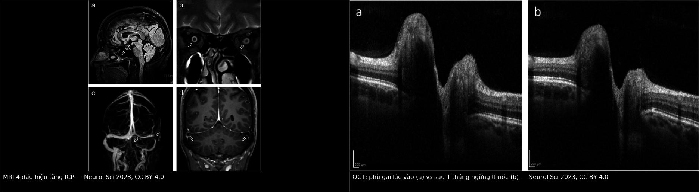
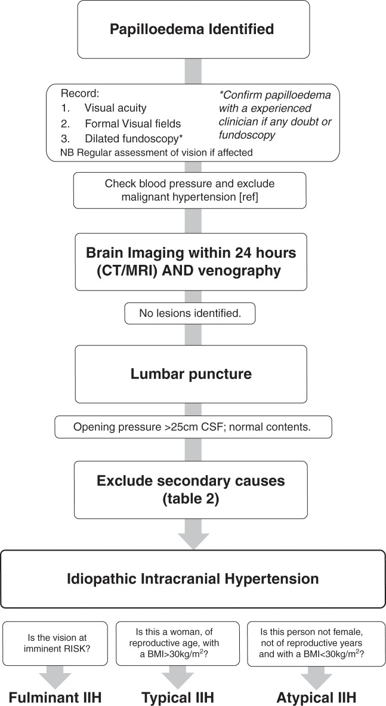
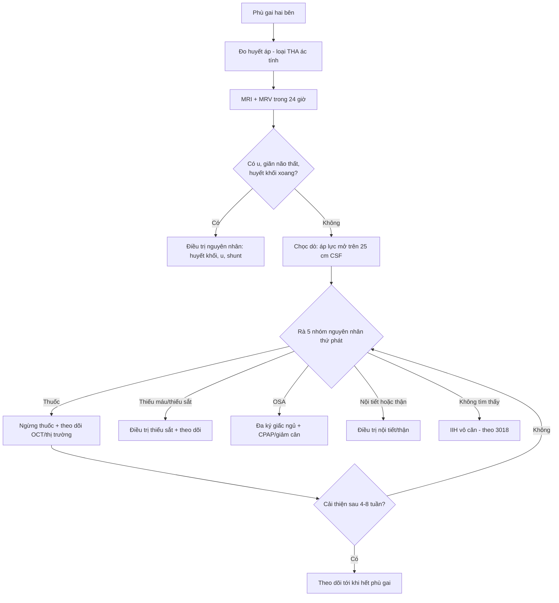
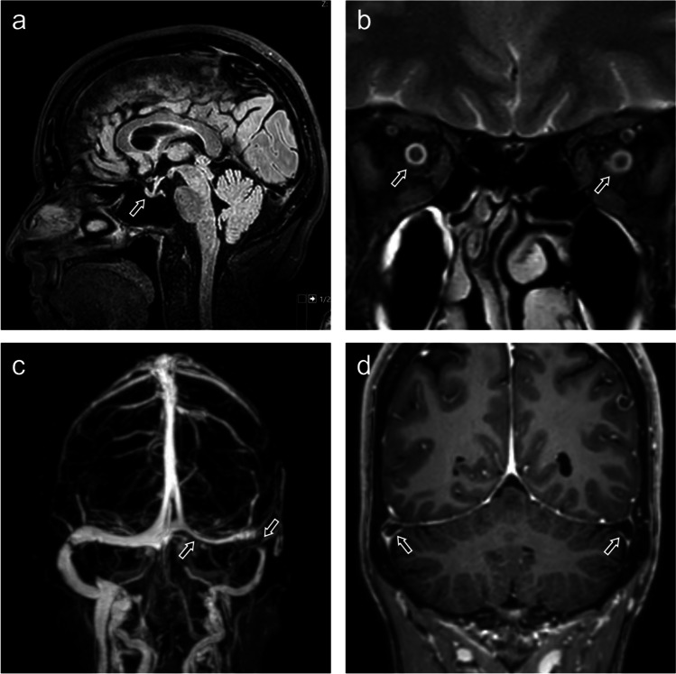
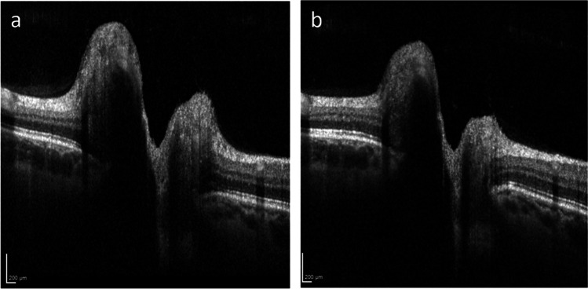

# 3021 — Tăng áp lực nội sọ THỨ PHÁT: thuốc, thiếu máu, ngưng thở khi ngủ — khi nào KHÔNG được gọi là IIH

**Tags:** `pattern:phu-gai-thi` `pattern:hep-xoang-tinh-mach` `vung:gai-thi` `anatomy:gai-thi` `score:Frisen` `protocol:MRV` `protocol:OCT-RNFL`
**Mức chắc chắn (certainty):** tổng hợp y văn (literature synthesis) — ghép **đồng thuận quản lý IIH của Anh** (PMC6166610; bảng nguyên nhân thứ phát + sơ đồ chẩn đoán), **ca nguyên văn tăng áp lực do isotretinoin rồi doxycycline** (PMC10641047), **ca isotretinoin biểu hiện bằng ù tai mạch đập** (PMC13012612), **phân tích gộp kháng sinh gây tăng áp lực** (PMC12494680), **hai nghiên cứu thiếu máu – IIH** (PMC13485090, PMC12558186) và **phân tích gộp OSA – IIH** (PMC12409888). Cơ chế của từng nhóm còn tranh luận → xem nhãn ở từng đoạn, không suy thành quy luật.

> **Bài này trả lời đúng câu hỏi mà bài [3018](../3018-tang-ap-luc-noi-so-tu-phat-nguoi-lon/lesson.md) để mở: “phù gai + áp lực mở cao, nhưng bệnh nhân đang dùng isotretinoin / thiếu máu / ngưng thở khi ngủ — có được gọi là IIH không?”** Câu trả lời ngắn: **không** — nhóm này là **tăng áp lực nội sọ thứ phát (secondary intracranial hypertension)**, điều trị **khác** (bỏ thuốc, điều trị thiếu máu/OSA), và gắn nhãn sai dẫn tới **shunt/stent không cần thiết**. Nối [3016 – Hạ áp lực nội sọ tự phát](../3016-ha-ap-luc-noi-so-tu-phat/lesson.md) (đối cực), [3018 – IIH người lớn](../3018-tang-ap-luc-noi-so-tu-phat-nguoi-lon/lesson.md), [433 – Phù đĩa thị & drusen](../433-phu-dia-thi-drusen/lesson.md) và [3014 – PDPH](../3014-dau-dau-sau-choc-do-tuy-song/lesson.md) (phù gai do hạ áp lực).

## 1. Tổng quan bệnh học – cơ chế hình ảnh

- **Định nghĩa và ngưỡng:** tăng áp lực nội sọ (intracranial pressure, ICP) **> 25 cm CSF (250 mmH₂O)** + phù gai + MRI/MRV không có u, không giãn não thất, CSF bình thường. **IIH** chỉ được chẩn đoán khi đã **loại trừ nguyên nhân thứ phát** (bước “Exclude secondary causes” trong sơ đồ đồng thuận Anh, PMC6166610) — nếu tìm được nguyên nhân thì tên bệnh đổi và **điều trị đổi**.
- **Con đường cuối cùng (final common pathway) của mọi nguyên nhân:** ICP = (sản xuất CSF) − (hấp thu CSF) + (áp lực tĩnh mạch nội sọ). Tăng áp lực tĩnh mạch xoang → giảm chênh áp qua hạt màng nhện → **giảm hấp thu CSF**. Vì vậy thuốc, thiếu máu, OSA, tắc tĩnh mạch và IIH “vô căn” **gặp nhau ở cùng một cơ chế đích** — điều này giải thích tại sao **hình ảnh và OCT gần như giống nhau**, và tại sao **không thể phân biệt bằng hình ảnh**, chỉ phân biệt bằng **bệnh sử + xét nghiệm**.
- **TẠI SAO thuốc gây tăng ICP (cơ chế chưa rõ — nhãn suy luận):** giả thuyết được nêu trong y văn là **tăng sản xuất CSF / ảnh hưởng trực tiếp lên hạt màng nhện và tĩnh mạch màng cứng**; với **dẫn xuất vitamin A (isotretinoin, ATRA)** còn có thể do tác động lên chuyển hóa retinoic acid trong tế bào màng nhện. Y văn mô tả rõ ràng **hiện tượng tái thách thức (positive rechallenge)** — tức quan hệ nhân quả ở mức ca bệnh, không phải chỉ trùng hợp: trong một khảo sát, **179/1.950 ca pseudotumor cerebri** liên quan isotretinoin và **6 ca tái phát khi dùng lại** (PMC10641047 trích dẫn).
- **TẠI SAO thiếu máu gây tăng ICP (giả thuyết huyết động):** thiếu máu → giảm vận chuyển oxy → **giãn mạch não bù trừ** → tăng thể tích máu não và **tăng áp lực tĩnh mạch**, giảm hấp thu CSF. Bằng chứng hiện có là **dịch tễ**, không phải thử nghiệm: **47,5% (29/61)** bệnh nhân IIH có thiếu máu (PMC12558186); bệnh nhân thiếu máu **trẻ hơn** (31 ± 12,4 vs 38,6 ± 13,6 tuổi, P = 0,028). Nhưng khi so 92 bệnh nhân IIH có/không thiếu máu, **kiểu hình giống nhau**: áp lực mở **27 (26–35) vs 30 (26–36) cm H₂O** (P = 0,366), RNFL **215 vs 165 µm** (P = 0,212), thị trường MD **−2,27 vs −2,51 dB** (P = 0,844) (PMC13485090) → **thiếu máu là yếu tố đồng hành/khởi phát, không tạo ra kiểu hình khác**; đừng chờ “chữa thiếu máu xong mới điều trị mắt”.
- **TẠI SAO OSA gây tăng ICP:** ngưng thở → **tăng CO₂ và giảm O₂ từng đợt** → giãn mạch não, tăng áp lực tĩnh mạch, và **tăng áp lực lồng ngực khi gắng thở** làm giảm dòng tĩnh mạch về tim. Phân tích gộp 8 nghiên cứu (241 bệnh nhân): **42,4% (95% CI 25,8–60,9)** bệnh nhân IIH có OSA (PMC12409888) — tỉ lệ đủ cao để **hỏi và sàng lọc mọi bệnh nhân**, đặc biệt nam giới và BMI rất cao.
- **TẠI SAO MRI thấy đúng 4 dấu hiệu đó (vật lý):** CSF rất sáng trên **T2W**; ICP cao đẩy CSF vào bao quanh thần kinh thị → **bao thị giãn (b)**; xung CSF ép tuyến yên vào đáy hố yên → **treo rỗng tuyến yên/sella dẹt (a)**; chênh áp qua thành xoang + thành xoang mềm → **hẹp xoang ngang (c)**; CSF bị đẩy vào khoang dưới nhện quanh xoang → **túi màng nhện (d)**. Trên **MRV**, hẹp xoang thường **hồi phục sau khi hạ áp lực** — nên **không đặt stent chỉ vì MRV hẹp** ở lần chụp đầu.
- **TẠI SAO OCT là thước đo theo dõi:** OCT phân giải trục **~3–5 µm**, đo chiều dày **RNFL** và toàn bộ võng mạc quanh đĩa thị; phù = nước ngoại bào → RNFL dày; khi hết phù, RNFL giảm trước, **GC-IPL mỏng** là dấu tổn thương không hồi phục. Trong ca isotretinoin của bài này, OCT cho thấy phù gai **giảm rõ sau 1 tháng** ngừng thuốc (Hình mục 3).
- **Số liệu định lượng phải nhớ:**
  - **Ngưỡng chẩn đoán:** áp lực mở **> 25 cm CSF**; **phù gai**; MRI/MRV không u/không huyết khối; CSF bình thường.
  - **Kháng sinh (phân tích gộp 10 nghiên cứu quan sát, chất lượng bằng chứng thấp):** nhóm **tetracycline** OR **2,40 (95% CI 1,87–3,06)**; nhóm **quinolone** OR **2,70 (95% CI 1,54–4,75)** (PMC12494680).
  - **Isotretinoin:** **179/1.950** ca pseudotumor; **6 ca** tái phát khi dùng lại; thuốc khởi phát trong **1–10%** người dùng chỉ với triệu chứng đau đầu (PMC10641047).
  - **Ca nguyên văn (PMC10641047):** isotretinoin **20 mg/ngày** × 2 tháng → áp lực mở **28 cm H₂O**; ngừng thuốc + **acetazolamide 250 mg × 2/ngày** → **18 cm**; sau đó **doxycycline 40 mg/ngày** → tái phát **26 cm**.
  - **Ca isotretinoin thứ hai (PMC13012612):** nữ **30 tuổi**, ù tai mạch đập một bên + nhìn mờ; **ù tai còn sau 1 năm** dù đã ngừng thuốc, hết đau đầu và hết thay đổi thị lực → **triệu chứng không phải lúc nào cũng hồi phục hoàn toàn**.
  - **Thiếu máu:** **47,5%** bệnh nhân IIH; kiểu hình không khác (số ở trên).
  - **OSA:** **42,4%** (25,8–60,9) bệnh nhân IIH.
  - **Theo dõi (đồng thuận Anh, Bảng 4):** phù gai **nhẹ + thị trường bình thường → 6 tháng**; **nặng + thị trường xấu đi → trong 1 tuần**; **nặng + thị trường tổn thương đang cải thiện → trong 4 tuần** (PMC6166610).
  - **“Không điển hình” (atypical) — phải soi lại nguyên nhân:** **nam giới**, **không trong tuổi sinh sản**, hoặc **BMI < 30 kg/m²** (PMC6166610, Bảng 2).

## 2. Mẫu hình + chẩn đoán phân biệt theo nhóm nguyên nhân (gamut)

- **Mẫu hình chung:** phù gai hai bên + đau đầu kiểu tăng áp lực + nhìn mờ thoáng qua; MRI 4 dấu hiệu; **áp lực mở > 25 cm CSF**. **Hình ảnh không nói nguyên nhân** — gamut dưới đây lấy từ **bệnh sử và xét nghiệm**.
- **Nhóm 1 — THUỐC (drug-induced intracranial hypertension, DIH):** **tetracycline/doxycycline/minocycline**, **isotretinoin / vitamin A / ATRA**, **quinolone**, **ngừng corticosteroid**, danazol, levothyroxine, tamoxifen, lithium, hormone tăng trưởng, ciclosporin, acid nalidixic, indomethacin, cimetidine, cấy levonorgestrel. Hỏi **cả thuốc bôi/không kê đơn** và **đợt kháng sinh đã ngừng vài tháng trước** (ca PMC10641047: doxycycline ngừng **11 tháng** trước isotretinoin vẫn được coi là yếu tố).
- **Nhóm 2 — MÁU:** **thiếu máu thiếu sắt** (kể cả thiếu sắt **không thiếu máu**), **đa hồng cầu** (polycythaemia vera). → xét nghiệm **CBC + ferritin + sắt**.
- **Nhóm 3 — TẮC DẪN LƯU TĨNH MẠCH:** **huyết khối xoang màng cứng**, huyết khối tĩnh mạch cảnh, hội chứng tĩnh mạch chủ trên, thắt tĩnh mạch cảnh, tăng áp lực tim phải, **dò động–tĩnh mạch**, giảm hấp thu sau **viêm màng não/xuất huyết dưới nhện**. → **MRV/CTV có tương phản** là bắt buộc.
- **Nhóm 4 — NỘI TIẾT:** **suy thượng thận/Addison**, **hội chứng Cushing**, **suy cận giáp**, **suy giáp**, **cường giáp**. → TSH, cortisol 8 giờ sáng, canxi, PTH.
- **Nhóm 5 — BỆNH HỆ THỐNG:** **bệnh thận mạn/suy thận**, **ngưng thở khi ngủ do tắc nghẽn (OSA)**, **COPD**, **lupus**, psittacosis. → creatinine, sàng lọc OSA, ANA theo lâm sàng.
- **Nhóm 6 — HỘI CHỨNG:** **Down**, **craniosynostosis**, **Turner**.
- **Gợi nhớ 5 nhóm:** **“T–M–V–N–H”**: **T**huốc, **M**áu, **V** (venous — tĩnh mạch), **N**ội tiết, **H**ệ thống. Trong đó **T và M chiếm phần lớn ca “IIH không điển hình” ở người trẻ nữ**.

## 3. Bảng so sánh phân biệt (ma trận đối chiếu)

| Thực thể (entity) | Hình ảnh điển hình | Chốt vào (rule-in) | Chốt loại (rule-out) | Gợi ý xác nhận |
|---|---|---|---|---|
| **Tăng áp lực do thuốc (DIH)** | Phù gai + MRI 4 dấu hiệu, **không huyết khối xoang**; hình ảnh **không khác IIH** | **Bắt đầu/ngừng thuốc trùng thời điểm + cải thiện sau ngừng (positive dechallenge); tái phát khi dùng lại** | **Không có thuốc nghi ngờ, không cải thiện sau 4–8 tuần ngừng** → tìm nguyên nhân khác | Bệnh sử thuốc 6–12 tháng; ngừng thuốc có theo dõi OCT/thị trường |
| **Thiếu máu / thiếu sắt** | Phù gai, MRI như trên; **không có dấu hiệu đặc hiệu** | **Hb thấp hoặc ferritin thấp + không nguyên nhân khác** | **CBC/ferritin bình thường** → loại trừ | CBC, ferritin, sắt, transferrin |
| **OSA** | Phù gai, MRI như trên; **không đặc hiệu** | **Ngáy + ngưng thở + BMI cao + polysomnography AHI cao** | **Polysomnography bình thường** → loại trừ | Sàng lọc (STOP-BANG), đa ký giấc ngủ |
| **Huyết khối xoang màng cứng** | **Khuyết lấp đầy xoang trên MRV/CTV**, nhồi máu tĩnh mạch, xuất huyết | **Khuyết xoang + yếu tố nguy cơ (thuốc tránh thai, thai kỳ, tăng đông)** | **Xoang thông hoàn toàn có tương phản** | MRV/CTV; D-dimer; tầm soát tăng đông |
| **Suy thận / cường cận giáp / suy giáp** | Phù gai, MRI như trên | **Creatinine cao, PTH cao + canxi cao, TSH cao** | **Xét nghiệm bình thường** | Sinh hóa máu, PTH, TSH |
| **IIH thực sự (vô căn)** | Như trên, **nữ, tuổi sinh sản, BMI > 30** | **Đủ tiêu chuẩn + đã loại trừ toàn bộ bảng nguyên nhân** | **Có bất kỳ nguyên nhân nào ở trên** → đổi tên bệnh | Chẩn đoán loại trừ; theo dõi OCT + thị trường |

*Trái: **(a)** sella dẹt/treo rỗng trên T1W sagittal — mũi tên; **(b)** bao thần kinh thị hai bên giãn, có dịch sáng T2; **(c)** MRV: **hẹp xoang ngang phải** (mũi tên đôi) — có thể hồi phục sau khi hạ áp lực, **không phải chỉ định stent ngay**; **(d)** túi màng nhện quanh xoang ngang hai bên. Phải: OCT gai thị — **(a)** phù gai lúc nhập viện, **(b)** giảm phù sau **1 tháng** ngừng isotretinoin. Nguồn: Neurological Sciences 2023 (PMC10641047), Fig. 2 và Fig. 1, **CC BY 4.0**; ảnh ghép letterbox, không crop.*

### Đọc đúng thứ tự để không gắn nhãn sai

1. **Xác nhận phù gai thật** (soi đáy mắt ± OCT), loại **giả phù gai** (drusen — bài [433](../433-phu-dia-thi-drusen/lesson.md)).
2. **Đo huyết áp** — tăng huyết áp ác tính gây phù gai hai bên và **không phải** tăng áp lực nội sọ vô căn.
3. **MRI + MRV trong 24 giờ** — loại u, giãn não thất, huyết khối xoang.
4. **Chọc dò: áp lực mở > 25 cm CSF**, CSF bình thường.
5. **Rà bảng nguyên nhân thứ phát** (Nhóm 1–6) **trước khi viết chữ “IIH”** — đây là bước hay bị bỏ nhất.

## 4. Protocol chụp + hệ phân độ/điểm chuẩn hóa + ngưỡng xử trí

- **Chẩn đoán (theo sơ đồ đồng thuận Anh, PMC6166610):**
  1. Ghi **thị lực, thị trường, soi đáy mắt giãn đồng tử**; nếu không chắc phù gai → hội chẩn bác sĩ có kinh nghiệm.
  2. **Đo huyết áp**, loại tăng huyết áp ác tính.
  3. **MRI sọ + MRV trong 24 giờ** (không có tổn thương, không giãn não thất, không huyết khối).
  4. **Chọc dò tủy sống**: áp lực mở **> 25 cm CSF**, thành phần CSF bình thường.
  5. **Loại trừ nguyên nhân thứ phát** — bảng Nhóm 1–6 — rồi mới kết luận.
- **Bộ xét nghiệm tối thiểu khi nghi thứ phát:** **CBC + ferritin/sắt**, **TSH**, **creatinine**, **canxi + PTH**, **cortisol 8 giờ sáng** (nếu nghi suy thượng thận), **đường huyết**, **bệnh sử thuốc 6–12 tháng** (kể cả vitamin A, thuốc bôi, kháng sinh), **sàng lọc OSA**.

*Sơ đồ đồng thuận Anh: sau MRI/MRV âm tính và **áp lực mở > 25 cm CSF**, phải **“Exclude secondary causes”** rồi mới được viết **IIH**; nhánh dưới phân loại **tối cấp – điển hình – không điển hình** (nam, ngoài tuổi sinh sản, BMI < 30 = **không điển hình** → phải soi lại nguyên nhân). Nguồn: J Neurol Neurosurg Psychiatry 2018 (PMC6166610), Fig. 2, CC BY 4.0.*

- **Chụp theo dõi:** **OCT RNFL/TRT** mỗi lần khám (không cần MRI lặp lại nếu lâm sàng ổn định); **thị trường 24-2**; **MRV lặp** chỉ khi nghi huyết khối hoặc trước khi cân nhắc stent.
- **Phân độ phù gai (Frisén 0–5)** + **khoảng theo dõi theo đồng thuận Anh**: nhẹ/thị trường bình thường **6 tháng**; trung bình **3–4 tháng**; nặng **1–3 tháng**; nặng + thị trường xấu đi **trong 1 tuần** (PMC6166610, Bảng 4).
- **Ngưỡng xử trí (khác IIH vô căn):**
  - **Bỏ thuốc nghi ngờ là điều trị bậc 1** — không chờ “đủ tiêu chuẩn IIH”. Nếu thuốc **không thể ngừng** (vd ATRA trong lơ xê mi cấp thể tiền tủy bào), phải **điều trị tăng áp lực song song** và phối hợp chuyên khoa.
  - **Thiếu máu/thiếu sắt:** điều trị nguyên nhân thiếu sắt, nhưng **không hoãn** điều trị bảo vệ thị lực nếu phù gai nặng.
  - **OSA:** điều trị OSA (CPAP/giảm cân) song song; không đặt shunt trước khi đánh giá OSA ở bệnh nhân ngáy + BMI cao.
  - **Hẹp xoang trên MRV** ở lần đầu: **không stent** — hẹp có thể thứ phát và hồi phục; chỉ cân nhắc khi đã loại nguyên nhân, điều trị nội khoa tối ưu và thị lực đe dọa.
  - **Acetazolamide** dùng như cầu nối (ca nguyên văn: **250 mg × 2/ngày**), liều tối đa và tác dụng phụ xem [3018](../3018-tang-ap-luc-noi-so-tu-phat-nguoi-lon/lesson.md).

## 5. Biến thể bình thường và cạm bẫy

- **Biến thể bình thường / giả bệnh:**
  - **Drusen đĩa thị (ODD)** và **PHOMS** giả phù gai, **không tăng áp lực** — B-scan siêu âm thấy echo dày; OCT thấy cấu trúc dạng khối, không phải phù trục thật.
  - **Hẹp xoang ngang “là bẩm sinh”** ở người không tăng áp lực — MRV hẹp đơn thuần **không** đồng nghĩa bệnh.
  - **Sella dẹt nhẹ** ở người lớn tuổi/béo — đọc trong bối cảnh, không đứng một mình.
  - **Áp lực mở dao động**: tư thế, Valsalva, thở ra gắng sức có thể làm sai **vài cm H₂O** → đo đúng tư thế nằm nghiêng, thả lỏng, **ít nhất 2 lần** nếu nghi ngờ.
- **Cạm bẫy:**
  - **Bỏ sót thuốc:** isotretinoin cho mụn/rosacea, **doxycycline cho mụn trứng cá**, vitamin A liều cao, thuốc bôi retinoid — bệnh nhân không coi là “thuốc”.
  - **Gắn nhãn IIH ở bệnh nhân không điển hình** (nam, BMI < 30, ngoài tuổi sinh sản) rồi đặt stent xoang → **bỏ qua nguyên nhân chữa được**.
  - **Nghĩ thiếu máu là “nguyên nhân duy nhất”** rồi không điều trị phù gai nặng — kiểu hình nặng/nhẹ không khác nhau giữa nhóm thiếu máu và không thiếu máu (PMC13485090).
  - **Không hỏi ngưng thở khi ngủ** ở nam béo: **42,4%** bệnh nhân IIH có OSA; bỏ qua = điều trị sai đích.
  - **Dùng kết quả MRV một lần để quyết định stent**: hẹp xoang trong tăng áp lực thường **thứ phát và hồi phục**.
  - **Cho rằng ngừng thuốc là hết**: ca PMC13012612 vẫn còn **ù tai mạch đập sau 1 năm** dù đã ngừng isotretinoin → theo dõi dài, không hứa hồi phục hoàn toàn.

## 6. Tự lượng giá — Blind Quiz

**Ca 1 — Nữ 27 tuổi, rosacea, dùng isotretinoin 20 mg/ngày 2 tháng; đau đầu + nhìn mờ. Ảnh MRI dưới đây.**

- Gợi ý: (a) T1W sagittal, (b) T2W coronal qua hốc mắt, (c) MRV, (d) T1W sau tiêm coronal.
- Câu hỏi: kể 4 dấu hiệu và giải thích cơ chế của mỗi dấu hiệu? Dấu hiệu nào **không** được dùng để quyết định stent ngay? Bước tiếp theo?

<b>Bấm để hiện đáp án</b>

- **(a)** **sella dẹt/treo rỗng tuyến yên** — xung CSF ép tuyến yên; **(b)** **bao thần kinh thị giãn** hai bên — CSF dồn vào khoang dưới nhện quanh thị; **(c)** **hẹp xoang ngang phải** — chênh áp + thành xoang mềm, **thường hồi phục** → **không stent ngay**; **(d)** **túi màng nhện** quanh xoang.
- **Chẩn đoán:** tăng áp lực nội sọ **do thuốc (isotretinoin)** — nhãn **DIH**, không phải IIH. Ca gốc: áp lực mở **28 cm H₂O**, giảm còn **18 cm** sau ngừng thuốc + acetazolamide **250 mg × 2/ngày** (PMC10641047).
- **Bước tiếp theo:** ngừng isotretinoin, hỏi thêm kháng sinh/vitamin A, CBC + ferritin, sàng lọc OSA, OCT + thị trường để theo dõi.
- **Nguồn ảnh:** Neurological Sciences 2023 (PMC10641047), Fig. 2, CC BY 4.0.

**Ca 2 — Cùng bệnh nhân, OCT gai thị lúc nhập viện và sau 1 tháng.**

- Gợi ý: thang 200 µm ở góc dưới.
- Câu hỏi: mô tả thay đổi giữa (a) và (b)? Vì sao OCT nhạy hơn soi đáy mắt khi theo dõi? Có cần chụp lại MRI không?

<b>Bấm để hiện đáp án</b>

- **(a)** gai thị lồi cao, RNFL dày, ranh giới giữa lớp sợi và lớp dưới gai mờ; **(b)** sau **1 tháng** ngừng isotretinoin: **độ lồi và chiều dày RNFL giảm rõ**, bờ gai rõ hơn.
- **Vì sao OCT nhạy hơn:** đo **µm** (phân giải trục ~3–5 µm) trong khi soi đáy mắt chỉ phân độ định tính; thay đổi **vài chục µm** đã thấy trên OCT trước khi bờ gai “trông đẹp” trên ảnh màu.
- **MRI:** không cần lặp lại nếu lâm sàng ổn định và không nghi huyết khối; theo dõi bằng **OCT + thị trường**, chụp lại MRV khi cân nhắc can thiệp.
- **Nguồn ảnh:** Neurological Sciences 2023 (PMC10641047), Fig. 1, CC BY 4.0.

## Bài liên quan chéo
- [3018 – Tăng áp lực nội sọ tự phát (IIH) ở người lớn](../3018-tang-ap-luc-noi-so-tu-phat-nguoi-lon/lesson.md) (chẩn đoán – điều trị IIH thực sự)
- [3016 – Hạ áp lực nội sọ tự phát](../3016-ha-ap-luc-noi-so-tu-phat/lesson.md) (đối cực: áp lực thấp)
- [3014 – Đau đầu sau chọc dò tủy sống](../3014-dau-dau-sau-choc-do-tuy-song/lesson.md) (phù gai do hạ áp lực)
- [433 – Phù đĩa thị & drusen](../433-phu-dia-thi-drusen/lesson.md) (giả phù gai)
- [234 – Theo dõi đa phương thức tăng áp lực nội sọ ở trẻ](../234-tang-ap-luc-noi-so-theo-doi-da-phuong-thuc-nhi/lesson.md)
- [3012 – Áp-xe ngoài màng cứng sau gây tê](../3012-apxe-ngoai-mang-cung-sau-gay-te-ngoai-mang-cung/lesson.md) (nhiễm trùng thần kinh trung ương)

## Ảnh
- `3021_dau-hieu-mri_MRI-PMC10641047-F2.jpg` — 4 dấu hiệu MRI, Neurological Sciences 2023 (PMC10641047), Fig. 2, CC BY 4.0.
- `3021_oct-giam-phu_OCT-PMC10641047-F1.jpg` — OCT trước/sau ngừng thuốc, cùng bài, Fig. 1, CC BY 4.0.
- `3021_so-do-chan-doan_Flow-PMC6166610-F2.jpg` — sơ đồ điều tra phù gai của đồng thuận Anh, J Neurol Neurosurg Psychiatry 2018 (PMC6166610), Fig. 2, CC BY 4.0.
- `composite_mri-va-oct.jpg` — ảnh ghép letterbox từ hai ảnh đầu (cùng CC BY 4.0), tạo bằng `tools/make_composite.py`.
- Nguồn + giấy phép từng ảnh: `images/CREDITS.md`.

> Không dùng để chẩn đoán độc lập khi chưa có người hướng dẫn.
