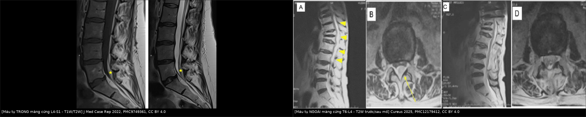
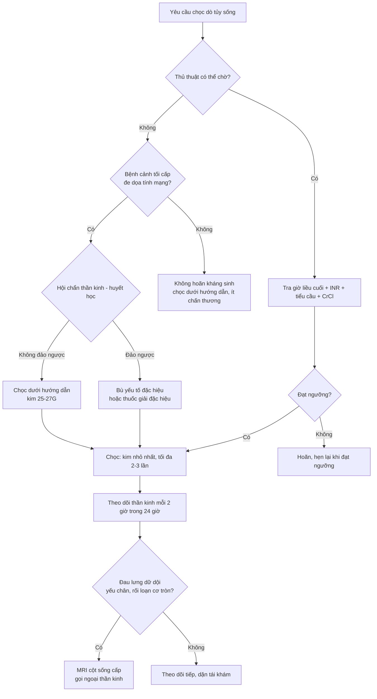
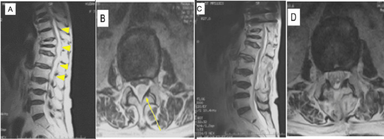
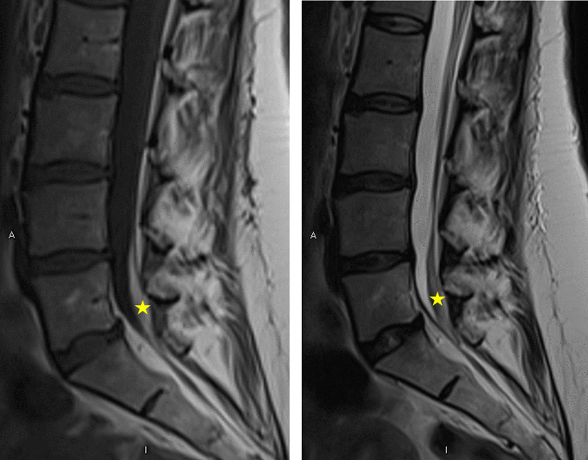

# 3022 — Chọc dò tủy sống ở bệnh nhân dùng kháng đông / rối loạn đông máu: ngưỡng INR, tiểu cầu, DOAC và heparin

**Tags:** `pattern:roi-loan-dong-mau` `pattern:tu-mau-ngoai-mang-cung` `pattern:tu-mau-trong-mang-cung` `vung:cot-song-that-lung` `anatomy:ong-song-that-lung` `score:INR` `score:tieu-cau` `protocol:choc-do-tuy-song` `protocol:MRI-cot-song`
**Mức chắc chắn (certainty):** tổng hợp y văn (literature synthesis) — ghép **cohort toàn quốc 83.711 lượt chọc dò** (PMC8094417), **nghiên cứu registry ghép điểm xu hướng 25.788 cặp** (PMC13415340), **tổng quan ngưỡng tiểu cầu** (PMC12358768), **bảng ngừng thuốc ASRA-PM 2025** (PMC13200797), **tổng quan 37 ca máu tụ trong màng cứng sau chọc dò** (PMC13328977) và **2 ca máu tụ ngoài màng cứng khi tiếp tục kháng đông** (PMC12179412). Nhiều thiết kế khác nhau, không phải một ca → không gắn nhãn ca nguyên văn.

> **Câu hỏi thực hành:** bệnh nhân nghi viêm màng não đang dùng apixaban; sản phụ tiểu cầu 60 ×10³/µL; cụ ông INR 1,8 vì warfarin — **chọc, hoãn, đảo ngược, hay đổi sang chọc dưới hướng dẫn?**
> Bài này chốt theo **một trục duy nhất: “còn bao nhiêu hoạt tính thuốc tại thời điểm kim xuyên màng cứng”**, không theo cảm giác “đông máu hơi kém”. Ngưỡng cụ thể nằm ở mục (4); bẫy chết người nằm ở mục (5). Nối [3020 – Chọc dò khó dưới hướng dẫn hình ảnh](../3020-choc-do-tuy-song-duoi-huong-dan-hinh-anh/lesson.md), [3014 – PDPH & blood patch](../3014-dau-dau-sau-choc-do-tuy-song/lesson.md), [3013 – Hội chứng đuôi ngựa hậu phẫu](../3013-hoi-chung-duoi-ngua-sau-mo-cot-song/lesson.md).

## 1. Tổng quan bệnh học – cơ chế hình ảnh: vì sao một mũi kim thành máu tụ chèn ép tủy

- **Giải phẫu quyết định kiểu chảy máu.** Khoang ngoài màng cứng thắt lưng chứa **đám rối tĩnh mạch ngoài màng cứng (Batson)** — mạch **áp lực thấp, thành mỏng, không có van hiệu quả**. Khi kim cắt dây chằng vàng và màng cứng, máu rỉ từ đám rối này **chảy chậm, tự bít bằng cục máu đông**; nếu còn hoạt tính kháng đông, cục máu không bít được → máu tụ lan dọc khoang ngoài màng cứng. Vì áp lực thấp, **triệu chứng thường xuất hiện muộn 1–24 giờ**, không ngay khi chọc.
- **Vì sao tổn thương ở ngực nguy hiểm hơn thắt lưng.** Ở thắt lưng, khoang dưới nhện chỉ còn **đuôi ngựa (cauda equina)** — các sợi thần kinh rời, chịu được dịch chuyển; ở **ngực, tủy sống là một ống đặc nằm trong ống sống hẹp** → cùng một thể tích máu tụ gây chèn ép tủy nhanh hơn nhiều. Đúng như phân bố trong y văn: **54,1%** máu tụ trong màng cứng sau chọc dò nằm ở **ngực/ngực–thắt lưng**, chỉ 45,9% ở thắt lưng (37 ca, PMC13328977).
- **Ba yếu tố cộng lại thành nguy cơ (chứ không phải chỉ INR):**
  1. **Hoạt tính thuốc còn lại** tại thời điểm chọc — quyết định bằng **dược động học** (nửa đời thải) + **chức năng thận** với DOAC.
  2. **Mức chấn thương mô** — cỡ kim, kiểu mũi kim, **số lần chọc**, có/không chọc qua vùng biến dạng.
  3. **Khoang chứa máu** — ngoài màng cứng (đám rối tĩnh mạch) vs dưới màng cứng/dưới nhện (mạch màng nuôi, mạch tủy).
- **TẠI SAO ngưỡng hiện hành không phải “bằng chứng mạnh”:** các con số INR/tiểu cầu/thời gian ngừng thuốc đến từ **mô hình dược động học + ý kiến chuyên gia + ca báo cáo**, không từ RCT (không ai random hoá bệnh nhân để chọc dò khi đang chống đông). Vì vậy phải đọc cùng **tỉ lệ biến cố nền**:
  - **Cohort Đan Mạch 83.711 lượt chọc dò (2008–2018):** máu tụ tủy trong 30 ngày **0,20% (99/49.526)** khi không rối loạn đông máu vs **0,23% (24/10.371)** khi có rối loạn đông máu (định nghĩa: tiểu cầu < 150 ×10³/µL, **INR > 1,4**, hoặc aPTT > 39 giây). Yếu tố nguy cơ độc lập: **nam (HR 1,72; 1,15–2,56)**, tuổi **41–60 (HR 1,96)** và **61–80 (HR 2,20)** (PMC8094417).
  - **Nhưng “chọc ra máu” (traumatic tap) thì tăng rõ theo INR:** **36,8%** ở INR 1,5–2,0; **43,7%** ở INR 2,1–2,5; **41,9%** ở INR 2,6–3,0 vs **28,2%** khi INR bình thường; aPTT 40–60 giây: **26,3% vs 21,3%** (chênh 5,1%; 2,9–7,2%) (PMC8094417). Dịch não tủy lẫn máu làm **sai xét nghiệm tế bào/protein** và làm mờ chẩn đoán viêm màng não.
  - **Nghiên cứu registry ghép điểm xu hướng 2026 (TriNetX)** — 25.788 cặp dùng/không dùng kháng đông: máu tụ **ngoài màng cứng OR 1,000 (0,561–1,784)**, **dưới màng cứng OR 0,780 (0,640–0,950)**; 13.310 cặp kháng kết tập tiểu cầu: OR 1,904 (0,885–4,095) và 1,008 (0,784–1,296) — **không tăng có ý nghĩa** (PMC13415340). **Phản biện:** đây là dữ liệu hồi cứu, bác sĩ **chọn bệnh nhân nguy cơ thấp** để chọc và có thể đã ngừng thuốc trước đó; “không thấy khác biệt” không đồng nghĩa “chọc lúc đang dùng thuốc là an toàn”.
  - **Máu tụ vẫn xảy ra khi đông máu hoàn toàn bình thường:** 37 ca trong 10 năm, khởi phát **< 24 giờ ở 54,0%**, **> 48 giờ ở 13,5%**; tác giả nhấn mạnh ca của họ có **đông máu bình thường** và hình ảnh sớm **giả u trong màng cứng** (PMC13328977). Đây là lý do **không được coi “INR bình thường” là giấy miễn trừ** — kỹ thuật và theo dõi vẫn quyết định.
- **Ngưỡng tiểu cầu: ba trường phái, một thông điệp.** **AABB khuyến cáo 50 ×10³/µL**, **Anh 40**, **Đức 20**. Bằng chứng: 1.251 lượt chọc dò ở bệnh nhân ung thư/huyết học có **0,3% (4 ca) biến cố chảy máu** — 2 ca xảy ra khi tiểu cầu **≥ 100 ×10³/µL**, và không tương quan với mức tiểu cầu; 5.223 lượt chọc dò ở trẻ ALL **không có biến cố nghiêm trọng nào** dù 14% làm khi tiểu cầu 21–50 ×10³/µL (PMC12358768). Hạ ngưỡng từ 50 xuống 40 giảm lượng tiểu cầu truyền từ **0,6% xuống 0,4%**.
- **Vì sao DOAC không đọc được bằng INR:** apixaban/rivaroxaban/edoxaban ức chế **yếu tố Xa**, dabigatran ức chế **thrombin**; **INR và aPTT không nhạy, có thể bình thường dù nồng độ thuốc còn cao**. Muốn đo phải dùng **anti-Xa hiệu chuẩn theo thuốc** (hoặc thuốc ức chế thrombin pha loãng với dabigatran) — và các xét nghiệm này **không phải lúc nào cũng có**; vì thế thực hành dựa vào **khoảng thời gian từ liều cuối + chức năng thận**.

## 2. Mẫu hình + chẩn đoán phân biệt theo tình huống (gamut)

- **Nguyên tắc:** phân nhóm theo **hai câu hỏi** — (1) *thủ thuật có thể chờ không?* (2) *thuốc còn hoạt tính không?*
- **A. Chờ được (chọc dò chương trình, có chỉ định không cấp cứu):** **luôn chờ đủ khoảng ngừng thuốc** rồi chọc. Đây là nhóm duy nhất được phép “hẹn lại ngày”.
  - Warfarin: ngừng **5 ngày**, xác nhận **INR < 1,5** trước khi chọc (ASRA-PM 2025; PMC13200797).
  - DOAC liều thấp: apixaban **36 giờ**, rivaroxaban/edoxaban **24 giờ**, dabigatran **48 giờ**.
  - DOAC liều cao/điều trị: **≥ 72 giờ** (riêng dabigatran **120 giờ nếu CrCl 30–49 mL/phút**).
  - Kháng kết tập tiểu cầu: **aspirin liều thấp không cần ngừng**; **clopidogrel 5–7 ngày**, **ticagrelor ~5 ngày**, **prasugrel 7–10 ngày**.
  - Heparin: **LMWH liều dự phòng ≥ 12 giờ**, **liều điều trị ≥ 24 giờ**; **UFH dưới da 4–6 giờ** (liều cao 12–24 giờ); **UFH tĩnh mạch 4–6 giờ + aPTT bình thường**.
- **B. Không chờ được nhưng chưa tối cấp (nghi viêm màng não, sốt + cứng gáy, đã có chỉ định kháng sinh):** **không hoãn kháng sinh để chờ chọc dò**; cân nhắc **chọc dò dưới hướng dẫn** để giảm số lần chọc, dùng **kim nhỏ nhất hợp lý**, **một người có kinh nghiệm**, **không quá 2–3 lần**. Nếu vẫn thất bại → điều trị theo kinh nghiệm và chọc lại khi an toàn.
- **C. Tối cấp, không thể chờ (nghi viêm màng não mủ, sốc, cần chẩn đoán để quyết định):** hoặc **đảo ngược kháng đông có mục tiêu** rồi chọc, hoặc **chọc dưới hướng dẫn** với kim 25–27G, hoặc cả hai. Đảo ngược chỉ đặt ra khi **lợi ích chẩn đoán lớn hơn nguy cơ huyết khối** — quyết định đa chuyên khoa (thần kinh – huyết học – gây mê), không tự quyết.
- **D. Rối loạn đông máu “nội tại” (không do thuốc):** xơ gan (INR tăng nhưng **không phản ánh đủ nguy cơ chảy máu**, còn thiếu cả yếu tố ức chế và tiểu cầu), **suy thận (urê huyết làm rối loạn chức năng tiểu cầu)**, **bệnh máu ác tính**, **DIC**, **hemophilia/vWD** — nhóm này cần **huyết học tư vấn** và bù yếu tố đặc hiệu, không chỉ truyền tiểu cầu.
- **E. Đang dùng kép (DOAC + kháng kết tập) hoặc mới ngừng thuốc < 24 giờ:** coi như **nguy cơ cao nhất**, kể cả khi INR/aPTT bình thường.
- **Gợi nhớ 4 nhóm:** **“Chờ – Chọc khéo – Đảo ngược – Đổi đường”** (chờ đủ giờ; chọc ít chấn thương; đảo ngược có mục tiêu; đổi sang chọc dưới hướng dẫn/đường khác).

## 3. Bảng so sánh phân biệt (ma trận đối chiếu)

| Thực thể (entity) | Hình ảnh / xét nghiệm điển hình | Chốt vào (rule-in) | Chốt loại (rule-out) | Gợi ý xác nhận |
|---|---|---|---|---|
| **Chọc dò an toàn trên nền kháng kết tập đơn độc (aspirin)** | Không có hình ảnh bất thường; không cần xét nghiệm đông máu thêm | **Aspirin liều thấp + không dùng thuốc thứ hai + không rối loạn đông máu khác** → chọc ngay | **Đang DAPT, hoặc INR > 1,4, hoặc tiểu cầu thấp** → không còn thuộc nhóm này | Hỏi kỹ thuốc (kể cả thực phẩm bổ sung/NSAID); không cần đo lại INR nếu không có bệnh gan |
| **Warfarin chưa đủ ngưỡng** | INR còn cao; có thể kèm thiếu yếu tố VII | **INR ≥ 1,5** → chưa chọc; chờ ± vitamin K nếu cần sớm | **INR < 1,5 và đã ngừng ≥ 5 ngày** → được chọc | INR ngay trước chọc (không dùng kết quả 2 ngày trước) |
| **DOAC còn hoạt tính** | **INR/aPTT có thể bình thường**; anti-Xa đặc hiệu mới phản ánh | **Trong khoảng ngừng chưa đủ (apixaban < 36 giờ, dabigatran < 48–120 giờ)** → còn nguy cơ | **Đã đủ khoảng ngừng theo liều + CrCl, chức năng thận ổn định** → được chọc | Thời điểm liều cuối + CrCl; anti-Xa hiệu chuẩn nếu có và nếu kết quả sẽ đổi quyết định |
| **Giảm tiểu cầu** | Không hình ảnh; công thức máu | **< 20 ×10³/µL** (ngưỡng Đức) — vùng chắc chắn phải truyền/bù trước | **≥ 50 ×10³/µL** — không cần truyền dự phòng chỉ để chọc dò; **40–50** là vùng thực hành rộng rãi | Đếm tiểu cầu ngay trước chọc; xem thêm thuốc ức chế kết tập (TKI dasatinib/ponatinib làm tăng chảy máu) |
| **Máu tụ ngoài màng cứng sau chọc dò** | MRI T2: khối **tăng tín hiệu phía sau, đẩy túi màng cứng ra trước**, lan dọc nhiều đốt; T1 tùy tuổi máu | **Đau lưng dữ dội + yếu hai chân tiến triển trong 1–24 giờ sau chọc**; MRI xác nhận | **Đau lưng đơn thuần, không yếu, không rối loạn cơ tròn** → theo dõi, không mổ | MRI cột sống **cấp** (không chờ); khám thần kinh mỗi 2 giờ |
| **Máu tụ trong/dưới màng cứng** | MRI T1 **tăng tín hiệu** trong túi màng cứng, T2 giảm so với dịch não tủy; có thể **giả u** | **Đau lan hai chân + dị cảm yên ngựa/tiểu không tự chủ**; T1 sáng trong bao màng cứng | **Dịch não tủy trong, không đau lan** → không phải máu tụ | MRI có/không tiêm thuốc: không ngấm hoặc ngấm rìa (khác u) |
| **Rối loạn đông máu do gan/thận** | INR tăng nhưng yếu tố V/tiểu cầu có thể bình thường; urê cao | **Xơ gan Child C, urê > 30 mmol/L, DIC** → nguy cơ cao dù INR “vừa phải” | **Xơ gan Child A, urê bình thường, fibrinogen bình thường** → nguy cơ gần nhóm chung | Huyết học tư vấn; bù yếu tố đặc hiệu thay vì truyền tiểu cầu máy móc |

*Trái: MRI thắt lưng T1W/T2W — cục máu **tăng tín hiệu T1** nằm trong bao màng cứng L4–S1, lẫn giữa các sợi đuôi ngựa (dấu ★); đông máu bình thường, kim Quincke 18G, chọc ra máu. Nguồn: J Med Case Reports 2022 (PMC9749361) Fig. 1, CC BY 4.0. Phải: MRI T2W trước (A,B) và sau mổ (C,D) — khối **tăng tín hiệu ngoài màng cứng phía sau từ T6 đến L4** (đầu mũi tên vàng), chèn ép túi màng cứng; bệnh nhân **vẫn dùng aspirin**, liệt 2 giờ sau chụp tủy cản quang, giải ép 6 giờ → hồi phục hoàn toàn. Nguồn: Cureus 2025 (PMC12179412) Figure 2, CC BY 4.0. Ảnh ghép letterbox, không crop.*

### Đọc ảnh máu tụ sau chọc dò — 4 bước

1. **Xác định khoang:** khối nằm **ngoài** màng cứng (đẩy màng cứng vào trong, dấu “màng cứng căng”) hay **trong** bao màng cứng (lẫn giữa các sợi rễ, ôm theo túi)?
2. **Đếm đốt lan:** chiều dài tổn thương theo đốt — **≥ 3 đốt ở ngực** là yếu tố quyết định mổ sớm.
3. **Tín hiệu theo thời gian:** T1 sáng + T2 tối = **máu bán cấp sớm (intracellular methemoglobin)**; T1 sáng + T2 sáng = bán cấp muộn; **T1 tối + T2 tối** = tối cấp/cấp (deoxyhemoglobin) — nhóm dễ bị bỏ sót vì “không sáng”.
4. **Đối chiếu thời điểm chọc:** máu tụ **cùng ngày** thường **chưa có viền ngấm**; nếu thấy ngấm rìa + phù mô mềm → nghĩ nguyên nhân khác (u, áp-xe) theo bài [3013](../3013-hoi-chung-duoi-ngua-sau-mo-cot-song/lesson.md).

## 4. Protocol thủ thuật + ngưỡng quyết định

### 4.1 Phiếu kiểm trước chọc dò (bắt buộc ghi vào hồ sơ)

- **Thuốc:** tên, liều, **giờ uống liều cuối**, chỉ định (dự phòng hay điều trị), thuốc kèm (NSAID, SSRI, TKI).
- **Xét nghiệm:** công thức máu (tiểu cầu), **INR**, aPTT, **creatinine/CrCl** (bắt buộc với DOAC); với bệnh gan: fibrinogen ± yếu tố V.
- **Kỹ thuật dự kiến:** cỡ/kiểu kim, đường vào, **người thực hiện**, số lần chọc tối đa trước khi dừng; có sẵn phương án chọc dưới hướng dẫn ([3020](../3020-choc-do-tuy-song-duoi-huong-dan-hinh-anh/lesson.md)).
- **Theo dõi sau chọc:** khám thần kinh (lực hai chân, cảm giác yên ngựa, cơ tròn) **mỗi 2 giờ trong 24 giờ đầu**; dặn bệnh nhân **quay lại ngay** nếu đau lưng dữ dội hoặc yếu chân.

### 4.2 Ngưỡng theo thuốc (ASRA-PM 2025, qua bảng đối chiếu PMC13200797)

| Thuốc | Ngừng trước thủ thuật neuraxial (LP) | Kiểm tra trước chọc |
|---|---|---|
| Warfarin | **5 ngày** | **INR < 1,5** |
| Apixaban | **36 giờ** (liều thấp) · **≥ 72 giờ** (liều điều trị) | Giờ liều cuối, CrCl |
| Rivaroxaban / edoxaban | **24 giờ** (liều thấp) · **≥ 72 giờ** (liều điều trị) | Giờ liều cuối, CrCl |
| Dabigatran | **48 giờ** (liều thấp) · **72 giờ** nếu CrCl ≥ 50 · **120 giờ** nếu CrCl 30–49 | **CrCl bắt buộc** (thuốc thải qua thận) |
| Clopidogrel | **5–7 ngày** | Không có xét nghiệm thay thế đáng tin |
| Ticagrelor / prasugrel | **~5 ngày / 7–10 ngày** | Như trên |
| Aspirin liều thấp | **Không cần ngừng** (liều cao: 3–7 ngày) | — |
| LMWH dự phòng / điều trị | **≥ 12 giờ / ≥ 24 giờ** | Số liều cuối |
| UFH dưới da | **4–6 giờ** (liều cao 12–24 giờ) | — |
| UFH tĩnh mạch | **4–6 giờ** | **aPTT bình thường** |

> **Lưu ý dùng bảng:** đây là khoảng **tối thiểu** cho **đường neuraxial** (bao gồm LP), nghiêm ngặt hơn khoảng ngừng cho phẫu thuật thường quy (PAUSE: ngừng 1–2 ngày). Với **đặt catheter** hoặc **nhiều lần chọc**, cộng thêm thời gian và tránh catheter nằm lâu.

### 4.3 Tiểu cầu và các ngưỡng khác

- **Tiểu cầu:** chọc dò được ở **≥ 50 ×10³/µL** theo AABB; **40 ×10³/µL** theo Anh; **20 ×10³/µL** theo Đức. Bằng chứng thực tế: biến cố chảy máu **0,3%**, không tương quan mức tiểu cầu (PMC12358768). → **Không truyền tiểu cầu chỉ để đạt 100**; truyền khi **< 20** hoặc khi có chảy máu/đang dùng thuốc ức chế kết tập.
- **INR:** rối loạn đông máu được định nghĩa **INR > 1,4** trong cohort 83.711 lượt; **ngưỡng chọc thực hành < 1,5**. Chọc khi INR 1,5–3,0 làm **tăng chọc ra máu lên 36,8–43,7%** (so với 28,2%) — không phải chống chỉ định tuyệt đối nhưng **làm hỏng giá trị xét nghiệm**.
- **aPTT:** > 39 giây (định nghĩa cohort) — tăng chọc ra máu (26,3% vs 21,3%).
- **Kỹ thuật giảm chấn thương:** kim **25–27G** (không cắt) khi chỉ lấy dịch não tủy; **kim 20–22G** khi cần đo áp lực/bơm thuốc; **tối đa 2–3 lần chọc**; nếu thất bại → chuyển **chọc dưới siêu âm/fluoroscopy/CT** thay vì “thử mù” thêm ([3020](../3020-choc-do-tuy-song-duoi-huong-dan-hinh-anh/lesson.md)).

### 4.4 Đảo ngược kháng đông — nguyên tắc, không phải công thức

- **Chỉ đảo ngược khi lợi ích của việc lấy dịch não tủy ngay > nguy cơ huyết khối/tắc mạch** (viêm màng não mủ, sốc nhiễm khuẩn chưa rõ ổ, nghi xuất huyết dưới nhện mà CT âm tính nhưng cần chọc).
- **Warfarin:** vitamin K ± phức hợp prothrombin (PCC) để đưa INR về ngưỡng chọc — hiệu quả nhanh nhưng **kéo dài trạng thái không chống đông**; cân nhắc van tim cơ học (nguy cơ huyết khối rất cao).
- **Dabigatran:** **idarucizumab** (kháng thể đơn dòng đặc hiệu).
- **DOAC ức chế Xa:** **andexanet alfa** hoặc PCC — tùy khả dụng; **không** dùng chung với heparin phân đoạn.
- **Kháng kết tập tiểu cầu:** truyền tiểu cầu chỉ có ý nghĩa một phần (ticagrelor gắn thuận nghịch; clopidogrel không hồi phục nhanh) — **không coi truyền tiểu cầu là “tắt” thuốc**.
- **Nguyên tắc chung:** nếu đã đảo ngược, **chọc ngay khi đạt ngưỡng** và **khởi động lại kháng đông sớm** theo chỉ định; ghi rõ thời điểm đảo ngược và thời điểm dự kiến dùng lại.

## 5. Biến thể bình thường và cạm bẫy

- **Biến thể bình thường:**
  - **Chọc ra máu loang lổ ở cuối thủ thuật** (traumatic tap) ở người đông máu bình thường: hồng cầu giảm dần giữa các ống nghiệm 1–4; nếu **không giảm đều** hoặc **siêu váng xanthochromia** → nghĩ xuất huyết dưới nhện thật, không phải chấn thương.
  - **Đám rối tĩnh mạch ngoài màng cứng giãn** ở người béo/thai kỳ: dễ chọc vào → máu chảy nhiều hơn dự kiến dù INR bình thường.
  - **INR “giả tăng”** ở bệnh nhân dùng DOAC hoặc kháng thể kháng phospholipid — đừng hoãn chọc 5 ngày chỉ vì một INR lạc.
- **Cạm bẫy chết người:**
  1. **“Đông máu bình thường nên chắc không sao”** — 37 ca máu tụ trong màng cứng, nhiều ca đông máu bình thường; riêng ca 18G Quincke chọc ra máu → hội chứng đuôi ngựa **không hồi phục** (tiểu không tự chủ, mất cảm giác yên ngựa) (PMC9749361).
  2. **Bỏ qua thời điểm liều cuối DOAC** và tin INR bình thường: apixaban/edoxaban **không làm INR tăng đáng kể**.
  3. **Chọc nhiều lần** vì “cố thêm một lần nữa”: mỗi lần là một vết rách màng cứng + đám rối; **quá 2–3 lần → đổi phương thức**, không đổi kim rồi thử tiếp.
  4. **Không theo dõi sau chọc:** máu tụ biểu hiện **muộn 1–24 giờ**; bệnh nhân ra viện ngay trong ngày mà không có hướng dẫn quay lại là bỏ mất cửa sổ vàng (ca aspirin: liệt 2 giờ sau thủ thuật; giải ép 6 giờ → hồi phục, để muộn hơn thì không).
  5. **Blood patch ở người đang kháng đông:** bản thân blood patch cũng là thủ thuật ngoài màng cứng — phải áp cùng ngưỡng ngừng thuốc (xem [3014](../3014-dau-dau-sau-choc-do-tuy-song/lesson.md)).
  6. **Đảo ngược kháng đông “cho tiện”** ở bệnh nhân van tim cơ học/rung nhĩ nguy cơ cao để chọc dò chương trình — nguy cơ đột quỵ do ngừng thuốc có thể lớn hơn nguy cơ máu tụ, nhất là khi thủ thuật **hoãn được**.
  7. **Chọc dò để “trị đau đầu” lặp lại** (IIH): không có bằng chứng; chính ca trong bài là **hơn 15 lần chọc dò** dẫn tới máu tụ — dùng acetazolamide/stent theo [3018](../3018-tang-ap-luc-noi-so-tu-phat-nguoi-lon/lesson.md), không dùng LP như liệu pháp.
  8. **Nhầm máu tụ với đau lưng cơ học sau chọc** — điểm khác: đau **lan hai chân**, **yếu tiến triển theo giờ**, **rối loạn cơ tròn**; cơ học thì đau khu trú, không yếu.

## 6. Tự lượng giá — Blind Quiz

**Ca 1 — Cụ bà 79 tuổi, đang dùng aspirin vì đã đặt stent mạch vành; chụp tủy cản quang bằng kim 20G để đánh giá hẹp ống sống. Hai giờ sau: đau lưng dữ dội rồi yếu hai chân.**

- **Câu 1:** Khối tăng tín hiệu ở (A) nằm ở khoang nào, lan từ đốt nào đến đốt nào? Vì sao (B) lại quan trọng để xác nhận chèn ép?
- **Câu 2:** INR 0,99 và tiểu cầu 164 ×10³/µL — có loại trừ được nguy cơ máu tụ không? Quyết định tiếp theo trong 6 giờ đầu là gì, và (C,D) nói lên điều gì về tiên lượng?

<b>Bấm để hiện đáp án</b>

- **Câu 1:** Khối nằm **ngoài màng cứng, phía sau**, **tăng tín hiệu trên T2W**, lan **T6–L4** (đầu mũi tên vàng), đẩy túi màng cứng ra trước. (B) là lát **ngang**: thấy rõ khối chiếm khoang sau và **chèn ép túi màng cứng** — hình sagittal một mình không phân biệt được máu tụ với phì đại dây chằng.
- **Câu 2:** **Không.** INR 0,99 và tiểu cầu 164 chỉ nói **đường đông máu kinh điển bình thường**; bệnh nhân **vẫn đang dùng aspirin** — hoạt tính kháng kết tập không có xét nghiệm INR nào phản ánh. Quyết định: **MRI cột sống cấp + gọi ngoại thần kinh giải ép ngay** (ca này mổ **6 giờ** sau khởi phát, hồi phục hoàn toàn; (C,D) là MRI sau mổ — **hết chèn ép**, tủy/túi màng cứng trở về bình thường).
- **Số liệu:** 2 ca trong bài đều **tiếp tục** kháng đông/kháng kết tập và đều có máu tụ; cả hai hồi phục nhờ giải ép sớm (PMC12179412). Ngược lại, tổng quan 37 ca cho thấy **54% khởi phát < 24 giờ** và **13,5% sau 48 giờ** — không được chỉ theo dõi 6 giờ rồi kết luận an toàn (PMC13328977).
- **Nguồn ảnh:** Cureus 2025 (PMC12179412), Figure 2, CC BY 4.0.

**Ca 2 — Nữ 28 tuổi, tiền sử đặt shunt não–ổ bụng, chọc dò tủy sống lần thứ 16 để giảm đau đầu, kim Quincke 18G, dịch não tủy lẫn máu, đông máu bình thường. Năm ngày sau: đau lan hai chân, dị cảm yên ngựa, tiểu không tự chủ.**

- **Câu 3:** Mô tả tổn thương trên T1W/T2W, xác định khoang, và giải thích vì sao “đông máu bình thường” không bảo vệ được bệnh nhân này.

<b>Bấm để hiện đáp án</b>

- **Hình ảnh:** trên T1W (trái) có cục máu **tăng tín hiệu** nằm **trong bao màng cứng**, lẫn giữa các sợi **đuôi ngựa** ở mức **L5**; trên T2W (phải) cục máu **giảm tín hiệu so với dịch não tủy** → **máu tụ trong màng cứng bán cấp sớm**. Kèm **phù/viêm quanh rễ S1 trái** trên lát ngang (Fig. 2 của bài gốc).
- **Vì sao vẫn xảy ra dù đông máu bình thường:** nguy cơ đến từ **chấn thương mô** — **kim cắt 18G**, **chọc ra máu**, và **16 lần chọc dò lặp lại**; cộng thêm tình trạng đau đầu mạn khiến chọc dò được lặp lại nhiều lần. Đây chính là nhóm “chọc dò để trị đau đầu” **không có bằng chứng** và đã bị khuyến cáo dừng.
- **Kết cục:** theo dõi bảo tồn, MRI 4 tháng sau còn ít máu tụ nhưng **di chứng vĩnh viễn**: mất cảm giác vùng yên ngựa/chân phải và **tiểu không tự chủ**.
- **Nguồn ảnh:** J Med Case Reports 2022 (PMC9749361), Fig. 1, CC BY 4.0.

## Bài liên quan chéo
- [3020 – Chọc dò tủy sống khó dưới hướng dẫn hình ảnh](../3020-choc-do-tuy-song-duoi-huong-dan-hinh-anh/lesson.md) (giảm số lần chọc — biện pháp giảm nguy cơ chảy máu)
- [3014 – Đau đầu sau chọc dò tủy sống (PDPH) & blood patch](../3014-dau-dau-sau-choc-do-tuy-song/lesson.md) (blood patch trên nền kháng đông)
- [3013 – Hội chứng đuôi ngựa hậu phẫu: máu tụ – phù – áp-xe](../3013-hoi-chung-duoi-ngua-sau-mo-cot-song/lesson.md) (cửa sổ giải ép, tiên lượng theo thời gian)
- [3012 – Áp-xe ngoài màng cứng sau gây tê ngoài màng cứng](../3012-apxe-ngoai-mang-cung-sau-gay-te-ngoai-mang-cung/lesson.md) (chẩn đoán phân biệt đau lưng + sốt sau thủ thuật)
- [3018 – Tăng áp lực nội sọ tự phát ở người lớn](../3018-tang-ap-luc-noi-so-tu-phat-nguoi-lon/lesson.md) (áp lực mở; không dùng LP lặp lại để trị đau đầu)
- [3016 – Hạ áp lực nội sọ tự phát](../3016-ha-ap-luc-noi-so-tu-phat/lesson.md) (chọc dò có cản quang để định vị rò)
- [258 – Áp-xe ngoài màng cứng do loét tì đè](../258-apxe-ngoai-mang-cung-loet-ti-de-cung-cut/lesson.md) (khi nào KHÔNG chọc dò)

## Ảnh
- `3022_hematoma-ngoai-mang-cung_MRI-PMC12179412-F2.jpg` — máu tụ ngoài màng cứng T6–L4, T2W trước/sau mổ, Cureus 2025 (PMC12179412), Figure 2, CC BY 4.0.
- `3022_hematoma-tuy_MRI-PMC9749361-F1.jpg` — cục máu trong màng cứng L5, T1W/T2W, J Med Case Reports 2022 (PMC9749361), Fig. 1, CC BY 4.0.
- `composite_hematoma-sau-choc-do.jpg` — ảnh ghép letterbox từ hai ảnh trên (cả hai CC BY 4.0), tạo bằng `tools/make_composite.py`.
- Nguồn + giấy phép từng ảnh: `images/CREDITS.md`.

> Không dùng để chẩn đoán độc lập khi chưa có người hướng dẫn.
