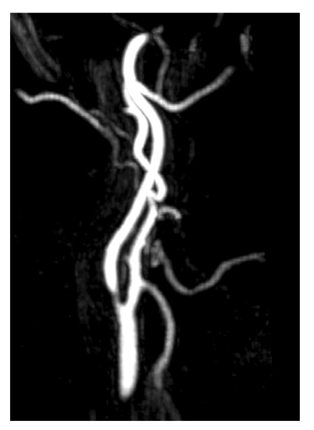
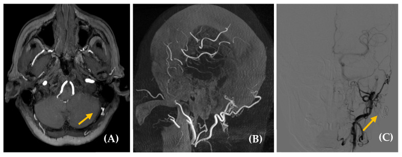
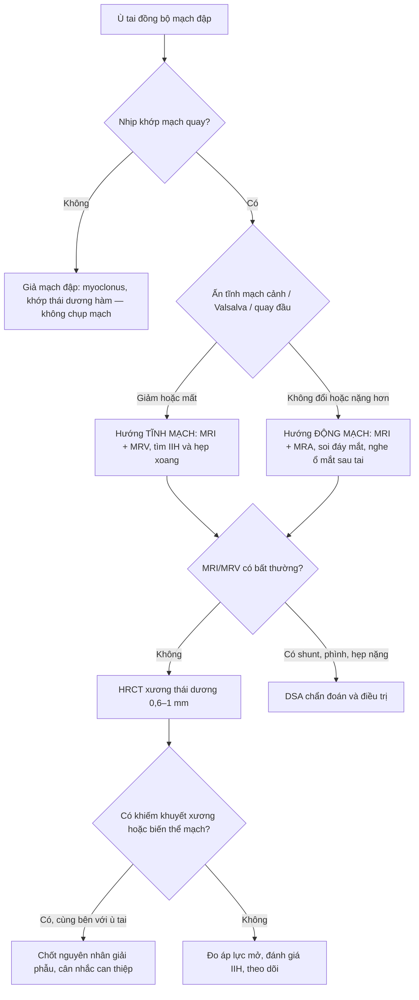
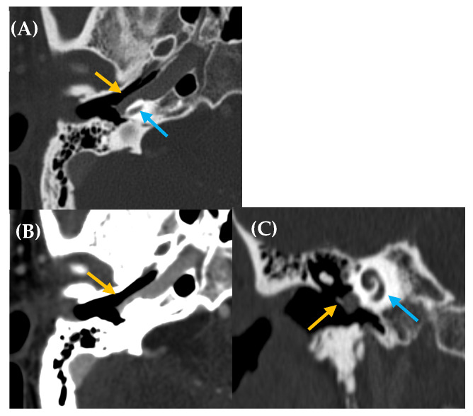
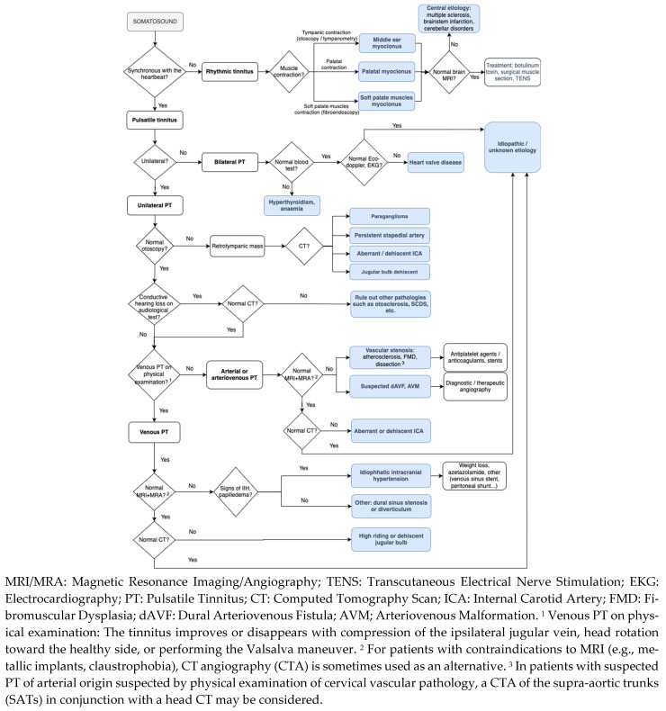

# 3023 — Ù tai mạch đập: tiếp cận hình ảnh theo hướng động mạch vs tĩnh mạch

**Tags:** `pattern:u-tai-mach-dap` `pattern:ro-dong-tinh-mach` `pattern:hep-xoang-tinh-mach` `pattern:gia-phinh` `vung:nen-so` `vung:dau-co` `protocol:MRA` `protocol:CTA` `protocol:DSA`
**Mức chắc chắn (certainty):** tổng hợp y văn (literature synthesis) — ghép **tổng quan phạm vi (scoping review) 40 bài kèm lưu đồ chẩn đoán của một trung tâm tai–thần kinh–điện quang** (J Clin Med 2025, PMC12250305), **tổng quan tường thuật về căn nguyên và xử trí** (J Int Adv Otol 2025, PMC12317842), **đoàn hệ đặt stent xoang tĩnh mạch hai trung tâm** (Neurosurg Rev 2026, PMC13396035), **loạt nút mạch diverticulum bóng cảnh** (Front Neurol 2026, PMC13686904), **tổng quan phạm vi can thiệp diverticulum xoang tĩnh mạch** (Front Surg 2026, PMC13500910) và **tổng quan có hệ thống phục hồi thành xoang xích-ma** (Audiol Res 2026, PMC13509635). Không có ca do nhóm tự chụp.

> **Câu hỏi thực hành:** nữ **34 tuổi**, **ù tai phải 8 tháng**, cảm giác "vù vù" **đúng nhịp tim**, **giảm rõ khi ấn tĩnh mạch cảnh phải**, không nghe kém, soi tai bình thường, BMI 32, đau đầu nhẹ buổi sáng. Câu hỏi: **chụp gì trước — MRI/MRA hay CT xương thái dương — và dấu hiệu nào buộc phải chụp mạch (DSA)?**
> Bài chốt **ba quyết định**: **(1) ù tai có đúng đồng bộ mạch đập không (phân biệt "giả mạch đập" do myoclonus)? (2) hướng động mạch hay tĩnh mạch? (3) bước hình ảnh nào là bước đầu và khi nào dừng ở MRI thay vì đi tới DSA?** Nối [3018 – Tăng áp lực nội sọ tự phát](../3018-tang-ap-luc-noi-so-tu-phat-nguoi-lon/lesson.md), [3021 – Tăng áp lực nội sọ thứ phát](../3021-tang-ap-luc-noi-so-thu-phat-thuoc-thieu-mau/lesson.md), [248 – Can thiệp nội mạch giả phình/bóc tách ĐM cổ](../248-can-thiep-noi-mach-gia-phinh-boc-tach-dong-mach-co-dot-song/lesson.md), [249 – Rò động mạch cảnh–xoang hang](../249-ro-dong-mach-canh-xoang-hang-chan-thuong/lesson.md).

## 1. Tổng quan bệnh học – cơ chế hình ảnh: vì sao nghe được nhịp tim của chính mình

- **Định nghĩa:** ù tai mạch đập (pulsatile tinnitus, PT) là **cảm nhận âm thanh đồng bộ với nhịp tim**, không có nguồn âm ngoài. Đây là **tiếng cơ thể (somatosound)** chứ không phải ù tai thần kinh giác quan thông thường. PT chiếm **~5–10%** tổng số ca ù tai theo tổng quan 2025 (PMC12250305) và **~4%** theo tổng quan 2025 khác (PMC12317842) — con số khác nhau vì tiêu chuẩn chọn mẫu, không phải mâu thuẫn sinh học.
- **Hai cơ chế duy nhất (mọi căn nguyên đều quy về một trong hai):**
  1. **Xoáy dòng (turbulence):** hẹp lòng mạch hoặc shunt động–tĩnh mạch làm dòng chảy **tăng tốc và thành dòng xoáy** ngay cạnh tai trong → tiếng "thổi/ro" tần số cao.
  2. **Khuếch đại âm thanh bình thường (loss of sound insulation):** **mất lớp xương che** giữa tai trong và dịch nội sọ (dehiscence), hoặc **giảm che lấp do nghe dẫn truyền kém** (ráy, viêm tai giữa, xơ tai) → tiếng mạch máu bình thường **truyền qua xương** vào ốc tai, trong khi tiếng ồn môi trường không còn che lấp vì đường khí bị giảm.
- **TẠI SAO "đúng nhịp tim" là chốt lâm sàng:** chỉ dòng máu **có nhịp** mới tạo ra tiếng đồng bộ. Ù tai **không đồng bộ** (tiếng "tách tách như máy đánh chữ", nhịp nhanh hơn mạch) là **myoclonus cơ vòi nhĩ/cơ búa–bàn đạp hoặc myoclonus vòm miệng** — **"giả mạch đập" (pseudo-pulsatile)**, và **chụp mạch là vô ích** (PMC12250305). Vì vậy bước 1 không phải là chọn máy, mà là **đếm nhịp cùng lúc với mạch quay** và hỏi **có thay đổi khi ấn tĩnh mạch cảnh / nghiệm pháp Valsalva / quay đầu** không.
- **TẦN SUẤT CĂN NGUYÊN — bảng gộp 8 loạt, 620 bệnh nhân** (Table 12, PMC12250305). Đây là con số tốt nhất để trả lời "khám 100 ca PT thì gặp gì":

| Nhóm | Tần suất gộp (n = 620) | Ghi chú định lượng |
|---|---|---|
| **Động mạch (arterial)** | **131 (21,1%)** | Trong đó **hẹp động mạch 98 (15,8%)** — nguyên nhân **hay gặp nhất** |
| **Động–tĩnh mạch (arteriovenous)** | **126 (20,3%)** | **dAVF 46 (7,4%)**, rò trực tiếp **11 (1,8%)**, AVM **3 (0,4%)** |
| **Tĩnh mạch (venous)** | **178 (28,7%)** | **IIH 83 (13,4%)**; **biến thể giải phẫu tĩnh mạch 95 (15,3%)** (bóng cảnh cao, dehiscence bóng cảnh, diverticulum xoang ngang/xích-ma) |
| **U mạch (u cuộn cảnh, u nền sọ)** | **45 (7,3%)** | |
| **Biến thể động mạch nền sọ (ICA lạc chỗ, ĐM bàn đạp tồn tại)** | **20 (3,2%)** | |
| **Tăng sinh mao mạch (viêm tai giữa cấp, xơ tai)** | **21 (3,4%)** | |
| **Hội chứng dehiscence ống bán khuyên trên (SCDS)** | **5 (0,8%)** | |
| **Không tìm được căn nguyên (idiopathic)** | **135 (21,8%)** | Khớp với "**~30%** không tìm ra nguyên nhân" của tổng quan khác (PMC12317842) |

- **Ngưỡng định lượng phải thuộc:**
  - **Hẹp động mạch cảnh chỉ gây PT khi hẹp > 70%** và tổn thương **phải ở trên mức C4** (dưới chỗ chia cảnh chỉ quá xa tai trong) — nên **siêu âm Doppler cổ không phải bước đầu** (PMC12250305).
  - **dAVF chiếm tới 20%** các ca PT đồng bộ mạch trong một số loạt, và **10–15%** tổng số dị dạng mạch nội sọ (PMC12250305); **dAVF gộp 7,4%** trong bảng trên.
  - **Bóc tách động mạch cổ–sọ: 2–6%** ca PT.
  - **Bóng cảnh cao/dehiscence: 6–34%** người bình thường tùy định nghĩa mốc giải phẫu — **biến thể này phổ biến hơn bệnh**, nên "thấy bóng cảnh cao" **không đồng nghĩa "đó là nguyên nhân"**.
  - **Quai AICA chạm dây VIII: 14–34%** người không triệu chứng — cùng lý do, không được chốt nguyên nhân từ một biến thể phổ biến.
  - **IIH: 1/100.000 dân/năm**; **hẹp xoang ngang gặp tới 90% ca IIH**; chẩn đoán cần **áp lực mở ≥ 25 cm CSF** ([3018](../3018-tang-ap-luc-noi-so-tu-phat-nguoi-lon/lesson.md)).
- **TẠI SAO phân biệt động mạch vs tĩnh mạch lại định hình cả protocol:** âm **tần số thấp ("vù vù") + giảm khi ấn tĩnh mạch cảnh cùng bên / Valsalva / quay đầu sang bên lành** → hướng **tĩnh mạch**; âm **tần số cao ("huýt sáo, xì") + không đổi khi ấn tĩnh mạch** → hướng **động mạch**. Ngoại lệ quan trọng: **ấn tĩnh mạch cảnh làm PT NẶNG HƠN** → nghĩ **dòng tràn qua tĩnh mạch lồi cầu (condylar venous overflow)** hoặc **hẹp động mạch** (chèn ép không tắc làm tăng vận tốc) (PMC12250305).

*MRA MIP mặt phẳng dọc ở bệnh nhân nữ 72 tuổi, PT tai phải: mảng xơ vữa hai chỗ chia cảnh, bên phải **hẹp ngắn > 70%**; tái thông mạch làm **hết PT**. Hẹp dưới chỗ chia cảnh hiếm khi gây PT vì quá xa tai trong. Nguồn: J Clin Med 2025 (PMC12250305), CC BY 4.0, nguyên bản.*

## 2. Mẫu hình + chẩn đoán phân biệt theo nguồn âm (gamut)

- **Gamut theo hướng dòng (bước 1 — khám tại giường quyết định bước 2):**

| Hướng | Đặc điểm âm | Nghiệm pháp | Nhóm bệnh |
|---|---|---|---|
| **Động mạch** | Tần số cao, "thổi/huýt", **không giảm** khi ấn tĩnh mạch cảnh | Ấn động mạch cảnh **giảm**; có tiếng thổi (bruit) vùng cổ/ổ mắt/sau tai | Hẹp xơ vữa **> 70%**, bóc tách **2–6%**, FMD "chuỗi hạt", phình/giã dị dạng, **dAVF**, AVM, CCF, u cuộn cảnh |
| **Tĩnh mạch** | Tần số thấp, "vù vù", **giảm/mất** khi ấn tĩnh mạch cảnh cùng bên, Valsalva, quay đầu sang bên lành | Ấn tĩnh mạch cảnh cùng bên | **IIH 13,4%**, **hẹp xoang ngang/xích-ma**, **diverticulum xoang**, **bóng cảnh cao/dehiscence**, tĩnh mạch lồi cầu giãn, tĩnh mạch phát xương chũm |
| **Không mạch (giả mạch đập)** | Tiếng "tách", nhịp **không** khớp mạch | Không đổi với mọi nghiệm pháp mạch | Myoclonus vòm miệng/cơ tai giữa, tiếng khớp thái dương–hàm, hội chứng vòi nhĩ mở |

- **Gamut theo vị trí tổn thương (bước 2 — hình ảnh):**
  - **Quanh tai trong/xương thái dương:** ICA lạc chỗ, ICA **dehiscence**, **ĐM bàn đạp tồn tại** (thiếu lỗ gai), SCDS, xơ tai/Paget, u cuộn cảnh nhĩ.
  - **Nền sọ giữa/góc cầu–tiểu não:** u cuộn cảnh hố tĩnh mạch cảnh, u bao dây VIII, quai AICA chạm dây VIII.
  - **Xoang tĩnh mạch:** hẹp xoang ngang/xích-ma (IIH), **diverticulum xoang**, **dehiscence thành xoang xích-ma**, tĩnh mạch lồi cầu, **dAVF thành xoang**.
  - **Cổ:** hẹp xơ vữa ICA **> 70%** trên C4, bóc tách, FMD.
- **Gợi nhớ nhanh theo chữ cái:** **V**ascular (hẹp/shunt) – **V**enous (IIH/hẹp xoang) – **D**ehiscence (SCDS, bóng cảnh, thành xoang) – **T**umor (u cuộn cảnh) — bốn nhóm này phủ **> 75%** ca có căn nguyên.

## 3. Bảng so sánh phân biệt (ma trận đối chiếu)

| Thực thể (entity) | Hình ảnh điển hình | Chốt vào (rule-in) | Chốt loại (rule-out) | Gợi ý xác nhận |
|---|---|---|---|---|
| **dAVF thành xoang** | MRA/CTA: **động mạch màng não nuôi phì đại**, tĩnh mạch dẫn lưu giãn không cân xứng, "shaggy" màng tiểu não; DSA: thấy điểm shunt + **trào ngược tĩnh mạch vỏ não** | **Chuỗi nuôi–shunt–dẫn lưu trên DSA**, kèm tĩnh mạch vỏ não giãn; **gõ ngón tay/ghi âm qua ống tai không có tiếng mạch → loại dAVF (độ nhạy 100%)** | Chỉ có tĩnh mạch giãn mà **không thấy shunt** trên DSA chất lượng tốt → không phải dAVF | **DSA** là chuẩn vàng; CTA-4D tương hợp gần 100%; phân độ Borden/Cognard quyết định can thiệp |
| **IIH + hẹp xoang ngang** | MRI: **hố yên rỗng, đĩa thị dẹt ra sau, giãn khoang dưới nhện quanh thị giác**, hẹp xoang ngang hai bên; MRV: hẹp **tại điểm nối xoang ngang–xích-ma** | **Áp lực mở ≥ 25 cm CSF** + ≥ 2/3 dấu hình ảnh; **ITSS ≥ 4** (hẹp ≥ 66% cả hai bên) | Không có gai thị, áp lực mở bình thường, không hẹp → không phải IIH | Chọc dò đo áp lực; **chênh áp qua chỗ hẹp** trước khi đặt stent |
| **Dehiscence/diverticulum thành xoang xích-ma** | HRCT xương thái dương: **khiếm khuyết xương thành xoang** ± túi lồi vào tế bào chũm | **Khiếm khuyết xương + túi lồi cùng bên với PT**; MRV/CTV thấy diverticulum | Xoang dày đủ xương, không túi lồi → tìm nguyên nhân khác | HRCT 0,6–1 mm + CTV; kết hợp gõ/nghe sau tai |
| **Bóng cảnh cao / dehiscence bóng cảnh** | HRCT: đỉnh bóng cảnh **lên tới bản đáy ốc tai hoặc trên vòng nhĩ**; thành xương mất liên tục | **Đỉnh bóng cảnh ngang mức sàn ống tai trong/ốc tai + mất liên tục thành xương** | Bóng cảnh cao nhưng **thành xương liên tục** = biến thể, **không đủ gây PT** (Hình 7 nguồn) | HRCT; **không can thiệp biến thể không dehiscence** |
| **ICA lạc chỗ / dehiscent ICA** | HRCT: khối ống **trong hòm nhĩ**, cạnh ụ ốc tai; **mất vách xương cảnh–nhĩ**, ống nhĩ dưới giãn; không có lỗ gai nếu kèm ĐM bàn đạp tồn tại | **Khối đập theo mạch sau màng nhĩ + ống xương bất thường trên HRCT** | Khối đặc không đập, không có bất thường ống cảnh → u cuộn cảnh/u khác | **HRCT + MRA**; **tuyệt đối không sinh thiết** khối đập sau màng nhĩ |
| **U cuộn cảnh nhĩ/hố tĩnh mạch cảnh** | CT: khối mô mềm **trên ụ ốc tai**, tiêu xương; MRI T2 "muối tiêu", **ngấm mạnh gadolinium** | **Ngấm mạnh + tiêu xương + "muối tiêu"** | Không ngấm, không tiêu xương → loại | MRI + MRA; xạ hình somatostatin nếu cần |
| **SCDS** | HRCT tái tạo **Pöschl/Stenvers**: mất xương trên ống bán khuyên trên | **Khiếm khuyết xương + nghiệm pháp VEMP ngưỡng thấp** | CT bình thường + VEMP bình thường → loại | CT đa mặt phẳng + VEMP; **hình ảnh một mình không đủ chẩn đoán** |
| **Myoclonus (giả mạch đập)** | Hình ảnh **bình thường** | **Nhịp không khớp mạch**, thấy rung cơ vòm miệng/màng nhĩ | Nhịp khớp mạch → không phải myoclonus | Nội soi mũi họng, soi tai; **không chụp mạch** |

*Nữ 65 tuổi, ù tai trái 5 năm, **không đổi khi ấn trục mạch cổ** (hướng động mạch). (A) MRA thấy bất thường gợi ý dAVF; (B) cone-beam CT MPR dọc; (C) DSA cho thấy **nuôi từ nhánh chẩm trái, dẫn lưu tĩnh mạch dưới chẩm** — và nút mạch ngay trong can thiệp. Đây là lý do DSA vừa là chuẩn vàng vừa là điều trị. Nguồn: J Clin Med 2025 (PMC12250305), CC BY 4.0, nguyên bản.*

## 4. Protocol chụp + ngưỡng xử trí

- **Bước 0 — tại giường (bắt buộc trước khi đặt lịch chụp):** xác nhận **đồng bộ mạch**, thử **ấn tĩnh mạch cảnh / ấn động mạch cảnh / Valsalva / quay đầu**, **soi tai** tìm khối đỏ sau màng nhĩ, **nghe ổ mắt – sau tai – cổ**, đo **HA và BMI**, **soi đáy mắt** nếu nghi IIH. **Ghi âm qua ống tai (transcanal sound recording)**: **không có tiếng mạch → loại dAVF với độ nhạy 100%** — một nghiệm pháp rẻ tiền có thể tránh cả DSA (PMC12250305).
- **Bước 1 — MRI sọ + MRA (không cản quang TOF, thêm thì tĩnh mạch nếu nghi tĩnh mạch):** bắt buộc có **DWI, FLAIR, T1 3D trước/sau tiêm, chuỗi T2 nặng (FIESTA/CISS/DRIVE)** để đọc dây VIII, ống tai trong và xoang. MRI là bước đầu vì **nhạy nhất với các nguyên nhân nguy hiểm** (dAVF, bệnh động mạch, IIH, u) và **không bức xạ**.
- **Bước 2 — HRCT xương thái dương 0,6–1 mm** khi: **MRI bình thường**, **nghe dẫn truyền kém với soi tai bình thường**, hoặc **thấy khối sau màng nhĩ**. Đây là nơi chốt **ICA lạc chỗ, dehiscent ICA, ĐM bàn đạp tồn tại, bóng cảnh cao, dehiscence thành xoang, SCDS, xơ tai/Paget**.
- **Bước 3 — DSA** chỉ khi: **nghi dAVF/AVM/CCF mạnh** (tiếng thổi, mạch máu giãn trên MRA/CTA, PT không đổi khi ấn tĩnh mạch cảnh), hoặc **để điều trị**. DSA **không phải phim tầm soát** — có nguy cơ đột quỵ và bức xạ.
- **Giá trị từng phương thức (Table 11 nguồn — mức "tốt nhất" `+++`):**

| Tổn thương | CT | CTA | 4D-CTA | MRI | MRA | DSA |
|---|---|---|---|---|---|---|
| Bệnh hòm nhĩ/xương thái dương | **+++** | +++ | +++ | + | – | – |
| Dehiscence/biến thể ống mạch | **+++** | +++ | +++ | – | – | – |
| dAVF | – | + | **+++** | ± | ++ | **+++** |
| Hẹp mạch (xơ vữa/FMD/bóc tách) | – | ++ | + | ± | **+++** | + |
| IIH | – | – | – | **+++** | ± | – (chỉ đo áp lực) |

- **Điều trị chứng cứ số (để tư vấn, không tự quyết):**
  - **Đặt stent xoang tĩnh mạch** (30 người lớn, hai trung tâm): **chênh áp qua chỗ hẹp 7,0 ± 1,4 mmHg**, **áp lực mở 39,93 → 18,23 cm H₂O sau 1 tháng**, **90% hết PT ngay**, 10% còn lại hết trong 12 tháng; biến chứng nhẹ **10%** (bầm máu 6,7%, chảy máu cam 3,3%), **không biến cố nặng** (PMC13396035).
  - **Diverticulum bóng cảnh** (12 ca): **nghiệm pháp bít bóng (BTO) cải thiện ≥ trung bình 87,5% (7/8)**; **stent + coil 91,7%**; **75% hết hoàn toàn, 25% cải thiện rõ** ở 7,25 tháng (PMC13686904).
  - **Diverticulum xoang tĩnh mạch** (tổng quan 23 bài/78 ca): **hết hoàn toàn 84,4%**, cải thiện một phần 10,4%, **không đỡ 5,2%** (PMC13500910).
  - **Phục hồi thành xoang xích-ma** (34 tai): **hết hoàn toàn 64,9% (24/37)**, đáp ứng ban đầu tốt **91,9%**, **thành công dài hạn 83,8%** (PMC13509635).
  - **Nguyên tắc:** **chỉ can thiệp khi có bằng chứng hẹp có ý nghĩa huyết động (chênh áp)** — hẹp xoang ngang gặp tới **90% ca IIH**, nên "thấy hẹp" chưa phải chỉ định.

## 5. Biến thể bình thường và cạm bẫy

- **Bẫy số 1 — biến thể phổ biến hơn bệnh:** **bóng cảnh cao 6–34%**, **quai AICA chạm dây VIII 14–34%**, **hẹp xoang ngang tới 90% ca IIH**. Thấy một biến thể **cùng bên** với PT chỉ là **gợi ý**, phải loại trừ nguyên nhân nguy hiểm trước khi quy kết (chính nguồn cảnh báo điều này).
- **Bẫy số 2 — "ù tai do căng thẳng":** PT là triệu chứng **có nguyên nhân điều trị được ở 70–80%** ca; dán nhãn tâm lý mà bỏ qua **dAVF có trào ngược vỏ não** (nguy cơ xuất huyết) là lỗi nặng nhất của bài này.
- **Bẫy số 3 — ấn tĩnh mạch cảnh làm nặng hơn:** đừng mặc định "tĩnh mạch thì phải giảm". **Nặng hơn** = dòng tràn qua **tĩnh mạch lồi cầu** hoặc **hẹp động mạch** (chèn ép không tắc → tăng vận tốc).
- **Bẫy số 4 — PT hai bên:** hướng **bệnh hệ thống** (thiếu máu, tăng tiểu cầu, cường giáp, thai, hẹp van động mạch chủ) — **không** đổ thẳng vào chụp mạch; xét nghiệm máu + siêu âm tim trước.
- **Bẫy số 5 — nghe dẫn truyền kém che lấp chẩn đoán:** ráy nút, viêm tai giữa tiết dịch, xơ tai đều có thể **tạo** PT do giảm che lấp; **lấy ráy/điều trị viêm tai rồi đánh giá lại** trước khi chụp mạch.
- **Bẫy số 6 — khối đập sau màng nhĩ:** **không sinh thiết, không đốt** trước khi có HRCT/MRA — ICA lạc chỗ bị nhầm là u cuộn cảnh và can thiệp mù có thể gây **chảy máu ồ ạt, đột quỵ, tử vong** (nguồn nêu rõ).
- **Cạm bẫy mặt cắt:** trên **MRI không cản quang**, tĩnh mạch dẫn lưu giãn có thể **giả u**; luôn đối chiếu **MRA/CTV** và **hai mặt phẳng** trước khi gọi "khối".

## 6. Tự lượng giá — Blind Quiz

**Ca 1 — Ù tai trái 5 năm, không đổi khi ấn trục mạch cổ.**

- Gợi ý lâm sàng: nữ 65 tuổi, ù tai trái 5 năm, soi tai bình thường, không đổi khi ấn tĩnh mạch cảnh hay động mạch cảnh.
- Câu hỏi: Hướng động mạch hay tĩnh mạch? Hình nào chốt chẩn đoán? Vì sao không dừng ở MRA?

<b>Bấm để hiện đáp án (findings + chẩn đoán)</b>

- Dấu hiệu (findings): **A** — MRA thấy bất thường mạch gợi ý shunt; **B** — cone-beam CT MPR thấy cấu trúc mạch bất thường cạnh xoang; **C** — DSA: **dAVF nuôi từ nhánh chẩm trái, dẫn lưu tĩnh mạch dưới chẩm**, đã nút mạch.
- Chẩn đoán (diagnosis): **rò động–tĩnh mạch màng não (dAVF)** — PT **không đổi khi ấn tĩnh mạch cảnh** đã chỉ đúng hướng động mạch.
- Vì sao: dAVF tạo **dòng xoáy áp lực cao** sát xoang → tiếng tần số cao; MRA chỉ **gợi ý** shunt, **DSA mới thấy điểm shunt và trào ngược tĩnh mạch vỏ não** để quyết định can thiệp.
- Nguồn ảnh: J Clin Med 2025 (PMC12250305), CC BY 4.0.

**Ca 2 — Khối đập sau màng nhĩ, ù tai phải nhiều năm.**

- Gợi ý lâm sàng: nam 33 tuổi, ù tai phải nhiều năm, soi tai thấy **khối đập theo mạch** sau màng nhĩ.
- Câu hỏi: Khối nằm ở đâu? Dấu hiệu xương nào xác nhận bẩm sinh? Việc nào **tuyệt đối không** làm?

<b>Bấm để hiện đáp án</b>

- Dấu hiệu (findings): khối dạng **ống trong hòm nhĩ phải**, sát **ụ ốc tai**, kèm **ống nhĩ dưới giãn** và **mất vách xương cảnh–nhĩ**; (A) cửa sổ xương, (B) thì cản quang mô mềm, (C) MPR vành.
- Chẩn đoán (diagnosis): **động mạch cảnh trong lạc chỗ vào hòm nhĩ (aberrant ICA)** — mạch cảnh đi lạc ra ngoài qua hòm nhĩ rồi mới vào ống cảnh.
- Vì sao: **mất vách xương** giữa ICA và tai trong → nhịp mạch truyền trực tiếp, đúng cơ chế "mất cách âm" của bài.
- Cấm làm: **sinh thiết/đốt khối** — nhầm với u cuộn cảnh và can thiệp mù có thể gây chảy máu ồ ạt.
- Nguồn ảnh: J Clin Med 2025 (PMC12250305), CC BY 4.0.

**Ca 3 — Ù tai "vù vù" giảm khi ấn tĩnh mạch cảnh, nữ trẻ béo.**

- Gợi ý lâm sàng: nữ 34 tuổi, BMI 32, ù tai phải **giảm khi ấn tĩnh mạch cảnh phải**, đau đầu buổi sáng, soi đáy mắt **gai thị hai bên**.
- Câu hỏi: Hướng nào? Hai xét nghiệm nào chốt chẩn đoán? Ngưỡng số nào phải nhớ?

<b>Bấm để hiện đáp án</b>

- Dấu hiệu (findings): lưu đồ nguồn chia **đồng bộ mạch → hướng tĩnh mạch/động mạch → MRI/MRA → HRCT → DSA**; ca này đi nhánh **tĩnh mạch có gai thị**.
- Chẩn đoán (diagnosis): **tăng áp lực nội sọ tự phát (IIH) có hẹp xoang ngang** — PT là triệu chứng **hay gặp nhất** của IIH và **nặng hơn buổi sáng**.
- Ngưỡng phải nhớ: **áp lực mở ≥ 25 cm CSF**; **hẹp xoang ngang gặp tới 90% ca IIH** nhưng **chỉ đặt stent khi có chênh áp** (loạt 30 ca: **7,0 ± 1,4 mmHg**, hết PT ngay **90%**).
- Phản biện nguồn: đây là **lưu đồ tổng quan**, không phải dữ liệu tiên lượng; ca minh họa được ghép từ mô tả lâm sàng điển hình, không phải ca nguyên văn của bài gốc.
- Nguồn ảnh: J Clin Med 2025 (PMC12250305), CC BY 4.0.

## Bài liên quan chéo
- [200 – Tổng quan hệ Thần kinh](../200-tong-quan-he-than-kinh/lesson.md)
- [3018 – Tăng áp lực nội sọ tự phát ở người lớn](../3018-tang-ap-luc-noi-so-tu-phat-nguoi-lon/lesson.md)
- [3021 – Tăng áp lực nội sọ thứ phát do thuốc/thiếu máu](../3021-tang-ap-luc-noi-so-thu-phat-thuoc-thieu-mau/lesson.md)
- [249 – Rò động mạch cảnh–xoang hang chấn thương](../249-ro-dong-mach-canh-xoang-hang-chan-thuong/lesson.md)
- [248 – Can thiệp nội mạch giả phình/bóc tách động mạch cổ](../248-can-thiep-noi-mach-gia-phinh-boc-tach-dong-mach-co-dot-song/lesson.md)
- [247 – Bóc tách động mạch cổ](../247-boc-tach-dong-mach-co-dot-song-cervical-artery-dissection/lesson.md)
- [3046 – Chảy máu cam ồ ạt do vỡ giả phình động mạch cảnh trong vào xoang bướm](../3046-chay-mau-cam-do-vo-gia-phinh-dong-mach-canh-trong-xoang-buom/lesson.md)

## Ảnh
- 4 ảnh, tất cả **CC BY 4.0**, nguồn + giấy phép từng file trong `images/CREDITS.md`.
- Không tạo ảnh ghép: bốn hình thuộc **bốn bệnh cảnh và bốn phương thức khác nhau** (MRA hẹp cảnh, CT xương thái dương, MRA+DSA dAVF, lưu đồ) — ghép sẽ gợi ý sai quan hệ nhân quả.

> Không dùng để chẩn đoán độc lập khi chưa có người hướng dẫn.
