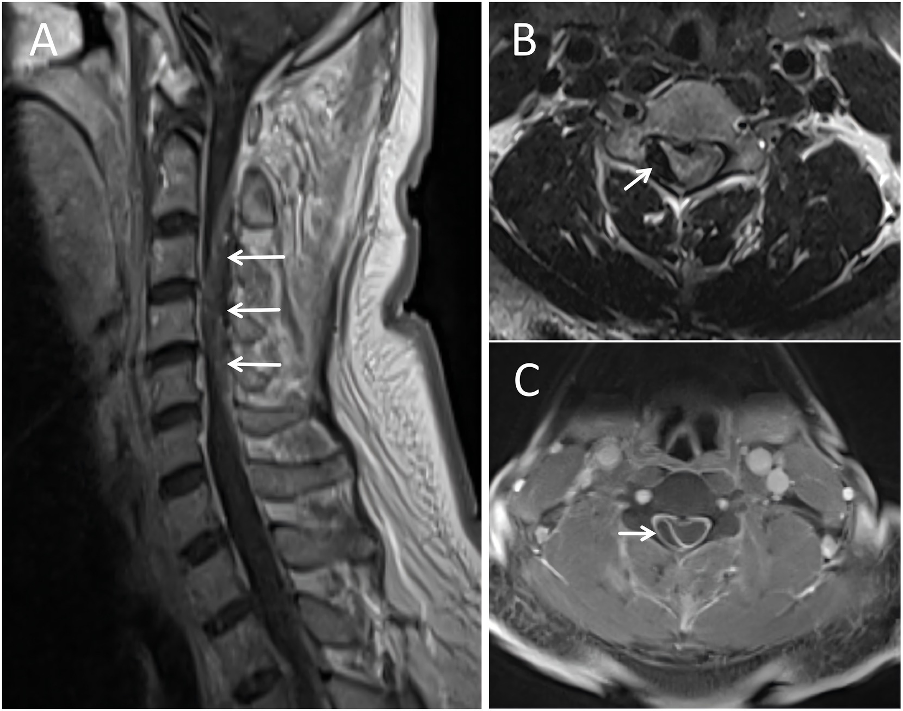
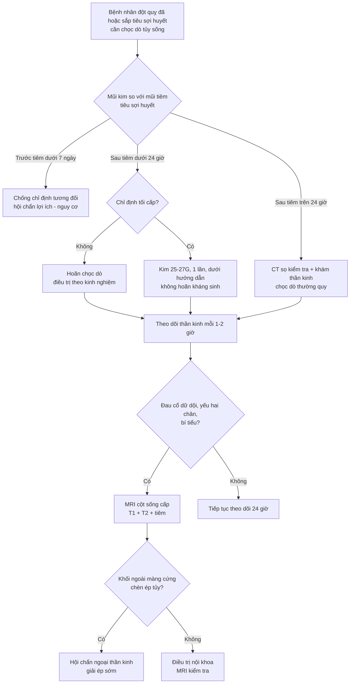
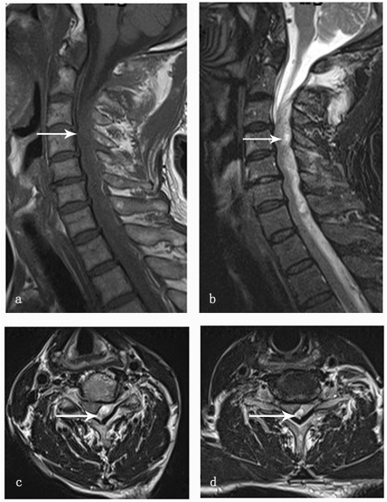
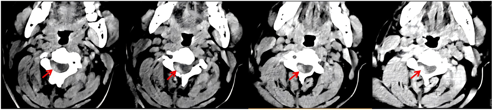

# 3024 — Chọc dò tủy sống quanh tiêu sợi huyết & lấy huyết khối: cửa sổ 24 giờ, dịch não tủy lẫn máu và máu tụ tủy

**Tags:** `pattern:tu-mau-ngoai-mang-cung` `pattern:tu-mau-duoi-mang-cung` `pattern:roi-loan-dong-mau` `vung:cot-song-co-nguc` `vung:nao` `score:NIHSS` `score:sICH` `protocol:choc-do-tuy-song` `protocol:MRI-cot-song` `protocol:tieu-soi-huyet-khoi`
**Mức chắc chắn (certainty):** tổng hợp y văn (literature synthesis) — ghép **guideline tiêu sợi huyết Nhật 2019** (toàn văn OA, PMC6923159), **tổng quan cơ chế tenecteplase** (PMC13678336), **meta-analysis TNK vs alteplase** (PMC13619431), **bảng chống chỉ định AHA/ASA ghi lại trong guideline Trung Quốc** (PMC5628383), **ca lâm sàng + mini-review 7 ca máu tụ tủy sau tiêu sợi huyết** (PMC12043198), và **2 ca nguyên văn có ảnh MRI** (PMC13121364, PMC11416295). Không phải một ca đơn lẻ → không gắn nhãn ca nguyên văn.

> **Câu hỏi thực hành:** bệnh nhân 60 tuổi đã được tiêm alteplase 4 giờ trước vì nhồi máu não, nay sốt 39 °C + cứng gáy — **chọc dò bây giờ hay chờ?** Ngược lại: bệnh nhân đau đầu dữ dội + yếu hai chân đang chờ tiêu sợi huyết — **có tiêm không?**
> Bài này chốt theo **một trục duy nhất: máu còn “đông được” hay không tại thời điểm kim xuyên màng cứng**, và **tủy sống ở đoạn cổ–ngực không có khoảng đệm như đuôi ngựa**. Nối [3022 – Chọc dò ở người dùng kháng đông](../3022-choc-do-tuy-song-khang-dong/lesson.md), [3020 – Chọc dò khó dưới hướng dẫn](../3020-choc-do-tuy-song-duoi-huong-dan-hinh-anh/lesson.md), [3013 – Hội chứng đuôi ngựa hậu phẫu](../3013-hoi-chung-duoi-ngua-sau-mo-cot-song/lesson.md), [3014 – PDPH & blood patch](../3014-dau-dau-sau-choc-do-tuy-song/lesson.md).

## 1. Tổng quan bệnh học – cơ chế hình ảnh: vì sao “INR bình thường” không nói được gì

- **Trạng thái tiêu sợi huyết là trạng thái sinh lý khác hẳn “giảm đông do thuốc kháng đông”.** Alteplase (rt-PA) 0.9 mg/kg (tối đa 90 mg, 10% bolus + 60 phút truyền) có **nửa đời 4 phút** nhưng tác dụng **kéo dài hàng giờ** vì đã kích hoạt plasminogen thành plasmin trong cục máu và trong tuần hoàn; tenecteplase (TNK) 0.25 mg/kg **một liều bolus, nửa đời 20 phút**, fibrin đặc hiệu hơn (PMC13619431).
- **TẠI SAO không có “ngưỡng INR an toàn”:** alteplase gây **giảm fibrinogen, giảm plasminogen, giảm yếu tố V và kéo dài PT** — nhưng đây là thay đổi **động, không tuyến tính**, và **INR/aPTT không phản ánh lượng plasmin đang hoạt động**. Nghiên cứu biomarker của TASTE cho thấy alteplase gây biến đổi hệ thống rõ hơn nhiều so với TNK 0.25 mg/kg (TNK chỉ giảm nhẹ plasminogen) (PMC13678336). Hệ quả thực hành: **một INR 1,1 không chứng minh “đã an toàn để chọc”**, và **fibrinogen bình thường trước tiêm cũng không bảo vệ** — ca TNK dưới đây có fibrinogen **3,55 g/L** trước tiêm, vẫn máu tụ.
- **sICH (xuất huyết nội sọ có triệu chứng) là biến cố nền của mọi ca tiêu sợi huyết:** NINDS **6,4% vs 0,6%**; ECASS III **2,4%**; các thử nghiệm TNK hiện đại: AcT **3,4% vs 3,2%**, TRACE-2 **2% vs 2%**, ATTEST-2 **2% vs 2%** (PMC6923159, PMC13678336). Nghĩa là **khoảng 2–6% bệnh nhân đã có chảy máu trong sọ** — nên một ca xấu đi sau tiêm **không mặc định là do chọc dò**, nhưng cũng **không được mặc định là chảy máu não**: phải nghĩ tới **máu tụ cột sống** (mục 5).
- **TẠI SAO máu tụ cột sống sau tiêu sợi huyết lại nguy hiểm hơn sau chọc dò thường:** đầu kim đi qua **đám rối tĩnh mạch ngoài màng cứng (Batson)** — mạch áp lực thấp, thành mỏng; bình thường cục máu tự bít lỗ rách trong vài phút, nhưng trong trạng thái tiêu sợi huyết **cục máu không hình thành được** nên máu chảy dọc khoang ngoài màng cứng. Ở **thắt lưng** chỉ có **đuôi ngựa** (các sợi rễ rời, chịu dịch chuyển); ở **cổ–ngực** tủy là một ống đặc trong ống sống hẹp → **cùng thể tích máu gây chèn ép nhanh và nặng hơn nhiều** (xem phân bố 54,1% ở ngực trong [3022](../3022-choc-do-tuy-song-khang-dong/lesson.md)).
- **Dịch não tủy lẫn máu (bloody CSF) sau tiêu sợi huyết không đọc được như chọc dò thường:** nghiệm pháp “hồng cầu giảm dần qua các ống” mất giá trị vì máu có thể tiếp tục chảy; muốn phân biệt **xuất huyết dưới nhện thật** phải dùng **quang phổ kế (spectrophotometry) tìm xanthochromia**, và cửa sổ thời gian chính xác sau tiêu sợi huyết **chưa rõ — cần tra** (bài này không chốt con số).
- **Tần suất nền:** máu tụ ngoài màng cứng cột sống tự phát (SSEH) khoảng **0,1 ca/100.000 người/năm**, thường gặp tuổi **40–60**; sau tiêu sợi huyết chỉ có **ca báo cáo**, không có mẫu số (PMC13121364, PMC12043198).

## 2. Mẫu hình + chẩn đoán phân biệt theo thời điểm (gamut)

- **Nguyên tắc:** không phân nhóm theo bệnh mà theo **khoảng cách từ mũi tiêm tiêu sợi huyết tới mũi kim** — vì đó là thứ quyết định.
- **A. Chọc dò TRƯỚC tiêu sợi huyết (trong 7 ngày):** AHA/ASA xếp **chọc dò tủy sống trong 7 ngày trước** là **chống chỉ định tương đối** của tiêu sợi huyết tĩnh mạch (**Class IIb, LOE C**) — “nên tránh, nhưng vẫn có thể cân nhắc” (ghi lại trong PMC5628383; đối chiếu thêm PMC12043198). Guideline Nhật 2019 đặt **sinh thiết/chấn thương trong 10 ngày** và **sinh/đình chỉ thai trong 10 ngày** vào nhóm “thận trọng” (PMC6923159).
- **B. Chọc dò TRONG 24 giờ sau tiêu sợi huyết:** **hoãn nếu hoãn được.** Guideline Nhật yêu cầu **không dùng thuốc kháng huyết khối trong 24 giờ** và **hoãn đặt sonde dạ dày, sonde bàng quang, catheter động mạch** ngay sau tiêm “bất cứ khi nào có thể” (PMC6923159). Mốc **24 giờ** cho chọc dò là **suy ra từ nguyên tắc đó, không có RCT** — ghi rõ để không biến nó thành “bằng chứng mức cao”.
- **C. Chọc dò SAU 24 giờ (chỉ định thật):** nghi **viêm màng não** ở bệnh nhân có “stroke mimic” (sốt, cứng gáy, rối loạn ý thức), **đánh giá xuất huyết dưới nhện khi CT âm tính**, **đo áp lực mở** trong IIH ([3018](../3018-tang-ap-luc-noi-so-tu-phat-nguoi-lon/lesson.md)), **tìm tế bào ác tính/cytology**.
- **D. Sau LẤY HUYẾT KHỐI CƠ HỌC (mechanical thrombectomy):** không có ngưỡng riêng — **chưa rõ, cần tra**. Áp dụng cùng nguyên tắc 24 giờ + kiểm tra **heparin dùng trong thủ thuật** (có thể cần **protamine** nếu chọc khẩn), và **tránh chọc khi ổ nhồi máu lớn còn hiệu ứng khối** (nguy cơ tụt não).
- **E. Chọc dò ở bệnh nhân có bệnh cảnh “giả đột quỵ” mà nguyên nhân là cột sống:** đây là nhóm **chết người vì chẩn đoán**, không phải vì kỹ thuật — **máu tụ ngoài màng cứng cổ tự phát** gây yếu nửa người + đau cổ, bị nhầm là nhồi máu não và **được tiêm tiêu sợi huyết** (ca mục 6).
- **F. Chọc dò sau mở sọ giảm áp:** nguy cơ **tụt não nghịch lý (paradoxical herniation)** do giảm áp lực nội sọ đột ngột — chống chỉ định tương đối; nếu buộc phải chọc thì lấy **thể tích tối thiểu**, có sẵn phương án bù dịch.
- **Gợi nhớ 4 câu:** **“Trước 7 ngày – Sau 24 giờ – Cổ ngực nguy hiểm – Đau cổ là chuông báo”**.

## 3. Bảng so sánh phân biệt (ma trận đối chiếu)

| Thực thể (entity) | Hình ảnh / xét nghiệm điển hình | Chốt vào (rule-in) | Chốt loại (rule-out) | Gợi ý xác nhận |
|---|---|---|---|---|
| **Máu tụ ngoài màng cứng cột sống (SSEH) sau tiêu sợi huyết** | CT cột sống: khối **tăng nhẹ tỷ trọng** sau bên trong ống sống; MRI **T1 hơi sáng, T2 tối**, **không ngấm thuốc**, đẩy tủy ra trước | **Đau cổ/lưng dữ dội + yếu hai chân tiến triển trong 2–24 giờ đầu**, kèm **bí tiểu** | **Đau khu trú không yếu, không rối loạn cơ tròn** → theo dõi | **MRI cột sống cấp** (T1+T2+tiêm); đo chiều dài theo đốt và đường kính trước–sau (mm) để quyết định mổ |
| **Máu tụ dưới màng cứng cột sống (SSDH)** | MRI **T1 đồng/tăng tín hiệu**, **T2 tăng tín hiệu**, nằm **trong bao màng cứng**, viền màng cứng **tối trên T2** (“dark line”) | **Đau cổ vai hai giờ sau tiêm + liệt tứ chi/ngang mức cảm giác** | **Dịch não tủy trong, không đau cổ** → không phải SSDH | MRI cấp; **không chọc dò để “xác nhận”** khi đã có MRI |
| **Nhồi máu não tiến triển / sICH sau tiêu sợi huyết** | CT: đông đặc trong nhu mô, có thể kèm đè đẩy; NIHSS tăng | **Thiếu hụt thần kinh kiểu bán cầu/thân não, không đau cổ, không rối loạn cơ tròn** | **Đau cổ + yếu hai chi dưới + bí tiểu** → không giải thích được bằng nhồi máu bán cầu | CT sọ cấp; nếu CT âm tính mà lâm sàng “không khớp” → **MRI cột sống** |
| **Xuất huyết dưới nhện (misdiagnosis ban đầu)** | CT sọ có máu rãnh; **dịch não tủy vàng (xanthochromia)** trên quang phổ kế | **Đau đầu sét đánh + cứng gáy + xanthochromia** | **Dịch không vàng sau ≥12 giờ và không có máu trên CT** → loại trừ | CT + CTA; chọc dò chỉ khi CT âm tính và **đã ngoài cửa sổ tiêu sợi huyết** |
| **Viêm màng não vi khuẩn (chỉ định chọc dò thật)** | Dịch đục, **bạch cầu ≥ 1000/mm³**, protein tăng, glucose giảm; cấy/PCR | **Sốt + cứng gáy + dịch viêm** | **Dịch trong, tế bào bình thường** → không viêm màng não | **Không hoãn kháng sinh để chờ chọc**; chọc khi an toàn về đông máu |
| **Máu tụ tủy trong màng cứng (intramedullary) / nhồi máu tủy** | MRI T2 tăng tín hiệu trong tủy, **không có khối ngoài tủy** | **Đau + khiếm khuyết thần kinh kiểu tủy, không có khối chèn ép** | **Có khối ngoài màng cứng/dưới màng cứng** → không phải tổn thương trong tủy | MRI có/không tiêm; DWI tủy nếu nghi nhồi máu |

*MRI cột sống cổ cùng bệnh nhân: (A) T1W sagittal — khối **hơi tăng tín hiệu** ở khoang ngoài màng cứng phía sau, lan **C2–C6** (mũi tên trắng), đè tủy ra trước; (B) T2W axial — khối **giảm tín hiệu** chiếm khoang sau bên phải, chèn ép tủy; (C) T1W sau tiêm — khối **không ngấm thuốc**, phù hợp máu tụ chứ không phải u. Nguồn: Front Med 2026 (PMC13121364) Figure 3, CC BY 4.0. Không crop.*

### Đọc ảnh máu tụ cột sống sau tiêu sợi huyết — 4 bước

1. **Khoang nào:** khối nằm **ngoài** màng cứng (đẩy màng cứng/tủy vào trong, “màng cứng căng”) hay **trong** bao màng cứng (ôm theo túi, viền màng cứng tối trên T2)?
2. **Đếm đốt lan + đo chỗ hẹp nhất:** chiều dài theo đốt và **đường kính trước–sau tại chỗ chèn ép** (mm) — yếu tố quyết định mổ, không phải thể tích ước lượng.
3. **Tín hiệu theo thời gian:** **T1 sáng + T2 tối** = máu bán cấp sớm (methemoglobin nội bào); **T1 tối + T2 tối** = tối cấp/cấp — nhóm **dễ bị bỏ sót** vì “không sáng trên T1”.
4. **Không ngấm thuốc:** khối **không ngấm** giúp loại u/dị dạng mạch; nếu **ngấm rìa + phù mô mềm** → nghĩ nguyên nhân khác (u, áp-xe).

## 4. Protocol: cửa sổ thời gian + ngưỡng quyết định

### 4.1 Bảng quyết định theo thời điểm

| Tình huống | Mốc thời gian | Việc phải làm | Mức chắc chắn |
|---|---|---|---|
| Đã chọc dò, nay có chỉ định tiêu sợi huyết | **< 7 ngày** | Coi là **chống chỉ định tương đối**; hội chẩn, cân nhắc lợi ích (NIHSS, thời gian thiếu máu) vs nguy cơ | Guideline (Class IIb) |
| Cần chọc dò sau tiêu sợi huyết | **< 24 giờ** | **Hoãn** nếu không tối cấp; không hoãn kháng sinh; nếu buộc chọc → kim **25–27G**, 1 lần, dưới hướng dẫn | Thực hành suy ra từ guideline 24 giờ |
| Cần chọc dò sau tiêu sợi huyết | **≥ 24 giờ** | Kiểm tra lại thần kinh + CT sọ trước; chọc như thường quy | Thực hành |
| Sau **lấy huyết khối** | **≥ 24 giờ** (đề xuất) | Kiểm tra heparin trong thủ thuật (± protamine); tránh chọc khi còn hiệu ứng khối lớn | **Chưa rõ — cần tra** |
| Sau **mở sọ giảm áp** | Bất kỳ | Tránh chọc; nếu buộc → thể tích tối thiểu, bù dịch, theo dõi tri giác | Ca báo cáo |

### 4.2 Kỹ thuật và theo dõi

- **Kim:** ưu tiên **kim không cắt (atraumatic, pencil-point) 25–27G** khi chỉ lấy dịch; **20–22G** khi cần đo áp lực/bơm thuốc — nhưng sau tiêu sợi huyết **cỡ kim nhỏ hơn không thay thế được thời gian chờ**.
- **Số lần chọc:** tối đa **2–3 lần**; thất bại → chuyển **chọc dò dưới hướng dẫn** ([3020](../3020-choc-do-tuy-song-duoi-huong-dan-hinh-anh/lesson.md)), không “thử mù” thêm.
- **Theo dõi sau chọc ở bệnh nhân đã tiêu sợi huyết:** khám thần kinh (lực hai chân, cảm giác, cơ tròn) **mỗi 1–2 giờ trong 24 giờ đầu** — ngắn hơn khoảng theo dõi thường quy vì trạng thái tiêu sợi huyết làm máu tụ tiến triển nhanh.
- **Thuốc:** không kháng kết tập/kháng đông trong **24 giờ** sau tiêu sợi huyết (PMC6923159); nếu đã chọc dò, **thêm thời gian** theo đánh giá chảy máu.
- **Nếu có máu tụ:** **tranexamic acid** là biện pháp cầm máu được dùng trong ca báo cáo (1 g IV, PMC11416295) — **không có bằng chứng mức cao**, và **không thay thế giải ép**; chỉ định mổ dựa trên **mức chèn ép + tốc độ tiến triển**, không chờ “đủ nặng”.

## 5. Biến thể bình thường và cạm bẫy

- **Biến thể bình thường:**
  - **Đám rối tĩnh mạch ngoài màng cứng giãn** ở người béo/thai kỳ: chọc dễ vào tĩnh mạch, máu chảy nhiều hơn dự kiến dù không rối loạn đông máu — **không** đồng nghĩa máu tụ.
  - **Dịch não tủy hồng nhẹ ở cuối thủ thuật** do chấn thương mô: hồng cầu **giảm dần** giữa các ống; nhưng sau tiêu sợi huyết, nghiệm pháp này **kém tin cậy** — cần quang phổ kế nếu nghi xuất huyết dưới nhện thật.
  - **Tăng nhẹ D-dimer sau tiêu sợi huyết** là hệ quả dược lý, **không** đồng nghĩa bóc tách động mạch — ca TNK có D-dimer **4,72 mg/L** và bị nghĩ tới bóc tách trước khi MRI cột sống được làm (PMC11416295).
- **Cạm bẫy chết người:**
  1. **Đau cổ + yếu nửa người bị đọc là “nhồi máu não” và bị tiêm tiêu sợi huyết.** Ca 52 tuổi: đau cổ, yếu phải, NIHSS 7 → tiêm rt-PA 0,9 mg/kg; sau tiêm **không cải thiện + bí tiểu + tăng phản xạ hai chân**; khối **0,5 × 8 cm từ C2–C6**; mổ **ngày 12**, hồi phục hoàn toàn sau 6 tháng (PMC13121364). **Dấu hiệu “phản biện” nằm ở đau cổ + rối loạn cơ tròn**, không ở CT sọ.
  2. **Deterioration sau tiêm luôn bị quy cho sICH mà không khám cột sống** — mất cửa sổ giải ép. Máu tụ cột sống trong y văn khởi phát **~2 giờ đến ngày 3** sau tiêm (bảng 7 ca ở PMC12043198).
  3. **Chọc dò quá sớm vì “bệnh nhân sốt, cần kháng sinh ngay”** — đúng là **không hoãn kháng sinh**, nhưng cũng **không cần chọc dò ngay trong 24 giờ đầu**; cấy máu + kháng sinh theo kinh nghiệm trước.
  4. **Tin “fibrinogen bình thường” là an toàn:** ca TNK có fibrinogen **3,55 g/L** trước tiêm vẫn máu tụ dưới màng cứng cổ, liệt tứ chi, di chứng **liệt hai chân** sau 2 tháng (PMC11416295).
  5. **Chọc dò để “xác nhận” máu tụ cột sống khi đã có MRI** — vô ích và nguy hiểm; MRI là chốt.
  6. **Bỏ qua chiều cao tổn thương:** khối ở **cổ–ngực** chèn ép tủy, khác hẳn khối thắt lưng chỉ chèn đuôi ngựa; đừng đánh giá “nhẹ” theo thể tích.
  7. **Dùng INR/aPTT để “cho phép” chọc dò trong 24 giờ đầu** — không có ngưỡng nào được chứng minh; **thời gian**, không phải xét nghiệm, là biến số chính.

## 6. Tự lượng giá — Blind Quiz

**Ca 1 — Nam 71 tuổi, yếu nửa người trái 105 phút, được tiêm tenecteplase 16 mg (0,25 mg/kg). 2 giờ 20 phút sau: đau dữ dội vùng cổ–vai trái rồi liệt tứ chi.**

- **Câu 1:** Tổn thương nằm ở khoang nào (ngoài màng cứng hay trong bao màng cứng)? Dấu hiệu nào trên T2 giúp xác định? Vì sao “đau cổ sau tiêm” là dấu hiệu báo động, không phải tác dụng phụ?
- **Câu 2:** Nếu bệnh nhân này cần chọc dò tủy sống để loại trừ viêm màng não, bạn chờ đến khi nào và vì sao?

<b>Bấm để hiện đáp án</b>

- **Câu 1:** Khối **trong bao màng cứng (SSDH)** vùng cổ: trên T1W (a) khối **đồng tín hiệu**, trên T2W (b) khối **tăng tín hiệu** và **màng cứng hiện thành đường tối (dark line)** ngay ngoài khối — dấu hiệu chỉ ra máu nằm *trong* bao màng cứng; axial (c,d) thấy khối **chèn ép tủy** (mũi tên). Đau cổ dữ dội **2 giờ 20 phút** sau tiêm là biểu hiện của máu tụ đang lan trong khoang kín, không phải đau cơ — kèm **liệt tiến triển + mức cảm giác T2**.
- **Câu 2:** **Chờ tối thiểu 24 giờ** sau liều tenecteplase và chỉ chọc khi thật cần (không hoãn kháng sinh); dùng **kim 25–27G**, theo dõi thần kinh mỗi 1–2 giờ. Ở ca này, ưu tiên tuyệt đối là **MRI cấp + giải ép** (mổ 12 giờ sau khởi phát đau) — chọc dò sẽ làm mất thời gian vàng.
- **Số liệu:** TNK 16 mg, fibrinogen **3,55 g/L** trước tiêm, D-dimer **4,72 mg/L** sau tiêm; tranexamic acid **1 g**; sau mổ **hai tay hồi phục, hai chân liệt** ở tháng thứ 2 (PMC11416295).
- **Nguồn ảnh:** Heliyon 2024 (PMC11416295), Fig. 1, **CC BY-NC-ND 4.0** — hiển thị **nguyên bản**, không crop/ghép.

**Ca 2 — Nam 52 tuổi, đau cổ rồi yếu nửa người phải, NIHSS 7, được tiêm alteplase 0,9 mg/kg lúc 3 giờ 10 phút. Sau tiêm không cải thiện, xuất hiện bí tiểu. CTA đầu tiên được đọc lại.**

- **Câu 3:** Mô tả tổn thương trên CT ngang và cho biết vì sao CTA “bình thường” ban đầu vẫn có thể bỏ sót. Chẩn đoán phân biệt trước tiêm là gì, và dấu hiệu nào đã bị bỏ qua?

<b>Bấm để hiện đáp án</b>

- **Câu 3:** CT cột sống cổ các lát ngang: khối **tăng nhẹ tỷ trọng** ở khoang ngoài màng cứng **sau bên phải**, kích thước **~0,5 × 8 cm từ C2 đến C6** (mũi tên đỏ). CTA ban đầu chỉ được đọc theo “mạch máu”, **không đọc ống sống** — tổn thương nằm ngoài cửa sổ đánh giá thường quy. Trước tiêm, chẩn đoán phân biệt phải có **máu tụ ngoài màng cứng cột sống tự phát** và **bóc tách động mạch đốt sống**; dấu hiệu bị bỏ qua là **đau cổ kéo dài + bí tiểu + tăng phản xạ/ clonus hai chân** (không có ở nhồi máu bán cầu đơn thuần).
- **Diễn biến:** mổ **ngày 12** sau khởi phát; **hồi phục hoàn toàn sau 6 tháng** — muộn nhưng vẫn hồi phục, nên **không được kết luận tiên lượng xấu sớm**.
- **Phản biện:** ca này chứng minh **tiêu sợi huyết không gây ra** máu tụ (máu tụ có trước), nhưng **làm nặng thêm**; bài học là **đọc lại CTA có cửa sổ cột sống** ở mọi ca “đột quỵ + đau cổ”.
- **Nguồn ảnh:** Front Med 2026 (PMC13121364), Figure 2, CC BY 4.0. Ảnh nguyên bản, không crop.

## Bài liên quan chéo
- [3022 – Chọc dò tủy sống ở người dùng kháng đông / rối loạn đông máu](../3022-choc-do-tuy-song-khang-dong/lesson.md) (ngưỡng INR/tiểu cầu/DOAC; cùng “trục hoạt tính thuốc”)
- [3020 – Chọc dò tủy sống khó dưới hướng dẫn hình ảnh](../3020-choc-do-tuy-song-duoi-huong-dan-hinh-anh/lesson.md) (giảm số lần chọc = giảm nguy cơ chảy máu)
- [3013 – Hội chứng đuôi ngựa hậu phẫu: máu tụ – phù – áp-xe](../3013-hoi-chung-duoi-ngua-sau-mo-cot-song/lesson.md) (cửa sổ giải ép, tiên lượng theo thời gian)
- [3014 – Đau đầu sau chọc dò tủy sống (PDPH) & blood patch](../3014-dau-dau-sau-choc-do-tuy-song/lesson.md) (blood patch cũng là thủ thuật ngoài màng cứng)
- [3018 – Tăng áp lực nội sọ tự phát ở người lớn](../3018-tang-ap-luc-noi-so-tu-phat-nguoi-lon/lesson.md) (chỉ định đo áp lực mở; không chọc lặp để trị đau đầu)
- [3025 – Đảo ngược kháng đông trong xuất huyết nội sọ cấp](../3025-dao-nguoc-khang-dong-xuat-huyet-noi-so/lesson.md) (khi biến cố chảy máu đã xảy ra: đảo ngược thế nào)

## Ảnh
- `3024_mau-tu-ngoai-mang-cung_MRI-PMC13121364-F3.jpg` — MRI cột sống cổ T1/T2/sau tiêm, máu tụ ngoài màng cứng C2–C6, Front Med 2026 (PMC13121364), Figure 3, **CC BY 4.0**.
- `3024_mau-tu-ngoai-mang-cung_CT-PMC13121364-F2.jpg` — CT cột sống cổ ngang, khối 0,5 × 8 cm C2–C6, cùng bài, Figure 2, **CC BY 4.0**.
- `3024_mau-tu-duoi-mang-cung_MRI-PMC11416295-F1.jpg` — MRI cột sống cổ, máu tụ dưới màng cứng sau tenecteplase, Heliyon 2024 (PMC11416295), Fig. 1, **CC BY-NC-ND 4.0** — hiển thị nguyên bản, không phái sinh.
- Nguồn + giấy phép từng ảnh: `images/CREDITS.md`.

> Không dùng để chẩn đoán độc lập khi chưa có người hướng dẫn.
