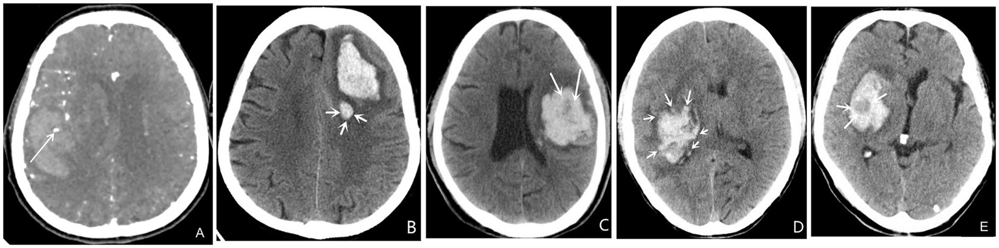
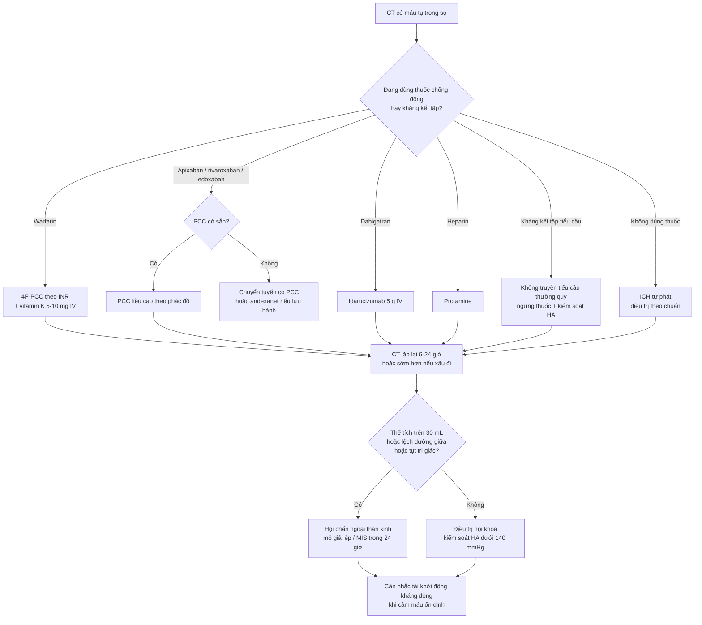
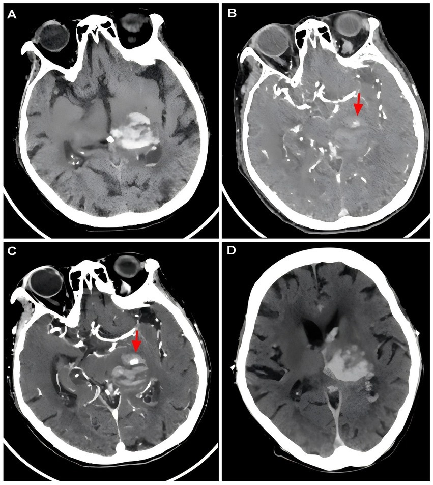

# 3025 — Đảo ngược kháng đông trong xuất huyết nội sọ cấp: chọn thuốc, liều, dấu hiệu CT và khi nào khởi động lại

**Tags:** `pattern:xuat-huyet-noi-so` `pattern:dau-hieu-lan-rong-mau-tu` `vung:nao` `score:spot-sign` `score:blend-sign` `score:ICH-score` `protocol:CT-so-nao` `protocol:CTA` `protocol:dao-nguoc-khang-dong`
**Mức chắc chắn (certainty):** tổng hợp y văn (literature synthesis) — ghép **phân tích hậu kiểm ANNEXA-I về dấu hiệu NCCT** (PMC13688066), **meta-analysis spot sign 2.832 bệnh nhân** (PMC13433554), **tổng quan dấu hiệu CT + hệ điểm** (PMC13349933), **ca CT có spot sign → lan rộng** (PMC13265560), **bảng liều đảo ngược + mốc FDA 22/12/2025** (PMC13110298), **tổng quan quản lý kháng đông hậu andexanet** (PMC13073382), **PCC thực hành trên ICH do Xa** (PMC12906014), **tổng quan điều trị ICH** (PMC13099448), cùng **INCH** và **PATCH** (trích abstract gốc), **meta-analysis tái khởi động kháng đông** (PMC12822325). Nhiều thiết kế khác nhau, không phải một ca → không gắn nhãn ca nguyên văn.

> **Câu hỏi thực hành:** bệnh nhân 78 tuổi dùng apixaban, đột ngột liệt nửa người, CT có ổ máu tụ 25 mL đồi thị — **đảo ngược bằng gì, liều bao nhiêu, có mổ không, bao giờ dùng lại thuốc?**
> Bài này chốt theo **hai trục**: (1) **còn bao nhiêu hoạt tính thuốc** (quyết định thuốc đảo ngược), và (2) **ổ máu còn đang chảy hay đã đông** (quyết định có can thiệp hay không). Ngưỡng cụ thể ở mục (4); bẫy chết người ở mục (5). Nối [3022 – Chọc dò ở người dùng kháng đông](../3022-choc-do-tuy-song-khang-dong/lesson.md), [3024 – Chọc dò quanh tiêu sợi huyết](../3024-choc-do-tuy-song-quanh-tieu-soi-huyet-khoi/lesson.md), [212 – Xuất huyết sọ: ICH/SAH/SDH/EDH](../212-xuat-huyet-so-nao/lesson.md), [201 – Protocol CT/MRI sọ não](../201-protocol-so-nao/lesson.md).

## 1. Tổng quan bệnh học – cơ chế hình ảnh: vì sao “máu chưa đông” hiện ra thành dấu hiệu trên CT

- **Lan rộng máu tụ (hematoma expansion — HE) là biến cố đích.** HE xảy ra ở **~20–30%** bệnh nhân ICH, chủ yếu **trong 3–6 giờ đầu**, và gắn chặt với kết cục xấu (PMC13099448). Định nghĩa vận hành hay dùng: **tăng > 6 mL tuyệt đối**, hoặc **> 33% thể tích**, hoặc **xuất huyết não thất mới**; thử nghiệm ANNEXA-I dùng ngưỡng **≥ 12,5 mL hoặc ≥ 35%** (PMC13688066).
- **TẠI SAO kháng đông tạo ra “máu lỏng” thấy được trên CT:** máu tụ bình thường đông trong phút → **cục fibrin co lại, đặc, 60–80 HU**, bờ rõ. Khi còn hoạt tính kháng đông (hoặc tiêu sợi huyết), fibrin không trùng hợp được → **máu chưa đông nằm lại trong ổ**, có **tỷ trọng thấp hơn** và **phân bố không đều** → trên CT không cản quang xuất hiện **vùng giảm tỷ trọng trong ổ máu, mức dịch, hoặc “xoáy”** — đó chính là cơ sở vật lý của **black hole sign, blend sign, swirl sign, hypodensities**.
- **Vì sao các dấu hiệu này có giá trị tiên lượng:** chúng phản ánh **máu còn chảy vào ổ** tại thời điểm chụp, không phải “di chứng”. Ngưỡng định lượng hay dùng: **blend sign** = hai vùng tồn tại cạnh nhau, bờ rõ, **chênh > 18 HU**; **black hole sign** = vùng giảm tỷ trọng **đóng kín trong** ổ tăng tỷ trọng, bờ rõ; **island sign** = **≥ 3 “đảo” máu nhỏ tách rời** (hoặc ≥ 4 nếu tính cả đảo nối một phần); **satellite sign** = ổ máu nhỏ **tách rời** ổ chính; **swirl sign** = vùng giảm/đồng tỷ trọng dạng tròn–dải–không đều trong ổ, đại diện **máu chưa đông** (PMC13349933). Trong cùng nhóm, **island sign** có **OR mạnh nhất (7,87)** cho HE (PMC13349933).
- **Con số thực tế trên nhóm kháng đông ức chế Xa:** trong **434** bệnh nhân của ANNEXA-I, **72,1%** có **ít nhất một** dấu hiệu NCCT; **HE 31,8%**; **mật độ không đều, hypodensity và black hole sign** là yếu tố **độc lập** với HE (PMC13688066). Nghĩa là **dấu hiệu CT dương không phải hiếm**, và **không được dùng để “trấn an”**.
- **CTA spot sign:** chấm ngấm thuốc trong ổ máu trên CTA. Meta-analysis **10 nghiên cứu, 2.832 bệnh nhân (613 có spot sign)**: HE **OR 7,17 (5,65–9,09)**, tử vong **OR 4,14 (2,45–6,99)**, kết cục xấu **OR 4,06 (2,66–6,20)** (PMC13433554). **Phản biện:** spot sign **độ nhạy thấp** — âm tính **không loại trừ** lan rộng, nên nó là **dấu hiệu “rule-in”, không phải “rule-out”**.
- **Vì sao thời gian là biến số chính:** thuốc đảo ngược **không hồi phục được mô đã chết**, chỉ hạn chế **máu chảy thêm**. Toàn bộ lợi ích nằm trong **vài giờ đầu**; mọi bước chậm trễ (chờ kết quả đông máu, chờ thuốc từ kho) đều làm mất tác dụng.

## 2. Mẫu hình + chẩn đoán phân biệt theo nhóm thuốc (gamut)

- **Nguyên tắc:** chọn thuốc theo **cơ chế thuốc**, không theo tên thương mại; **không chờ xét nghiệm đông máu** để bắt đầu ở bệnh nhân đang chảy máu có hội chứng lâm sàng rõ.
- **A. Kháng vitamin K (warfarin):** thiếu yếu tố **II, VII, IX, X** → đảo ngược bằng **vitamin K IV + 4F-PCC**; **không dùng FFP** nếu có PCC (INCH: INR ≤ 1,2 trong 3 giờ **67% vs 9%**; tử vong **19% vs 35%**; tử vong do lan rộng máu **0/27 vs 5/23**) (INCH, PMID 27302126).
- **B. DOAC ức chế yếu tố Xa (apixaban, rivaroxaban, edoxaban):** **INR/aPTT không phản ánh** → đảo ngược bằng **PCC liều cao hoặc andexanet**; sau **22/12/2025**, andexanet **đã bị rút khỏi thị trường Mỹ** (nguy cơ huyết khối), **vẫn lưu hành ở EU/Canada** → thực tế nhiều nơi **PCC là lựa chọn duy nhất** (PMC13110298, PMC13073382).
- **C. Dabigatran (ức chế thrombin):** có **thuốc giải đặc hiệu — idarucizumab 5 g IV**; nếu không có → PCC/aPCC hoặc **lọc máu** (dabigatran thải qua thận, dialyzable) (PMC13110298).
- **D. Heparin (UFH/LMWH):** **protamine** (liều theo lượng heparin còn hiệu lực); LMWH chỉ đảo ngược một phần. Không dùng PCC thay protamine.
- **E. Kháng kết tập tiểu cầu đơn thuần:** **không truyền tiểu cầu thường quy** — PATCH cho thấy **truyền tiểu cầu làm xấu hơn** (chết/phụ thuộc **aOR 2,05; 1,18–3,56**; tử vong trong viện **24% vs 17%**) (PATCH, PMID 27178479). Xử trí: ngừng thuốc, kiểm soát HA, cân nhắc can thiệp ngoại khoa như ICH tự phát.
- **F. Rối loạn đông máu “nội tại” (xơ gan, DIC, giảm tiểu cầu nặng, urê cao):** **không có “số INR” để đảo ngược**; bù **yếu tố đặc hiệu/fibrinogen/tiểu cầu** theo huyết học, và nhớ rằng INR cao ở xơ gan **không** đồng nghĩa giảm khả năng cầm máu.
- **G. Ngộ độc/chưa rõ thuốc + ổ máu lớn, chèn ép:** ưu tiên **kiểm soát đường thở + mổ giải ép** song song với đảo ngược — **không chờ đảo ngược xong mới mổ** (khi đang tụt não).
- **Gợi nhớ 5 nhóm:** **V–X–D–H–P** (Vitamin K, Xa, Direct thrombin, Heparin, Platelet).

## 3. Bảng so sánh phân biệt (ma trận đối chiếu)

| Thực thể (entity) | Hình ảnh / xét nghiệm điển hình | Chốt vào (rule-in) | Chốt loại (rule-out) | Gợi ý xác nhận |
|---|---|---|---|---|
| **ICH do warfarin** | Ổ máu đơn độc hoặc nhiều ổ, hay gặp ở **thùy não**; INR **≥ 2,0** | **INR ≥ 2,0 + đang dùng warfarin + ổ máu trên CT** | **INR bình thường, không dùng kháng đông** → ICH tự phát | INR ngay tại cấp cứu; 4F-PCC theo INR + vitamin K 5–10 mg IV |
| **ICH do thuốc ức chế Xa** | Ổ máu, **dấu hiệu NCCT dương 72,1%**, **HE 31,8%** trong ANNEXA-I | **Đang dùng apixaban/rivaroxaban + ổ máu + anti-Xa hiệu chuẩn cao (nếu có)** | **Đã quá 3–5 nửa đời thuốc + chức năng thận bình thường** → hoạt tính thấp | Hỏi **giờ uống liều cuối** + CrCl; anti-Xa hiệu chuẩn nếu kết quả sẽ đổi quyết định |
| **ICH do dabigatran** | Ổ máu; aPTT có thể tăng nhưng **không tuyến tính** | **Đang dùng dabigatran + ổ máu** (không cần chờ aPTT) | **dTT/ecarin bình thường** (nếu có) → hoạt tính thấp | **Idarucizumab 5 g**; nếu không có → PCC/aPCC/lọc máu |
| **ICH trên nền kháng kết tập tiểu cầu** | Ổ máu; không có xét nghiệm phản ánh | **Đang dùng aspirin/clopidogrel/ticagrelor + ổ máu** | **Không dùng thuốc nào** → không phải nhóm này | **Không truyền tiểu cầu thường quy** (PATCH: hại) |
| **Máu tụ dưới màng cứng cấp (SDH) do kháng đông** | Khối **liềm** bám mặt trong hộp sọ, **không qua đường giữa**, có thể **lệch đường giữa** | **Chấn thương/đau đầu + khối liềm + đang kháng đông** | **Tổn thương trong nhu mô, hình cầu** → ICH | CT không cản quang; **mổ lấy máu** nếu dày > 10 mm hoặc lệch > 5 mm |
| **Xuất huyết dưới nhện (SAH)** | Máu rãnh/bể đáy; **đau đầu sét đánh** | **Máu rãnh + đau đầu đột ngột** | **Không máu rãnh trên CT tốt + không cứng gáy** → ít khả năng | CTA tìm phình mạch; **không đảo ngược nếu là SAH do vỡ phình đang hoạt động** mà chưa xử lý phình |
| **Lan rộng máu tụ (HE)** | **Tăng > 6 mL / > 33%**, hoặc **≥ 12,5 mL / ≥ 35%** (ANNEXA-I) trên CT lặp lại; **spot sign**, **blend**, **black hole**, **island**, **satellite**, **swirl** | **Bất kỳ dấu hiệu NCCT nào + chụp lại trong 6–24 giờ** | **Ổ máu đồng nhất, bờ đều, không dấu hiệu, không dùng kháng đông** → nguy cơ thấp | CT lặp lại **6–24 giờ** (hoặc sớm hơn nếu xấu đi); CTA nếu cân nhắc can thiệp |

*Năm dấu hiệu trên CT không cản quang/CTA: **(A) spot sign** trên CTA (chấm ngấm thuốc trong ổ máu); **(B) satellite sign** — ổ máu nhỏ tách rời; **(C) swirl sign** — vùng giảm/đồng tỷ trọng dạng xoáy (máu chưa đông); **(D) island sign** — nhiều “đảo” máu nhỏ; **(E) black hole sign** — vùng giảm tỷ trọng đóng kín trong ổ máu. Nguồn: Front Neurol 2026 (PMC13349933) Figure 2, CC BY 4.0. Không crop.*

### Đọc ổ máu tụ trên CT — 5 bước trước khi quyết định đảo ngược

1. **Thể tích:** đo **ABC/2** (hoặc planimetry) — ghi mL; **≥ 30 mL** ở trên lều là ngưỡng cân nhắc can thiệp (ENRICH dùng **30–80 mL**, PMC13099448).
2. **Vị trí + hiệu ứng khối:** **thùy** (can thiệp ít rủi ro hơn) vs **đồi thị/nhân nền** (sâu, can thiệp kém lợi); **lệch đường giữa (mm)**, **chèn bể đáy**, **giãn não thất**.
3. **Dấu hiệu “máu còn chảy”:** spot sign / blend / black hole / island / satellite / swirl — **bất kỳ dấu hiệu nào cũng làm tăng nguy cơ HE**.
4. **Máu vào não thất (IVH):** làm nặng tiên lượng và tăng nguy cơ não úng thủy — cân nhắc **dẫn lưu não thất**.
5. **Thời điểm so với liều thuốc cuối:** quyết định **có cần đảo ngược hay chỉ theo dõi**.

## 4. Protocol: dấu hiệu CT + liều đảo ngược + thời điểm mổ

### 4.1 Ngưỡng hình ảnh và thời điểm chụp lại

- **CT không cản quang ngay khi nhập viện** (không chờ), + **CTA** nếu cân nhắc can thiệp/spot sign; **CT lặp lại 6–24 giờ** hoặc **ngay khi xấu đi** — HE chủ yếu trong **3–6 giờ đầu**.
- **Ngưỡng hành động:** HE **> 6 mL / > 33%** (định nghĩa kinh điển) hoặc **≥ 12,5 mL / ≥ 35%** (ANNEXA-I) → coi là **thất bại cầm máu**, xem lại chiến lược.
- **Kiểm soát huyết áp:** đích **SBP < 140 mmHg trong 1 giờ** (INTERACT2: **n = 2.839**, **aOR 0,87; 0,75–1,01** — xu hướng có lợi, an toàn); **không hạ sâu 110–139 mmHg** (ATACH-II: **n = 1.000**, không lợi về chức năng, **tăng biến chứng thận**) (PMC13099448).

### 4.2 Bảng liều đảo ngược (người lớn, ICH cấp)

| Thuốc nền | Thuốc đảo ngược | Liều | Ghi chú |
|---|---|---|---|
| **Warfarin (VKA)** | **4F-PCC** + **vitamin K IV** | 4F-PCC theo INR: **2–<4: 25 IU/kg; 4–6: 35 IU/kg; >6: 50 IU/kg**; hoặc liều cố định **1.500 IU** cho ICH. Vitamin K **5–10 mg IV** (2–5 mg nếu sắp dùng lại sớm) | 4F-PCC khởi phát **5–15 phút**; vitamin K IV khởi phát **1–2 giờ**, đạt đỉnh **~24 giờ** → **luôn dùng cùng nhau** (PMC13110298) |
| **Apixaban / rivaroxaban / edoxaban** | **PCC** (4F-PCC hoặc aPCC); **andexanet** nếu có | Liều PCC cho nhóm Xa **cao hơn nhóm VKA** và **khác nhau giữa các phác đồ** — **chưa có RCT xác định liều tối ưu** (PMC13680811) | Andexanet: **rút khỏi thị trường Mỹ 22/12/2025** do huyết khối; **vẫn ở EU/Canada** (PMC13110298) |
| **Dabigatran** | **Idarucizumab** | **5 g IV** (2 × 2,5 g) | Nếu không có: PCC/aPCC hoặc **lọc máu** (thuốc thải qua thận) |
| **UFH / LMWH** | **Protamine** | Liều theo lượng heparin còn hiệu lực | LMWH chỉ đảo ngược **một phần** |
| **Kháng kết tập tiểu cầu** | **Không truyền tiểu cầu thường quy** | — | PATCH: **aOR 2,05 (1,18–3,56)** cho chết/phụ thuộc → **hại** |
| **Không rõ thuốc / ngộ độc** | PCC + vitamin K; **than hoạt** nếu mới uống 2–4 giờ | — | Hỏi kỹ **giờ uống liều cuối** |

### 4.3 Bằng chứng đằng sau các lựa chọn (và chỗ còn trống)

- **INCH (VKA-ICH, n = 50, dừng sớm):** 4F-PCC **30 IU/kg** vs FFP **20 mL/kg**; **INR ≤ 1,2 trong 3 giờ: 67% vs 9%**; tử vong **19% vs 35%** — nhưng **không đủ lực** để chứng minh lợi ích chức năng (PMID 27302126).
- **ANNEXA-I (Xa-ICH, n = 530):** andexanet **hiệu quả cầm máu tốt hơn** và giảm anti-Xa mạnh hơn (**94,5% vs 26,9%**), **nhưng** biến cố huyết khối **10,3% vs 5,6%**, **đột quỵ thiếu máu 6,5% vs 1,5%**, **không khác biệt tử vong 30 ngày** (qua PMC13073382, PMC13099448).
- **PCC thực hành trên Xa-ICH (n = 52):** hiệu quả cầm máu theo tiêu chí ANNEXA-I **75,0%**; biến cố huyết khối **1,9%**; tử vong 30 ngày **23,1%** — khác biệt lớn với ANNEXA-I vì **quần thể nhỏ hơn, ổ máu nhỏ hơn** (trung vị **5,45 mL**) → **không so sánh trực tiếp** (PMC12906014).
- **aPCC vs 4F-PCC (n = 293):** cầm máu **77,0% vs 70,7%**, **không khác biệt có ý nghĩa** (PMC13073382).
- **Khởi động lại kháng đông (5 RCT, n = 733):** giảm đột quỵ thiếu máu **RR 0,20 (0,06–0,71)**, **NNT 9**; tăng xuất huyết nội sọ **HR 3,69 (1,54–8,84)**, **NNH 24** → **không có ngưỡng thời gian được chứng minh**, phải cá thể hóa (PMC12822325).
- **Chỗ còn trống:** **liều PCC tối ưu cho Xa-ICH**, **vai trò andexanet hậu rút khỏi thị trường**, và **thời điểm mổ lý tưởng** đều **chưa có bằng chứng mức cao** (PMC13680811, PMC13099448).

## 5. Biến thể bình thường và cạm bẫy

- **Biến thể bình thường:**
  - **Vôi hóa đám rối mạch mạc (choroid plexus)**, **vôi hóa tuyến tùng**, **vôi hóa thể gai** — tăng tỷ trọng đối xứng, **không có hiệu ứng khối**, không đổi trên CT lặp lại.
  - **Máu tụ nhỏ ở vị trí “lạ”** (thùy chẩm) có thể do **amyloid mạch máu (CAA)** ở người già, không do kháng đông — khác hướng tái khởi động.
  - **Giảm tỷ trọng quanh ổ máu** do **phù** (24–48 giờ) — không phải “máu còn chảy”, không đặt lại thuốc đảo ngược.
- **Cạm bẫy chết người:**
  1. **Chờ INR/aPTT ở bệnh nhân đang dùng DOAC rồi mới đảo ngược** — **INR/aPTT có thể bình thường** dù nồng độ thuốc còn cao; quyết định dựa trên **giờ uống liều cuối + CrCl + lâm sàng**.
  2. **Tin “CT đồng nhất = an toàn”** — trong 434 ca Xa-ICH, **72,1% có ít nhất một dấu hiệu** và **31,8% lan rộng**; ổ máu đẹp trên CT đầu **không loại trừ** HE.
  3. **Dùng FFP thay PCC** ở VKA-ICH: chậm đạt INR đích (**9% vs 67%** trong 3 giờ) và **nhiều tử vong do lan rộng hơn** (INCH).
  4. **Truyền tiểu cầu cho ICH do kháng kết tập** “cho chắc” — PATCH cho thấy **hại** (aOR 2,05); chỉ truyền khi có chỉ định huyết học khác.
  5. **Đảo ngược xong nhưng không chụp lại** — HE có thể xảy ra sau đảo ngược; **CT lặp lại 6–24 giờ** là một phần của điều trị, không phải “theo dõi tùy chọn”.
  6. **Mổ hoặc không mổ chỉ dựa vào thể tích** — ENRICH: **30–80 mL**, mổ trong **24 giờ**, cải thiện ở **thùy** nhưng **không ở ICH sâu**; quyết định phải theo **vị trí + tri giác + bệnh nền** (PMC13099448).
  7. **Quên tái khởi động kháng đông** — bỏ hẳn kháng đông làm tăng đột quỵ thiếu máu (RR 0,20 khi dùng lại = giảm 80%); nhưng dùng lại quá sớm tăng xuất huyết (HR 3,69) → **cá thể hóa, có hội chẩn**.
  8. **Spot sign âm tính được dùng để loại trừ** — **độ nhạy thấp**; âm tính không loại trừ HE (PMC13433554).

## 6. Tự lượng giá — Blind Quiz

**Ca 1 — Năm ổ máu tụ khác nhau trên CT/CTA. Nhìn hình, gọi tên từng dấu hiệu trước khi mở đáp án.**

- **Câu 1:** Panel nào là **spot sign**, **satellite**, **swirl**, **island**, **black hole**? Dấu hiệu nào có **OR mạnh nhất** cho lan rộng máu tụ, và vì sao âm tính **không** loại trừ?
- **Câu 2:** Bệnh nhân dùng apixaban, CT có **black hole sign** — dấu hiệu này **thay đổi** quyết định đảo ngược không?

<b>Bấm để hiện đáp án</b>

- **Câu 1:** **(A) spot sign** (CTA — chấm ngấm thuốc trong ổ máu); **(B) satellite sign** (ổ nhỏ tách rời); **(C) swirl sign** (vùng giảm/đồng tỷ trọng dạng xoáy = máu chưa đông); **(D) island sign** (≥ 3 “đảo” máu nhỏ); **(E) black hole sign** (vùng giảm tỷ trọng đóng kín, bờ rõ). **Island sign** có **OR 7,87** — mạnh nhất trong nhóm (PMC13349933). **Âm tính không loại trừ** vì độ nhạy thấp; meta-analysis vẫn cho **HE OR 7,17** khi có spot sign, nhưng không có nghĩa thiếu spot sign là an toàn (PMC13433554).
- **Câu 2:** **Có — theo hướng “không chờ thêm”.** Black hole sign là **yếu tố độc lập** với HE trong ANNEXA-I (**HE 31,8%** ở nhóm Xa-ICH có ≥ 1 dấu hiệu NCCT); nó **không đổi thuốc** đảo ngược nhưng **đổi mức khẩn** (chụp lại sớm 6 giờ, cân nhắc can thiệp, không “theo dõi ngoại trú”).
- **Nguồn ảnh:** Front Neurol 2026 (PMC13349933), Figure 2, CC BY 4.0.

**Ca 2 — Nữ 75 tuổi, ổ máu đồi thị trái 12,90 mL, CTA có spot sign. 3,5 giờ sau, CT lặp lại.**

- **Câu 3:** Mô tả (A)–(D) và giải thích vì sao **spot sign dương** đã đủ để coi bệnh nhân này là **nguy cơ cao**, dù thể tích ban đầu chỉ **12,90 mL**.

<b>Bấm để hiện đáp án</b>

- **Câu 3:** (A) CT không cản quang: ổ máu **đồi thị trái**, thể tích **12,90 mL**; (B) CTA: **spot sign dương** (mũi tên đỏ) — chấm ngấm thuốc trong ổ; (C) CT tuần tự: **“brush sign”** (dấu hiệu mới của nhóm tác giả, mô tả vùng tăng tỷ trọng dạng “bàn chải” quanh ổ) — chỉ **máu còn rỉ**; (D) CT lặp lại: ổ máu **lan rộng rõ**. Thể tích nhỏ **không** bảo vệ: nguy cơ nằm ở **máu còn chảy**, không ở kích thước ban đầu — **HE OR 7,17** khi có spot sign (PMC13433554), và **island/black hole/blend** cũng độc lập với HE (PMC13688066).
- **Hệ quả thực hành:** bệnh nhân này cần **chụp lại sớm (giờ, không phải ngày)**, kiểm soát **SBP < 140 mmHg trong 1 giờ**, và nếu đang dùng kháng đông → **đảo ngược ngay** thay vì “chờ ổn định”.
- **Phản biện:** đây là ca minh họa trong bài về **“brush sign”**, một dấu hiệu **chưa được xác nhận độc lập rộng rãi** — không dùng nó thay **spot sign/blend/black hole** đã được kiểm chứng.
- **Nguồn ảnh:** Front Neurol 2026 (PMC13265560), Figure 2, CC BY 4.0.

## Bài liên quan chéo
- [3022 – Chọc dò tủy sống ở người dùng kháng đông / rối loạn đông máu](../3022-choc-do-tuy-song-khang-dong/lesson.md) (cùng bảng thuốc – thời gian ngừng; khác bối cảnh: thủ thuật chương trình)
- [3024 – Chọc dò tủy sống quanh tiêu sợi huyết & lấy huyết khối](../3024-choc-do-tuy-song-quanh-tieu-soi-huyet-khoi/lesson.md) (khi biến cố chảy máu xảy ra sau tiêu sợi huyết)
- [3013 – Hội chứng đuôi ngựa hậu phẫu: máu tụ – phù – áp-xe](../3013-hoi-chung-duoi-ngua-sau-mo-cot-song/lesson.md) (máu tụ ngoài màng cứng — cùng nguyên lý “máu còn chảy”)
- [212 – Xuất huyết sọ: ICH/SAH/SDH/EDH & diễn tiến máu](../212-xuat-huyet-so-nao/lesson.md) (nền tảng phân biệt 4 loại chảy máu trong sọ)
- [201 – Protocol CT/MRI sọ não](../201-protocol-so-nao/lesson.md) (chọn chuỗi xung, thời điểm chụp lại)

## Ảnh
- `3025_dau-hieu-tang-huyet_CT-PMC13349933-F2.jpg` — bộ 5 dấu hiệu CT/CTA dự báo lan rộng máu tụ, Front Neurol 2026 (PMC13349933), Figure 2, **CC BY 4.0**.
- `3025_spot-sign-tien-trien_CT-PMC13265560-F2.jpg` — ca ổ máu đồi thị 12,90 mL: CT đầu → CTA spot sign → CT trễ “brush sign” → CT lặp lại lan rộng, Front Neurol 2026 (PMC13265560), Figure 2, **CC BY 4.0**.
- Nguồn + giấy phép từng ảnh: `images/CREDITS.md`.

> Không dùng để chẩn đoán độc lập khi chưa có người hướng dẫn.
