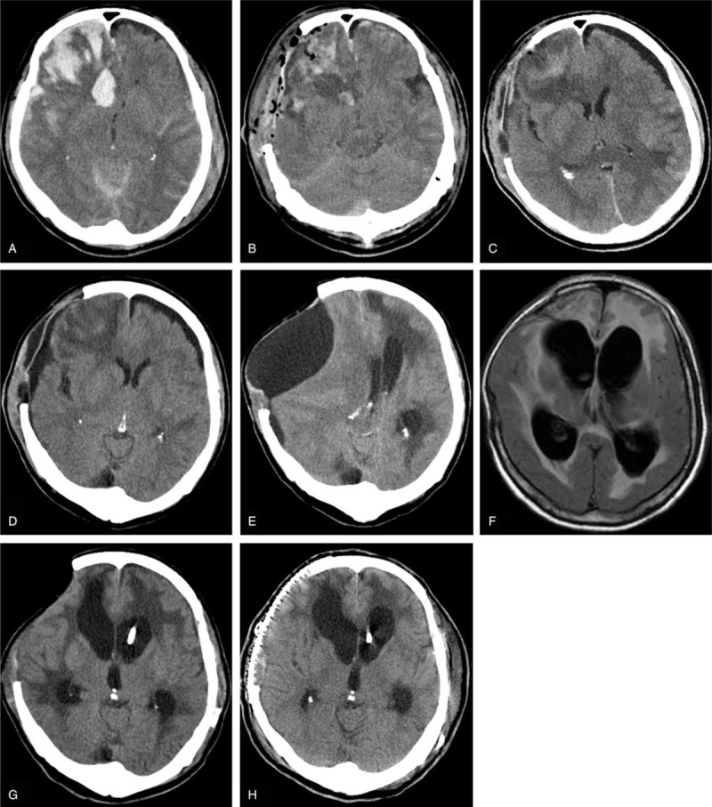
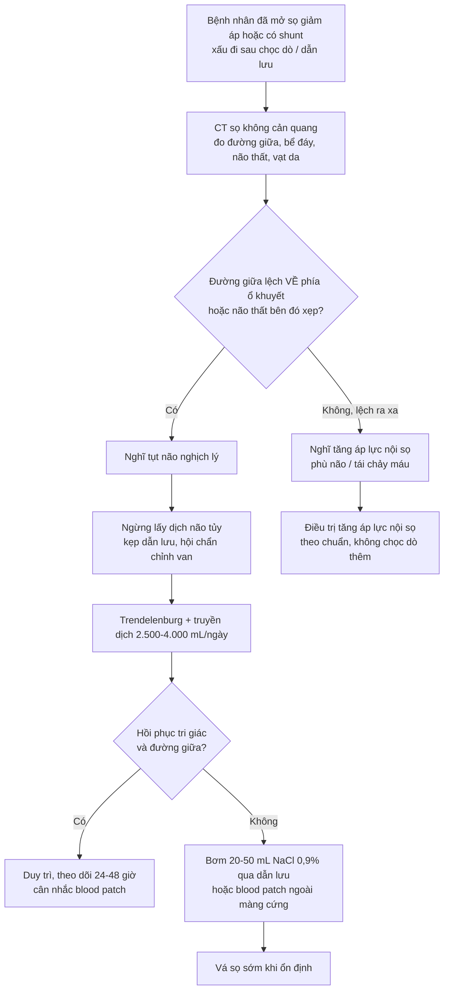
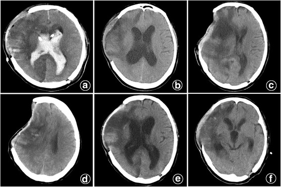

# 3026 — Chọc dò tủy sống ở bệnh nhân có shunt não thất hoặc sau mở sọ giảm áp: tụt não nghịch lý (paradoxical herniation)

**Tags:** `pattern:tut-nao-nghich-ly` `pattern:chap-nap-lun` `pattern:di-lech-duong-giua` `vung:nao` `score:midline-shift` `protocol:choc-do-tuy-song` `protocol:do-ap-luc-mo` `protocol:cranioplasty`
**Mức chắc chắn (certainty):** tổng hợp y văn (literature synthesis) — ghép **loạt 429 ca mở sọ giảm áp** với 13 ca tụt não nghịch lý (PMC4782849), **2 ca tụt não cấp sau chọc dò 30 mL** (PMC5541649), **3 ca tụt não sau dẫn lưu dịch não tủy** (PMC10539714), **ca sau dẫn lưu thắt lưng 48 giờ** (PMC11294903), **loạt 27 ca hội chứng nắp sọ lún** (PMC9610374) và **ca hạ áp lực nội sọ âm sau chọc dò ở trẻ có shunt** (PMC13224972). Đây là tổng hợp nhiều thiết kế, không phải một ca nguyên văn.

> **Câu hỏi thực hành:** bệnh nhân 56 tuổi chấn thương sọ não đã **mở sọ giảm áp**, nay sốt và nghi viêm màng não; chọc dò lấy **30 mL** dịch não tủy, **1 giờ sau** hôn mê, đồng tử không đều, CT thấy **não tụt về phía đối diện ổ khuyết sọ**. Đây là **tăng áp lực nội sọ** hay **hạ áp lực nội sọ**? Câu trả lời quyết định sống còn vì hai bên dùng **thuốc ngược nhau**.
> Bài chốt theo **hai trục**: (1) **não đang bị đẩy về đâu** (về phía ổ khuyết sọ hay ra xa ổ khuyết), và (2) **áp lực nội sọ còn bao nhiêu** (đo được hay suy ra từ lâm sàng). Nối [3020 – Chọc dò dưới hướng dẫn hình ảnh](../3020-choc-do-tuy-song-duoi-huong-dan-hinh-anh/lesson.md), [3022 – Chọc dò ở người dùng kháng đông](../3022-choc-do-tuy-song-khang-dong/lesson.md), [3014 – Đau đầu sau chọc dò](../3014-dau-dau-sau-choc-do-tuy-song/lesson.md), [3018 – Tăng áp lực nội sọ tự phát](../3018-tang-ap-luc-noi-so-tu-phat-nguoi-lon/lesson.md), [234 – Theo dõi áp lực nội sọ ở trẻ](../234-tang-ap-luc-noi-so-theo-doi-da-phuong-thuc-nhi/lesson.md).

## 1. Tổng quan bệnh học – cơ chế hình ảnh: vì sao lấy 30 mL dịch lại làm não “tụt ngược”

- **Định luật Monro–Kellie** nói hộp sọ kín chứa ba thành phần không nén được: **nhu mô não, dịch não tủy, máu**. Khi **mở sọ giảm áp (decompressive craniectomy — DC)**, hộp sọ **không còn kín**: một phần não và màng não chịu **áp suất khí quyển (~760 mmHg)** thay vì áp lực nội sọ. Cân bằng áp lực bị phá vỡ theo hai chiều:
  - **Mất dịch não tủy** (chọc dò, dẫn lưu thắt lưng, van shunt, dẫn lưu não thất) làm **thể tích dịch trong khoang dưới nhện giảm** → áp lực trong sọ tụt xuống **dưới mức khí quyển tác động lên vạt da**.
  - **Áp suất khí quyển ép vạt da lún vào** và **trọng lực** kéo não xuống → não **dịch chuyển ra xa ổ khuyết sọ**, tức **ngược hướng** với thoát vị do tăng áp lực. Đó là nghĩa của **“tụt não nghịch lý” (paradoxical herniation — PH)**.
- **Vì sao gọi là “nghịch lý”:** mọi phản xạ điều trị thông thường (mannitol, tăng thông khí, lấy thêm dịch não tủy) đều **làm nặng hơn**, vì chúng **hạ áp lực nội sọ** — trong khi bệnh sinh là **áp lực quá thấp**. Điều trị đúng là **tăng áp lực nội sọ**.
- **Ngưỡng định lượng lấy từ các loạt ca:**
  - **Áp lực nội sọ lúc tụt não: 1–3 mmHg** ở 4 bệnh nhân được theo dõi, so với **12–79 mmHg** ở 137 bệnh nhân mở sọ giảm áp **không** tụt não (PMC4782849). Trị số này thấp hơn nhiều so với áp lực nội sọ bình thường **5–15 mmHg**.
  - **Áp lực mở khi chọc dò: 2–5 cm H₂O** ở 11 bệnh nhân (bình thường **6–20 cm H₂O**) — tức **hạ áp lực nội sọ rõ rệt** (PMC4782849).
  - **Huyết áp lúc tụt não: 72–81/35–46 mmHg; nhịp tim 105–135 lần/phút** — phản ứng giao cảm do hạ áp lực nội sọ, **không phải** tam chứng Cushing của tăng áp lực (PMC4782849).
  - **Thể tích dịch đủ gây tụt não rất nhỏ:** **30 mL** qua chọc dò một lần gây hôn mê sau **1–2 giờ** (PMC5541649); **20 mL/ngày** qua dẫn lưu thắt lưng liên tục gây tụt não rõ trên CT vào **ngày hậu phẫu 56** (PMC4782849).
- **TẠI SAO CT thấy “nắp sọ lún” và “não tụt ngược”:** vạt da bị áp suất khí quyển đẩy vào → **đường viền da lún dưới xương sọ**; não mất thể tích dịch đệm nên **rãnh cuộn não mất, bể đáy bị xóa, não thất bên bên ổ khuyết xẹp**, và **đường giữa lệch về phía ổ khuyết**. Trong loạt 27 ca nắp sọ lún, **thể tích não thất ba là 1,2 mL ở nhóm lún so với 2,35 mL ở nhóm không lún** (p = 0,04) — tức **não thất nhỏ** là dấu hiệu hỗ trợ, không phải “não thất lớn” (PMC9610374).
- **Tần suất:** tụt não nghịch lý gặp **3,0% (13/429)** sau mở sọ giảm áp một bên (PMC4782849); hội chứng nắp sọ lún gặp **63% (17/27)** ở loạt chụp CT có đo đạc, trong đó **2/27 (7,4%)** có tụt não nghịch lý (PMC9610374).
- **Yếu tố nguy cơ — bằng chứng trực tiếp từ loạt 429 ca:** so sánh 13 ca có tụt não với 416 ca không có:
  - **Dẫn lưu não thất ngoài (EVD): 6/13 so với 13/416**
  - **Van shunt não thất–phúc mạc: 3/13 so với 19/416**
  - **Chọc dò tủy sống: 11/13 so với 84/416**
  - **Dẫn lưu thắt lưng liên tục: 6/13 so với 7/416**
  - **Đường kính cửa sổ xương không khác biệt: 10,94 ± 0,92 cm so với 11,25 ± 1,09 cm** (p = 0,242) → **không phải “cửa sổ càng lớn càng nguy”**, mà là **mất dịch não tủy** mới là yếu tố quyết định (PMC4782849).
- **Thời gian:** **6/14 đợt** xảy ra **trong 2 tuần** đầu (vạt da còn căng), **8/14 đợt** từ **2 tuần đến 2 tháng** (vạt da đã lún) (PMC4782849). Tụt não cấp sau chọc dò có thể xảy ra **1–2 giờ** sau kim (PMC5541649).
- **Vì sao “nắp sọ lún” KHÔNG đủ để chẩn đoán:** trong loạt trên, **8/14 đợt** có nắp lún nhưng **6/14 đợt** (trong 2 tuần) **không có nắp lún** — tác giả kết luận nắp lún **“không cần thiết và không nhạy”** cho tụt não nghịch lý (PMC4782849). Đây là cạm bẫy lớn nhất: chờ thấy nắp lún mới nghĩ đến chẩn đoán là **chờ quá muộn**.
- **Nhóm có shunt là nhóm riêng:** van shunt đặt **áp lực mở 160 mm H₂O**, trong một ca tụt não phải **nâng lên 200 mm H₂O** để giảm dẫn lưu (PMC4782849). Ở trẻ có shunt, chọc dò có thể gây **não úng thủy áp lực âm (negative-pressure hydrocephalus)** — não thất **giãn ra** dù áp lực nội sọ **dưới khí quyển**; trong loạt 29 trẻ hạ áp lực nội sọ, **37% khởi phát sau chọc dò** (PMC13224972).

## 2. Mẫu hình + chẩn đoán phân biệt theo cơ chế (gamut)

- **Mẫu hình chung:** bệnh nhân **đã mở sọ giảm áp hoặc có shunt**, **xấu đi sau một thao tác lấy dịch não tủy** (chọc dò, dẫn lưu, chỉnh van) hoặc **sau khi ngồi dậy/khô dịch**. CT cho thấy **não bị đẩy về phía ổ khuyết sọ**.
- **Nhóm A — mất thể tích/áp lực (não bị “hút” ra ngoài):**
  - **Tụt não nghịch lý** sau chọc dò/dẫn lưu: áp lực mở **2–5 cm H₂O**, áp lực nội sọ **1–3 mmHg**, đồng tử giãn, hôn mê.
  - **Não úng thủy áp lực âm:** não thất **giãn**, áp lực nội sọ **âm**, thường sau chọc dò ở người có shunt; **rất dễ bị chẩn đoán nhầm là shunt hỏng** và mổ lại nhiều lần (PMC13224972).
  - **Dẫn lưu quá mức qua van shunt:** đau đầu thế đứng, não thất xẹp, có thể có máu tụ dưới màng cứng do rách tĩnh mạch bắc cầu.
- **Nhóm B — tăng thể tích/áp lực (não bị “đẩy” ra ngoài):**
  - **Tăng áp lực nội sọ do phù não/tái chảy máu** — hướng lệch **ra xa ổ khuyết**, vạt da căng, có thể giãn đồng tử cùng bên tổn thương.
  - **Khí nội sọ dưới áp lực (tension pneumocephalus)** — khí chèn ép, thường sau mổ hoặc sau thủ thuật; CT có **khí nội sọ lượng lớn, “núm khí” chèn giữa hai thùy trán**.
  - **Máu tụ dưới màng cứng cấp** do rách tĩnh mạch bắc cầu sau khi não xẹp xuống.
- **Nhóm C — không do áp lực:** động kinh, an thần quá liều, viêm màng não tiến triển, rối loạn điện giải; **luôn loại trừ trước khi quy tụt não**.
- **Gợi nhớ 4 chữ “T–C–K–M”:** **T**ụt não nghịch lý, **C**ăng (tăng áp lực), **K**hí (pneumocephalus), **M**áu (máu tụ cấp).

## 3. Bảng so sánh phân biệt (ma trận đối chiếu)

| Thực thể (entity) | Hình ảnh điển hình | Chốt vào (rule-in) | Chốt loại (rule-out) | Gợi ý xác nhận |
|---|---|---|---|---|
| **Tụt não nghịch lý (PH)** | Não **tụt về phía ổ khuyết sọ**, rãnh cuộn não xóa, bể đáy xóa, **não thất bên bên ổ khuyết xẹp**, có thể **nắp sọ lún**, **dịch dưới màng cứng** | **Xấu đi sau chọc dò/dẫn lưu + đường giữa lệch VỀ phía ổ khuyết + áp lực mở 2–5 cm H₂O** | **Đường giữa lệch RA XA ổ khuyết + vạt da căng + áp lực mở cao** → tăng áp lực nội sọ | Đo áp lực mở khi chọc dò; theo dõi áp lực nội sọ nếu có; đáp ứng với **Trendelenburg + truyền dịch** |
| **Não úng thủy áp lực âm** | **Não thất giãn** dù áp lực thấp, thường có shunt; không có khối choán chỗ | **Não thất giãn + áp lực nội sọ âm/dưới khí quyển + sau chọc dò** | **Não thất giãn + áp lực cao + van shunt tắc** → shunt hỏng thật | Theo dõi áp lực nội sọ; **không vội mổ lại shunt**; blood patch/điều chỉnh van |
| **Tăng áp lực nội sọ (phù não, tái chảy máu)** | Não **đẩy ra ngoài ổ khuyết**, vạt da căng, bể đáy xóa, não thất xẹp hoặc giãn tùy mức | **Đau đầu + nôn + đồng tử giãn cùng bên + hướng lệch ra xa ổ khuyết** | **Hướng lệch về phía ổ khuyết + huyết áp thấp** → không phải tăng áp lực | CT lặp lại; đo áp lực nội sọ; **không dùng mannitol khi chưa loại trừ PH** |
| **Khí nội sọ dưới áp lực** | Khí **nhiều, đối xứng hoặc chèn ép**, “núm khí” giữa hai thùy trán; có thể tăng áp lực | **Khí chèn ép + suy giảm tri giác sau mổ/thủ thuật** | **Khí ít, không chèn ép, tự tiêu** → khí tồn dư lành tính | CT cửa sổ xương; chọc hút khí nếu chèn ép |
| **Máu tụ dưới màng cứng cấp** | Khối **liềm** bám mặt trong hộp sọ, không qua đường giữa, có thể lệch đường giữa | **Chấn thương/đau đầu + khối liềm + não xẹp xuống sau dẫn lưu** | **Tổn thương trong nhu mô** → không phải máu tụ dưới màng cứng | CT không cản quang; mổ nếu dày **> 10 mm** hoặc lệch **> 5 mm** |
| **Dẫn lưu quá mức qua van shunt** | Não thất **khe**, có thể tụ dịch dưới màng cứng; đau đầu **thế đứng** | **Đau đầu tăng khi đứng, giảm khi nằm + não thất khe + van đang dẫn lưu** | **Đau đầu không liên quan tư thế + não thất không khe** → nghĩ nguyên nhân khác | Chỉnh van lên áp lực cao hơn; blood patch nếu có rò |

*Diễn tiến một ca: (A) đụng dập xuất huyết và phù não; (B) ngay sau mở sọ giảm áp; (C) ngày hậu phẫu 10 — tụ dịch dưới màng cứng; (D) ngày 30 — tụ dịch tăng sau dẫn lưu thắt lưng liên tục; (E) ngày 56 — **nắp sọ lún, đường giữa lệch, GCS 4**, chẩn đoán tụt não nghịch lý; (F) ngày 106 — hết lệch đường giữa sau Trendelenburg và truyền dịch; (G) đặt van shunt ngày 122; (H) vá sọ ngày 137. Nguồn: Medicine (Baltimore) 2016 (PMC4782849), Figure 3, CC BY 4.0. Không crop.*

## 4. Protocol: trước – trong – sau khi chọc dò ở người có shunt hoặc đã mở sọ

### 4.1 Trước khi chọc dò — 4 câu hỏi bắt buộc

1. **Có ổ khuyết sọ đang lún hoặc não thất bên bên đó xẹp không?** Nếu có → **coi như nguy cơ tụt não nghịch lý**, **không chọc dò để “giải áp”**.
2. **Đường giữa lệch về phía nào?** Lệch **về phía ổ khuyết** = cảnh báo tụt não nghịch lý; lệch **ra xa** = nghĩ tăng áp lực nội sọ.
3. **Có chỉ định thật không?** Nghi **viêm màng não** là chỉ định mạnh nhất; nhưng nếu bệnh nhân đang có dấu hiệu tụt não thì **ưu tiên cấy máu + kháng sinh kinh nghiệm**, hội chẩn ngoại thần kinh, và **chọc dò khi đã an toàn** hoặc **lấy dịch qua van shunt** nếu có chỉ định.
4. **Có thể thay bằng cách lấy dịch khác không?** Ở người có shunt, **chọc van shunt (shunt tap)** lấy được dịch nhưng có nguy cơ nhiễm trùng ống/túi shunt — chỉ làm khi có chỉ định và vô khuẩn nghiêm ngặt; **không dùng chọc dò để đánh giá shunt có hỏng hay không** vì áp lực đo được không phản ánh áp lực trong não thất.

### 4.2 Nếu buộc phải chọc dò — kỹ thuật “lấy tối thiểu”

- **Tư thế nằm nghiêng, đầu giường ngang** (không ngồi, không đầu cao) để tránh tạo chênh áp lực dọc trục.
- **Đo áp lực mở bằng manometer** trước khi lấy dịch; ghi lại **cm H₂O**. **Áp lực mở 2–5 cm H₂O** là dấu hiệu cảnh báo đã có hạ áp lực nội sọ (PMC4782849).
- **Lấy thể tích tối thiểu đủ xét nghiệm** (thường **1–2 mL mỗi ống**, không “xả bớt cho nhẹ đầu”). Các ca tụt não đã báo cáo xảy ra sau **20–30 mL** (PMC4782849, PMC5541649) — **không có ngưỡng thể tích “an toàn” được chứng minh**.
- **Dừng ngay** nếu bệnh nhân **đau đầu tăng, buồn nôn, rối loạn tri giác, đồng tử thay đổi**; không chờ lấy đủ ống.
- **Không dùng chọc dò để “hạ áp lực” ở bệnh nhân đã mở sọ giảm áp** — đây chính là cơ chế gây tụt não nghịch lý.
- **Sau chọc dò:** cho nằm **Trendelenburg** nếu có triệu chứng, truyền dịch, theo dõi tri giác/đồng tử **ít nhất 2 giờ** (thời điểm đã ghi nhận tụt não cấp là **1–2 giờ**).

### 4.3 Xử trí tụt não nghịch lý — tăng áp lực nội sọ, không giảm

| Bước | Việc làm | Ngưỡng/liều đã báo cáo |
|---|---|---|
| 1 | **Ngừng ngay mọi lấy dịch não tủy**: bỏ chọc dò, **kẹp dẫn lưu thắt lưng/EVD**, hội chẩn chỉnh van shunt | Loạt 429 ca: ngừng dẫn lưu là bước đầu tiên (PMC4782849) |
| 2 | **Tư thế Trendelenburg** (đầu thấp) | Dùng ở 7/14 đợt; hiệu quả trong vài ngày (PMC4782849, PMC10539714) |
| 3 | **Truyền dịch tinh thể mạnh** | **2.500–4.000 mL/ngày** trong loạt 429 ca (PMC4782849) |
| 4 | **Bơm dịch não tủy/thể tích vào khoang dưới nhện** nếu còn dẫn lưu | **20–50 mL NaCl 0,9% bơm chậm qua ống dẫn lưu** ở 2 ca (PMC4782849) |
| 5 | **Nâng áp lực mở van shunt** | **160 → 200 mm H₂O** ở 1 ca (PMC4782849) |
| 6 | **Blood patch ngoài màng cứng** khi có rò dịch/đau đầu thế đứng kéo dài | Hiệu quả trong ca tụt não sau chọc dò (PMC6682252); ở trẻ có shunt, blood patch + quấn cổ + chỉnh van giúp hồi phục (PMC13224972) |
| 7 | **Vá sọ (cranioplasty)** — điều trị triệt để | Trong loạt 429 ca, **6 ca vá sọ khoảng 3 tháng sau**; **94,11% (16/17)** cải thiện sau vá sọ ở loạt 27 ca nắp lún (PMC4782849, PMC9610374) |

- **Theo dõi:** áp lực nội sọ nếu có đầu dò; đích là **đưa áp lực trở lại dương**, không cần đạt trị số “bình thường” ngay. Theo dõi **đồng tử, tri giác, huyết áp** mỗi 15–30 phút trong giờ đầu.
- **Không dùng:** mannitol, tăng thông khí, lấy thêm dịch não tủy, đầu cao — tất cả **làm tăng chênh áp lực và đẩy não ra xa ổ khuyết hơn**.

### 4.4 Khoảng trống bằng chứng

- **Không có thử nghiệm ngẫu nhiên** so sánh thể tích dịch an toàn, thời điểm vá sọ, hoặc vai trò blood patch ở tụt não nghịch lý; các khuyến cáo hiện dựa trên **loạt ca và ca lâm sàng** (PMC4782849, PMC11567043, PMC10539714).
- **Ngưỡng áp lực mở “an toàn” chưa được xác lập**; các ca tụt não đã xảy ra với áp lực mở **2–5 cm H₂O**, nhưng cũng có ca tụt não **tự phát** không do chọc dò (PMC13236341).
- **Vai trò của theo dõi áp lực nội sọ liên tục** trong việc phân biệt tụt não nghịch lý với tăng áp lực nội sọ chưa được đánh giá bằng nghiên cứu tiến cứu.

## 5. Biến thể bình thường và cạm bẫy

- **Biến thể bình thường:**
  - **Nắp sọ lún nhẹ, không triệu chứng** sau mở sọ giảm áp — có thể chỉ là hội chứng nắp sọ lún (sinking skin flap) **không có tụt não**; theo dõi, không can thiệp cấp.
  - **Tụ dịch dưới màng cứng (subdural hygroma) lượng nhỏ** sau mở sọ — thường tự tiêu; chỉ là dấu hiệu hỗ trợ, **không phải chẩn đoán**.
  - **Não thất bên bên ổ khuyết hơi xẹp hơn bên đối diện** do mất cân bằng áp lực — có thể là bất đối xứng lành tính nếu không có lệch đường giữa và không có triệu chứng.
- **Cạm bẫy chết người:**
  1. **Chẩn đoán “tăng áp lực nội sọ” rồi dùng mannitol/tăng thông khí** ở bệnh nhân tụt não nghịch lý — làm tăng chênh áp lực, đẩy não ra xa ổ khuyết nhanh hơn.
  2. **Chờ thấy nắp sọ lún mới nghĩ đến tụt não** — **6/14 đợt xảy ra trong 2 tuần khi vạt da còn căng** (PMC4782849).
  3. **Đọc “đường giữa lệch” mà không xác định hướng** — hướng lệch **về phía ổ khuyết** là chốt phân biệt với phù não.
  4. **Chọc dò “để giảm áp” ở người đã mở sọ giảm áp** — chính là nguyên nhân; nếu cần lấy dịch để chẩn đoán viêm màng não, **lấy tối thiểu** và theo dõi sát.
  5. **Cho rằng van shunt “đang mở đúng” là an toàn** — tụt não đã xảy ra **5–7 ngày sau đặt shunt** dù áp lực dẫn lưu đặt **trên 10 cm H₂O** (PMC10539714).
  6. **Chẩn đoán “shunt hỏng” khi thấy não thất giãn** — trong não úng thủy áp lực âm, **mổ lại shunt không giúp** và có thể làm nặng thêm (PMC13224972).
  7. **Vá sọ kèm dẫn lưu hút áp lực âm dưới da đầu** — đã báo cáo gây **thoát vị lên trên lều do áp lực âm** (PMC6417323); tránh hút âm mạnh sau vá sọ.
  8. **Bỏ qua nguyên nhân khác**: động kinh, thuốc an thần, viêm màng não — tụt não nghịch lý là chẩn đoán **loại trừ sau khi đã loại trừ tăng áp lực và các nguyên nhân không do áp lực**.

## 6. Tự lượng giá — Blind Quiz

**Ca 1 — Nam 56 tuổi, chấn thương sọ não nặng, đã mở sọ giảm áp và đặt dẫn lưu não thất. Ba tuần sau, não thất giãn; chọc dò lấy 30 mL dịch não tủy. Nhìn 6 ô CT, mô tả trước khi mở đáp án.**

- **Câu hỏi:** (a) Ở các ô c–d, não bị đẩy **về phía nào** so với ổ khuyết sọ? (b) Vì sao lấy **30 mL** dịch não tủy lại gây hôn mê **1 giờ** sau chọc dò? (c) Hai việc làm đầu tiên là gì?

<b>Bấm để hiện đáp án</b>

- (a) Não và đường giữa **lệch về phía ổ khuyết sọ**, vạt da **lún** — hướng **ngược** với thoát vị do tăng áp lực. Đây là **tụt não nghịch lý**.
- (b) Mất **30 mL** dịch não tủy làm giảm thể tích khoang dưới nhện; hộp sọ đã mở nên **áp suất khí quyển** tác động trực tiếp lên vạt da và **trọng lực** kéo não xuống → chênh áp lực **dọc trục** rất lớn so với thể tích dịch mất. Trong loạt ca, thời điểm xấu đi là **1–2 giờ** sau chọc dò.
- (c) **Ngừng ngay lấy dịch não tủy**, đặt **Trendelenburg**, **truyền dịch tinh thể mạnh** (2.500–4.000 mL/ngày), hội chẩn ngoại thần kinh để **kẹp dẫn lưu/chỉnh van**; nếu không hồi phục → **blood patch** hoặc bơm **20–50 mL NaCl 0,9%** qua ống dẫn lưu; vá sọ khi ổn định.
- **Nguồn ảnh:** BMC Neurology 2017 (PMC5541649), Figure 2 — (a) CT sau mổ; (b) não úng thủy 3 tuần sau; (c,d) **hội chứng nắp sọ lún và lệch đường giữa sau chọc dò**; (e,f) hết lệch đường giữa một ngày sau Trendelenburg và truyền dịch. CC BY 4.0.

**Ca 2 — Bệnh nhân mở sọ giảm áp, chọc dò và dẫn lưu thắt lưng 20 mL dịch mỗi ngày. Đến ngày 56, GCS 4. Nhìn 8 ô CT, xác định thời điểm và hướng tụt não.**

- **Câu hỏi:** (a) Ô nào cho thấy tụt não rõ nhất, và dấu hiệu chính là gì? (b) Vì sao **không** dùng mannitol ở thời điểm này? (c) Hai biện pháp đã giúp hồi phục?

<b>Bấm để hiện đáp án</b>

- (a) **Ô E (ngày hậu phẫu 56):** nắp sọ lún, tụ dịch dưới da đầu tăng, **vỏ não bị ép dẹt, đường giữa lệch rõ**, GCS 4. Đây là **tụt não nghịch lý**.
- (b) Mannitol **hạ áp lực nội sọ**, làm tăng chênh áp lực giữa khoang dưới nhện và khoang ngoài sọ, **đẩy não ra xa ổ khuyết** — tức **làm nặng** tụt não nghịch lý.
- (c) **Ngừng dẫn lưu thắt lưng**, **Trendelenburg** và **truyền dịch tĩnh mạch nhanh**; sau đó **đặt van shunt** (ngày 122) và **vá sọ** (ngày 137). CT ngày 106 (**ô F**) cho thấy **hết lệch đường giữa**.
- **Nguồn ảnh:** Medicine (Baltimore) 2016 (PMC4782849), Figure 3, CC BY 4.0.

## Bài liên quan chéo
- [3020 – Chọc dò tủy sống khó dưới hướng dẫn hình ảnh](../3020-choc-do-tuy-song-duoi-huong-dan-hinh-anh/lesson.md) (kỹ thuật chọc dò khi mất mốc)
- [3022 – Chọc dò tủy sống ở người dùng kháng đông](../3022-choc-do-tuy-song-khang-dong/lesson.md) (nguy cơ máu tụ — cùng bối cảnh “chọc dò ở người nguy cơ cao”)
- [3024 – Chọc dò quanh tiêu sợi huyết](../3024-choc-do-tuy-song-quanh-tieu-soi-huyet-khoi/lesson.md) (biến chứng chảy máu sau chọc dò)
- [3014 – Đau đầu sau chọc dò (PDPH)](../3014-dau-dau-sau-choc-do-tuy-song/lesson.md) (hạ áp lực nội sọ **không có** ổ khuyết sọ)
- [3018 – Tăng áp lực nội sọ tự phát](../3018-tang-ap-luc-noi-so-tu-phat-nguoi-lon/lesson.md) (đối cực: áp lực mở cao)
- [234 – Tăng áp lực nội sọ & theo dõi đa phương thức ở trẻ](../234-tang-ap-luc-noi-so-theo-doi-da-phuong-thuc-nhi/lesson.md) (EVD, CPP, ICP)
- [3002 – Shunt não thất–màng phổi & não thất–tĩnh mạch](../3002-shunt-nao-that-mang-phoi-tinh-mach/lesson.md) (biến chứng shunt)
- [212 – Xuất huyết sọ: ICH/SAH/SDH/EDH](../212-xuat-huyet-so-nao/lesson.md) (máu tụ dưới màng cứng cấp sau dẫn lưu)

## Ảnh
- `3026_tut-nao-nghich-ly_CT-PMC4782849-F3.jpg` — 8 ô CT một ca tụt não nghịch lý sau dẫn lưu thắt lưng 20 mL/ngày, Medicine (Baltimore) 2016 (PMC4782849), Figure 3, **CC BY 4.0**.
- `3026_tut-nao-sau-choc-do_CT-PMC5541649-F2.jpg` — 6 ô CT: não úng thủy sau mở sọ, **tụt não sau chọc dò 30 mL**, hồi phục sau Trendelenburg và truyền dịch, J Neurosurg Case Lessons 2026 (PMC5541649), Figure 2, **CC BY 4.0**.
- Nguồn + giấy phép từng ảnh: `images/CREDITS.md`.

> Không dùng để chẩn đoán độc lập khi chưa có người hướng dẫn.
