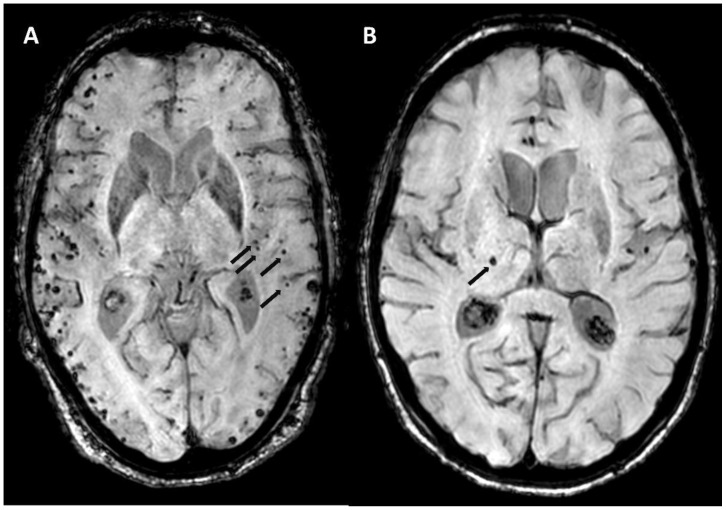
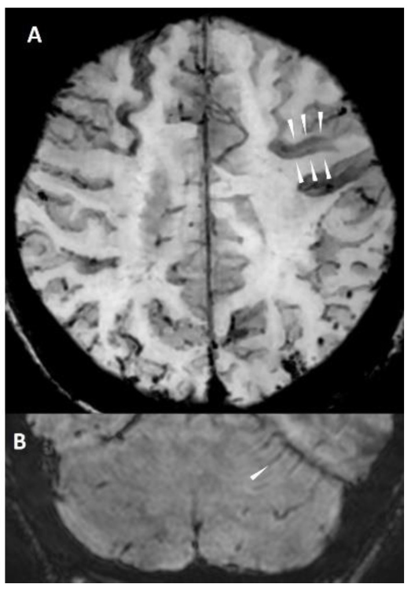
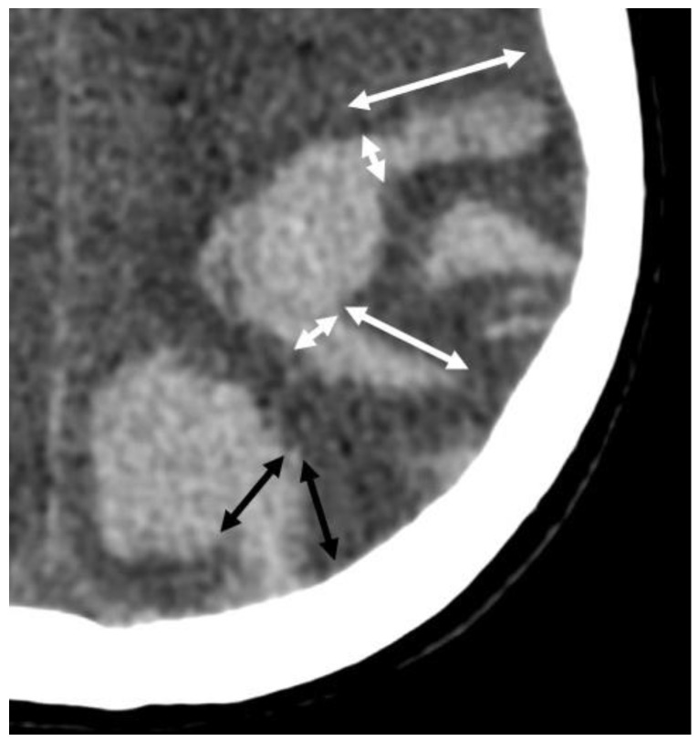
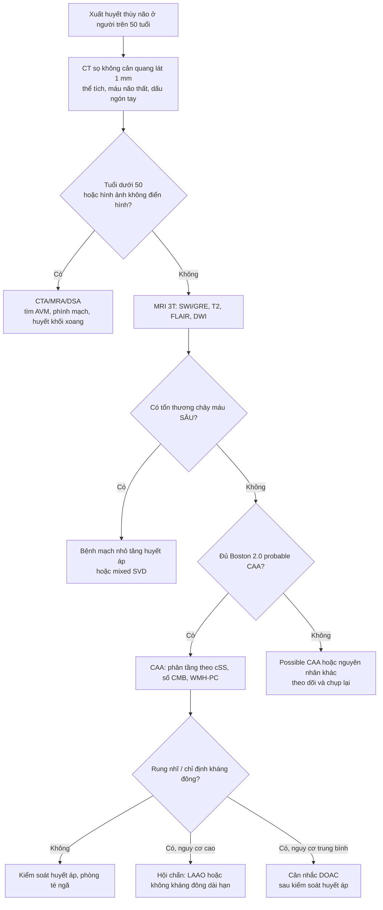
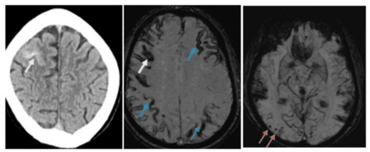
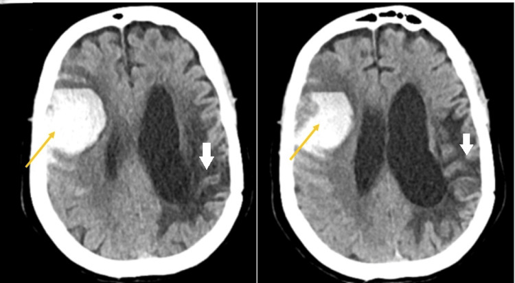

# 3027 — Xuất huyết nội sọ do bệnh mạch amyloid não (CAA) ở người già: thùy vs sâu, vi chảy máu, Boston 2.0 và quyết định dùng lại kháng đông hay LAAO

**Tags:** `pattern:xuat-huyet-thuy` `pattern:vi-chay-mau-nao` `pattern:siderosis-vo-nao` `pattern:hao-mau-vo-nao` `vung:nao` `score:Boston-2.0` `protocol:MRI-SWI` `protocol:CT-so-nao` `incidentaloma:vi-chay-mau`
**Mức chắc chắn (certainty):** tổng hợp y văn (literature synthesis) — ghép **nghiên cứu chẩn đoán Boston 2.0** (Lancet Neurol 2022, PMCID PMC9389452, trích abstract), **tổng quan hình ảnh Boston 2.0** (Biomolecules 2024, PMC11592298), **loạt 254 người sống sau xuất huyết thùy** (Front Neurol 2026, PMC13021402), **ca CAA có cSAH–cSS–vi chảy máu** (Cureus 2026, PMC13060576), **hướng dẫn dùng kháng đông/LAAO theo kiểu hình xuất huyết** (J Cardiovasc Dev Dis 2026, PMC13027075; Cureus 2026, PMC13384533), **PRESTIGE-AF** và **SoSTART** (trích qua PMC13695321), **CAA-ri** (PMC13560943, PMC13562774) và **loạt Medicare** (Ann Neurol 2025, PMC12629278). Nhiều thiết kế khác nhau → không gắn nhãn ca nguyên văn.

> **Câu hỏi thực hành:** bệnh nhân 78 tuổi, rung nhĩ, đang dùng apixaban, nhập viện vì **xuất huyết thùy trán phải 30 mL**. Câu hỏi không chỉ là “đảo ngược kháng đông” mà là: **có nên dùng lại kháng đông không, hay chuyển sang đóng tiểu nhĩ trái (LAAO)?** Câu trả lời phụ thuộc vào việc **xuất huyết này là CAA hay bệnh mạch nhỏ tăng huyết áp** — hai bệnh có **nguy cơ tái phát chênh nhau hơn 7 lần**.
> Bài chốt theo **hai trục**: (1) **phân bố tổn thương** (thùy vỏ não vs sâu/nhân nền) và (2) **gánh nặng vi chảy máu + siderosis** trên MRI. Nối [3025 – Đảo ngược kháng đông trong ICH](../3025-dao-nguoc-khang-dong-xuat-huyet-noi-so/lesson.md), [212 – Xuất huyết sọ: ICH/SAH/SDH/EDH](../212-xuat-huyet-so-nao/lesson.md), [3022 – Chọc dò ở người dùng kháng đông](../3022-choc-do-tuy-song-khang-dong/lesson.md), [201 – Protocol CT/MRI sọ não](../201-protocol-so-nao/lesson.md), [229 – PACNS vs RCVS](../229-pacns-vs-rcvs/lesson.md).

## 1. Tổng quan bệnh học – cơ chế hình ảnh: vì sao amyloid chọn mạch VỎ NÃO và vì sao SWI nhìn thấy

- **Bệnh học:** trong **bệnh mạch amyloid não (cerebral amyloid angiopathy — CAA)**, peptide **β-amyloid (chủ yếu Aβ40)** lắng đọng trong **thành động mạch nhỏ và tiểu động mạch của vỏ não và màng mềm**. Thành mạch dày lên, mất cơ trơn, tạo **vi phình mạch** và **nứt thành** → máu chảy vào **nhu mô thùy não** hoặc **khoang dưới nhện vùng lồi (convexity subarachnoid hemorrhage — cSAH)**.
- **TẠI SAO là “thùy” chứ không phải “sâu”:** mạch bị amyloid là **động mạch vỏ–màng mềm**; các **động mạch xuyên sâu (lenticulostriate, thalamoperforating)** ít bị amyloid và là địa bàn của **bệnh mạch nhỏ tăng huyết áp**. Vì vậy **vị trí xuất huyết/vi chảy máu phản ánh bệnh mạch nền**: **thùy = CAA**, **sâu (đồi thị, nhân nền, cầu não, tiểu não) = tăng huyết áp**. Đây là lý do Boston 2.0 đòi **“không có tổn thương chảy máu sâu”** cho thể **probable CAA**.
- **TẠI SAO SWI/GRE thấy vi chảy máu (cerebral microbleeds — CMB):** sau chảy máu nhỏ, đại thực bào chuyển hemoglobin thành **hemosiderin/ferritin** — chất **thuận từ mạnh (paramagnetic)**. Trường từ không đồng nhất làm **T2* ngắn lại** → **mất tín hiệu** trên chuỗi **T2*** hoặc **SWI**. SWI dùng **TE dài (20–25 ms)** + lọc pha + **MinIP 10 mm** nên nhạy hơn GRE; hiệu ứng **“blooming”** làm tổn thương **2 mm trông to hơn**, vì vậy phải đọc trên **ảnh gốc và ảnh MinIP**, tránh đo kích thước trên ảnh blooming.
- **Ngưỡng định lượng:**
  - **CMB: 2–10 mm**, tròn/oval, **giảm tín hiệu đồng nhất**, **không có phù xung quanh**, **không nằm trong rãnh** (PMC11592298).
  - **Giãn khoang quanh mạch trung tâm bán bầu dục (centrum semiovale enlarged perivascular spaces — CSO-EPVS): cần > 20 ổ mỗi bán cầu** để đủ tiêu chuẩn “đặc điểm chất trắng” của Boston 2.0 (PMC11592298).
  - **Tỷ lệ hiện diện các dấu hiệu** trong một nhóm CAA: **CSO-EPVS 56%, CMB 52%, cSS 49%, ICH 44%** (PMC11592298).
  - **Xuất huyết não cấp trên CT: 50–80 HU**, bờ không đều; **ngón tay (finger-like projections)** = máu chảy dọc rãnh, **chiều dài > chiều rộng chân** (PMC11592298).
- **Dịch tễ và tiên lượng:** trong **1.920.312 người thụ hưởng Medicare**, CAA được chẩn đoán ở **11,3/10.000**; CAA gắn với **tử vong HR 4,9 (4,6–5,2)**, **xuất huyết nội sọ HR 26,9 (20,3–35,6)** và **đột quỵ thiếu máu HR 4,6 (3,6–6,0)** (PMC12629278). CAA là **nguyên nhân thường gặp nhất của xuất huyết thùy ở người già** (PMC11592298).
- **Tái phát — con số quyết định điều trị:** CAA tái phát **7,4–8,5%/năm**, tăng lên **15–20%/năm** khi có **cSS lan tỏa nhiều ổ + nhiều CMB thùy**; trong khi ICH **không do CAA chỉ 1,1%/năm**, ICH **sâu do tăng huyết áp 0,6–1,1%/năm**, **mixed SVD ~1,8%/năm** (PMC13027075). Một phân tích khác: xuất huyết **thùy 5,1/100 bệnh nhân–năm** so với **sâu 1,8/100 bệnh nhân–năm**, **HR 3,2** (PMC13027075).
- **Vì sao “càng nhiều dấu hiệu càng nguy”:** trong **254 người sống sau xuất huyết thùy** (trung vị 68,5 tuổi, **66,9% probable CAA**), theo dõi trung vị **20 tháng** có **20,9% tái phát**; **WMH dạng liên tục vùng sau (WMH-PC) aHR 2,55**, **cSS aHR 2,34**, **CSO-EPVS aHR 2,75**; **kết hợp WMH-PC + cSS aHR 3,16** (PMC13021402). Nghĩa là **đếm và mô tả dấu hiệu** thay đổi tiên lượng, không chỉ để “đủ tiêu chuẩn chẩn đoán”.

## 2. Mẫu hình + chẩn đoán phân biệt theo vị trí và bệnh mạch nền (gamut)

- **Mẫu hình cốt lõi:** người **> 50 tuổi**, xuất huyết **thùy** (vỏ–dưới vỏ), **không tăng huyết áp nặng**, kèm **nhiều CMB thùy**, **cSS**, **cSAH vùng lồi**, hoặc **suy giảm nhận thức tiến triển**.
- **Gamut theo vị trí:**
  - **Thùy vỏ não (CAA):** CAA thể chảy máu; CAA thể viêm (CAA-ri); cSAH vùng lồi; **bệnh mạch amyloid thể di truyền** (APP, PSEN1/2 — thường khởi phát sớm); dị dạng mạch; u chảy máu; huyết khối xoang vỏ.
  - **Sâu (tăng huyết áp):** đồi thị, nhân nền, cầu não, tiểu não; **vi chảy máu sâu** + **lacune** + **EPVS vùng nhân nền**.
  - **Mixed SVD:** vừa sâu vừa thùy; tiên lượng tái phát trung gian **~1,8%/năm**.
  - **Nhiều ổ / hai bán cầu:** di căn chảy máu, thuyên tắc nhiễm khuẩn, rối loạn đông máu, **CAA** (nhiều ổ thùy).
- **Gợi nhớ “LOBAR”:** **L**obar location, **O**lder patient, **B**leeding recurrence, **A**myloid markers (CMB thùy, cSS), **R**ule out deep/other cause.
- **Phân biệt với CAA-ri (thể viêm):** đau đầu, rối loạn tri giác, co giật, **phù chất trắng không đối xứng** trên FLAIR, có thể **choán chỗ giả u**; đáp ứng corticoid. Đây là thể **có thể hồi phục** — bỏ sót dẫn tới sinh thiết/mổ vô ích.
- **Phân biệt với cSAH do nguyên nhân khác:** **RCVS** (đau đầu sét đánh, co mạch hồi phục), **huyết khối xoang** (đau đầu, tăng áp lực, thiếu máu tĩnh mạch), **PRES**, **viêm nội tâm mạc** (phình vi khuẩn), **chấn thương**.

## 3. Bảng so sánh phân biệt (ma trận đối chiếu)

| Thực thể (entity) | Hình ảnh điển hình | Chốt vào (rule-in) | Chốt loại (rule-out) | Gợi ý xác nhận |
|---|---|---|---|---|
| **CAA (probable)** | **Xuất huyết thùy**, **nhiều CMB thùy**, **cSS**, **cSAH vùng lồi**, **CSO-EPVS > 20/bán cầu**, WMH dạng multispot | **≥ 2 tổn thương chảy máu thùy** (ICH/CMB/cSS/cSAH) **hoặc 1 tổn thương thùy + 1 đặc điểm chất trắng**, **không có tổn thương sâu**, tuổi **> 50** | **Có CMB/ICH sâu** hoặc nguyên nhân khác rõ (AVM, u, huyết khối xoang) → không phải probable CAA | MRI 3T **SWI/GRE** + T2/FLAIR; áp dụng Boston 2.0; loại trừ nguyên nhân khác |
| **Bệnh mạch nhỏ tăng huyết áp** | **ICH/CMB sâu** (đồi thị, nhân nền, cầu não, tiểu não), **lacune**, **EPVS nhân nền**, WMH quanh não thất | **CMB/ICH sâu + tăng huyết áp + không có CMB thùy** | **CMB thùy + cSS** → nghĩ CAA, không quy cho tăng huyết áp | MRI SWI; kiểm soát huyết áp; đánh giá lại nếu tái phát thùy |
| **Mixed SVD** | **Có cả tổn thương sâu và thùy** | **CMB/ICH vừa sâu vừa thùy** | **Chỉ một loại vị trí** → không phải mixed | MRI SWI; tái phát **~1,8%/năm** (PMC13027075) |
| **ICH do kháng đông** | Bất kỳ vị trí, thường **thùy** nếu có CAA nền; INR cao/DOAC | **Đang dùng kháng đông + ICH** | **Không dùng kháng đông** → không phải nhóm này; **nhưng kháng đông KHÔNG loại trừ CAA** | Hỏi thuốc + INR/anti-Xa; **vẫn chụp MRI SWI** sau khi ổn định |
| **AVM / cavernoma** | Thùy, **vôi hóa**, **flow void**, nidus ngấm thuốc; cavernoma có **vòng hemosiderin** | **Bệnh nhân trẻ + nidus/flow void + không có CMB rải rác** | **Nhiều CMB thùy + cSS + tuổi già** → CAA, không phải AVM | CTA/MRA/DSA; MRI T2*/SWI |
| **U chảy máu (di căn, glioma)** | **Phù nhiều hơn ổ máu**, ngấm thuốc vòng/nốt, nhiều ổ ở ranh giới chất trắng–vỏ | **Phù không tương xứng + ngấm thuốc + nhiều ổ** | **Không phù, không ngấm thuốc, có CMB thùy rải rác** → CAA | MRI có tương phản; PET/CT; sinh thiết nếu cần |
| **CAA-ri (thể viêm)** | **Phù chất trắng không đối xứng**, dạng lan tỏa hoặc nhiều ổ, có thể choán chỗ; kèm CMB thùy/cSS | **Phù + dấu hiệu CAA + đau đầu/rối loạn tri giác/co giật** | **Không phù, không đáp ứng corticoid** → nghĩ u/nhiễm trùng | MRI trước–sau corticoid; loại trừ nhiễm trùng/u |
| **cSAH do RCVS** | Máu dưới nhện **vùng lồi**, co mạch nhiều ổ trên CTA/MRA, hồi phục | **Đau đầu sét đánh tái diễn + co mạch hồi phục + không có CMB thùy** | **cSS + nhiều CMB thùy ở người già** → CAA | CTA/MRA lặp lại 1–3 tháng; MRI SWI |

*(A) Nhiều **vi chảy máu thùy** (mũi tên đen) trên MRI định lượng từ (venBOLD, 3T, TE 25 ms, lát 1 mm) — kiểu CAA. (B) Một **vi chảy máu sâu ở đồi thị** (mũi tên đen) — kiểu bệnh mạch nhỏ tăng huyết áp. Nguồn: Biomolecules 2024 (PMC11592298), Figure 3, CC BY 4.0. Không crop.*

### Ba dấu hiệu “đắt giá” trên MRI — đọc đúng để không chẩn đoán sai

1. **CMB thùy (lobar CMB):** đếm **theo vùng** (thùy trán/đỉnh/thái dương/chẩm) và ghi **có/không có CMB sâu**. **≥ 2 CMB thùy** đã đủ là một “tổn thương chảy máu” trong Boston 2.0; **nhiều CMB + cSS** là kiểu hình tái phát cao.
2. **cSS (cortical superficial siderosis):** dải **giảm tín hiệu cong theo bề mặt vỏ não**, **bám cả hai mặt rãnh** — khác máu dưới nhện cấp (tăng tỷ trọng trên CT, tăng tín hiệu FLAIR) và khác **máu tồn dư sau mổ**. cSS **rất đặc hiệu cho CAA** và gắn với tăng nguy cơ tái phát (PMC11592298).
3. **cSAH vùng lồi:** máu trong rãnh vùng lồi, **không lan vào bể đáy**, thường kèm cSS; ở người già **cSAH + cSS + CMB thùy = CAA cho đến khi chứng minh ngược lại**.

*(A) Siderosis vỏ não (đầu mũi tên trắng) — dải giảm tín hiệu **cong theo bề mặt vỏ**, bám **hai mặt rãnh**; (B) siderosis hố sau theo lá tiểu não (đầu mũi tên trắng). Nguồn: Biomolecules 2024 (PMC11592298), Figure 5, CC BY 4.0. Không crop.*

## 4. Protocol chụp + hệ phân độ/điểm chuẩn hóa

### 4.1 Protocol hình ảnh cấp và bán cấp

- **Cấp cứu:** **CT sọ không cản quang, lát mỏng 1 mm** — xác định vị trí thùy/sâu, thể tích (ABC/2), máu vào não thất, **dấu ngón tay**, **lan dưới nhện**. Nếu bệnh nhân **< 50 tuổi**, không có tăng huyết áp, hoặc hình ảnh không điển hình → **CTA** tìm AVM/phình mạch/huyết khối xoang.
- **MRI sau khi ổn định (24–72 giờ):** **3T**, tối thiểu **SWI** (hoặc T2* GRE), **T2, FLAIR, DWI**; thêm **T1 sau tiêm** nếu nghi u/CAA-ri. Thông số tham khảo trong bài gốc: **SWI/venBOLD TE 25 ms, TR 18 ms, lát 1 mm, MinIP 10 mm**; GRE 1,5T dùng **TE 49 ms** (PMC11592298).
- **Đếm và ghi báo cáo:** số **CMB thùy** và **CMB sâu** (theo bán cầu), **cSS** (khu trú/lan tỏa), **cSAH**, **CSO-EPVS** (có **> 20/bán cầu** không), **WMH dạng multispot**, **lacune**, **vi chảy máu hố sau**.
- **CT đủ để nghi CAA không?** **Tiêu chuẩn Edinburgh trên CT** (dấu **ngón tay** + **lan dưới nhện** ± APOE) có giá trị nhất định: trong loạt 53 ca phẫu thuật có đối chiếu mô bệnh học, **AUC 0,76 (0,61–0,92)**; **15,4% (2/13)** ca mô bệnh học **âm tính** vẫn bị xếp “khả năng CAA cao” theo CT (PMC12702237). Vì vậy **CT chỉ để sàng lọc; MRI SWI mới là chốt**.

*Dấu **ngón tay** (mũi tên đôi trắng): chồi máu dài hơn chiều rộng chân nơi xuất phát từ ổ máu chính; **thùy hóa** (mũi tên đôi đen) có chiều rộng chân ≈ chiều dài. Đây là một trong các tiêu chuẩn CT của **Edinburgh**. Nguồn: Biomolecules 2024 (PMC11592298), Figure 9, CC BY 4.0. Không crop.*

### 4.2 Tiêu chuẩn Boston 2.0 (2022) — bản dùng trong bài

| Thể | Định nghĩa vận hành |
|---|---|
| **CAA chắc chắn (definite)** | **Toàn bộ não sau mổ tử thi**: có xuất huyết thùy/cSAH/suy giảm nhận thức + **CAA nặng có bệnh mạch** + không có tổn thương chẩn đoán khác |
| **Probable CAA có bằng chứng mô bệnh** | Bệnh cảnh lâm sàng phù hợp + **mô bệnh học có CAA** (máu tụ được lấy ra/sinh thiết vỏ não) + không có tổn thương khác |
| **Probable CAA** | Tuổi **> 50**, bệnh cảnh phù hợp, MRI có **≥ 2 tổn thương chảy máu thùy** (ICH, CMB, cSS, cSAH) **hoặc 1 tổn thương thùy + 1 đặc điểm chất trắng** (CSO-EPVS hoặc WMH multispot), **không có tổn thương chảy máu sâu**, không có nguyên nhân khác |
| **Possible CAA** | Tuổi **> 50**, bệnh cảnh phù hợp, **1 tổn thương chảy máu thùy** **hoặc 1 đặc điểm chất trắng**, không có nguyên nhân khác |

- **Độ chính xác của Boston 2.0:** **độ nhạy 74,8% (65,4–82,7), độ đặc hiệu 84,6% (71,9–93,1)** ở nhóm phát triển; **74,5%/95,0%** ở nhóm có **tử thi làm chuẩn**; **AUC 0,848 (0,794–0,901)**; so với Boston cũ (**độ nhạy 64,5%, độ đặc hiệu 95,0%, AUC 0,798**) (Lancet Neurol 2022, PMCID PMC9389452 — trích abstract).
- **Cảnh báo quan trọng:** ở **63 bệnh nhân Alzheimer có mô bệnh học**, Boston 2.0 chỉ đạt **độ nhạy 40,8%** và **độ đặc hiệu 64,2%** cho **probable CAA** — tiêu chuẩn **kém chính xác ở nhóm sa sút trí tuệ**, nơi CAA thường gặp (PMC12779924). **Không dùng “không đủ tiêu chuẩn” để loại trừ CAA ở người sa sút trí tuệ.**

### 4.3 Phân tầng nguy cơ tái phát theo kiểu hình

| Kiểu hình | Nguy cơ tái phát/năm | Hàm ý điều trị |
|---|---|---|
| ICH sâu do tăng huyết áp | **0,6–1,1%** | Kiểm soát huyết áp; cân nhắc dùng lại kháng đông nếu chỉ định mạnh |
| Mixed SVD | **~1,8%** | Cá thể hóa; ưu tiên kiểm soát yếu tố nguy cơ |
| CAA (probable) | **7,4–8,5%** | **Rất thận trọng** với kháng đông dài hạn; cân nhắc LAAO |
| CAA + **cSS lan tỏa + nhiều CMB thùy** | **15–20%** | **Tránh kháng đông dài hạn** nếu có thể; LAAO/hội chẩn đa chuyên khoa |
| CAA + **WMH-PC + cSS** | **aHR 3,16** so với không có | Theo dõi sát, tối ưu huyết áp, tránh té ngã |

### 4.4 Quyết định kháng đông – chống kết tập tiểu cầu – LAAO

- **Nguyên tắc:** **không có “công thức” chung**; quyết định theo **kiểu hình xuất huyết + nguy cơ huyết khối + nguyện vọng bệnh nhân**, có hội chẩn.
- **Bằng chứng mới (2025–2026):**
  - **PRESTIGE-AF:** ở bệnh nhân ICH + rung nhĩ, DOAC giảm **đột quỵ thiếu máu** mạnh (**HR 0,05; 0,01–0,36**; **0,83 so với 8,60/100 bệnh nhân–năm**) nhưng **tái phát ICH HR 10,89 (90% CI 1,95–60,72)** — **không đạt tiêu chuẩn không thua kém** (PMC13695321).
  - **SoSTART:** dùng lại kháng đông sau ICH có **tái phát ICH 8% so với 4%** ở nhóm không dùng lại (PMC13027075).
  - **Hệ quả:** với **CAA thể tái phát cao (cSS lan tỏa/nhiều CMB)**, lợi ích phòng huyết khối phải cân rất nặng với nguy cơ chảy máu; **LAAO** là lựa chọn thay thế nhưng **không miễn nhiễm rủi ro**.
- **LAAO — con số cần biết:**
  - Ở bệnh nhân rung nhĩ **đã có biến cố huyết khối dù đang kháng đông**, LAAO so với tiếp tục kháng đông: **đột quỵ thiếu máu 2,8 so với 8,9/100 bệnh nhân–năm**, **HR 0,33 (0,19–0,58)** (nghiên cứu STR-OAC, 433 ca) (PMC13027075).
  - Biến chứng thủ thuật thường gặp: **tràn dịch màng tim ~2,5–2,7%**, **biến chứng mạch vào ~2,5%**; sau thủ thuật **vẫn cần kháng kết tập/kháng đông ngắn hạn** (PMC13027075).
  - **Chưa có RCT riêng cho CAA:** các thử nghiệm **COMPARE LAAO** và **STROKE CLOSE** đang chạy nhưng **không chọn riêng CAA** (PMC13027075). Vì vậy **LAAO ở CAA là quyết định cá thể hóa**, không phải chỉ định chuẩn.
- **Thực hành đề xuất:**
  1. **CAA + cSS lan tỏa/nhiều CMB + rung nhĩ:** ưu tiên **LAAO** hoặc **không kháng đông dài hạn**, thảo luận với tim mạch.
  2. **CAA + 1 ổ thùy đơn độc, không cSS, không nhiều CMB:** có thể cân nhắc **DOAC** nếu nguy cơ huyết khối cao, sau khi kiểm soát huyết áp và có đồng thuận.
  3. **Không dùng kháng kết tập tiểu cầu “cho chắc”** khi không có chỉ định mạch vành/đột quỵ thiếu máu — làm tăng nguy cơ chảy máu mà không có lợi ích rõ.
  4. **Kiểm soát huyết áp** là can thiệp nền tảng; **tránh rượu nhiều, té ngã, chấn thương đầu**.

### 4.5 CAA thể viêm (CAA-ri) — điều trị và theo dõi

- **Nhận diện:** đau đầu, rối loạn tri giác, co giật, khiếm khuyết khu trú + **phù chất trắng không đối xứng** trên FLAIR, kèm dấu hiệu CAA. **Loại trừ** nhiễm trùng, u, bệnh mạch máu.
- **Corticoid sớm:** khởi trị **trong vòng 6 tuần** kể từ khởi phát gắn với **kết cục chức năng tốt hơn (OR 0,14; 0,03–0,58)** và **giảm phù (OR 0,13; 0,04–0,45)** so với khởi trị muộn (PMC13560943).
- **Tái phát:** **22,4% / 26,3% / 44,0%** ở **6 / 12 / 24 tháng**; **phù lan tỏa (≥ 4 vùng) là yếu tố dự báo mạnh (HR 12,26; 1,95–76,94)**; mycophenolate gợi ý giảm tái phát nhưng **chưa có ý nghĩa (HR 0,36; 0,07–1,09)** (PMC13562774).
- **Thời gian corticoid:** trong loạt trên, trung vị **giảm liều 4,5 tháng**; theo dõi MRI để phát hiện tái phát **sau khi giảm liều**, không chỉ trong đợt cấp.

## 5. Biến thể bình thường và cạm bẫy

- **Biến thể bình thường / giả tổn thương:**
  - **CMB đơn độc ở người rất già** có thể gặp mà không có CAA lan tỏa; **không chẩn đoán CAA chỉ vì một CMB**.
  - **Dải giảm tín hiệu ở rãnh do mạch máu chảy chậm (flow void)** — không phải cSS; cSS bám **hai mặt rãnh** và theo bề mặt vỏ.
  - **Vôi hóa mạch mạc treo/tuyến tùng** và **khí nội sọ** đều giảm tín hiệu trên SWI — đọc kèm CT và ảnh phase.
  - **Máu tồn dư sau mổ/chấn thương** có thể giống cSS khu trú; hỏi tiền sử và so phim cũ.
- **Cạm bẫy chết người:**
  1. **Gọi mọi xuất huyết thùy ở người già là CAA mà không chụp MRI** — Boston 2.0 cần **≥ 2 tổn thương thùy** hoặc **1 + đặc điểm chất trắng**; thiếu MRI dễ **bỏ sót AVM/u/huyết khối xoang** ở người trẻ hơn.
  2. **Bỏ qua CMB sâu** — chỉ cần **một CMB/ICH sâu** là **không đủ tiêu chuẩn probable CAA**; quyết định kháng đông có thể khác hẳn.
  3. **Tin “Boston âm tính = không CAA”** — ở bệnh nhân Alzheimer, độ nhạy chỉ **40,8%** (PMC12779924).
  4. **Không đếm CMB/cSS** — **cSS lan tỏa + nhiều CMB** đẩy nguy cơ tái phát lên **15–20%/năm**, gấp đôi nhóm CAA thông thường.
  5. **Dùng kháng đông dài hạn “vì rung nhĩ”** mà không hội chẩn — PRESTIGE-AF cho **HR tái phát ICH 10,89**, dù giảm đột quỵ thiếu máu rất mạnh.
  6. **Cho rằng LAAO là “không cần thuốc”** — sau LAAO vẫn cần **kháng kết tập/kháng đông ngắn hạn**, và có **biến chứng thủ thuật ~2,5–2,7%**.
  7. **Bỏ sót CAA-ri** — phù chất trắng không đối xứng **hồi phục được** với corticoid; nếu nghĩ u và sinh thiết/mổ, bệnh nhân mất cơ hội điều trị nội khoa.
  8. **Đo kích thước CMB trên ảnh MinIP/blooming** — hiệu ứng blooming làm tổn thương to hơn thật; đo trên **ảnh gốc**, và phân biệt với **vôi hóa, khí, kim loại**.

## 6. Tự lượng giá — Blind Quiz

**Ca 1 — Nam 72 tuổi, đau đầu nhẹ đột ngột, CT không cản quang có máu rãnh vùng lồi bán cầu phải. Nhìn 3 ô ảnh, mô tả trước khi mở đáp án.**

- **Câu hỏi:** (a) Dấu hiệu trên CT (ô trái) là gì? (b) Hai dấu hiệu trên MRI (ô giữa và phải) là gì? (c) Bộ ba này gợi ý bệnh gì, và vì sao không phải xuất huyết dưới nhện do vỡ phình?

<b>Bấm để hiện đáp án</b>

- (a) **Máu dưới nhện vùng lồi (cSAH)** — tăng tỷ trọng trong rãnh vùng lồi, **không lan vào bể đáy** (mũi tên trắng).
- (b) Ô giữa: **siderosis vỏ não (cSS)** — dải giảm tín hiệu bám bề mặt vỏ não (mũi tên xanh); ô phải: **nhiều vi chảy máu thùy** (mũi tên cam).
- (c) **CAA** — bộ ba **cSAH + cSS + nhiều CMB thùy** ở người già là kiểu hình CAA điển hình, đủ **≥ 2 tổn thương chảy máu thùy** cho **probable CAA** nếu không có tổn thương sâu và không có nguyên nhân khác. **Không phải vỡ phình mạch** vì cSAH **khu trú vùng lồi**, không có máu bể đáy, và có **cSS/CMB** — dấu hiệu bệnh mạch nhỏ nền, không phải túi phình.
- **Nguồn ảnh:** Cureus 2026 (PMC13060576), Figure 1 — CC BY 4.0.

**Ca 2 — Nữ 78 tuổi, tiền sử xuất huyết thùy trái 2 năm trước. Nay đau đầu, CT mới. Nhìn 2 ô CT, xác định tổn thương mới và dấu hiệu nền.**

- **Câu hỏi:** (a) Ổ máu mới nằm ở đâu, và dấu hiệu nào cho biết đã có xuất huyết cũ? (b) Vì sao bệnh nhân này **không nên dùng lại kháng đông dài hạn** nếu không có chỉ định bắt buộc? (c) Cần bổ sung chuỗi xung nào để chốt nguy cơ?

<b>Bấm để hiện đáp án</b>

- (a) **Xuất huyết thùy trán–thái dương phải** (mũi tên vàng) — ổ tăng tỷ trọng lớn, bờ không đều; vùng giảm tỷ trọng và giãn não thất bên trái (mũi tên trắng) là **di chứng xuất huyết cũ/hoại tử não**.
- (b) Vì **tái phát thùy** ở người già gần như chắc chắn là **CAA**, với **nguy cơ tái phát 7,4–8,5%/năm**, tăng **15–20%/năm** nếu có **cSS lan tỏa + nhiều CMB**; dùng lại kháng đông làm tăng nguy cơ này (PRESTIGE-AF: **HR tái phát ICH 10,89**). Nếu có rung nhĩ, **LAAO** là lựa chọn thay thế cần hội chẩn.
- (c) **MRI 3T SWI/GRE + T2/FLAIR/DWI** để đếm **CMB thùy**, tìm **cSS**, **cSAH**, **CSO-EPVS**, và loại trừ **AVM/u**; nếu có phù không đối xứng → nghĩ **CAA-ri**.
- **Nguồn ảnh:** Cureus 2026 (PMC13060576), Figure 3 — CC BY 4.0.

## Bài liên quan chéo
- [3025 – Đảo ngược kháng đông trong xuất huyết nội sọ cấp](../3025-dao-nguoc-khang-dong-xuat-huyet-noi-so/lesson.md) (bước trước: cầm máu và đảo ngược)
- [212 – Xuất huyết sọ: ICH/SAH/SDH/EDH](../212-xuat-huyet-so-nao/lesson.md) (nền tảng phân biệt 4 loại chảy máu)
- [3022 – Chọc dò tủy sống ở người dùng kháng đông](../3022-choc-do-tuy-song-khang-dong/lesson.md) (ngưỡng INR/DOAC và máu tụ)
- [201 – Protocol CT/MRI sọ não](../201-protocol-so-nao/lesson.md) (chọn chuỗi xung, thời điểm chụp)
- [229 – PACNS vs RCVS](../229-pacns-vs-rcvs/lesson.md) (cSAH và co mạch — phân biệt với CAA)
- [3018 – Tăng áp lực nội sọ tự phát](../3018-tang-ap-luc-noi-so-tu-phat-nguoi-lon/lesson.md) (đau đầu + phù gai — DDx ở người già)

## Ảnh
- `3027_vi-chay-mau-thuy_MRI-PMC11592298-F3.jpg` — nhiều CMB thùy (A) so với một CMB sâu đồi thị (B), Biomolecules 2024 (PMC11592298), Figure 3, **CC BY 4.0**.
- `3027_siderosis-vo-nao_MRI-PMC11592298-F5.jpg` — siderosis vỏ não và siderosis hố sau, Biomolecules 2024 (PMC11592298), Figure 5, **CC BY 4.0**.
- `3027_ngon-tay_CT-PMC11592298-F9.jpg` — dấu ngón tay trên CT (tiêu chuẩn Edinburgh), Biomolecules 2024 (PMC11592298), Figure 9, **CC BY 4.0**.
- `3027_csah-css-vi-chay-mau_MRI-PMC13060576-F1.jpg` — cSAH + cSS + nhiều CMB thùy, Cureus 2026 (PMC13060576), Figure 1, **CC BY 4.0**.
- `3027_tai-phat-thuy_CT-PMC13060576-F3.jpg` — xuất huyết thùy tái phát, Cureus 2026 (PMC13060576), Figure 3, **CC BY 4.0**.
- Nguồn + giấy phép từng ảnh: `images/CREDITS.md`.

> Không dùng để chẩn đoán độc lập khi chưa có người hướng dẫn.
