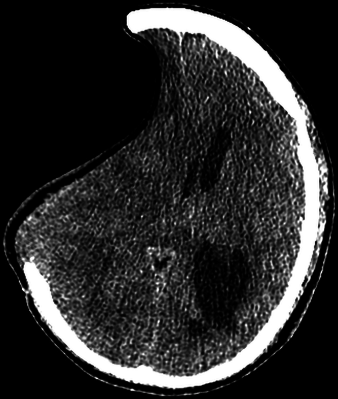
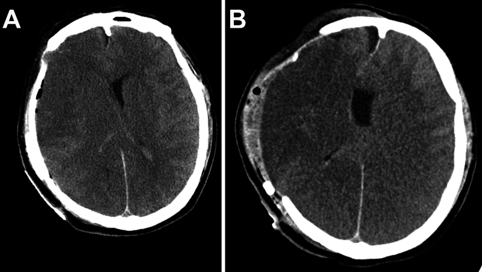
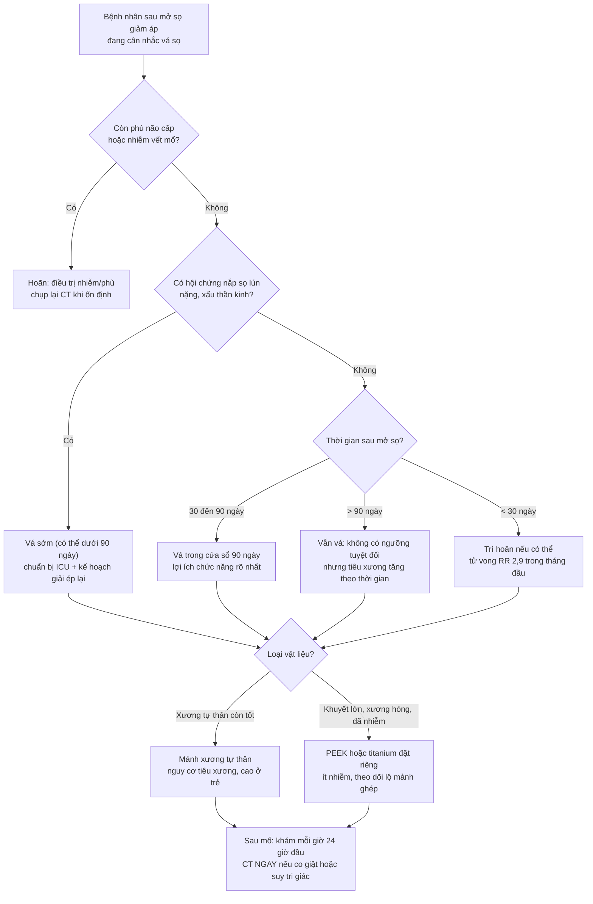
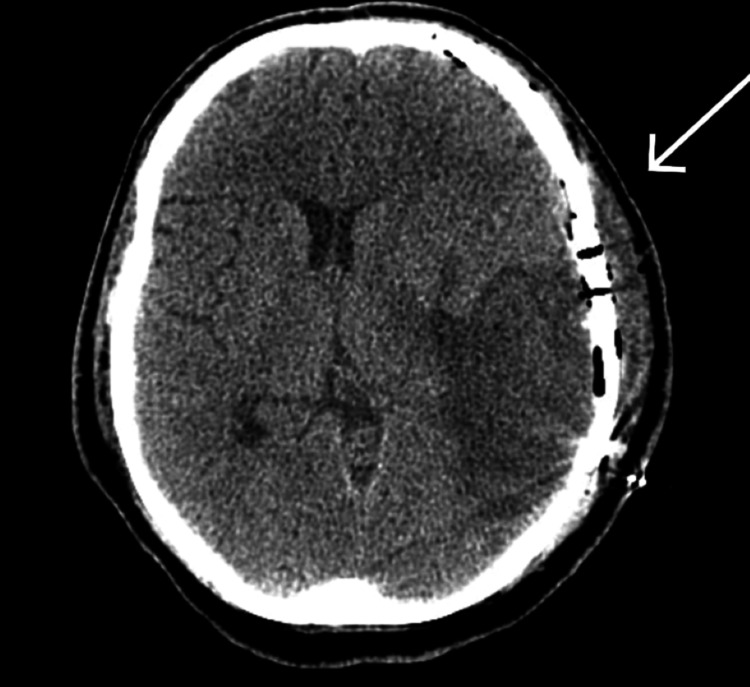
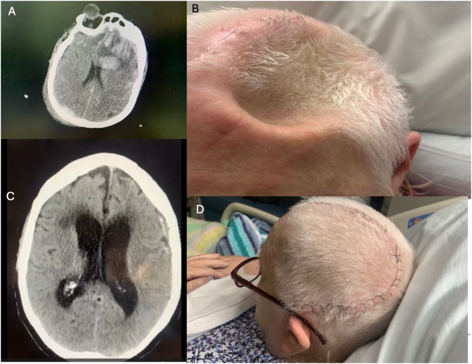

# 3028 — Vá sọ sau mở sọ giảm áp: thời điểm, vật liệu, phù não ác tính sau vá (MBSC) và hội chứng nắp sọ lún

**Tags:** `pattern:nap-so-lun` `pattern:di-lech-duong-giua` `pattern:phu-nao-lan-toa` `pattern:tieu-xuong-manh-ghep` `vung:nao` `vung:hop-so` `score:Oulu-resorption` `protocol:CT-so-nao-khong-can-quang` `protocol:MRI-sau-va-so` `incidentaloma:manh-ghep-xuong`
**Mức chắc chắn (certainty):** tổng hợp y văn (literature synthesis) — ghép **báo cáo ca MBSC/SSFS có tổng quan hệ thống các ca đã báo cáo** (Cureus 2026, PMCID PMC13072451), **tổng quan cơ chế – chẩn đoán hội chứng trephined** (Brain & Spine 2026, PMC13471285), **ca hội chứng nắp sọ lún được vá sọ sớm** (Cureus 2025, PMC12009460), **3 phân tích gộp về thời điểm vá sọ** (Neurosurg Rev 2026, PMC12789150 và PMC13246589; J Clin Med 2025, PMC12194293), **phân tích gộp nhi** (Acta Neurochir 2025, PMC12356755), **nghiên cứu cắt ngang thời điểm bằng CART** (Neurosurg Rev 2026, PMC12764505), **phân độ tiêu xương theo thang Oulu** (Neurosurg Rev 2026, PMC13633375) và **mạng lưới so sánh vật liệu** (Med Sci Monit 2026, PMC12988648; Bioengineering 2026, PMC13203544). Nhiều thiết kế quan sát, mâu thuẫn nhau ở điểm kết cục thần kinh → ghi rõ chỗ chưa đồng thuận, không gắn nhãn ca nguyên văn.

> **Câu hỏi thực hành:** bệnh nhân 42 tuổi, 5 tháng sau **mở sọ giảm áp** vì máu tụ nội sọ, tỉnh táo nhưng **nắp sọ lún sâu**, CT có **lệch đường giữa 15 mm về phía ổ khuyết**. Câu hỏi không phải "có vá sọ không" (câu trả lời là có) mà là: **vá bây giờ hay chờ, bằng vật liệu gì, và chuẩn bị gì cho biến chứng nguy hiểm nhất — phù não ác tính ngay trong giờ đầu sau vá**.
> Bài chốt theo **ba trục**: (1) **hướng lệch và mức lún** nói gì về áp lực nội sọ; (2) **thời điểm** — mốc 90 ngày cho chức năng, mốc ~122 ngày cho biến chứng, và vùng nguy hiểm < 30 ngày; (3) **vật liệu** — đánh đổi giữa tiêu xương (xương tự thân) và nhiễm/lộ mảnh ghép (vật liệu tổng hợp). Nối [3026 – Tụt não nghịch lý sau chọc dò](../3026-tut-nao-nghich-ly-sau-choc-do-shunt-mo-so/lesson.md), [212 – Xuất huyết sọ](../212-xuat-huyet-so-nao/lesson.md), [201 – Protocol CT/MRI sọ não](../201-protocol-so-nao/lesson.md), [224 – Chấn thương sọ não nhi](../224-chan-thuong-so-nao-nhi/lesson.md), [3002 – Shunt não thất–màng phổi & nắp sọ lún](../3002-shunt-nao-that-mang-phoi-tinh-mach/lesson.md).

## 1. Tổng quan bệnh học – cơ chế hình ảnh: vì sao nắp sọ LÚN và vì sao vá sọ có thể giết bệnh nhân

- **Bối cảnh:** **mở sọ giảm áp (decompressive craniectomy — DC)** bỏ một mảng xương để não thoát ra ngoài khi tăng áp lực nội sọ kháng trị; **vá sọ (cranioplasty — CP)** phục hồi vòm sọ kín. CP là phẫu thuật **"ngoài màng cứng"** nhưng **hậu quả nằm trong màng cứng** — đây chính là điểm khiến nó nguy hiểm.
- **TẠI SAO nắp sọ lún (hội chứng trephined / sinking skin flap syndrome — SSFS/SoT):** sau DC, nhu mô não **không còn bị vòm sọ giữ**, chịu **áp lực khí quyển** trực tiếp; khi dịch não tủy bị lấy bớt (dẫn lưu, shunt) hoặc não teo lại, **chênh áp xuyên màng cứng trở nên âm** → não bị **hút ra phía ổ khuyết** và **da đầu lõm vào**. Hệ quả sinh lý: **giảm tưới máu não**, **rối loạn dòng dịch não tủy**, **rối loạn tự điều hoà** → chậm chạp, giảm tập trung, yếu nửa người, đau đầu thế đứng.
  - **Trên CT, dấu hiệu là HÌNH HỌC:** đường viền da đầu **lõm** tại ổ khuyết, **nhu mô não kéo về phía ổ khuyết**, **lệch đường giữa VỀ PHÍA khuyết**, bể đáy căng, não thất bên **bên khuyết nhỏ hơn**. Lệch **về phía khuyết = hạ áp lực**; lệch **ra xa khuyết = tăng áp lực** — đây là quy tắc đọc nhanh quan trọng nhất (đã chốt ở [3026](../3026-tut-nao-nghich-ly-sau-choc-do-shunt-mo-so/lesson.md)).
- **TẠI SAO vá sọ có thể gây phù não ác tính (massive brain swelling after cranioplasty — MBSC):** khi vòm sọ được đóng kín, **áp lực khí quyển không còn đè lên não**; đồng thời **tưới máu não tăng**, **dòng dịch não tủy phục hồi**, bệnh nhân **nằm ngửa** → **áp lực nội sọ tăng đột ngột**. Với một bộ não **đã thích nghi với áp lực nội sọ thấp và độ giãn kém** (nắp lún nặng + lệch đường giữa), **mức áp lực "bình thường" của người khoẻ lại là quá cao** — tác giả gọi là **"tăng áp lực nội sọ giả" (pseudointracranial hypertension)**. Kết quả: **phù lan tỏa hai bán cầu ± hố sau**, **mất phân biệt chất xám–trắng**, tụt hạnh nhân, có thể kèm **xuất huyết nhỏ**.
  - **Trên CT, phù là GIẢM tỷ trọng** vì mô phù chứa nhiều nước (giảm trọng lượng nguyên tử trung bình) → **lan theo chất trắng, xoá rãnh, xoá phân biệt vỏ–tuỷ**; khác nhồi máu ở chỗ **không tôn trọng một vùng mạch máu** và **không hạn chế khuếch tán** trên DWI.
- **Ngưỡng định lượng và tỷ lệ:**
  - **SSFS gặp ở 13% bệnh nhân sau DC**, khởi phát **28–188 ngày** sau mổ; có thể **sớm trong 2 tuần** (PMC12009460).
  - **MBSC: 43 ca đã báo cáo tính đến 2026; chỉ 8 ca sống (18,6%) và chỉ 2 ca hồi phục đáng kể ngoài di chứng nặng**, phần lớn diễn tiến **trong vài giờ đầu sau vá** (PMC13072451).
  - **Biến chứng chung của vá sọ: 25–50%**, so với **1–5%** của phẫu thuật thần kinh thường quy (PMC12988648); loạt **754 ca vá sọ trong 10,75 năm**: **24,6% có ≥ 1 biến chứng** — nhiễm phải tháo mảnh ghép **6,6%**, não úng thủy phải đặt shunt **9,0%**, tiêu xương phải thay vật liệu **6,3%**, co giật **4,1%**, máu tụ phải mổ lại **2,3%** (PMC13072451).
  - **Hiệu quả thần kinh của vá sọ:** **65% bệnh nhân SoT cải thiện rõ trong 4 ngày đầu** sau vá, duy trì đến **90 ngày** (PMC13471285); gộp **21 nghiên cứu / 1.682 bệnh nhân**, vá sọ **cải thiện chức năng** so với trước mổ (**SMD 0,52; 0,21–0,83**) và **nhận thức MMSE (SMD 0,57; 0,34–0,79)** (PMC13246589).
- **TẠI SAO xương tự thân bị TIÊU (bone flap resorption — BFR):** mảnh xương sau DC **mất nguồn nuôi từ màng xương và cân**, bị **huỷ cốt bào** thay dần; trên CT thấy **mỏng dần bờ mảnh ghép, khuyết kiểu "gặm nhấm", hở đường khớp rộng ra**, **không có phản ứng màng xương, không ngấm thuốc** (khác nhiễm trùng). Nguy cơ tăng khi **diện khuyết > 92,11 cm²**, **chấn thương sọ não**, **hút thuốc**, **mảnh ghép ≥ 2**; **< 2 mảnh là yếu tố bảo vệ** (PMC13633375). Ở **trẻ**, tiêu xương phải mổ lại **~30%**, nhiễm **~10%** (PMC12356755).

## 2. Mẫu hình + chẩn đoán phân biệt theo thời gian và theo hướng nắp sọ (gamut)

- **Trục 1 — THỜI GIAN sau vá sọ (quyết định gamut):**
  - **< 24 giờ:** **MBSC (phù não ác tính)** · **máu tụ ngoài/dưới màng cứng cấp** · **co giật sớm** · **tăng áp lực do khí nội sọ**.
  - **1–4 tuần:** **nhiễm mảnh ghép/dịch tụ** · **hygroma** · **rò dịch não tủy** · **máu tụ muộn**.
  - **> 1 tháng:** **tiêu xương mảnh ghép** · **não úng thủy sau vá** (đặc biệt khi vá đồng thời với shunt) · **lộ mảnh ghép** · **SSFS tồn tại/diễn tiến dù đã vá**.
- **Trục 2 — HƯỚNG NẮP SỌ:** **lõm** = hạ áp lực/SSFS hoặc dẫn lưu quá mức; **căng phồng** = tăng áp lực, máu tụ, phù, hoặc **não phòi ra** qua ổ khuyết.
- **Gợi nhớ "SUNK"** (đúng nghĩa "lún"): **S**inking skin flap (SSFS/SoT) · **U**ng thủy (não úng thủy sau vá) · **N**hiễm mảnh ghép · **K**huyết xương = tiêu xương mảnh ghép.
- **Gamut theo vị trí tổn thương trên CT:**
  - **Ngoài trục (extra-axial):** máu tụ ngoài màng cứng/dưới màng cứng cấp, hygroma, dịch tụ dưới cân (subgaleal), khí ngoài màng cứng.
  - **Trong trục (intra-axial):** phù não lan tỏa (MBSC), ổ giảm tỷ trọng do nhồi máu, ổ tăng tỷ trọng do xuất huyết mới, ổ mủ (áp-xe).
  - **Tại mảnh ghép:** tiêu xương (mỏng bờ), di lệch/lún mảnh ghép, lộ mảnh ghép qua da, vỡ dụng cụ cố định.
- **Điểm phân biệt then chốt:** **nắp lún + lệch về phía khuyết** không phải "não úng thủy" — đặt shunt cho bệnh nhân này sẽ làm lún sâu hơn và có thể gây **tụt não nghịch lý** (xem 3026).

## 3. Bảng so sánh phân biệt (ma trận đối chiếu)

| Thực thể (entity) | Hình ảnh điển hình | Chốt vào (rule-in) | Chốt loại (rule-out) | Gợi ý xác nhận |
|---|---|---|---|---|
| **SSFS / hội chứng trephined (SoT)** | Nắp da đầu **lõm sâu** tại ổ khuyết, não kéo về khuyết, **lệch đường giữa VỀ PHÍA khuyết**, não thất bên khuyết nhỏ hơn | **Lún da đầu nhìn thấy + lệch về phía khuyết + xấu đi thần kinh không do tổn thương mới**, đỡ khi nằm ngửa | **Có tổn thương mới (máu tụ, nhồi máu, áp-xe) giải thích được triệu chứng** → không quy cho SSFS | CT 1 mm; so phim cũ; đáp ứng sau vá sọ |
| **MBSC (phù não ác tính sau vá)** | **Phù lan tỏa hai bán cầu ± hố sau**, mất phân biệt xám–trắng, rãnh xoá, có thể kèm xuất huyết nhỏ; xuất hiện **trong vài giờ** sau vá | **SSFS nặng trước mổ (lệch ≥ 15 mm) + suy thần kinh/co giật ngay sau vá + phù không tôn trọng vùng mạch** | **Phù khu trú đúng một vùng mạch máu + DWI hạn chế** → nhồi máu, không phải MBSC | CT cấp; CTA/CTV loại trừ tắc mạch – huyết khối xoang; mổ lại giải ép nếu xấu |
| **Nhiễm mảnh ghép** | Dịch tụ **quanh mảnh ghép**, khí trong mô mềm, **ngấm thuốc viền**, tiêu xương không đều, **lộ chỉ/mảnh ghép** | **Sốt + sưng nóng vết mổ + dịch đục**, cấy (+) | **Không sốt, không ngấm thuốc, chỉ mỏng xương đều** → tiêu xương vô khuẩn | MRI có tương phản; cấy dịch/mô; đánh dấu (PET) khi mạn tính |
| **Tiêu xương mảnh ghép (BFR)** | **Mỏng dần bờ mảnh ghép, khuyết kiểu bị gặm**, hở khớp rộng, **lún mảnh ghép**; thường **> 3 tháng** | **Mảnh ghép mỏng/hỏng tiến triển trên ≥ 2 lần CT + diện khuyết > 92,11 cm² + TBI/hút thuốc** | **Mảnh ghép mất hoàn toàn kèm tụ dịch và sốt** → nhiễm trùng | Thang **Oulu** (nhẹ/trung gian/nặng); CT xương lát mỏng |
| **Não úng thủy sau vá** | Não thủy **giãn tiến triển**, **thùy thái dương giãn**, rãnh vỏ căng, **túi cùng góc cầu–tiểu não rộng** | **Não thất giãn tiến triển + tam chứng (đi, tiểu, nhận thức) hoặc giảm tri giác** | **Não thất giãn nhưng rãnh vỏ giãn theo, không lệch, không triệu chứng** → giãn do teo (hydrocephalus ex vacuo) | CT/MRI so sánh; nghiệm pháp lấy dịch/tháo shunt thắt lưng |
| **Máu tụ ngoài/dưới màng cứng cấp sau vá** | Khối **tăng tỷ trọng hình liềm/thấu kính** dưới vòm sọ mới, **đẩy lệch đường giữa** | **Đau đầu dữ dội + suy tri giác trong 24 giờ đầu** | **Dải giảm tỷ trọng đối xứng hai bên, không đẩy lệch** → dịch tồn dư | CT cấp; đo độ dày (mm) và lệch đường giữa (mm) |
| **Rò dịch não tủy / pseudomeningocele** | Tụ dịch **dưới cân, đồng tỷ trọng dịch não tủy**, có thể thông với khoang dưới nhện, **căng phồng khi ho** | **Chảy dịch trong vết mổ + beta-2 transferrin (+)** | **Dịch tụ không thông, không tăng khi ho, tự xẹp** → tụ dịch đơn thuần | MRI T2/CT cisternography khi cần; beta-2 transferrin |

*CT sọ không cản quang: **nắp sọ lún nặng** — da đầu lõm sâu tại ổ khuyết, nhu mô não kéo về phía khuyết, **lệch đường giữa 15 mm**. Đây là kiểu hình có **độ giãn kém nhất** và là bối cảnh nguy cơ cao của **MBSC** khi vòm sọ được đóng lại. Nguồn: Cureus 2026 (PMC13072451), Figure 2, **CC BY-NC-ND 4.0** — nguyên bản, không crop.*

### Ba dấu hiệu "đắt giá" trên CT trước và sau vá sọ — đọc đúng để không ra quyết định sai

1. **Hướng của lệch đường giữa.** Đo tại **lỗ Monro** (hoặc tại mức não thất bên rộng nhất). **Lệch về phía ổ khuyết = hạ áp lực** (SSFS, dẫn lưu quá mức); **lệch ra xa ổ khuyết = tăng áp lực** (máu tụ, phù, não úng thủy). Không ghi "lệch 15 mm" mà bỏ hướng — hướng là chẩn đoán.
2. **Mức lún và diện khuyết.** Đo **chỗ lún sâu nhất (mm)** và **diện tích khuyết sọ (cm²)**. **Diện khuyết > 92,11 cm²** là yếu tố nguy cơ độc lập của tiêu xương mảnh ghép (PMC13633375); khuyết lớn cũng là yếu tố được dùng trong các thang phân tầng nguy cơ SoT.
3. **Phù có "tôn trọng vùng mạch" hay không.** **Phù lan tỏa, hai bên, không theo một vùng mạch, không hạn chế khuếch tán** = MBSC/hyperemia; **phù khu trú đúng lãnh thổ động mạch + DWI hạn chế** = nhồi máu. Phân biệt này quyết định **mổ lại giải ép hay không**.

*(A) CT sau vá bằng mảnh PEEK đặt riêng: **phù lan tỏa trên lều**, xoá rãnh và mất phân biệt xám–trắng, kèm **ổ xuất huyết vỏ não 8 mL**. (B) Sau khi **tháo mảnh ghép và lấy máu tụ**, phù **vẫn nặng thêm** trong vài giờ — minh hoạ rằng khi dòng thác MBSC đã bùng phát thì giải ép muộn thường không cứu được. Nguồn: Cureus 2026 (PMC13072451), Figure 3, **CC BY-NC-ND 4.0** — nguyên bản, không crop.*

## 4. Protocol chụp + thời điểm + vật liệu (hệ phân độ)

### 4.1 Protocol hình ảnh

- **Trước vá sọ:** **CT sọ không cản quang, lát 1 mm, cửa sổ xương + nhu mô** — đo **diện tích khuyết (cm²)**, **mức lún (mm)**, **lệch đường giữa (mm, ghi hướng)**, **kích thước não thất**, loại trừ **hygroma/tụ dịch**, đánh giá **mảnh xương tự thân** (nếu còn) bằng **thang Oulu**. Thêm **CTA/CTV** khi nghi huyết khối xoang hoặc bất thường mạch.
- **Ngay sau vá sọ:** **không chụp thường quy nếu bệnh nhân tỉnh táo, không dấu hiệu thần kinh**; **chụp NGAY** khi **co giật, giãn đồng tử, giảm tri giác, thở máy khó** — và chụp **trong vòng phút**, không chờ.
- **MRI (khi cần phân định):** **DWI/ADC** (nhồi máu vs phù vận mạch), **SWI/T2*** (máu cũ, hemosiderin), **FLAIR** (phù), **T1 sau tiêm** (áp-xe/lộ mảnh ghép). **Không dùng MRI thay CT cấp** ở bệnh nhân mất ổn định.
- **Theo dõi sau vá:** theo dõi **ICP** nếu còn đầu dò; **khám thần kinh mỗi giờ trong 24 giờ đầu**; theo dõi **dịch dẫn lưu dưới cân** (dẫn lưu hút có thể góp phần vào rối loạn áp lực — chưa có bằng chứng nhân quả, xem mục 5).

### 4.2 Thời điểm — các mốc số liệu và chỗ CHƯA đồng thuận

| Mốc | Bằng chứng | Hàm ý thực hành |
|---|---|---|
| **< 30–35 ngày (siêu sớm)** | **Giảm não úng thủy sau mổ RR 0,31 (P = 0,005)**; **thời gian mổ ngắn hơn −42,43 phút**; không tăng nhiễm/ tử vong trong phân tích gộp (PMC12789150) | Cân nhắc khi **SSFS nặng, thoát dịch nhiều, không có nhiễm**; nhưng **nguy cơ biến chứng sớm cao hơn** — cần ICU và đường mổ sạch |
| **< 2 tháng** | **Tăng biến chứng sau mổ** trong loạt ghép cặp **3.241 bệnh nhân**; **tử vong cao hơn khi vá trong tháng đầu, RR 2,9 (1,5–5,5; p = 0,001)** (trích trong PMC13072451) | **Tránh vá trong tháng đầu** nếu không có chỉ định bắt buộc (SSFS nặng, da mỏng nguy cơ lộ) |
| **≤ 90 ngày ("vá sớm")** | **Chức năng tốt hơn**: gộp **SMD 0,52 (0,21–0,83)**, **MMSE SMD 0,57 (0,34–0,79)**, nhóm **TBI SMD 0,74 (0,32–1,15)** (PMC13246589); **65% cải thiện trong 4 ngày** (PMC13471285) | **Mốc ưu tiên cho kết cục thần kinh** khi bệnh nhân đã qua giai đoạn phù não cấp |
| **> 90 ngày ("vá muộn")** | **Không khác biệt biến chứng** so với sớm: **15 nghiên cứu, 666 sớm vs 1.214 muộn**, không úng thủy **OR 1,66 (0,55–4,99)** (PMC12194293); một phân tích gộp khác lại thấy **thời gian mổ và mất máu ít hơn ở nhóm sớm** (PMC12973139) | Muộn **không** đồng nghĩa an toàn hơn; đánh đổi là **tiêu xương tăng** và **chậm phục hồi chức năng** |
| **~122,5 ngày (CART)** | **Điểm cắt tối ưu để giảm biến chứng: ngày 122,5 (độ nhạy 87%)**; nhóm có biến chứng vá sớm hơn (**84 ± 44 vs 102 ± 70 ngày, p = 0,065**) (PMC12764505) | Con số **gợi ý**, không phải luật; dùng để thảo luận với gia đình |

- **Chỗ chưa đồng thuận (phản biện):** hai phân tích gộp cùng năm cho **kết cục nhận thức NGƯỢC nhau** — PMC13246589 thấy **MMSE tốt hơn ở nhóm vá sớm** (I² = 0%), trong khi PMC12973139 thấy **MMSE nghiêng về nhóm vá muộn**. Khác biệt đến từ **định nghĩa "sớm" (≤ 90 ngày vs ngưỡng khác)**, **thời điểm đo**, và **tỷ lệ mất theo dõi**. **Không trích một con số duy nhất để hứa hẹn với gia đình.**
- **Kết luận thực hành:** **không có "một con số vàng"**. Trình tự hợp lý: **(1)** chờ qua **giai đoạn phù não cấp** và **hết nhiễm**; **(2)** nếu **SSFS nặng/diễn tiến nhanh**, vá **sớm** vì lợi ích chức năng, chấp nhận nguy cơ; **(3)** nếu bệnh nhân ổn định, **không vội trong tháng đầu**; **(4)** luôn chuẩn bị **phương án giải ép lại trong 24 giờ**.

### 4.3 Vật liệu — đánh đổi định lượng

| Vật liệu | Ưu điểm | Nhược điểm (số liệu) | Chọn khi |
|---|---|---|---|
| **Xương tự thân (autologous)** | Rẻ, khớp hoàn hảo, là xương thật | **Tiêu xương 26,2% ở loạt phân độ Oulu** (nhẹ 14,8% / trung gian 6,6% / nặng 4,9%); **trẻ: tiêu xương phải mổ lại ~30%, nhiễm ~10%** | Khuyết **< 92,11 cm²**, mảnh **1 mảnh**, không chấn thương dập não nặng, **bảo quản tốt** |
| **PEEK (đặt riêng)** | Nhẹ, không cản quang nhiều, khớp theo thiết kế 3D | **Tốt nhất về nhiễm trong mạng lưới so sánh (SUCRA cao)**; hiếm lộ mảnh ghép; **giá cao**, cần lập kế hoạch 3D | Khuyết lớn, xương tự thân hỏng/đã nhiễm, cần thẩm mỹ |
| **Titanium** | Bền, dễ cố định | **Nguy cơ lộ mảnh ghép cao hơn** trong mạng lưới so sánh | Khuyết lớn cần chắc chắn; **tránh ở vùng da mỏng** |
| **PMMA (đúc tay/đúc khuôn)** | Rẻ, phổ biến | **SUCRA nhiễm thấp nhất**; **pPMMA có tỷ lệ mổ lại cao nhất**; **phản ứng dị vật** đã báo cáo | Nguồn lực hạn chế, khuyết vừa |
| **Hydroxyapatite** | Tương thích sinh học | Vị trí trung bình về nhiễm; **mổ lại cao** trong mạng lưới | Ít dùng khi có lựa chọn khác |

- **Cố định:** **vật liệu cố định không titanium** gắn với **nhiễm và tiêu xương cao hơn ở trẻ** (PMC12356755) → ưu tiên **nẹp/vít titanium**.
- **Vá sọ đồng thời với đặt shunt:** cân nhắc kỹ — vá khi shunt vừa đặt dễ **dẫn lưu quá mức → lún nắp sọ**; nhiều nhóm chọn **vá trước, shunt sau** hoặc **hạ áp lực van** (xem [3002](../3002-shunt-nao-that-mang-phoi-tinh-mach/lesson.md)).

## 5. Biến thể bình thường và cạm bẫy

- **Biến thể/giả tổn thương:**
  - **Lún nhẹ da đầu không triệu chứng** ở người có khuyết lớn, không lệch đường giữa → **theo dõi**, không mổ cấp.
  - **Khí nội sọ lượng nhỏ sau vá** (vài mL, không đè ép) là bình thường, tự tiêu trong **1–2 tuần**; chỉ nguy hiểm khi **khí căng (tension pneumocephalus)** — dấu **"Mount Fuji"** hai thùy trán bị đẩy tách, khi đó là cấp cứu.
  - **Mảnh ghép cản quang mạnh** (titanium, PMMA có cản quang) tạo **giả ảnh vệt (streak)** che mô não lân cận — đọc trên **cửa sổ nhu mô** và nếu cần **MRI**.
- **Cạm bẫy chết người:**
  1. **Coi nắp lún là "vấn đề thẩm mỹ".** Nó là **dấu hiệu của áp lực nội sọ thấp và độ giãn kém** — và chính là bối cảnh của MBSC.
  2. **Không đo hướng lệch đường giữa.** Lệch **về phía khuyết** mà đặt shunt hoặc chọc dò → **tụt não nghịch lý** (bài 3026), có thể tử vong trong vài giờ.
  3. **Bỏ qua co giật ngay sau vá.** Trong ca MBSC điển hình, **co giật toàn thể xuất hiện trong 1 giờ đầu**, sau đó là phù ác tính — co giật ở đây là **dấu hiệu báo động**, không phải "cơn động kinh đơn thuần".
  4. **Vá sọ cho bệnh nhân còn phù não.** Vá khi não còn căng là **đóng nắp một nồi áp suất**; chờ CT cho thấy phù thoái triển.
  5. **Đặt shunt trước/sát ngày vá sọ** ở bệnh nhân có khuyết lớn → **lún sâu hơn**, dễ tụt não.
  6. **Hứa "một lần là xong" với trẻ.** Tiêu xương phải mổ lại **~30%**; cần nói trước với gia đình về **khả năng thay vật liệu**.
  7. **Đọc tiêu xương thành nhiễm trùng.** Tiêu xương **không sốt, không ngấm thuốc, không tụ dịch**; điều trị khác hẳn (theo dõi/thay vật liệu, không kháng sinh dài).
  8. **Quên theo dõi não úng thủy sau vá (9,0% phải đặt shunt)** — đặc biệt khi vá sau chấn thương nặng hoặc có máu trong não thất.

## 6. Tự lượng giá — Blind Quiz

**Ca 1 — Nam 42 tuổi, 5 tháng sau mở sọ giảm áp vì máu tụ nội sọ đa ổ. Tỉnh, làm theo lệnh, nhưng nắp sọ lõm rõ. Nhìn CT, mô tả trước khi mở đáp án.**

- **Câu hỏi:** (a) Dấu hiệu chính và **hướng** lệch đường giữa? (b) Đây là hội chứng gì, và vì sao **không** phải não úng thủy? (c) Biến chứng nguy hiểm nhất **ngay sau khi vá** và tỷ lệ sống của nó?

<b>Bấm để hiện đáp án</b>

- (a) **Nắp sọ lún nặng** (da đầu lõm sâu tại ổ khuyết), não kéo về phía khuyết, **lệch đường giữa 15 mm VỀ PHÍA ổ khuyết**.
- (b) **Hội chứng nắp sọ lún / hội chứng trephined (SSFS/SoT)** — áp lực nội sọ thấp, não mất giá đỡ của vòm sọ. **Không phải não úng thủy** vì **lệch về phía khuyết** và **não thất bên bên khuyết nhỏ hơn**, không giãn tiến triển; đặt shunt ở đây sẽ làm lún sâu thêm.
- (c) **Phù não ác tính sau vá sọ (MBSC)** — trong **43 ca** đã báo cáo, **chỉ 8 ca sống (18,6%)** và **chỉ 2 ca hồi phục đáng kể**. Diễn tiến **trong vài giờ**, đôi khi kèm **co giật trong 1 giờ đầu**.
- **Nguồn ảnh:** Cureus 2026 (PMC13072451), Figure 2 — CC BY-NC-ND 4.0.

**Ca 2 — Cùng bệnh nhân, 1 giờ sau vá bằng mảnh PEEK đặt riêng: co giật toàn thể, rồi hôn mê. Nhìn 2 ô CT, mô tả trước.**

- **Câu hỏi:** (a) Dấu hiệu trên ô A và ô B? (b) Chẩn đoán và cơ chế? (c) Xử trí ngay — và vì sao kết cục trong ca này vẫn xấu dù đã làm đúng?

<b>Bấm để hiện đáp án</b>

- (a) Ô A: **phù lan tỏa trên lều + phù tiểu não**, xoá rãnh, mất phân biệt xám–trắng, kèm **ổ xuất huyết vỏ não 8 mL**. Ô B: sau **tháo mảnh ghép + lấy máu tụ**, phù **nặng thêm**, não phòi qua ổ khuyết.
- (b) **MBSC** — "tăng áp lực nội sọ giả": đóng kín vòm sọ làm mất áp lực khí quyển đè lên não, tăng tưới máu, phục hồi dòng dịch não tủy và tư thế nằm ngửa → **áp lực tăng đột ngột trên bộ não đã thích nghi với áp lực thấp, độ giãn kém**.
- (c) **CT ngay + giải ép lại (tháo mảnh ghép) + osmotherapy (NaCl 23,4%, mannitol) + tăng thông khí**, đồng thời loại trừ **huyết khối xoang/tắc mạch**. Trong ca này CTA/CTV âm tính nhưng bệnh nhân **vẫn tiến triển tới hoại tử não thiếu oxy lan tỏa** — cho thấy **khi dòng thác đã bùng phát thì giải ép muộn không đủ**, nên **dự phòng và nhận diện sớm** là then chốt.
- **Nguồn ảnh:** Cureus 2026 (PMC13072451), Figure 3 — CC BY-NC-ND 4.0.

**Ca 3 — Bệnh nhân sau mở sọ, có hygroma và nắp lún; được vá sọ. So sánh 2 thời điểm trên ảnh và mô tả cái gì đã thay đổi.**

- **Câu hỏi:** (a) Dấu hiệu nào cho thấy vá sọ đã có tác dụng? (b) Vì sao vá sọ được coi là **điều trị** của hội chứng nắp lún chứ không chỉ là "đóng lại cho đẹp"?

<b>Bấm để hiện đáp án</b>

- (a) **Mảnh ghép đã đóng vòm sọ** (mũi tên), **giảm rõ di lệch đường giữa**, tổn thương dưới màng cứng/hygroma nhỏ lại và não nở về vị trí.
- (b) Vì vá sọ **phục hồi vòm kín** → **bình thường hoá áp lực nội sọ, dòng dịch não tủy và tưới máu não**; **65% bệnh nhân SoT cải thiện rõ trong 4 ngày đầu** và duy trì đến 90 ngày. Vá sọ **rút ngắn phục hồi chức năng**, nhưng **không phải thủ thuật "lành"**: biến chứng chung **25–50%**.
- **Nguồn ảnh:** Cureus 2025 (PMC12009460), Figure 5 — CC BY 4.0.

**Ca 4 — Minh hoạ lâm sàng + CT của hội chứng trephined trước và sau vá.**

- **Câu hỏi:** Liệt kê 4 ô (A–D) và cho biết **dấu hiệu nào trên lâm sàng** đi kèm với CT để chẩn đoán SoT.

<b>Bấm để hiện đáp án</b>

- (A) CT ban đầu: **nhiều ổ dập não + phù nặng** → mở sọ giảm áp bên trái. (B) **Da đầu lõm sâu** tại ổ khuyết sau vài tuần, kèm **buồn ngủ, chậm nhận thức, giảm tham gia phục hồi chức năng** — không có não úng thủy, không nhiễm, không tổn thương mới. (C) CT sau vá: **vòm sọ kín, giảm biến dạng não**. (D) Ảnh lâm sàng sau vá: **đường mổ liền, vòm sọ phục hồi**.
- **Chốt chẩn đoán:** **lún da đầu nhìn thấy được + xấu đi thần kinh không do tổn thương mới + cải thiện sau vá**.
- **Nguồn ảnh:** Brain & Spine 2026 (PMC13471285), Figure 1 — CC BY-NC-ND 4.0.

## Bài liên quan chéo
- [3026 – Tụt não nghịch lý sau chọc dò ở người có shunt/mở sọ giảm áp](../3026-tut-nao-nghich-ly-sau-choc-do-shunt-mo-so/lesson.md) (bước trước: hướng lệch, áp lực mở, Trendelenburg)
- [212 – Xuất huyết sọ: ICH/SAH/SDH/EDH](../212-xuat-huyet-so-nao/lesson.md) (nền tảng đọc máu tụ sau vá)
- [201 – Protocol CT/MRI sọ não](../201-protocol-so-nao/lesson.md) (chọn chuỗi xung, thời điểm chụp)
- [224 – Chấn thương sọ não ở trẻ](../224-chan-thuong-so-nao-nhi/lesson.md) (chỉ định mở sọ, khác biệt sinh lý trẻ)
- [3002 – Shunt não thất–màng phổi & nắp sọ lún](../3002-shunt-nao-that-mang-phoi-tinh-mach/lesson.md) (dẫn lưu quá mức → lún)
- [251 – Chấn thương đầu ở trẻ có shunt / rối loạn đông máu](../251-chan-thuong-dau-tre-shunt-va-roi-loan-dong-mau/lesson.md) (nhóm nguy cơ cao)

## Ảnh
- `3028_nap-so-lun_CT-PMC13072451-F2.jpg` — nắp sọ lún nặng, lệch đường giữa 15 mm, Cureus 2026 (PMC13072451), Figure 2, **CC BY-NC-ND 4.0**.
- `3028_phu-nao-sau-va-so_CT-PMC13072451-F3.jpg` — phù não lan tỏa sau vá PEEK và sau tháo mảnh ghép, Cureus 2026 (PMC13072451), Figure 3, **CC BY-NC-ND 4.0**.
- `3028_sau-va-so_CT-PMC12009460-F5.jpg` — CT sau vá sọ: giảm di lệch đường giữa, Cureus 2025 (PMC12009460), Figure 5, **CC BY 4.0**.
- `3028_sy-trephined_CT-PMC13471285-F1.jpg` — minh hoạ hội chứng trephined (A–D), Brain & Spine 2026 (PMC13471285), Figure 1, **CC BY-NC-ND 4.0**.
- Nguồn + giấy phép từng ảnh: `images/CREDITS.md`. Không tạo composite (ảnh NC-ND giữ nguyên bản).

> Không dùng để chẩn đoán độc lập khi chưa có người hướng dẫn.
