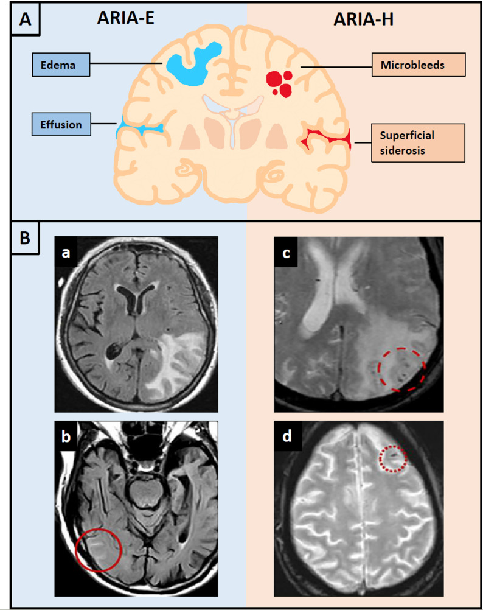
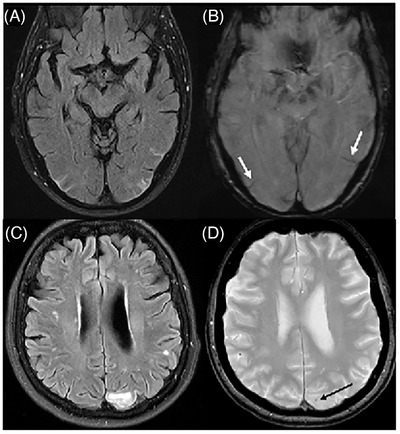
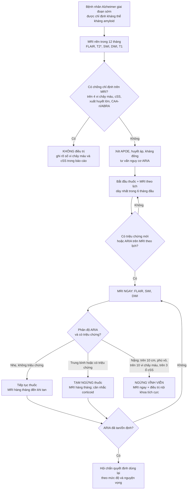
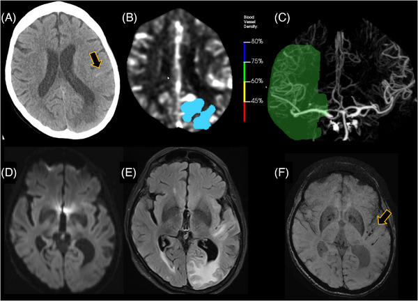
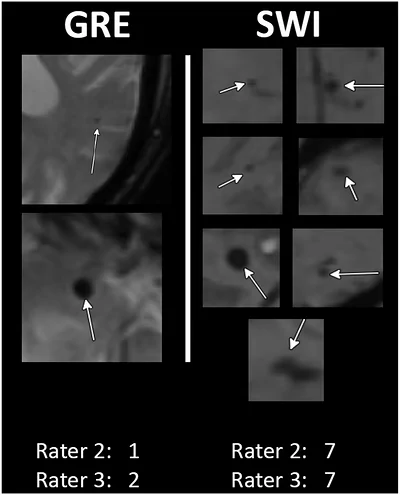

# 3029 — ARIA khi dùng kháng thể kháng amyloid (lecanemab/donanemab): ARIA-E vs ARIA-H, phân độ MRI, sàng lọc CAA và lịch theo dõi

**Tags:** `pattern:aria-e` `pattern:aria-h` `pattern:phu-van-mach` `pattern:vi-chay-mau-thuy` `pattern:siderosis-vo-nao` `vung:nao` `score:ARIA-severity` `protocol:MRI-ARIA` `protocol:MRI-SWI` `incidentaloma:vi-chay-mau`
**Mức chắc chắn (certainty):** tổng hợp y văn (literature synthesis) — ghép **tổng quan có hệ thống hoá 62 nguồn về lecanemab/donanemab** (Neurol Int 2026, PMCID PMC13610423), **tổng quan cơ chế – hình ảnh – phân độ ARIA kèm bảng phân độ MRI** (Alzheimers Res Ther 2026, PMC13063504), **bài tổng quan ARIA trong liệu pháp kháng amyloid** (Alzheimer's Dement 2026, PMC13099593), **khung khu vực về phát hiện – xử trí ARIA** (J Prev Alzheimers Dis 2026, PMC12854975), **nghiên cứu so sánh GRE vs SWI khi sàng lọc** (Alzheimers Dement (DADM) 2026, PMC13575324), **nghiên cứu MRI 3D tăng tốc cho theo dõi ARIA** (Alzheimer's Dement 2026, PMC13093291) và **phân tích tín hiệu an toàn hậu mại** (Ther Adv Drug Saf 2026, PMC13487121). Đây là lĩnh vực **rất mới (2023–2026)**, nhiều dữ liệu hậu mại còn mỏng → ghi rõ chỗ chưa chắc.

> **Câu hỏi thực hành:** bệnh nhân 74 tuổi, suy giảm nhận thức nhẹ do Alzheimer đã xác nhận bằng PET amyloid, **APOE ε4 dị hợp tử**, bắt đầu **lecanemab**. Tháng thứ 3, sau đợt tăng liều, bệnh nhân **đau đầu và lú lẫn nhẹ**; MRI cho thấy **vùng tăng tín hiệu FLAIR ở chất trắng dưới vỏ thái dương–chẩm trái**. Câu hỏi: **đây là ARIA-E hay nhồi máu, mức độ nào, có phải ngừng thuốc, và lịch MRI tiếp theo ra sao** — và quan trọng hơn: **trên MRI nền trước điều trị, dấu hiệu nào khiến bệnh nhân này không được điều trị ngay từ đầu**.
> Bài chốt theo **hai trục**: (1) **chuỗi xung** — FLAIR cho ARIA-E, T2*/SWI cho ARIA-H, DWI để loại nhồi máu; (2) **ngưỡng kích thước và số lượng** quyết định **tiếp tục / tạm ngừng / ngừng vĩnh viễn**. Nối [3027 – Xuất huyết thùy do CAA ở người già](../3027-xuat-huyet-thuy-caa-nguoi-gia/lesson.md), [201 – Protocol CT/MRI sọ não](../201-protocol-so-nao/lesson.md), [229 – PACNS vs RCVS](../229-pacns-vs-rcvs/lesson.md), [212 – Xuất huyết sọ](../212-xuat-huyet-so-nao/lesson.md).

## 1. Tổng quan bệnh học – cơ chế hình ảnh: vì sao ARIA-E là NƯỚC và ARIA-H là SẮT

- **Cơ chế:** kháng thể kháng amyloid gắn **mảng amyloid trong nhu mô và amyloid trong thành mạch**, hoạt hoá bổ thể và **phản ứng viêm quanh mạch**; amyloid được huy động ra lòng mạch để thải. Hai hậu quả hình ảnh tách biệt:
  - **ARIA-E (edema/effusion):** thành mạch **tăng tính thấm** → **dịch huyết tương rò vào chất trắng quanh mạch** (phù vận mạch) và **vào rãnh** (tràn dịch rãnh — sulcal effusion).
  - **ARIA-H (hemorrhage):** thành mạch **tổn thương thực sự** → **hồng cầu thoát mạch** → **vi chảy máu vỏ não** hoặc **siderosis màng mềm** (hemosiderin lắng dọc rãnh); hiếm hơn là **xuất huyết thùy lớn**.
- **TẠI SAO ARIA-E sáng trên FLAIR/T2:** phù vận mạch làm **tăng lượng nước tự do trong mô** → **kéo dài T2** → tăng tín hiệu trên T2 và FLAIR; **không phải hiện tượng hạn chế khuếch tán** vì tế bào không bị phù độc → **ADC không giảm** (đây là điểm phân biệt với nhồi máu cấp).
- **TẠI SAO ARIA-H đen trên T2*/SWI:** hồng cầu thoát mạch được đại thực bào chuyển thành **hemosiderin/ferritin** — **thuận từ mạnh** → làm **T2* ngắn lại** → **mất tín hiệu**, và hiệu ứng **blooming** làm tổn thương **2 mm trông to hơn**. Vì vậy **SWI nhạy hơn GRE** và **đo trên ảnh gốc, không đo trên ảnh MinIP**.
- **Ngưỡng định lượng:**
  - **Tần suất ARIA-E:** **lecanemab 12,6%** (giả dược **1,7%**), **donanemab 24,0%** (giả dược **2,1%**); **ARIA-H: 17,3%** (lecanemab) và **31,4%** (donanemab) (PMC13610423).
  - **ARIA có triệu chứng:** ARIA-E **2,8%** (lecanemab) và **6,1%** (donanemab) trong thử nghiệm then chốt; gộp các thử nghiệm pha 3: **2,8–5,8%** ARIA-E và **1,0–1,2%** ARIA-H có triệu chứng (PMC13063504).
  - **Mức độ nặng trên MRI:** ARIA-E nặng **2,1–11,5%**, ARIA-H nặng **3,5–6,4%** các ca (PMC13063504).
  - **Phần lớn KHÔNG triệu chứng:** khoảng **75%** ca ARIA được phát hiện tình cờ trên MRI theo lịch (PMC13099593); **~80%** ARIA-E do lecanemab **tan trong vòng 4 tháng**, **96%** ARIA-E do donanemab tan trong **trung bình 2 tháng**; **~80% triệu chứng ARIA hết hoàn toàn** (PMC13063504).
  - **Thời điểm:** ARIA tập trung **sau các liều đầu, giữa tháng 2 và tháng 6**; hầu hết trong **3–6 tháng đầu** (PMC13099593, PMC12854975).
  - **Yếu tố nguy cơ mạnh nhất — APOE ε4:** ARIA-E **5,4%** (không mang) / **10,9%** (dị hợp) / **32,6%** (đồng hợp) với lecanemab; **15,7% / 22,8% / 40,6%** với donanemab (PMC13610423). Gộp lại: ARIA-E ở **APOE4(+) 34,5% vs 6,5%** (≈ **5 lần**); **ARIA-H 21,4% vs 11,9%**; **ARIA có triệu chứng 6,1–11,2%** ở **ε4/ε4** so với **1,6–2,6%** ở người không mang (PMC13063504).
  - **Bệnh mạch nền làm tăng nguy cơ:** trong phân tích gộp **3.030 người** dùng donanemab, các yếu tố độc lập gồm **số alen APOE ε4, số vi chảy máu nền, siderosis vỏ não (cSS), gánh nặng amyloid nền, huyết áp động mạch trung bình cao** (PMC13610423).
  - **CAA đi cùng Alzheimer tới 80%** — nghĩa là **phần lớn bệnh nhân đủ tiêu chuẩn điều trị đã có sẵn bệnh mạch amyloid ở mức nào đó** (PMC13063504). Đây chính là cầu nối sang bài [3027](../3027-xuat-huyet-thuy-caa-nguoi-gia/lesson.md).

## 2. Mẫu hình + chẩn đoán phân biệt theo vị trí và theo chuỗi xung (gamut)

- **Mẫu hình cốt lõi:** bệnh nhân **Alzheimer giai đoạn sớm, đang dùng kháng thể kháng amyloid**, xuất hiện **đau đầu, lú lẫn, chóng mặt, rối loạn dáng đi, thay đổi thị giác, co giật hoặc khiếm khuyết khu trú** trong **6 tháng đầu** → nghĩ **ARIA** cho đến khi loại trừ.
- **Gamut theo chuỗi xung — ba câu hỏi:**
  1. **FLAIR: có phù/tràn dịch rãnh không?** → **ARIA-E** · nhồi máu · CAA thể viêm (CAA-ri) · PRES · u · viêm.
  2. **T2*/SWI: có mất tín hiệu mới không?** → **ARIA-H** (vi chảy máu, siderosis) · CAA · máu tụ cũ · vôi hoá · khí · kim loại.
  3. **DWI: có hạn chế khuếch tán không?** → **nhồi máu cấp** (ARIA-E **không** hạn chế khuếch tán).
- **Gamut theo vị trí:**
  - **Chất trắng dưới vỏ (subcortical white matter):** ARIA-E (phù vận mạch), CAA-ri (phù không đối xứng), PRES (thường vùng đỉnh–chẩm, hai bên), u thần kinh đệm.
  - **Vỏ não – màng mềm (cortical, leptomeningeal):** ARIA-H vi chảy máu vỏ não, **siderosis màng mềm**, xuất huyết dưới nhện vùng lồi (cSAH) do CAA.
  - **Thùy não (lobar):** xuất huyết thùy lớn — biến chứng hiếm nhưng nặng của ARIA-H/CAA.
  - **Vùng mạch máu (vascular territory):** nếu tổn thương **tôn trọng đúng một lãnh thổ động mạch** → **nhồi máu**, không phải ARIA.
- **Gợi nhớ "ARIA" khi đọc MRI:** **A**symmetry của phù **R**ãnh có dịch **I**ntact diffusion (không hạn chế khuếch tán) **A**poE ε4 làm nặng thêm.

## 3. Bảng so sánh phân biệt (ma trận đối chiếu)

| Thực thể (entity) | Hình ảnh điển hình | Chốt vào (rule-in) | Chốt loại (rule-out) | Gợi ý xác nhận |
|---|---|---|---|---|
| **ARIA-E** | **Tăng tín hiệu FLAIR** ở chất trắng dưới vỏ, đối xứng hoặc không, **± tràn dịch rãnh**; **không hạn chế khuếch tán**; thường **không ngấm thuốc** | **Đang dùng kháng thể kháng amyloid + phù mới + ADC không giảm + không theo lãnh thổ mạch** | **DWI hạn chế + ADC tối + theo đúng một vùng mạch** → nhồi máu | MRI **FLAIR + DWI/ADC + T2\*/SWI**; so MRI nền |
| **ARIA-H (vi chảy máu)** | **Nốt mất tín hiệu tròn 2–10 mm** trên T2*/SWI, **không phù quanh**, thường **vỏ–dưới vỏ** | **≥ 1 vi chảy máu MỚI so với MRI nền** trong khi đang điều trị | **Mất tín hiệu dạng đường/chấm theo mạch, có nhánh** → mạch máu/DVA, không phải vi chảy máu | **SWI (ưu tiên)**, đối chiếu ảnh nền; đếm và ghi vị trí |
| **ARIA-H (siderosis màng mềm, cSS)** | **Dải mất tín hiệu cong bám mặt vỏ não**, **cả hai mặt rãnh** | **cSS mới/xấu đi + đang điều trị** | **Máu tồn dư sau mổ/chấn thương khu trú**; **mạch máu chảy chậm** | SWI + ảnh phase; so phim cũ |
| **CAA (bệnh mạch amyloid, không do thuốc)** | **Vi chảy máu thùy + cSS + cSAH vùng lồi**, **không có tổn thương sâu**, tuổi > 50 | **Boston 2.0 probable CAA** trên MRI nền **TRƯỚC** khi bắt đầu thuốc | **Có vi chảy máu/ICH sâu** → không đủ probable CAA | MRI 3T SWI + T2/FLAIR; áp dụng Boston 2.0 (bài 3027) |
| **CAA-ri / ABRA (thể viêm)** | **Phù không đối xứng** lan tỏa hoặc nhiều ổ, có thể choán chỗ, kèm dấu hiệu CAA | **Phù + dấu hiệu CAA + không dùng kháng thể kháng amyloid** (hoặc xuất hiện sau nhiều tháng) | **Phù xuất hiện đúng cửa sổ ARIA khi đang dùng thuốc** → ARIA-E cho đến khi chứng minh ngược lại | MRI trước–sau corticoid; loại trừ nhiễm |
| **Nhồi máu não cấp** | **Tổn thương theo lãnh thổ mạch**, **DWI hạn chế/ADC tối**, có thể tắc mạch lớn | **DWI hạn chế + ADC tối + theo vùng mạch** | **ADC bình thường + phù lan ngoài lãnh thổ** → ARIA-E | DWI/ADC, MRA/CTA, thang ASPECTS |
| **PRES** | Phù **hai bên, đối xứng, vùng đỉnh–chẩm**, kèm **tăng huyết áp** | **Phù đối xứng + HA cao + hồi phục khi kiểm soát HA** | **Phù một bên, không tăng HA, đang dùng kháng amyloid** → ARIA-E | MRI; theo dõi huyết áp; chụp lại sau 2–4 tuần |
| **Xuất huyết thùy lớn (macrohemorrhage)** | Khối **tăng tỷ trọng trên CT** hoặc **máu tụ** trên MRI, có thể có mức dịch | **Máu tụ thùy mới + đang điều trị** | **Chỉ có vi chảy máu < 10 mm** → ARIA-H nhẹ, không phải macrohemorrhage | CT cấp; MRI SWI sau ổn định |

*(A) Sơ đồ: **ARIA-E** = phù (edema) và tràn dịch rãnh (effusion); **ARIA-H** = vi chảy máu (microbleeds) và siderosis màng mềm. (B) Ảnh thật: **a** — phù vận mạch lớn vùng chẩm trái trên FLAIR; **b** — ổ phù nhỏ (vòng đỏ); **c** — mất tín hiệu do vi chảy máu/siderosis trên chuỗi nhạy từ; **d** — vi chảy máu dạng chấm vùng đỉnh phải (vòng đỏ). Nguồn: Alzheimers Res Ther 2026 (PMC13063504), Figure 1, CC BY 4.0. Không crop.*

### Phân độ ARIA trên MRI — bảng quyết định (nguồn: PMC13063504, Table 1)

| Thể | Nhẹ (mild) | Trung bình (moderate) | Nặng (severe) |
|---|---|---|---|
| **ARIA-E** — kích thước vùng tăng tín hiệu FLAIR (rãnh, vỏ/dưới vỏ) | **< 5 cm ở một vị trí** | **5–10 cm ở một vị trí**, hoặc **< 10 cm ở nhiều vị trí** | **> 10 cm ở một hoặc nhiều vị trí**, kèm **phù vỏ (gyral swelling) và xoá rãnh** |
| **ARIA-H** — số vi chảy máu MỚI | **1–4** | **5–9** | **≥ 10** |
| **ARIA-H** — số ổ siderosis vỏ não khu trú | **1** | **2** | **≥ 3** |

- **Cách dùng bảng:** phân độ **theo hình ảnh**, nhưng quyết định điều trị cần **cả hình ảnh lẫn lâm sàng** — **ARIA nặng về hình ảnh mà không triệu chứng vẫn là nặng**, và ngược lại **triệu chứng nặng dù ảnh nhẹ cũng là nặng**.
- **Lưu ý đọc ảnh:** ARIA-E **có thể chỉ là tràn dịch rãnh** (không có phù nhu mô) — đừng bỏ qua; đo **đường kính lớn nhất** trên **FLAIR**, ghi **số vị trí** và **có phù vỏ/xoá rãnh hay không** vì đó là tiêu chí "nặng".

*Bệnh nhân 1 (A, B): **ARIA-E trung bình** — FLAIR (A) có **tràn dịch rãnh vùng chẩm hai bên và thái dương sau trái** + **phù vận mạch chẩm trái**; SWI (B) có **dải mất tín hiệu** = **siderosis màng mềm** (mũi tên trắng) — ARIA-H trung bình. Bệnh nhân 2 (C, D): **ARIA-E nhẹ** và **ARIA-H nhẹ**. Nguồn: Alzheimer's Dement 2026 (PMC13099593), Figure 2, CC BY 4.0. Không crop.*

## 4. Protocol chụp + lịch theo dõi + tiêu chuẩn loại trừ (hệ phân độ)

### 4.1 Chuỗi xung tối thiểu — bộ "ARIA protocol"

- **Bắt buộc:** **FLAIR** (phát hiện ARIA-E, kể cả tràn dịch rãnh) + **T2\* GRE hoặc SWI** (ARIA-H) + **DWI/ADC** (loại nhồi máu) + **T2** + **T1** (cấu trúc, teo, mốc so sánh).
- **Ưu tiên SWI hơn GRE:** cùng một bệnh nhân, **GRE đếm 1–2 vi chảy máu trong khi SWI đếm 7**; SWI còn **phân biệt siderosis thật với mạch máu/DVA** (GRE hay đọc nhầm mạch là vi chảy máu) (PMC13575324). Nếu chỉ có GRE, **nguy cơ đếm thiếu → bỏ sót tiêu chuẩn loại trừ**.
- **Tăng tốc:** chuỗi **3D FLAIR và SWI tăng tốc (Wave-CAIPI)** giảm **tới 56% thời gian chụp**, **độ nhạy/độ đặc hiệu cho ARIA-E = 1,00**, mức độ nặng tương đương (PMC13093291) — phù hợp để rút ngắn buổi chụp ở người sa sút trí tuệ khó nằm yên.
- **Đo và ghi báo cáo:** với **ARIA-E** ghi **cm lớn nhất, số vị trí, có phù vỏ/xoá rãnh, có tràn dịch rãnh**; với **ARIA-H** ghi **số vi chảy máu mới (và tổng), số ổ cSS, vị trí thùy/sâu**; luôn **so với MRI nền** vì tiêu chuẩn là **"mới"**.

### 4.2 Lịch MRI — theo nhãn thuốc, không theo thói quen

| Thuốc | MRI nền | MRI trong điều trị |
|---|---|---|
| **Lecanemab** | Trong **12 tháng trước liều đầu** | **Trước truyền lần 5, lần 7, lần 14** (nhãn); **FDA bổ sung một lần chụp sớm giữa truyền lần 2 và lần 3** sau khi ghi nhận **2 ca ARIA-E sớm tử vong** |
| **Donanemab** | Trong **12 tháng trước liều đầu** | **Trước truyền lần 2, 3, 4 và 7** (theo khuyến cáo sử dụng thích hợp + nhãn FDA) |
| **Cả hai** | Bắt buộc **SWI/GRE** để đếm vi chảy máu + tìm cSS | **Chụp ngay khi có triệu chứng**, không chờ lịch; sau một ca ARIA → **MRI hàng tháng đến khi ổn định/tan** |

- **Vì sao dày ở đầu:** ARIA tập trung **tháng 2–6**, tức quanh các liều đầu và các mốc tăng liều — nên lịch chụp **dày nhất trong 6 tháng đầu**.
- **Vì sao cần "chụp ngay khi có triệu chứng":** ARIA **bắt chước đột quỵ** (xem ca 2 dưới đây); nếu chỉ chờ lịch, **cửa sổ can thiệp bị bỏ qua** và bệnh nhân có thể bị **tiêu sợi huyết nhầm** — đúng tình huống đã gây **xuất huyết thùy lan tỏa** ở một ca được báo cáo.

### 4.3 Tiêu chuẩn LOẠI TRỪ trên MRI nền (phần quan trọng nhất của bài)

- **Hoa Kỳ (thực hành, không phải chống chỉ định tuyệt đối trên nhãn):** loại khỏi điều trị khi có **> 4 vi chảy máu**, **≥ 1 xuất huyết lớn (macrohemorrhage)**, **≥ 1 ổ siderosis vỏ não**, hoặc **bằng chứng ABRA/CAA-ri** (PMC13063504).
- **EU/Anh:** **xuất huyết não hoặc CAA trên MRI nền là CHỐNG CHỈ ĐỊNH** với cả hai thuốc; **EU khuyến cáo không dùng lecanemab nếu có ≥ 2 vi chảy máu thùy** (theo Boston v1); **thay đổi chất trắng nặng là chống chỉ định với donanemab** theo EMA/MHRA.
- **Khác biệt vùng miền này là cạm bẫy thực hành:** **cùng một MRI** có thể **được điều trị ở nơi này và bị loại ở nơi khác** → **đọc báo cáo MRI phải ghi rõ số vi chảy máu**, không chỉ ghi "không có bất thường".
- **Ngưỡng khác cần nhớ:** **huyết áp không kiểm soát tốt** là chống chỉ định với donanemab ở EU; thuốc chống kết tập tiểu cầu **có thể tiếp tục** (không làm tăng ARIA rõ), nhưng **kháng đông** đi cùng lecanemab làm **xuất huyết lớn tăng từ 0,6% lên 2,7%** (PMC13063504) → **phải hội chẩn trước khi bắt đầu** và **tuyệt đối không dùng tiêu sợi huyết theo kinh nghiệm** khi chưa loại ARIA.

## 5. Biến thể bình thường và cạm bẫy

- **Biến thể/giả tổn thương:**
  - **Mạch máu cắt ngang** tạo **chấm mất tín hiệu** trên GRE — trên SWI thấy **dạng đường có nhánh**, hoặc **DVA** với **tĩnh mạch dẫn lưu**. GRE hay đọc nhầm thành vi chảy máu/siderosis → **loại oan bệnh nhân** (PMC13575324).
  - **Vôi hoá mạch mạc treo, tuyến tùng, hạch nền** mất tín hiệu trên T2*/SWI — đọc kèm CT và **đối xứng**.
  - **Khí nội sọ, kim loại, mảnh đạn, kẹp phẫu thuật** gây mất tín hiệu lớn — xem ảnh phase và tiền sử.
  - **Thay đổi chất trắng do tuổi (Fazekas)** tăng tín hiệu FLAIR **đối xứng quanh não thất** — khác ARIA-E (thường **dưới vỏ, không đối xứng**, xuất hiện **mới**).
- **Cạm bẫy chết người:**
  1. **Không chụp SWI/GRE ở MRI nền.** Không đếm được vi chảy máu → **không sàng lọc được CAA** → bệnh nhân nguy cơ cao nhất lại được điều trị.
  2. **Báo cáo "không bất thường" mà không đếm.** Tiêu chuẩn loại trừ là **con số** (> 4 vi chảy máu; ≥ 2 vi chảy máu thùy ở EU/Anh) → phải ghi số.
  3. **Gọi ARIA-E là nhồi máu rồi dùng tiêu sợi huyết.** ARIA-E **không hạn chế khuếch tán**; dùng tPA nhầm đã gây **xuất huyết thùy lan tỏa** trong ca được báo cáo (PMC13099593).
  4. **Đo ARIA-E bằng cm trên ảnh không phải FLAIR** hoặc **không ghi số vị trí** → phân độ sai (mild vs moderate) → quyết định ngừng/tiếp tục sai.
  5. **Đo vi chảy máu trên ảnh MinIP/blooming** → **đếm quá mức** và **loại oan** bệnh nhân; đo trên **ảnh gốc**, đối chiếu ảnh nền.
  6. **Bỏ qua ARIA-H "đơn độc".** ARIA-H có thể xuất hiện **không kèm ARIA-E** — nếu ARIA-E thoáng qua không được chụp kịp thì chỉ còn ARIA-H làm chứng.
  7. **Tiếp tục thuốc khi có ARIA trung bình không triệu chứng.** Khuyến cáo là **tạm ngừng + MRI hàng tháng** khi **trung bình trên MRI** hoặc **có triệu chứng** — không "chờ xem".
  8. **Cho rằng thuốc "an toàn vì ARIA phần lớn không triệu chứng".** Vẫn có **xuất huyết lớn (2,7% khi dùng kháng đông)**, **co giật, bệnh não**, và **tử vong** đã báo cáo; lợi ích trung bình là **khiêm tốn** (CDR-SB **0,45 điểm** ở 18 tháng; iADRS **3,25 điểm** ở 76 tuần) (PMC13610423).

*Bệnh nhân nữ đầu 70 tuổi đang dùng kháng thể kháng amyloid, nhập viện vì **mất ngôn ngữ, yếu tay phải, lú lẫn**. (A) CT không cản quang: **xuất huyết dưới nhện trán trái** (mũi tên) + **phù vận mạch thùy đỉnh trái còn giữ vỏ** (cortical sparing). (B) Phần mềm đột quỵ tự động đánh dấu **vùng giảm tỷ trọng 5–12 HU**. (C) CTA: giảm **60–75% mật độ mạch** vùng động mạch não giữa trái — **giả tắc mạch do phù chèn ép**. (D–F) DWI/FLAIR/SWI: phù không hạn chế khuếch tán, kèm **siderosis** (mũi tên vàng). Đây là **ARIA giả đột quỵ** — dùng tiêu sợi huyết sẽ gây chảy máu. Nguồn: Alzheimer's Dement 2026 (PMC13099593), Figure 3, CC BY 4.0. Không crop.*

## 6. Tự lượng giá — Blind Quiz

**Ca 1 — Nam 71 tuổi, Alzheimer giai đoạn sớm, đang lecanemab tháng thứ 4. Đau đầu và nhìn mờ thoáng qua. Nhìn 4 ô MRI, phân loại trước khi mở đáp án.**

- **Câu hỏi:** (a) Ô A và B mô tả gì, phân độ nào? (b) Ô C và D là thể ARIA nào? (c) Bước tiếp theo với thuốc và lịch chụp?

<b>Bấm để hiện đáp án</b>

- (a) Ô A (FLAIR): **tràn dịch rãnh vùng chẩm hai bên + thái dương sau trái** và **phù vận mạch chẩm trái** → **ARIA-E trung bình** (nhiều vị trí, mỗi ổ < 10 cm). Ô B (SWI): **dải mất tín hiệu màng mềm** = **siderosis** → **ARIA-H trung bình** (2 ổ cSS).
- (b) Ô C–D: **ARIA-E nhẹ** (ổ phù nhỏ) và **ARIA-H nhẹ** (vi chảy máu dạng chấm).
- (c) **Tạm ngừng thuốc** (vì **trung bình trên MRI**, dù triệu chứng nhẹ) + **MRI hàng tháng đến khi ARIA-E tan/ARIA-H ổn định**; hội chẩn dùng lại khi ổn định. Nếu là **nặng** (> 10 cm, phù vỏ, ≥ 10 vi chảy máu, ≥ 3 ổ cSS) → **ngừng vĩnh viễn**.
- **Nguồn ảnh:** Alzheimer's Dement 2026 (PMC13099593), Figure 2 — CC BY 4.0.

**Ca 2 — Nữ 72 tuổi đang điều trị kháng amyloid, nhập viện vì yếu nửa người phải và mất ngôn ngữ. Nhìn 6 ô ảnh: có nên dùng tiêu sợi huyết?**

- **Câu hỏi:** (a) Dấu hiệu trên CT (A) và tại sao phần mềm đột quỵ "báo động" ở (B)–(C)? (b) DWI (D) nói gì? (c) Quyết định điều trị và cái bẫy?

<b>Bấm để hiện đáp án</b>

- (a) (A) **Xuất huyết dưới nhện vùng lồi trán trái** + **phù vận mạch thùy đỉnh trái còn giữ vỏ**; (B) phần mềm đánh dấu **vùng giảm 5–12 HU** — ngưỡng của nó dành cho **nhồi máu**, không dành cho phù ARIA; (C) CTA giảm **60–75% mật độ mạch** vùng não giữa trái do **phù chèn ép vi mạch**, không phải tắc thật.
- (b) **DWI không hạn chế khuếch tán** → **không phải nhồi máu cấp**; phù là **vận mạch**.
- (c) **KHÔNG dùng tiêu sợi huyết** — đây là **ARIA giả đột quỵ**; tPA ở bệnh nhân có ARIA/CAA đã gây **xuất huyết thùy lan tỏa**. Xử trí: ngừng thuốc kháng amyloid, MRI theo dõi, điều trị nội khoa; hội chẩn thần kinh–đột quỵ trước mọi quyết định tái thông.
- **Nguồn ảnh:** Alzheimer's Dement 2026 (PMC13099593), Figure 3 — CC BY 4.0.

**Ca 3 — Bệnh nhân 69 tuổi chuẩn bị điều trị lecanemab. Trên ảnh, GRE và SWI cho số vi chảy máu khác nhau. Bệnh nhân có đủ tiêu chuẩn không?**

- **Câu hỏi:** (a) GRE đếm bao nhiêu, SWI đếm bao nhiêu? (b) Vì sao khác biệt này **thay đổi quyết định điều trị**? (c) Chuỗi xung nào nên dùng làm chuẩn?

<b>Bấm để hiện đáp án</b>

- (a) **GRE: 1–2 vi chảy máu** (hai người đọc khác nhau); **SWI: 7 vi chảy máu** (cả hai người đọc đều thấy 7).
- (b) Vì tiêu chuẩn loại trừ tính bằng **số vi chảy máu**: **> 4** (thực hành Hoa Kỳ) hoặc **≥ 2 vi chảy máu thùy** (EU/Anh với lecanemab). Đếm bằng GRE → **bệnh nhân "đủ tiêu chuẩn"**; đếm bằng SWI → **7 vi chảy máu = loại trừ**. Sai chuỗi xung = **đưa bệnh nhân nguy cơ cao nhất vào điều trị**.
- (c) **SWI** (hoặc 3D SWI tăng tốc) là chuẩn; GRE chỉ chấp nhận khi không có SWI, và phải **cảnh báo đếm thiếu** trong báo cáo.
- **Nguồn ảnh:** Alzheimers Dement (DADM) 2026 (PMC13575324), Figure 2 — CC BY-NC 4.0.

**Ca 4 — Đọc sơ đồ 4 kiểu hình: chỉ ra đâu là "nước" và đâu là "sắt".**

- **Câu hỏi:** Trong ô (A), hai tổn thương nào **hồi phục được** và tổn thương nào **để lại dấu vết vĩnh viễn**? Vì sao?

<b>Bấm để hiện đáp án</b>

- **Phù (edema) và tràn dịch rãnh (effusion)** = **ARIA-E**: dịch huyết tương, **hấp thu được** — **~80% tan trong 4 tháng** (lecanemab), **96%** trong **trung bình 2 tháng** (donanemab).
- **Vi chảy máu và siderosis** = **ARIA-H**: **hemosiderin** đọng lại → **mất tín hiệu trên T2*/SWI tồn tại lâu**, có thể **vĩnh viễn**; đây là lý do **đếm vi chảy máu là tiêu chuẩn loại trừ** chứ không phải "theo dõi rồi tính sau".
- **Nguồn ảnh:** Alzheimers Res Ther 2026 (PMC13063504), Figure 1 — CC BY 4.0.

## Bài liên quan chéo
- [3027 – Xuất huyết thùy do CAA ở người già: thùy vs sâu, Boston 2.0](../3027-xuat-huyet-thuy-caa-nguoi-gia/lesson.md) (nền tảng phân biệt CAA và ARIA-H)
- [201 – Protocol CT/MRI sọ não](../201-protocol-so-nao/lesson.md) (chọn chuỗi xung, thời điểm chụp)
- [229 – PACNS vs RCVS](../229-pacns-vs-rcvs/lesson.md) (phù và xuất huyết vùng lồi — DDx)
- [212 – Xuất huyết sọ: ICH/SAH/SDH/EDH](../212-xuat-huyet-so-nao/lesson.md) (khi ARIA-H chuyển thành xuất huyết lớn)
- [3025 – Đảo ngược kháng đông trong xuất huyết nội sọ cấp](../3025-dao-nguoc-khang-dong-xuat-huyet-noi-so/lesson.md) (bệnh nhân ARIA có dùng kháng đông)
- [3028 – Vá sọ sau mở sọ giảm áp](../3028-va-so-sau-mo-so-giam-ap/lesson.md) (cùng nhóm bệnh nhân sa sút trí tuệ có can thiệp thần kinh)

## Ảnh
- `3029_aria-the_MRI-PMC13063504-F1.jpg` — sơ đồ + 4 ảnh thật của ARIA-E/ARIA-H, Alzheimers Res Ther 2026 (PMC13063504), Figure 1, **CC BY 4.0**.
- `3029_aria-e-va-aria-h_FLAIR-SWI-PMC13099593-F2.jpg` — ARIA-E trung bình + siderosis, và ARIA nhẹ, Alzheimer's Dement 2026 (PMC13099593), Figure 2, **CC BY 4.0**.
- `3029_aria-dang-dot-quy_CT-MRI-PMC13099593-F3.jpg` — ARIA giả đột quỵ (CT, CTA, DWI, FLAIR, SWI), Alzheimer's Dement 2026 (PMC13099593), Figure 3, **CC BY 4.0**.
- `3029_gre-vs-swi_T2star-SWI-PMC13575324-F2.webp` — GRE đếm 1–2 so với SWI đếm 7 vi chảy máu, Alzheimers Dement (DADM) 2026 (PMC13575324), Figure 2, **CC BY-NC 4.0**.
- Nguồn + giấy phép từng ảnh: `images/CREDITS.md`. Không tạo composite vì mỗi ảnh đã chứa nhiều ô so sánh.

> Không dùng để chẩn đoán độc lập khi chưa có người hướng dẫn.
