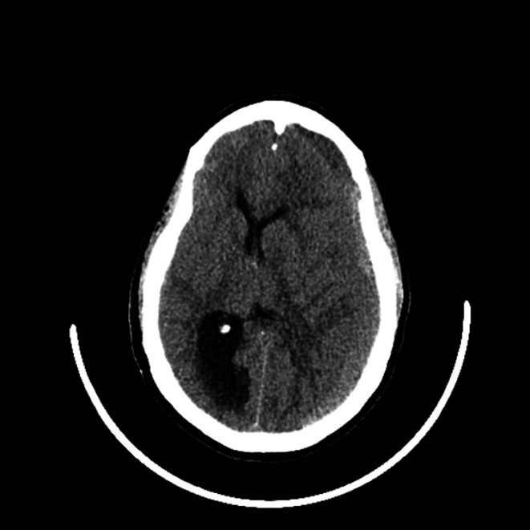
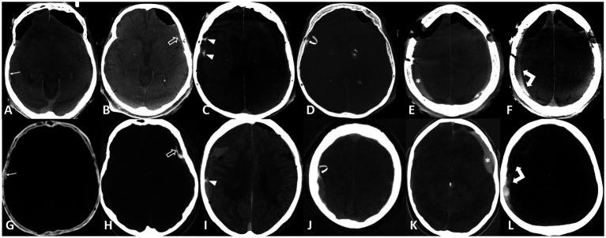
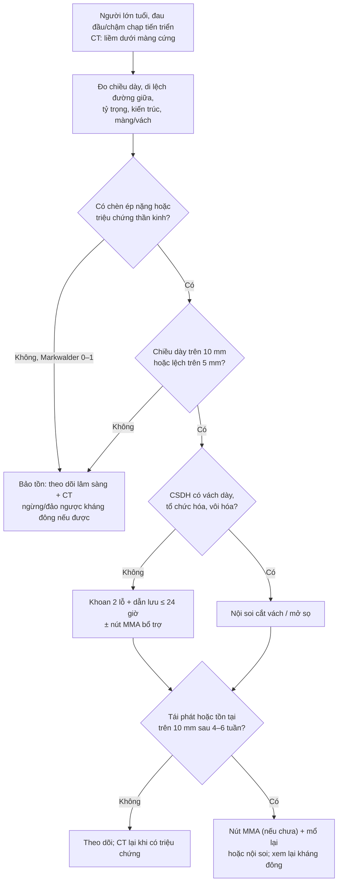
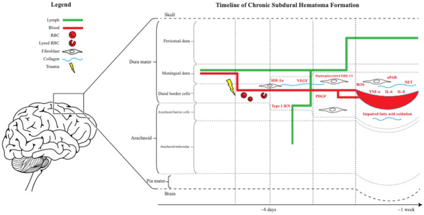
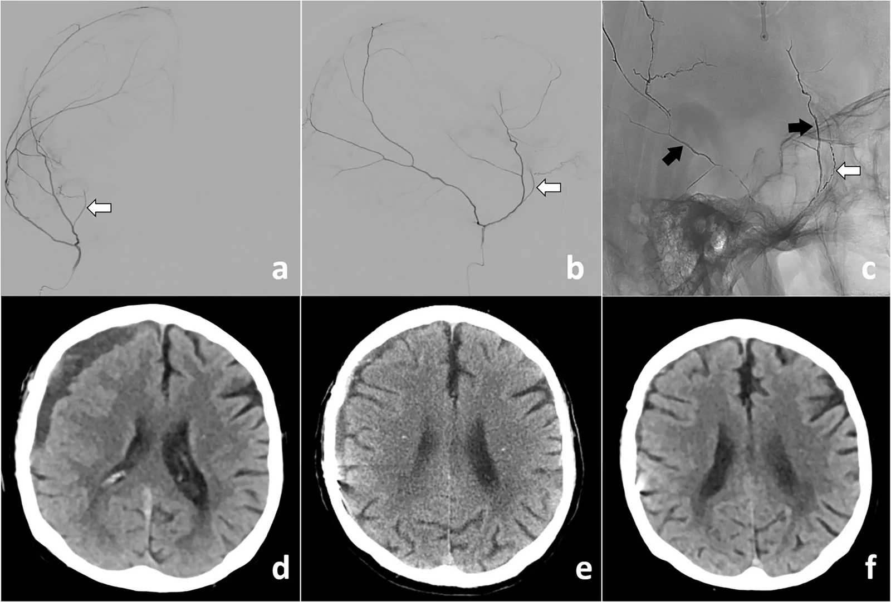

# 3030 — Tụ máu dưới màng cứng mạn tính (chronic subdural hematoma): màng ngoài/vách, giai đoạn tỷ trọng, ngưỡng mổ và nút động mạch màng não giữa

**Tags:** `pattern:tu-mau-duoi-mang-cung` `pattern:liem-ngoai-truc` `pattern:ty-trong-hon-hop` `pattern:di-lech-duong-giua` `vung:so-nao` `score:Markwalder` `score:midline-shift` `protocol:CT-so-nao` `protocol:DSA-MMA` `incidentaloma:tu-mau-man`
**Mức chắc chắn (certainty):** tổng hợp y văn (literature synthesis) — ghép **tổng quan cơ chế – sinh màng** (Ther Adv Neurol Disord 2026, PMC13053969), **đồng thuận Copenhagen 2024 của iCORIC/DACSUHS** (Acta Neurochir 2026, PMC13186905), **tổng quan chẩn đoán – điều trị** (J Clin Med 2026, PMC13258658), **tổng quan nút động mạch màng não giữa kèm 4 RCT 2024–2025** (Eur Radiol 2026, PMC13574904), **phân tích gộp nút mạch** (Front Surg 2026, PMC13541657) cùng các loạt bệnh nhân về **tỷ trọng máu tụ tồn dư**, **khoan xoắn ốc**, **nội soi** và **màng tăng ngấm thuốc**. Chỗ các nghiên cứu mâu thuẫn được ghi rõ tại chỗ, không chọn một con số có lợi.

> **Câu hỏi thực hành:** cụ 82 tuổi, **té nhẹ 6 tuần trước**, đau đầu tăng dần, đi lại chậm, lẫn nhẹ; đang dùng **apixaban** vì rung nhĩ. CT sọ không cản quang: **khối liềm dưới màng cứng bán cầu phải, dày 18 mm, tỷ trọng HỖN HỢP (phần trước giảm, phần sau tăng tỷ trọng), đẩy đường giữa 9 mm**. Câu hỏi: **đây là máu tụ cấp hay mạn, cần mổ chưa, mổ kiểu gì, có nên nút động mạch màng não giữa (MMA) không** — và với phim CT **7 tuần sau mổ** thấy còn **dải màng ngấm thuốc + ổ dịch 8 mm**, đó là **máu tụ tái phát hay màng trong còn lại**?
> Bài chốt theo **hai trục**: (1) **tỷ trọng × kiến trúc** trên CT để biết máu tụ đang ở giai đoạn nào và **nguy cơ tái phát**; (2) **màng nào đang sinh máu** — **màng ngoài (outer membrane)** là nguồn tái phát, **màng trong (inner membrane)** và **vách (septation)** chỉ là di chứng/bẫy dịch. Nối [212 – Xuất huyết sọ](../212-xuat-huyet-so-nao/lesson.md), [3025 – Đảo ngược kháng đông](../3025-dao-nguoc-khang-dong-xuat-huyet-noi-so/lesson.md), [3028 – Vá sọ sau mở sọ giảm áp](../3028-va-so-sau-mo-so-giam-ap/lesson.md), [201 – Protocol CT/MRI sọ não](../201-protocol-so-nao/lesson.md).

## 1. Tổng quan bệnh học – cơ chế hình ảnh: vì sao máu tụ "tự lớn" dù chấn thương đã qua

- **Nơi phát sinh:** lớp **tế bào bờ màng cứng (dural border cell layer — DBC)** nằm giữa màng cứng và màng nhện là **lớp yếu nhất, nghèo collagen nhất** của màng não; một cú va nhẹ (hoặc không có chấn thương rõ) **tách lớp này** tạo khoang tiềm tàng — **không phải chảy máu ồ ạt** (PMC13053969).
- **Trình tự sinh màng (mốc thời gian):**
  - **Ngày 0–3:** tách DBC, hồng cầu và fibrin lắng; **bạch cầu/đại thực bào** vào ổ máu tụ, **IL-6, IL-8** tăng → viêm tại chỗ.
  - **Khoảng 1 tuần:** **nguyên bào sợi** tổng hợp collagen (**TGF-β1/SMAD**), **VEGF, PDGF, uPAR** thúc đẩy tân mạch → hình thành **màng ngoài** (phía màng cứng, **giàu mạch, mạch thành mỏng, dễ rò**) và **màng trong** (phía màng nhện, **ít mạch, không phải động lực chính**).
  - **Sau 2–3 tuần:** màng ngoài trở thành **tissue sinh mạch tự nuôi** — mạch lớn phía ngoài, nhiều vi mạch phía lòng ổ → **tái chảy máu vi thể + rò huyết tương** liên tục; **fibrinolysis tại chỗ** (MMP-9, plasmin) làm máu không đông; **dẫn lưu bạch mạch màng não suy giảm** → ổ máu tụ **tự tăng thể tích** (PMC13053969).
  - Hệ quả: **máu tụ mạn không phải "cục máu cũ nằm yên"** mà là **một túi mô viêm sinh mạch** — đây là lý do **corticoid toàn thân không còn được dùng thường quy** và **nút động mạch nuôi màng** có thể làm tan máu tụ (PMC13258658).
- **TẠI SAO tỷ trọng CT thay đổi theo thời gian** (bắt buộc hiểu vật lý, không học vẹt):
  - **Tăng tỷ trọng (hyperdense):** hemoglobin còn nguyên trong hồng cầu đặc → **hấp thụ tia X mạnh**; máu tụ cấp **50–90 HU** ([212](../212-xuat-huyet-so-nao/lesson.md)).
  - **Giảm tỷ trọng (hypodense):** hồng cầu ly giải, **hemoglobin thoái giáng thành hemosiderin/ferritin** (không còn đậm độ cao) + dịch giàu protein nhưng **ít tế bào** + **phù/tăng nước** → **~19–23 HU** (đo trên **223 ca** sau mổ: 19,0 ± 9,1 HU ở nhóm không tái phát; 23,2 ± 13,1 HU ở nhóm tái phát — PMC13516401).
  - **Đẳng tỷ trọng (isodense):** đậm độ dịch **xấp xỉ nhu mô não** (vỏ xám ~35–40 HU, chất trắng ~25–30 HU) → **dấu hiệu gián tiếp** mới là chìa khóa: **bó chặt não, xóa rãnh, não thất bị ép, đường giữa lệch** (xem mục 5).
  - **Hỗn hợp (mixed):** **nhiều đợt chảy máu ở các tuổi khác nhau** — phần **giảm tỷ trọng** (dịch cũ) cạnh phần **tăng tỷ trọng** (máu mới), có thể có **mức dịch–dịch (fluid–fluid level)**; **hỗn hợp = dấu hiệu máu tụ đang hoạt động → nguy cơ tái phát cao** (PMC13258658, PMC13574904).
- **TẠI SAO màng ngấm thuốc:** màng ngoài là **mô hạt tân mạch** — mạch có lỗ thủng, **thoát thuốc cản quang**; trên CT có cản quang thấy **đường viền mỏng sát xương**; trên photon-counting CT/iodine map thấy rõ **màng ngoài, màng trong, vách, dấu "spandrel", ngấm trong lòng và mức dịch–dịch** (PMC12122510). Đây là cơ sở để **phân biệt màng còn lại với máu tụ tái phát** ở mục 5.
- **TẠI SAO trên MRI:** máu mạn → **methemoglobin ngoại bào + hemosiderin** → **T1 đồng/tăng nhẹ, T2 tăng** (dịch) với **viền tối hemosiderin** ở màng trong; **màng ngấm gadolinium**; **không hạn chế khuếch tán** (dịch ngoại bào) trừ khi có cục máu tổ chức/áp-xe. **MRI nhạy hơn CT** với máu tụ **đẳng tỷ trọng hai bên** và với **màng/vách** (PMC13258658 — bảng so sánh CT vs MRI).
- **Ngưỡng định lượng phải nhớ:**
  - **Tần suất:** **1,7–20,6/100.000 dân/năm**, tăng theo tuổi (PMC13053969).
  - **Tái phát sau mổ:** **10–20%** (PMC13574904); **20,2% (45/223)** trong loạt đo tỷ trọng tồn dư (PMC13516401); **14,9%** trong loạt 101 ca mổ 2 lỗ khoan (PMC13544649).
  - **Từ dịch dưới màng cứng (hygroma) tiến triển thành CSDH: ~25%** (PMC13258658).
  - **Thời gian "mạn":** tổn thương được gọi mạn khi **≥ 3 tuần** trên lâm sàng/CT (màng đã hình thành); **tổ chức hóa (organized)** khi có **vách dày, vôi hóa, nhiều thùy** — nhóm này **không đáp ứng mổ khoan đơn thuần** (PMC13339822).

## 2. Mẫu hình + chẩn đoán phân biệt theo vị trí và theo kiến trúc (gamut)

- **Mẫu hình cốt lõi:** người **> 65 tuổi**, **té nhẹ vài tuần trước** (hoặc không nhớ chấn thương), **đau đầu, chậm chạp, lẫn, yếu nửa người**, triệu chứng **tiến triển theo tuần**; CT có **liềm ngoài trục ôm bờ não, vượt đường khớp sọ, không vượt liềm đại não**.
- **Gamut theo tỷ trọng CT (5 thể — nhớ để đọc đúng "tuổi" máu):**
  1. **Giảm tỷ trọng đồng nhất** — CSDH "thuần" (dịch), nguy cơ tái phát thấp nhất.
  2. **Đẳng tỷ trọng** — CSDH 4–8 tuần, **dễ bỏ sót**, đặc biệt **hai bên**.
  3. **Tăng tỷ trọng** — máu tụ **cấp/bán cấp** hoặc **tái chảy máu trong CSDH** (không đồng nghĩa "máu tụ cấp đơn thuần").
  4. **Hỗn hợp** — nhiều đợt chảy máu, **mức dịch–dịch**, nguy cơ tái phát cao.
  5. **Hỗn hợp + vôi hóa/vách dày** — **CSDH tổ chức hóa**, cần **nội soi/mở sọ** hơn là khoan.
- **Gamut theo kiến trúc (mô hình tiến triển của Schievink, bảng trong PMC13258658):** **hygroma (dịch não tủy) → đồng nhất (homogeneous) → dạng phiến (laminar) → tách lớp (separated) → chuyển tiếp (gradation) → dạng lưới/xơ (trabecular)**. **Laminar/separated** có **mật độ mạch trong màng cao hơn → tái phát cao hơn**; **trabecular** xơ hóa dần → **ít chảy máu hơn**.
- **Gamut theo vị trí:**
  - **Lồi bán cầu (convexity)** — thể điển hình, hay gặp nhất.
  - **Liên bán cầu (interhemispheric/parafalcine)** — dễ nhầm với **máu tụ dưới nhện liềm** hoặc **u màng cứng liềm**; liềm dày **> 5 mm** đối xứng mới đáng ngờ.
  - **Lều tiểu não (tentorial)** và **hố sọ sau** — hiếm, **chèn ép thân não sớm với thể tích nhỏ**, triệu chứng nặng không tương xứng.
  - **Hai bên (bilateral) ~20–25%** — **lệch đường giữa có thể bằng 0** vì hai bên "bù trừ" → **bẫy bỏ sót**; yếu tố nguy cơ tái phát độc lập (PMC13574904, PMC13544649).
- **Gamut theo bối cảnh (quyết định xử trí):**
  - **Chống đông/kháng kết tập tiểu cầu** — tái phát cao hơn; **không phải chống chỉ định mổ**; thời điểm dùng lại bàn ở mục 4.
  - **Sau shunt não thất / mở sọ giảm áp** — **máu tụ dưới màng cứng do quá dẫn lưu** (hạ áp lực nội sọ), khác cơ chế CSDH tự phát; xử lý **van/shunt** trước hay song song.
  - **Teo não, nghiện rượu, động kinh, bệnh thận** — làm **khoang dưới màng cứng rộng ra**, máu tụ lớn hơn mới có triệu chứng.
  - **Nhi** — ngoài phạm vi bài này (khác sinh học, thường do **shunt/quá dẫn lưu** hoặc **ngược đãi**).
- **Gợi nhớ "CHRONIC" khi đọc CT:** **C**rescent (liềm) · **H**eterogeneous (hỗn hợp = đang chảy) · **R**ecurrence risk (tái phát theo kiến trúc) · **O**ld patient (người già, teo não) · **N**o midline shift needed (hai bên có thể không lệch) · **I**sodense trap (đẳng tỷ trọng) · **C**ontrast/membrane (màng ngấm thuốc).

## 3. Bảng so sánh phân biệt (ma trận đối chiếu)

| Thực thể (entity) | Hình ảnh điển hình | Chốt vào (rule-in) | Chốt loại (rule-out) | Gợi ý xác nhận |
|---|---|---|---|---|
| **CSDH (máu tụ mạn)** | **Liềm ngoài trục**, giảm/đẳng/hỗn hợp tỷ trọng, **ôm bờ não, vượt khớp sọ**, màng/vách; não bị bó chặt | **Triệu chứng tiến triển theo tuần ở người già + liềm + tỷ trọng thấp/hỗn hợp ≥ 3 tuần** | **Thấu kính hai mặt lồi, không vượt khớp** → ngoài màng cứng; **dịch đồng tỷ trọng dịch não tủy, không màng** → hygroma | CT không cản quang lát mỏng; **MRI T1/T2/FLAIR + T1+Gd** khi nghi đẳng tỷ trọng/hai bên |
| **SDH cấp (máu tụ dưới màng cứng cấp)** | **Tăng tỷ trọng đồng nhất 50–90 HU**, liềm, phù não, thường sau chấn thương mạnh | **Chấn thương trong vài giờ–3 ngày + tăng tỷ trọng đồng nhất** | **Giảm tỷ trọng + màng + triệu chứng tuần** → mạn | CT cấp; theo dõi 6 giờ nếu đang chảy |
| **Hygroma dưới màng cứng** | **Dịch đồng tỷ trọng dịch não tủy (~0–15 HU)**, không màng, không vách; thường sau **quá dẫn lưu/shunt** hoặc chấn thương nhẹ | **Đậm độ = dịch não tủy + không màng + bối cảnh hạ áp lực** | **Có màng ngấm thuốc, có vách, đậm độ > 15 HU** → CSDH | MRI (FLAIR tối, không ngấm màng); đo áp lực mở nếu nghi hạ áp lực |
| **Mủ màng cứng dưới màng cứng (subdural empyema)** | **Dịch dưới màng cứng có viền ngấm thuốc + hạn chế khuếch tán**, thường một bên, sốt | **Sốt + viêm xoang/tai + DWI hạn chế + màng ngấm dày** | **DWI không hạn chế + không sốt + đậm độ thấp đồng nhất** → CSDH | MRI DWI/ADC + T1+Gd; cấy máu; **không chọc dò mù** |
| **Nang màng nhện (arachnoid cyst)** | **Dịch đồng tỷ trọng dịch não tủy**, bờ nhẵn, **não bị đẩy nhưng không bó chặt**, **dày xương/vỏ sọ** tại chỗ | **Tín hiệu = dịch não tủy trên mọi chuỗi + không màng + vỏ xương mỏng/dày khu trú** | **Màng ngấm thuốc, mức dịch–dịch, bó não** → CSDH | MRI T2/FLAIR; CT xương; theo dõi nhiều năm |
| **Di căn màng cứng / viêm màng cứng (pachymeningitis)** | **Dày màng cứng dạng nốt hoặc lan tỏa, ngấm thuốc mạnh**, có thể nhiều ổ, phá xương | **Nốt ngấm thuốc + tiền sử ung thư/lao/sarcoid + phá xương** | **Màng mỏng đều + không phá xương + đậm độ dịch** → CSDH | MRI T1+Gd, CT xương, sinh thiết nếu nghi |
| **Máu tụ dưới màng cứng do quá dẫn lưu (shunt)** | **Dịch/hygroma hai bên + não thất nhỏ + não "xẹp"**, đau đầu thế đứng | **Có shunt/van + não thất xẹp + đau đầu tư thế** | **Máu tụ có màng, tỷ trọng hỗn hợp, không liên quan tư thế** → CSDH | MRI; kiểm tra van; **hạ áp lực mở** nếu chọc dò |
| **Máu tụ tồn dư sau mổ (residual)** | **Ổ dịch mỏng < 10 mm, không ngấm màng, giảm dần theo thời gian** | **Giảm thể tích trên 2 lần CT + không triệu chứng** | **Dày lên, tỷ trọng tăng, ngấm màng mới, triệu chứng tái phát** → tái phát | CT đối chiếu cùng mặt cắt; **MRI T1+Gd** phân biệt màng/máu |

*CT sọ không cản quang: **khối liềm ngoài trục bán cầu trái** (phải trên ảnh), **tỷ trọng hỗn hợp** — phần trước giảm tỷ trọng, phần sau còn tăng tỷ trọng; **bó chặt nhu mô, xóa rãnh, đẩy đường giữa sang phải**. Ổ máu tụ "toàn bán cầu" (holohemispheric) đè đẩy tới mức **thoát vị móc** trên phim gốc. Nguồn: Clin Case Rep 2026 (PMC13109044), Figure 1, CC BY 4.0. Không crop.*

### Đọc "màng" trên CT: màng ngoài, màng trong hay vách?

- **Trên CT không cản quang, màng gần như KHÔNG thấy** — chỉ thấy **viền tăng nhẹ sát xương** khi màng dày/vôi hóa. **Muốn đọc màng phải có cản quang** (CT thường, CT mạch hoặc **photon-counting CT/iodine map**) hay **MRI T1+Gd**.
- **Tần suất các thành phần ngấm thuốc** (105 ổ, đọc đồng thuận, PMC12122510): **màng ngoài 74%** · **màng trong 42%** · **vách 6,7%** · **dấu "spandrel" (vùng chuyển tiếp) 32%** · **ngấm trong lòng ổ 56%** · **mức dịch–dịch 42%**.
- **Ý nghĩa lâm sàng (điểm mấu chốt của bài):**
  - **Màng ngoài** = **nguồn tái phát** (mạch nuôi từ **động mạch màng não giữa**); đây là **đích của nút mạch**.
  - **Màng trong** = **di chứng**, thường **không phải nguồn tái phát**; thấy màng trong **không có nghĩa là phải mổ lại**.
  - **Vách (septation)** = **cản trở dẫn lưu dịch** → ổ dịch tồn tại lâu, **dễ nhầm là "tái phát"**, nhưng **vách không tự sinh máu**; **vách dày nhiều + tổ chức hóa** → cân nhắc **nội soi**.
  - **Ngấm trong lòng ổ + mức dịch–dịch** = **máu còn hoạt động** → **nguy cơ tồn tại/tiến triển cao hơn** (khoảng tin cậy Bayesian không chứa OR = 1) → **theo dõi sát và cân nhắc nút mạch** (PMC12122510).

*Hàng trên: CT xoay/thường; hàng dưới: **bản đồ iodine của photon-counting CT** trên cùng bệnh nhân. **(A,G)** màng ngoài (mũi tên); **(B,H)** màng trong (mũi tên rỗng); **(C,I)** vách (đầu mũi tên); **(D,J)** dấu "spandrel" vùng chuyển tiếp; **(E,K)** ngấm trong lòng ổ; **(F,L)** mức dịch–dịch. Nguồn: Front Neurol 2025 (PMC12122510), Figure 2, CC BY 4.0. Không crop.*

## 4. Protocol chụp + phân độ + chỉ định mổ và nút mạch

### 4.1 Protocol hình ảnh

- **CT sọ không cản quang, lát ≤ 5 mm (tốt nhất 1 mm), cửa sổ nhu mô + xương** — đo **chiều dày tối đa (mm)**, **di lệch đường giữa tại lỗ Monro (mm)**, **diện tích/ thể tích (ABC/2)**, **tỷ trọng (HU)**, **kiến trúc (đồng nhất/laminar/separated/trabecular)**, **vách/màng nhìn thấy**, **tổn thương não kèm theo**.
- **CT có cản quang hoặc photon-counting/iodine map** khi cần **đọc màng, vách, mức dịch–dịch** (đặc biệt trước khi quyết định nút mạch) (PMC12122510).
- **MRI sọ (T1, T2, FLAIR, DWI/ADC, T1+Gd, SWI nếu nghi chảy máu)** khi: **đẳng tỷ trọng hai bên**, nghi **mủ màng cứng**, nghi **di căn màng cứng**, hoặc **phân biệt màng với máu tụ tái phát** (PMC13258658).
- **DSA/CTA** khi lên kế hoạch **nút MMA**; **không cần CTA thường quy** cho CSDH đơn thuần.

### 4.2 Phân độ lâm sàng — Markwalder (0–4)

| Độ | Mô tả | Hướng xử trí điển hình |
|---|---|---|
| **0** | Thần kinh bình thường, không triệu chứng | **Theo dõi** (đa số tan tự nhiên) |
| **1** | Tỉnh, định hướng tốt; **đau đầu nhẹ**, không thiếu hụt hoặc chỉ **bất đối xứng phản xạ** | **Theo dõi ± điều trị nội khoa**; mổ nếu dày/lệch nhiều và tiến triển |
| **2** | **Lơ mơ/không định hướng**, thiếu hụt khu trú (liệt nửa người nhẹ) | **Mổ** (khoan + dẫn lưu) |
| **3** | **Sững sờ**, đáp ứng đúng với kích thích đau; **liệt nửa người nặng** | **Mổ cấp cứu** |
| **4** | **Hôn mê**, không đáp ứng vận động với đau; **duỗi/co cứng mất não** | **Mổ tối khẩn + hồi sức** |

*(Bảng 3 trong PMC13258658, sửa từ Markwalder và cộng sự.)*

- **Ngưỡng mổ kinh điển (đồng thuận Copenhagen 2024):** **chiều dày > 1 cm VÀ/HOẶC di lệch đường giữa > 5 mm** ở bệnh nhân **có triệu chứng/chèn ép đáng kể** → **mổ**; **triệu chứng nhẹ + chèn ép không đáng kể** → **điều trị bảo tồn, theo dõi, chuyển mổ khi nặng lên** (PMC13186905).
- **Tuổi cao KHÔNG phải chống chỉ định** — các nghiên cứu nhỏ không thấy tăng tử vong ở người > 90 tuổi; **quyết định theo chèn ép + triệu chứng**, không theo tuổi đơn thuần (PMC13186905).
- **Không có "ngưỡng tuyệt đối" cho tất cả:** một số loạt thấy **di lệch đường giữa > 5 mm** dự báo kết cục xấu (**aOR 1,11 mỗi mm**, PMC13286766), nhưng loạt 101 ca khác **không thấy chiều dày/lệch dự báo tái phát** (PMC13544649) → **dùng ngưỡng để quyết định mổ, không dùng để tiên đoán tái phát**.

### 4.3 Chọn kỹ thuật mổ (bảng so sánh có số)

| Kỹ thuật | Ưu điểm | Nhược điểm / số liệu | Khi nào chọn |
|---|---|---|---|
| **Khoan 2 lỗ + dẫn lưu (burr-hole craniostomy, BHC)** | Tiêu chuẩn vàng, ít xâm lấn, rửa được ổ máu tụ | **Tái phát 17,0%** trong nhóm ghép cặp (PMC13204861); vẫn là **lựa chọn đầu tay** | **CSDH đồng nhất/hỗn hợp, chưa tổ chức hóa**, Markwalder ≥ 2 |
| **Khoan xoắn ốc (twist drill craniostomy, TDC)** | Nhanh, làm tại giường | **68,5% (122/178) phải chuyển sang BHC**; **tái phát 42,6% vs 17,0%** (p = 0,012); tái phát sớm+muộn cần BHC **83,1%** | Chỉ khi **bệnh nhân quá nặng không lên phòng mổ**, ổ dịch loãng, không vách |
| **Nội soi (neuroendoscopy)** | **Thấy và cắt vách, cầm máu trực tiếp** | **Thời gian mổ dài hơn (117,67 vs 81,15 phút)**; **tái phát 2,22% (1/45) vs 15,38% (8/52)**; làm sạch **90,11% vs 74,79%** (PMC12819681) | **CSDH có vách (septated)**, tổ chức hóa, tái phát nhiều lần |
| **Mở sọ (craniotomy)** | Lấy được **màng dày, vôi hóa, cục máu tổ chức** | Biến chứng cao hơn, thời gian nằm viện dài | **CSDH tổ chức hóa/vôi hóa**, tái phát sau nội soi, chảy máu không cầm |
| **Dẫn lưu sau mổ** | **Giảm tái phát** | **Để ≤ 24 giờ**; **dưới màng cứng hoặc trên xương (subperiosteal)** đều được; **dưới màng cứng: nhiễm/đặt sai nhiều hơn**; **dưới xương: tái phát 8,3% vs 12,0%** (PMC13186905, PMC13204861) | **Mặc định sau BHC** |

- **Nhiệt độ dịch rửa 37 °C** làm giảm tái phát so với 22 °C (thử nghiệm Thụy Điển 541 ca, dẫn trong PMC13204861) — chi tiết kỹ thuật nhỏ nhưng miễn phí.

### 4.4 Nút động mạch màng não giữa (MMA embolization) — bằng chứng 2024–2025

| Thử nghiệm | n | Đối tượng | Kết cục chính | Kết quả |
|---|---|---|---|---|
| **EMBOLISE** (2024) | 400 | CSDH bán cấp/mạn **có chỉ định mổ** | Tái phát cần mổ lại **90 ngày** | **4,1% vs 11,3%**; biến cố nặng do nút mạch **~2%** |
| **MAGIC-MT** (2024) | 722 | CSDH có triệu chứng, có/không mổ | Tái phát/tiến triển **90 ngày** | **6,7% vs 9,9%** (không có ý nghĩa); **biến cố nặng/tử vong 6,7% vs 11,6%** (p = 0,02) |
| **STEM** (2025) | 310 | CSDH có triệu chứng, mổ **hoặc** theo dõi | Thất bại điều trị **180 ngày** (còn > 10 mm, mổ cứu, di chứng nặng) | **16% vs 36%**; **OR 0,36** (p = 0,001) |
| **EMPROTECT** (2025) | 342 | Sau mổ khoan, dự phòng tái phát | Tái phát **6 tháng** | **14,8% vs 21,0%**; **aOR 0,64 (0,36–1,14)** — **không có ý nghĩa**; hạt **300–500 µm** |

*(Bảng 1 và phần chú giải thử nghiệm trong PMC13574904; EMPROTECT dùng hạt lớn nên có thể không tới được mao mạch xa.)*

- **Phân tích gộp (12 nghiên cứu, 1.046 ca nút mạch vs 1.547 ca điều trị thường quy):** **tái phát 5,9% vs 15,4%**, **RR 0,43 (0,32–0,58)**; **thất bại điều trị RR 0,40 (0,18–0,87)**; **tử vong RR 0,98 (0,75–1,26)** — **không giảm tử vong** (PMC13541657).
- **Kết luận thực hành (trung thực với dữ liệu):** **nút MMA là chỉ định bổ trợ (adjunct) ở CSDH không cấp cứu, chọn lọc**, được **đồng thuận 2025 xếp loại I** cho nhóm này (PMC13574904), nhưng **không thay thế mổ ở bệnh nhân chèn ép nặng**, và **không phải "thuốc chữa tái phát"** — **EMPROTECT âm tính** cho thấy **kỹ thuật/loại hạt ảnh hưởng kết quả**.
- **Cơ chế:** màng ngoài được nuôi bởi **nhánh MMA**; nút mạch **cắt nguồn sinh mạch** → ổ máu tụ **ngừng tái chảy và tiêu dần**. Do đó **nút mạch hiệu quả khi màng còn hoạt động** (máu tụ mới, tỷ trọng hỗn hợp, ngấm màng), **kém khi ổ đã xơ hóa/tổ chức hóa**.

### 4.5 Theo dõi và dùng lại thuốc

- **CT sau mổ 24–72 giờ** để đánh giá **máu tụ tồn dư, khí nội sọ, chảy máu mới**; **không có đồng thuận về chụp thường quy ở bệnh nhân không triệu chứng** — **chụp theo triệu chứng** là hướng thực hành (PMC13258658, PMC13186905).
- **Tỷ trọng máu tụ tồn dư ≥ 19 HU** trên CT sau mổ → **tái phát cao hơn** (25,7% vs nhóm thấp), **OR 1,9 độc lập** (PMC13516401). Đây là **dấu hiệu rẻ tiền, có sẵn** — nên đo và ghi vào báo cáo.
- **Dùng lại kháng đông/kháng kết tập:** dữ liệu 2 thử nghiệm Đan Mạch cho thấy **dùng lại sau trung vị 8 ngày (kháng kết tập), 4 ngày (kháng vitamin K), 7 ngày (DOAC)** **không làm tăng tái phát** (PMC13186905) — nhưng quyết định vẫn **cá thể hóa theo nguy cơ huyết khối**.
- **Corticoid toàn thân không còn thường quy** — có thể **làm kết cục chức năng xấu hơn và tăng biến cố nặng**; chỉ cân nhắc chọn lọc (PMC13258658).

## 5. Biến thể bình thường và cạm bẫy

- **CSDH đẳng tỷ trọng HAI BÊN — bẫy số 1:** hai ổ "bù trừ" → **đường giữa gần như không lệch**, dễ đọc là "não teo bình thường". Dấu hiệu: **não thất bị khe hẹp, rãnh xóa, bờ não bị bó phẳng, tĩnh mạch vỏ não bị đẩy vào trong**; **MRI FLAIR** thấy rõ dịch ngoài trục.
- **Hygroma ≠ CSDH:** dịch **đồng tín hiệu dịch não tủy**, **không màng**; **~25% hygroma tiến triển thành CSDH** → **theo dõi, không mổ ngay** (PMC13258658).
- **Máu tụ tồn dư sau mổ KHÔNG phải tái phát:** ổ dịch **< 10 mm, giảm dần, không ngấm màng** là **bình thường**. **"Tái phát"** theo định nghĩa dùng trong các thử nghiệm là **máu tụ dày > 10 mm lại tăng lên hoặc cần mổ lại** (PMC13541657).
- **Màng trong còn lại sau mổ:** thấy **đường ngấm mỏng phía màng nhện** trên MRI/CT cản quang **không phải chỉ định mổ lại**; **màng ngoài ngấm mới/dày lên + ngấm trong lòng + mức dịch–dịch** mới là **dấu hiệu hoạt động** (PMC12122510).
- **Đo tỷ trọng sai:** đặt ROI **quá gần xương/giữa hai ổ** → **nhiễu thể tích một phần (partial volume)** làm tỷ trọng "tăng giả"; **đo ở 3 vị trí, tránh vùng vôi hóa, ghi HU trung bình**. Ngưỡng **19 HU** chỉ có ý nghĩa khi **đo đúng kỹ thuật**.
- **"Spandrel sign"** (ngấm vùng chuyển tiếp giữa màng và nhu mô) **không phải u** — đừng gọi nhầm là **di căn màng cứng** hay **meningioma**.
- **Khí nội sọ sau mổ** thường tự tiêu; **khí căng (tension pneumocephalus)** khi có **dấu núm vú (Mount Fuji sign)** + tri giác xấu → **mở da/dẫn lưu cấp**.
- **Sau nút MMA:** đau đầu thoáng qua, **thiếu máu cục bộ do bọt khí/thuyên tắc** hiếm; **phải chụp DSA xác nhận không có nối thần kinh–mạch** (nhánh **động mạch mắt/màng não giữa phụ**) trước khi bơm hạt/lỏng.
- **Bỏ sót tổn thương kèm theo (satisfaction of search):** đã thấy CSDH lớn thì **vẫn phải đọc hết**: **máu tụ dưới nhện chấn thương, dập não, gãy sọ, máu tụ ngoài màng cứng đối bên, tràn dịch não**.
- **CSDH ở bệnh nhân đang lọc máu/ECMO:** **nguy cơ chảy máu cao**, **mổ vẫn được** nhưng cần **phối hợp lọc máu không heparin** và **kiểm soát huyết áp**.

*Sơ đồ: **tách lớp tế bào bờ màng cứng (dural border cell layer)** sau chấn thương nhẹ → **viêm, tân mạch (VEGF/PDGF), nguyên bào sợi** → hình thành **màng ngoài và màng trong** trong **khoảng 1 tuần**, kèm **tái chảy máu vi thể**. Đây là lý do máu tụ **mạn** tiếp tục lớn dù không còn chấn thương. Nguồn: Ther Adv Neurol Disord 2026 (PMC13053969), Figure 2, CC BY-NC 4.0. Không crop.*

## 6. Tự lượng giá — Blind Quiz

**Ca 1 — Cụ 82 tuổi, té nhẹ 6 tuần trước, đau đầu và đi lại chậm. Nhìn CT, mô tả trước khi mở đáp án.**

- **Câu hỏi:** (a) Khối ngoài trục nằm ở khoang nào, vì sao? (b) Tỷ trọng nói gì về thời gian và hoạt động của máu tụ? (c) Có chỉ định mổ không, dựa trên ngưỡng nào?

<b>Bấm để hiện đáp án</b>

- (a) **Khoang dưới màng cứng**: khối **liềm ôm bờ não, vượt đường khớp sọ**, không vượt liềm đại não — khác **máu tụ ngoài màng cứng** (thấu kính, không vượt khớp).
- (b) **Tỷ trọng hỗn hợp**: phần **giảm tỷ trọng** = dịch máu cũ; phần **tăng tỷ trọng** = **đợt chảy máu mới** → CSDH **đang hoạt động**, **nguy cơ tái phát cao**. Đây không phải "máu tụ cấp đơn thuần" dù có phần tăng tỷ trọng.
- (c) **Có**: máu tụ **dày > 10 mm** (18 mm) **và lệch đường giữa > 5 mm** (9 mm) + **triệu chứng tiến triển** → **mổ khoan + dẫn lưu ≤ 24 giờ**; **cân nhắc nút MMA bổ trợ** (EMBOLISE: tái phát **4,1% vs 11,3%**). Cần **xử lý apixaban** theo nguy cơ huyết khối, không chờ INR.
- **Nguồn ảnh:** Clin Case Rep 2026 (PMC13109044), Figure 1 — CC BY 4.0.

**Ca 2 — Bệnh nhân CSDH sau mổ 6 tuần, CT còn ổ dịch 8 mm. Ảnh dưới là 6 kiểu ngấm thuốc trên cùng một ổ. Cái nào là "màng đang sinh máu"?**

- **Câu hỏi:** (a) Ghép A–F với màng ngoài, màng trong, vách, spandrel, ngấm trong lòng, mức dịch–dịch. (b) Thành phần nào **dự báo tái phát**? (c) Có nên mổ lại chỉ vì thấy màng trong?

<b>Bấm để hiện đáp án</b>

- (a) **A/G màng ngoài** (sát xương); **B/H màng trong** (phía màng nhện); **C/I vách**; **D/J spandrel** (vùng chuyển tiếp); **E/K ngấm trong lòng ổ**; **F/L mức dịch–dịch**.
- (b) **Ngấm trong lòng ổ (56%) và mức dịch–dịch (42%)** liên quan **tồn tại/tiến triển** (khoảng tin cậy Bayesian không chứa OR = 1). **Màng ngoài (74%)** là **nguồn sinh mạch** → **đích của nút MMA**.
- (c) **Không.** **Màng trong (42%)** là di chứng, **không phải nguồn tái phát**; chỉ mổ lại khi **máu tụ dày > 10 mm và tăng lên** hoặc **triệu chứng tái phát**, không dựa vào hình ảnh màng đơn thuần.
- **Nguồn ảnh:** Front Neurol 2025 (PMC12122510), Figure 2 — CC BY 4.0.

**Ca 3 — Nam 88 tuổi, CSDH phải tái phát sau mổ khoan. Xem DSA và chuỗi CT: nút mạch có hiệu quả không, và vì sao?**

- **Câu hỏi:** (a) Ảnh (a)–(c) đang làm gì, mũi tên chỉ gì? (b) So sánh (d), (e), (f) — có phải "máu tụ tan dần" không? (c) Vì sao nút mạch hiệu quả ở ca này nhưng **EMPROTECT lại âm tính**?

<b>Bấm để hiện đáp án</b>

- (a) **Chụp mạch số hóa xóa nền (DSA) chọn lọc động mạch màng não giữa**: (a) tư thế trước, (b) tư thế nghiêng — mũi tên chỉ **thân/nhánh MMA**; (c) ảnh không xóa cho thấy **khối vật liệu nút mạch (Onyx)** trong nhánh MMA.
- (b) (d) CT trước nút: **CSDH lồi phải tỷ trọng hỗn hợp**; (e) **3 tháng**: giảm rõ; (f) **7 tháng**: **gần như tan hoàn toàn** — đúng là **tan dần sau khi cắt nguồn mạch nuôi màng**.
- (c) Nút mạch hiệu quả khi **màng ngoài còn hoạt động và vật liệu tới được mao mạch xa**. **EMPROTECT dùng hạt 300–500 µm** → **có thể không tới được mao mạch màng**; **EMBOLISE/STEM/ MAGIC-MT dùng Onyx/Squid (chất lỏng)** → thấm sâu hơn. Bài học: **hiệu quả phụ thuộc kỹ thuật, không chỉ chỉ định**.
- **Nguồn ảnh:** Eur Radiol 2026 (PMC13574904), Fig. 1 — CC BY 4.0.

## Bài liên quan chéo
- [212 – Xuất huyết sọ: ICH/SAH/SDH/EDH & diễn tiến máu](../212-xuat-huyet-so-nao/lesson.md) (nền tảng liềm vs thấu kính, 5 giai đoạn hemoglobin)
- [3025 – Đảo ngược kháng đông trong xuất huyết nội sọ cấp](../3025-dao-nguoc-khang-dong-xuat-huyet-noi-so/lesson.md) (bệnh nhân CSDH đang dùng DOAC/warfarin)
- [3028 – Vá sọ sau mở sọ giảm áp](../3028-va-so-sau-mo-so-giam-ap/lesson.md) (máu tụ dưới màng cứng sau mở sọ/SSFS)
- [3026 – Tụt não nghịch lý sau chọc dò ở bệnh nhân có shunt](../3026-tut-nao-nghich-ly-sau-choc-do-shunt-mo-so/lesson.md) (hygroma do quá dẫn lưu)
- [201 – Protocol CT/MRI sọ não](../201-protocol-so-nao/lesson.md) (chọn chuỗi xung, đo đạc)
- [210 – Giải phẫu sọ não](../210-giai-phau-so-nao/lesson.md) (màng não, khoang ngoài trục)

## Ảnh
- `3030_tu-mau-hon-hop_CT_PMC13109044-F1.jpg` — CSDH tỷ trọng hỗn hợp, đè đẩy đường giữa, Clin Case Rep 2026 (PMC13109044), Figure 1, **CC BY 4.0**.
- `3030_mang-ngoai-vach-mang-trong_CT-PCT_PMC12122510-F2.jpg` — 6 kiểu ngấm thuốc của màng/vách (CT thường và iodine map), Front Neurol 2025 (PMC12122510), Figure 2, **CC BY 4.0**.
- `3030_sinh-mang-theo-thoi-gian_SoDo_PMC13053969-F2.jpg` — sơ đồ sinh màng theo thời gian, Ther Adv Neurol Disord 2026 (PMC13053969), Figure 2, **CC BY-NC 4.0**.
- `3030_mma-dsa-va-theo-doi_DSA-CT_PMC13574904-F1.webp` — DSA nút MMA + CT trước/3 tháng/7 tháng, Eur Radiol 2026 (PMC13574904), Fig. 1, **CC BY 4.0**.
- Nguồn + giấy phép từng ảnh: `images/CREDITS.md`. **Không tạo composite** vì mỗi ảnh đã là bảng nhiều ô so sánh (cắt/ghép sẽ làm mất nhãn mũi tên).

> Không dùng để chẩn đoán độc lập khi chưa có người hướng dẫn.
