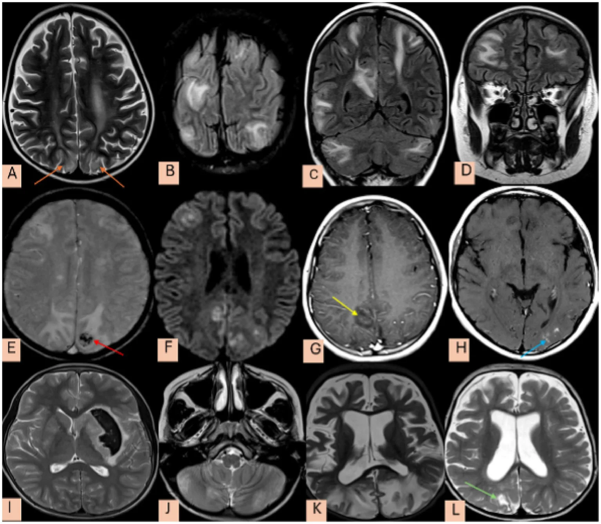
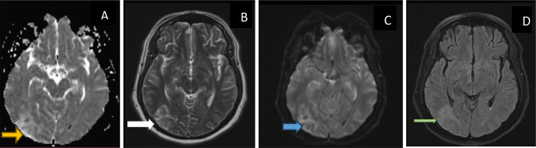
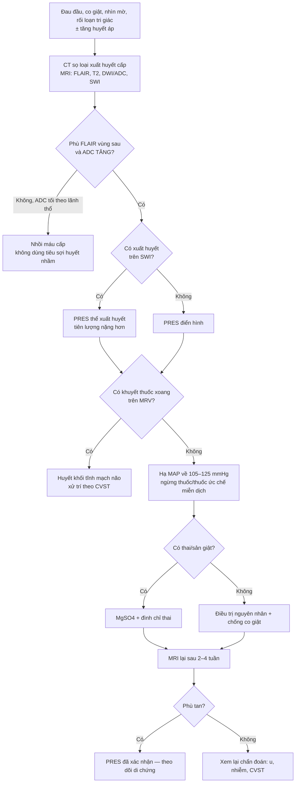
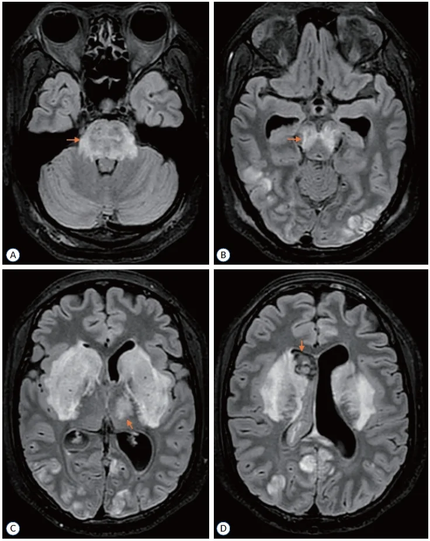

# 3031 — Bệnh não sau phục hồi (PRES): phù vận mạch vùng đỉnh–chẩm, thể trung tâm, xuất huyết và cạm bẫy "giả đột quỵ"

**Tags:** `pattern:phu-van-mach` `pattern:phu-dinh-cham` `pattern:phu-doi-xung` `pattern:xuat-huyet-nao` `vung:nao` `score:PRES-imaging` `protocol:MRI-so-nao` `protocol:MRV` `incidentaloma:xuat-huyet-vi-the`
**Mức chắc chắn (certainty):** tổng hợp y văn (literature synthesis) — ghép **tổng quan cơ chế – lâm sàng – xử trí** (Int J Emerg Med 2026, PMC12922249), **phân tích gộp xuất huyết trong PRES** (Ann Med Surg 2025, PMC12401445), **phân tích gộp thể trung tâm** (Neurol Int 2025, PMC12298113), **loạt 60 ca người lớn** (Sci Rep 2026, PMC12946175), **loạt 77 trẻ** (Front Neurol 2026, PMC13613123) và **3 ca có ảnh MRI** (PMC13396603, PMC13220548, PMC13549776). Số liệu **mâu thuẫn giữa các nguồn** (tử vong, tỷ lệ hồi phục) được ghi cả hai phía tại chỗ.

> **Câu hỏi thực hành:** nữ 28 tuổi, **thai 35 tuần**, nhập viện vì **đau đầu dữ dội, nhìn mờ, co giật toàn thể**, huyết áp **180/110 mmHg**, protein niệu +++; CT sọ không cản quang bình thường. MRI: **tăng tín hiệu FLAIR đối xứng hai bên vùng đỉnh–chẩm, không hạn chế khuếch tán**. Câu hỏi: **đây là PRES hay nhồi máu vùng sau, có xuất huyết kèm theo không, hạ áp đến đâu, và vì sao "reversible" không có nghĩa là lành hoàn toàn**?
> Bài chốt theo **hai trục**: (1) **chuỗi xung quyết định bản chất nước** — **FLAIR sáng + ADC TĂNG = phù vận mạch (PRES)**; **DWI sáng + ADC TỐI = phù độc tế bào (nhồi máu)**; **SWI = xuất huyết**; (2) **phân bố** — **đỉnh–chẩm đối xứng** là điển hình, **thân não/hạch nền/tủy** là **thể trung tâm (13%)** dễ bỏ sót. Nối [3029 – ARIA-E/ARIA-H](../3029-aria-khang-the-khang-amyloid/lesson.md), [3027 – Xuất huyết thùy do CAA](../3027-xuat-huyet-thuy-caa-nguoi-gia/lesson.md), [229 – PACNS vs RCVS](../229-pacns-vs-rcvs/lesson.md), [216 – Huyết khối tĩnh mạch não](../216-di-dang-mach-CVST/lesson.md), [201 – Protocol CT/MRI sọ não](../201-protocol-so-nao/lesson.md).

## 1. Tổng quan bệnh học – cơ chế hình ảnh: vì sao là NƯỚC, vì sao ở VÙNG SAU, vì sao có thể chảy máu

- **Hai cơ chế hội tụ (không phải một):**
  1. **Suy tự điều hòa (autoregulatory failure):** huyết áp tăng vượt khả năng co tiểu động mạch → **giãn mạch, tăng áp lực mao mạch** → **dịch huyết tương thoát vào mô**.
  2. **Tổn thương nội mô (endothelial injury):** thuốc ức chế miễn dịch (tacrolimus, cyclosporine), độc chất, nhiễm trùng, tự miễn, sản giật → **giải phóng yếu tố viêm, phá hàng rào máu–não**.
  - Hệ quả chung: **phù vận mạch (vasogenic edema)** — **nước ở khoang ngoại bào**, không phải phù tế bào (PMC12922249).
- **TẠI SAO vùng sau (đỉnh–chẩm) hay bị nhất:** **vòng tuần hoàn sau có phân bố thần kinh giao cảm thưa hơn** → **khả năng tự điều hòa kém hơn** khi huyết áp tăng vọt; cộng với **chất trắng dưới vỏ** là nơi mạch máu dễ rò nhất → **phù đối xứng hai bên vùng đỉnh–chẩm** (PMC12922249).
- **TẠI SAO FLAIR sáng:** nước tự do ngoại bào làm **kéo dài T2** → tăng tín hiệu T2/FLAIR; **ADC TĂNG** (nước khuếch tán tự do) — **đây là chốt phân biệt với nhồi máu**.
- **TẠI SAO có thể xuất huyết:** tổn thương nội mô mao mạch đủ nặng → **hồng cầu thoát mạch** → **vi chảy máu vỏ/dưới vỏ** (SWI mất tín hiệu), **xuất huyết nhu mô**, hoặc **xuất huyết dưới nhện vùng lồi**; **xuất huyết không loại trừ PRES** (PMC12401445).
- **TẠI SAO "reversible" là tên gọi dễ gây nhầm:** phần lớn phù tan trong **1–2 tuần**, nhưng **tổn thương đã xảy ra thì không hồi phục**: **~17% có xuất huyết**, một phần có **nhồi máu/hoại tử vỏ não**, và **10–20% còn di chứng** (PMC12922249).
- **Ngưỡng định lượng phải nhớ:**
  - **Tần suất:** **0,04% trẻ nói chung**, **0,4% trẻ nhập ICU**; **0,69% bệnh nhân lupus**; **~0,03% các đợt nhập viện người lớn** (PMC12922249).
  - **Tăng huyết áp lúc đến:** **~84%** trong tổng quan (PMC12922249); **> 90%** trong gộp ca xuất huyết (PMC12401445); **55%** trong loạt 60 ca Colombia (PMC12946175) — **nghĩa là 16–45% KHÔNG có tăng huyết áp rõ**.
  - **Triệu chứng:** **co giật 60–90%** (trẻ **77,9%**), đau đầu, nhìn mờ, rối loạn tri giác (PMC12922249, PMC13613123).
  - **Tử vong:** **10–19%** trong tổng quan (PMC12922249); **12,7%** trong nhóm **PRES có xuất huyết** (PMC12401445); loạt Colombia **tử vong tại viện tới ~6%** — **khác nhau do chọn bệnh**, ghi cả hai.
  - **Hồi phục:** **75–90% hồi phục hoàn toàn trong ~1 tuần**, **10–20% di chứng** (PMC12922249); **40–44%** có di chứng thần kinh/hình ảnh tồn tại trong các loạt nặng.
  - **Tái phát:** **~4%**, gắn với **yếu tố khởi phát còn tồn tại** (cơn tăng huyết áp, lupus bùng phát, suy thận, bệnh hồng cầu hình liềm) (PMC12922249).
  - **Động kinh dài hạn:** chỉ **1–3,9%** — **không cần kháng động kinh kéo dài** cho mọi bệnh nhân (PMC12922249).

## 2. Mẫu hình + chẩn đoán phân biệt theo vị trí (gamut)

- **Mẫu hình cốt lõi:** **đau đầu + co giật + nhìn mờ + rối loạn tri giác**, khởi phát **cấp/trong vài ngày**, kèm **tăng huyết áp** hoặc **yếu tố khởi phát** (sản giật, thuốc ức chế miễn dịch, suy thận, tự miễn, nhiễm trùng, truyền máu).
- **Gamut theo vị trí — 4 kiểu hình:**
  1. **Đỉnh–chẩm hai bên (parieto-occipital, ~33% trong loạt Colombia)** — điển hình, **đối xứng**, chất trắng dưới vỏ, **vỏ thường còn** (cortical sparing).
  2. **Thùy trán/đỉnh đơn độc hoặc không đối xứng** — dễ nhầm u/viêm; **thùy trán hay gặp ở trẻ** (PMC12922249).
  3. **Thể trung tâm (central variant PRES, cvPRES) — 13% (95% CI 9–18%)**: **thân não 88%** (cầu **70,45%**), **hạch nền/đồi thị**, **tiểu não**, **tủy sống 18%**; **tăng huyết áp 72%**, **tử vong chỉ 2%** (PMC12298113).
  4. **Thể xuất huyết (hemorrhagic PRES) — ~17%**: **xuất huyết nhu mô 77,7%**, **dưới nhện 15,8%**, **vi chảy máu 6,3%**; **tử vong 12,7%** (PMC12401445).
- **Gamut theo bối cảnh (tìm nguyên nhân trước khi gọi "tự phát"):**
  - **Sản khoa:** **sản giật/tiền sản giật** (thai > 20 tuần đến 6 tuần sau sinh).
  - **Thuốc:** **tacrolimus, cyclosporine, sirolimus** (ghép tạng/tủy), hóa trị, **ức chế điểm kiểm soát miễn dịch**, erythropoietin, IVIG.
  - **Thận:** **suy thận cấp/mạn, lọc máu, hội chứng urê huyết tán huyết (TTP/HUS)**.
  - **Tự miễn:** **lupus (0,69%)**, xơ cứng bì, viêm mạch.
  - **Khác:** **nhiễm trùng/huyết khối nhiễm khuẩn, truyền máu khối lượng lớn, thiếu máu nặng, cường cận giáp, ngộ độc rượu/cocaine**.
- **Gamut theo hình thái phù (giúp nhớ DDx):**
  - **Đối xứng, vùng sau, không choán chỗ** → **PRES**.
  - **Một bên, có choán chỗ, phù lan rộng** → **u thần kinh đệm/nhiễm trùng**.
  - **Theo lãnh thổ mạch, hạn chế khuếch tán** → **nhồi máu**.
  - **Phù + huyết khối xoang trên MRV** → **huyết khối tĩnh mạch não**, không phải PRES (dù có thể chồng lấp).
  - **Phù + vi chảy máu thùy + cSS ở người già** → **CAA-ri/ABRA**, không phải PRES.
- **Gợi nhớ "PRES" khi đọc MRI:** **P**osterior (vùng sau) · **R**eversible (phù vận mạch, ADC tăng) · **E**dema (FLAIR sáng) · **S**paring cortex (vỏ còn, phù ở chất trắng dưới vỏ).

*MRI FLAIR lát trục: **tăng tín hiệu đối xứng hai bên vùng đỉnh–chẩm**, lan theo **vỏ và chất trắng dưới vỏ** (mũi tên đỏ), điển hình của **phù vận mạch trong PRES**. Bệnh nhân sản giật, kèm **nhồi máu cầu** (ảnh khác trong cùng ca) — cho thấy PRES **có thể không "lành" hoàn toàn**. Nguồn: Radiol Case Rep 2026 (PMC13396603), Fig. 1, CC BY-NC-ND 4.0. Nguyên bản, không crop.*

*Loạt 77 trẻ PRES: **(A,B)** T2/FLAIR tăng tín hiệu **đỉnh–chẩm hai bên** (mũi tên cam); **(C)** T2 thân não/cerebellum; **(D)** FLAIR vành; **(E)** **vi chảy máu vỏ** (mũi tên đỏ, T2*); **(F)** **hạn chế khuếch tán** (DWI sáng) ở vùng đỉnh phải; **(G,H)** ngấm thuốc màng não/vỏ não; **(I–L)** di chứng **teo não, giãn não thất, tổn thương muộn**. Nguồn: Front Neurol 2026 (PMC13613123), Figure 4, CC BY 4.0. Không crop.*

## 3. Bảng so sánh phân biệt (ma trận đối chiếu)

| Thực thể (entity) | Hình ảnh điển hình | Chốt vào (rule-in) | Chốt loại (rule-out) | Gợi ý xác nhận |
|---|---|---|---|---|
| **PRES điển hình** | **Tăng FLAIR/T2 đối xứng vùng đỉnh–chẩm**, chất trắng dưới vỏ, **vỏ còn**, **ADC tăng**, **không hạn chế khuếch tán**, ít choán chỗ | **Bối cảnh tăng huyết áp/sản giật/thuốc + phù đối xứng vùng sau + ADC tăng** | **DWI hạn chế + ADC tối theo lãnh thổ mạch** → nhồi máu; **choán chỗ, phù một bên** → u | MRI **FLAIR + DWI/ADC + SWI**; theo dõi tan sau 1–2 tuần |
| **PRES thể trung tâm (cvPRES)** | **Tăng T2/FLAIR thân não (cầu 70%), hạch nền, đồi thị, tiểu não**, ít/không tổn thương vỏ | **Phù trung tâm + tăng huyết áp + không theo lãnh thổ mạch** | **Tổn thương đối xứng hạch nền do ngộ độc/thiếu máu** khác bối cảnh; **nhồi máu cầu** có DWI hạn chế | MRI toàn bộ trục (không chỉ lát đỉnh); **13%** PRES là thể này |
| **PRES xuất huyết** | **Ổ máu tụ nhỏ/nhu mô, SAH vùng lồi, vi chảy máu trên SWI** trong vùng phù | **SWI mất tín hiệu trong vùng phù FLAIR** | **Xuất huyết đơn độc không phù** → CAA/ICH; **máu trong u** → u | **SWI/T2\*** bắt buộc; CT cấp nếu tri giác xấu |
| **ARIA-E (kháng thể kháng amyloid)** | **Phù/tràn dịch rãnh** vùng sau, **ADC không giảm**, bệnh nhân **đang dùng lecanemab/donanemab** | **Cửa sổ 2–6 tháng sau liều kháng amyloid + phù mới + không tăng HA** | **Bối cảnh sản giật/thuốc ức chế miễn dịch/tăng HA** → PRES | MRI FLAIR/SWI/DWI; ngừng thuốc theo phác đồ (bài 3029) |
| **CAA-ri / ABRA** | **Phù không đối xứng, nhiều ổ**, kèm **vi chảy máu thùy + siderosis vỏ** (SWI), người **> 50 tuổi** | **Phù + dấu hiệu CAA (Boston 2.0) + không có yếu tố khởi phát PRES** | **Phù đối xứng vùng sau + tăng HA** → PRES | MRI SWI + T2/FLAIR; đáp ứng corticoid; bài 3027 |
| **Nhồi máu vùng sau (PCA/vertebrobasilar)** | **Theo lãnh thổ mạch**, **DWI hạn chế + ADC tối**, có thể tắc mạch lớn | **DWI/ADC hạn chế + theo lãnh thổ + thiếu hụt khu trú tương ứng** | **ADC tăng + phù lan ngoài lãnh thổ** → PRES | DWI/ADC, MRA/CTA; **không dùng tiêu sợi huyết nếu là PRES** |
| **Huyết khối tĩnh mạch não (CVST)** | **Phù hai bên/không đối xứng, có thể xuất huyết**, xoang tăng tín hiệu trên T1/T2, **khuyết thuốc trên MRV/CTV** | **Khuyết thuốc xoang + D-dimer + đau đầu tăng dần** | **MRV bình thường + phù đối xứng điển hình** → PRES | **MRV/CTV bắt buộc** ở PRES có xuất huyết/không điển hình (bài 216) |
| **Viêm não do HSV** | **Thùy thái dương/đảo, một hoặc hai bên, hạn chế khuếch tán**, có xuất huyết | **Sốt + co giật + thái dương + DWI hạn chế** | **Đỉnh–chẩm, ADC tăng, không sốt** → PRES | MRI + PCR HSV dịch não tủy; **không chờ kết quả mới dùng acyclovir** |
| **U thần kinh đệm thâm nhiễm** | **Phù một bên, choán chỗ, không theo mạch**, có thể ngấm thuốc | **Choán chỗ + phù tiến triển + ngấm thuốc** | **Đối xứng, không choán chỗ, tan nhanh** → PRES | MRI T1+Gd; theo dõi 2–4 tuần (u không tan) |

*(A) **ADC: tăng tín hiệu** (mũi tên vàng) ở vùng chẩm trái → **phù vận mạch**, không phải nhồi máu. (B) T2: tăng tín hiệu vỏ/dưới vỏ chẩm trái (mũi tên trắng). (C) DWI không sáng tương ứng. (D) FLAIR: tăng nhẹ (mũi tên xanh). Bệnh nhân này còn **xuất huyết não thất** — PRES **có thể xuất huyết**. Nguồn: Int J Emerg Med 2026 (PMC13220548), Fig. 3, CC BY 4.0. Không crop.*

## 4. Protocol chụp + xử trí theo bậc + theo dõi

### 4.1 Protocol hình ảnh

- **MRI sọ là chuẩn** (CT chỉ để loại xuất huyết cấp/khi bệnh nhân không hợp tác): **FLAIR + T2 + DWI/ADC + SWI/T2\* + T1±Gd**; thêm **MRA/MRV** khi: xuất huyết, không điển hình, hoặc nghi huyết khối xoang (PMC12922249).
- **Bắt buộc có ADC** — **không chẩn đoán "phù" chỉ bằng DWI** (T2 shine-through dễ đọc nhầm là hạn chế khuếch tán).
- **Bắt buộc có SWI/T2\*** — **17% PRES có xuất huyết**, và **vi chảy máu đổi tiên lượng** (PMC12401445).
- **Chụp toàn bộ trục não** (kể cả **cầu, hành não, tiểu não**) vì **13% là thể trung tâm**, dễ bỏ sót nếu chỉ chụp 4–5 lát đỉnh.
- **Chụp lại 2–4 tuần** (hoặc sớm hơn nếu xấu đi) để xác nhận **tính "phục hồi"**: phù tan = PRES; **tổn thương còn/ngấm thuốc/teo** = đã có nhồi máu hoặc bệnh khác.
- **Ghi báo cáo theo 4 mục:** (1) **vị trí + đối xứng**; (2) **FLAIR/ADC** (vận mạch vs độc tế bào); (3) **SWI** (xuất huyết/vi chảy máu); (4) **có/không choán chỗ** — đây là 4 câu quyết định chẩn đoán.

### 4.2 Xử trí — hạ áp lực "vừa phải", không "hạ thật nhanh"

- **Mục tiêu huyết áp:** giảm **từ từ**, nhắm **huyết áp động mạch trung bình (MAP) 105–125 mmHg**; tránh **tụt áp nhanh** vì có thể gây **thiếu máu não** (PMC12922249).
- **Tăng huyết áp ác tính:** giảm **huyết áp tâm trương về 100–105 mmHg trong vài giờ** (PMC12922249).
- **Sản giật/tiền sản giật:** **magie sulfat** phòng co giật + **đình chỉ thai** là điều trị nguyên nhân; **không chờ MRI mới xử trí**.
- **Thuốc ức chế miễn dịch:** **ngừng/đổi thuốc** (tacrolimus/cyclosporine) sau khi hội chẩn ghép; **không tự ngừng** ở bệnh nhân ghép mới.
- **Co giật:** **levetiracetam** hoặc thuốc theo phác đồ; **không duy trì kháng động kinh dài hạn** trừ khi động kinh thực sự (**1–3,9%**) (PMC12922249).
- **Hỗ trợ:** **~70% cần ICU**, **35–40% cần thở máy tạm thời** (PMC12922249); kiểm soát **đường huyết, điện giải, thận**.
- **Corticoid:** **không có bằng chứng thuyết phục** trong PRES nói chung; **không dùng thay cho kiểm soát huyết áp/ngừng thuốc** (PMC12922249).

### 4.3 Tiên lượng và theo dõi dài hạn

- **Hồi phục lâm sàng nhanh** (giờ–ngày) sau khi kiểm soát huyết áp/nguyên nhân là **đặc trưng**, nhưng **hình ảnh có thể chậm hơn** (1–2 tuần).
- **Di chứng cần tầm soát:** **động kinh muộn (1–3,9%)**, **suy giảm nhận thức**, **khiếm thị vỏ não**, **teo não khu trú** — nhất là thể **xuất huyết/nhồi máu**.
- **Tái phát ~4%** — **kiểm soát huyết áp lâu dài** và **tránh dùng lại thuốc khởi phát** là cách phòng chính.
- **Phụ nữ sau PRES sản khoa:** tư vấn **nguy cơ tái phát ở thai kỳ sau**, theo dõi huyết áp và protein niệu sớm.

## 5. Biến thể bình thường và cạm bẫy

- **PRES một bên/không đối xứng** — có thật, dễ nhầm u hoặc nhồi máu; **không choán chỗ + ADC tăng + bối cảnh điển hình** giúp phân biệt; **chụp lại 2–4 tuần** là "nghiệm pháp thời gian".
- **PRES KHÔNG có tăng huyết áp** — **16–45%** tùy loạt (84% có HA trong tổng quan; 55% trong loạt Colombia) → **đừng loại PRES chỉ vì huyết áp bình thường**, nhất là **sản giật, lupus, thuốc ức chế miễn dịch, nhiễm trùng**.
- **"T2 sáng = nhồi máu"** — sai: **phải xem ADC**. **DWI sáng + ADC tăng = T2 shine-through** (không phải hạn chế khuếch tán thật).
- **"Reversible" không có nghĩa là không để lại gì:** **~17% xuất huyết**, một phần **nhồi máu/hoại tử vỏ**, **10–20% di chứng**, **tử vong 10–19%** ở các loạt nặng → **không được xem là "lành tính"**.
- **Vỏ não "còn" (cortical sparing)** là dấu hiệu kinh điển, nhưng **thể nặng có thể mất vỏ** — **không dùng để loại PRES**.
- **PRES + xuất huyết não thất** (thể trung tâm) — **dễ nhầm xuất huyết não thất do tăng huyết áp đơn thuần**; nhìn **phù FLAIR đối xứng cầu/hạch nền** và **bối cảnh sản giật/thuốc**.
- **PRES và RCVS chồng lấp:** co thắt mạch có thể thấy trên MRA; **không gọi RCVS chỉ vì MRA có co thắt** khi bối cảnh là PRES — **theo dõi và chụp lại**.
- **Bỏ sót tổn thương kèm theo:** **nhồi máu cầu**, **huyết khối xoang**, **xuất huyết dưới nhện** — luôn đọc **DWI + SWI + MRV** cùng lúc.
- **Thuốc ức chế miễn dịch (tacrolimus):** **nồng độ thuốc trong "khoảng trị liệu" vẫn có thể gây PRES** → **không loại trừ vì nồng độ bình thường**; ngừng/đổi thuốc theo hội chẩn.

*MRI FLAIR: **(A)** phù đối xứng **cầu** (mũi tên cam); **(B)** phù **trung não** và vùng sau; **(C)** phù **hạch nền hai bên**; **(D)** phù đồi thị + **xuất huyết não thất** (mũi tên cam) — thể trung tâm của PRES, **không điển hình vùng đỉnh–chẩm**. Nguồn: J Korean Neurosurg Soc 2026 (PMC13549776), Fig. 2, CC BY-NC 4.0. Không crop.*

## 6. Tự lượng giá — Blind Quiz

**Ca 1 — Nữ 26 tuổi, sản giật sau sinh, đau đầu và nhìn mờ. Nhìn FLAIR, mô tả trước khi mở đáp án.**

- **Câu hỏi:** (a) Tổn thương ở đâu, đối xứng hay không? (b) Chuỗi xung nào cần thêm để chắc đây là **phù vận mạch**? (c) Có cần loại trừ huyết khối xoang không?

<b>Bấm để hiện đáp án</b>

- (a) **Tăng tín hiệu FLAIR đối xứng hai bên vùng đỉnh–chẩm**, lan **vỏ + chất trắng dưới vỏ**, **không choán chỗ** → điển hình PRES.
- (b) **DWI + ADC**: **ADC tăng** (không hạn chế khuếch tán) xác nhận **phù vận mạch**; **SWI** để tìm **xuất huyết/vi chảy máu**.
- (c) **Có** — nhất là khi có xuất huyết hoặc không điển hình: **MRV/CTV** loại **huyết khối tĩnh mạch não** (phù + xuất huyết có thể giống PRES).
- **Nguồn ảnh:** Radiol Case Rep 2026 (PMC13396603), Fig. 1 — CC BY-NC-ND 4.0.

**Ca 2 — Bệnh nhân tăng huyết áp, co giật, liệt nhẹ nửa người. Bốn ô MRI: ô nào chứng minh đây KHÔNG phải nhồi máu?**

- **Câu hỏi:** (a) Ô A (ADC) nói gì? (b) Vì sao DWI không sáng lại quan trọng? (c) Có gì bất thường ngoài phù?

<b>Bấm để hiện đáp án</b>

- (a) **ADC TĂNG tín hiệu** ở vùng chẩm trái (mũi tên vàng) = **nước tự do ngoại bào** → **phù vận mạch**, không phải phù độc tế bào.
- (b) **DWI không hạn chế khuếch tán** (không sáng) loại **nhồi máu cấp**; nếu DWI sáng + ADC tối mới là nhồi máu.
- (c) Bệnh nhân có **xuất huyết não thất** (ảnh CT trong bài gốc) → **PRES thể xuất huyết**, tiên lượng nặng hơn; cần **SWI** và **MRV**.
- **Nguồn ảnh:** Int J Emerg Med 2026 (PMC13220548), Fig. 3 — CC BY 4.0.

**Ca 3 — Sản phụ sản giật, hôn mê, CT có máu trong não thất. Nhìn FLAIR: tổn thương không ở đỉnh–chẩm. Chẩn đoán?**

- **Câu hỏi:** (a) Vị trí phù? (b) Vì sao dễ bỏ sót nếu chỉ chụp vài lát đỉnh? (c) Hướng xử trí và theo dõi?

<b>Bấm để hiện đáp án</b>

- (a) **Cầu (A), trung não (B), hạch nền (C), đồi thị (D)** — **thể trung tâm (cvPRES)**, chiếm **13%** PRES; **thân não 88%**, **cầu 70,45%**.
- (b) Vì tổn thương nằm **dưới lều**, ngoài vùng đỉnh–chẩm điển hình → **phải chụp toàn bộ trục** (cầu→hành não→tiểu não) mới thấy.
- (c) **Kiểm soát huyết áp từ từ (MAP 105–125)**, **MgSO4 + đình chỉ thai** nếu sản giật, **theo dõi xuất huyết não thất**, **MRI lại 2–4 tuần**; thể trung tâm có **tử vong thấp (~2%)** nhưng vẫn có thể để lại di chứng.
- **Nguồn ảnh:** J Korean Neurosurg Soc 2026 (PMC13549776), Fig. 2 — CC BY-NC 4.0.

## Bài liên quan chéo
- [3029 – ARIA khi dùng kháng thể kháng amyloid: ARIA-E vs ARIA-H](../3029-aria-khang-the-khang-amyloid/lesson.md) (PRES là hàng DDx bắt buộc của ARIA-E)
- [3027 – Xuất huyết thùy do CAA ở người già](../3027-xuat-huyet-thuy-caa-nguoi-gia/lesson.md) (phù + vi chảy máu thùy ở người già)
- [229 – PACNS vs RCVS](../229-pacns-vs-rcvs/lesson.md) (co thắt mạch, phù và xuất huyết vùng lồi)
- [216 – Huyết khối tĩnh mạch não (CVST)](../216-di-dang-mach-CVST/lesson.md) (phù hai bên + xuất huyết — phải loại trừ bằng MRV)
- [201 – Protocol CT/MRI sọ não](../201-protocol-so-nao/lesson.md) (chọn chuỗi xung, DWI/ADC, SWI)
- [211 – Đột quỵ não](../211-dot-quy-nao/lesson.md) (phân biệt phù vận mạch với nhồi máu cấp)
- [218 – Thoát vị não & não úng thủy](../218-thoat-vi-nao-ung-thuy/lesson.md) (khi PRES nặng gây phù lan tỏa)

## Ảnh
- `3031_phu-dinh-cham_FLAIR_PMC13396603-F1.jpg` — phù đối xứng đỉnh–chẩm trên FLAIR, Radiol Case Rep 2026 (PMC13396603), Fig. 1, **CC BY-NC-ND 4.0** (nguyên bản, không crop).
- `3031_phu-van-mach-ADC_MRI_PMC13220548-F3.jpg` — ADC tăng + T2/DWI/FLAIR cùng ca, Int J Emerg Med 2026 (PMC13220548), Fig. 3, **CC BY 4.0**.
- `3031_the-trung-tam_FLAIR_PMC13549776-F2.webp` — thể trung tâm: cầu, trung não, hạch nền + xuất huyết não thất, J Korean Neurosurg Soc 2026 (PMC13549776), Fig. 2, **CC BY-NC 4.0**.
- `3031_tre-em_MRI_PMC13613123-F4.webp` — 12 ô MRI ở trẻ PRES (phù, hạn chế khuếch tán, xuất huyết, di chứng), Front Neurol 2026 (PMC13613123), Figure 4, **CC BY 4.0**.
- Nguồn + giấy phép từng ảnh: `images/CREDITS.md`. **Không tạo composite** vì mỗi ảnh đã là bảng nhiều ô có nhãn mũi tên.

> Không dùng để chẩn đoán độc lập khi chưa có người hướng dẫn.
