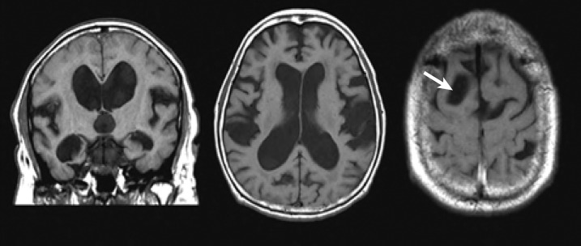
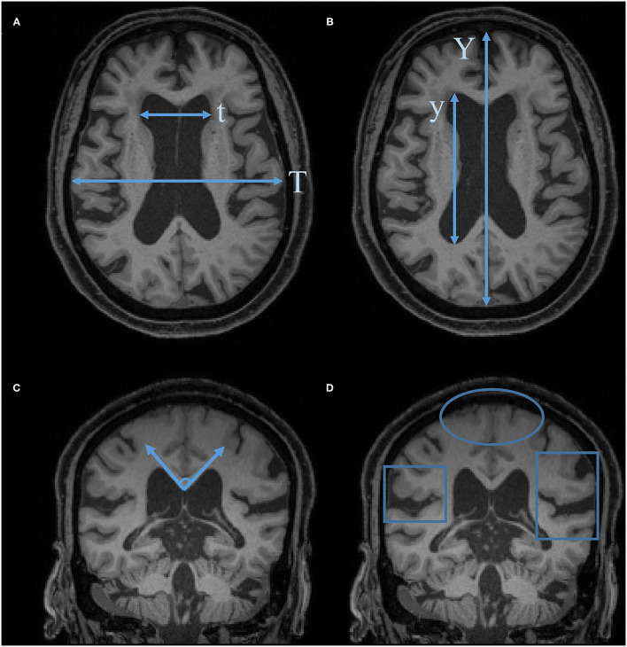
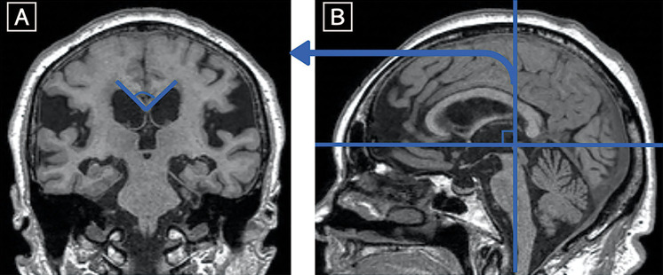
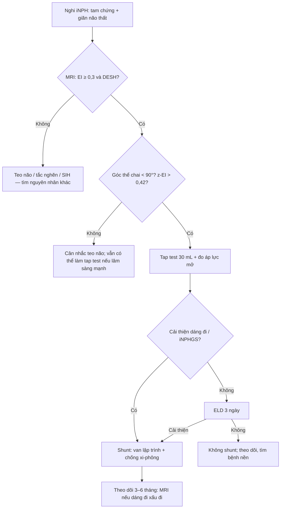
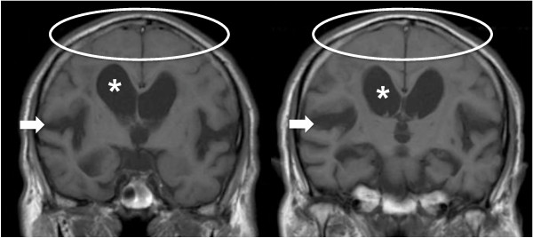

# 3032 — Não úng thủy áp lực bình thường (iNPH): DESH, góc thể chai, tap test 30 mL và ngưỡng đặt shunt

**Tags:** `pattern:nao-ung-thuy` `pattern:desh` `pattern:hep-khoang-duoi-nhen-dinh` `pattern:gian-nao-that` `vung:nao-that` `score:Evans` `score:DESH` `score:callosal-angle` `protocol:MRI-so-nao` `protocol:tap-test` `incidentaloma:gian-nao-that`
**Mức chắc chắn (certainty):** tổng hợp y văn (literature synthesis) — ghép **hướng dẫn iNPH lần 3 của Nhật 2021** (PMC7905302), **RCT PENS 2025 trên NEJM** (PMC12682072), **đoàn hệ SINPHONI** (PMC2987762), **nghiên cứu tap test** (PMC3293050), **RCT van hấp dẫn SVASONA** (PMC3717598), **dịch tễ dựa dân số** (PMC6541279) và **phân tích gộp yếu tố hình ảnh** (PMC9922237).

> **Câu hỏi thực hành:** ông 78 tuổi, **3 tháng nay đi chậm, bước ngắn, dễ mất thăng bằng khi quay người**, hay quên và **tiểu gấp không kịp đi**. MRI sọ: **não thất giãn, rãnh não vùng đỉnh "dính" vào xương sọ, rãnh Sylvius giãn rộng**. Câu hỏi: **giãn não thất này là teo não do tuổi, tắc nghẽn lưu thông, hay iNPH có thể đảo ngược bằng shunt — và nếu là iNPH thì đo gì, lấy bao nhiêu dịch, khi nào mổ?**
> Bài chốt theo **ba trục**: (1) **hình thái** — giãn não thất **có** hẹp khoang dưới nhện đỉnh **không tương xứng** (DESH) chứ không phải giãn đều; (2) **số đo** — **EI ≥ 0,3**, **z-EI > 0,42**, **góc thể chai < 90°**, **BVR < 1,0/< 1,5**; (3) **bằng chứng động** — **tap test 30 mL** và đáp ứng sau shunt. Nối [3030 – Tụ máu dưới màng cứng mạn](../3030-tu-mau-duoi-mang-cung-man/lesson.md) (biến chứng quá dẫn lưu), [3018 – IIH người lớn](../3018-tang-ap-luc-noi-so-tu-phat-nguoi-lon/lesson.md) (shunt là bước cuối, nhưng sinh lý ngược), [218 – Não úng thủy](../218-thoat-vi-nao-ung-thuy/lesson.md), [252 – Teo não & sa sút trí tuệ](../252-bien-chung-muon-cua-shunt-nao-that/lesson.md).

## 1. Tổng quan bệnh học – cơ chế hình ảnh: vì sao não thất giãn mà áp lực lại "bình thường"

- **Định nghĩa và nghịch lý áp lực:** iNPH là **giãn não thất do rối loạn hấp thu dịch não tủy (CSF absorption)** ở khoang dưới nhện lồi não, trong khi **áp lực mở đo một lần ≤ 200 mmH₂O (20 cmH₂O)** — tiêu chuẩn **probable iNPH** của hướng dẫn Nhật 2021 (PMC7905302). "Bình thường" chỉ là **giá trị đo tại một thời điểm**, không phải áp lực thấp: **áp lực xung (pulse pressure)** và **biên độ sóng CSF** tăng, còn **độ giãn (compliance)** giảm.
- **TẠI SAO não thất giãn:** hấp thu kém ở lồi não → **ứ CSF trong hệ thống** → **áp lực xung tác động lên thành não thất trong mỗi nhát mạch** → giãn dần **sừng trán và sừng thái dương** (vùng thành mỏng nhất), trong khi **khoang dưới nhện đỉnh bị "bóp" lại** vì não bị đẩy lên sát xương sọ. Đây là **giãn không tương xứng**, không phải giãn đều như teo não.
- **TẠI SAO "DESH" (disproportionately enlarged subarachnoid-space hydrocephalus):** bộ ba **(1) não thất giãn, (2) khoang dưới nhện đỉnh/đường giữa hẹp, (3) rãnh Sylvius giãn rộng** (PMC7905302, PMC2987762). Rãnh Sylvius giãn vì đó là nơi CSF còn "chỗ" để thoát ra ngoài, còn khoang đỉnh bị chèn.
- **TẠI SAO tín hiệu mô não bình thường:** iNPH là **rối loạn thủy lực**, không phải phù hay hoại tử; **T1/T2/FLAIR của nhu mô không đổi**, **không có quầng tăng tín hiệu quanh não thất kiểu thấm dịch (transependymal edema)** như não úng thủy tắc nghẽn cấp. Vùng tăng tín hiệu quanh não thất nếu có thường là **bệnh mạch nhỏ mạn** (leukoaraiosis), không phải dấu hiệu iNPH.
- **TẠI SAO góc thể chai hẹp:** khi não thất giãn, **mái não thất bên dâng lên** làm **góc giữa hai nửa thể chai** (đo trên lát coronal **qua mép sau — posterior commissure**, vuông góc đường AC–PC) **nhỏ lại < 90°**; teo não làm góc **mở rộng ≥ 90°**. Đây là **chỉ số "gián tiếp" của DESH**, mạnh hơn EI trong dự báo đáp ứng shunt (PMC9922237: **DOR 1,88**, dù vẫn thấp).
- **TẠI SAO có thể đảo ngược:** giảm thể tích CSF qua tap test/shunt → **giảm áp lực xung** → **tăng tưới máu não và phục hồi dẫn truyền vùng vận động–trán**; nhưng **chỉ phần "thủy lực" hồi phục**, phần **thoái hóa thần kinh nền (nếu có) thì không**.
- **Ngưỡng định lượng phải nhớ:**
  - **Chỉ số Evans (EI) = đường kính tối đa sừng trán / đường kính trong xương sọ cùng lát ≥ 0,30** — đo **tại lát qua lỗ Monro** (PMC7905302). EI trung bình trong SINPHONI chỉ **0,356 ± 0,040** → **giãn nặng hiếm**.
  - **z-EI (chiều cao sừng trán theo trục z / đường kính đường giữa sọ) > 0,42** — **tốt hơn EI > 0,3** (PMC7905302).
  - **BVR (brain/ventricle ratio): < 1,0 tại lát qua mép trước (AC), < 1,5 tại lát qua mép sau (PC)** (PMC7905302).
  - **Góc thể chai < 90°** (PMC7905302); đo **trên lát coronal qua PC, vuông góc AC–PC**.
  - **Tap test:** lấy **30 mL** CSF qua chọc dò thắt lưng, đánh giá lại dáng đi/điểm iNPHGS; **Se 71,3% / Sp 65%** khi dùng **thay đổi tổng điểm iNPHGS**; thêm **áp lực mở ≥ 15 cmH₂O** → **Se 82,5%** mà không giảm đặc hiệu (PMC3293050).
  - **Đáp ứng shunt:** **80%** giảm ≥ 1 bậc mRS trong 1 năm (95% CI 71,0–86,7), **69%** kết cục thuận lợi (PMC2987762). RCT PENS 2025 (n = 99, mù đôi, có đối chứng giả): **tốc độ đi +0,23 ± 0,23 m/s**, **Tinetti +2,9 vs +0,5**, **không cải thiện nhận thức và tiểu không tự chủ ở 3 tháng** (PMC12682072).
  - **Tỷ lệ mắc:** **3,7%** ở người ≥ 65 tuổi (Thụy Điển, tiêu chuẩn Âu–Mỹ), **8,9%** ở ≥ 80 tuổi, **2,1%** ở 65–79; theo tiêu chuẩn Nhật **1,5%** (PMC6541279). Tại Nhật **660/100.000** so với **53/100.000** ở Âu–Mỹ (PMC7905302).
  - **Giãn não thất không triệu chứng (AVIM):** tiến triển thành iNPH **17%/năm** trong một nghiên cứu đoàn hệ Nhật → **theo dõi, KHÔNG mổ khi chưa có triệu chứng** (PMC7905302).
  - **Biến chứng dẫn lưu quá mức:** máu tụ dưới màng cứng **14,3% vs 2,0%** (shunt mở vs giả, PENS — PMC12682072); **29/71 vs 5/74** biến cố quá dẫn lưu khi so van thường với **van hấp dẫn (gravitational)**, chênh nguy cơ **−36%** (SVASONA — PMC3717598); **VA 12,7% vs VP 5,5%** máu tụ dưới màng cứng (PMC7905302).

## 2. Mẫu hình + chẩn đoán phân biệt theo vị trí (gamut)

- **Mẫu hình cốt lõi:** **tam chứng Hakim–Adams** — **rối loạn dáng đi (gait disturbance) xuất hiện sớm và nổi bật** (bước ngắn, "dính chân", mất thăng bằng khi quay, có thể "đóng băng" khi khởi bước), **sa sút nhận thức** (chủ yếu chậm xử lý, giảm chú ý, không phải mất ngôn ngữ) và **tiểu gấp/không tự chủ**. **Tam chứng đầy đủ không phải lúc nào cũng có** — tiêu chuẩn **probable iNPH** chỉ cần **≥ 1 triệu chứng** trong tam chứng, kèm **DESH** hoặc **đáp ứng tap test** (PMC7905302).
- **Gamut theo hình thái — 4 nhóm giãn não thất:**
  1. **Giãn không tương xứng + hẹp khoang đỉnh (DESH)** → **iNPH** (nguyên phát); **NPH thứ phát** sau **chảy máu dưới nhện, viêm màng não, chấn thương sọ, não úng thủy bẩm sinh đã bù trừ** (cùng DESH, khác tiền sử).
  2. **Giãn đều + rãnh vỏ giãn rộng** → **teo não (ex vacuo)** do tuổi, bệnh Alzheimer, bệnh mạch nhỏ; **không DESH**, góc thể chai **≥ 90°**.
  3. **Giãn + tắc nghẽn lưu thông** → **hẹp cống Sylvius**, u hố sau, nang màng nhện; **não thất III phình to, quầng thấm dịch quanh não thất, thể chai vồng lên**.
  4. **Giãn + dấu hiệu "não xệ"** → **hạ áp lực nội sọ tự phát (SIH)**: **ngấm màng não dày, xoang tĩnh mạch giãn, tụ dịch dưới màng cứng**, không có DESH; đau đầu **thế đứng** là chốt lâm sàng (nối [3016](../3016-ha-ap-luc-noi-so-tu-phat/lesson.md)).
- **Mnemonic "DESH không phải teo":** **D**isproportionate ventricles, **E**ffaced sulci at vertex, **S**ylvian fissures enlarged, **H**ydrocephalus with normal pressure — **tương xứng là teo, không tương xứng là NPH**.
- **Bảng phân biệt nhanh theo vị trí hẹp:** hẹp **khoang đỉnh + đường giữa** = NPH; hẹp **chỉ đường giữa** = biến thể người già; giãn **rãnh Sylvius đơn độc** = giãn rãnh Sylvius tuổi già (không đủ chẩn đoán).

*Hai lát coronal: não thất giãn; khoang dưới nhện đỉnh/đường giữa bị "bóp" (mũi tên); rãnh Sylvius giãn rộng. Nguồn: Neurol Med Chir (Tokyo) 2021 (PMC7905302), CC BY-NC-ND 4.0 — nguyên bản, không crop.*

## 3. Bảng so sánh phân biệt (ma trận đối chiếu)

| Thực thể (entity) | Hình ảnh điển hình | Chốt vào (rule-in) | Chốt loại (rule-out) | Gợi ý xác nhận |
|---|---|---|---|---|
| **iNPH nguyên phát** | Não thất giãn **không tương xứng**; **hẹp khoang đỉnh/đường giữa**; **rãnh Sylvius giãn**; góc thể chai **< 90°**; EI **≥ 0,3** (thường 0,33–0,40) | **DESH + tam chứng + EI ≥ 0,3**; **góc thể chai < 90°**; **cải thiện sau tap test 30 mL** | **Rãnh vỏ giãn đều + góc thể chai ≥ 90°** → teo; **quầng thấm dịch quanh não thất + não thất III phình** → tắc nghẽn | MRI 3D T1 + FLAIR; tap test 30 mL; đo EI/z-EI/BVR/CA |
| **Teo não do tuổi / Alzheimer** | Não thất giãn **tương xứng** với rãnh vỏ; **rãnh đỉnh cũng giãn**; **không hẹp khoang đỉnh**; góc thể chai **≥ 90°** | **Giãn đều não thất + rãnh**; **teo hồi hải mã (MTA)**; **không đáp ứng tap test** | **DESH thật + hẹp khoang đỉnh** → iNPH; **không có teo hồi hải mã** không loại Alzheimer | MRI coronal T1 (MTA), tap test, theo dõi lâm sàng |
| **Não úng thủy tắc nghẽn (hẹp cống Sylvius, u hố sau)** | **Não thất bên + III phình to**, **não thất IV bình thường/nhỏ**; **quầng T2/FLAIR quanh não thất** (thấm dịch); thể chai vồng | **Giãn não thất III + IV không tương xứng**; **quầng thấm dịch**; **không thấy dòng chảy qua cống** trên MRI | **DESH + não thất IV bình thường** → iNPH; **không quầng thấm dịch** | MRI có chuỗi dòng chảy (flow-sensitive), nội soi/tắc nghẽn |
| **NPH thứ phát (sau SAH/viêm màng não/chấn thương)** | Cùng DESH, nhưng **có máu/xơ màng não cũ**, **giãn não thất tiến triển sau biến cố** | **Tiền sử SAH/viêm màng não/chấn thương + DESH mới** | **Không có biến cố trước đó** → nguyên phát | Đối chiếu phim cũ, MRI có tương phản màng não |
| **SIH (hạ áp lực nội sọ tự phát)** | **Não "xệ"**: **ngấm màng não dày đối xứng**, **xoang tĩnh mạch giãn**, **tụ dịch dưới màng cứng**, **không DESH** | **Đau đầu thế đứng + ngấm màng não + xoang giãn** | **DESH + không ngấm màng não** → iNPH | MRI sọ + tủy, CT myelography (nối 3016) |
| **Giãn não thất không triệu chứng (AVIM)** | DESH **nhưng không có tam chứng** | **Hình ảnh DESH đơn thuần, không triệu chứng** | **Có rối loạn dáng đi thực sự** → iNPH có triệu chứng | Theo dõi **17%/năm** tiến triển; **không shunt** |

*A: EI = t/T (sừng trán/xương sọ). B: ALVI = y/Y. C: góc thể chai trên lát coronal. D: DESH — vòng tròn = khoang đỉnh hẹp, khung = rãnh Sylvius giãn. Nguồn: Front Aging Neurosci 2021 (PMC8787286), CC BY 4.0.*

*A: góc giữa hai nửa thể chai trên lát coronal. B: mặt phẳng đo — lát qua mép sau (PC), vuông góc đường AC–PC. Đo sai mặt phẳng là nguyên nhân sai số thường gặp. Nguồn: Neurol Med Chir (Tokyo) 2021 (PMC7905302), CC BY-NC-ND 4.0.*

### Ba câu hỏi đọc phim theo thứ tự
1. **Não thất có giãn không?** Đo **EI tại lỗ Monro**; nếu EI < 0,3 nhưng nghi ngờ, đo **z-EI > 0,42** hoặc **BVR**.
2. **Giãn có tương xứng với rãnh vỏ không?** Nếu **rãnh đỉnh giãn theo** → teo; nếu **rãnh đỉnh bị xóa, Sylvius giãn** → DESH.
3. **Góc thể chai bao nhiêu?** **< 90°** ủng hộ iNPH; **≥ 90°** ủng hộ teo. Ghi kèm **mm** chiều rộng sừng trán và **độ lệch đường giữa** nếu có.

## 4. Protocol chụp + hệ phân độ/điểm chuẩn hóa

- **MRI sọ là chuẩn (không cần cản quang):** **3D T1 (MPRAGE/SPGR) 1 mm** để đo EI/z-EI/BVR và thể tích; **FLAIR** để loại **quầng thấm dịch quanh não thất** và bệnh mạch nhỏ; **DWI/ADC** để loại nhồi máu cấp; **SWI** loại vi chảy máu/hemosiderosis (nếu nghĩ mạch máu); **lát coronal vuông góc AC–PC** để đo góc thể chai. Nếu nghi tắc nghẽn: thêm **chuỗi dòng chảy CSF** và **MRV**.
- **Đo và ghi vào báo cáo (đủ 4 số):** **EI**, **z-EI**, **góc thể chai**, **BVR AC/PC**; mô tả **khoang đỉnh/đường giữa** và **rãnh Sylvius**. Đừng chỉ ghi "giãn não thất".
- **Tap test (giao thức tối thiểu):** chọc dò thắt lưng, **lấy 30 mL** CSF (nếu dung nạp), **đo áp lực mở**, đánh giá **tốc độ đi 10 m/TUG** và **iNPHGS** trước — sau **1 giờ, 4 giờ, 24 giờ** (có nơi 3 ngày). **Không có ngưỡng "tốt lên bao nhiêu mét/giây" thống nhất** — dùng **thay đổi có ý nghĩa lâm sàng** theo iNPHGS và tốc độ đi; **tap test âm không loại trừ** (Se 71%).
- **Dẫn lưu thắt lưng ngoài (external lumbar drainage — ELD) 3 ngày** khi tap test âm nhưng hình ảnh/lâm sàng mạnh: theo dõi **thể tích dẫn lưu 10 mL/giờ**, đánh giá lại mỗi ngày; biến chứng **đau đầu tư thế, nhiễm trùng, tụt não** (nối [3026](../3026-tut-nao-nghich-ly-sau-choc-do-shunt-mo-so/lesson.md)).
- **Chỉ định shunt:** **probable/definite iNPH** + **đáp ứng tap test/ELD** + **mục tiêu chức năng rõ** (đi lại, tự chủ). **Không shunt** cho **AVIM không triệu chứng** hoặc **teo não đơn thuần**.
- **Chọn van:** **van lập trình + cơ chế chống xi-phông/hấp dẫn** ở người **cao tuổi, não thất nhỏ, tiền sử tụ dịch dưới màng cứng**; **VP** hay **LP** tương đương về kết cục (SINPHONI vs SINPHONI-2), nhưng **VA có máu tụ dưới màng cứng 12,7% vs VP 5,5%** (PMC7905302). **Van hấp dẫn giảm quá dẫn lưu: 5/74 vs 29/71** (SVASONA — PMC3717598).
- **Theo dõi sau shunt:** **MRI/CT ở 3–6 tháng** và **mỗi khi dáng đi xấu đi** để tìm **tụ dịch/máu tụ dưới màng cứng do quá dẫn lưu** (nối 3030), **nhiễm trùng shunt**, **tắc van**; đánh giá lại **mRS, TUG, iNPHGS** ở **3, 6, 12 tháng**.

## 5. Biến thể bình thường và cạm bẫy

- **Giãn não thất "bình thường" ở người già:** EI có thể **> 0,3** do **giãn sừng trán sinh lý**, nhất là ở nam lớn tuổi. **EI đơn độc không đủ chẩn đoán** — cần **DESH + triệu chứng**.
- **Hẹp khoang đỉnh do tuổi (age-related tight high convexity):** người già không iNPH vẫn có thể có **khoang dưới nhện đỉnh thưa**; phân biệt bằng **rãnh Sylvius giãn rõ + EI tăng + triệu chứng tiến triển**.
- **Đo EI sai lát:** đo **tại lỗ Monro**, không đo ở lát lớn nhất của não thất; đo **đường kính trong xương sọ** cùng lát. Sai lát làm EI lệch **0,05–0,10**.
- **Góc thể chai đo sai mặt phẳng:** phải **coronal qua PC, vuông góc AC–PC**; lát chếch làm góc **tăng giả 10–20°** → bỏ sót iNPH.
- **Nhầm "quầng sáng quanh não thất" là dấu hiệu iNPH:** đó là **bệnh mạch nhỏ mạn**, không phải thấm dịch; iNPH **không có quầng thấm dịch**.
- **Tap test âm:** **Se 71%** → **không loại trừ**; nếu lâm sàng/hình ảnh mạnh, làm **ELD 3 ngày**.
- **Quá dẫn lưu sau shunt:** **đau đầu tư thế, buồn nôn, dáng đi xấu đi** sau một giai đoạn cải thiện → **chụp CT/MRI tìm tụ dịch/máu tụ dưới màng cứng** (nối 3030); **hạ áp lực van** là cách xử trí, không phải tăng.
- **"Bình thường" của áp lực mở:** một lần đo **≤ 20 cmH₂O** không loại trừ dao động áp lực; đừng dùng một con số để loại iNPH.

## 6. Tự lượng giá — Blind Quiz ngay trên trang tĩnh

**Ca 1 — Ông 76 tuổi, đi chậm 6 tháng, hay quên, tiểu gấp. Nhìn hai lát coronal T1, mô tả trước khi đọc đáp án.**

- Gợi ý lâm sàng: **tam chứng** dáng đi–nhận thức–tiểu; không sốt, không đau đầu.
- Câu hỏi: **Dấu hiệu chính ở khoang dưới nhện đỉnh và rãnh Sylvius?** **3 chẩn đoán phân biệt?** **Số đo nào chốt?**

<b>Bấm để hiện đáp án (findings + chẩn đoán)</b>

- Dấu hiệu: **não thất giãn** (dấu *), **khoang dưới nhện đỉnh và đường giữa bị xóa** (vòng bầu dục), **rãnh Sylvius giãn rộng** (mũi tên) → **DESH**.
- Chẩn đoán: **iNPH** — giãn não thất **không tương xứng** với teo vỏ; cơ chế là **rối loạn hấp thu CSF ở lồi não** làm tăng áp lực xung, không phải teo mô.
- Chốt: **EI ≥ 0,3**, **góc thể chai < 90°**, **z-EI > 0,42**; sau đó **tap test 30 mL**.
- Nguồn ảnh: Cerebrospinal Fluid Res 2010 (PMC2987762), CC BY 4.0.

**Ca 2 — Bà 80 tuổi, MRI có giãn não thất; đo các chỉ số trên ảnh.**

- Câu hỏi: **EI tính thế nào?** **Góc thể chai đo ở đâu?** **Hình D mô tả gì?** **Khi nào gọi là DESH?**

<b>Bấm để hiện đáp án</b>

- **EI = t/T**: **t** = đường kính tối đa sừng trán, **T** = đường kính trong xương sọ **cùng lát**, đo **tại lỗ Monro**; **EI ≥ 0,3** là giãn.
- **ALVI = y/Y** (đường kính trước–sau não thất bên / xương sọ) — chỉ số bổ trợ.
- **Góc thể chai:** đo trên **lát coronal qua mép sau (PC), vuông góc AC–PC**; **< 90°** ủng hộ iNPH.
- **Hình D = DESH:** vòng tròn = **khoang đỉnh hẹp**, khung = **rãnh Sylvius giãn**; DESH = giãn não thất **+ hẹp khoang đỉnh + giãn Sylvius**.
- Nguồn ảnh: Front Aging Neurosci 2021 (PMC8787286), CC BY 4.0.

**Ca 3 — Ông 68 tuổi, sau chảy máu dưới nhện 3 tháng, dáng đi xấu dần. Xem mặt phẳng đo góc thể chai.**

- Câu hỏi: **Vì sao phải đo ở lát qua PC?** **Nếu góc 65° thì nghĩ gì?** **Bước tiếp theo?**

<b>Bấm để hiện đáp án</b>

- Mặt phẳng đúng: **coronal qua mép sau (PC), vuông góc đường AC–PC** — vì **đây là lát chuẩn của hướng dẫn**; đo chếch làm góc sai.
- **Góc 65° (< 90°)** + **DESH** + tiền sử SAH → **NPH thứ phát sau SAH** (cùng cơ chế hấp thu, khác nguyên nhân).
- Bước tiếp: **tap test 30 mL** (hoặc ELD 3 ngày nếu tap âm); nếu cải thiện → **shunt với van lập trình + chống xi-phông**, theo dõi **tụ dịch dưới màng cứng**.
- Nguồn ảnh: Neurol Med Chir (Tokyo) 2021 (PMC7905302), CC BY-NC-ND 4.0.

## Bài liên quan chéo
- [218 – Thoát vị não & não úng thủy: NPH vs tắc nghẽn vs teo](../218-thoat-vi-nao-ung-thuy/lesson.md)
- [252 – Biến chứng muộn của shunt não thất](../252-bien-chung-muon-cua-shunt-nao-that/lesson.md)
- [3016 – Hạ áp lực nội sọ tự phát (SIH)](../3016-ha-ap-luc-noi-so-tu-phat/lesson.md)
- [3018 – Tăng áp lực nội sọ tự phát (IIH) ở người lớn](../3018-tang-ap-luc-noi-so-tu-phat-nguoi-lon/lesson.md)
- [3030 – Tụ máu dưới màng cứng mạn tính (biến chứng quá dẫn lưu)](../3030-tu-mau-duoi-mang-cung-man/lesson.md)
- [3026 – Tụt não nghịch lý sau chọc dò](../3026-tut-nao-nghich-ly-sau-choc-do-shunt-mo-so/lesson.md)

> Không dùng để chẩn đoán độc lập khi chưa có người hướng dẫn.
