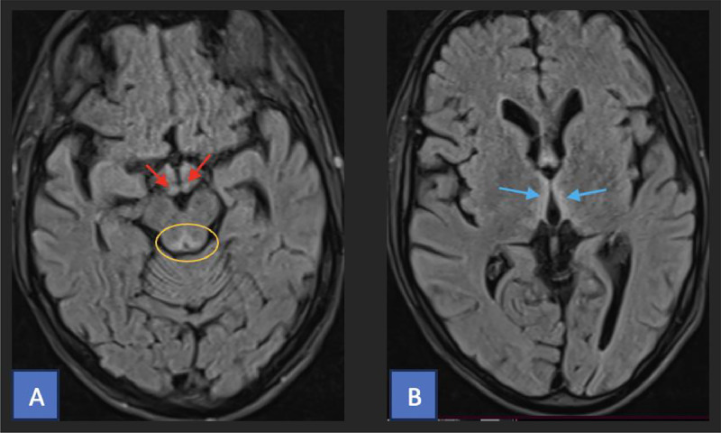
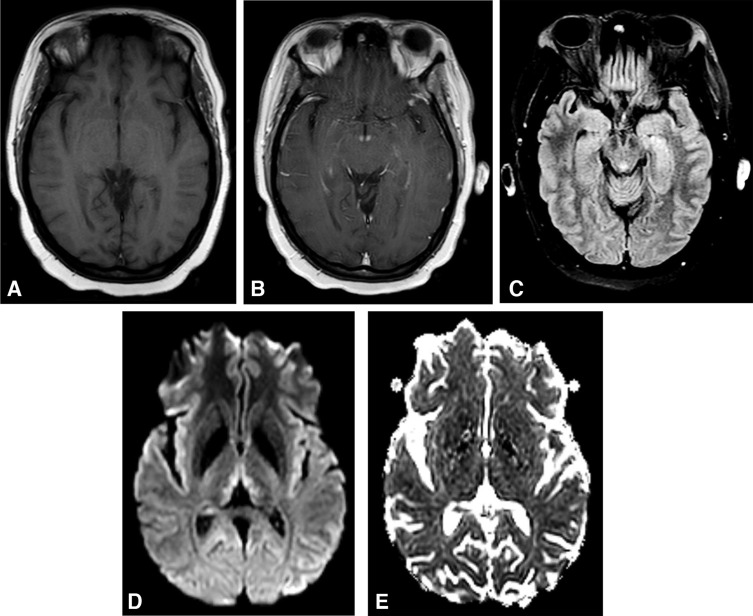
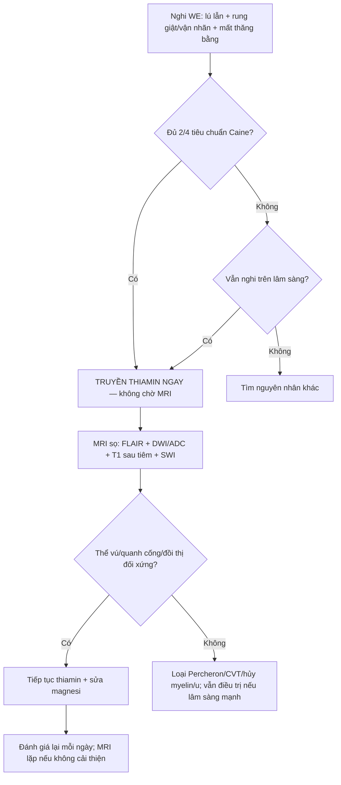
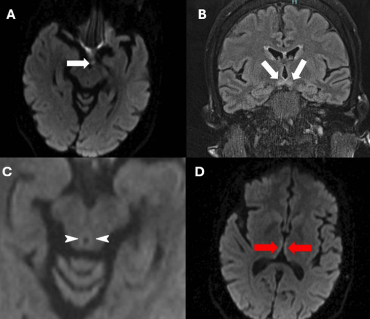
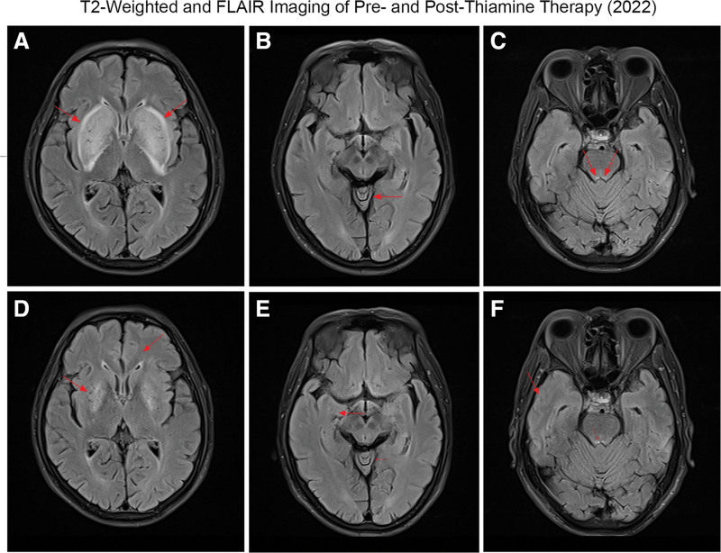

# 3033 — Bệnh não Wernicke & thiếu thiamin: "tam chứng chỉ 10–33%", MRI quanh cống Sylvius và liều thiamin cứu được

**Tags:** `pattern:phu-doi-xung` `pattern:phu-quanh-cong-sylvius` `pattern:phu-doi-thi` `pattern:han-che-khuếch-tan` `vung:nao` `score:Caine` `protocol:MRI-so-nao` `protocol:thiamin`
**Mức chắc chắn (certainty):** tổng hợp y văn (literature synthesis) — ghép **tổng quan WE 2023** (PMC10393093), **tổng quan WKS không do rượu 2026** (PMC13489584), **tổng quan có hệ thống WE sau phẫu thuật tiêu hóa 2026** (PMC13365056), **RCT liều thiamin 2022** (PMC9321884), **tổng quan thần kinh–nhãn khoa** (PMC7335288), **3 ca có ảnh MRI** (PMC11324805, PMC12506538, PMC13008232) và **dữ liệu mô bệnh học–hình ảnh** (PMC12535404).

> **Câu hỏi thực hành:** nam 52 tuổi, **uống rượu nhiều, ăn kém 3 tuần nay**, vào viện vì **lú lẫn, đi loạng choạng, mắt nhìn đôi và rung giật nhãn cầu**. Người trực đề nghị **chụp MRI sọ trước, chờ kết quả rồi mới truyền thiamin**. Câu hỏi: **chờ có đúng không, MRI sẽ thấy gì, thể không điển hình trông ra sao, và liều thiamin nào đủ?**
> Bài chốt theo **ba trục**: (1) **điều trị không chờ hình ảnh** — nghi WE là **truyền thiamin ngay**, vì **85% người sống sót mang di chứng WKS mạn** và **~20% tử vong nếu không điều trị**; (2) **hình ảnh** — **T2/FLAIR đối xứng quanh cống Sylvius + đồi thị trong + thể vú**, **DWI hạn chế ở thể cấp**, **ngấm thể vú**; (3) **gamut đối xứng** — phân biệt với **nhồi máu động mạch Percheron**, **huyết khối tĩnh mạch não sâu**, **hủy myelin thẩm thấu**, **bệnh não gan**, **CJD**. Nối [3029 – ARIA-E/ARIA-H](../3029-aria-khang-the-khang-amyloid/lesson.md), [3031 – PRES](../3031-pres-benh-nao-sau-phuc-hoi/lesson.md), [216 – Huyết khối tĩnh mạch não](../216-di-dang-mach-CVST/lesson.md), [211 – Đột quỵ não](../211-dot-quy-nao/lesson.md), [1902 – Bệnh não gan cấp](../1902-benh-nao-gan-an-tinh/lesson.md).

## 1. Tổng quan bệnh học – cơ chế hình ảnh: vì sao thiếu B1 lại chọn đúng đồi thị và thể vú

- **Sinh hóa cốt lõi:** thiamin (vitamin B1) → **thiamin diphosphate (TDP)** là cofactor của **pyruvate dehydrogenase (PDH)**, **α-ketoglutarate dehydrogenase (α-KGDH)** và **transketolase**. Thiếu TDP → **giảm sản xuất ATP từ glucose**, **ứ lactate**, **sụp chuyển hóa oxy hóa** ở tế bào thần kinh và tế bào hình sao.
- **Dự trữ và thời gian:** cơ thể chỉ dự trữ thiamin **2–3 tuần**; biểu hiện lâm sàng thường sau **4–6 tuần** thiếu hụt (PMC10393093, PMC13489584).
- **TẠI SAO đúng vùng đó (selective vulnerability):** các nhân **chuyển hóa glucose rất cao** — **thể vú, đồi thị trong (mediodorsal/anterior), chất xám quanh cống Sylvius, mảng mái, nhân tiền đình, thùy nhộng tiểu não** — phụ thuộc PDH/α-KGDH nhất. Thiếu ATP → **phù tế bào hình sao (astrocytic edema)** → **phá hàng rào máu–não** → **phù độc tế bào + phù vận mạch**; glutamate ngoại bào tăng gây **độc tế bào thần kinh**.
- **TẠI SAO T2/FLAIR sáng:** nước nội bào/ngoại bào tăng → **kéo dài T2**; tổn thương **đối xứng** vì cả hai bên đều thiếu cùng một enzyme.
- **TẠI SAO DWI hạn chế:** phù độc tế bào làm **giảm khuếch tán nước** → **DWI sáng + ADC tối** ở thể cấp; nhưng **không phải ca nào cũng hạn chế** — ca do ung thư dạ dày (PMC12506538) **không hạn chế khuếch tán**, nên **DWI âm không loại trừ WE**.
- **TẠI SAO thể vú ngấm thuốc:** phá hàng rào máu–não tại thể vú → **ngấm tương phản** (hình 3033_we-mri ô B); dấu hiệu này **đặc hiệu nhưng không nhạy**.
- **TẠI SAO có thể chảy máu hoặc hoại tử:** tổn thương nội mô mao mạch nặng → **xuất huyết đồi thị** (thể hiếm, tiên lượng xấu) và **teo thể vú/đồi thị** về sau.
- **Di chứng mô học:** thể vú **giảm thể tích 60–80%** ở **96–100%** ca WKS; **mất neuron đồi thị lưng giữa 48% ở WE → 64% ở KS**; **vỏ trán lưng bên giảm ~20%** (PMC12535404). Đây là lý do **“phù hồi phục nhưng trí nhớ có thể không”**.
- **Ngưỡng định lượng phải nhớ:**
  - **Tổn thương Wernicke tại tử thi: 0,4–2,8%** dân số chung (PMC10393093); **chỉ ≤ 6%** ca không do rượu được chẩn đoán **trước tử vong** (PMC13489584).
  - **Tam chứng đầy đủ: 16–33%** (PMC10393093); **~10%** trong tổng quan có hệ thống (PMC13365056); **< 15%** ở ca không do rượu (PMC13489584). **Đừng chờ đủ tam chứng.**
  - **Tiêu chuẩn Caine (2/4):** **thiếu dinh dưỡng**, **bất thường vận nhãn/rung giật**, **rối loạn tiểu não**, **rối loạn tri giác/trí nhớ**. Dùng **2/4** nâng tỷ lệ nhận diện từ **23% lên 85%** (PMC9693280, PMC10393093).
  - **MRI: nhạy 53%, đặc hiệu 93%** (PMC10434319) → **MRI âm không loại trừ**.
  - **Tử vong ~20%** nếu không điều trị (PMC13489584); **~85%** người sống sót WE có **di chứng nhận thức mạn (WKS)** (PMC8242940, PMC9693280).
  - **Phác đồ:** **UK (RCP): 500 mg IV × 3 lần/ngày trong 2–3 ngày**, sau đó **250 mg/ngày**; **EFNS: 200 mg IV mỗi 8 giờ** đến khi hết triệu chứng; **Mỹ: 100 mg parenteral 3–7 ngày** rồi uống (PMC10393093). **RCT 2022** (127 ca): **100 vs 300 vs 500 mg × 3/ngày trong 5 ngày** — **không thấy lợi ích rõ của liều cao** (PMC9321884), nhưng **không có bằng chứng để hạ liều ở ca nặng**; luôn **sửa magnesi** và thiếu hụt B khác.

## 2. Mẫu hình + chẩn đoán phân biệt theo vị trí (gamut)

- **Mẫu hình cốt lõi:** **rối loạn tri giác + rung giật nhãn cầu/liệt vận nhãn + mất thăng bằng**; khởi phát **bán cấp** (ngày–tuần), bối cảnh **rượu, nôn kéo dài, dinh dưỡng kém, phẫu thuật tiêu hóa, mang thai nôn nhiều, lọc máu, nuôi dưỡng tĩnh mạch kéo dài**.
- **Gamut theo hình ảnh — tổn thương đối xứng quanh não thất III/cống Sylvius:**
  1. **Thiếu thiamin (WE)** — thể vú + đồi thị trong + quanh cống; **DWI hạn chế ở thể cấp**, **ngấm thể vú**.
  2. **Nhồi máu động mạch Percheron (artery of Percheron)** — nhồi máu **đồi thị cạnh đường giữa hai bên ± trung não**, **DWI sáng/ADC tối rõ**, **khởi phát đột ngột**, **có yếu tố mạch máu**, **không có ngấm thể vú**.
  3. **Huyết khối tĩnh mạch não sâu (deep CVT)** — đồi thị **phù ± xuất huyết**, **tắc xoang thẳng/vein of Galen**, **đau đầu dữ dội**, **ngấm màng não**; chẩn đoán bằng **CTV/MRV**.
  4. **Hủy myelin thẩm thấu (osmotic demyelination)** — **cầu não trung tâm** điển hình, **thể ngoài cầu** ở đồi thị/hạch nền; bối cảnh **sửa Na⁺ quá nhanh**; **không ngấm thể vú**.
  5. **Bệnh não gan** — **T1 sáng đối xứng ở hạch nền (globus pallidus)**, **không hạn chế khuếch tán**, **amoniac cao**, **rung giật gan bàn tay**.
  6. **CJD** — **“cortical ribboning” + hạch nền**, **DWI sáng**, **teo nhanh**, **myoclonus**, **EEG/PCR 14-3-3**.
  7. **U thần kinh đệm/lymphoma đồi thị hai bên** — **choán chỗ, phù xung quanh, không đối xứng hoàn toàn**, **không hồi phục sau thiamin**.
- **Mnemonic "WERNICKE":** **W**ernicke (thể vú), **E**dema quanh cống, **R**ượu/dinh dưỡng, **N**ystagmus, **I**ncreased T2/FLAIR, **C**onfusion, **K**orsakoff (di chứng), **E**nhancement thể vú.

*A: FLAIR — thể vú tăng tín hiệu (mũi tên đỏ), chất xám quanh cống (vòng vàng). B: FLAIR — đồi thị trong hai bên tăng tín hiệu (mũi tên xanh). Ở ca này tổn thương **không ngấm và không hạn chế khuếch tán**. Nguồn: Radiol Case Rep 2025 (PMC12506538), CC BY-NC-ND 4.0.*

## 3. Bảng so sánh phân biệt (ma trận đối chiếu)

| Thực thể (entity) | Hình ảnh điển hình | Chốt vào (rule-in) | Chốt loại (rule-out) | Gợi ý xác nhận |
|---|---|---|---|---|
| **Bệnh não Wernicke (thiếu thiamin)** | **T2/FLAIR đối xứng**: thể vú, đồi thị trong, quanh cống Sylvius, mảng mái; **DWI hạn chế ở thể cấp**; **ngấm thể vú** | **Bối cảnh thiếu dinh dưỡng/rượu/nôn kéo dài + 2/4 Caine**; **thể vú + quanh cống đối xứng**; **đáp ứng sau thiamin** | **Tổn thương một bên, có choán chỗ, không đối xứng** → u/nhồi máu; **DWI âm không loại trừ**; **không có bối cảnh thiếu hụt** → nghĩ nguyên nhân khác | **Truyền thiamin ngay** (không chờ MRI); MRI sọ có/không tương phản; nồng độ thiamin máu **không dùng để loại trừ** |
| **Nhồi máu động mạch Percheron** | **Đồi thị cạnh đường giữa hai bên ± trung não**, hình chữ V; **DWI sáng/ADC tối rõ**, **không ngấm thể vú** | **Khởi phát đột ngột + yếu tố mạch máu**; **hạn chế khuếch tán theo lãnh thổ**; **không đáp ứng thiamin** | **Tổn thương thể vú/quanh cống đối xứng + bối cảnh dinh dưỡng** → WE; **không có hạn chế khuếch tán** → không phải nhồi máu cấp | MRA/CTA, siêu âm tim, theo dõi thời gian; **không trì hoãn thiamin nếu nghi WE** |
| **Huyết khối tĩnh mạch não sâu** | Đồi thị **phù ± xuất huyết**, **tắc xoang thẳng/vein of Galen**, **ngấm màng não**, phù lan | **Đau đầu dữ dội + phù đồi thị hai bên + huyết khối xoang trên CTV/MRV** | **Không tắc xoang + tổn thương thể vú** → WE; **không xuất huyết, không tắc** → loại CVT | **CTV/MRV bắt buộc**; D-dimer; kháng đông nếu xác định |
| **Hủy myelin thẩm thấu** | **Cầu não trung tâm** hình "thỏi son"; thể ngoài cầu: đồi thị, hạch nền | **Sửa Na⁺ > 8–10 mmol/L/24 giờ** hoặc **tăng Na⁺ nhanh**; **tổn thương cầu trung tâm** | **Không có bối cảnh Na⁺**; **tổn thương thể vú** → WE | Điện giải đồ, tốc độ sửa Na⁺, MRI lặp |
| **Bệnh não gan** | **T1 sáng đối xứng hạch nền**, **không hạn chế khuếch tán**; teo não nhẹ | **Xơ gan + amoniac cao + rung giật gan bàn tay**; **T1 sáng globus pallidus** | **T1 không sáng hạch nền**; **DWI hạn chế** → WE/nhồi máu | Amoniac, chức năng gan, đáp ứng lactulose |
| **CJD** | **Cortical ribboning + hạch nền**, **DWI sáng**, **teo nhanh** | **Myoclonus + sa sút nhanh + DWI vỏ/hạch nền**; **RT-QuIC/14-3-3** | **Tổn thương chỉ đồi thị/thể vú đối xứng, hồi phục sau thiamin** → WE | EEG, RT-QuIC, MRI lặp 2–4 tuần |
| **U thần kinh đệm/lymphoma đồi thị** | **Khối choán chỗ**, phù xung quanh, **bất đối xứng**, **ngấm thuốc dạng nốt** | **Hiệu ứng choán chỗ + bất đối xứng + ngấm không đều** | **Đối xứng hoàn toàn + không choán chỗ + hồi phục** → WE | MRI tương phản, PET, sinh thiết |

*A: T1 trước tiêm bình thường. B: T1 sau tiêm — **ngấm thể vú**. C: FLAIR — **tăng tín hiệu chất xám quanh cống**. D: DWI — **đồi thị trong sáng**. E: ADC — **hạn chế khuếch tán nhẹ** (phù độc tế bào). Nguồn: Eye Brain 2020 (PMC7335288), CC BY-NC 4.0.*

## 4. Protocol chụp + hệ phân độ/điểm chuẩn hóa

- **Nguyên tắc vàng: điều trị trước, hình ảnh sau.** Nghi WE trên lâm sàng → **truyền thiamin ngay** (không chờ MRI, không chờ nồng độ thiamin máu); nếu bệnh nhân **hạ đường huyết/tăng glucose**, **truyền thiamin trước hoặc cùng glucose** để tránh làm nặng thêm.
- **MRI sọ (không cần cản quang là đủ cho chẩn đoán):** **T2/FLAIR** (đồi thị, thể vú, quanh cống, mảng mái), **DWI + ADC** (phù độc tế bào), **T1 sau tiêm** (ngấm thể vú), **SWI** (xuất huyết). Lát **3 mm** qua vùng đồi thị–trung não; thêm **hệ thần kinh trung ương toàn bộ** nếu nghi tổn thương vỏ/dây thần kinh sọ (thể không điển hình).
- **Xét nghiệm:** **nồng độ thiamin máu (whole blood thiamine diphosphate)** trước khi truyền nếu lấy được — nhưng **không chờ kết quả**; **magnesi, kali, phospho, glucose, lactate, amoniac, chức năng gan/thận**; **điện giải đồ** để loại hủy myelin thẩm thấu; **CTV/MRV** nếu nghi huyết khối xoang.
- **Phân tầng xử trí theo Caine:** **2/4 tiêu chuẩn** → **điều trị như WE** (không cần đủ tam chứng). Bảng điểm Caine **không thay thế** đánh giá lâm sàng ở ca không do rượu (chưa được thẩm định đầy đủ).
- **Liều và đường dùng (người lớn):**
  - **UK (RCP):** **500 mg IV × 3 lần/ngày trong 2–3 ngày**; nếu đáp ứng → **250 mg/ngày** đến khi hết triệu chứng; sau đó **uống 100 mg × 3/ngày** trong thời gian còn nguy cơ.
  - **EFNS:** **200 mg IV mỗi 8 giờ** đến khi cải thiện.
  - **Mỹ:** **100 mg parenteral 3–7 ngày**, sau đó **uống**.
  - **RCT 2022:** **100/300/500 mg × 3/ngày × 5 ngày** — **không khác biệt rõ**; **không hạ liều ở ca nặng**, và **sửa magnesi** vì thiếu magnesi làm **giảm đáp ứng thiamin** (PMC9321884).
- **Phòng bệnh ở nhóm nguy cơ:** **trước và sau phẫu thuật béo phì**, **nôn nhiều khi mang thai**, **nuôi dưỡng tĩnh mạch kéo dài**, **nghiện rượu** → **bổ sung thiamin theo phác đồ**, không chờ triệu chứng.
- **Theo dõi:** đánh giá lại **vận nhãn, dáng đi, trí nhớ** mỗi ngày; **MRI lặp 1–2 tuần** nếu không cải thiện để loại u/CVT/nhồi máu; **tầm soát nguyên nhân nền** (rượu, bariatric, ung thư, nôn thai, lọc máu).

## 5. Biến thể bình thường và cạm bẫy

- **"Không đủ tam chứng" là quy luật, không phải ngoại lệ:** tam chứng đầy đủ chỉ **10–33%**; ở ca **không do rượu** lại càng **< 15%**. Chờ đủ tam chứng = **bỏ sót**.
- **MRI âm không loại trừ:** **nhạy 53%**, **đặc hiệu 93%**; **DWI âm** cũng gặp (ca PMC12506538 **không hạn chế khuếch tán**). **Chẩn đoán là lâm sàng + đáp ứng thiamin**.
- **Thể không điển hình ở ca không do rượu:** tổn thương **vỏ não, tiểu não, nhân dây thần kinh sọ**; **"lentiform fork sign"** ở hạch nền (ca lọc máu — PMC13008232) — dễ nhầm **bệnh não ure huyết** hoặc **hủy myelin thẩm thấu**. **Đáp ứng sau thiamin** là chốt.
- **Nhầm với nhồi máu Percheron:** cả hai đều **đồi thị hai bên**; khác ở **khởi phát đột ngột + hạn chế khuếch tán rõ + yếu tố mạch máu** (Percheron) vs **bối cảnh dinh dưỡng + thể vú/quanh cống + hồi phục sau thiamin** (WE). Nếu nghi cả hai → **vẫn truyền thiamin**, không chờ.
- **Nhầm với bệnh não gan:** **T1 sáng hạch nền** là chìa khóa; **WE không có T1 sáng globus pallidus**.
- **Bỏ sót thể vú vì lát cắt dày:** thể vú **~3 mm** (ca PMC12506538) — lát **> 3 mm** dễ bỏ; dùng **lát mỏng 1–3 mm** qua vùng dưới đồi.
- **Ngấm thể vú chỉ là dấu hiệu hỗ trợ:** không nhạy; **không ngấm không loại trừ**.
- **Thiamin trước glucose:** ở bệnh nhân suy dinh dưỡng, **truyền glucose trước thiamin** có thể **khởi phát/làm nặng WE**; luôn **thiamin trước hoặc đồng thời**.
- **Thiếu magnesi:** **không đáp ứng thiamin** nếu không sửa magnesi — kiểm tra và bù.

## 6. Tự lượng giá — Blind Quiz ngay trên trang tĩnh

**Ca 1 — Nam 52 tuổi, nghiện rượu, lú lẫn + đi loạng choạng + rung giật nhãn cầu. Nhìn 5 ô MRI, mô tả trước.**

- Gợi ý lâm sàng: ăn uống kém 3 tuần, không sốt, không chấn thương.
- Câu hỏi: **Dấu hiệu ở thể vú, quanh cống và đồi thị?** **Chuỗi xung nào chốt phù độc tế bào?** **3 chẩn đoán phân biệt?**

<b>Bấm để hiện đáp án (findings + chẩn đoán)</b>

- Dấu hiệu: **ngấm thể vú** (B), **tăng tín hiệu FLAIR chất xám quanh cống** (C), **DWI sáng đồi thị trong** (D), **ADC tối nhẹ** (E) → phù độc tế bào.
- Chẩn đoán: **bệnh não Wernicke** — thiếu thiamin làm sụp PDH/α-KGDH, phù tế bào hình sao ở vùng chuyển hóa cao.
- Phân biệt: **nhồi máu Percheron** (đột ngột, DWI rõ, không ngấm thể vú), **huyết khối tĩnh mạch não sâu** (đau đầu, tắc xoang trên MRV), **hủy myelin thẩm thấu** (sửa Na⁺ nhanh, cầu não).
- Xử trí: **truyền thiamin ngay** theo phác đồ, **không chờ MRI**; bù magnesi.
- Nguồn ảnh: Eye Brain 2020 (PMC7335288), CC BY-NC 4.0.

**Ca 2 — Nữ 53 tuổi, nôn nhiều, sụt cân, nhìn mờ hai bên và đi yếu. Xem DWI/FLAIR.**

- Câu hỏi: **Dấu hiệu ở A/B/C/D?** **Vì sao DWI quan trọng ở đây?** **Có cần chờ xét nghiệm thiamin không?**

<b>Bấm để hiện đáp án</b>

- A: **hạn chế khuếch tán thể vú** (mũi tên trắng); B: **FLAIR thể vú hai bên**; C–D: **đồi thị trong hạn chế khuếch tán**.
- DWI quan trọng vì **phù độc tế bào** là dấu hiệu **sớm, trước khi T2/FLAIR rõ**; nhưng **DWI âm không loại trừ**.
- **Không chờ** nồng độ thiamin: **truyền thiamin ngay** khi nghi WE; xét nghiệm chỉ để hồi cứu.
- Nguồn ảnh: Cureus 2024 (PMC11324805), CC BY 4.0.

**Ca 3 — Nam 60 tuổi, lọc máu chu kỳ, đi loạng choạng tái phát sau ngừng thiamin. Xem 6 ô MRI.**

- Câu hỏi: **Dấu hiệu "lentiform fork" là gì?** **Vì sao dễ nhầm ở bệnh nhân lọc máu?** **Điều gì chốt chẩn đoán?**

<b>Bấm để hiện đáp án</b>

- **Lentiform fork sign:** tăng tín hiệu **đối xứng hạch nền** với **phần viền ngoài được bảo tồn**, tạo hình "cái nĩa"; gặp trong **bệnh não do ure huyết, nhiễm toan ceton, hủy myelin thẩm thấu** — **không đặc hiệu**.
- Ở ca này, tổn thương kèm **thùy nhộng tiểu não, cầu não lưng** và **tái phát sau ngừng thiamin**, **giảm sau bổ sung** → **WE thể không điển hình**.
- Chốt: **bối cảnh thiếu thiamin + tổn thương đối xứng + hồi phục sau thiamin**; không dựa vào một dấu hiệu đơn lẻ.
- Nguồn ảnh: Medicine (Baltimore) 2026 (PMC13008232), CC BY 4.0.

## Bài liên quan chéo
- [211 – Đột quỵ não: nhồi máu & vùng lãnh thổ mạch](../211-dot-quy-nao/lesson.md)
- [216 – Huyết khối tĩnh mạch não (CVST)](../216-di-dang-mach-CVST/lesson.md)
- [3029 – ARIA-E/ARIA-H khi dùng kháng thể kháng amyloid](../3029-aria-khang-the-khang-amyloid/lesson.md)
- [3031 – PRES: phù vận mạch đối xứng vùng sau](../3031-pres-benh-nao-sau-phuc-hoi/lesson.md)
- [1902 – Bệnh não gan cấp tính](../1902-benh-nao-gan-an-tinh/lesson.md)

> Không dùng để chẩn đoán độc lập khi chưa có người hướng dẫn.
