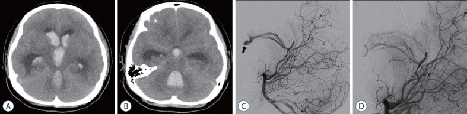
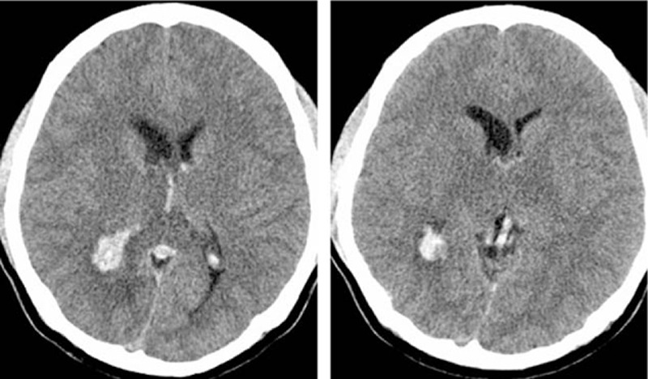
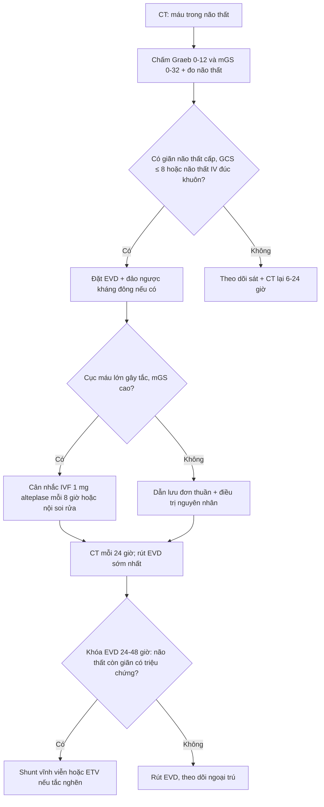
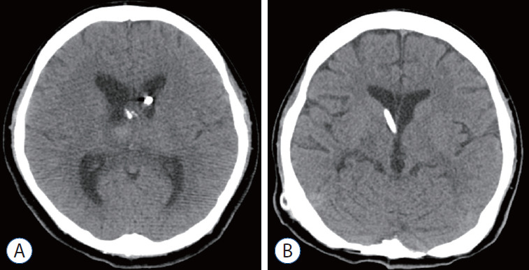

# 3034 — Chảy máu não thất (IVH) & não úng thủy sau xuất huyết: Graeb 0–12, mGS 0–32, CLEAR III và ngưỡng đặt shunt

**Tags:** `pattern:chay-mau-nao-that` `pattern:gian-nao-that` `pattern:nao-ung-thuy-sau-xuat-huyet` `vung:nao-that` `score:Graeb` `score:mGS` `score:IVH-score` `protocol:CT-so-nao` `protocol:EVD` `protocol:rua-nao-that`
**Mức chắc chắn (certainty):** tổng hợp y văn (literature synthesis) — ghép **RCT CLEAR III** (PMC6108339), **meta-analysis IVF 19 nghiên cứu/1.020 ca** (PMC7012971), **so sánh nội soi rửa não thất vs EVD** (PMC13320334), **nhiễm trùng EVD** (PMC12819451), **Graeb/mGS/IVH score** (PMC12839113, PMC13458277, PMC11568315, PMC9028147), **review não úng thủy sau IVH** (PMC12399821) và **3 ca có ảnh CT** (PMC8918245, PMC4956778).

> **Câu hỏi thực hành:** nam 58 tuổi, **tăng huyết áp, đột ngột hôn mê**, CT sọ thấy **máu lấp cả hai não thất bên + não thất IV căng tròn**. Người trực hỏi: **chấm điểm gì, có đặt EVD không, có bơm rt-PA vào não thất không, và khi nào phải đặt shunt vĩnh viễn?**
> Bài chốt theo **ba trục**: (1) **đo mức máu** — Graeb **0–12** cho thấy máu *nhiều hay ít*, mGS **0–32** cho thấy *máu còn đang chảy hay đã đông*, IVH score **0–23** gộp cả não úng thủy; (2) **giải áp** — EVD khi có **giãn não thất cấp/GCS ≤ 8/não thất IV bị đúc khuôn**, rửa não thất (IVF/nội soi) **không cải thiện chức năng** dù **giảm tử vong** (CLEAR III); (3) **shunt** — chỉ khi **cai EVD thất bại**, và **nội soi rửa não thất giảm shunt 13% vs 26%**. Nối [212 – Xuất huyết nội sọ](../212-xuat-huyet-so-nao/lesson.md), [218 – Thoát vị não & não úng thủy](../218-thoat-vi-nao-ung-thuy/lesson.md), [3032 – iNPH](../3032-nao-ung-thuy-ap-luc-binh-thuong/lesson.md), [216 – Huyết khối tĩnh mạch não](../216-di-dang-mach-CVST/lesson.md).

## 1. Tổng quan bệnh học – cơ chế hình ảnh: vì sao máu trong não thất vừa chèn ép vừa làm hỏng hấp thu dịch

- **Hai cơ chế song song, không thay thế nhau:**
  1. **Tắc nghẽn cơ học (obstructive):** cục máu đông bít **lỗ Monro → não thất bên giãn**, bít **cống Sylvius/não thất IV → giãn ngược dòng nhanh**; đây là lý do **não thất IV bị đúc khuôn (cast) là cấp cứu**, vì nó vừa tắc dòng ra vừa **chèn ép thân não**.
  2. **Hỏng hấp thu (communicating):** hồng cầu ly giải → **hemoglobin, sắt, heme** → stress oxy hóa và **ferroptosis**; **thrombin** và **TGF-β1** gây **xơ hóa màng nhện/hạt màng nhện** và **tổn thương biểu mô não thất** → sau nhiều tuần não thất vẫn giãn dù máu đã tan (PMC12399821).
- **Vì sao máu cấp sáng trên CT:** hemoglobin chứa **sắt** hấp thụ tia X mạnh; máu tụ cấp điển hình **50–80 HU**, trong khi **dịch não tủy 0–15 HU** → chênh **≥ 35 HU** nên nhìn thấy rõ ngay cả khi lượng máu ít. Khi cục máu **co lại và ly giải**, tỷ trọng giảm dần nên **mức máu–dịch (blood–CSF level)** là dấu hiệu của máu *đang lắng*, không phải máu mới.
- **Vì sao MRI khác CT:** chuỗi **deoxyhemoglobin** (T2 tối), **methemoglobin** (T1 sáng), **hemosiderin** (SWI blooming) giúp phân biệt **máu cũ – máu mới** khi CT đã đồng tỷ trọng; **DWI/ADC** phát hiện **nhồi máu biểu mô quanh não thất** do chèn ép.
- **Tần suất và tiên lượng (số phải nhớ):**
  - **IVH xuất hiện ở 30–45%** ca xuất huyết nội sọ (PMC13458277); **IVH nguyên phát chỉ ~3%** ca xuất huyết nội sọ tự phát (PMC12883228).
  - **Tử vong chung ~50%** ở IVH nặng — con số mở đầu của CLEAR III (PMC6108339).
  - **Thang điểm:** Graeb gốc **0–12**; **modified Graeb (mGS) 0–32**; **IVH score 0–23** = **3×(thất phải + thất trái) + thất III + thất IV + 3×não úng thủy (1/0)** (PMC12839113).
  - **Điểm càng cao, chết càng nhiều:** theo thang vị trí IVH (ITS), tử vong 30 ngày **0,9% ở điểm 0** và **90,6% ở điểm 9** (PMC13458277).
  - **mGS dự báo não úng thủy cấp:** mỗi **1 điểm mGS** → **OR 1,362 (1,286–1,548)**; nhóm có não úng thủy có **mGS trung vị 20 (14–23)** so với **0 (0–3)** ở nhóm không; mô hình **AUC 0,974–0,981** (PMC11568315).
  - **Ngưỡng giãn não thất trên CT:** **Evans > 0,3**; **sừng trán > 45 mm**; **não thất III > 6 mm**; **não thất IV > 12 mm** (PMC13458277).

## 2. Mẫu hình + chẩn đoán phân biệt theo vị trí (gamut)

- **Mẫu hình cốt lõi:** **hôn mê/giảm tri giác sau đột quỵ hoặc chấn thương + máu trong não thất**, thường kèm **giãn não thất** và **đau đầu, nôn, rối loạn ý thức tiến triển**.
- **Gamut theo khoang bị lấp:**
  1. **Chỉ não thất bên** — thường do xuất huyết đồi thị/hạch nền lan vào; ít chèn ép thân não nhưng dễ tắc lỗ Monro.
  2. **Não thất III + hai thất bên** — tắc lỗ Monro/cống; **giãn nhanh trong vài giờ**.
  3. **Não thất IV đúc khuôn** — **chèn ép thân não + tắc dòng ra**, tử vong nhanh nếu không giải áp; đây là hình thái **không được bỏ** trên lát cắt ngang dày.
  4. **Máu lan vào khoang dưới nhện kèm IVH** — vỡ phình/AVM; phải tìm **phình trên CTA**.
- **Gamut theo nguyên nhân (5 nhóm chính):**
  - **Tăng huyết áp** (đồi thị, hạch nền → lan não thất) — hay gặp nhất ở người lớn.
  - **Vỡ phình/SAH** — IVH kèm máu khoang dưới nhện, **modified Fisher cao**.
  - **Huyết khối tĩnh mạch não (CVST)** — đồi thị **giảm tỷ trọng hai bên**, **tĩnh mạch Galen/xoang thẳng tăng tỷ trọng**, nhồi máu đồi thị; dễ bị gọi nhầm là “IVH nguyên phát”.
  - **AVM/dị dạng mạch** — thấy **nidus/tĩnh mạch giãn** trên CTA/DSA.
  - **Rối loạn đông máu/kháng đông, chấn thương, u** — không có nguyên nhân mạch máu trên CTA thì phải hỏi **INR/DOAC/tiểu cầu** và **tiền sử chấn thương**.
- **Mnemonic “IVH–5T”:** **T**halamic (tăng huyết áp), **T**ear (phình/AVM vỡ), **T**hrombosis (CVST), **T**rauma, **T**hinners (kháng đông/rối loạn đông máu).

*A–B: CT không cản quang — máu trong não thất bên, **não thất IV căng tròn chèn ép thân não** (mũi tên nhìn thấy trên B). C–D: DSA xác định **nidus AVM trong não thất** — nguyên nhân gốc. Nguồn: J Korean Neurosurg Soc 2022 (PMC8918245), CC BY-NC 4.0.*

## 3. Bảng so sánh phân biệt (ma trận đối chiếu)

| Thực thể (entity) | Hình ảnh điển hình (CT/MRI) | Chốt vào (rule-in) | Chốt loại (rule-out) | Gợi ý xác nhận |
|---|---|---|---|---|
| **IVH do tăng huyết áp** | Ổ máu **đồi thị/hạch nền** lan vào não thất; máu trong thất bên cùng bên; não thất giãn | **Ổ máu nhu mô ≥ 1 cm kèm IVH + tăng huyết áp + không phình trên CTA** | **Không có ổ máu nhu mô + máu đối xứng hai thất + đồi thị giảm tỷ trọng** → nghĩ CVST | CT sọ, CTA; kiểm huyết áp, thuốc kháng đông |
| **IVH do vỡ phình (aSAH)** | Máu khoang dưới nhện dày + IVH; **phình trên CTA**; giãn não thất sớm | **Máu dưới nhện + phình + giãn não thất cấp** | **Không phình trên CTA chất lượng tốt + không máu dưới nhện** → loại | **CTA bắt buộc**; DSA nếu CTA âm mà nghi cao |
| **IVH do CVST** | **Đồi thị giảm tỷ trọng hai bên**, **tĩnh mạch Galen/xoang thẳng tăng tỷ trọng**, IVH; MRI có phù đồi thị | **Tắc xoang trên MRV/CTV + đồi thị hai bên bất thường** | **MRV thông toàn bộ + không phù đồi thị** → loại CVST | **MRV/CTV**, D-dimer; kháng đông dù có IVH |
| **IVH do AVM/dị dạng** | Nidus/tĩnh mạch giãn cạnh não thất; máu não thất đơn thuần; có thể có nidus nhỏ | **Nidus trên DSA/CTA + tuổi trẻ + không tăng huyết áp** | **DSA âm hoàn toàn** → loại AVM lớn (còn u mạch nhỏ) | **DSA** là chuẩn; MRI/SWI tìm nidus |
| **IVH nguyên phát (primary IVH)** | Máu **chỉ trong não thất**, không ổ máu nhu mô; ~3% xuất huyết nội sọ tự phát | **Không ổ máu nhu mô + không phình/AVM/CVST trên CTA-MRV** | **Có ổ máu nhu mô, phình, tắc xoang** → không phải nguyên phát | CTA + MRV + xét nghiệm đông máu |
| **IVH do rối loạn đông máu/kháng đông** | Máu nhiều khoang, **mức máu–dịch**, không ổ máu điển hình; có thể tái chảy | **INR > 1,5 hoặc DOAC gần đây + máu lan tỏa** | **INR/tiểu cầu bình thường + có nguyên nhân mạch máu** → loại | INR, aPTT, tiểu cầu, anti-Xa; **đảo ngược trước EVD** |
| **IVH sau chấn thương** | Máu não thất + **dập não/tụ máu dưới màng cứng/SAH chấn thương**; “Traumatic Graeb” | **Cơ chế chấn thương + tổn thương nhu mô/màng não kèm theo** | **Không cơ chế chấn thương + không tổn thương ngoài não thất** → loại | CT xương sọ, CT sọ lại sau 6–24 giờ |

*Hai lát cắt ngang: máu trong sừng chẩm hai não thất bên, **tĩnh mạch Galen/xoang thẳng tăng tỷ trọng**, và **đồi thị giảm tỷ trọng đối xứng** — bộ ba của **huyết khối tĩnh mạch não**, không phải “IVH nguyên phát”. Nguồn: Medicine (Baltimore) 2016 (PMC4956778), CC BY-NC 4.0.*

### Ba thang điểm — chọn cái nào?
- **Graeb gốc (1982, 0–12):** mỗi **thất bên 1–4** (1 vệt máu, 2 < ½, 3 > ½, 4 lấp đầy và giãn); **thất III và thất IV 0–2** (0 không máu, 1 có máu nhưng kích thước bình thường, 2 lấp đầy và giãn). Nhanh, dùng hằng ngày; **Graeb > 6/12** từng được gắn với nguy cơ não úng thủy (PMC11568315).
- **modified Graeb (mGS, 0–32):** chia nhỏ **sừng trán/thân/sừng chẩm từng thất bên + thất III + thất IV**, mỗi khoang 0–4 → nhạy hơn với **máu còn tiến triển**; **mGS > 16/32** là ngưỡng hay gặp ở ca có não úng thủy cấp (PMC11568315).
- **IVH score (2009, 0–23):** gộp **lượng máu + não úng thủy**, dự báo **tử vong và kết cục chức năng**; cả ba thang có **AUC 0,70–0,74** cho kết cục 12 tháng, **Graeb và IVH score mạnh nhất cho shunt** (PMC12839113).

## 4. Protocol chụp + hệ phân độ/điểm chuẩn hóa

- **CT sọ không cản quang, lát ≤ 5 mm, toàn bộ não thất** — chụp ngay khi nghi IVH; **đo Graeb/mGS + đo não thất** (Evans, sừng trán, thất III, thất IV) và **ghi rõ não thất IV có bị đúc khuôn hay không**.
- **CTA** khi có **máu khoang dưới nhện, phình nghi ngờ, AVM, hoặc IVH “nguyên phát”**; **MRV/CTV** khi **đồi thị hai bên bất thường hoặc đau đầu kiểu CVST**; **DSA** khi CTA âm nhưng nghi AVM nhỏ hoặc cần can thiệp.
- **EVD (dẫn lưu não thất ra ngoài) — chỉ định:** **giãn não thất cấp có triệu chứng**, **GCS ≤ 8**, **não thất IV bị đúc khuôn**, **giãn sừng thời gian** trên CT, hoặc **mGS cao kèm suy giảm tri giác**. Đặt **lỗ Kocher (trước 10–11 cm, cách đường giữa 2–3 cm)**, đầu catheter **5–7 cm** vào não thất bên phải; kiểm vị trí bằng CT.
- **Nhiễm trùng EVD (EVDAI) — con số phải nhớ:** **14% theo bệnh nhân (27/194)**, **12% theo catheter (27/228)**, trên **2.258 ngày EVD**; **BNI grade 4 OR 6,66 (2,04–21,68)** và **mỗi điểm IVH score OR 1,33** cho EVDAI (PMC12819451). Vì vậy **rút EVD sớm nhất có thể** và **không để EVD “phòng xa” khi không còn chỉ định**.
- **Rửa não thất bằng rt-PA (intraventricular fibrinolysis — IVF):**
  - **CLEAR III (n = 500):** **1 mg alteplase mỗi 8 giờ, tối đa 12 liều** qua EVD; **mRS ≤ 3 lúc 180 ngày 48% vs 45%** (RR 1,06; 0,88–1,28; p = 0,554) → **không cải thiện chức năng**; nhưng **tử vong 18% vs 29%** (HR 0,60; 0,41–0,86; p = 0,006), **viêm não thất 7% vs 12%**, **chảy máu có triệu chứng 2% vs 2%** (PMC6108339).
  - **Meta-analysis 19 nghiên cứu/1.020 ca:** tử vong **RR 0,58 (0,47–0,72)**, tắc EVD **RR 0,41 (0,22–0,74)**, thời gian sạch não thất **−4,05 ngày**; **không khác biệt** về kết cục chức năng tốt (**RR 1,41; 0,98–2,03**) hay **shunt (RR 0,93; 0,70–1,22)**; sau hiệu chỉnh thiên lệch công bố, **chảy máu nội sọ RR 1,67 (1,01–2,74)** (PMC7012971).
  - **Kết luận thực hành:** IVF **giảm chết và giảm tắc ống**, **không làm bệnh nhân tỉnh tốt hơn** — dùng khi **cục máu lớn gây tắc**, không dùng đại trà.
- **Nội soi rửa não thất (endoscopic lavage):** so với EVD đơn thuần, **giảm 66,7% khối máu trong não thất**, **EVD 3 vs 7 ngày**, **ICU 8 vs 25 ngày**, **shunt 13% vs 26%**, **mRS 0–3 lúc 90 ngày 52,1% vs 13,1%** (PMC13320334) — dữ liệu quan sát, chưa có RCT lớn.
- **Shunt vĩnh viễn — chỉ khi cai EVD thất bại:** thử **khóa EVD 24–48 giờ**, theo dõi **tri giác, ICP, lượng dịch não tủy/ngày và kích thước não thất trên CT**; **shunt** khi **giãn não thất tái phát có triệu chứng**, **không cai được**, hoặc **mGS cao + não thất IV từng bị đúc khuôn**. **ETV** chỉ đặt khi **não úng thủy tắc nghẽn còn thông khoang đáy**; ở não úng thủy sau IVH **thành công chỉ 37–45%** và **thất bại sớm > 30% trong 6 tháng** (PMC12399821).
- **Điều trị nguyên nhân song song:** vỡ phình → **coil/clip sớm**; CVST → **kháng đông** dù có IVH (quyết định theo ca, nối [216](../216-di-dang-mach-CVST/lesson.md)); rối loạn đông máu → **đảo ngược trước khi đặt EVD** (nối [3025](../3025-dao-nguoc-khang-dong-xuat-huyet-noi-so/lesson.md)).

## 5. Biến thể bình thường và cạm bẫy

- **“Máu trong não thất” không đồng nghĩa “IVH nguyên phát”:** ca CVST (ảnh mục 3) có **đồi thị giảm tỷ trọng + tĩnh mạch Galen tăng tỷ trọng** — nếu chỉ chấm Graeb rồi đặt EVD mà **không chụp MRV**, bỏ sót nguyên nhân **điều trị được bằng kháng đông**.
- **Não thất IV bị đúc khuôn dễ bỏ trên lát cắt dày:** não thất IV **nằm thấp, sát thân não**; lát **> 5 mm** hoặc không dựng **sagittal/coronal** dễ đọc “không thấy máu” — luôn **xem lại 3 bình diện** và ghi rõ trong báo cáo.
- **Giãn não thất do teo não (ex vacuo) không phải não úng thủy cấp:** phân biệt bằng **rãnh vỏ giãn theo**, **không có sừng thời gian căng**, **không có mức máu–dịch mới**; đặt EVD ở ca này **không giúp và tăng nhiễm trùng**.
- **Máu–dịch giả trên CT:** **đám rối mạch mạc vôi hóa**, **đầu catheter**, **khí trong não thất sau thủ thuật** đều tăng/giảm tỷ trọng; so với **mức ngang hoàn toàn** và **vị trí giải phẫu** trước khi gọi IVH.
- **Tự lừa bằng “EVD đã đặt là xong”:** EVD **không điều trị nguyên nhân** và **không ngăn được shunt**; **14%/12% nhiễm trùng** và **tắc ống** là lý do phải **đánh giá lại chỉ định mỗi ngày**.
- **IVF không phải “bơm là khỏi”:** CLEAR III **không cải thiện mRS** dù **giảm tử vong**; đừng hứa với gia đình “rửa não thất sẽ hồi phục chức năng”.
- **Ca “bảo tồn tốt hơn mổ” có thể do chọn bệnh:** nghiên cứu 40 ca báo **cải thiện 90% vs 60%** và **tử vong 10% vs 40%** ở nhóm bảo tồn (PMC12883228), nhưng **nhóm mổ nặng hơn** (liệt nửa người 85% vs 55%) — **không dùng để trì hoãn EVD ở ca có giãn não thất cấp**.
- **Chấm điểm khác nhau giữa các bác sĩ:** Graeb/mGS có **độ đồng thuận trung bình**; nên **ghi rõ khoang nào bị lấp** kèm điểm, và **so sánh với CT trước** thay vì chỉ dùng tổng điểm.

## 6. Tự lượng giá — Blind Quiz ngay trên trang tĩnh

**Ca 1 — Nam 58 tuổi, hôn mê sau đột ngột đau đầu. Nhìn 4 ô (A–D): mô tả trước khi đọc đáp án.**

- Gợi ý lâm sàng: không chấn thương, huyết áp bình thường, không dùng kháng đông.
- Câu hỏi: **máu lấp khoang nào?** **não thất IV có bị đúc khuôn không?** **Graeb/mGS ước lượng?** **bước tiếp theo ngoài EVD là gì?**

<b>Bấm để hiện đáp án (findings + chẩn đoán)</b>

- Dấu hiệu: **A–B** — máu lấp hai não thất bên và **não thất IV căng tròn** (đúc khuôn), giãn não thất bên; **C–D** — DSA có **nidus AVM trong não thất** với phình nội nidus.
- Chẩn đoán: **IVH ồ ạt do vỡ AVM trong não thất** — máu vừa tắc dòng dịch vừa **chèn ép thân não**.
- Điểm: Graeb **cao (≈ 10–12/12)** vì thất bên lấp gần đầy và thất IV căng; mGS tương ứng **> 20/32**.
- Xử trí: **EVD giải áp + can thiệp AVM (nút/mổ)**; ca này còn **mở sọ lấy máu não thất IV** và **rt-PA vào não thất** (ảnh mục 6 ca 3).
- Nguồn ảnh: J Korean Neurosurg Soc 2022 (PMC8918245), CC BY-NC 4.0.

**Ca 2 — Nam 24 tuổi, đau đầu và giảm trí nhớ vài ngày, CT thấy máu trong não thất. Chẩn đoán là gì?**

- Câu hỏi: **ngoài máu não thất còn dấu hiệu nào?** **vì sao không được gọi là IVH nguyên phát?** **xét nghiệm/hình ảnh nào chốt?**

<b>Bấm để hiện đáp án</b>

- Dấu hiệu: máu ở **sừng chẩm hai não thất bên**; **tĩnh mạch Galen/xoang thẳng tăng tỷ trọng**; **đồi thị giảm tỷ trọng đối xứng**.
- Chẩn đoán: **huyết khối tĩnh mạch não (CVST)** gây nhồi máu đồi thị và lan máu vào não thất — không phải IVH nguyên phát.
- Chốt: **MRV/CTV** thấy mất dòng xoang thẳng/Galen; **D-dimer**; điều trị **kháng đông** (quyết định cá thể khi có IVH).
- Cạm bẫy: chỉ chấm Graeb rồi đặt EVD mà bỏ MRV → **bỏ sót nguyên nhân điều trị được**.
- Nguồn ảnh: Medicine (Baltimore) 2016 (PMC4956778), CC BY-NC 4.0.

**Ca 3 — Bệnh nhân IVH nặng sau 8 liều rt-PA vào não thất; 18 tháng sau chụp lại. Hai ảnh nói gì về hiệu quả và biến chứng?**

- Câu hỏi: **A cho thấy gì?** **B cho thấy gì?** **vì sao vẫn phải đặt shunt dù máu đã tan?**

<b>Bấm để hiện đáp án</b>

- A: sau **8 liều rt-PA trong 4 ngày**, máu não thất gần như sạch, còn **đầu catheter EVD**; não thất giảm giãn.
- B: sau **shunt 18 tháng**, não thất **kích thước bình thường**, không giãn tái phát.
- Vì sao vẫn shunt: máu tan **không hồi phục hấp thu dịch** — xơ hóa màng nhện/hạt màng nhện do hemoglobin, thrombin, TGF-β1 (PMC12399821); **nội soi rửa giảm shunt (13% vs 26%)** nhưng **không loại bỏ hoàn toàn** (PMC13320334).
- Nguồn ảnh: J Korean Neurosurg Soc 2022 (PMC8918245), CC BY-NC 4.0.

## Bài liên quan chéo
- [212 – Xuất huyết nội sọ: ICH score, spot sign, thái độ với máu tụ](../212-xuat-huyet-so-nao/lesson.md)
- [218 – Thoát vị não & não úng thủy tắc nghẽn](../218-thoat-vi-nao-ung-thuy/lesson.md)
- [3032 – Não úng thủy áp lực bình thường (iNPH): DESH & ngưỡng shunt](../3032-nao-ung-thuy-ap-luc-binh-thuong/lesson.md)
- [216 – Huyết khối tĩnh mạch não (CVST)](../216-di-dang-mach-CVST/lesson.md)
- [3025 – Đảo ngược kháng đông trong xuất huyết nội sọ](../3025-dao-nguoc-khang-dong-xuat-huyet-noi-so/lesson.md)
- [3024 – Chọc dò tủy sống quanh tiêu sợi huyết](../3024-choc-do-tuy-song-quanh-tieu-soi-huyet-khoi/lesson.md)
- [201 – Protocol sọ não](../201-protocol-so-nao/lesson.md)

> Không dùng để chẩn đoán độc lập khi chưa có người hướng dẫn.
