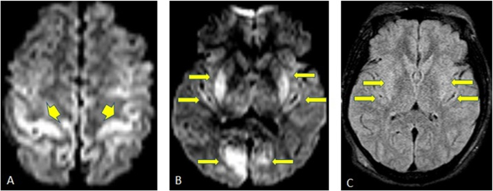
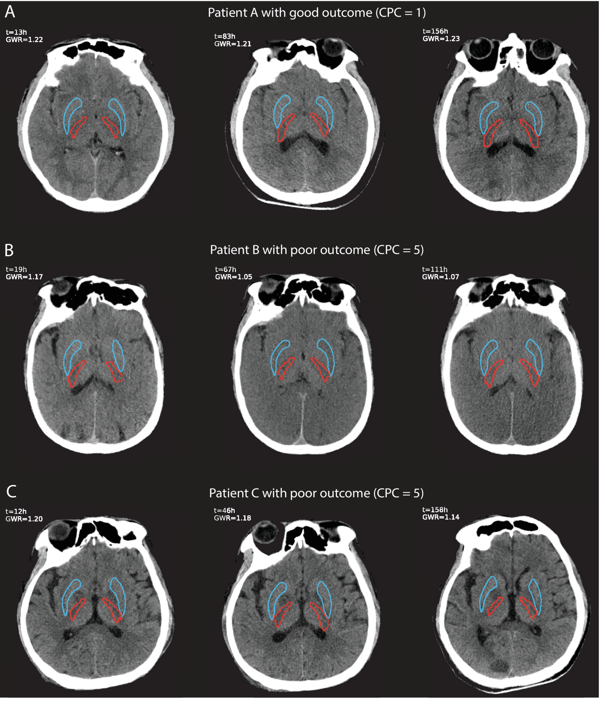
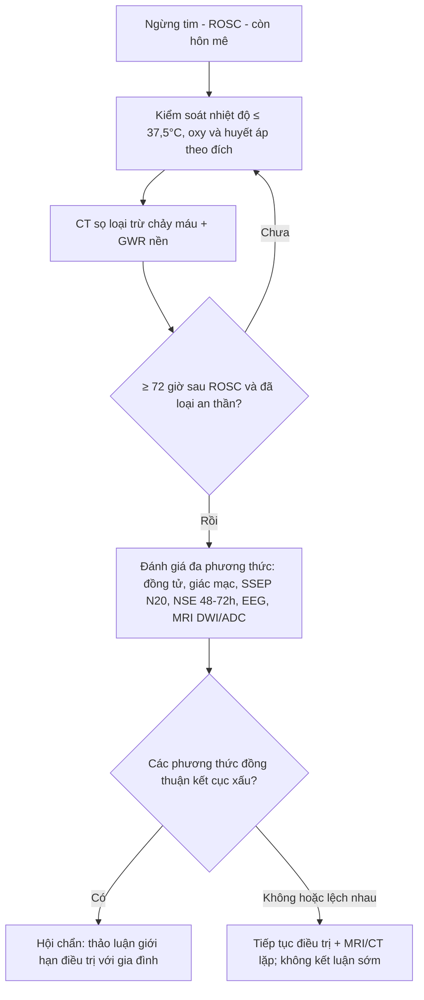
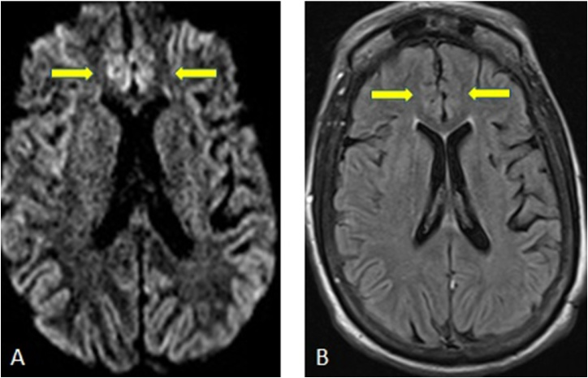

# 3035 — Bệnh não thiếu oxy–thiếu máu cục bộ (HIE) sau ngừng tim ở người lớn: DWI/ADC, GWR và ngưỡng dự báo 72 giờ

**Tags:** `pattern:han-che-khuếch-tan` `pattern:vo-nao` `pattern:hach-nen` `pattern:phu-doc-te-bao` `vung:nao` `score:GWR` `score:ADC` `protocol:CT-so-nao` `protocol:MRI-so-nao` `protocol:du-bao-sau-ngung-tim`
**Mức chắc chắn (certainty):** tổng hợp y văn (literature synthesis) — ghép **nghiên cứu DWI siêu sớm < 6 giờ** (PMC9837995), **GWR tự động theo thời điểm** (PMC12751271), **rapid review GWR người lớn–trẻ em** (PMC13129448), **review tổng hợp khuyến cáo ERC/ESICM 2025** (PMC13038935), **thực hành dự báo đa phương thức** (PMC13363386), **review chẩn đoán phân biệt tổn thương vỏ lan tỏa trên DWI** (PMC6231053) và **3 ca có ảnh**.

> **Câu hỏi thực hành:** nam 55 tuổi, **ngừng tim ngoài bệnh viện, được hồi sinh sau 20 phút**, nhập ICU còn hôn mê. Ngày thứ 2 gia đình hỏi “có cứu được không”, người trực định **chụp CT rồi kết luận**. Câu hỏi: **chụp gì, đọc gì, và vì sao chưa được kết luận ở ngày thứ 2?**
> Bài chốt theo **ba trục**: (1) **cơ chế** — thiếu ATP làm **phù độc tế bào (cytotoxic edema)** → **ADC tối** trong vài phút, trong khi **CT/FLAIR còn bình thường**; (2) **định lượng** — **DWI/ADC** sớm có **độ đặc hiệu 100% nhưng độ nhạy chỉ 74,2%**, **GWR tự động** tăng độ chính xác khi chụp **sau 24 giờ**; (3) **dự báo** — **đa phương thức, ≥ 72 giờ sau ROSC**, không dựa một xét nghiệm. Nối [211 – Đột quỵ não](../211-dot-quy-nao/lesson.md), [3033 – Wernicke](../3033-benh-nao-wernicke-thieu-thiamin/lesson.md), [3031 – PRES](../3031-pres-benh-nao-sau-phuc-hoi/lesson.md), [201 – Protocol sọ não](../201-protocol-so-nao/lesson.md).

## 1. Tổng quan bệnh học – cơ chế hình ảnh: vì sao não ngừng tim lại “sáng” trên DWI trước khi sáng trên CT

- **Dòng thác phân tử:** ngừng tuần hoàn → **thiếu oxy + thiếu glucose** → **sụp ATP** → **bơm Na⁺/K⁺-ATPase ngừng hoạt động** → **Na⁺ và nước vào tế bào** → **phù độc tế bào (cytotoxic edema)**. Nước chuyển từ ngoại bào vào nội bào làm **khoảng khuếch tán bị thu hẹp** → **DWI sáng, ADC tối**; hiện tượng này xảy ra **trong vài phút**, trước khi có thay đổi mô học thấy được trên CT.
- **Vì sao CT chậm hơn:** CT chỉ thấy **mất phân biệt xám–trắng** khi phù làm **giảm tỷ trọng chất xám** (bình thường **35–45 HU**) xuống gần chất trắng (**20–30 HU**); phải mất **hàng giờ đến vài ngày** mới đủ rõ. Vì vậy **CT bình thường trong 6 giờ đầu không loại trừ HIE**.
- **Tế bào nào chết trước (selective vulnerability):** **lớp III, V, VI vỏ não**, **CA1 hải mã**, **tế bào Purkinje tiểu não**, **hạch nền/đồi thị** — nơi có nhu cầu chuyển hóa cao nhất → tổn thương **đối xứng**, lan theo **dải vỏ (cortical ribbon)** chứ không theo lãnh thổ mạch.
- **Vì sao có “dấu hiệu giả” trên CT:**
  - **Mất phân biệt xám–trắng** → tính **GWR (gray–white matter ratio)** = HU chất xám / HU chất trắng (thường dùng **nhân đuôi, nhân bèo, đồi thị / nhánh sau bao trong**).
  - **Pseudosubarachnoid hemorrhage:** vỏ não mất tỷ trọng trong khi **bể đáy vẫn đậm** → trông như **chảy máu dưới nhện** dù không có máu.
  - **White cerebellum sign:** tiểu não **được bảo tồn** nên **sáng tương đối** so với đại não đã phù; **reversal sign:** đảo ngược tương quan xám–trắng — cả hai là dấu hiệu **muộn, tiên lượng rất xấu**, không nhạy.
  - **T1 sáng vỏ não (pseudolaminar necrosis):** xuất hiện **1–2 tuần** sau, là **hoại tử vỏ**, **không phải xuất huyết** — đừng gọi nhầm là máu.
- **Ngưỡng định lượng phải nhớ:**
  - **ADC < 650 × 10⁻⁶ mm²/s** là ngưỡng hay dùng để định nghĩa **vùng hạn chế khuếch tán**; tỷ lệ thể tích não dưới ngưỡng (**PV650**) **> 28,8%** dự báo kết cục xấu với **AUC 0,83**, **độ nhạy 48,4%** ở **độ đặc hiệu 100%** (PMC9837995).
  - **Có HSI (high signal intensity) trên DWI/ADC trong 6 giờ đầu:** **0/46 ca có kết cục tốt**, so với **48/64 (75%)** ca không có HSI; **AUC 0,87**, **độ nhạy 74,2%**, **độ đặc hiệu 100%** (PMC9837995).
  - **GWR tự động:** **AUC 0,72 (< 24 giờ)**, **0,78 (24–96 giờ)**, **0,81 (96–168 giờ)**, **0,83** khi thêm **diễn tiến theo thời gian**; GWR **giảm dần** ở nhóm kết cục xấu sau 24 giờ, **ổn định** ở nhóm tốt (PMC12751271).
  - **GWR người lớn:** nhóm tốt **1,18–1,35**, nhóm xấu **1,06–1,31** — **chồng lấp đáng kể**, nên **không có một ngưỡng tuyệt đối dùng cho mọi ca**; **trẻ em có GWR thấp hơn**, không áp ngưỡng người lớn (PMC13129448).
  - **DWI siêu sớm trong 6 giờ** có thể **âm tính** vì độ nhạy thấp; **MRI lặp 72–96 giờ** mới đủ tin cậy (PMC9837995, PMC12751271).

## 2. Mẫu hình + chẩn đoán phân biệt theo vị trí (gamut)

- **Mẫu hình cốt lõi:** **hôn mê sau ngừng tim + hạn chế khuếch tán đối xứng ở vỏ não và/hoặc hạch nền – đồi thị**, không theo lãnh thổ mạch; thường kèm **mất phân biệt xám–trắng trên CT**.
- **Gamut theo vị trí tổn thương:**
  1. **Vỏ não lan tỏa (cortical ribboning)** — thể hay gặp nhất ở người lớn; **DWI sáng dọc bờ vỏ** ở nhiều thùy, **không theo một động mạch**.
  2. **Hạch nền – đồi thị hai bên** — tổn thương **sâu**, tiên lượng xấu hơn; gặp khi **ngừng tim kéo dài** hoặc **ngộ độc CO/cyanide**.
  3. **Hải mã** — tổn thương **nhỏ, dễ bỏ** trên lát dày; giải thích **di chứng trí nhớ** ở người sống.
  4. **Tiểu não** — thường **được bảo tồn** → **white cerebellum sign**; tổn thương tiểu não đơn độc **hiếm** và gợi ý nguyên nhân khác (ngộ độc, bệnh chuyển hóa).
  5. **Chất trắng** — **delayed post-anoxic leukoencephalopathy** xuất hiện **1–4 tuần** sau hồi phục ban đầu rồi **sa sút muộn**.
  6. **Phù lan tỏa – mất phân biệt xám–trắng toàn bộ** — hình thái **gần chết não**, cần **đánh giá chết não** theo quy trình.
- **Gamut theo nguyên nhân (khi tổn thương đối xứng):** **HIE sau ngừng tim** · **hạ đường huyết** · **động kinh liên tục** · **CJD** · **bệnh não gan** · **PRES/RCVS** · **Wernicke** · **hủy myelin thẩm thấu** · **ngộ độc CO/cyanide/methanol** · **bệnh ty thể (MELAS)**. **Bối cảnh + phân bố + xét nghiệm** quyết định, không dựa một ổ sáng.

*A: DWI — **hạn chế khuếch tán vỏ não vùng quanh trung tâm (perirolandic)**. B: DWI — **hạch nền, vỏ sau đảo và vỏ chẩm hai bên**. C: FLAIR — **thay đổi rất nhẹ**, chứng minh DWI sớm hơn FLAIR. Nguồn: Eur J Radiol Open 2018 (PMC6231053), CC BY-NC-ND 4.0.*

## 3. Bảng so sánh phân biệt (ma trận đối chiếu)

| Thực thể (entity) | Hình ảnh điển hình (CT/MRI) | Chốt vào (rule-in) | Chốt loại (rule-out) | Gợi ý xác nhận |
|---|---|---|---|---|
| **HIE sau ngừng tim** | **DWI sáng/ADC tối đối xứng vỏ não ± hạch nền, hải mã**; CT mất phân biệt xám–trắng, **GWR thấp**; T1 sáng vỏ muộn | **Bối cảnh ngừng tim/ROSC + tổn thương đối xứng không theo lãnh thổ + ADC tối** | **Tổn thương một bên/theo lãnh thổ mạch** → nhồi máu; **đường huyết thấp** → hạ đường huyết | **DWI/ADC 72–96 giờ**, GWR, NSE, SSEP, EEG |
| **Hạ đường huyết** | **Vỏ não (đỉnh–chẩm, parasagittal) + hạch nền + hải mã** hạn chế khuếch tán; **đồi thị thường được bảo tồn** | **Glucose máu thấp lúc hôn mê + tổn thương vỏ/hạch nền hồi phục sau bù glucose** | **Glucose bình thường + tổn thương đồi thị nổi bật** → nghĩ HIE/ngộ độc | **Glucose mao mạch/venous**, đáp ứng lâm sàng sau bù |
| **Động kinh liên tục (status epilepticus)** | Hạn chế khuếch tán **vỏ theo vùng động kinh**, có thể **một bên**, kèm **phù FLAIR**; hồi phục sau kiểm soát cơn | **EEG có cơn liên tục + tổn thương vỏ khớp vùng ictal** | **EEG không có cơn + tổn thương đối xứng toàn bộ** → không phải SE | **EEG khẩn**, MRI lặp sau kiểm soát cơn |
| **CJD** | **Cortical ribboning + hạch nền/đồi thị**, **DWI sáng**, teo nhanh; **không có bối cảnh ngừng tim** | **Sa sút nhanh + myoclonus + DWI vỏ/hạch nền + RT-QuIC/14-3-3** | **Khởi phát cấp sau ROSC + hồi phục một phần** → HIE | EEG, RT-QuIC, MRI lặp 2–4 tuần |
| **Bệnh não gan** | **T1 sáng đối xứng hạch nền (globus pallidus)**, có thể hạn chế khuếch tán vỏ; **không mất phân biệt xám–trắng kiểu HIE** | **Xơ gan + amoniac cao + rung giật gan bàn tay** | **T1 không sáng hạch nền + bối cảnh ngừng tim** → HIE | Amoniac, chức năng gan, đáp ứng lactulose |
| **PRES/RCVS** | **Phù vận mạch đỉnh–chẩm**, FLAIR sáng nhưng **ADC tăng** (không hạn chế); có thể xuất huyết | **Tăng huyết áp/ thuốc ức chế miễn dịch + phù vùng sau, ADC tăng** | **ADC tối lan tỏa vỏ + bối cảnh ngừng tim** → HIE | MRI + MRV; theo dõi huyết áp |
| **Wernicke (thiếu thiamin)** | **Thể vú, đồi thị trong, quanh cống Sylvius** đối xứng; DWI hạn chế ở thể cấp | **Bối cảnh rượu/dinh dưỡng + thể vú/quanh cống + đáp ứng thiamin** | **Tổn thương vỏ lan tỏa + hạch nền, không có thể vú** → HIE | Thiamin, MRI; **không chờ kết quả** |
| **Hủy myelin thẩm thấu** | **Cầu não trung tâm** hình “thỏi son”; thể ngoài cầu ở đồi thị/hạch nền | **Sửa Na⁺ quá nhanh (> 8–10 mmol/L/24 giờ)** | **Không rối loạn Na⁺ + tổn thương vỏ lan tỏa** → HIE | Điện giải đồ, tốc độ sửa Na⁺ |

*A: bệnh nhân kết cục **tốt** — GWR **1,22 → 1,21 → 1,23**, giữ phân biệt xám–trắng. B: kết cục **xấu** — GWR **1,17 → 1,05 → 1,07**, mất dần phân biệt. C: kết cục **xấu** — GWR **1,20 → 1,18 → 1,14**; **CT lúc 12 giờ còn “bình thường”** nhưng đã xấu dần. Nguồn: Crit Care 2025 (PMC12751271), CC BY-NC-ND 4.0.*

### Đọc GWR đúng — ba điều dễ sai
- **GWR không phải hằng số:** người lớn nhóm tốt **1,18–1,35**, nhóm xấu **1,06–1,31** — **chồng lấp**; trẻ nhỏ **thấp hơn** nên **không áp ngưỡng người lớn** (PMC13129448).
- **Thời điểm quan trọng hơn con số:** cùng một bệnh nhân, GWR **giảm thêm** sau 24 giờ là dấu hiệu xấu, dù giá trị tuyệt đối chưa “thấp” (PMC12751271).
- **Đo tự động ổn định hơn đo tay:** đặt ROI **nhân bèo/nhánh sau bao trong** bằng atlas giúp giảm lệch giữa người đọc (PMC12751271).

## 4. Protocol chụp + dự báo đa phương thức (hệ phân độ/điểm)

- **CT sọ không cản quang:** ngay khi nhập viện (loại trừ chảy máu, đánh giá phù, GWR nền) và **lặp 24–96 giờ**; **đo GWR tại nhân bèo/nhánh sau bao trong**, ghi **giá trị + thời điểm** vì **AUC tăng theo thời gian** (0,72 → 0,81).
- **MRI sọ:** **DWI + ADC** (bắt buộc), **FLAIR**, **T1** (tìm hoại tử vỏ muộn), **SWI** (loại xuất huyết); **lát 3–5 mm**. **Chụp sớm < 6 giờ có thể âm** (độ nhạy 74,2%) → **lặp 72–96 giờ** trước khi kết luận.
- **ADC định lượng:** ghi **ADC vùng tổn thương (× 10⁻⁶ mm²/s)** và **PV650** nếu phần mềm cho phép; **PV650 > 28,8%** là ngưỡng dự báo xấu ở độ đặc hiệu 100% (PMC9837995).
- **Kiểm soát và điều trị nền (2025 ERC/ESICM):**
  - **Nhiệt độ ≤ 37,5 °C trong 36–72 giờ**, **không hạ thân nhiệt thường quy 33 °C** (TTM2 không thêm lợi ích so với kiểm soát nhiệt độ) (PMC13038935).
  - **SpO₂ 94–98%**, **PaCO₂ 35–45 mmHg**, **MAP 60–65 mmHg** (cá thể hóa).
  - **EEG liên tục**, **điều trị cơn động kinh**, **không dùng thuốc chống động kinh dự phòng**.
  - **An thần ngắn**, ngừng đủ để **đánh giá thần kinh**.
- **Dự báo đa phương thức — KHÔNG trước 72 giờ sau ROSC, và không dựa một xét nghiệm:**
  - **Lâm sàng:** **mất phản xạ đồng tử tại ≥ 72 giờ**, **mất phản xạ giác mạc hai bên tại ≥ 72 giờ**, **myoclonus/status myoclonus** (kết hợp các test khác).
  - **SSEP:** **mất đáp ứng vỏ N20 hai bên** (có thể ghi từ **≥ 24 giờ**, dùng thuốc giãn cơ khi cần).
  - **NSE:** **> 60 µg/L tại 48 giờ và/hoặc 72 giờ**, **lấy serial 24–48–72 giờ**; xu hướng tăng càng xấu (PMC13038935).
  - **EEG:** **không dùng “mất phản ứng điện thế nền” đơn thuần** để dự báo (khuyến cáo chống).
  - **Hình ảnh:** **MRI DWI/ADC** và **CT GWR** là **bằng chứng bổ trợ**, không thay thế lâm sàng/SSEP.
- **Tránh tự ứng nghiệm (self-fulfilling prophecy):** chỉ **bàn giới hạn điều trị** khi **nhiều phương thức đồng thuận** và **đã loại yếu tố gây nhiễu** (an thần, giãn cơ, hạ thân nhiệt, suy gan/thận, nhiễm trùng). Trong một đơn vị chọn lọc, **MRI chỉ được dùng ở 27,8%** ca dự báo — khoảng trống thực hành rõ (PMC13363386).

## 5. Biến thể bình thường và cạm bẫy

- **CT/MRI bình thường trong 6 giờ đầu không loại trừ HIE:** DWI sớm chỉ **nhạy 74,2%**; **GWR < 24 giờ AUC 0,72** — **phải chụp lặp**.
- **Hạ đường huyết là kẻ bắt chước nguy hiểm:** tổn thương **vỏ + hạch nền + hải mã** giống HIE nhưng **đồi thị thường được bảo tồn** và **hồi phục sau bù glucose**; luôn **kiểm glucose trước khi kết luận** (PMC6231053).
- **Động kinh liên tục:** hạn chế khuếch tán **một bên/theo vùng**, **hồi phục sau kiểm soát cơn** — cần **EEG**, đừng gán HIE.
- **GWR bị nhiễu bởi:** **tuổi nhỏ** (GWR thấp hơn), **thiếu máu**, **thuốc cản quang**, **nhồi máu cũ**, **hạ thân nhiệt**; đo **một lát** dễ sai — dùng **atlas/đo lặp**.
- **“White cerebellum sign” và “reversal sign” là dấu hiệu muộn:** không xuất hiện sớm, **không dùng để loại trừ**; ngược lại, **không thấy không có nghĩa là nhẹ**.
- **T1 sáng vỏ não không phải xuất huyết:** đó là **hoại tử vỏ giả lớp (pseudolaminar necrosis)** xuất hiện **1–2 tuần**; đừng mô tả “máu vỏ não”.
- **Bẫy “chẩn đoán trước, ngừng điều trị sau”:** dự báo sớm < 72 giờ, khi còn an thần/giãn cơ, là nguyên nhân **tử vong do quyết định**, không phải do bệnh.
- **Trẻ em khác người lớn:** ngưỡng GWR và mô hình tổn thương **không chuyển nguyên** — dùng **ngưỡng theo tuổi** (PMC13129448).
- **Sau ngừng tim vẫn có thể có nguyên nhân thứ hai:** **nhồi máu do huyết khối mạch vành–não**, **xuất huyết sau can thiệp**, **CVST** — đừng quy mọi tổn thương cho HIE.

## 6. Tự lượng giá — Blind Quiz ngay trên trang tĩnh

**Ca 1 — Nam 42 tuổi, hôn mê sau ngừng tim được hồi sinh. Nhìn 3 ô DWI/FLAIR: mô tả trước.**

- Gợi ý lâm sàng: không chấn thương, không dùng thuốc, glucose bình thường.
- Câu hỏi: **tổn thương ở những vùng nào?** **vì sao DWI rõ hơn FLAIR?** **3 chẩn đoán phân biệt cần loại?**

<b>Bấm để hiện đáp án (findings + chẩn đoán)</b>

- Dấu hiệu: **A** — hạn chế khuếch tán **vỏ não quanh trung tâm**; **B** — **hạch nền, vỏ sau đảo, vỏ chẩm** hai bên; **C** — FLAIR **gần như bình thường**.
- Chẩn đoán: **HIE sau ngừng tim** — phù độc tế bào làm giảm khuếch tán **trước** khi phù đủ để đổi tín hiệu FLAIR.
- Phân biệt: **hạ đường huyết** (bảo tồn đồi thị, glucose thấp), **động kinh liên tục** (EEG), **CJD** (khởi phát bán cấp, không bối cảnh ngừng tim).
- Nguồn ảnh: Eur J Radiol Open 2018 (PMC6231053), CC BY-NC-ND 4.0.

**Ca 2 — Ba bệnh nhân hôn mê sau ngừng tim, CT lặp 3 lần. Ai sẽ hồi phục? Nhìn GWR trước.**

- Câu hỏi: **A/B/C khác nhau ở đâu?** **vì sao CT lúc 12 giờ của C không đủ để tiên lượng?** **kết luận dựa vào gì?**

<b>Bấm để hiện đáp án</b>

- **A (CPC 1):** GWR **1,22 → 1,21 → 1,23** — **ổn định**, phân biệt xám–trắng còn rõ.
- **B (CPC 5):** GWR **1,17 → 1,05 → 1,07** — **giảm sau 24 giờ**, mất phân biệt rõ dần.
- **C (CPC 5):** GWR **1,20 → 1,18 → 1,14** — lúc 12 giờ **trông còn ổn**, nhưng **giảm dần**; đây là lý do **không tiên lượng bằng một CT sớm**.
- Kết luận: dùng **GWR theo thời gian + đa phương thức ≥ 72 giờ**, không dùng một con số.
- Nguồn ảnh: Crit Care 2025 (PMC12751271), CC BY-NC-ND 4.0.

**Ca 3 — Nữ 66 tuổi, hôn mê do hạ đường huyết nặng; DWI/FLAIR cho tổn thương vỏ. Vì sao không gọi là HIE?**

- Câu hỏi: **tổn thương ở đâu?** **dấu hiệu nào giúp phân biệt với HIE?** **xử trí đầu tay?**

<b>Bấm để hiện đáp án</b>

- Dấu hiệu: **A** — DWI hạn chế khuếch tán **vỏ parasagittal hai bên**; **B** — FLAIR tăng tín hiệu tương ứng.
- Phân biệt: **bối cảnh hạ đường huyết + đồi thị được bảo tồn + hồi phục sau bù glucose** → **tổn thương do hạ đường huyết**, không phải HIE.
- Xử trí: **bù glucose ngay**, theo dõi thần kinh; **MRI lặp** để đánh giá hồi phục; không dự báo tiên lượng trong 24 giờ đầu.
- Nguồn ảnh: Eur J Radiol Open 2018 (PMC6231053), CC BY-NC-ND 4.0.

## Bài liên quan chéo
- [211 – Đột quỵ não: nhồi máu & vùng lãnh thổ mạch](../211-dot-quy-nao/lesson.md)
- [3033 – Bệnh não Wernicke & thiếu thiamin](../3033-benh-nao-wernicke-thieu-thiamin/lesson.md)
- [3031 – PRES: phù vận mạch đối xứng vùng sau](../3031-pres-benh-nao-sau-phuc-hoi/lesson.md)
- [219 – PRES vs RCVS](../219-pres-rcvs/lesson.md)
- [201 – Protocol sọ não](../201-protocol-so-nao/lesson.md)
- [3034 – Chảy máu não thất & não úng thủy sau xuất huyết](../3034-chay-mau-nao-that-ivh-nao-ung-thuy/lesson.md)

> Không dùng để chẩn đoán độc lập khi chưa có người hướng dẫn.
