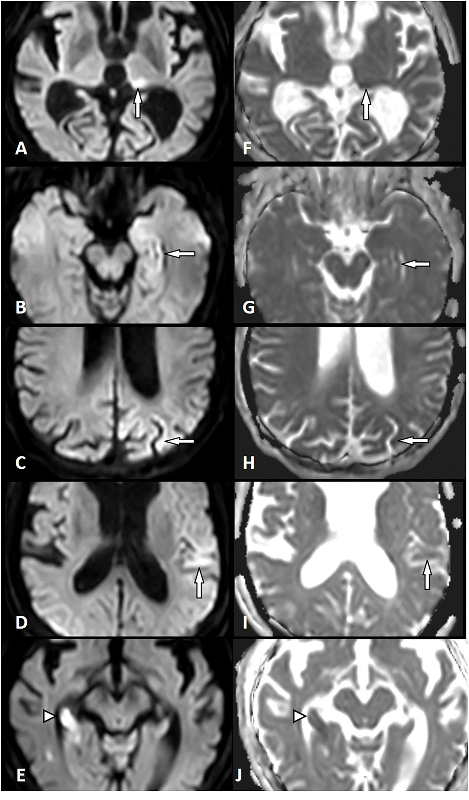
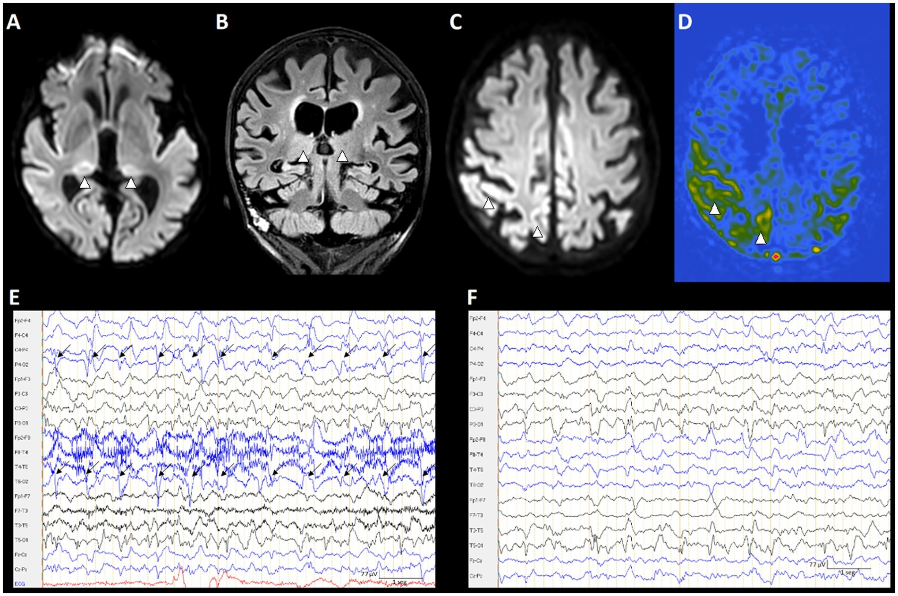
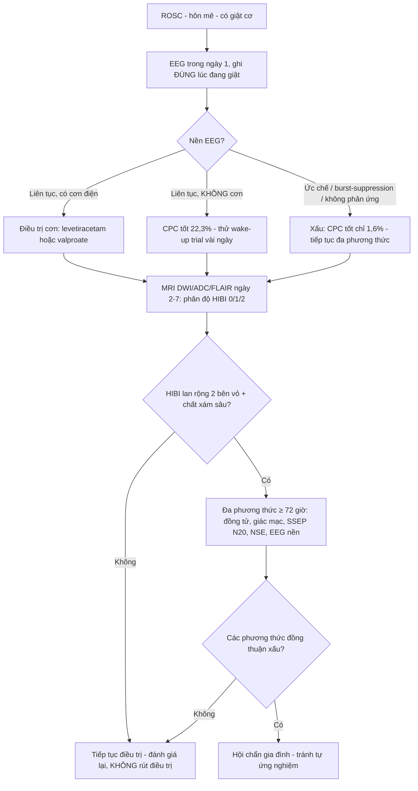
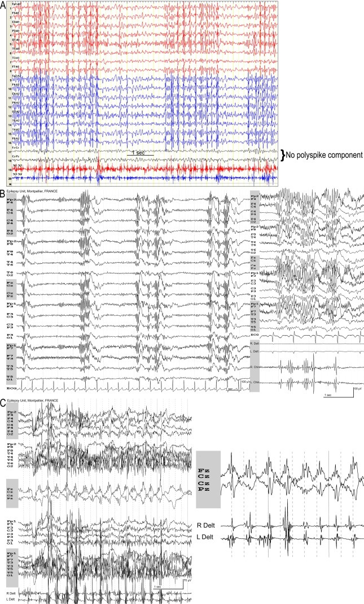

# 3036 — Trạng thái myoclonus & động kinh sau ngừng tim: phân loại, EEG, HIBI trên MRI và ngưỡng dự báo

**Tags:** `pattern:myoclonus` `pattern:dong-kinh-lien-tuc` `pattern:han-che-khuếch-tan` `pattern:vo-nao` `vung:nao` `score:CPC` `score:HIBI-MRI` `score:ACNS-EEG` `protocol:EEG-lien-tuc` `protocol:MRI-so-nao` `protocol:du-bao-sau-ngung-tim`
**Mức chắc chắn (certainty):** tổng hợp y văn (literature synthesis) — ghép **tổng quan hệ thống 119 nghiên cứu/3.881 ca** về myoclonus sau ngừng tim (PMC11801442), **khuyến cáo ERC/ESICM 2025** (PMC13038935), **phân độ HIBI trên MRI ở trạng thái động kinh siêu kháng trị sau ngừng tim** (PMC11736634), **định lượng hạn chế khuếch tán quanh cơn** (PMC9301206), **vai trò MRI quanh cơn trong liên tục ictal–interictal** (PMC13065682), **độ tin cậy giữa người đọc** (PMC5618111) và **một ca artifacts cơ trên EEG bị đọc nhầm thành polyspike** (PMC7782929); **3 ảnh có giấy phép rõ**.

> **Câu hỏi thực hành:** nam 58 tuổi, **ngừng tim ngoài bệnh viện – ROSC sau 18 phút**, hôn mê, ngày thứ 2 xuất hiện **rung giật cơ toàn thân liên tục**, gia đình xin “kết luận”. Người trực thấy **myoclonus liên tục + EEG dày đặc** và định **báo tiên lượng tuyệt vọng**. Câu hỏi: **myoclonus sau ngừng tim có phải một chẩn đoán duy nhất? Cần ghi gì trên EEG, chụp gì trên MRI, và vì sao KHÔNG được kết luận bằng myoclonus đơn thuần?**
> Bài chốt theo **ba trục**: (1) **phân loại** — “myoclonus” sau ngừng tim là **4 thực thể khác nhau về tiên lượng**: myoclonus, **status myoclonus (MyS/SM)**, **myoclonic status epilepticus (MSE)** và **Lance-Adams sớm (eLAS)** — **CPC 1–2 lần lượt 9,8% · 5,8% · 5,7% · 82,0%** (PMC11801442); (2) **điện sinh lý** — quyết định không nằm ở “có myoclonus”, mà ở **nền EEG**: **1,6%** kết cục tốt khi nền **ức chế/burst-suppression/không phản ứng**, **22,3%** khi **nền liên tục không có cơn**; (3) **hình ảnh** — **HIBI lan rộng** trên DWI/ADC mới là biến số tiên lượng (**kết cục xấu 83% vs 27%, OR 12,8**), và **hạn chế khuếch tán quanh cơn** có thể **hồi phục** nên không được gọi là hoại tử. Nối [3035 – HIE sau ngừng tim](../3035-hie-sau-ngung-tim-nguoi-lon/lesson.md), [3034 – IVH & EVD](../3034-chay-mau-nao-that-ivh-nao-ung-thuy/lesson.md), [3033 – Wernicke](../3033-benh-nao-wernicke-thieu-thiamin/lesson.md), [211 – Đột quỵ não](../211-dot-quy-nao/lesson.md), [201 – Protocol sọ não](../201-protocol-so-nao/lesson.md).

## 1. Tổng quan bệnh học – cơ chế hình ảnh: vì sao “giật cơ” lại là chuyện của vỏ não, EEG và DWI

- **Myoclonus là gì:** co cơ **đột ngột, ngắn (shock-like)**, có thể **khu trú, đa ổ hoặc toàn thân**; sau ngừng tim thường **khởi phát trong 24–48 giờ** (PMC13038935). Sinh lý bệnh là **mất ức chế GABAergic** ở vỏ não/vỏ–dưới vỏ sau tổn thương thiếu oxy, cộng **tăng kích thích glutamatergic** → mạng vỏ–đồi thị–tiểu não mất cân bằng.
- **Bốn thực thể, bốn tiên lượng (đây là điểm chết người của bài):**

| Thực thể | Định nghĩa vận hành | Cơ chế/EEG thường gặp | CPC 1–2 (kết cục tốt) |
|---|---|---|---|
| **Myoclonus** (đơn thuần) | Giật cơ ngắn, có thể từng cơn, **không liên tục** | Vỏ não (khu trú/đa ổ, kích thích) hoặc dưới vỏ | **9,8%** |
| **Status myoclonus (MyS/SM)** | **Giật cơ toàn thân LIÊN TỤC ≥ 30 phút, trong 72 giờ sau ROSC** (ERC/ESICM 2025) | Đa dạng; nhiều ca **không có cơn trên EEG** | **5,8%** |
| **Myoclonic status epilepticus (MSE)** | MyS/SM **+ bằng chứng điện sinh lý của cơn** (Salzburg/ACNS) | **Có cơn điện**; thường nền ức chế | **5,7%** |
| **Lance-Adams sớm (eLAS)** | Myoclonus ở người **còn hôn mê ≤ 72 giờ** nhưng sau đó **tỉnh và thành myoclonus khi vận động** | Vỏ–dưới vỏ, **nền EEG liên tục**, sóng nhọn–sóng hẹp giữa đường | **82,0%** |

  (Bảng dựng từ PMC11801442: **119 nghiên cứu, 3.881 bệnh nhân**, trong đó myoclonus **2.659**, MyS/SM **883**, MSE **569**, eLAS **40**; CPC 1–2 tính trên số ca có kết cục xác định.)
- **Vì sao “30 phút” là con số lịch sử và hay bị hiểu sai:** myoclonus **> 30 phút** từng được gọi là **MSE** (và ERC/ESICM 2015 gọi là MyS/SM), trong khi **ILAE đã hạ ngưỡng cơn co giật từ 30 phút xuống 5 phút** (cơn co giật) và **10 phút** (cơn không co giật) — nghĩa là **cùng chữ “status” nhưng hai hệ tiêu chuẩn khác nhau**. Đừng dùng “30 phút” để nói “đã là cơn điện”: **30 phút chỉ là mốc lâm sàng của status myoclonus**; cơn điện phải chứng minh bằng EEG (PMC11801442).
- **TẠI SAO DWI sáng trong cơn (và vì sao việc này quan trọng sau ngừng tim):** cơn động kinh làm **nhu cầu ATP tăng vọt**, đồng thời **mất bơm Na⁺/K⁺-ATPase** do thiếu oxy → **Na⁺ và nước vào tế bào (phù độc tế bào)** → **khoảng khuếch tán ngoại bào hẹp lại** → **DWI sáng, ADC tối**. Đây là **cơ chế giống hệt HIE**, nên trên một bệnh nhân sau ngừng tim, **hạn chế khuếch tán vỏ não vừa có thể do thiếu oxy, vừa có thể do cơn** — hai nguyên nhân **chồng lấn trên cùng một ảnh**. Đó là lý do **không được đọc “DWI sáng = hoại tử không hồi phục”**.
- **Ngưỡng định lượng phải nhớ:**
  - **Định lượng hạn chế khuếch tán phân biệt cơn vs nhồi máu** (PMC9301206, **26 ca SE vs 164 ca đột quỵ thiếu máu cấp**): tỷ lệ tín hiệu DWI (tổn thương/đối xứng lành) **1,42 (IQR 1,32–1,47) ở SE** vs **1,67 (1,49–1,90) ở nhồi máu**; tỷ lệ ADC **0,80 (0,72–0,89)** vs **0,61 (0,50–0,71)**; **cut-off DWI 1,495 (Se 75%, Sp 85%)** và **cut-off ADC 0,735 (Se 73%, Sp 84%)**.
  - **Vị trí ưa thích của hạn chế khuếch tán quanh cơn:** **vỏ não tân sinh, hồi hải mã, pulvinar đồi thị, thể chai (splenium), tiểu não đối bên** (PMC9301206) — **pulvinar và hải mã** là hai ổ “kinh điển” dễ bị gán nhầm cho HIE.
  - **Phân độ HIBI trên MRI ở trạng thái động kinh siêu kháng trị sau ngừng tim** (PMC11736634, **40 ca**): HIBI **lan rộng 45%** vs **không lan rộng 55%**; kết cục xấu sau 6 tháng **83% vs 27% (OR 12,8; KTC 95% 2,5–64,3)**; **tỉnh lại trước xuất viện 22% vs 73% (OR 8,8)**; **cơn hết 67% vs 95%**; **tử vong 50% vs 27% (p = 0,303, không khác biệt có ý nghĩa)** — tức **HIBI lan rộng dự báo chức năng, không dự báo chết**.
  - **Nền EEG quyết định hơn triệu chứng:** CPC 1–2 = **1,6%** (nền ức chế/burst-suppression/không phản ứng) · **11,3%** (nền không ức chế **+ có cơn điện**) · **22,3%** (nền không ức chế, **không cơn**) (PMC11801442, EEG ghi ở **2.714/3.881 ca = 69,9%**).
  - **Độ tin cậy của khám lâm sàng rất thấp:** phân loại kiểu myoclonus (toàn thân vs khu trú/đa ổ) **κ = −0,05**, tính kích thích **κ = −0,05**, vị trí gần/xa **κ = 0,46**; chỉ **thang điểm UMRS** đạt **ICC 0,82** (PMC5618111) → **không dùng kiểu myoclonus “nhìn bằng mắt” để tiên lượng**.
  - **Ngưỡng dự báo TỐT (mới 2025):** **GCS vận động 4–5 lúc 72–96 giờ**, **NSE < 17 µg/L**, **EEG nền liên tục không có phóng điện trong 72 giờ**, **không hạn chế khuếch tán vỏ/chất xám sâu trên MRI ngày 2–7**; **≥ 2 dấu hiệu tốt đồng thuận, không có dấu hiệu xấu → hồi phục thần kinh > 80%** (PMC13038935).

*Cột trái **DWI**, cột phải **ADC**. **A/F** — **pulvinar trái**; **B/G** — **hồi hải mã trái**; **C/H** — **vỏ đỉnh trái**; **D/I** — **vỏ thái dương trái**: đều là hạn chế khuếch tán **quanh cơn** (đầu mũi tên trắng). **E/J** — **hồi hải mã phải** ở bệnh nhân **nhồi máu** (mũi tên đầu tam giác): mức hạn chế **rõ hơn**. Nguồn: Front Neurol 2022 (PMC9301206), CC BY 4.0.*

## 2. Mẫu hình + chẩn đoán phân biệt theo vị trí (gamut)

- **Mẫu hình cốt lõi:** **hôn mê sau ROSC + giật cơ**, và trên MRI **hạn chế khuếch tán vỏ não và/hoặc chất xám sâu**, có thể **kèm phù FLAIR muộn**.
- **Gamut theo hình thái lâm sàng (quyết định tiên lượng):**
  1. **Khu trú/đa ổ, kích thích (cortical)** — thường **tốt hơn**, có thể tiến triển thành **Lance-Adams**.
  2. **Toàn thân, liên tục ≥ 30 phút (status myoclonus)** — nhóm xấu nhất về thống kê, nhưng **vẫn có ~6% kết cục tốt**.
  3. **Có cơn điện trên EEG (MSE)** — **nền EEG** mới là yếu tố chia nhóm chứ không phải tên gọi.
  4. **Lance-Adams (sớm hoặc muộn)** — **82% kết cục tốt**; đặc trưng **myoclonus khi vận động, ý thức bảo tồn**.
- **Gamut theo vị trí tổn thương trên MRI:**
  1. **Vỏ não lan tỏa (cortical ribboning)** — HIBI; đối xứng, không theo lãnh thổ mạch.
  2. **Hồi hải mã** — cả HIE và cơn; **hồi phục được** nếu do cơn.
  3. **Pulvinar đồi thị** — “dấu hiệu pulvinar” của **liên tục ictal–interictal**; coi chừng gán cho nhồi máu động mạch Percheron.
  4. **Chất xám sâu (hạch nền)** — HIBI nặng, tiên lượng xấu hơn.
  5. **Thể chai (splenium) + tiểu não đối bên** — gợi ý **lan truyền cơn** hơn là thiếu oxy toàn thể.
  6. **Chất trắng** — **không** phải myoclonus/HIE cấp; nghĩ bệnh khác (hủy myelin, bạch cầu não muộn).
- **Gamut nguyên nhân khi bệnh nhân KHÔNG ngừng tim nhưng có myoclonus + hạn chế khuếch tán vỏ:** **động kinh liên tục** · **hạ đường huyết** · **CJD** · **bệnh não gan** · **ngộ độc CO/cyanide** · **viêm não tự miễn** · **thuốc gây myoclonus** (quetiapine, SSRI, opioid, piperacillin/tazobactam) — **bối cảnh là chốt**, không phải ổ sáng.

*A: **DWI** — hạn chế khuếch tán **hai bên pulvinar** (đầu mũi tên). B: **FLAIR coronal** — tương ứng tăng tín hiệu nhẹ. C: **DWI** lát cao — hạn chế khuếch tán **vỏ não**. D: **ASL** — **tăng tưới máu** đúng vùng tổn thương (đỏ), dấu hiệu **cơn đang hoạt động**. E: **EEG** — phóng điện định kỳ (mũi tên) trên nền còn liên tục; F: EEG sau điều trị. Nguồn: Front Neurol 2026 (PMC13065682), CC BY 4.0.*

## 3. Bảng so sánh phân biệt (ma trận đối chiếu)

| Thực thể (entity) | Hình ảnh điển hình | Chốt vào (rule-in) | Chốt loại (rule-out) | Gợi ý xác nhận |
|---|---|---|---|---|
| **Myoclonus/status myoclonus sau ngừng tim** | MRI: HIBI **vỏ ± chất xám sâu**, đối xứng; có thể **không thấy gì** nếu chụp quá sớm | **Bối cảnh ROSC + giật cơ toàn thân ≥ 30 phút trong 72 giờ + EEG có/không cơn** | **Giật cơ chỉ khi vận động, ý thức tỉnh** → Lance-Adams, không phải status myoclonus | **EEG liên tục từ ngày 1**, MRI ngày 2–7, NSE 48–72 giờ |
| **Hạn chế khuếch tán quanh cơn (peri-ictal)** | **Vỏ/hải mã/pulvinar**, **tỷ lệ DWI ~1,42**, **ADC ~0,80**; **giảm dần và có thể mất** trên MRI lặp | **EEG có cơn/liên tục ictal + tổn thương khớp vùng + hồi phục trên MRI lặp** | **Tỷ lệ DWI > 1,495/ADC < 0,735 + theo lãnh thổ mạch** → nhồi máu | **MRI lặp 7–30 ngày**, ADC định lượng |
| **Nhồi máu não cấp** | Hạn chế khuếch tán **theo lãnh thổ động mạch**, **rõ hơn** (DWI 1,67/ADC 0,61), có thể **tăng tưới–giảm tưới theo thì** | **Theo lãnh thổ + đột ngột + mạch máu tương ứng bị tắc trên CTA/MRA** | **Đối xứng hai bên + không theo lãnh thổ** → không phải nhồi máu | **CTA/MRA**, MRI lặp |
| **Hạ đường huyết** | **Vỏ đỉnh–chẩm parasagittal + hạch nền + hải mã**, **đồi thị thường được bảo tồn** | **Glucose thấp lúc hôn mê + hồi phục sau bù glucose** | **Glucose bình thường + pulvinar nổi bật** → cơn/HIE | Glucose mao mạch, đáp ứng lâm sàng |
| **CJD** | **Cortical ribboning + hạch nền/đồi thị**, teo nhanh; **myoclonus giật mình (startle)** | **Sa sút bán cấp + RT-QuIC/14-3-3 dương + DWI vỏ/hạch nền** | **Khởi phát cấp sau ROSC + có nền EEG liên tục** → không phải CJD | RT-QuIC, EEG, MRI lặp 2–4 tuần |
| **Lance-Adams (kể cả eLAS)** | MRI thường **bình thường hoặc teo nhẹ muộn**; không có HIBI lan rộng | **Ý thức tỉnh + myoclonus khi vận động + nền EEG liên tục** | **Hôn mê sâu + nền ức chế** → không phải LAS | **Video + UMRS**, EEG, theo dõi nhiều ngày |
| **Myoclonus do thuốc (vd quetiapine)** | **MRI bình thường**; EEG có **artifact cơ** dễ đọc thành polyspike | **Bắt đầu sau khởi trị thuốc + giảm khi ngừng thuốc + EEG không có cơn thực** | **Có cơn điện xác thực + tổn thương MRI khớp** → không phải do thuốc | **Ngừng thuốc thử**, EEG đa kênh, xem lại montage |
| **Động kinh liên tục không do ngừng tim** | Hạn chế khuếch tán **một bên/theo vùng**, phù FLAIR, **có thể hồi phục hoàn toàn** | **EEG cơn + không bối cảnh ROSC** | **Đối xứng toàn bộ + ROSC** → HIE | **EEG khẩn**, MRI lặp sau kiểm soát cơn |

**Ảnh đối chiếu cơ chế:** xem ảnh mục (2) — **cùng một “DWI sáng” nhưng D là ASL tăng tưới (cơn)**, trong khi ở HIBI (bài [3035](../3035-hie-sau-ngung-tim-nguoi-lon/lesson.md)) tưới máu **không tăng**.

## 4. Protocol chụp + hệ phân độ/điểm chuẩn hóa

- **EEG — bắt buộc, từ ngày 1:** **EEG liên tục hoặc EEG thường quy ≥ 24–48 giờ** để bắt **cơn không co giật** (PMC13038935). **Ghi EEG ĐÚNG LÚC đang giật** — đây là khuyến cáo riêng của 2025 vì nó vừa xác định **cơn**, vừa cho **nền liên tục/phản ứng** (yếu tố tiên lượng).
- **Thuật ngữ EEG:** dùng **ACNS** (mẫu hình định kỳ/rhythmic, tần số, phản ứng) và **tiêu chuẩn Salzburg** cho cơn; **không tự đặt tên “MSE”** nếu chưa có tiêu chuẩn cơn.
- **MRI sọ — thời điểm quyết định:** **DWI + ADC + FLAIR + T1 ± SWI**, lát 3–5 mm; **chụp ngày 2–7** (không phải 6 giờ đầu): **không hạn chế khuếch tán vỏ/chất xám sâu trên MRI ngày 2–7 là một dấu hiệu TIÊN LƯỢNG TỐT** (PMC13038935). Nếu CT sớm bình thường mà vẫn hôn mê → **lặp hình ảnh 72–96 giờ**.
- **Phân độ HIBI trên MRI (PMC11736634 — dùng cho ca có trạng thái động kinh):**
  - **HIBI 0:** không bất thường tín hiệu ở **hạch nền và vỏ não xám**.
  - **HIBI 1:** bất thường **hạch nền** (DWI hạn chế sớm), vỏ não **chưa** lan rộng.
  - **HIBI 2 (lan rộng):** bất thường **cả hạch nền và vỏ não lan rộng** → nhóm tiên lượng xấu (**83% kết cục xấu**).
- **Định lượng khi cần phân biệt cơn vs nhồi máu:** đo **tỷ lệ tín hiệu DWI** và **tỷ lệ ADC** so với bên đối xứng — **DWI < 1,495 / ADC > 0,735 nghiêng về cơn**; **DWI > 1,495 / ADC < 0,735 nghiêng về nhồi máu** (PMC9301206).
- **Điều trị (2025 ERC/ESICM):**
  - **KHÔNG dùng thuốc chống động kinh dự phòng** (khuyến cáo chống, 2024 ILCOR).
  - **Điều trị cơn có bằng chứng lâm sàng hoặc trên EEG**: **levetiracetam hoặc valproate** là lựa chọn đầu tay (chọn theo bệnh nền/tương tác).
  - **Myoclonus + nền EEG LÀNH: thử “wake-up trial” vài ngày sau ngừng tim** — không vội kết luận.
  - **An thần ngắn (propofol/remifentanil) + ngừng an thần hằng ngày** để đánh giá được thần kinh; tổ hợp propofol–remifentanil có thể rút ngắn thời gian tỉnh nhưng **tăng nhu cầu vận mạch**.
- **Dự báo: đa phương thức, ≥ 72 giờ, và KHÔNG bằng myoclonus đơn thuần.** Myoclonus/status myoclonus **trong 7 ngày chỉ dùng để dự báo xấu KHI kết hợp với xét nghiệm khác** (khuyến cáo yếu, bằng chứng rất thấp).

## 5. Biến thể bình thường và cạm bẫy

- **Artifact cơ trên EEG bị đọc thành polyspike** — cạm bẫy số 1 của “myoclonic status”: cơ vùng cổ/hàm tạo **nhịp nhanh lan rộng trông như polyspike**, đặc biệt khi **điện cực đường giữa (Fz–Cz, Cz–Pz) không có thành phần polyspike**. Trong ca đã báo, **quetiapine gây myoclonus** và **artifact cơ** bị chẩn đoán nhầm là **MSE** (PMC7782929). Cách tránh: **xem nhiều montage, đối chiếu kênh đường giữa, ghi video đồng bộ, thử nghiệm giãn cơ/giảm artifact**.
- **An thần và giãn cơ che mất myoclonus:** bệnh nhân “hết giật” sau propofol không có nghĩa là **hết cơn**; ngược lại EEG có thể thành **burst-suppression do thuốc** và bị đọc là **“highly malignant pattern”** → **kết luận xấu oan**. Luôn ghi rõ **thời điểm dùng thuốc** lên EEG.
- **Myoclonus đơn thuần KHÔNG phải tiêu chuẩn rút điều trị:** **9,8%** ca myoclonus và **5,8%** ca status myoclonus có **CPC 1–2**; **82%** ca eLAS tốt — nên **myoclonus chỉ là một mảnh**, phải đặt cạnh EEG, NSE, SSEP, MRI.
- **Tự ứng nghiệm (self-fulfilling prophecy):** status myoclonus nằm trong tiêu chuẩn **cho phép WLST** từ 2015/2021, nên **chính nó làm tăng “tử vong” trong các nghiên cứu hồi cứu**; đọc số phải nhớ vòng lặp này (PMC11801442).
- **Khám lâm sàng không tái lập:** κ **−0,05** cho kiểu myoclonus và tính kích thích → **hai bác sĩ nhìn cùng video có thể xếp hai nhóm tiên lượng khác nhau**; dùng **UMRS** (ICC 0,82) và **video** khi cần theo dõi.
- **Hạn chế khuếch tán “quanh cơn” không phải hoại tử:** có thể **hồi phục hoàn toàn**, nhưng cũng có thể để lại **hoại tử vỏ dạng lớp (cortical laminar necrosis)**, **xơ hóa hải mã (mesial temporal sclerosis)** và **teo khu trú** — nên **MRI lặp** mới phân biệt được (PMC9301206).
- **Pulvinar hai bên ≠ nhồi máu Percheron:** nhồi máu Percheron cho **đột ngột, hạn chế khuếch tán rõ, theo lãnh thổ**; pulvinar trong liên tục ictal–interictal thường **kèm ASL tăng tưới** (ảnh mục 2) và **thay đổi theo thời gian**.
- **Đừng quên nguyên nhân thứ hai:** bệnh nhân sau ngừng tim vẫn có thể có **nhồi máu do huyết khối mạch vành–não**, **xuất huyết sau can thiệp**, **viêm màng não/EVD** — “myoclonus” không miễn trừ các chẩn đoán khác.

*A: montage lưỡng cực — “burst” nhịp nhanh lan rộng trông như polyspike, nhưng **Fz–Cz và Cz–Pz KHÔNG có thành phần polyspike** (chú thích nguyên văn: “No polyspike component”). B, C: các bệnh nhân khác — **artifact cơ** (B) và mẫu hình có **sóng nhọn–sóng** thật (C). Nguồn: Epilepsy Behav Rep 2020 (PMC7782929), CC BY-NC-ND 4.0 — **ảnh nguyên bản, không crop**.*

## 6. Tự lượng giá — Blind Quiz ngay trên trang tĩnh

**Ca 1 — Nữ 47 tuổi, động kinh liên tục, MRI trong 48 giờ đầu. Nhìn 10 ô DWI/ADC và trả lời trước.**

- Gợi ý lâm sàng: không ngừng tim, không liệt nửa người, EEG có cơn.
- Câu hỏi: **tổn thương ở những vùng nào?** **vì sao đây không phải nhồi máu?** **dấu hiệu định lượng nào giúp chốt?**

<b>Bấm để hiện đáp án (findings + chẩn đoán)</b>

- Dấu hiệu: **A/F** pulvinar trái, **B/G** hồi hải mã trái, **C/H** vỏ đỉnh trái, **D/I** vỏ thái dương trái — **DWI sáng/ADC tối**. **E/J** là ca **nhồi máu hồi hải mã phải** để đối chiếu.
- Chẩn đoán: **hạn chế khuếch tán quanh cơn do trạng thái động kinh** — cơn gây **phù độc tế bào** giống thiếu máu cục bộ nhưng **cường độ nhẹ hơn** và **có thể hồi phục**.
- Định lượng: **tỷ lệ DWI 1,42 (SE) vs 1,67 (nhồi máu)**; **ADC 0,80 vs 0,61**; **cut-off DWI 1,495 (Se 75%/Sp 85%)**, **ADC 0,735 (Se 73%/Sp 84%)**.
- Nguồn ảnh: Front Neurol 2022 (PMC9301206), CC BY 4.0.

**Ca 2 — Nam 30 tuổi, co giật kéo dài rồi hôn mê; MRI cho tổn thương hai bên pulvinar. Nhìn ảnh trước khi đọc đáp án.**

- Câu hỏi: **vì sao nói tổn thương đang “hoạt động” chứ không phải di chứng?** **ô D thêm được thông tin gì mà DWI không có?** **E khác F ở đâu?**

<b>Bấm để hiện đáp án</b>

- **A/C**: hạn chế khuếch tán **hai bên pulvinar** và **vỏ não**; **B**: FLAIR tăng tín hiệu nhẹ.
- **D (ASL)**: **tăng tưới máu** đúng vùng tổn thương → **cơn đang hoạt động** (tăng chuyển hóa–tưới máu), khác HIBI (tưới máu không tăng).
- **E**: phóng điện định kỳ trên **nền còn liên tục** (liên tục ictal–interictal); **F**: sau điều trị, phóng điện giảm.
- Ý nghĩa: tổn thương **quanh cơn**, có khả năng **hồi phục** — không được gọi là hoại tử vỏ.
- Nguồn ảnh: Front Neurol 2026 (PMC13065682), CC BY 4.0.

**Ca 3 — Nam 62 tuổi, myoclonus sau khi thêm một thuốc; EEG “dày đặc polyspike”. Có thật là myoclonic status không?**

- Câu hỏi: **vì sao nghi artifact?** **kênh nào giúp phân định?** **xử trí tiếp theo?**

<b>Bấm để hiện đáp án</b>

- Nghi artifact vì “burst” **lan quá rộng, không có hình thái sóng nhọn–sóng điển hình**, và **Fz–Cz/Cz–Pz không có polyspike**.
- Kênh **đường giữa** và **nhiều montage** giúp phân định; ghi **video đồng bộ**, thử **giãn cơ/giảm artifact**.
- Xử trí: **xem lại thuốc** (quetiapine/SSRI/opioid có thể gây myoclonus), **không tăng thuốc chống động kinh chỉ vì “polyspike” giả**.
- Nguồn ảnh: Epilepsy Behav Rep 2020 (PMC7782929), CC BY-NC-ND 4.0.

## Bài liên quan chéo
- [3035 – HIE sau ngừng tim ở người lớn: DWI/ADC, GWR, dự báo đa phương thức ≥ 72 giờ](../3035-hie-sau-ngung-tim-nguoi-lon/lesson.md)
- [3034 – Chảy máu não thất & não úng thủy sau xuất huyết: EVD, rửa não thất, shunt](../3034-chay-mau-nao-that-ivh-nao-ung-thuy/lesson.md)
- [3033 – Bệnh não Wernicke & thiếu thiamin: thể vú–quanh cống, Caine 2/4](../3033-benh-nao-wernicke-thieu-thiamin/lesson.md)
- [3031 – Bệnh não sau phục hồi (PRES): phù vận mạch đỉnh–chẩm](../3031-pres-benh-nao-sau-phuc-hoi/lesson.md)
- [211 – Đột quỵ não: nhồi máu & vùng lãnh thổ mạch](../211-dot-quy-nao/lesson.md)
- [201 – Protocol sọ não](../201-protocol-so-nao/lesson.md)

## Ảnh
- `3036_myoclonus-sau-ngung-tim_DWI_PMC9301206-G1.jpg` — Front Neurol 2022, **CC BY 4.0**, chuyển từ webp gốc sang JPEG, không crop.
- `3036_myoclonus-sau-ngung-tim_DWI-ASL-EEG_PMC13065682-G3.jpg` — Front Neurol 2026, **CC BY 4.0**, nguyên bản JPEG.
- `3036_myoclonus-sau-ngung-tim_EEG_PMC7782929-G1.jpg` — Epilepsy Behav Rep 2020, **CC BY-NC-ND 4.0**, **nguyên bản, không chỉnh sửa**.
- Nguồn + giấy phép từng ảnh: `images/CREDITS.md`.

> Không dùng để chẩn đoán độc lập khi chưa có người hướng dẫn.
