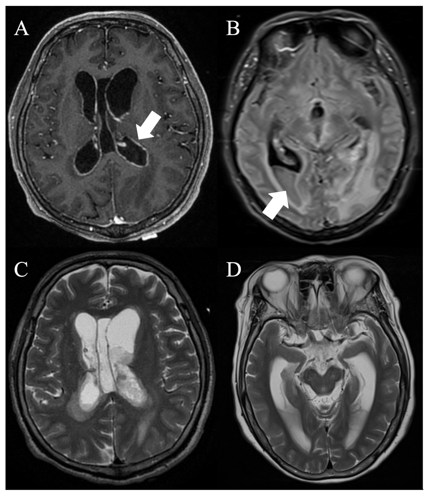
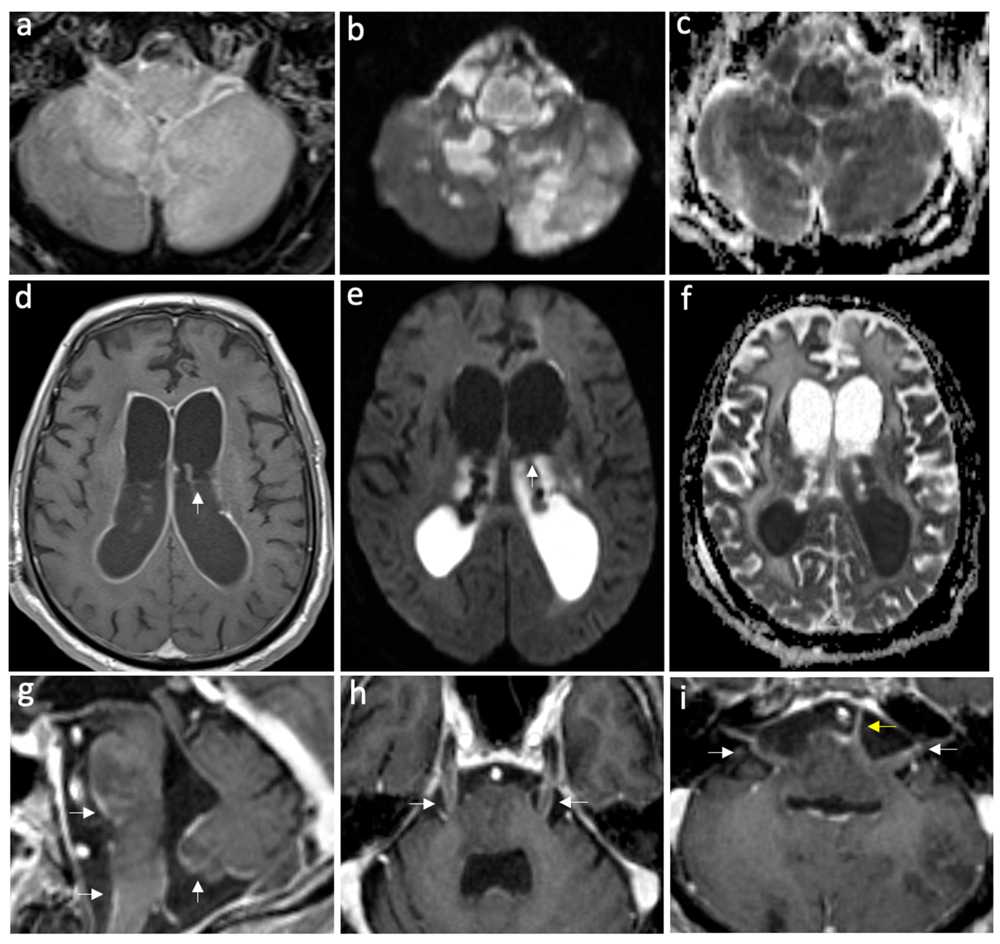
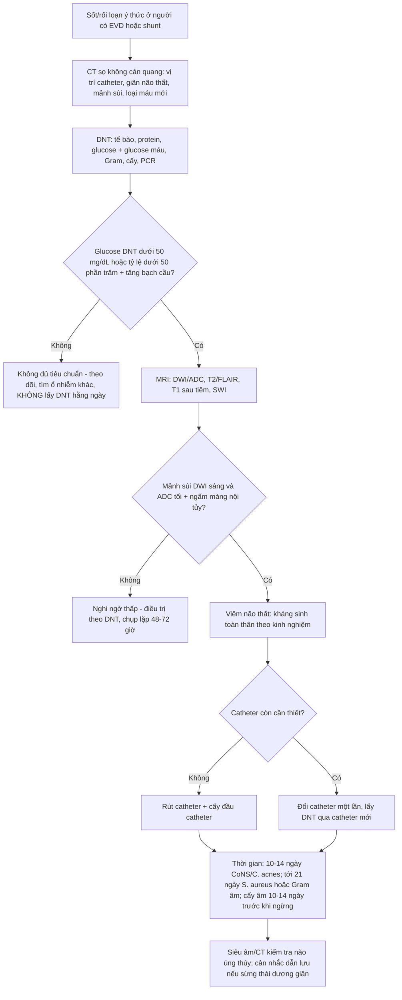
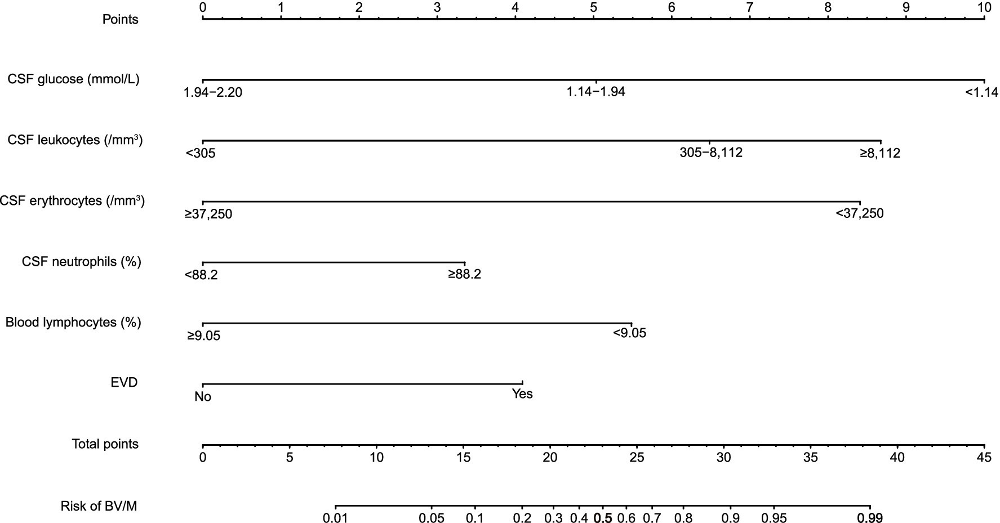

# 3037 — Nhiễm trùng não thất & nhiễm trùng liên quan EVD: mủ trong não thất, ngấm màng nội tủy, DNT và ngưỡng rút catheter

**Tags:** `pattern:dich-mu-trong-nao-that` `pattern:ngam-mang-nao-that` `pattern:han-che-khuếch-tan` `pattern:gian-nao-that` `vung:nao-that` `score:CDC-IDSA` `score:CSF-cell-index` `protocol:CT-so-nao` `protocol:MRI-so-nao` `protocol:EVD` `protocol:choc-do-tuy-song`
**Mức chắc chắn (certainty):** tổng hợp y văn (literature synthesis) — ghép **meta phân tích 94 nghiên cứu** về nhiễm trùng liên quan EVD (PMC13547555), **cohort 387 bệnh nhân/421 EVD** (PMC12992071), **tổng quan hệ thống về lấy DNT thường quy** (PMC13615090), **nghiên cứu về lượng máu trong SAH/IVH** (PMC12819451, nối bài 3034), **loạt ca viêm não thất mủ nguyên phát có ảnh MRI** (PMC13706012), **ca viêm não thất có ảnh DWI/ADC** (PMC11417761), **nomogram 271 ca** (PMC13039033), **so sánh dấu ấn DNT với tiêu chuẩn CDC/IDSA** (PMC12954234) và **tổng quan điều trị 2022** (PMC8896765).

> **Câu hỏi thực hành:** nam 54 tuổi, **chảy máu dưới nhện vỡ phình, đặt EVD ngày thứ 6**, sốt 38,6 °C, gáy cứng, dịch não tủy (DNT) đục. CT thấy **não thất giãn hơn + “vách” tăng tỷ trọng ở sừng chẩm**. Câu hỏi: **đây là máu cũ, mủ, hay thuốc cản quang? Có phải rút EVD ngay? Kháng sinh bao nhiêu ngày, và có cần chọc DNT mỗi ngày không?**
> Bài chốt theo **ba trục**: (1) **hình ảnh** — **mủ trong não thất hạn chế khuếch tán** (DWI sáng/**ADC tối**) trong khi **DNT tự do thì không**, cộng **ngấm màng nội tủy** và **giãn sừng thái dương**; (2) **xét nghiệm** — **DNT mới là chốt**, không phải hình ảnh: **CSF WBC AUC 0,828**, **tỷ lệ WBC DNT/máu 0,797**, **glucose DNT/máu 0,768** — còn **IL-6/CRP/PCT máu KHÔNG phân biệt được**; (3) **xử trí** — **rút/không đổi catheter là biện pháp phòng ngừa mạnh nhất** (**đổi EVD: HR 3,13**), **AI-EVD OR 0,43**, và **không lấy DNT thường quy hằng ngày**. Nối [3034 – IVH & EVD](../3034-chay-mau-nao-that-ivh-nao-ung-thuy/lesson.md), [3012 – Áp-xe ngoài màng cứng sau gây tê](../3012-apxe-ngoai-mang-cung-sau-gay-te-ngoai-mang-cung/lesson.md), [3014 – Đau đầu sau chọc dò](../3014-dau-dau-sau-choc-do-tuy-song/lesson.md), [214 – Nhiễm trùng hệ thần kinh trung ương](../214-nhiem-trung-tktw/lesson.md), [201 – Protocol sọ não](../201-protocol-so-nao/lesson.md).

## 1. Tổng quan bệnh học – cơ chế hình ảnh: vì sao mủ trong não thất “tối” trên ADC còn DNT thì không

- **Đường vào:** (1) **ngược dòng theo catheter** (EVD, shunt, Ommaya) — màng sinh học (biofilm) trên bề mặt catheter là ổ nhiễm không kháng sinh nào xuyên được; (2) **lan từ ổ mủ lân cận** (áp-xe não vỡ vào não thất, viêm màng não, viêm xương sọ); (3) **rò DNT / vết mổ**; (4) **nhiễm qua đường máu** (hiếm).
- **Mô bệnh:** viêm màng nội tủy + **dịch tiết mủ giàu bạch cầu và fibrin** đọng ở **phần thấp của não thất** (sừng chẩm khi nằm ngửa). Mủ **quánh, nhiều tế bào** làm **giảm chuyển động Brown của nước ngoại bào** → **DWI sáng, ADC tối**. Ngược lại **DNT bình thường** là nước tự do → **DWI tối, ADC rất sáng**. Đây là **cơ sở vật lý duy nhất** để phân biệt “mủ” với “dịch”: **cùng nằm trong não thất, khác độ linh động của phân tử nước**.
- **Vì sao có ngấm màng nội tủy:** viêm làm **phá vỡ hàng rào máu–DNT** tại màng nội tủy → **T1 sau tiêm ngấm đều, liên tục theo viền não thất** (khác ngấm dạng nốt của u). Đây là dấu hiệu **đặc hiệu nhưng không nhạy**.
- **Vì sao giãn não thất:** mảnh mủ/fibrin **bít lỗ Monro, cống Sylvius, lỗ Magendie/Luschka** và **làm tắc hấp thu màng nhện** → **não úng thủy cấp**. **Giãn sừng thái dương** là dấu hiệu **rất nhạy** của úng thủy tắc nghẽn cấp, cần **dẫn lưu DNT khẩn**.
- **Vì sao CT dễ bỏ sót:** DNT **0–10 HU**, mủ chỉ **khoảng 15–40 HU** — đủ để “hơi tăng tỷ trọng” nhưng **dễ bị coi là nhiễu** ở lát dày, và **máu cấp (50–80 HU) đậm hơn hẳn**. Vì vậy **CT không loại trừ viêm não thất**.
- **Ngưỡng định lượng phải nhớ:**
  - **Tần suất nhiễm trùng liên quan EVD (ERI): 8,6% (KTC 95% 7,2–10,3)**, gộp **94 nghiên cứu**; **AI-EVD 4,3%** vs **EVD thường 9,4%** vs **SI-EVD 10,5%**; **AI so với thường: OR 0,43 (0,28–0,67)**; **SI so với thường (phân tích độ nhạy): OR 0,58 (0,38–0,88)** (PMC13547555).
  - **Cấy vi khuẩn:** **Gram dương 65%**; **Staphylococcus 49,8%** (trong đó **CoNS 58%**), **Acinetobacter 7,6%**, **Klebsiella 7%** (PMC13547555).
  - **Cohort 387 bệnh nhân/421 EVD:** **nghi ngờ ERI 26,9%**, **xác định 16,3%**; **đổi EVD làm tăng nguy cơ: HR 3,13 (2,02–4,85)**; **rò DNT và tắc catheter cũng là yếu tố nguy cơ**; **kháng sinh toàn thân vì nhiễm khác: HR 0,33** (nghĩa là **nhiễm ở nơi khác làm tăng “nghi ngờ” nhưng không phải ERI**) (PMC12992071).
  - **Trong chảy máu dưới nhện (aSAH):** **EVDAI 14% theo bệnh nhân, 12% theo catheter**; **BNI độ 4: OR 6,66 (2,04–21,68)**; **mỗi điểm IVH score: OR 1,33 (1,05–1,69)**; **thời điểm khởi phát sớm hơn khi máu nhiều** (PMC12819451) — nối [3034](../3034-chay-mau-nao-that-ivh-nao-ung-thuy/lesson.md).
  - **Dấu ấn DNT phân biệt được, dấu ấn máu thì không** (PMC12954234, 33 ca bệnh/33 ca chứng ghép cặp): **CSF WBC AUC 0,828**, **tỷ lệ WBC DNT/máu 0,797**, **glucose DNT 0,754**, **tỷ lệ glucose DNT/máu 0,768**; **IL-6, CRP, PCT huyết thanh và tỷ lệ/albumin KHÔNG khác biệt**.
  - **Tiêu chuẩn CDC/IDSA “đủ” và “có thể” bắt được ca thật nhưng cũng bắt nhầm:** trong số ca **được điều trị**, **50% đạt định nghĩa xác định** và **97% đạt “probable”**; nhưng **2,9% ca chứng cũng đạt tiêu chuẩn** (PMC12954234).
  - **Chỉ số tế bào (cell index, CI)** ở bệnh nhân có máu trong DNT: **cut-off 10,4 → Se 80,5%/Sp 70,5%** (PMC8896765).
  - **Lactate DNT** (meta 404 ca sau mổ thần kinh): **cut-off 4,41 ± 0,85 mmol/L → Se 92%/Sp 88%**; **không đặc hiệu** với nhồi máu, co giật, chấn thương (PMC8896765).
  - **Viêm não thất mủ nguyên phát (8 ca):** **tử vong 1 năm 25%**; người sống có **WBC DNT trung vị 1.005/µL (508–1.977,5)** và **protein 1.030 mg/dL (847,5–1.225)**; người tử vong có **WBC 82,5/µL, protein 212,1 mg/dL** — tức **viêm “nghèo tế bào” ở ca tối nặng là dấu hiệu xấu**, không phải “nhẹ” (PMC13706012). Cohort 87 ca khác: **tử vong 1 năm 39,1%**, **67,3% người sống còn di chứng** (trích trong PMC13706012).

*A: **T1 sau tiêm** — ngấm **liên tục theo màng nội tủy** thất bên (mũi tên): phá vỡ hàng rào máu–DNT. B: **FLAIR** — **mức dịch–mủ** ở phần thấp sừng chẩm (mũi tên). C: **T2** — não thất giãn + **mảnh sùi tín hiệu trung gian** đọng phía thấp + **phù quanh não thất** (thoát dịch qua màng nội tủy). D: **T2** ngang trung não — **giãn lớn sừng thái dương hai bên** = dấu hiệu nhạy của úng thủy tắc nghẽn cấp. Nguồn: J Clin Med 2026 (PMC13706012), CC BY 4.0.*

## 2. Mẫu hình + chẩn đoán phân biệt theo vị trí (gamut)

- **Mẫu hình cốt lõi:** **sốt + đau đầu/rối loạn ý thức ở người có EVD/shunt vừa mổ** → **DNT viêm** → **hình ảnh: mảnh sùi trong não thất + ngấm màng nội tủy ± giãn não thất**.
- **Gamut theo “mảnh sùi trong lòng não thất”:**
  1. **Mủ (viêm não thất)** — **DWI sáng/ADC tối**, T2 trung gian, **mức dịch–mủ**, ngấm màng nội tủy.
  2. **Máu trong não thất (IVH)** — **T2 tối**, **SWI lan tỏa (blooming)**, **50–80 HU** trên CT, **mức hồng cầu lắng**; **máu cấp cũng hạn chế khuếch tán** → **DWI một mình không phân biệt được**.
  3. **U trong não thất** (neurocytoma trung tâm, papilloma đám rối mạch mạc, ependymoma) — **khối đặc ngấm thuốc**, **bám vào vị trí giải phẫu**, **không mức dịch–mủ**.
  4. **Nang keo thất III (colloid cyst)** — **tròn, ở lỗ Monro**, tín hiệu **thay đổi theo thành phần**, **không ngấm màng nội tủy lan tỏa**.
  5. **Khí trong não thất (pneumocephalus)** — **rất tối trên mọi chuỗi xung, không hạn chế khuếch tán**, **mức khí–dịch nằm trên** (không phải dưới).
  6. **Mỡ (vỡ u bì)** — **T1 sáng, mất tín hiệu khi fat-sat**, **giọt mỡ nổi trên DNT**.
  7. **Nang/ấu trùng (neurocysticercosis dạng não thất)** — **nang có đầu đốt (scolex)**, **không ngấm màng nội tủy toàn bộ**.
- **Gamut theo nguyên nhân khi đã chắc có viêm não thất:** **EVD/shunt (hay nhất)** · **sau mổ thần kinh** · **áp-xe não vỡ** · **viêm màng não do phế cầu/tụ cầu** · **lao (thường kèm viêm màng não nền)** · **nấm (Cryptococcus)** · **nhiễm trùng bẩm sinh (CMV — vôi hóa quanh não thất, không mủ)**.

*Ca viêm màng não–não có **viêm não thất** (a) FLAIR sau tiêm, (b) **DWI**, (c) **ADC** ở tầng cầu: ngấm màng nội tủy + hạn chế khuếch tán dịch trong não thất. (d) FLAIR sau tiêm: **giãn não thất + ngấm màng nội tủy** (mũi tên). (e) **DWI**: **mảnh sủi sáng rực ở sừng chẩm**; (f) **ADC**: **tối tương ứng** — chứng minh **hạn chế khuếch tán thật**, không phải “T2 shine-through”. (g–i) ngấm màng nội tủy sừng thái dương và bể đáy. Nguồn: Neurol Int 2024 (PMC11417761), CC BY 4.0.*

## 3. Bảng so sánh phân biệt (ma trận đối chiếu)

| Thực thể (entity) | Hình ảnh điển hình | Chốt vào (rule-in) | Chốt loại (rule-out) | Gợi ý xác nhận |
|---|---|---|---|---|
| **Viêm não thất do vi khuẩn (EVD/shunt)** | **Mảnh sùi DWI sáng/ADC tối** đọng phía thấp, **ngấm màng nội tủy liên tục**, giãn não thất | **Có catheter/mổ + sốt + DNT viêm + mảnh sùi hạn chế khuếch tán** | **Không ngấm màng nội tủy + không mảnh sùi + DNT bình thường** → không phải | **DNT: cấy + tế bào + glucose**, MRI DWI/ADC, cấy đầu catheter |
| **Máu trong não thất (IVH)** | **T2 tối**, **SWI blooming**, CT **50–80 HU**, mức hồng cầu lắng; **có thể hạn chế khuếch tán ở máu cấp** | **Bối cảnh chảy máu + SWI dương mạnh + đậm độ CT cao** | **T2 trung gian + SWI âm + sốt/DNT viêm** → mủ | **SWI/T2\***, CT không cản quang, DNT |
| **U trong não thất** | Khối **đặc, ngấm thuốc**, bám vào thành/vị trí điển hình; **không mức dịch–mủ** | **Khối đặc ngấm thuốc đồng nhất + không sốt** | **Mức dịch–mủ + ngấm màng nội tủy lan tỏa** → viêm | MRI + cản quang, mô bệnh học |
| **Nang keo thất III** | **Tròn, ở lỗ Monro**, tín hiệu thay đổi, **không ngấm** | **Vị trí lỗ Monro + không ngấm + không sốt** | **Mủ đọng phía thấp + ngấm màng nội tủy** → viêm | MRI T1/T2, CT |
| **Khí trong não thất** | **Tối trên mọi chuỗi**, **không hạn chế khuếch tán**, **mức khí ở TRÊN** | **Tiền sử mổ/chấn thương + mức khí nằm trên** | **Mức ở DƯỚI + DWI hạn chế** → mủ/máu | CT (ngưỡng khí), MRI |
| **Nhiễm trùng bẩm sinh (CMV)** | **Vôi hóa quanh não thất**, teo vỏ, **không mủ** | **Vôi hóa quanh não thất + PCR CMV** | **Mảnh sùi hạn chế khuếch tán + DNT viêm** → vi khuẩn | Siêu âm qua thóp, PCR, TORCH |
| **Viêm màng nội tủy phản ứng sau mổ (không nhiễm)** | Ngấm màng nội tủy **nhẹ, mỏng**, **không mảnh sùi**, DNT **không viêm** | **Ngấm nhẹ đơn độc + DNT bình thường + không sốt** | **Mảnh sùi + DWI hạn chế + DNT viêm** → nhiễm thật | **So phim cũ**, DNT lặp, theo dõi lâm sàng |

**Ghi chú đọc ma trận:** hai hàng **dễ nhầm nhất** là **mủ vs máu** (vì **cả hai đều hạn chế khuếch tán**) và **nhiễm thật vs ngấm phản ứng sau mổ** (vì **cả hai đều ngấm màng nội tủy**). Chốt luôn nằm ở **DNT + bối cảnh**, không ở một chuỗi xung.

## 4. Protocol chụp + hệ phân độ/điểm chuẩn hóa

- **CT sọ không cản quang — bước 0, luôn làm:** vị trí/đầu catheter, **giãn não thất**, **mảnh sùi “hơi tăng tỷ trọng”**, **mức dịch–mủ**, loại trừ chảy máu mới và **di lệch đường giữa**. CT **không loại trừ** viêm não thất.
- **CT có cản quang (nếu chưa MRI):** tìm **ngấm màng nội tủy** — dấu hiệu đặc hiệu giúp định hướng.
- **MRI — bộ tối thiểu:** **DWI + ADC** (bắt buộc), **T2/FLAIR**, **T1 sau tiêm**, **SWI** (loại máu); lát **3–5 mm**; **so sánh ADC với DNT bình thường cùng lát** — mủ **tối hơn hẳn**.
- **DNT — bộ xét nghiệm chuẩn (chốt chẩn đoán):** tế bào (có hiệu chỉnh theo hồng cầu → **cell index**), protein, glucose **kèm glucose máu cùng ngày**, Gram, cấy, PCR/16S nếu đã dùng kháng sinh.
- **Ngưỡng DNT theo CDC/IDSA (dùng trong thực hành):** **glucose DNT < 50 mg/dL** hoặc **tỷ lệ glucose DNT/máu < 50%**; cộng **tăng bạch cầu DNT**, **tăng protein**, **cấy dương** hoặc **hình ảnh/tình huống lâm sàng phù hợp** (PMC8896765).
- **Nomogram dự báo viêm não thất/viêm màng não sau mổ (271 ca: 150 bệnh/121 chứng)** — **6 biến**, **AUC 0,886 (training)** và **0,860 (validation)**: **tỷ lệ lymphocyte máu**, **WBC DNT** (nhóm **305–8.112/µL: OR 9,50**; **≥ 8.112/µL: OR 18,68** so với **< 305/µL**), **hồng cầu DNT**, **tỷ lệ neutrophil DNT**, **glucose DNT** (**< 1,14 mmol/L: OR 18,76** so với **1,94–2,20 mmol/L**), **EVD** (PMC13039033).
- **Điều trị kháng sinh (theo tổng quan 2022):**
  - **Thời gian:** **10–14 ngày** với **CoNS/C. acnes**; **tới 21 ngày** với **S. aureus hoặc trực khuẩn Gram âm**; nếu cấy còn dương → **10–14 ngày sau lần cấy dương cuối** (PMC8896765).
  - **Không dùng kháng sinh dự phòng suốt thời gian đặt catheter** (tăng đề kháng); **một liều trước đặt** theo hệ vi khuẩn địa phương.
  - **Nhiễm catheter = nhiễm màng sinh học → phải rút/đổi catheter**; **không đổi theo lịch** (đổi định kỳ không làm giảm nhiễm, và **đổi EVD làm tăng nguy cơ: HR 3,13**).
  - **Kháng sinh trong não thất (intraventricular)** chỉ dành cho **thất bại điều trị/vi khuẩn khó điều trị**, có nguy cơ **viêm màng não vô khuẩn và co giật**.
- **Không lấy DNT thường quy mỗi ngày:** 14 nghiên cứu, **chỉ 2 nghiên cứu so sánh trực tiếp** và **không thấy lợi ích**; **thao tác hệ thống và thời gian lưu catheter** quan trọng hơn **tần suất lấy mẫu** (PMC13615090).

*Nomogram gồm **6 biến thường có sẵn**: tỷ lệ lymphocyte máu, **WBC DNT**, hồng cầu DNT, tỷ lệ neutrophil DNT, **glucose DNT**, **EVD**; **AUC 0,886 (training) / 0,860 (validation)**. Dùng để **chọn ca cần tăng tần suất xét nghiệm TRƯỚC khi có kết quả cấy**, không dùng để thay cấy. Nguồn: Front Med 2026 (PMC13039033), CC BY 4.0.*

## 5. Biến thể bình thường và cạm bẫy

- **“Máu cũng hạn chế khuếch tán”** — cạm bẫy nguy hiểm nhất: máu cấp trong não thất **DWI sáng/ADC tối** y như mủ. **Chốt phân biệt:** **T2 tối + SWI blooming + 50–80 HU** (máu) vs **T2 trung gian + mức dịch–mủ + ngấm màng nội tủy + DNT viêm** (mủ).
- **“T2 shine-through”** trên DWI: mọi ổ **sáng trên DWI** phải đọc **kèm ADC**; **chỉ khi ADC tối** mới gọi là hạn chế khuếch tán thật.
- **Ngấm màng nội tủy sau mổ/phản ứng với catheter** có thể **dương tính giả**: ngấm **mỏng, nhẹ, không mảnh sùi**; bệnh nhân **không sốt**, DNT **không viêm**. Luôn **so phim cũ** và **đặt cạnh DNT**.
- **Mảnh sùi “bình thường” sau IVH:** một ít máu lắng ở sừng chẩm là bình thường; **chỉ khi hạn chế khuếch tán + lâm sàng** mới gọi mủ.
- **Kháng sinh trước khi lấy DNT làm mất chẩn đoán:** **217/326 (66%)** ca được dùng kháng sinh **trước** khi lấy DNT, và việc này **làm giảm độ nhạy Gram và cấy** (P ≤ 0,004) (PMC6422431). → **Lấy DNT TRƯỚC khi đổi kháng sinh** nếu an toàn.
- **“Viêm nghèo tế bào = nhẹ” là sai:** ca tối nặng có thể **WBC DNT chỉ 82,5/µL** kèm **hôn mê sâu và sốc** — **bạch cầu thấp phản ánh phản ứng miễn dịch cạn, không phải bệnh nhẹ** (PMC13706012).
- **Tiêu chuẩn CDC/IDSA không phải “vàng ròng”:** **2,9% ca chứng** vẫn đạt tiêu chuẩn → **đừng điều trị chỉ vì “đủ tiêu chuẩn”**, phải có bối cảnh + hình ảnh (PMC12954234).
- **Đổi EVD theo lịch làm TĂNG nhiễm:** **HR 3,13** cho đổi EVD; **không** đổi định kỳ, chỉ đổi khi **tắc/không còn cần** (PMC12992071).
- **Giãn não thất sau khi hết nhiễm vẫn cần theo dõi:** hấp thu màng nhện có thể **hồi phục chậm** → **shunt** chỉ khi **giãn tiến triển + triệu chứng**, không đặt shunt “cho chắc” trong lúc còn viêm (nối [3034](../3034-chay-mau-nao-that-ivh-nao-ung-thuy/lesson.md)).
- **Nhiễm ở nơi khác làm nhiễu chẩn đoán:** kháng sinh toàn thân vì ổ nhiễm khác cho **HR 0,33** — tức nhóm này **ít bị ERI thật hơn** nhưng **bị nghi ngờ nhiều hơn** (PMC12992071).

## 6. Tự lượng giá — Blind Quiz ngay trên trang tĩnh

**Ca 1 — Nam 44 tuổi, sốt và rối loạn ý thức ngày 3 sau mổ; MRI sọ có cản quang. Nhìn 4 ô trước.**

- Gợi ý lâm sàng: DNT đục, glucose DNT thấp; chưa có kết quả cấy.
- Câu hỏi: **dấu hiệu nào nói “đang viêm” chứ không phải “di chứng”?** **ô B và C khác nhau ở đâu?** **ô D cảnh báo điều gì?**

<b>Bấm để hiện đáp án (findings + chẩn đoán)</b>

- **A**: **ngấm màng nội tủy liên tục** (mũi tên) — phá vỡ hàng rào máu–DNT, dấu hiệu của **viêm đang hoạt động**; di chứng xơ hóa không ngấm kiểu này.
- **B (FLAIR)**: **mức dịch–mủ** ở sừng chẩm; **C (T2)**: **mảnh sùi tín hiệu trung gian** + **phù quanh não thất** (thoát dịch qua màng nội tủy).
- **D**: **giãn sừng thái dương hai bên** — úng thủy tắc nghẽn cấp, cần **dẫn lưu DNT**, không chờ.
- Chẩn đoán: **viêm não thất mủ** — mủ đọng phía thấp + viêm màng nội tủy; chốt bằng **DNT**.
- Nguồn ảnh: J Clin Med 2026 (PMC13706012), CC BY 4.0.

**Ca 2 — Nữ 35 tuổi, viêm màng não–não; DWI và ADC cùng lát. Vì sao phải xem ADC?**

- Câu hỏi: **ổ sáng ở sừng chẩm trên DWI là mủ, máu hay “T2 shine-through”?** **ADC trả lời thế nào?** **còn dấu hiệu nào khác của viêm?**

<b>Bấm để hiện đáp án</b>

- **e (DWI)**: mảnh sủi **sáng rực** ở sừng chẩm; **f (ADC)**: **tối tương ứng** → **hạn chế khuếch tán thật** (mủ quánh, nhiều tế bào), không phải T2 shine-through.
- Dấu hiệu kèm: **ngấm màng nội tủy** (a, d, g–i), **giãn não thất**, **phù quanh não thất**.
- Phân biệt với **máu**: máu cấp cũng hạn chế khuếch tán nhưng **T2 tối + SWI blooming + 50–80 HU**.
- Nguồn ảnh: Neurol Int 2024 (PMC11417761), CC BY 4.0.

**Ca 3 — Bệnh nhân hôn mê sau mổ, DNT có 120 bạch cầu/µL. Nhìn nomogram: có nên tăng tần suất xét nghiệm?**

- Câu hỏi: **6 biến là gì?** **AUC bao nhiêu?** **nomogram dùng để làm gì và KHÔNG dùng để làm gì?**

<b>Bấm để hiện đáp án</b>

- **6 biến**: tỷ lệ lymphocyte máu, **WBC DNT**, hồng cầu DNT, tỷ lệ neutrophil DNT, **glucose DNT**, **EVD**.
- **AUC 0,886 (training) / 0,860 (validation)**, 271 ca (150 bệnh/121 chứng), Hosmer–Lemeshow **p = 0,471**.
- Dùng để **chọn ca cần tăng tần suất xét nghiệm TRƯỚC khi có cấy** và **không trì hoãn kháng sinh ở nhóm nguy cơ cao**; **KHÔNG** dùng thay cấy/DNT và **không** dùng để ngừng kháng sinh.
- Nguồn ảnh: Front Med 2026 (PMC13039033), CC BY 4.0.

## Bài liên quan chéo
- [3034 – Chảy máu não thất & não úng thủy sau xuất huyết: Graeb, CLEAR III, EVD, shunt](../3034-chay-mau-nao-that-ivh-nao-ung-thuy/lesson.md)
- [3012 – Áp-xe ngoài màng cứng sau gây tê/gây mê ngoài màng cứng](../3012-apxe-ngoai-mang-cung-sau-gay-te-ngoai-mang-cung/lesson.md)
- [3014 – Đau đầu sau chọc dò tủy sống: blood patch, biến chứng nội sọ](../3014-dau-dau-sau-choc-do-tuy-song/lesson.md)
- [214 – Nhiễm trùng hệ thần kinh trung ương](../214-nhiem-trung-tktw/lesson.md)
- [3036 – Trạng thái myoclonus & động kinh sau ngừng tim](../3036-trang-thai-myoclonus-sau-ngung-tim/lesson.md)
- [201 – Protocol sọ não](../201-protocol-so-nao/lesson.md)

## Ảnh
- `3037_viem-nao-that_MRI_PMC13706012-G2.jpg` — J Clin Med 2026, **CC BY 4.0**, chuyển từ webp gốc sang JPEG, **không crop**.
- `3037_viem-nao-that_DWI-ADC_PMC11417761-G2.jpg` — Neurol Int 2024, **CC BY 4.0**, chuyển PNG → JPEG, **không crop**.
- `3037_viem-nao-that_nomogram_PMC13039033-G2.jpg` — Front Med 2026, **CC BY 4.0**, nguyên bản.
- Nguồn + giấy phép từng ảnh: `images/CREDITS.md`.

> Không dùng để chẩn đoán độc lập khi chưa có người hướng dẫn.
