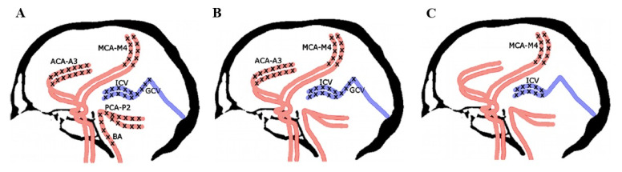
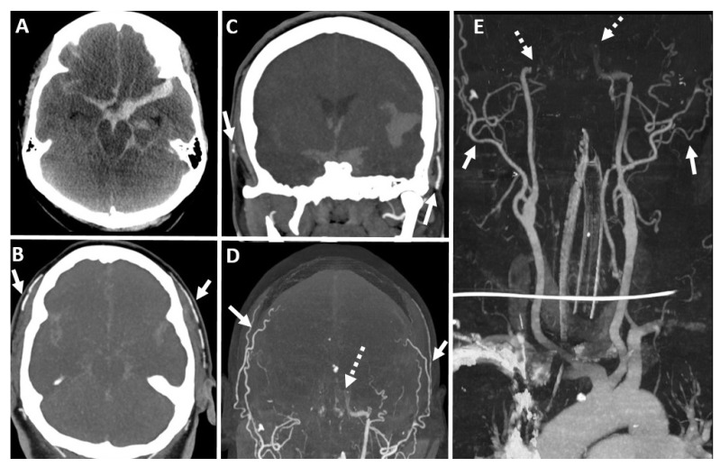
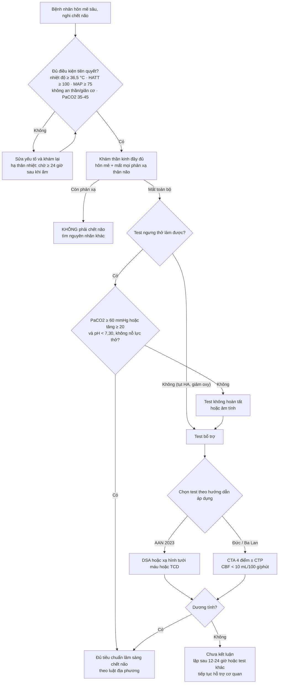
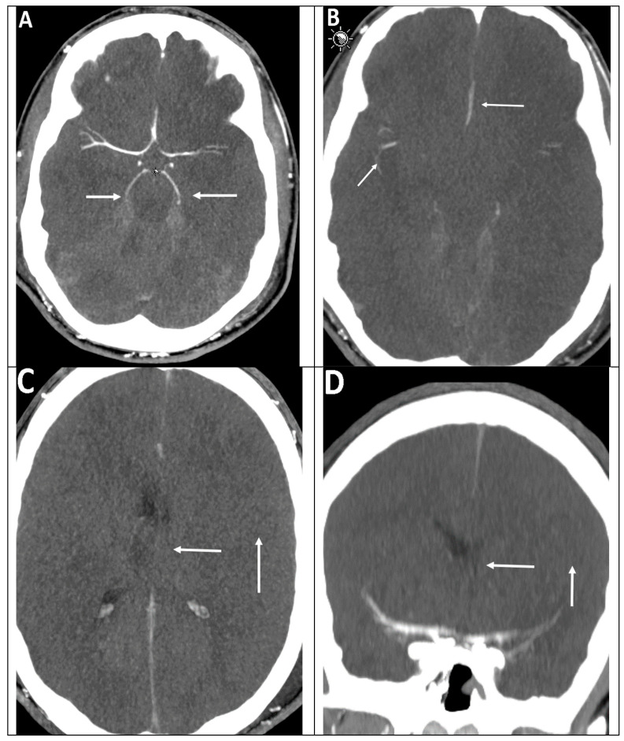
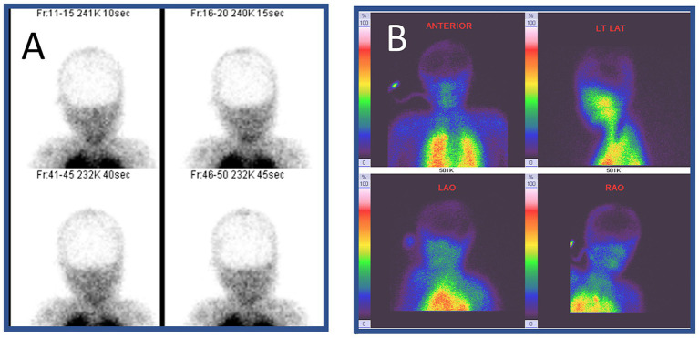

# 3038 — Chẩn đoán chết não (BD/DNC): tiêu chuẩn lâm sàng, test ngưng thở và đọc CTA/CT tưới máu cho đúng

**Tags:** `pattern:mat-tuoi-mau-nao` `pattern:phu-nao-lan-toa` `pattern:mat-phan-biet-xam-trang` `pattern:gia-xuat-huyet-duoi-nhen` `vung:nao` `vung:than-nao` `score:CTA-4-diem` `protocol:CTA-chet-nao` `protocol:CT-tuoi-mau` `protocol:test-ngung-tho` `protocol:xa-hinh-nao`
**Mức chắc chắn (certainty):** tổng hợp y văn (literature synthesis) — ghép **nghiên cứu độ chính xác tiến cứu, mù đôi, 15 ICU/282 bệnh nhân** về CT tưới máu + CTA (PMC12166499, JAMA Neurol 2025, CC BY), **dữ liệu thực tế toàn nước Đức 5.152 bệnh nhân/1.272 CTA** (PMC11235910), **tổng quan ảnh học đa phương thức theo AAN 2023** (PMC11202462), **tổng quan các test bổ trợ có ca minh họa** (PMC11747481), **meta phân tích CT/MR tưới máu** (PMC11568350), **nghiên cứu CTA trẻ em 43 ca** (PMC11945848), **bài về bẫy dương/âm tính giả của CTA** (PMC9604663) và **kinh nghiệm quốc gia Ba Lan đưa CTA/CTP vào hướng dẫn** (PMC8469323).

> **Câu hỏi thực hành:** nam 41 tuổi, **ngừng tim được hồi sinh (ROSC) ngày thứ 4**, GCS 3, đồng tử giãn không phản xạ, mất phản xạ giác mạc–ho–nuốt, không có vận động tự phát; **đang noradrenalin, MAP 68 mmHg**. Bác sĩ hồi sức hỏi: **đã đủ chẩn đoán chết não chưa? Có phải làm test ngưng thở (apnea test) không? Nếu không làm được thì CTA hay CT tưới máu (CTP), và đọc thế nào để không kết luận oan?**
> Bài chốt theo **ba lớp không được lẫn**: **dòng chảy (flow) ≠ tưới máu (perfusion) ≠ chức năng (function)**. Chẩn đoán là **lâm sàng**; **test ngưng thở là phần không thể bỏ**; ảnh học chỉ **bổ trợ** khi lâm sàng không hoàn tất — và **CTA/CTP KHÔNG nằm trong danh sách test bổ trợ được AAN 2023 chấp nhận ở người lớn** (chỉ DSA, xạ hình tưới máu, TCD), trong khi **Đức và Ba Lan đã đưa CTA/CTP vào hướng dẫn quốc gia**. Nối [3035 – HIE sau ngừng tim](../3035-hie-sau-ngung-tim-nguoi-lon/lesson.md), [3036 – Myoclonus sau ngừng tim](../3036-trang-thai-myoclonus-sau-ngung-tim/lesson.md), [3037 – Nhiễm trùng não thất/EVD](../3037-nhiem-trung-nao-that-evd/lesson.md), [211 – Đột quỵ não](../211-dot-quy-nao/lesson.md), [201 – Protocol sọ não](../201-protocol-so-nao/lesson.md).

## 1. Tổng quan bệnh học – cơ chế hình ảnh: vì sao “không còn dòng chảy” không đồng nghĩa “không còn tưới máu”

- **Sinh lý quyết định tất cả:** áp lực tưới máu não **CPP = MAP − ICP**. Khi ICP tăng dần tới mức MAP, **CPP → 0**, dòng chảy trong các động mạch lớn **dừng lại từ ngoại vi vào trong** (động mạch vỏ → động mạch nền → tĩnh mạch sâu). Đây là lý do **thứ tự mất tín hiệu** có ý nghĩa chẩn đoán, không phải chi tiết ngẫu nhiên.
- **Ba ngưỡng sinh lý phải nhớ:**
  - **CBF < 10 mL/100 g/phút** → **điện não im lặng** (đủ để EEG “phẳng” nhưng tế bào còn sống) — đây chính là **tiêu chí CTP của hướng dẫn Ba Lan**: **CBF < 10 mL/100 g/phút + CBV < 1 mL/100 g** tại mọi vùng ROI (PMC8469323).
  - **CBF < 5 mL/100 g/phút** → **chết tế bào không hồi phục** — mới là nền tảng của chết não.
  - Vì vậy một bệnh nhân có thể **“chết điện não” mà chưa chết não**, và **“không thấy mạch trên CTA” mà não vẫn còn tưới máu mao mạch** ở một số vùng.
- **Vì sao CTA chỉ là “flow”, không phải “perfusion”:** CTA mặt cắt 1 mm với **pha động mạch ở giây 20 và pha tĩnh mạch ở giây 60** (protocol trẻ em, PMC11945848) chỉ cho biết **thuốc có tới được mạch đó hay không**. Não chết nhưng **dòng chảy chậm (stasis filling)** vẫn làm thuốc ngấm vào các đoạn gần → **âm tính giả**. Ngược lại **mở sọ giảm áp** làm ICP khu trú giảm → còn dòng chảy dù não đã chết → cũng **âm tính giả**.
- **Vì sao CTP gần “perfusion” hơn:** CTP đo **thể tích máu trong mao mạch (CBV)** và **lưu lượng (CBF)** theo thời gian — mô não chết **không còn CBV**, kể cả khi động mạch lớn còn thấy thuốc. Đó là lý do CTP có độ nhạy cao hơn CTA ở bệnh nhân có **khuyết sọ**.
- **Vì sao xạ hình “nhìn được chức năng – chuyển hóa”:** **99mTc-HMPAO** gắn vào phức hợp nội bào phụ thuộc **hoạt động ty thể**; não chết không giữ thuốc → **“hollow skull” (sọ rỗng)**, cộng **“hot nose” (mũi nóng)** do tuần hoàn ngoài sọ còn tốt (PMC11747481).
- **Ngưỡng định lượng phải nhớ (thứ tự quan trọng khi trả lời “đã đủ chưa”):**
  - **Điều kiện tiên quyết:** thân nhiệt trung tâm **≥ 36,5 °C** (hướng dẫn AAN 2023, theo PMC11202462; nhiều nơi ghi ≥ 36 °C), **huyết áp tâm thu ≥ 100 mmHg** và **MAP ≥ 75 mmHg** (hoặc sát trị số nền của bệnh nhân), **không còn thuốc an thần/giãn cơ** (**chờ ≥ 5 lần chu kỳ bán thải** sau khi ngừng, nếu biết thuốc), **PaO₂ ≥ 200 mmHg** khi thở 100% O₂, **PaCO₂ nền 35–45 mmHg**, **pH động mạch < 7,30** khi không có tăng CO₂ mạn.
  - **Hạ thân nhiệt:** phải **quan sát thêm ≥ 24 giờ sau khi hồi phục thân nhiệt > 36 °C** trước khi kết luận.
  - **Test ngưng thở dương tính:** không có nỗ lực thở khi **PaCO₂ ≥ 60 mmHg** (hoặc **tăng ≥ 20 mmHg** so với nền) và **pH < 7,30**.
  - **Phải dừng test ngưng thở** nếu **HATT < 100 mmHg hoặc MAP < 75 mmHg** dù đã dùng vận mạch/dịch, **SpO₂ < 85%**, loạn nhịp, hoặc tụt huyết áp — không được “cố cho đủ số”.
  - **Độ chính xác test bổ trợ (người lớn):** **DSA 100%/100%**; **SPECT 88,4%/100%**; **TCD 90%/98%**; **EEG 53–80%/97%**; **SSEP 100%/78%**; **CTA 52–97%/100%** (các nghiên cứu cũ, PMC11747481). **Meta CTP/MRP 10 nghiên cứu/328 bệnh nhân: độ nhạy 96,1% (KTC 95% 89,5–98,6)** (PMC11568350).
  - **Nghiên cứu tiến cứu mù đôi mạnh nhất (282 bệnh nhân, 204 ca chết não theo lâm sàng):** **CTP thân não định tính Se 98,5%/Sp 74,4%**; **CTP toàn não Se 93,6%/Sp 92,3%**; **CTA Se 75,5–87,3% và Sp 89,7–91,0%**; độ đồng thuận giữa 2 bác sĩ **κ 0,81–0,84**; **14 ca (5%) biến cố nhẹ, không có biến cố nặng** (PMC12166499). **Không test nào đạt ngưỡng tiền định > 98%** → kết luận của chính nhóm nghiên cứu: **lâm sàng vẫn là nền tảng**.
  - **Thực tế Đức (5.152 bệnh nhân, 1.272 CTA, 676 bệnh viện):** dùng CTA tăng **17,2% → 29,7%** qua 4 năm; **thất bại kỹ thuật 0,9%**, **dương tính 89,3%**, **âm tính 9,8%**; **âm tính nhiều hơn** ở tổn thương não thứ phát, hội chứng lâm sàng kéo dài, hoặc khám lâm sàng không đáng tin; thời gian tới chẩn đoán **2,6 giờ** (CTA) so với **1,6 giờ** (test khác) (PMC11235910).
  - **Trẻ em (43 ca, 3 tháng–18 tuổi):** thang **4 điểm ICV–SPV** (không ngấm **tĩnh mạch não trong + tĩnh mạch đá trên**) nhạy nhất **88,4%**, so với **A20-V60 86,0%** và **A60-V60 79,1%**; ở trẻ **có khuyết sọ ICV–SPV 89,5% vs A60-V60 68,4%**; **stasis filling gặp 34%** (PMC11945848).

*Sơ đồ ba thang điểm: (A) **10 điểm** — không ngấm cả hai ACA-A3, MCA-M4, PCA-P2, ICV, GCV và BA; (B) **7 điểm** — ACA-A3, MCA-M4, ICV, GCV; (C) **4 điểm** — chỉ **MCA-M4 hai bên và ICV**. Càng đòi nhiều mạch, **càng dễ âm tính giả** vì các đoạn xa vẫn có thể ngấm thuốc do dòng chảy ứ (stasis). Đây là lý do thang 4 điểm được chọn ở nhiều nước. Nguồn: J Clin Med 2021 (PMC8469323), CC BY 4.0.*

## 2. Mẫu hình + chẩn đoán phân biệt theo vị trí (gamut)

- **Trên CT không cản quang (CT sọ):** **phù não lan tỏa + mất phân biệt xám–trắng + xóa rãnh/bể đáy + thoát vị hạnh nhân** — gặp ở **93%** trẻ chết não trong loạt 43 ca (PMC11945848). Gợi ý nhưng **KHÔNG chẩn đoán**: cùng hình ảnh gặp ở hôn mê do ngộ độc, hạ đường huyết nặng, hạ thân nhiệt.
- **Dấu hiệu “giả” nguy hiểm nhất:** **xuất huyết dưới nhện giả (pseudosubarachnoid hemorrhage)** — bể đáy **tăng tỷ trọng** do **ứ tĩnh mạch + phù**, không phải máu; đọc nhầm thành SAH sẽ **đổi hoàn toàn hướng xử trí** (PMC11747481, PMC11202462).
- **“Tiểu não trắng” (white cerebellum sign / cerebellar reversal):** phù vỏ não lan tỏa làm **tiểu não trông tăng tỷ trọng tương đối** — dấu hiệu phù nặng, không đặc hiệu.
- **Trên CTA:** mất ngấm thuốc **từ đoạn xuyên màng cứng trở lên** — ĐM cảnh trong **hết đoạn đá**, ĐM sống **hết đoạn trong màng cứng**, trong khi **ĐM cảnh ngoài và nhánh còn ngấm rõ**; tĩnh mạch não trong/Galen không ngấm (PMC11202462, PMC8469323).
- **Trên CTP:** vùng **CBF < 10 mL/100 g/phút** và **CBV < 1 mL/100 g** lan **toàn bộ** vỏ–hạch nền–thân não; vùng còn tưới máu **khu trú** = **không phải ngưng tuần hoàn toàn bộ**.
- **Trên xạ hình:** **hollow skull** (không hoạt độ trong bán cầu/tiểu não) + **hot nose**; lưu ý **hot nose** cũng gặp trong nhồi máu lớn, máu tụ dưới màng cứng, bệnh não gan → **không dùng một mình** (PMC11747481).
- **Trên TCD:** phổ **oscillating/reverberating** (tiền tâm thu–hậu tâm thu đảo chiều), **systolic spikes < 200 ms**, **vận tốc đỉnh tâm thu < 50 cm/s** ở **≥ 3 động mạch nội sọ** (2 MCA + BA); nếu chỉ làm TCD đơn thuần phải **lặp lại trong 30 phút**; **TCD chưa được kiểm chứng ở trẻ em** (PMC11747481).
- **Gamut “bắt chước chết não” phải loại trước khi chụp bất cứ gì:** an thần/giãn cơ còn tác dụng, **hạ thân nhiệt**, **hội chứng Guillain–Barré/botulism** (mất phản xạ nhưng ý thức còn), **tổn thương tủy cổ cao**, rối loạn chuyển hóa–điện giải nặng, **trạng thái phong tỏa (locked-in)** do nhồi máu cầu não, ngộ độc.
- **Mnemonic 5 bước “DNC”:** **D**rugs/temperature (loại thuốc, sửa nhiệt) → **N**eurologic exam (mất ý thức + mất phản xạ thân não) → **C**arbon dioxide (apnea test) → **C**onfirmatory test **chỉ khi lâm sàng không hoàn tất** → **C**onsult/jurisdiction (đúng luật địa phương).

## 3. Bảng so sánh phân biệt (ma trận đối chiếu)

| Test / thực thể | Tiêu chí hình ảnh–kỹ thuật | Chốt vào (rule-in) | Chốt loại (rule-out) | Gợi ý xác nhận |
|---|---|---|---|---|
| **DSA** (chuẩn vàng dòng chảy) | Không ngấm thuốc ĐM cảnh trong–sống nội sọ, không có tĩnh mạch dẫn lưu; **2 lần tiêm cách 20 phút** | **Không ngấm 4 động mạch khi vào nội sọ + không có pha tĩnh mạch** | Còn ngấm bất kỳ ĐM nội sọ → **chưa kết luận** | Xâm lấn, cần chuyển phòng mạch; thận yếu, tụt HA |
| **CTA 4 điểm** | 1 mm, pha ĐM **20 s** + pha TM **60 s**; MCA-M4 hai bên + ICV | **Không ngấm MCA-M4 hai bên VÀ ICV** | Ngấm **dù chỉ một MCA-M4** → âm tính; **stasis filling đoạn gần** không tính là dương | Đọc theo thang đã chọn, ghi rõ 4/7/10 điểm |
| **CTP (CT tưới máu)** | ROI vỏ, hạch nền, thân não; **CBF < 10**, **CBV < 1** | **Mất tưới máu toàn bộ kể cả thân não** | Còn **bất kỳ vùng tưới máu** → chưa ngưng hoàn toàn | **CTP thân não** nhạy 98,5% nhưng **Sp 74,4%** → dương tính giả |
| **Xạ hình 99mTc-HMPAO** | Ảnh phẳng + SPECT: không hoạt độ nội sọ | **Hollow skull** (không hoạt độ bán cầu/tiểu não) | Còn hoạt độ vỏ **hoặc** tiểu não → chưa kết luận | **Hot nose** một mình **không** chốt |
| **TCD** | ≥ 3 ĐM nội sọ: 2 MCA (50–60 mm) + BA (80–90 mm) | **Phổ oscillating/reverberating hai bên + BA** | **Còn dòng tâm trương** → chưa ngưng; **mất tín hiệu hoàn toàn** = giai đoạn muộn, không chốt | Lặp 12–24 giờ nếu chưa có ICP monitor |
| **EEG** | **Không hoạt động ≥ 2 µV trong 30 phút**, điện cực cách ≥ 10 cm | Điện não phẳng theo chuẩn ACNS | Còn hoạt động bất kỳ → loại | **Bị nhiễu bởi an thần/hạ nhiệt**; **Se 53–80%** |
| **Bệnh cảnh giả chết não** | CT phù lan tỏa ± giả SAH; CTA “không ngấm” | — | **Có yếu tố sửa được** (thuốc, nhiệt độ, HA, chuyển hóa) | Sửa yếu tố → khám lại; **không chụp thay cho sửa** |

*A: CT không cản quang — **xuất huyết dưới nhện lan tỏa + phù não**. B–E: MIP và dựng 3D — **ĐM cảnh ngoài và nhánh ngấm rõ** (mũi tên liền), **ĐM cảnh trong chỉ tới đoạn đá** (mũi tên đứt), **không ngấm bất kỳ động mạch nội sọ nào**. Đây là hình mẫu “dương tính” của CTA; lưu ý bệnh nhân này **có khuyết sọ** ở một số lát — chính là bối cảnh dễ **âm tính giả**. Nguồn: Diagnostics 2024 (PMC11202462), CC BY 4.0.*

### Vì sao “stasis filling” là cái bẫy số một của CTA
- Khi ICP xấp xỉ MAP, thuốc cản quang **vẫn vào được các đoạn gần** (A1–A2, M1–M2, P1–P2) rồi **dừng** — hình giống “còn tưới máu” nếu chỉ nhìn các đoạn này.
- **Thang 10 điểm và 7 điểm** đòi cả **A3, M4, P2** → dễ **âm tính giả** vì các đoạn xa có thể ngấm do ứ; **thang 4 điểm (MCA-M4 + ICV)** cân bằng nhất giữa nhạy và đặc hiệu (PMC9604663).
- Thực hành: dùng **bolus tracking** để bắt đúng pha động mạch sớm (kinh nghiệm Đức, PMC11235910); nếu **không đủ tiêu chí**, **không được kết luận chết não** — mà **lặp sau 12–24 giờ** hoặc chuyển test khác.

## 4. Protocol

1. **Trước khi chụp — sửa hết yếu tố sửa được:** thân nhiệt **≥ 36,5 °C**, **HATT ≥ 100 mmHg/MAP ≥ 75 mmHg**, **PaCO₂ 35–45 mmHg**, **PaO₂ ≥ 200 mmHg**, không còn an thần/giãn cơ (**≥ 5 chu kỳ bán thải**), loại trừ tổn thương tủy cổ cao và bệnh lý thần kinh–cơ.
2. **Khám lâm sàng đầy đủ (ghi rõ từng mục):** hôn mê không đáp ứng đau tối đa; mất **phản xạ đồng tử, giác mạc, mắt–đầu, mắt–tiền đình, hầu, ho**; **không có vận động thân não**; **loại trừ vận động do tủy** (Lazarus sign, duỗi tam chi) — đây **không phải** cử động có ý nghĩa.
3. **Test ngưng thở (không bỏ qua):**
   - Thở **100% O₂ ≥ 10 phút** để PaO₂ ≥ 200 mmHg; lấy **khí máu nền**.
   - **Ngắt máy thở** (để ống thông khí quản mở, ± CPAP 5 cmH₂O), **theo dõi liên tục**; lấy khí máu sau **8–10 phút** hoặc khi **PaCO₂ đạt ngưỡng**.
   - **Dương tính:** **PaCO₂ ≥ 60 mmHg (hoặc tăng ≥ 20 mmHg)** và **pH < 7,30**, **không có nỗ lực thở**.
   - **Dừng ngay:** HATT < 100 mmHg, MAP < 75 mmHg, SpO₂ < 85%, loạn nhịp, tụt HA — **ghi rõ “test không hoàn tất”**, không suy diễn.
4. **Chọn test bổ trợ theo bối cảnh (không theo thói quen):**
   - **Không làm được test ngưng thở / khám không đáng tin / tổn thương hố sau** → cần test bổ trợ.
   - **AAN 2023 (Mỹ):** chấp nhận **DSA, xạ hình tưới máu (SPECT), TCD**; **không** chấp nhận **EEG, điện thế gợi, CTA, MRA** (PMC11747481).
   - **Đức:** CTA theo protocol quốc gia (bolus tracking, tiêu chí đoạn gần) — dùng thực tế **24,7%** ca (1.272/5.152) (PMC11235910).
   - **Ba Lan:** **CTA + CTP** được đưa vào hướng dẫn, với **CTP: CBF < 10 mL/100 g/phút và CBV < 1 mL/100 g** (PMC8469323).
   - **Trẻ em:** ưu tiên **CTA 4 điểm ICV–SPV**; nhớ **khuyết sọ làm giảm độ nhạy của mọi thang** (PMC11945848).
5. **Kỹ thuật CTA/CTP tối thiểu:** lát **1 mm**, từ **lồi não tới C1–C2**; **không cản quang → pha động mạch 20 s → pha tĩnh mạch 60 s**; thuốc **2 mL/kg, 3 mL/s** (protocol trẻ em) hoặc **80 mL** ở người lớn (theo ca trong PMC11202462); đọc **MIP + dựng 3D** để không bỏ sót nhánh ngoài sọ.
6. **Ghi báo cáo theo mẫu 3 dòng:** (a) còn/không còn ngấm **từng mạch**; (b) **thang điểm dùng** và tổng điểm; (c) **kết luận “phù hợp/không phù hợp với ngưng tuần hoàn não”** — **không** ghi “chết não” trong báo cáo hình ảnh.

## 5. Biến thể bình thường và cạm bẫy

- **Phản xạ tủy vẫn còn ở người chết não:** gập/duỗi chi, **Lazarus sign** (giơ tay), vã mồ hôi, nhịp tim nhanh — **không phải** bằng chứng còn sống và **không phải** bằng chứng chết; phải mô tả và giải thích cho gia đình.
- **Khuyết sọ / mở sọ giảm áp / dẫn lưu dịch não tủy / shunt:** làm **giảm ICP khu trú** → CTA và cả xạ hình có thể **âm tính giả**; ưu tiên **CTP** và đọc theo vùng, không chỉ theo mạch lớn.
- **Tụt huyết áp:** giảm dòng chảy toàn bộ → **dương tính giả** trên CTA/DSA; **luôn ghi MAP tại thời điểm chụp**.
- **Trẻ nhỏ:** thóp mở, khuyết sọ bẩm sinh, shunt — **giảm độ nhạy của mọi thang CTA** (A60-V60 chỉ còn **68,4%** khi có khuyết sọ); **TCD không dùng cho trẻ**.
- **Tổn thương hố sau đơn thuần:** phá hủy thân não nhưng bán cầu còn tưới máu → **CTA/CTP toàn não có thể âm tính**; phải dựa vào lâm sàng + test chức năng thân não, không “chụp mạch để chắc”.
- **EEG phẳng không bằng chết não:** **Se 53–80%**, bị ảnh hưởng bởi an thần, hạ nhiệt, nhiễu điện từ; **không đánh giá được thân não**.
- **“Hot nose” và “pseudosubarachnoid hemorrhage”:** hai dấu hiệu **rất dễ gây kết luận sai** — một cái bị coi là bằng chứng chết não, một cái bị coi là xuất huyết thật.
- **Sai về thời gian:** không được kết luận trước khi **hết 5 chu kỳ bán thải** của thuốc, trước **24 giờ** sau khi ấm lên từ hạ thân nhiệt; **không có “giờ vàng” nào cho phép bỏ qua điều kiện tiên quyết**.

## 6. Tự lượng giá — Blind Quiz

**Ca 1 — Nam 46 tuổi, tai nạn giao thông, máu tụ dưới màng cứng lớn, GCS 3, mất phản xạ thân não. CTA được chỉ định vì không làm được test ngưng thở. Nhìn hình, mô tả trước khi bấm đáp án.**

- Hỏi: thuốc ngấm tới đâu? Có đủ tiêu chí thang 4 điểm không? Nếu CTA âm tính thì làm gì?

<b>Bấm để hiện đáp án</b>

- **ĐM cảnh ngoài và nhánh ngấm rõ; ĐM cảnh trong dừng ở đoạn đá; không có động mạch nội sọ nào ngấm** → **dương tính** với ngưng tuần hoàn não.
- Đối chiếu với thang đã chọn: nếu dùng **4 điểm**, cần **MCA-M4 hai bên + ICV** đều không ngấm; nếu dùng **10 điểm**, phải kiểm tra thêm **A3, P2, GCV, BA** — **đừng đổi thang giữa chừng**.
- Nếu **âm tính**: **không kết luận chết não**; **lặp CTA sau 12–24 giờ**, hoặc chuyển **CTP** (nhạy hơn ở ca khuyết sọ), hoặc **DSA/xạ hình** theo hướng dẫn áp dụng.
- Nguồn: Diagnostics 2024 (PMC11202462), CC BY 4.0.

**Ca 2 — Nữ 53 tuổi, hôn mê sau ngộ độc propofol, GCS 3. CTA cho thấy các đoạn gần vẫn ngấm thuốc.**

- Hỏi: đây là “còn tưới máu” hay “ứ thuốc”? Tiêu chí nào bị sai? Xử trí?

<b>Bấm để hiện đáp án</b>

- **Stasis filling**: thuốc vào **A1–A2, M1–M2, P1–P2** rồi dừng; trên thang **7/10 điểm** hình này **không đạt** tiêu chí ngưng tuần hoàn, nhưng trên **4 điểm** (C–D: **M4 và ICV không ngấm**) lại **dương tính**.
- **Sai lầm thường gặp:** chụp quá sớm/không bolus tracking → bắt nhầm pha; hoặc đọc “còn ngấm đoạn gần” rồi kết luận **âm tính** khi thực ra đã ngưng tuần hoàn.
- **Xử trí:** ghi rõ thang điểm, **không kết luận vội**; nếu bối cảnh còn **ngộ độc propofol** thì **phải loại thuốc trước** (chờ ≥ 5 chu kỳ bán thải) — hình ảnh không thay được điều kiện tiên quyết.
- Nguồn: Life 2022 (PMC9604663), CC BY 4.0.

**Ca 3 — Bệnh nhân sau ngừng tim, xạ hình tưới máu não được chỉ định.**

- Hỏi: mô tả hai dấu hiệu; dấu nào **không** đủ để chốt?

<b>Bấm để hiện đáp án</b>

- **Hollow skull:** không có hoạt độ phóng xạ trong bán cầu và tiểu não → phù hợp ngưng tuần hoàn não.
- **Hot nose:** hoạt độ tăng ở vùng mũi/mặt do tuần hoàn **ngoài sọ** còn tốt — **dấu hiệu phụ**, cũng gặp trong nhồi máu lớn, máu tụ dưới màng cứng, bệnh não gan → **không dùng một mình**.
- **Cẩn thận:** xạ hình có thể **âm tính giả** khi **mở sọ giảm áp** hoặc **tụt huyết áp**; luôn đối chiếu lâm sàng và MAP lúc tiêm.
- Nguồn: Front Neurol 2024 (PMC11747481), CC BY 4.0.

## Bài liên quan chéo
- [3035 – HIE sau ngừng tim ở người lớn](../3035-hie-sau-ngung-tim-nguoi-lon/lesson.md) (giai đoạn trước khi tiến tới chết não)
- [3036 – Trạng thái myoclonus sau ngừng tim](../3036-trang-thai-myoclonus-sau-ngung-tim/lesson.md) (vận động do tủy **không** phải cử động có ý nghĩa)
- [3037 – Nhiễm trùng não thất & nhiễm trùng EVD](../3037-nhiem-trung-nao-that-evd/lesson.md) (bệnh nhân có EVD — bẫy giảm ICP khu trú)
- [211 – Đột quỵ não](../211-dot-quy-nao/lesson.md) (nhồi máu thân não, locked-in)
- [201 – Protocol sọ não](../201-protocol-so-nao/lesson.md) (kỹ thuật CTA/CTP)
- [214 – Nhiễm trùng hệ thần kinh trung ương](../214-nhiem-trung-tktw/lesson.md)

> Không dùng để chẩn đoán độc lập khi chưa có người hướng dẫn. Chẩn đoán chết não là **quyết định pháp lý**, phải theo **hướng dẫn và luật áp dụng tại nơi hành nghề**.
