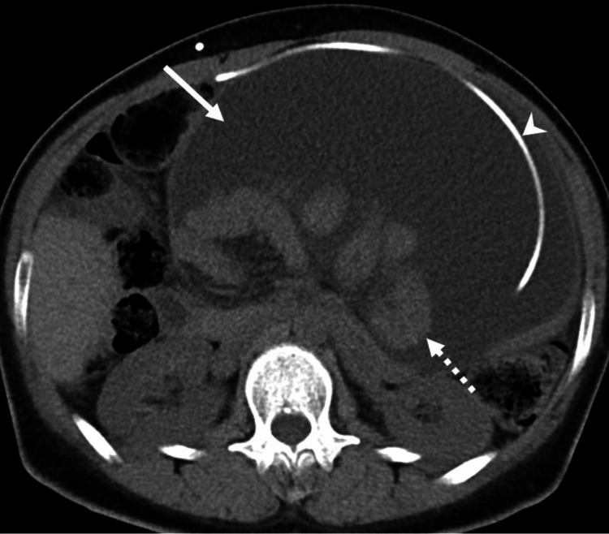
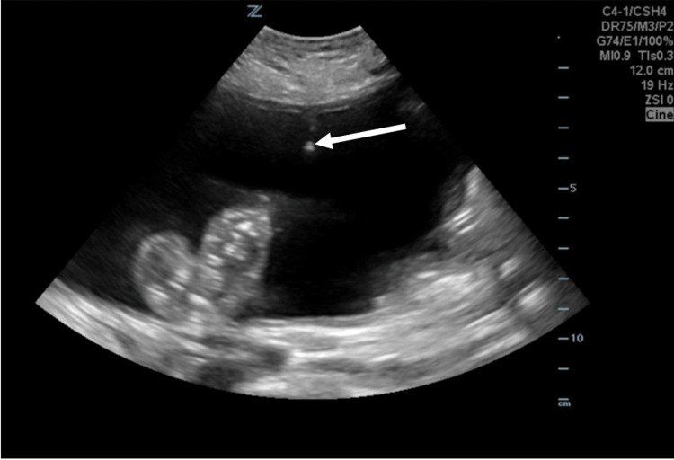
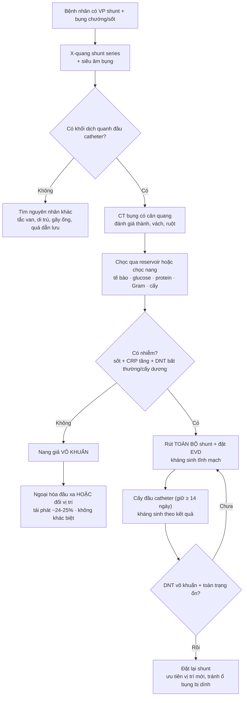
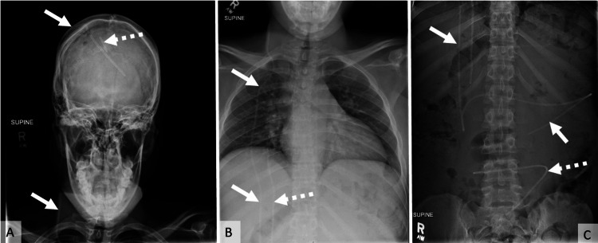
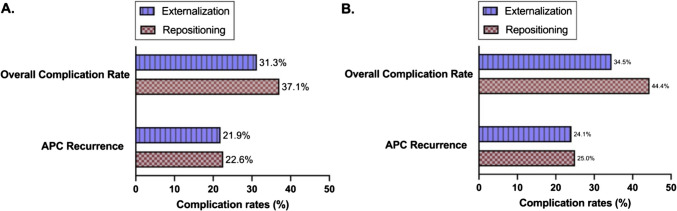

# 3039 — Nhiễm trùng shunt não thất–phúc mạc & nang giả phúc mạc: nang vô khuẩn hay nhiễm, rút shunt hay đổi vị trí?

**Tags:** `pattern:nang-dich-khu-tru` `pattern:ngam-thanh` `pattern:gian-nao-that` `pattern:dich-tu-do-o-bung` `vung:phuc-mac` `vung:nao-that` `score:CSF-cell-index` `protocol:CT-bung` `protocol:sieu-am-bung` `protocol:shunt-series` `protocol:choc-do-tuy-song`
**Mức chắc chắn (certainty):** tổng hợp y văn (literature synthesis) — ghép **tổng quan hệ thống 43 bài về nang giả phúc mạc vô khuẩn** (PMC12000107, Childs Nerv Syst 2025, CC BY), **cohort 390 ca mổ lại shunt** so sánh nhiễm trùng với hỏng cơ học (PMC12917439), **nghiên cứu 110 ca nhiễm đơn lẻ + 55 ca tái nhiễm** về chiến lược hai thì (PMC11762661), **cohort 81 trẻ/113 lần mổ lại** về kém hấp thu phúc mạc (PMC12926232), **meta nguy cơ nhiễm shunt** (PMC12562948), **nghiên cứu 317 ca đa bệnh viện** (PMC11942643), **ca nguyên văn có ảnh X-quang/CT/siêu âm** (PMC12405959, Cureus, CC BY) và **tổng quan điều trị viêm não thất/nhiễm liên quan thiết bị** (PMC8896765).

> **Câu hỏi thực hành:** bé gái 3 tuổi, **shunt não thất–phúc mạc (VP shunt) đã 2 lần mổ lại**, vào viện vì **sốt 38,5 °C + bụng chướng 5 ngày**, không nôn, không tiêu chảy. Siêu âm bụng: **khối dịch lớn vô hiệu, có vách, đầu catheter nằm trong**. CT: **khối dịch khu trú 9 cm, thành mỏng ngấm thuốc, không có hơi**. Câu hỏi: **đây là nang giả vô khuẩn hay ổ nhiễm? Có phải rút toàn bộ shunt? Kháng sinh gì, bao lâu, khi nào đặt lại?**
> Bài chốt theo **ba lớp**: (1) **hình ảnh chỉ nói “có nang”, không nói “có mủ”** — **dịch não tủy (DNT) + cấy đầu catheter** mới quyết định; (2) **nhiễm = rút toàn bộ, không “đổi vị trí”** (màng sinh học trên ống không kháng sinh nào xuyên được); (3) **nang vô khuẩn** có hai lựa chọn **ngoại hóa (externalization)** hoặc **đổi vị trí đầu xa**, **không khác nhau có ý nghĩa** về tái phát. Nối [3037 – Nhiễm trùng não thất & EVD](../3037-nhiem-trung-nao-that-evd/lesson.md), [3034 – IVH & não úng thủy](../3034-chay-mau-nao-that-ivh-nao-ung-thuy/lesson.md), [3032 – Não úng thủy áp lực bình thường](../3032-nao-ung-thuy-ap-luc-binh-thuong/lesson.md), [214 – Nhiễm trùng hệ thần kinh trung ương](../214-nhiem-trung-tktw/lesson.md), [100 – Tổng quan hệ Bụng](../100-tong-quan-he-bung/lesson.md).

## 1. Tổng quan bệnh học – cơ chế hình ảnh: vì sao DNT lại thành một “nang” trong ổ bụng

- **Sinh lý nền:** người lớn có **~150 mL DNT**, được **đổi mới 4–5 lần/ngày** (≈ **600–750 mL/ngày**); phần lớn tái hấp thu qua hạt màng nhện, một phần thoát qua **bạch mạch hoành với tốc độ 1–1,5 mL/phút** (PMC12926232). Shunt **đẩy toàn bộ lượng DNT đó vào khoang phúc mạc**, nơi **khả năng hấp thu là hữu hạn** và **phụ thuộc lớp trung biểu mô**.
- **Cơ chế nang giả:** viêm màng bụng (do mổ nhiều lần, nhiễm khuẩn độ thấp, DNT protein cao, phản ứng với catheter) → **fibrin hóa, dày trung biểu mô, mất lớp hấp thu khu trú** → DNT bị **vây quanh đầu catheter trong một khoang xơ KHÔNG có biểu mô lót** (pseudocyst, không phải nang thật). Vì không có biểu mô, **thành nang do viêm sinh ra**, nên **ngấm thuốc khi còn viêm hoạt động** và **có thể nhiễm khuẩn thứ phát**.
- **Vì sao nang gây “shunt hỏng” mà não có thể không giãn:** khoang nang tạo **áp lực đối kháng** → dòng DNT giảm/tắc; nhưng **nhu mô não đã mất đàn hồi** (đặc biệt trẻ có não úng thủy bẩm sinh, nhiều lần mổ) nên **không giãn tương ứng**. Đừng chờ “não thất to lên” mới chẩn đoán.
- **Vì sao hình ảnh không phân biệt được vô khuẩn/nhiễm:** cả hai đều là **dịch 0–20 HU**, thành mỏng, có vách; **dấu hiệu gợi ý nhiễm** chỉ là **thành dày > 3 mm, ngấm mạnh, mảnh trong lòng, hơi (hiếm)** — **không đủ** để chốt. Quyết định nằm ở **tế bào/cấy DNT + cấy đầu catheter**.
- **Ngưỡng định lượng phải nhớ:**
  - **Tần suất nang giả phúc mạc:** **1–4,5%** ca đặt VP shunt (PMC13544839, trích trong PMC12000107); một số loạt ghi **0,25–10%**, **tái phát tới 19,8%** (PMC12954247).
  - **Tần suất nhiễm shunt:** **9,6%** (225/2.333 bệnh nhân, gộp 5 nghiên cứu — PMC12562948); **7,26%** (23/317, đa bệnh viện — PMC11942643); **6% VP / 5,2% LP** (161 shunt, Ấn Độ — PMC12442118).
  - **Yếu tố nguy cơ nhiễm:** **tuổi < 6 tháng: RR 33,06 (9,27–117,99)** (meta nhi — PMC11799681); **não úng thủy bẩm sinh OR 2,502**, **thoát vị tủy–màng não OR 2,359**, **úng thủy do u OR 0,418** (PMC12562948); **ASA trước mổ > 3: HR 8,28** (PMC12442118).
  - **Thời điểm:** **58,06%** nhiễm xuất hiện **trong 2 tuần đầu** (PMC11942643); trong cohort 390 ca, **72,9%** ca nhiễm phải mổ lại **trong 6 tháng đầu** so với **42%** ca hỏng cơ học (PMC12917439).
  - **Dấu hiệu phân biệt nhiễm vs hỏng cơ học (390 ca):** sốt **70,7% vs 16,4%**; **CRP tăng 88,5% vs 6,4%** (OR **64,1**); **bạch cầu máu tăng 72,1% vs 15,6%** (OR **19,7**); **glucose DNT thấp 51,4% vs 13%**; **protein DNT cao 76,4% vs 36%**; **tuổi < 1: 51,4% vs 27,2%** (PMC12917439).
  - **Cấy và nhuộm:** **cấy DNT dương 85,7%**; **CoNS 55%** (**S. epidermidis 42,8%**); **nhuộm trực tiếp dương 79,3%** → **14,3% nhiễm vẫn cấy âm** (PMC12917439).
  - **Siêu âm bụng:** trong **hỏng cơ học**, **dịch tự do 33,3%**, **áp-xe 1,3%**; trong **nhiễm**, **dịch tự do 37,8%**, **áp-xe 25,5%** (PMC12917439) — **“dịch tự do” không loại được nang**.
  - **Nang giả vô khuẩn — ngoại hóa vs đổi vị trí (tổng quan hệ thống 43 bài):** tái phát **24,1% (ngoại hóa) vs 25,0% (đổi vị trí)**, p = 0,99; biến chứng chung **34,5% vs 44,4%**, p = 0,3861 (nhóm theo dõi ≥ 6 tháng); tính mọi thời điểm: biến chứng **31,3% vs 37,1%**, tái phát **21,9% vs 22,6%** (PMC12000107).
  - **Kém hấp thu phúc mạc ở trẻ (81 bệnh nhân/113 lần mổ lại):** **10 bệnh nhân** (10 nang giả + 1 cổ trướng không do gan); **mổ bụng xuyên phúc mạc trước đó OR 11,81 (2,73–51,04)**; **nhiều lần mổ lại OR 8,02 (1,86–34,63)**; **biến dạng trục cột sống OR 4,07 (1,03–16,03)**, tăng **2,77 lần mỗi độ**; **60% vs 11,3%** có tiền sử mổ bụng; **cứu được phúc mạc 7/10**, **3 ca phải chuyển shunt não thất–nhĩ (VA)** (PMC12926232).
  - **Nhiễm tái phát (110 ca đơn lẻ vs 55 ca tái phát):** **Gram âm 60%** ở nhóm tái phát; **đề kháng 3GC 85,2%**, **piperacillin–tazobactam 83,3%**, **carbapenem 10,4%**; **chiến lược đổi shunt hai thì làm giảm tái nhiễm**; khuyến nghị **glycopeptide + carbapenem** theo kinh nghiệm (PMC11762661).
  - **Thời gian kháng sinh:** **10–14 ngày** với **CoNS/C. acnes**, **tới 21 ngày** với **S. aureus/Gram âm**, tính **10–14 ngày sau lần cấy dương cuối** (PMC8896765).

*CT bụng không cản quang: **khối dịch khu trú (loculated) lớn** chiếm gần toàn bộ ổ bụng trước, **đầu catheter shunt** (đầu mũi tên) nằm **bên trong lòng khối**, **vách và màng bao** rõ (mũi tên liền), **đẩy quai ruột ra sau và sang bên**. Dịch **đồng tỷ trọng với nước**, không có hơi. Đây là hình mẫu “nang giả phúc mạc” — nhưng **hình ảnh một mình KHÔNG nói được vô khuẩn hay nhiễm**. Nguồn: Cureus 2026 (PMC12405959), CC BY 4.0.*

## 2. Mẫu hình + chẩn đoán phân biệt theo vị trí (gamut)

- **Khối dịch khu trú quanh đầu catheter (ổ bụng):** **nang giả vô khuẩn** · **nang giả nhiễm/áp-xe** · **cổ trướng DNT (CSF ascites, dịch tự do)** · **cổ trướng khu trú do dính** · **máu tụ/lymphocele sau mổ** · **nang buồng trứng/khối phần phụ** · **áp-xe sau thủng tạng** (catheter xuyên ruột).
- **Bệnh cảnh “shunt hỏng” không có khối dịch:** tắc van, tắc đầu xa do mạc nối/quai ruột, **di trú catheter** (ngực, bìu, trực tràng), **gãy/ngắt ống**, **quá dẫn lưu**.
- **Trên não:** **giãn não thất** (không bắt buộc) · **não thất xẹp + tụ máu dưới màng cứng** (quá dẫn lưu — nối [3030](../3030-tu-mau-duoi-mang-cung-man/lesson.md)) · **mủ trong não thất** (nối [3037](../3037-nhiem-trung-nao-that-evd/lesson.md)).
- **Mnemonic “SHUNT”:** **S**ite of distal tip (đầu xa ở đâu) · **H**ydrocephalus change (não thất có đổi) · **U**ltrasound abdomen (dịch tự do hay khu trú) · **N**eedle: chọc hút/cấy · **T**wo-stage if infected (rút toàn bộ + EVD).

## 3. Bảng so sánh phân biệt (ma trận đối chiếu)

| Thực thể | Hình ảnh điển hình | Chốt vào (rule-in) | Chốt loại (rule-out) | Gợi ý xác nhận |
|---|---|---|---|---|
| **Nang giả vô khuẩn** | Khối dịch **khu trú**, thành mỏng đều, **đầu catheter trong lòng**, không hơi; bệnh nhân **không sốt**, CRP bình thường | **Đầu catheter nằm trong khối dịch khu trú + DNT vô khuẩn + không hội chứng nhiễm** | **Thành dày/ngấm mạnh + sốt + CRP tăng** → nghĩ nhiễm | Siêu âm + CT; **cấy DNT và đầu catheter** |
| **Nang giả nhiễm / áp-xe** | Thành dày, ngấm mạnh, vách, mảnh trong lòng, **hiếm hơi**; có thể kèm viêm phúc mạc | **Sốt + CRP tăng + DNT bất thường/cấy dương** | **DNT hoàn toàn bình thường + CRP bình thường** không loại được **nhiễm khuẩn độ thấp** (biofilm) | **Cấy đầu catheter sau rút**; giữ cấy ≥ 14 ngày cho **C. acnes** |
| **Cổ trướng DNT (CSF ascites)** | **Dịch tự do** giữa các quai ruột, di chuyển theo tư thế, không có thành | **Dịch tự do lan tỏa + không vách + shunt còn lưu thông** | **Có vách/khu trú + đầu catheter trong khối** → nang giả | Siêu âm 2 tư thế; CT |
| **Cổ trướng khu trú do dính** | Dịch trong khoang dính, **không nhất thiết quanh catheter** | Tiền sử mổ bụng/viêm phúc mạc, vách dày | **Đầu catheter nằm ngoài khối** → không phải nang giả | CT có cản quang |
| **Máu tụ / lymphocele sau mổ** | Tỷ trọng cao (máu cấp 50–80 HU), không ngấm hoặc viền mỏng | **Mổ trong vòng vài ngày**, Hb giảm | **Dịch 0–20 HU + không thiếu máu** | CT không/có cản quang |
| **Nhiễm trùng shunt không có nang** | Não thất **có thể không giãn**; **phù mô mềm quanh ống**; đầu xa bình thường | **Sốt + CRP tăng + cấy DNT dương** | **Không sốt, CRP bình thường** → ít nghĩ nhiễm | **Chọc qua reservoir**, không chọc thắt lưng mù |

*Siêu âm: **khối dịch vô hiệu (anechoic)**, giới hạn rõ, **đầu catheter là điểm tăng âm trong lòng khối** (mũi tên). Hình bên là **kim chọc hút dưới hướng dẫn siêu âm**. Siêu âm là bước **đầu tay** vì nhanh, không xạ, phân biệt **dịch tự do vs khu trú** và cho **đường chọc hút chẩn đoán**. Nguồn: Cureus 2026 (PMC12405959), CC BY 4.0.*

### Vì sao “đổi vị trí đầu xa” không đủ khi có nhiễm
- Catheter nhiễm có **màng sinh học (biofilm)**: vi khuẩn bám trong **lớp polysaccharide** — **kháng sinh không xuyên qua**, và **cấy dịch rửa có thể âm** trong khi ống vẫn nhiễm.
- **Đổi vị trí** chỉ chuyển ống sang chỗ khác nhưng **giữ nguyên ống nhiễm** → **tái nhiễm**; trong nghiên cứu 110 ca, **chiến lược hai thì (rút toàn bộ → EVD → đặt lại) làm giảm tái nhiễm** (PMC11762661).
- Ngoại lệ: **nang giả vô khuẩn** — nơi **không có biofilm**, đổi vị trí và ngoại hóa **tương đương** (PMC12000107).

## 4. Protocol

1. **Đánh giá ban đầu (không bỏ bước nào):**
   - **Toàn thân:** sốt, CRP, bạch cầu; **khám bụng** (chướng, đau khu trú, phản ứng thành bụng).
   - **Thần kinh:** đau đầu, nôn, **gai thị** — lưu ý **gai thị vắng mặt 92,7%** ca hỏng cơ học (PMC12917439) → **không loại trừ**.
2. **Hình ảnh theo bậc:**
   - **X-quang “shunt series”** (sọ → cổ → ngực → bụng): kiểm tra **liên tục, gãy, di trú**, vị trí đầu xa; **không** đánh giá được nang.
   - **Siêu âm bụng:** bước **đầu tay** — dịch **tự do vs khu trú**, vách, đầu catheter, hướng chọc.
   - **CT bụng có cản quang:** khi siêu âm không rõ, nghi **áp-xe/vách/bowel obstruction**, hoặc cần đo kích thước–thành nang trước mổ.
   - **CT/MRI sọ:** đánh giá não thất, **máu tụ dưới màng cứng do quá dẫn lưu**, mủ trong não thất.
3. **Lấy mẫu — quyết định chẩn đoán:**
   - **Chọc qua reservoir/buồng shunt** (hoặc chọc nang dưới siêu âm) → **tế bào, glucose, protein, lactate, Gram, cấy**; **KHÔNG chọc thắt lưng mù** ở bệnh nhân có shunt (nguy cơ tụt não — nối [3026 – Tụt não nghịch lý](../3026-tut-nao-nghich-ly-sau-choc-do-shunt-mo-so/lesson.md)).
   - **Cấy đầu catheter sau khi rút** — mới là chốt của **nhiễm liên quan thiết bị**; giữ cấy **≥ 14 ngày** cho **C. acnes** (chậm mọc).
4. **Xử trí theo kết quả:**
   - **Nang giả vô khuẩn:** **ngoại hóa đầu xa** hoặc **đổi vị trí** (ổ bụng khác/phúc mạc–màng phổi/tĩnh mạch); **không khác nhau có ý nghĩa**; **nang rất lớn** phải **dẫn lưu từ từ** để tránh tụt huyết áp do giải ép nhanh (PMC12926232).
   - **Nhiễm shunt/nang nhiễm:** **rút toàn bộ hệ thống + đặt EVD** + **kháng sinh tĩnh mạch**; **đặt lại khi DNT vô khuẩn và toàn trạng ổn** (chiến lược hai thì).
   - **Kháng sinh kinh nghiệm:** **glycopeptide + carbapenem** nếu có yếu tố nguy cơ Gram âm/đã dùng kháng sinh dài (PMC11762661); **theo hệ vi khuẩn địa phương** — Ấn Độ **Gram âm 77%**, Thổ Nhĩ Kỳ **CoNS 55%** (PMC12442118, PMC12917439). **Thời gian:** 10–14 ngày (CoNS/C. acnes) hoặc tới 21 ngày (S. aureus/Gram âm), tính từ lần cấy dương cuối (PMC8896765).
   - **Kháng sinh trong não thất:** có thể dùng như **bổ trợ** ở ca khó (37 đợt ở trẻ, dung nạp tốt, DNT sạch nhanh — PMC13446907), nhưng **chưa có RCT**.
5. **Theo dõi sau mổ:** siêu âm/CT bụng nếu sốt lại; **đau đầu + não thất xẹp** → nghĩ **quá dẫn lưu**; **tái phát nang 24–25%** → hẹn khám và chụp lại có chủ đích.

## 5. Biến thể bình thường và cạm bẫy

- **“Không sốt, CRP bình thường” không loại được nhiễm:** **C. acnes/CoNS** gây nhiễm **âm thầm**, cấy chậm; **14,3%** ca nhiễm có **cấy DNT âm** (PMC12917439).
- **“Nang nhỏ, không triệu chứng” vẫn có thể nhiễm:** hình ảnh **không phân biệt**; nếu bệnh nhân có **shunt hỏng + nang**, **luôn lấy DNT** trước khi quyết định chỉ đổi vị trí.
- **Đừng nhầm dịch tự do với nang:** **cổ trướng DNT** lan tỏa, **không vách**, đổi theo tư thế; **nang giả** khu trú, **đầu catheter trong lòng**. Siêu âm 2 tư thế + CT giúp phân biệt.
- **Đừng chọc thắt lưng** ở bệnh nhân có shunt/nang lớn: nguy cơ **tụt não nghịch lý**; lấy DNT **qua reservoir**.
- **Nang rất lớn:** dẫn lưu **một lần quá nhanh** có thể gây **tụt huyết áp** (giải ép ổ bụng) — dẫn lưu từng phần (PMC12926232).
- **Trẻ nhỏ:** **tuổi < 6 tháng** là yếu tố nguy cơ mạnh nhất (**RR 33,06**); **nhiều lần mổ lại + mổ bụng trước đó** làm **kém hấp thu phúc mạc** → cân nhắc sớm **VA shunt** thay vì cố giữ phúc mạc.
- **Nhiễm tái phát:** **Gram âm kháng 3GC 85,2%** → **không dùng cephalosporin 3 đơn thuần** làm kinh nghiệm ở nhóm này (PMC11762661).
- **Chẩn đoán muộn:** nang giả có thể **nhiều năm sau đặt shunt** (ca 32 tuổi, 12 giờ đau cấp trên nền 2 tuần chướng) — **tiền sử shunt là manh mối bắt buộc** khi đọc CT bụng.

## 6. Tự lượng giá — Blind Quiz

**Ca 1 — Nữ 32 tuổi, não úng thủy bẩm sinh, nhiều lần mổ shunt, đau bụng 12 giờ + chướng 2 tuần, không sốt. Nhìn X-quang và CT, mô tả trước.**

- Hỏi: ống shunt có liên tục không? Có gãy/ngắt không? X-quang nói được gì về nang?

<b>Bấm để hiện đáp án</b>

- **Shunt series: catheter liên tục từ sọ → cổ → ngực → bụng**, còn **vài catheter cũ bị bỏ** (mũi tên đứt) — **không gãy, không ngắt**.
- **X-quang KHÔNG đánh giá được nang** — chỉ loại **gãy/ngắt/di trú**. Bước tiếp theo là **siêu âm/CT bụng**.

- **CT: khối dịch khu trú lớn, thành mỏng, đầu catheter nằm trong lòng** → **nang giả phúc mạc**.
- Bệnh nhân **không sốt** → hướng **vô khuẩn**, nhưng vẫn phải **chọc hút/cấy** trước khi kết luận; ca gốc được **chọc hút dưới siêu âm + điều trị bảo tồn**, triệu chứng giảm.
- Nguồn: Cureus 2026 (PMC12405959), CC BY 4.0.

**Ca 2 — Bé trai 2 tuổi, VP shunt, sốt 39 °C, bụng chướng, CRP 180 mg/L. Siêu âm có khối dịch quanh catheter.**

- Hỏi: bước tiếp theo? Nếu DNT đục và cấy Gram dương, có được “đổi vị trí đầu xa” không?

<b>Bấm để hiện đáp án</b>

- **Chọc hút dưới siêu âm** để lấy dịch: tế bào, glucose, protein, Gram, cấy; **đồng thời** lấy DNT qua reservoir.
- **Sốt + CRP tăng + dịch đục/cấy dương = nhiễm** → **rút TOÀN BỘ shunt + EVD + kháng sinh tĩnh mạch**, **không đổi vị trí đầu xa** (biofilm vẫn còn).
- **Đặt lại** khi DNT vô khuẩn và toàn trạng ổn; cân nhắc **vị trí mới** (ổ bụng khác, màng phổi, tĩnh mạch) vì **nhiều lần mổ lại là yếu tố nguy cơ kém hấp thu phúc mạc** (OR 8,02).
- Nguồn: ảnh Cureus 2026 (PMC12405959, CC BY 4.0); số liệu từ PMC11762661, PMC12926232.

**Ca 3 — Bảng so sánh hai chiến lược ở nang giả vô khuẩn: đọc biểu đồ và trả lời.**

- Hỏi: chiến lược nào ít biến chứng hơn? Khác biệt có ý nghĩa không? Kết luận thực hành?

<b>Bấm để hiện đáp án</b>

- **A (mọi thời điểm):** biến chứng **31,3% (ngoại hóa) vs 37,1% (đổi vị trí)**; tái phát **21,9% vs 22,6%**.
- **B (theo dõi ≥ 6 tháng):** biến chứng **34,5% vs 44,4%**; tái phát **24,1% vs 25,0%**; **p = 0,3861** và **p = 0,99** → **không có khác biệt có ý nghĩa**.
- **Kết luận:** chọn theo **điều kiện bệnh nhân và kinh nghiệm phẫu thuật**, không có “chuẩn vàng”; **tái phát ~1/4** nên phải **hẹn theo dõi**.
- Nguồn: Childs Nerv Syst 2025 (PMC12000107), CC BY 4.0.

## Bài liên quan chéo
- [3037 – Nhiễm trùng não thất & nhiễm trùng EVD](../3037-nhiem-trung-nao-that-evd/lesson.md) (nhiễm catheter não thất — cùng nguyên lý biofilm)
- [3034 – IVH & não úng thủy sau xuất huyết](../3034-chay-mau-nao-that-ivh-nao-ung-thuy/lesson.md) (khi nào shunt vĩnh viễn)
- [3032 – Não úng thủy áp lực bình thường](../3032-nao-ung-thuy-ap-luc-binh-thuong/lesson.md) (shunt ở người lớn, biến chứng quá dẫn lưu)
- [3030 – Tụ máu dưới màng cứng mạn](../3030-tu-mau-duoi-mang-cung-man/lesson.md) (biến chứng quá dẫn lưu sau shunt)
- [3026 – Tụt não nghịch lý sau chọc dò ở bệnh nhân có shunt](../3026-tut-nao-nghich-ly-sau-choc-do-shunt-mo-so/lesson.md) (tụt não nghịch lý)
- [214 – Nhiễm trùng hệ thần kinh trung ương](../214-nhiem-trung-tktw/lesson.md)
- [100 – Tổng quan hệ Bụng](../100-tong-quan-he-bung/lesson.md)

> Không dùng để chẩn đoán độc lập khi chưa có người hướng dẫn.
