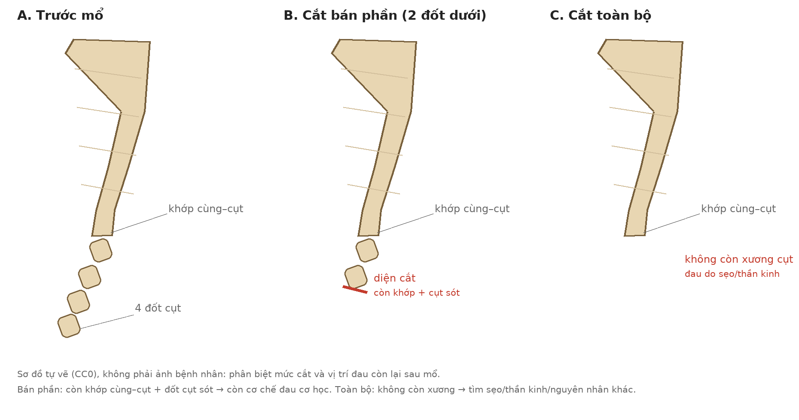
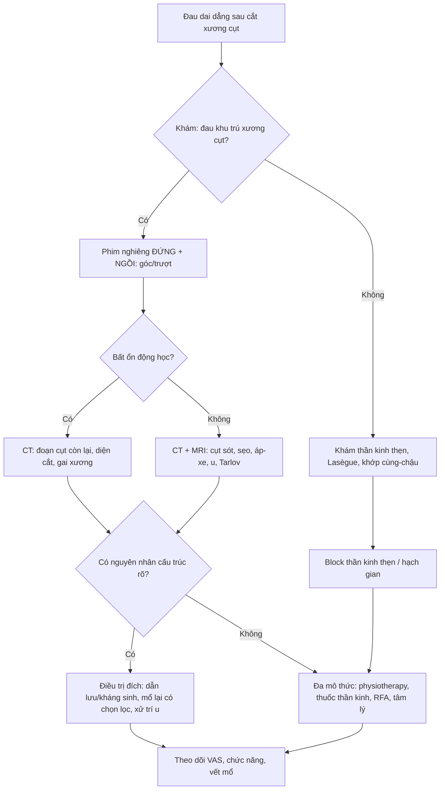
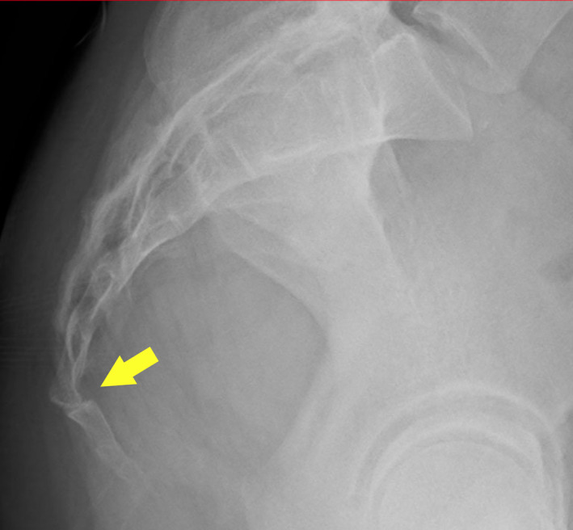
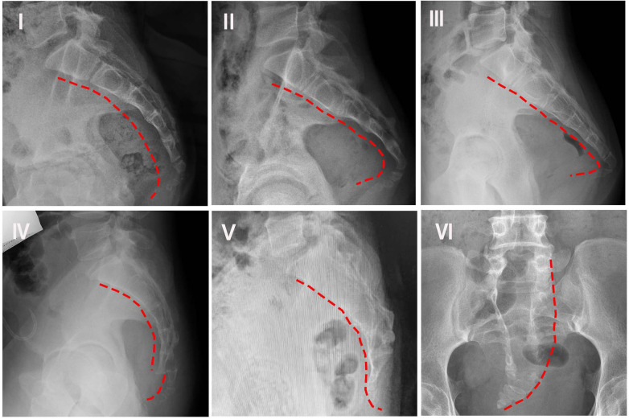

# 304 — Đau dai dẳng sau cắt xương cụt: đọc phim sau mổ, phân biệt cụt sót – sẹo thần kinh – nhiễm trùng – đau thần kinh thẹn

**Tags:** `pattern:dau-vung-cut` `pattern:dau-sau-mo` `pattern:bat-on-khop` `pattern:nhiem-trung-sau-mo` `vung:xuong-cut` `vung:khung-chau` `anatomy:xuong-cut` `protocol:phim-dong-hoc` `protocol:CT-xuong-cut` `protocol:MRI-khung-chau` `score:Maigne` `score:Nathan`
**Mức chắc chắn (certainty):** tổng hợp y văn (literature synthesis) — ghép **112 ca theo dõi 1 năm sau cắt xương cụt** (Bone Jt Open 2021, PMC8325972), **97 ca cắt bán phần** (J Orthop Surg Res 2023, PMC10605957), **55 ca so sánh mổ vs bảo tồn** (Int Orthop 2024, PMC11246298), **tổng quan hệ thống 42 nghiên cứu** (Neurospine 2026, PMC13152700), **hình thể–động học xương cụt** (Front Pediatr 2026, PMC13006408) và **mô hình đau đa cơ chế CPPS** (J Pain Res 2026, PMC13702083). Không có ca do nhóm tự chụp.

> **Câu hỏi thực hành:** nữ **42 tuổi**, **cắt xương cụt bán phần 8 tháng trước** vì đau khi ngồi; vết mổ đã lành, không sốt, nhưng **đau y như trước mổ**, tăng khi ngồi lâu và khi đứng dậy. Phim nghiêng **đứng** "không thấy bất thường". Câu hỏi: **đau do cụt còn sót, do sẹo thần kinh, do nhiễm trùng mạn, hay do đau thần kinh thẹn/đau trung ương — và có nên mổ lại không?**
> Bài chốt **ba quyết định**: **(1) sau cắt xương cụt, "còn xương cụt" không đồng nghĩa "mổ sót" — phải biết đã cắt bán phần hay toàn bộ; (2) phim động học ĐỨNG–NGỒI là bắt buộc, vì bất ổn chỉ lộ khi ngồi; (3) chỉ mổ lại khi có nguyên nhân cấu trúc rõ (cụt sót mất vững, áp-xe/viêm xương, u); đau không có nguồn cấu trúc → block/thần kinh/đa mô thức, không cắt thêm**. Nối [305 – Đau xương cụt (coccygodynia)](../305-dau-xuong-cut-coccygodynia/lesson.md), [556 – Đau sàn chậu cơ–mạc & đau thần kinh thẹn](../556-dau-san-chau-co-mac-pudendal-neuralgia/lesson.md), [370 – Nhiễm trùng cơ xương khớp](../370-nhiem-trung-msk/lesson.md).

## 1. Tổng quan bệnh học – cơ chế hình ảnh: vì sao cắt bỏ xương mà đau vẫn còn

- **Cắt xương cụt (coccygectomy) không "xóa" cả cơ chế đau.** Xương cụt là điểm tựa khi ngồi, nơi bám của **cơ sàn chậu, dây chằng cùng–cụt, dây thần kinh cùng–cụt và thần kinh thẹn**. Mổ lấy xương nhưng **khớp cùng–cụt, sẹo mô mềm, thần kinh và hệ thần kinh trung ương** vẫn còn — đó là 4 nguồn đau có thể tồn tại.
- **Kết quả mổ không phải 100%:** tổng quan ghi nhận **thành công 60–90%** tùy nguyên nhân, kỹ thuật và thời gian theo dõi (Neurospine 2026, PMC13152700). Trong **112 ca có theo dõi ≥ 1 năm**, **70% hài lòng**, **18% lưỡng lự**, **13% không hài lòng**; nhóm không hài lòng có **VAS 79,1 → 78,5** (gần như không đổi), trong khi nhóm hài lòng **69,0 → 20,8** (Bone Jt Open 2021, PMC8325972). **Không có yếu tố tiên lượng nào** (tuổi, BMI, hút thuốc, thời gian đau, VAS/ODI trước mổ) dự báo được kết quả — nghĩa là **không thể hứa trước "mổ là hết đau"**.
- **Loạt 97 ca cắt bán phần:** **VAS 8 → 2,6**, **ODI 39,8 → 13,4**; nhưng **thành công 88% ở nhóm chấn thương vs 71% ở nhóm không chấn thương (p = 0,047)**, biến chứng **14% vs 17%** (J Orthop Surg Res 2023, PMC10605957). **Nguyên nhân đau trước mổ quyết định kết quả sau mổ** — đây là lý do phải chọn bệnh nhân, không chỉ đọc phim.
- **TẠI SAO nhiễm trùng là bẫy:** vùng mổ **sát hậu môn, trong rãnh mông, ẩm, nhiều vi khuẩn**. Tỷ lệ nhiễm vết mổ trong y văn **5–15%**, có loạt tới **36%** (PMC13152700); đường mổ **giữa** tệ hơn **cạnh giữa/Z-plasty**. Nhiễm **biểu hiện muộn** bằng đau tăng + chảy dịch, có thể **không sốt** — dễ bị gán cho "đau do cụt còn sót".
- **TẠI SAO phim thường quy dễ âm tính:** xương cụt nhỏ, nằm sau trực tràng, **không chịu lực đứng**; trên phim nghiêng **đứng** nhiều bất ổn **biến mất**. Nghiên cứu động học cho thấy **bất thường chuyển động tới 69%** bệnh nhân đau cụt; khi ngồi: **trượt ra sau 22,1%**, **trượt ra trước 5,3%**, **tăng di động 27,4%**, **gai xương 14,4%**, chỉ **30,8% bình thường** (PMC13006408). Vì vậy **đứng–ngồi là cặp phim bắt buộc**, không phải "chụp thêm cho đủ".
- **TẠI SAO hình thể xương cụt quan trọng:** phân loại **Nathan I–VI** (I: cong nhẹ ra trước; II: cong mạnh, đỉnh hướng thẳng ra trước; III: gập góc cấp; IV: trượt ra trước ở khớp cùng–cụt/gian cụt; V: ngả sau + gai xương; VI: vẹo/lệch bên). **Type I gặp > 50% dân số** (biến thể bình thường); **type II gặp 83,3% (50/60) ở bệnh nhân đau cụt vs 40% ở nhóm chứng** — tức **hình thể chỉ là gợi ý, không phải chẩn đoán**.
- **TẠI SAO đau có thể "không tương xứng" với hình ảnh:** mô hình **CPPS (Coccyx Pain Phenotype Score)** tổng hợp 4 cơ chế — **cơ học, cơ–mạc, nhạy cảm thần kinh ngoại vi, nhạy cảm trung ương**; tác giả nhấn mạnh **tương quan hình ảnh–lâm sàng yếu** và **đau dai dẳng dù đã điều trị đúng tổn thương giải phẫu** (J Pain Res 2026, PMC13702083). Đây là nền để **không mổ lại mù** khi phim "sạch".
- **Đau sau mổ khác đau trước mổ ở chỗ nào:** trước mổ, đau thường do **khớp/gai xương**; sau mổ, thêm **diện cắt xương, sẹo co kéo, mô hạt, mảnh xương còn lại**. Trên CT, **diện cắt** là bờ xương "mới" **không có vỏ xơ**; đừng đọc là **tiêu xương do ung thư**. Trên MRI, **sẹo xơ giảm tín hiệu T2** và **ngấm thuốc muộn** — khác **ổ áp-xe viền ngấm + hạn chế khuếch tán**.

## 2. Mẫu hình + chẩn đoán phân biệt theo thời gian và vị trí (Gamut)

- **Gamut theo thời điểm sau mổ:**
  - **< 6 tuần:** **tụ máu/tụ dịch**, **nhiễm trùng vết mổ**, **bục chỉ/hở vết mổ**, **đau do phù nề** — thường khu trú, có sốt/đỏ/chảy dịch.
  - **6 tuần – 6 tháng:** **cụt còn sót/khớp còn bất ổn**, **sẹo thần kinh**, **viêm xương tủy mạn**, **đau do tư thế chưa phục hồi**.
  - **> 6 tháng:** **đau thần kinh thẹn**, **đau tham chiếu cột sống thắt lưng**, **đau trung ương/nociplastic**, **u (chordoma, GCT, di căn)**, **nang Tarlov**, **rò cùng–cụt**.
- **Gamut theo vị trí đau:**
  - **Đau giữa, khu trú đúng xương cụt, tăng khi ngồi/đứng dậy:** cơ học — cụt sót, khớp cùng–cụt, gai xương.
  - **Đau lan ra sau mông, đùi sau, không đúng điểm cụt:** tham chiếu **L5–S1**, cơ sàn chậu, khớp cùng–chậu.
  - **Đau vùng đáy chậu/âm hộ/dương vật, tăng khi ngồi, không đau khi ngủ:** **đau thần kinh thẹn** (Nantes).
  - **Đau bỏng rát, dị cảm, lan rộng, kèm rối loạn giấc ngủ/cảm xúc:** nhạy cảm trung ương/CPPS.
  - **Đau + chảy dịch + sốt/night pain + sụt cân:** **nhiễm trùng/u** — cờ đỏ.
- **Gamut theo hình ảnh:**
  - **Diện cắt/xương còn lại bình thường, không phù mô mềm** → không có nguyên nhân cấu trúc rõ.
  - **Di lệch/gập góc khi ngồi, hết khi đứng** → bất ổn động học.
  - **Ổ dịch viền ngấm, khí trong mô, phù lan** → áp-xe.
  - **Tiêu xương, phản ứng màng xương, khối mô mềm** → viêm xương/u.
  - **Nang dịch quanh rễ S2–S3** → Tarlov.
- **Mnemonic "SORC":** **S**tructural (cụt sót/bất ổn), **O**steomyelitis/infection, **R**adicular/pudendal (thần kinh), **C**entralized (đau trung ương/CPPS).

## 3. Bảng so sánh phân biệt (ma trận đối chiếu)

| Thực thể (entity) | Hình ảnh điển hình | Chốt vào (rule-in) | Chốt loại (rule-out) | Gợi ý xác nhận |
|---|---|---|---|---|
| **Cụt còn sót/khớp còn bất ổn** | **Đoạn xương cụt còn lại** ở đầu gần; khi ngồi **gập góc/trượt** so với đứng; diện cắt không phù | **Đau đúng điểm cụt + đau tăng khi ngồi + phim đứng–ngồi lệch** | Phim động học bình thường, đau lan ngoài vùng cụt → nghĩ thần kinh | Phim nghiêng **đứng + ngồi**, đo góc/trượt; CT xương; so phim trước mổ |
| **Sẹo thần kinh/đau thần kinh thẹn** | MRI: dải sẹo giảm tín hiệu T2, dày thần kinh thẹn; không có ổ dịch/xương | **Đau vùng đáy chậu, tăng khi ngồi, không đau khi ngủ; block thần kinh thẹn dương** | Đau khu trú xương cụt, block hạch gian dương → không phải thần kinh thẹn đơn thuần | Khám thần kinh; **block chẩn đoán**; MRI khung chậu 3D |
| **Nhiễm trùng vết mổ/viêm xương tủy** | **Ổ dịch viền ngấm**, khí mô mềm, phù lan; CT **tiêu xương + phản ứng màng xương**; MRI **hạn chế khuếch tán** | **Chảy dịch/mủ + đau tăng + CRP/ESR tăng; khởi phát sau mổ** | Vết mổ khô, CRP bình thường, không ổ dịch → không nhiễm | Cấy dịch/vết mổ; CT/MRI cản quang; **không chọc qua vùng da viêm** |
| **U vùng cùng–cụt (chordoma, GCT, di căn)** | **Khối tiêu xương**, phá vỏ, thành phần mô mềm; chordoma thường **T2 sáng** | **Đau đêm, sụt cân, khối sờ thấy, tiêu xương không giải thích** | Tiêu xương nhỏ quanh diện cắt, không khối → hậu phẫu | MRI + CT; **sinh thiết** nếu khối |
| **Nang Tarlov (S2–S3)** | Nang dịch **quanh rễ**, tín hiệu dịch, có thể **giãn xương** | **Đau rễ S2–S3, dị cảm vùng yên ngựa, đau khi ngồi** | Không nang, đau khu trú xương cụt → không Tarlov | MRI thắt lưng–cùng; EMG nếu cần |
| **Đau tham chiếu cột sống thắt lưng** | Thoát vị đĩa L5–S1, hẹp ống sống, thoái hóa khớp cùng–chậu | **Đau lan theo rễ, nghiệm pháp Lasègue, đau tăng khi ho** | Đau khu trú cụt, không lan → không tham chiếu | MRI thắt lưng; khám thần kinh |
| **Đau trung ương/nociplastic (CPPS)** | Hình ảnh **không tương xứng** hoặc bình thường; không ổ dịch, không bất ổn | **Đau lan rộng, dị cảm, rối loạn giấc ngủ, đã thất bại nhiều can thiệp** | Có nguyên nhân cấu trúc rõ và block tương ứng → không phải trung ương đơn thuần | Sàng lọc tâm lý–giấc ngủ; đáp ứng đa mô thức; **không mổ** |

*Sơ đồ tự vẽ (CC0), không phải ảnh bệnh nhân: **(A)** trước mổ — 4 đốt cụt và khớp cùng–cụt; **(B)** cắt bán phần — còn khớp cùng–cụt + đốt cụt sót, nên **cơ chế đau cơ học vẫn còn**; **(C)** cắt toàn bộ — không còn xương, đau còn lại phải tìm ở **sẹo/thần kinh/nguyên nhân khác**. Đây là điểm mấu chốt khi đọc phim sau mổ: **biết mức cắt trước khi gọi "cụt sót"**.*

## 4. Protocol chẩn đoán + phân độ + khi nào can thiệp

- **Bước 1 — hỏi đúng 6 câu:** (1) **mổ cách đây bao lâu**, (2) **cắt bán phần hay toàn bộ**, (3) **vết mổ đã lành chưa, có chảy dịch/sốt**, (4) **đau có giống trước mổ không**, (5) **đau khi ngồi/đứng dậy/đi cầu**, (6) **có dị cảm đáy chậu, tiểu/đại tiện bất thường, đau đêm**.
- **Bước 2 — khám:** sẹo, **điểm đau khu trú xương cụt**, khám **thần kinh thẹn** (vùng yên ngựa, phản xạ, cảm giác), **Lasègue**, khớp cùng–chậu, cơ sàn chậu; **không thăm khám trực tràng mạnh ngay sau mổ**.
- **Bước 3 — phim động học đứng–ngồi (bắt buộc):**
  - **Nghiêng đứng** và **nghiêng ngồi** (ngồi trên ghế cứng, chịu lực), đo **góc gập cụt** và **độ trượt** so với xương cùng.
  - **Maigne:** **gập > 25° khi ngồi = tăng di động**; **< 5° = bất động**; **5–25° = bình thường**; **trượt ra sau = luxation** (thường gặp ở người béo), **trượt ra trước** ít hơn.
  - **Không dùng phim đứng đơn thuần để loại trừ bất ổn** — trong loạt 21 bệnh nhân, **type IV chiếm 71% khi ngồi** trong khi **type I chiếm 66% khi đứng**.
- **Bước 4 — CT xương cụt (≤ 1 mm, coronal + sagittal + 3D):** đo **chiều dài đoạn cụt còn lại**, **diện cắt**, **gai xương**, **khoảng khớp cùng–cụt**, **tiêu xương/ phản ứng màng xương**, **khối mô mềm**. CT là **chuẩn để phân biệt cụt sót với diện cắt bình thường**.
- **Bước 5 — MRI khung chậu (T1, T2/PDFS, T1 sau tiêm ± fat-sat)** khi: nghi **áp-xe/viêm xương**, **u**, **nang Tarlov**, **sẹo thần kinh**, hoặc CT không giải thích đau. **MRI là phương thức tốt nhất để đánh giá đĩa/khớp cùng–cụt, mô mềm và dây thần kinh thẹn**; không cần cản quang nếu chỉ tìm phù/dịch.
- **Bước 6 — xét nghiệm & block chẩn đoán:** **CRP, ESR, WBC** (nhiễm trùng), **cấy dịch/vết mổ**; **block hạch gian (ganglion impar)** hoặc **block thần kinh thẹn** dưới fluoroscopy/CT — **giảm đau rõ trong thời gian tác dụng thuốc tê** gợi ý nguồn thần kinh và hỗ trợ chọn RFA.
- **Bước 7 — điều trị theo nguyên nhân:**

| Tình huống | Xử trí | Số liệu / lưu ý |
|---|---|---|
| **Cụt sót mất vững, đau khu trú, phim động học rõ** | Cân nhắc **mổ lại lấy phần còn lại** + physiotherapy | Không có thử nghiệm so sánh mổ lại vs không mổ; **chỉ khi có nguồn cấu trúc rõ** |
| **Nhiễm trùng vết mổ/áp-xe** | **Dẫn lưu + kháng sinh**; viêm xương → cần **cắt lọc** | Nhiễm **5–15%**, tới **36%**; đường mổ giữa → **cạnh giữa/Z-plasty** |
| **Đau thần kinh thẹn** | **Block thần kinh thẹn + thuốc thần kinh** (amitriptyline **10–25 mg** buổi tối; gabapentin **300 mg/ngày** tăng dần); RFA | Tiêu chuẩn Nantes; block dương tính hỗ trợ chẩn đoán |
| **Đau cụt không cấu trúc, block hạch gian dương** | **RFA/PRF hạch gian** hoặc **block lặp lại** | Giảm VAS **50–80%** trong các loạt; ít biến chứng |
| **Đau trung ương/CPPS** | **Đa mô thức**: physiotherapy, giấc ngủ, tâm lý, thuốc thần kinh; **tránh mổ lặp** | Tương quan hình ảnh–lâm sàng yếu; đau có thể tồn tại dù mổ "đúng" |
| **U/Tarlov** | Chuyển **chuyên khoa cột sống–u bướu**, sinh thiết/đánh giá | Không chọc mù; MRI + CT trước |

- **Theo dõi:** **VAS + ODI + giấc ngủ** lúc 6 tuần, 3 tháng, 6 tháng; **chụp lại chỉ khi có thay đổi lâm sàng** (đau mới, chảy dịch, sốt, khối), không chụp định kỳ vô ích.

## 5. Biến thể bình thường và cạm bẫy

- **Bẫy 1 — gọi "cụt sót" khi đã cắt bán phần:** cắt bán phần **cố ý** để lại đốt gần; trên phim, đoạn xương còn lại **là bình thường**, không phải "mổ sót". Phải **đọc bệnh án/đối chiếu phim trước mổ** trước khi kết luận.
- **Bẫy 2 — chỉ chụp phim nghiêng đứng:** bất ổn **chỉ lộ khi ngồi**; type IV **71% chỉ thấy khi ngồi**. Thiếu phim ngồi = bỏ sót nguyên nhân cơ học.
- **Bẫy 3 — tin rằng "phim bình thường = hết đau":** **70% hài lòng** nhưng **13% không hài lòng** dù mổ đúng; tương quan hình ảnh–lâm sàng yếu. **Không mổ lại chỉ vì bệnh nhân còn đau**.
- **Bẫy 4 — bỏ sót nhiễm trùng mạn:** đau tăng + chảy dịch **không cần sốt**; CRP/ESR có thể chỉ tăng nhẹ. **Hỏi kỹ vết mổ, nhìn, sờ, cấy** trước khi gán "đau thần kinh".
- **Bẫy 5 — nhầm đau thần kinh thẹn với đau cụt:** đau lan **đáy chậu/âm hộ/dương vật**, tăng khi ngồi, **không đau khi ngủ**, block thẹn dương. Cắt thêm xương **không giúp**.
- **Bẫy 6 — bỏ sót u/Tarlov:** đau **về đêm**, sụt cân, khối, tiêu xương, dị cảm yên ngựa → **MRI trước khi mổ lại**.
- **Bẫy 7 — "mổ rộng hơn là hết đau":** sau khi đã cắt toàn bộ, **không còn xương để cắt**; đau do sẹo/trung ương **không đáp ứng mổ**. Đây là lý do phải **phân tầng cơ chế** trước.
- **Cạm bẫy mặt cắt:** trên CT ngang, **đoạn cụt sót** có thể bị đọc là **mảnh xương lạc**; luôn dựng **sagittal** và so **bờ diện cắt** với phim trước mổ. Trên MRI, **sẹo xơ** giảm tín hiệu có thể giả **u xơ**; dùng **T2/PDFS + T1 sau tiêm** và bối cảnh hậu phẫu.

## 6. Tự lượng giá — Blind Quiz

**Ca 1 — Nữ 42 tuổi, đau cụt 2 năm, tăng khi ngồi; phim nghiêng chụp ở tư thế chịu lực.**

- Câu hỏi: Bất thường nằm ở đâu? Vì sao phim đứng có thể bỏ sót? Cần chụp gì tiếp?

<b>Bấm để hiện đáp án (findings + chẩn đoán)</b>

- Dấu hiệu (findings): **xương cụt trượt ra trước** so với xương cùng (mũi tên vàng), mất đường cong bình thường; trên phim nghiêng thấy rõ **di lệch ở khớp cùng–cụt**.
- Chẩn đoán (diagnosis): **bất ổn/trượt khớp cùng–cụt** — cơ chế cơ học của đau cụt; **phim đứng có thể bình thường vì bất ổn chỉ lộ khi chịu lực**.
- Bước tiếp: **phim nghiêng ngồi** (và đứng) để đo góc/trượt; nếu vẫn nghi ngờ → **CT sagittal**; điều trị đầu tay **bảo tồn** (đệm ngồi, physiotherapy), block hạch gian nếu đau nhiều.
- Nguồn ảnh: J Gen Fam Med 2022 (PMC9634120), CC BY 4.0.

**Ca 2 — Sáu phim nghiêng/AP của xương cụt: hình nào là biến thể bình thường, hình nào gợi ý bất ổn?**

- Câu hỏi: Gọi tên type I–VI. Type nào gặp > 50% dân số? Type nào gặp nhiều ở bệnh nhân đau cụt?

<b>Bấm để hiện đáp án</b>

- Dấu hiệu (findings): **I** cong nhẹ ra trước; **II** cong mạnh, đỉnh hướng thẳng ra trước; **III** gập góc cấp; **IV** trượt ra trước ở khớp cùng–cụt/gian cụt; **V** ngả sau + gai xương; **VI** vẹo/lệch bên.
- Chẩn đoán (diagnosis): **Nathan I–VI**. **Type I > 50% dân số** (bình thường); **type II 83,3% (50/60) ở bệnh nhân đau cụt vs 40% ở nhóm chứng** — hình thể **gợi ý**, không chẩn đoán.
- Vì sao: **type IV** (trượt) thường chỉ thấy khi **ngồi**; **type V** có thể kèm gai xương gây đau.
- Nguồn ảnh: Front Pediatr 2026 (PMC13006408), CC BY 4.0.

**Ca 3 — Bệnh nhân đau dai dẳng 8 tháng sau cắt xương cụt. Xem sơ đồ: cần hỏi gì trước khi kết luận "mổ sót"?**

- Câu hỏi: Hai kiểu cắt khác nhau ở đâu? Kiểu nào còn cơ chế đau cơ học? Kiểu nào buộc phải tìm nguyên nhân ngoài xương?

<b>Bấm để hiện đáp án</b>

- Dấu hiệu (findings): **(A)** trước mổ 4 đốt + khớp cùng–cụt; **(B)** cắt bán phần còn 2 đốt gần + khớp; **(C)** cắt toàn bộ, không còn xương cụt.
- Chẩn đoán (diagnosis): **(B)** vẫn còn **khớp cùng–cụt + đoạn cụt sót** → cơ chế **cơ học** có thể còn; **(C)** không còn xương → đau còn lại phải tìm ở **sẹo/ thần kinh/ trung ương/ u**.
- Vì sao: tổng quan cho thấy **cắt bán phần và toàn bộ cho kết quả giảm đau tương tự**, nên "cắt thêm" không mặc nhiên giải quyết đau; phải **đối chiếu mức cắt với phân bố đau và phim động học**.
- Nguồn ảnh: sơ đồ tự vẽ, CC0.

## Bài liên quan chéo
- [300 – Tổng quan Hệ Cơ – Xương – Khớp](../300-tong-quan-he-co-xuong-khop/lesson.md)
- [305 – Đau xương cụt (coccygodynia): phim động học & bất ổn khớp cùng–cụt](../305-dau-xuong-cut-coccygodynia/lesson.md)
- [556 – Đau sàn chậu cơ–mạc & đau thần kinh thẹn](../556-dau-san-chau-co-mac-pudendal-neuralgia/lesson.md)
- [370 – Nhiễm trùng cơ xương khớp](../370-nhiem-trung-msk/lesson.md)
- [320 – Gãy xương & trật khớp cấp cứu](../320-gay-xuong-trat-khop-cap-cuu/lesson.md)
- [309 – Loét tì đè & viêm xương tủy vùng khung chậu](../309-loet-ti-de-viem-xuong-tuy-spina-bifida-nguoi-lon/lesson.md)

## Ảnh
- 2 ảnh **CC BY 4.0** (Front Pediatr 2026: 1; J Gen Fam Med 2022: 1) — **nguyên bản**, không crop/ghép.
- 1 **sơ đồ tự vẽ CC0** (`304_dau-sau-cat-xuong-cut_so-do-CC0.png`) — không phải ảnh bệnh nhân, dùng để phân biệt mức cắt.
- Chi tiết trong `images/CREDITS.md`.

> Không dùng để chẩn đoán độc lập khi chưa có người hướng dẫn.
