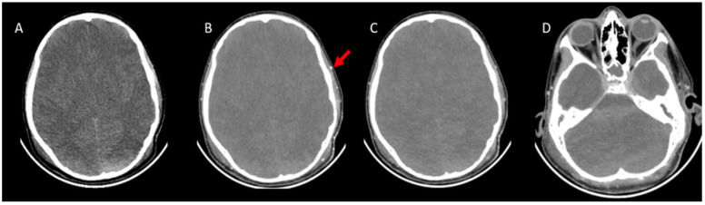
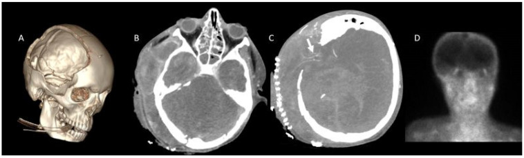
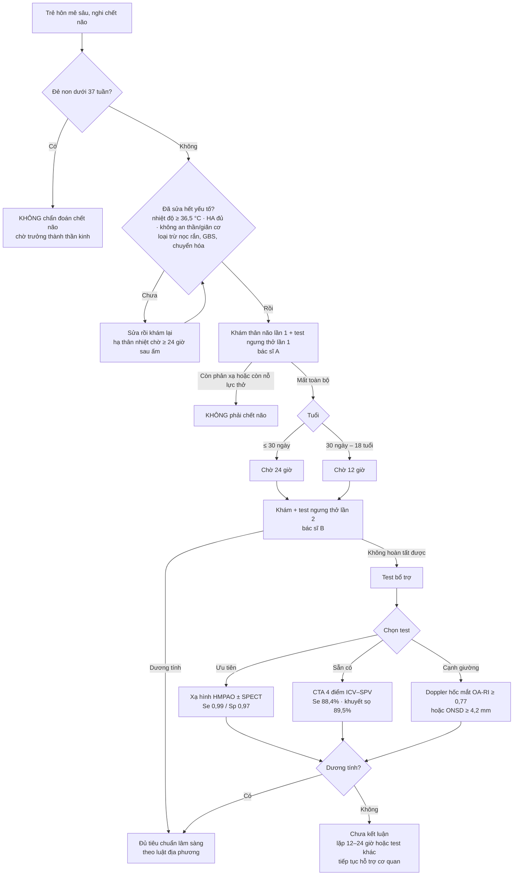
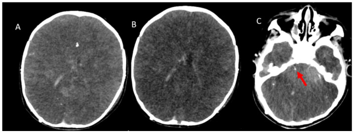
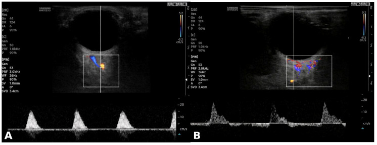

# 3040 — Chẩn đoán chết não ở trẻ em và sơ sinh: tuổi quyết định khoảng quan sát, test ngưng thở và test bổ trợ

**Tags:** `pattern:mat-tuoi-mau-nao` `pattern:phu-nao-lan-toa` `pattern:mat-phan-biet-xam-trang` `vung:nao` `vung:than-nao` `score:CTA-4-diem` `protocol:CTA-chet-nao` `protocol:test-ngung-tho` `protocol:sieu-am-hoc-mat`
**Mức chắc chắn (certainty):** tổng hợp y văn (literature synthesis) — ghép **tổng quan thuật toán chứng nhận chết não nhi** (PMC8578760), **meta phân tích độ chính xác test bổ trợ ở trẻ sơ sinh–trẻ em: 39 bài, 18 test, 866 bệnh nhân** (PMC10203011), **nghiên cứu CTA 43 trẻ đã chết não lâm sàng** (PMC11945848), **nghiên cứu siêu âm Doppler hốc mắt 28 trẻ** (PMC13117453), **ca test ngưng thở trên ECMO** (PMC7359818) và **ca ngộ độc nọc rắn giả chết não** (PMC12828855). Chưa có ca nguyên văn do nhóm tự chụp.

> **Câu hỏi thực hành:** bé trai **13 tuổi** ngừng tim sau đuối nước, ROSC ngày thứ 3, GCS 3, đồng tử giãn không phản xạ, mất phản xạ giác mạc–ho; **đang thở máy, vận mạch 0,1 µg/kg/phút, MAP 62 mmHg, thân nhiệt 35,4 °C**. Bác sĩ hồi sức hỏi: **đã đủ điều kiện chẩn đoán chết não chưa, khám mấy lần và cách nhau bao lâu, test ngưng thở làm thế nào, và nếu không làm được thì chụp gì?**
> Bài chốt **bốn điểm khác người lớn**: (1) **tuổi quyết định khoảng quan sát** (sơ sinh đủ tháng ≤ 30 ngày: **24 giờ**; 30 ngày–18 tuổi: **12 giờ**); (2) **trẻ đẻ non không được chẩn đoán chết não**; (3) **hai lần khám + hai test ngưng thở do hai bác sĩ khác nhau**; (4) **test bổ trợ ở trẻ yếu hơn ở người lớn** — test chính xác nhất là **xạ hình HMPAO (Se 0,99/Sp 0,97)** nhưng bằng chứng chỉ ở mức **thấp–rất thấp**. Nối [3038 – Chẩn đoán chết não ở người lớn](../3038-chet-nao-cta-ct-tuoi-mau/lesson.md), [3039 – Nhiễm trùng shunt VP](../3039-nhiem-trung-shunt-nao-that-phuc-mac/lesson.md), [3035 – HIE sau ngừng tim](../3035-hie-sau-ngung-tim-nguoi-lon/lesson.md), [211 – Đột quỵ não](../211-dot-quy-nao/lesson.md), [201 – Protocol sọ não](../201-protocol-so-nao/lesson.md).

## 1. Tổng quan bệnh học – cơ chế hình ảnh: vì sao trẻ không phải “người lớn thu nhỏ”

- **Sinh lý nền giống người lớn:** chết não là **mất không hồi phục chức năng toàn bộ não kể cả thân não**, xác định bằng **hôn mê sâu + mất mọi phản xạ thân não + mất khả năng thở tự chủ** (test ngưng thở), sau khi đã loại trừ mọi yếu tố gây giả chết não.
- **Khác biệt cốt lõi nằm ở tuổi:**
  - **Trẻ đẻ non (< 37 tuần): KHÔNG đủ tiêu chuẩn chẩn đoán chết não** vì **phản xạ thân não chưa hoàn chỉnh** — không thể phân biệt “chưa phát triển” với “đã mất” (PMC8578760).
  - **Sơ sinh đủ tháng đến 30 ngày tuổi:** hai lần khám **cách nhau 24 giờ**.
  - **30 ngày đến 18 tuổi:** hai lần khám **cách nhau 12 giờ**.
  - Cả hai lần khám **và** hai test ngưng thở phải do **hai bác sĩ khác nhau** thực hiện; thời điểm chết là **sau khi hoàn tất lần khám + test ngưng thở thứ hai** (PMC8578760).
- **Vì sao phải lặp lại lâu hơn ở sơ sinh:** ở trẻ nhỏ, **hộp sọ còn thóp và đường khớp mở** nên **ICP có thể tăng mà không gây thoát vị**, đồng thời **tuần hoàn não dự trữ lớn** hơn → **dòng chảy có thể còn** dù não đã chết. Đây là cơ chế khiến **test bổ trợ ở sơ sinh kém nhạy**, và là lý do hướng dẫn khuyên **dựa vào khám lặp lại** thay vì một lần chụp (PMC8578760).
- **Vì sao hình ảnh chỉ là “flow”, không phải “function”:** CTA chỉ cho biết **thuốc có tới được mạch hay không**. Ba tầng không được lẫn (kế thừa [3038](../3038-chet-nao-cta-ct-tuoi-mau/lesson.md)):
  - **CBF < 10 mL/100 g/phút** → **điện não im lặng** (não còn sống);
  - **CBF < 5 mL/100 g/phút** → **chết tế bào không hồi phục**;
  - **thuốc ứ ở đoạn gần (stasis filling)** → CTA “dương tính giả” nếu đọc sai, hoặc **âm tính giả** khi chỉ đòi các đoạn xa.
- **Ngưỡng định lượng phải nhớ (trẻ em):**
  - **Test ngưng thở:** không có nỗ lực thở khi **PaCO₂ ≥ 60 mmHg** hoặc **tăng ≥ 20 mmHg so với nền** → dương tính (PMC7359818). **Dừng test** khi **SpO₂ < 85% kéo dài > 30 giây**, **nhịp tim/tuyến huyết áp giảm**, **loạn nhịp** → ghi “test không hoàn tất”, **không suy diễn**.
  - **Trên ECMO:** có thể làm test ngưng thở bằng cách **giảm sweep gas 0,05 L/min mỗi 5 phút**; ca trẻ trong bài báo tăng **PaCO₂ > 20 mmHg** và test dương tính, sau đó gia đình đồng ý hiến tạng (PMC7359818).
  - **Xạ hình HMPAO (± SPECT):** **Se 0,99 (HDI 0,89–1,00), Sp 0,97 (0,65–1,00)** — chính xác nhất trong **39 bài/18 test/866 bệnh nhân**, nhưng **chất lượng bằng chứng thấp**; chỉ **xạ hình dòng chảy động học** đạt mức **trung bình** (PMC10203011).
  - **CTA 4 điểm ở trẻ (43 ca):** thang **ICV–SPV** (không ngấm **tĩnh mạch não trong + tĩnh mạch đá trên**) nhạy **88,4%**, cao hơn **A20-V60 86,0%** và **A60-V60 79,1%**; **có khuyết sọ: 89,5% vs 68,4%**; **stasis filling 34%**; **phù não lan tỏa + xóa bể đáy/thoát vị hạnh nhân 93%** (PMC11945848).
  - **Siêu âm Doppler hốc mắt (28 trẻ, 20 chết não/8 không):** **chỉ số cản OA-RI 0,84 (0,80–0,90) vs 0,65 (0,58–0,69)**; **cut-off ≥ 0,77: AUC 0,99, Se 95%, Sp 100%**; **ONSD 4,75 vs 3,90 mm**, cut-off **≥ 4,2 mm**, **AUC 0,81, Se/Sp 75%** — **khám phá, chưa kiểm chứng tiến cứu** (PMC13117453).
- **Hình ảnh “gợi ý” trên CT không cản quang:** phù lan tỏa, **mất phân biệt xám–trắng**, xóa rãnh/bể đáy, **xuất huyết dưới nhện giả** (bể đáy tăng tỷ trọng do ứ máu–phù, **không phải máu**), **“tiểu não trắng”** — đều **không chẩn đoán**, vì gặp cả ở hôn mê do ngộ độc, hạ đường huyết, hạ thân nhiệt.

*BN 13 tuổi, chết não lâm sàng, chụp theo protocol chết não. **A:** CT không cản quang — phù não, **mất não thất**, xóa rãnh. **B:** pha động mạch giây 20 — **động mạch thái dương nông ngấm rõ** (mũi tên đỏ) chứng tỏ kỹ thuật đạt. **C:** pha tĩnh mạch giây 60 — **không ngấm ĐM não giữa hai bên và nhánh**. **D:** **không ngấm tĩnh mạch não trong (ICV) và tĩnh mạch đá trên (SPV)**. Đây là bộ 4 dấu hiệu “dương tính chuẩn” của thang ICV–SPV. Nguồn: Tomography 2025 (PMC11945848), CC BY 4.0.*

## 2. Mẫu hình + chẩn đoán phân biệt theo tuổi và theo test (gamut)

- **Theo tuổi (quyết định khoảng quan sát):**
  - **< 37 tuần:** không chẩn đoán — chờ trưởng thành thần kinh, không dùng test bổ trợ để “bù”.
  - **Đủ tháng – 30 ngày:** 2 lần khám **24 giờ**; test bổ trợ **kém nhạy**, ưu tiên khám lặp lại.
  - **30 ngày – 18 tuổi:** 2 lần khám **12 giờ**; CTA/xạ hình dùng được khi lâm sàng không hoàn tất.
- **Theo test bổ trợ (từ “flow” đến “function”):**
  - **Xạ hình HMPAO/SPECT:** “hollow skull” (không hoạt độ bán cầu/tiểu não) + “hot nose”; **chính xác nhất ở trẻ** nhưng **không phổ cập**.
  - **CTA 4 điểm ICV–SPV:** nhanh, sẵn có; **nhạy 88,4%**, nhưng **âm tính khi khuyết sọ, shunt, thóp mở**.
  - **CT tưới máu (CTP):** đo **CBV/CBF** — gần “tưới máu” hơn; chưa có ngưỡng riêng được kiểm chứng ở trẻ.
  - **Siêu âm Doppler hốc mắt / ONSD:** **cạnh giường**, không cần vận chuyển; **OA-RI ≥ 0,77** gợi ý cao; mới ở mức khám phá.
  - **TCD:** **chưa được kiểm chứng ở trẻ**, không dùng thay lâm sàng.
  - **EEG:** **không đánh giá được thân não**, bị nhiễu bởi an thần/hạ nhiệt → **không dùng một mình**.
- **Gamut “bắt chước chết não ở trẻ” — phải loại trước khi chụp bất cứ gì:**
  - **Ngộ độc nọc rắn (krait):** trẻ **13 tuổi**, liệt mềm cấp + hôn mê + đồng tử giãn cố định + mất phản xạ hầu; **hồi phục hoàn toàn** sau **huyết thanh kháng nọc + 22 ngày thở máy** (PMC12828855). Đây là lý do **không bao giờ** kết luận chết não khi chưa loại trừ liệt mềm cấp.
  - **Hội chứng Guillain–Barré/botulism**, **tổn thương tủy cổ cao**, **trạng thái phong tỏa (locked-in)**, **rối loạn chuyển hóa–điện giải**, **hạ thân nhiệt**, **còn tác dụng an thần/giãn cơ**.
- **Mnemonic 4 bước “A-B-C-D” cho trẻ:** **A**ge (tuổi → khoảng quan sát) → **B**rainstem (khám thân não 2 lần) → **C**O₂ (test ngưng thở) → **D**ocument/ancillary (ghi chép, test bổ trợ khi cần).

## 3. Bảng so sánh phân biệt (ma trận đối chiếu)

| Test / thực thể | Tiêu chí kỹ thuật – hình ảnh | Chốt vào (rule-in) | Chốt loại (rule-out) | Gợi ý xác nhận |
|---|---|---|---|---|
| **Khám lâm sàng 2 lần** | Hôn mê, mất **mọi** phản xạ thân não; 2 bác sĩ; **24 giờ** (≤ 30 ngày) hoặc **12 giờ** (> 30 ngày) | **Mất toàn bộ phản xạ + đủ khoảng quan sát + 2 bác sĩ** | Còn **bất kỳ** phản xạ thân não → chưa chết não | Ghi từng phản xạ, giờ khám, tên bác sĩ |
| **Test ngưng thở** | Ngắt máy, để ống mở, ± CPAP 5 cmH₂O; theo dõi liên tục | **Không nỗ lực thở + PaCO₂ ≥ 60 mmHg hoặc tăng ≥ 20 mmHg** | **SpO₂ < 85% > 30 giây**, tụt HA, loạn nhịp → **test không hoàn tất** | Khí máu nền + sau 8–10 phút; ECMO: giảm sweep gas 0,05 L/min mỗi 5 phút |
| **CTA 4 điểm ICV–SPV** | 1 mm; pha ĐM 20 s + pha TM 60 s; **2 mL/kg @ 3 mL/s** | **Không ngấm ICV + SPV**, kèm không ngấm MCA-M4 | **Còn ngấm MCA-M4 hoặc SPV** → âm tính (kể cả khi lâm sàng đã chết não) | Đọc thang ghi rõ tên; soát **khuyết sọ/shunt** |
| **Xạ hình HMPAO ± SPECT** | Ảnh phẳng/SPECT, không hoạt độ nội sọ | **Hollow skull** (không hoạt độ bán cầu/tiểu não) | Còn hoạt độ vỏ **hoặc** tiểu não → chưa kết luận | **Chính xác nhất ở trẻ** (Se 0,99/Sp 0,97) nhưng bằng chứng thấp |
| **Doppler hốc mắt / ONSD** | ĐM mắt, ĐM trung tâm võng mạc, ĐM mi sau; đo ONSD | **OA-RI ≥ 0,77** (Se 95/Sp 100); **ONSD ≥ 4,2 mm** (Se/Sp 75) | **OA-RI thấp, phổ tâm trương còn** → chưa kết luận | Cạnh giường; **khám phá**, cần lặp và phối hợp |
| **TCD** | ≥ 3 ĐM nội sọ; phổ oscillating, PSV < 50 cm/s | Phổ **oscillating/reverberating** hai bên + thân nền | **Còn dòng tâm trương** → chưa ngưng | **Chưa kiểm chứng ở trẻ** — không thay lâm sàng |
| **Bắt chước chết não (nọc rắn, GBS, ngộ độc)** | Hôn mê + mất phản xạ nhưng **có yếu tố sửa được** | — | **Có yếu tố sửa được** (nọc, thuốc, điện giải, nhiệt độ) | Sửa yếu tố → khám lại; **không chụp thay cho sửa** |

*Cùng BN 13 tuổi đã chết não lâm sàng nhưng **có khuyết sọ**. **A:** dựng 3D — khuyết sọ rõ. **B:** pha tĩnh mạch — **không ngấm SPV và ICV**. **C:** **vẫn còn ngấm đoạn MCA-M4 bên phải** (mũi tên trắng) → nếu đọc thang 4 điểm thuần túy sẽ **âm tính giả**. **D:** xạ hình **không có tưới máu não** → chốt chẩn đoán. Bài học: **khi có khuyết sọ, một thang CTA không đủ**. Nguồn: Tomography 2025 (PMC11945848), CC BY 4.0.*

### Vì sao trẻ sơ sinh và trẻ có shunt lại là “vùng xám” của mọi test
- **Thóp mở/đường khớp mở** → ICP tăng được **bù trừ** nên **dòng chảy còn** dù não chết: **CTA âm tính giả**.
- **Khuyết sọ sau mở sọ giảm áp** → **ICP khu trú giảm**, mạch vỏ còn ngấm: trong loạt 43 trẻ, **A60-V60 chỉ còn 68,4%** độ nhạy khi có khuyết sọ (PMC11945848).
- **Shunt não thất** → giảm ICP, giảm ép → cùng cơ chế; đây cũng là lý do **không được dùng shunt để “hạ áp rồi chẩn đoán”**.
- **Hệ quả thực hành:** ở nhóm này, **xạ hình HMPAO** (nhìn chức năng tế bào) hoặc **CTP** hợp lý hơn CTA; và **luôn giữ nguyên tắc lâm sàng là nền tảng**.

## 4. Protocol

1. **Trước khi khám — sửa hết yếu tố sửa được:** thân nhiệt **≥ 36,5 °C**; **HATT/MAP đủ** (theo trị số nền của trẻ); **PaCO₂ 35–45 mmHg**, **PaO₂ đủ**; **không còn an thần/giãn cơ** (chờ **≥ 5 chu kỳ bán thải**); loại trừ **hạ đường huyết, rối loạn điện giải, ngộ độc, nọc rắn, GBS/botulism**.
2. **Khám lần 1 (bác sĩ A):** ghi rõ **hôn mê không đáp ứng đau tối đa**, mất **đồng tử, giác mạc, mắt–đầu, mắt–tiền đình, hầu, ho**; ghi nhận **cử động tủy** (Lazarus sign) là **không có ý nghĩa**.
3. **Test ngưng thở lần 1:** thở **100% O₂ ≥ 10 phút**, lấy khí máu nền → **ngắt máy**, theo dõi liên tục → khí máu sau **8–10 phút**; dương tính theo ngưỡng mục (1). **ECMO:** giảm sweep gas **0,05 L/min mỗi 5 phút**.
4. **Khoảng quan sát theo tuổi:** **24 giờ** nếu ≤ 30 ngày; **12 giờ** nếu > 30 ngày → **khám + test ngưng thở lần 2 do bác sĩ B**.
5. **Chỉ định test bổ trợ khi:** không làm được test ngưng thở, khám không đáng tin (chấn thương mặt, tổn thương tủy cổ), **hoặc** để hỗ trợ gia đình/thuật toán hiến tạng.
6. **Chọn test bổ trợ:** ưu tiên **xạ hình HMPAO/SPECT** (chính xác nhất); nếu không có → **CTA 4 điểm ICV–SPV** (nhớ bẫy khuyết sọ) ± **CTP**; **Doppler hốc mắt** làm cạnh giường khi không vận chuyển được; **không dùng TCD/EEG đơn thuần**.
7. **Kỹ thuật CTA trẻ:** lát **1 mm**, từ **lồi não tới C1–C2**; không cản quang → **pha ĐM 20 s** → **pha TM 60 s**; thuốc **2 mL/kg @ 3 mL/s**; đọc **MIP + dựng 3D**.
8. **Báo cáo 3 dòng:** (a) còn/không ngấm **từng mạch** theo thang đã chọn; (b) **điều kiện tiên quyết + nhiệt độ + MAP lúc chụp**; (c) kết luận **“phù hợp/không phù hợp với ngưng tuần hoàn não”** — **không ghi “chết não”** trong báo cáo hình ảnh.

## 5. Biến thể bình thường và cạm bẫy

- **Thóp mở, đường khớp mở, khuyết sọ, shunt, EVD:** giảm ICP khu trú → **CTA/xạ hình âm tính giả**; trong loạt 43 trẻ, khuyết sọ làm **A60-V60 rơi còn 68,4%**. Đọc theo vùng, đừng chỉ nhìn mạch lớn.
- **Stasis filling:** thuốc ứ ở A1–A2/M1–M2/P1–P2 → tưởng “còn tưới máu”; **gặp 34%** trẻ trong loạt CTA. Luôn đọc **đoạn xa (M4) + tĩnh mạch (ICV/SPV)**.
- **Cử động tủy (Lazarus sign, duỗi tam chi, vã mồ hôi):** **không phải** bằng chứng còn sống, cũng **không phải** bằng chứng chết — phải mô tả và giải thích cho gia đình.
- **Test ngưng thở “không hoàn tất” không phải “âm tính”:** tụt SpO₂/HA là **thất bại kỹ thuật**; không được suy ra “còn thở”.
- **Hạ thân nhiệt điều trị:** phải **quan sát thêm ≥ 24 giờ sau khi ấm lên > 36 °C**, và **≥ 5 chu kỳ bán thải** cho thuốc an thần — nếu không, **giả chết não**.
- **Ngộ độc nọc rắn (krait):** bệnh cảnh **liệt mềm + hôn mê + mất phản xạ** có thể **hồi phục hoàn toàn** (ca 13 tuổi, 22 ngày thở máy). Ở vùng có rắn độc, **luôn hỏi bối cảnh buổi sáng/mùa mưa, tìm vết cắn** trước khi kết luận.
- **Sơ sinh:** test bổ trợ **kém nhạy**, **EEG phẳng không bằng chết não**, và **phản xạ non tháng** dễ bị đọc nhầm là “mất phản xạ” → **không chẩn đoán ở trẻ đẻ non**.
- **Sai số “một lần khám”:** hướng dẫn nhi đòi **hai lần khám + hai test ngưng thở**, khác người lớn ở nhiều nơi; bỏ lần hai là **lỗi quy trình**, không phải tối ưu thời gian.

*Bé trai **1 tuổi** đã được xác định chết não **theo lâm sàng**, nhưng CTA **không đạt tiêu chí hình ảnh**: pha động mạch (A) và tĩnh mạch (B, C) cho thấy **không ngấm nhánh ĐM não giữa**, nhưng **vẫn ngấm tĩnh mạch đá trên (SPV, mũi tên đỏ)**. Đây là **âm tính giả** điển hình ở trẻ nhỏ (hộp sọ còn giãn, tuần hoàn dự trữ lớn) — bài gốc gọi đây là ca **“không đạt tiêu chí chết não trên CTA”** dù lâm sàng đã chết não. Kết luận: **CTA âm tính không được dùng để phủ định chẩn đoán lâm sàng**. Nguồn: Tomography 2025 (PMC11945848), CC BY 4.0.*

## 6. Tự lượng giá — Blind Quiz

**Ca 1 — Bé trai 13 tuổi, ngừng tim sau đuối nước, ngày thứ 3, GCS 3, mất phản xạ thân não. Xem CTA dưới đây trước khi đọc đáp án.**

- Gợi ý lâm sàng: đã sửa thân nhiệt, MAP 70 mmHg, không còn an thần 6 ngày.
- Câu hỏi: (1) Kỹ thuật chụp có đạt không — dựa vào đâu? (2) Những mạch nào **không ngấm**? (3) Có đủ kết luận chết não chỉ bằng ảnh này không?

<b>Bấm để hiện đáp án (findings + chẩn đoán)</b>

- **Kỹ thuật đạt:** **động mạch thái dương nông ngấm rõ ở pha 20 giây** (mũi tên đỏ) — nếu không thấy mạch ngoài sọ ngấm thì pha chụp sai.
- **Không ngấm:** **ĐM não giữa hai bên và nhánh (MCA-M4)**, **tĩnh mạch não trong (ICV)**, **tĩnh mạch đá trên (SPV)**; CT không cản quang có **phù lan tỏa, mất não thất**.
- **Kết luận:** phù hợp **ngưng tuần hoàn não** theo thang **ICV–SPV 4 điểm** — nhưng **ảnh không thay được lâm sàng**: vẫn cần **2 lần khám + 2 test ngưng thở cách 12 giờ** (tuổi 13) và **quyết định theo luật địa phương**.
- Nguồn ảnh: Tomography 2025 (PMC11945848), Figure 2, CC BY 4.0.

**Ca 2 — Cùng bệnh nhi, nhưng **đã mở sọ giảm áp** trước đó. CTA cho hình dưới. Có kết luận được không?**

- Câu hỏi: (1) Dấu hiệu nào **ủng hộ** chết não? (2) Dấu hiệu nào **chống lại kết luận** trên CTA? (3) Bước tiếp theo?

<b>Bấm để hiện đáp án (findings + chẩn đoán)</b>

- **Ủng hộ:** **không ngấm SPV và ICV** ở pha tĩnh mạch; dựng 3D thấy **khuyết sọ** rõ.
- **Chống lại (âm tính giả):** **vẫn còn ngấm đoạn MCA-M4 bên phải** (mũi tên trắng) — đúng tiêu chí “còn ngấm” của thang 4 điểm → **CTA không dương tính**.
- **Bước tiếp theo:** chuyển **xạ hình tưới máu** (trong bài gốc: **không có tưới máu não** → phù hợp chết não) hoặc **CTP**; **không** kết luận chỉ vì “gần đủ”.
- **Bài học:** khuyết sọ làm **giảm độ nhạy của mọi thang CTA** (A60-V60 còn **68,4%**; ICV–SPV **89,5%**).
- Nguồn ảnh: Tomography 2025 (PMC11945848), Figure 3, CC BY 4.0.

**Ca 3 — Bé gái 4 tuổi, nghi chết não, đang ECMO, không thể ngắt máy hoàn toàn. Siêu âm hốc mắt cho phổ dưới đây.**

- Câu hỏi: (1) Mô tả phổ? (2) Chỉ số nào tính từ phổ này và ngưỡng nào gợi ý? (3) Có đủ để chẩn đoán không?

<b>Bấm để hiện đáp án (findings + chẩn đoán)</b>

- **Phổ:** **gai tâm thu ngắn, mất gần hết dòng tâm trương** (A); **dòng đảo chiều/so le** (B) — kiểu **tăng cản (high-resistance)** điển hình của chết não.
- **Chỉ số:** **OA-RI** (chỉ số cản động mạch mắt) **≥ 0,77** — trong loạt 28 trẻ: **AUC 0,99, Se 95%, Sp 100%**; **ONSD ≥ 4,2 mm** chỉ đạt **Se/Sp 75%**.
- **Kết luận:** **gợi ý mạnh nhưng chưa đủ** — đây là nghiên cứu **hồi cứu, một trung tâm, 28 trẻ**, tác giả tự gọi là **khám phá**; vẫn cần hoàn tất **lâm sàng + test ngưng thở** (trên ECMO: giảm sweep gas 0,05 L/min mỗi 5 phút).
- Nguồn ảnh: J Clin Med 2026 (PMC13117453), Figure 2, CC BY 4.0.

## Bài liên quan chéo
- [3038 – Chẩn đoán chết não ở người lớn: test ngưng thở, CTA 4 điểm, CTP](../3038-chet-nao-cta-ct-tuoi-mau/lesson.md)
- [3039 – Nhiễm trùng shunt não thất–phúc mạc & nang giả phúc mạc](../3039-nhiem-trung-shunt-nao-that-phuc-mac/lesson.md)
- [3037 – Nhiễm trùng não thất & EVD](../3037-nhiem-trung-nao-that-evd/lesson.md)
- [3035 – HIE sau ngừng tim ở người lớn](../3035-hie-sau-ngung-tim-nguoi-lon/lesson.md)
- [201 – Protocol sọ não](../201-protocol-so-nao/lesson.md)
- [211 – Đột quỵ não](../211-dot-quy-nao/lesson.md)

> Không dùng để chẩn đoán độc lập khi chưa có người hướng dẫn.
