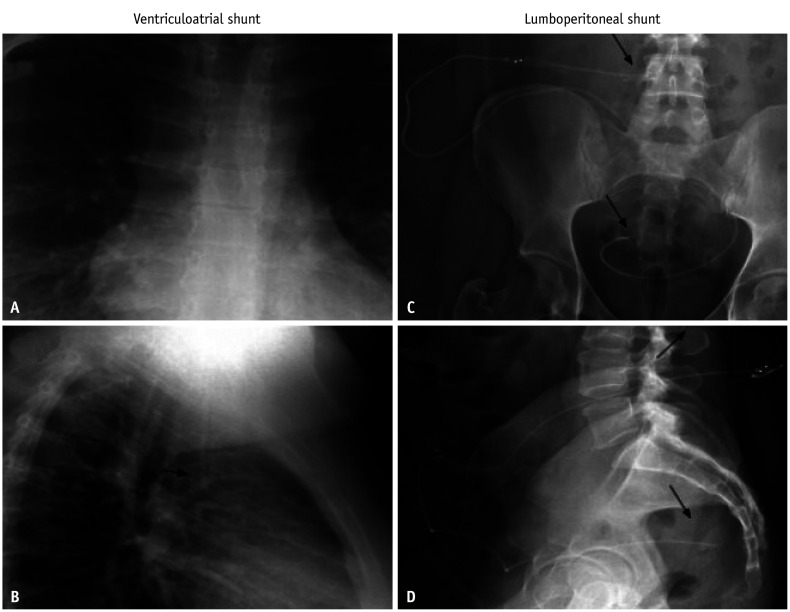
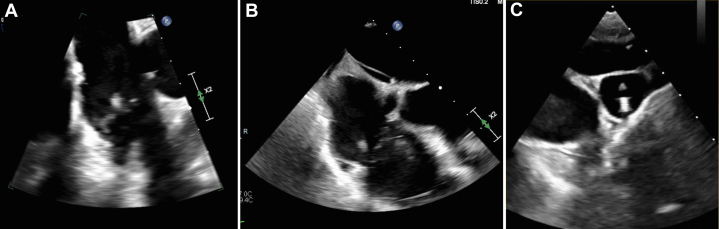
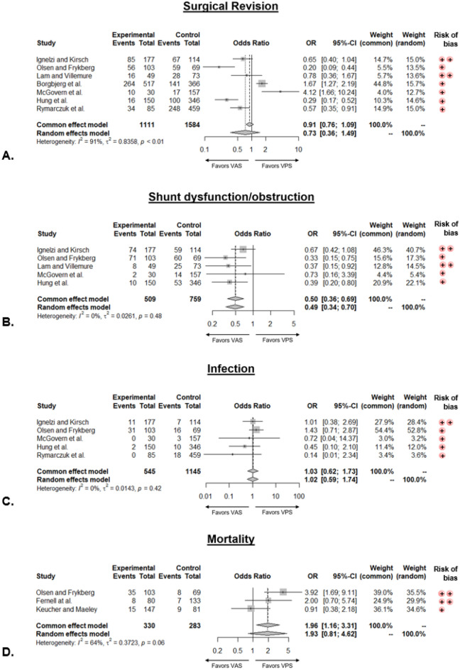
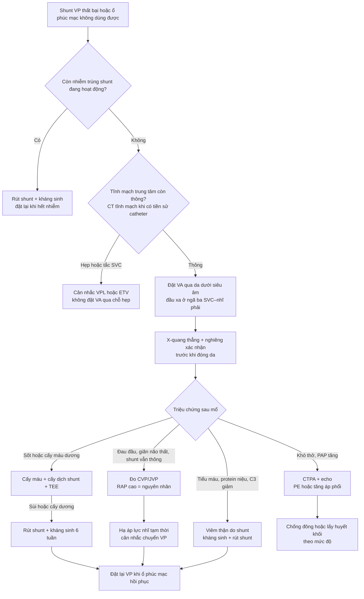

# 3041 — Shunt não thất–nhĩ (VA shunt): khi nào chọn, đọc biến chứng và khi nào chuyển lại VP

**Tags:** `pattern:shunt-dan-luu` `pattern:huyet-khoi-tinh-mach` `pattern:viem-noi-tam-mac` `pattern:vien-cau-than` `vung:nao-that` `vung:tim-phai` `protocol:shunt-series` `protocol:CT-nguc` `protocol:sieu-am-tim`
**Mức chắc chắn (certainty):** tổng hợp y văn (literature synthesis) — ghép **meta phân tích 9 nghiên cứu/3.197 bệnh nhân so sánh VA và VP** (PMC11310213), **tổng quan cơ chế–chẩn đoán–điều trị huyết khối VA shunt** (PMC8976808), **tổng quan ảnh học shunt hiện đại có hình X-quang chuẩn** (PMC13437215), **ca viêm nội tâm mạc ở shunt VA** (PMC11830242), **ca tăng áp lực tĩnh mạch hệ thống gây tăng áp lực nội sọ** (PMC12377171), **ca viêm thận do shunt chẩn đoán bằng cấy dịch shunt** (PMC11894289) và **loạt 79 ca viêm thận do shunt** (PMC5401727). Chưa có ca nguyên văn do nhóm tự chụp.

> **Câu hỏi thực hành:** nam **31 tuổi**, tiền sử **não úng thủy bẩm sinh + shunt não thất–nhĩ (ventriculoatrial, VA)**, nhập viện **sốt và sepsis** dù đang dùng oxacillin. Bác sĩ hỏi: **có phải nhiễm trùng shunt không, cấy máu dương thì cấy gì nữa, siêu âm tim để tìm gì, và có phải rút shunt không?** Cùng lúc, một bé **6 tuổi** có shunt VA đang **đau đầu tăng dần** nhưng **siêu âm/chụp thấy ống thông vẫn thông** — vì sao vẫn tăng áp lực nội sọ?
> Bài chốt **ba tầng của shunt VA**: **dòng chảy (ống thông có thông không) ≠ áp lực đủ gradient (nhĩ phải có nhận được không) ≠ biến chứng hệ thống (huyết khối, viêm nội tâm mạc, viêm thận, tăng áp phổi)**. VA **ít tắc hơn VP (OR 0,49)** nhưng **cái chết đến từ phía tim–thận**, không phải từ đầu catheter. Nối [3039 – Nhiễm trùng shunt não thất–phúc mạc](../3039-nhiem-trung-shunt-nao-that-phuc-mac/lesson.md), [3037 – Nhiễm trùng não thất & EVD](../3037-nhiem-trung-nao-that-evd/lesson.md), [3034 – Chảy máu não thất & não úng thủy sau xuất huyết](../3034-chay-mau-nao-that-ivh-nao-ung-thuy/lesson.md), [254 – Giãn tủy sau chấn thương](../254-gian-tuy-sau-chan-thuong-tuy-song/lesson.md), [093 – Hội chứng tĩnh mạch chủ trên](../093-hoi-chung-tinh-mach-chu-tren/lesson.md).

## 1. Tổng quan bệnh học – cơ chế hình ảnh: vì sao “ống thông còn thông” mà bệnh nhân vẫn tăng áp lực nội sọ

- **Nguyên lý dẫn lưu:** dịch não tủy (CSF) chỉ chảy khi có **chênh áp** giữa khoang dưới nhện/não thất và nơi nhận: **ΔP = ICP − P_nhận**. Với shunt VA, **P_nhận = áp lực nhĩ phải (right atrial pressure, RAP)**; với shunt VP, **P_nhận = áp lực trong ổ phúc mạc**. Van shunt chỉ mở khi **ΔP vượt ngưỡng van**, nên **RAP tăng sẽ “khóa” dòng chảy** dù ống thông không tắc.
- **Bằng chứng cho cơ chế này:** ca **nữ 19 tuổi** shunt VA, **tăng áp lực nội sọ kháng trị** dù đã chỉnh van nhiều lần và shunt “hoạt động tốt”; đo áp lực tĩnh mạch cho thấy **áp lực tĩnh mạch cảnh 12–13 mmHg**, và **sức cản đầu ra ở đầu nhĩ 20 cmH₂O ≈ 15 mmHg** — tức là **gradient bị mất vì phía nhận quá cao**, không phải vì tắc ống (PMC12377171). Đây là lý do **đo CVP trước mổ** có giá trị.
- **Vì sao chọn VA:** khi ổ phúc mạc “hết dùng được” — **nang giả phúc mạc tái phát, kém hấp thu, viêm phúc mạc, dính sau mổ, cổ trướng, béo phì, dẫn lưu kéo dài**; VA là **lựa chọn hàng hai phổ biến nhất** (PMC8976808).
- **Hiệu quả so với VP (meta 9 nghiên cứu, 3.197 bệnh nhân):**
  - **Rối loạn chức năng/tắc shunt: OR 0,49 (KTC 95% 0,34–0,70), I² = 0%** → VA **ít tắc hơn** rõ rệt.
  - **Nhiễm trùng: OR 1,02 (0,59–1,74)** → **không khác**.
  - **Mổ lại: OR 0,73 (0,36–1,49), I² = 91%** → không kết luận được vì thiên lệch giữa các nghiên cứu.
  - **Tử vong: OR 1,93 (0,81–4,62), I² = 64%** → xu hướng xấu hơn nhưng **không có ý nghĩa** (PMC11310213).
- **Ngưỡng định lượng của biến chứng (phải nhớ vì quyết định theo dõi suốt đời):**
  - **Huyết khối:** **0,3% biểu hiện lâm sàng** nhưng **tới 60% ở loạt tử thiết**; **huyết khối trong lòng tim/mạch 34%**; tỷ lệ tăng theo thời gian lưu ống: **20% sau 2 năm, 67% sau 6 năm, 85% sau 14 năm** (PMC8976808).
  - **Thuyên tắc phổi (PE):** **3,2% có ý nghĩa lâm sàng**, nhưng **50–100% ở tử thiết**.
  - **Tăng áp phổi (pulmonary hypertension):** **0,3% được chẩn đoán trên lâm sàng**, **6,3% ở tử thiết** → phần lớn **im lặng** cho tới khi thành **cor pulmonale**.
  - **Phẫu thuật lấy huyết khối trong tim:** tử vong mổ **21–67%**; nếu đã có **cor pulmonale mạn** thì **~100%**.
  - **Viêm thận do shunt (shunt nephritis):** ước tính **thấp tới 0,8%**; trong **79 ca** tổng quan: **hồi phục hoàn toàn 29 (37%), một phần 40 (51%), suy thận giai đoạn cuối 4 (5%), tử vong 6 (8%)**; **chỉ dùng kháng sinh không rút shunt: 0/9 hồi phục hoàn toàn, 3 tử vong** (PMC5401727).
- **Vì sao hình ảnh học phải đọc theo “đường đi + đầu xa”:** trên X-quang, **đầu catheter phải nằm ở ngã ba tĩnh mạch chủ trên–nhĩ phải**; đầu xa quá sâu vào nhĩ/thất → **loạn nhịp, thủng, huyết khối**. Trên CT/echo, **huyết khối bám đầu catheter** là nguyên nhân của **PE lặp lại** và **tăng áp phổi**.

*Hình chuẩn của shunt não thất–nhĩ. **A** (thẳng) và **B** (nghiêng): ống thông đi từ vùng trán–cổ xuống **tĩnh mạch cảnh trong**, qua **tĩnh mạch chủ trên**, **đầu xa dừng ở nhĩ phải** (mũi tên). **C, D**: ví dụ đối chiếu của shunt thắt lưng–phúc mạc (đi trong ống sống rồi đổ vào ổ phúc mạc) — **không phải shunt VA**, đặt cạnh để phân biệt **đường đi trước–sau**. Nguồn: Korean J Radiol 2026 (PMC13437215), CC BY-NC 4.0.*

## 2. Mẫu hình + chẩn đoán phân biệt theo vị trí và theo biến chứng (gamut)

- **Theo vị trí tổn thương (đọc trên X-quang/CT/echo):**
  - **Đầu gần (não thất):** tắc lỗ catheter, xuất huyết trong não thất, nhiễm trùng đường hầm.
  - **Thân ống ở cổ:** gập, đứt, nhiễm đường hầm, **huyết khối tĩnh mạch cảnh**.
  - **Đoạn trong lồng ngực (SVC):** **hẹp/huyết khối SVC** → hội chứng tĩnh mạch chủ trên, tràn dịch dưỡng trấp.
  - **Đầu xa ở nhĩ phải:** **huyết khối quanh catheter (34%)**, **viêm nội tâm mạc**, loạn nhịp, thủng, di trú (đã có ca vào **xoang vành**).
  - **Phổi:** **PE (3,2% lâm sàng)**, **tăng áp phổi (0,3–6,3%)**, **cor pulmonale**.
  - **Thận:** **viêm thận do shunt** — bệnh cảnh **viêm cầu thận do phức hợp miễn dịch**, biểu hiện **tiểu máu, protein niệu, bổ thể giảm**.
- **Theo kiểu biểu hiện lâm sàng (gamut “shunt VA có triệu chứng”):**
  - **Sốt/sepsis + cấy máu dương:** nghĩ **nhiễm trùng shunt/viêm nội tâm mạc** trước, không chỉ viêm màng não.
  - **Đau đầu + nôn + phù gai, shunt “vẫn thông”:** nghĩ **áp lực nhĩ phải cao**, **huyết khối SVC**, hoặc **van quá áp**.
  - **Khó thở + giảm oxy + siêu âm tim có tăng áp phổi:** nghĩ **PE mạn/tăng áp phổi do shunt**.
  - **Tiểu máu + phù + creatinine tăng:** nghĩ **viêm thận do shunt** (không phải nhiễm khuẩn tiết niệu).
  - **Đau ngực, loạn nhịp, ngất:** nghĩ **đầu catheter trong nhĩ/thất**, **thủng**, **tràn dịch màng tim**.
- **Mnemonic “VA-HIT”:** **V**alve/volume (van, quá dẫn lưu) – **A**trial pressure (áp lực nhĩ) – **H**eart (viêm nội tâm mạc, huyết khối) – **I**nfection (nhiễm trùng shunt, viêm thận) – **T**hrombosis (SVC/PE/tăng áp phổi).

## 3. Bảng so sánh phân biệt (ma trận đối chiếu)

### 3a. Chọn đường dẫn lưu khi ổ phúc mạc không dùng được

| Đường dẫn lưu | Chỉ định hợp lý | Chốt vào (rule-in) | Chốt loại (rule-out) | Theo dõi chính |
|---|---|---|---|---|
| **VA (não thất–nhĩ)** | Nang giả/kém hấp thu phúc mạc tái phát, dính ổ bụng, cổ trướng | **Ổ phúc mạc đã thất bại ≥ 1 lần + không nhiễm trùng toàn thân** | **Nhiễm trùng shunt đang hoạt động**, **huyết khối SVC**, **tăng áp phổi nặng** | X-quang đầu catheter, echo khi có triệu chứng, cấy máu |
| **VP (não thất–phúc mạc)** | Mặc định, ổ bụng còn dùng được | **Ổ bụng hấp thu tốt, không nang giả** | **Nang giả tái phát, viêm phúc mạc, cổ trướng** | CT bụng khi đau, siêu âm |
| **VPL (não thất–màng phổi)** | Ổ bụng và tim đều không thuận lợi | **Dung tích màng phổi đủ, không bệnh phổi** | **Tràn dịch màng phổi tái phát, suy hô hấp** | X-quang ngực, siêu âm màng phổi |
| **ETV (mở thông não thất III)** | Não úng thủy tắc nghẽn, không cần vật liệu | **Tắc nghẽn đường ra + não thất III giãn** | **Não úng thủy kém hấp thu** (ETV ít hiệu quả) | MRI định kỳ, lâm sàng |

### 3b. Biến chứng shunt VA — phân biệt bằng hình ảnh và xét nghiệm

| Thực thể | Hình ảnh / xét nghiệm điển hình | Chốt vào (rule-in) | Chốt loại (rule-out) | Gợi ý xác nhận |
|---|---|---|---|---|
| **Nhiễm trùng shunt/đường hầm** | X-quang mô mềm quanh ống, CT có ngấm thuốc dọc đường hầm; cấy máu/DNT | **Cấy máu và/hoặc DNT dương + sốt** | Cấy âm **không loại trừ** (đã dùng kháng sinh) | Cấy dịch shunt; **rút toàn bộ** khi nhiễm |
| **Viêm nội tâm mạc do shunt** | Siêu âm tim qua thực quản (TEE): **sùi trên van ba lá/đầu catheter** | **Sùi di động + cấy máu dương** (ca: sùi **11 mm** van ba lá) | TEE âm **không loại trừ** nếu nghi cao | **Rút shunt + kháng sinh 6 tuần** (ca: oxacillin + rifampin) |
| **Huyết khối trong nhĩ/SVC** | CT tĩnh mạch/echo: khối trong lòng **bám đầu catheter** | **Khối bám catheter + không đổi hình theo thì** | Khối **di chuyển tự do** → nghĩ huyết khối mới, cần xử trí cấp | CTPA/echo; **34%** có huyết khối trong lòng |
| **PE/tăng áp phổi** | CTPA: khuyết tĩnh mạch; echo: **PAP tăng**, thất phải giãn | **CTPA dương + tăng áp phổi trên echo** | CTPA âm **không loại trừ** PE mạn vi mạch | Theo dõi **nhiều năm**; PE gặp **50–100% ở tử thiết** |
| **Viêm thận do shunt** | **Tiểu máu, protein niệu, C3/C4 giảm**, creatinine tăng; cấy dịch shunt | **Bệnh thận + shunt nhiễm + bổ thể giảm** | **Không cần sinh thiết thận** nếu cấy dịch shunt dương | **Kháng sinh + rút shunt**; 51% hồi phục một phần |
| **Tăng áp lực nội sọ do RAP cao** | MRI/CT não giãn não thất; **đo CVP/JVP**; chụp tĩnh mạch | **ICP cao + CVP cao (12–13 mmHg) + shunt không tắc** | **CVP bình thường** → tìm nguyên nhân khác (van, tắc đầu gần) | Hạ áp lực tĩnh mạch, cân nhắc chuyển VP |

*Nam 31 tuổi, shunt VA từ nhỏ, sepsis do **Staphylococcus aureus nhạy methicillin**. TEE cho thấy **sùi 11 mm trên lá van ba lá sau, di động** (A, B) và **sùi tại đầu catheter** (C). Đây là hình mẫu “biến chứng tim” của shunt VA: **ổ nhiễm nằm ngay trên vật liệu**, nên **kháng sinh đơn thuần không đủ** — phải **rút shunt** rồi mới điều trị 6 tuần. Nguồn: JACC Case Reports 2025 (PMC11830242), CC BY-NC-ND 4.0 (giữ nguyên bản).*

### Bằng chứng nền: VA so với VP (đọc đúng chiều của OR)

*Gộp **9 nghiên cứu, 3.197 bệnh nhân**. **Rối loạn chức năng/tắc: OR 0,49 (0,34–0,70), I² = 0%** — VA **tốt hơn**. **Nhiễm trùng: OR 1,02 (0,59–1,74)** — **không khác**. **Mổ lại: OR 0,73 (0,36–1,49), I² = 91%** và **tử vong: OR 1,93 (0,81–4,62), I² = 64%** — **không kết luận** vì phương sai lớn. Đọc kỹ: “VA ít tắc hơn” **không** đồng nghĩa “VA an toàn hơn toàn diện”. Nguồn: Scientific Reports 2024 (PMC11310213), CC BY 4.0.*

## 4. Protocol

1. **Trước mổ — xác nhận chỉ định và loại trừ chống chỉ định:**
   - Chứng minh **ổ phúc mạc thất bại** (nang giả tái phát, kém hấp thu, viêm phúc mạc) — không chọn VA chỉ vì “tiện”.
   - **Loại trừ nhiễm trùng shunt đang hoạt động** (cấy máu, cấy dịch shunt, CRP) — đặt shunt vào tim khi đang nhiễm là thảm họa.
   - **Đánh giá tĩnh mạch trung tâm**: tiền sử catheter tĩnh mạch trung tâm nhiều lần → **CT tĩnh mạch** tìm hẹp/tắc SVC trước khi đặt.
   - **Siêu âm tim** nếu có tiền sử thổi tim, tăng áp phổi, hoặc shunt VA cũ.
2. **Kỹ thuật đặt đầu xa:**
   - **Siêu âm dẫn đường chọc tĩnh mạch cảnh trong** (percutaneous) thay vì mở da: thời gian đặt đầu xa **13,36 phút vs 30,22 phút** (p = 0,00001); tỷ lệ thay catheter **35,7% vs 55,5%** (không có ý nghĩa) (PMC12812172).
   - Đầu catheter ở **ngã ba SVC–nhĩ phải**; **kiểm tra X-quang ngay** (thẳng + nghiêng) trước khi đóng da — đầu quá sâu vào nhĩ → **loạn nhịp/thủng**.
   - Ở trẻ: catheter **đủ dài theo tăng trưởng**, tránh căng; loạt 8 trẻ đặt qua da cho thấy **3/8 (37,5%) có biến chứng**, trong đó **2/8 (25%) huyết khối** — cỡ mẫu nhỏ, nhưng nhắc **theo dõi sát** (PMC13591038).
3. **Sau mổ — theo dõi “3 tầng”:**
   - **Tầng van/đầu gần:** đau đầu, nôn, kích thích, giãn não thất trên CT → kiểm tra van/đầu gần.
   - **Tầng tim:** **X-quang định kỳ** vị trí đầu xa; **echo** khi có thổi tim, sốt, khó thở; **đo CVP** khi nghi tăng áp lực nội sọ mà shunt “vẫn thông”.
   - **Tầng thận:** **tổng phân tích nước tiểu + creatinine + C3/C4** định kỳ (6–12 tháng) — viêm thận do shunt **âm thầm trong nhiều năm**.
4. **Điều trị biến chứng — nguyên tắc “vật liệu ngoại lai phải ra”:**
   - **Nhiễm trùng shunt/viêm nội tâm mạc:** **rút toàn bộ shunt** + kháng sinh **6 tuần** (ca MSSA: oxacillin + rifampin), sau đó đặt lại khi hết nhiễm.
   - **Viêm thận do shunt:** **kháng sinh + rút shunt** — trong 79 ca, **chỉ kháng sinh không rút: 0/9 hồi phục hoàn toàn** (PMC5401727).
   - **Huyết khối trong nhĩ:** cân nhắc **lấy huyết khối** (tử vong mổ **21–67%**) hoặc can thiệp nội mạch; **không tiêu sợi huyết đơn thuần** vì huyết khối bám vật liệu.
   - **Tăng áp lực nội sọ do RAP cao:** điều trị nguyên nhân tăng áp lực nhĩ; ca báo cáo dùng **nitroglycerin** để giảm ICP (nhưng đau đầu tăng) và **acetazolamide** giảm triệu chứng — chỉ là biện pháp tạm (PMC12377171).
5. **Khi nào chuyển lại VP:** ổ phúc mạc hồi phục (hết nang giả/nhiễm), hoặc biến chứng tim–thận **không kiểm soát được** → **rút VA, đặt VP** sau khi điều trị nhiễm.
6. **Dự phòng (bằng chứng yếu):** một loạt **13 trẻ** dùng **aspirin 5 mg/kg/ngày** từ ngày 1 sau mổ, theo dõi **28–170 tháng**, **0% rối loạn chức năng đầu xa** — **quan sát, một trung tâm**, chưa đủ để thành khuyến cáo (PMC11875709).

## 5. Biến thể bình thường và cạm bẫy

- **“Shunt vẫn thông” không loại trừ tăng áp lực nội sọ:** nếu **RAP cao**, gradient mất dù ống thông hoàn hảo. **Đo CVP** là bước bị bỏ quên nhất (ca 19 tuổi: JVP **12–13 mmHg**, sức cản đầu ra **20 cmH₂O**).
- **Đầu catheter “trông đẹp” trên X-quang vẫn có thể sai:** cần **hai bình diện**; đầu quá thấp trong nhĩ → **loạn nhịp/thủng**, đầu quá cao ở SVC → **tắc do thành mạch**.
- **Sốt ở bệnh nhân shunt VA:** đừng chỉ nghĩ **viêm màng não** — **viêm nội tâm mạc** và **nhiễm khuẩn huyết** là hàng đầu; **TEE** cần thiết vì sùi có thể nhỏ.
- **Cấy máu âm không loại trừ:** bệnh nhân đã dùng kháng sinh (như ca oxacillin) vẫn có **sùi 11 mm**; cấy **dịch shunt** có thể là mẫu quyết định (ca viêm thận: **CSF cấy P. acnes**).
- **Tiểu máu ở người có shunt:** đừng mặc định **nhiễm khuẩn tiết niệu** — kiểm tra **bổ thể, protein niệu, creatinine**; viêm thận do shunt có thể tiến tới **suy thận giai đoạn cuối** (4/79) hoặc **tử vong** (6/79).
- **Di trú đầu xa:** đã có ca đầu catheter vào **xoang vành** gây rối loạn; luôn so **X-quang cũ** để phát hiện di lệch.
- **Tăng trưởng ở trẻ:** ống thông không dài theo trẻ → **kéo đầu catheter ra khỏi nhĩ** hoặc **căng đường hầm**; theo dõi X-quang khi trẻ lớn nhanh.
- **Đừng “nâng cấp” VA thành lựa chọn đầu tay:** meta cho thấy **ít tắc hơn** nhưng **tử vong/mổ lại không tốt hơn**, và **biến chứng tim–thận** là loại **không hồi phục** — chỉ dùng khi có chỉ định rõ.

## 6. Tự lượng giá — Blind Quiz

**Ca 1 — Nam 31 tuổi, shunt VA từ nhỏ, sốt 3 ngày, cấy máu MSSA. Xem phim dưới đây trước khi đọc đáp án.**

- Câu hỏi: (1) Đầu catheter nằm ở đâu, có đúng vị trí không? (2) Trên phim này cần tìm thêm dấu hiệu gì? (3) Bước tiếp theo ngoài kháng sinh?

<b>Bấm để hiện đáp án (findings + chẩn đoán)</b>

- **Vị trí:** ống thông đi từ vùng trán–cổ → **tĩnh mạch cảnh trong** → **tĩnh mạch chủ trên** → **đầu xa ở nhĩ phải** (mũi tên A, B). Đây là vị trí chuẩn; **không** nằm trong thất phải hay động mạch phổi.
- **Cần tìm:** **đường hầm quanh ống** (dày, khí, dịch), **đầu catheter có gập**, và **dấu hiệu tăng áp phổi** (động mạch phổi giãn, tim phải to).
- **Bước tiếp theo:** **TEE** tìm sùi (ca gốc: **sùi 11 mm van ba lá + đầu catheter**), **cấy dịch shunt**, và **rút toàn bộ shunt** + kháng sinh **6 tuần** — kháng sinh đơn thuần thất bại vì vi khuẩn bám vật liệu.
- Nguồn ảnh: Korean J Radiol 2026 (PMC13437215), Figure 3, CC BY-NC 4.0.

**Ca 2 — Nữ 19 tuổi, shunt VA, đau đầu tăng dần 3 tuần, CT não giãn não thất. Siêu âm và chụp cho thấy ống thông không tắc.**

- Câu hỏi: (1) Vì sao shunt “không tắc” mà vẫn tăng áp lực nội sọ? (2) Cần đo gì? (3) Hướng xử trí?

<b>Bấm để hiện đáp án (findings + chẩn đoán)</b>

- **Cơ chế:** dòng CSF phụ thuộc **ΔP = ICP − RAP**; khi **RAP tăng**, van không mở dù ống thông thông. Ca tương tự trong y văn: **JVP 12–13 mmHg**, **sức cản đầu ra 20 cmH₂O ≈ 15 mmHg**.
- **Cần đo:** **CVP/JVP** (và áp lực nhĩ phải nếu có), đối chiếu với **áp lực mở van**; loại trừ **hẹp SVC** bằng CT tĩnh mạch.
- **Xử trí:** điều trị nguyên nhân tăng áp lực nhĩ; **nitroglycerin** có thể hạ ICP (ca báo cáo, nhưng gây đau đầu) và **acetazolamide** giảm triệu chứng; nếu không kiểm soát → **chuyển VP**.
- **Lưu ý:** ảnh trong ca này là **TEE của ca viêm nội tâm mạc** (minh họa biến chứng tim của shunt VA), **không phải** ảnh của ca tăng áp lực nhĩ — dùng đúng bối cảnh, không gán sai bệnh nhân.
- Nguồn ảnh: JACC Case Reports 2025 (PMC11830242), Figure 1, CC BY-NC-ND 4.0.

**Ca 3 — Bạn đọc forest plot dưới đây để tư vấn phụ huynh “VA có an toàn hơn VP không?”**

- Câu hỏi: (1) Kết quả nào có ý nghĩa? (2) Kết quả nào không kết luận được, vì sao? (3) Câu trả lời trung thực cho gia đình?

<b>Bấm để hiện đáp án (findings + chẩn đoán)</b>

- **Có ý nghĩa:** **tắc/rối loạn chức năng OR 0,49 (0,34–0,70), I² = 0%** → VA **ít tắc hơn** khoảng một nửa.
- **Không kết luận:** **mổ lại OR 0,73 (0,36–1,49) với I² = 91%**, **tử vong OR 1,93 (0,81–4,62) với I² = 64%** — khoảng tin cậy rộng và phương sai lớn; **nhiễm trùng OR 1,02** = không khác.
- **Trả lời gia đình:** “VA **ít phải mổ lại vì tắc ống** hơn, nhưng **không chứng minh an toàn hơn toàn diện**; vì vậy chỉ chọn VA khi ổ bụng không dùng được, và phải theo dõi **tim–thận lâu dài**.”
- Nguồn ảnh: Scientific Reports 2024 (PMC11310213), Figure 2, CC BY 4.0.

## Bài liên quan chéo
- [3039 – Nhiễm trùng shunt não thất–phúc mạc & nang giả phúc mạc](../3039-nhiem-trung-shunt-nao-that-phuc-mac/lesson.md)
- [3037 – Nhiễm trùng não thất & nhiễm trùng EVD](../3037-nhiem-trung-nao-that-evd/lesson.md)
- [3034 – Chảy máu não thất & não úng thủy sau xuất huyết](../3034-chay-mau-nao-that-ivh-nao-ung-thuy/lesson.md)
- [093 – Hội chứng tĩnh mạch chủ trên](../093-hoi-chung-tinh-mach-chu-tren/lesson.md)
- [254 – Giãn tủy sau chấn thương tủy sống](../254-gian-tuy-sau-chan-thuong-tuy-song/lesson.md)

> Không dùng để chẩn đoán độc lập khi chưa có người hướng dẫn.
