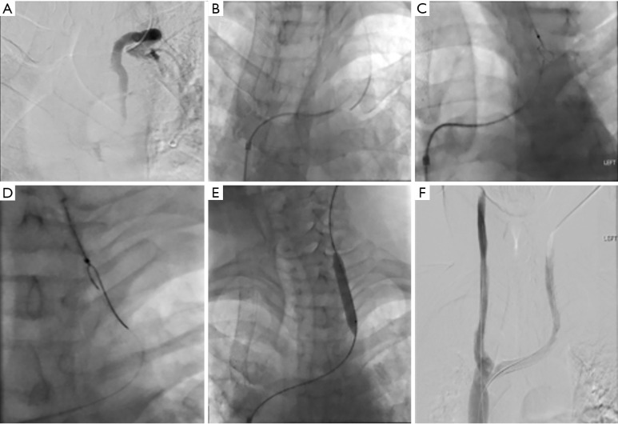
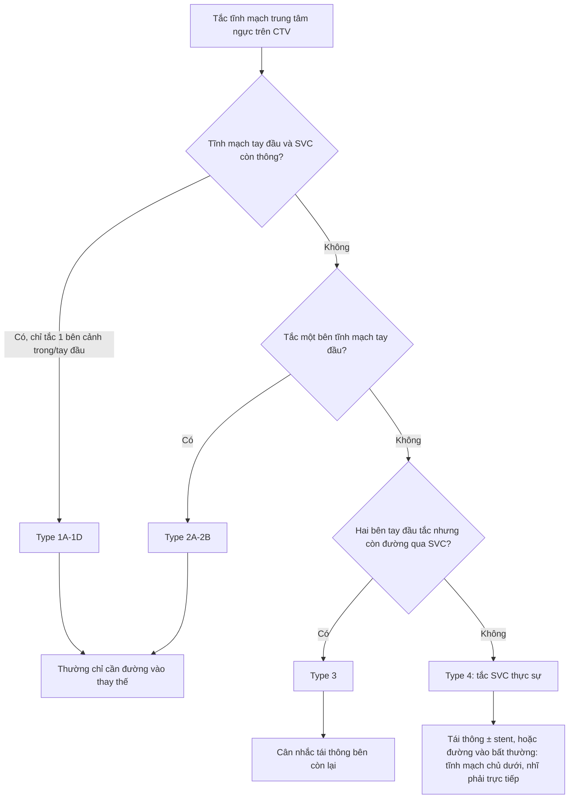
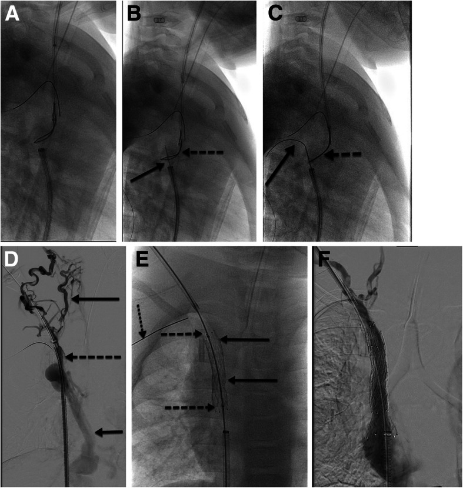
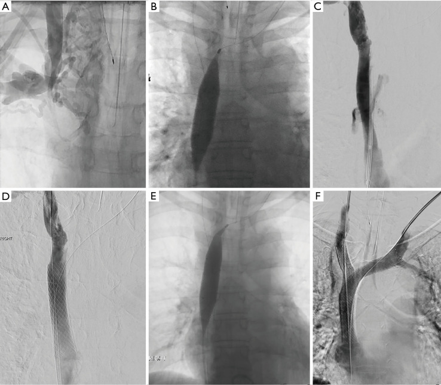

# 3043 — Hẹp–tắc tĩnh mạch chủ trên lành tính ở trẻ sau catheter trung tâm: đọc CTV/MRV và quyết định trước shunt VA

**Tags:** `pattern:hep-tinh-mach` `pattern:tuan-hoan-bang-he` `pattern:huyet-khoi-tinh-mach` `vung:trung-that` `protocol:CTV-nguc` `protocol:stent-tinh-mach` `score:SIR-CVO`
**Mức chắc chắn (certainty):** tổng hợp y văn (literature synthesis) — ghép **tổng quan kỹ thuật tái thông tĩnh mạch hệ thống ở trẻ** (CVIR Endovasc 2020, PMC7474020), **tổng quan tắc tĩnh mạch trung tâm ngực dưới góc nhìn điện quang can thiệp** (Cardiovasc Diagn Ther 2023, PMC9971304), **tổng quan quản lý hội chứng tĩnh mạch chủ trên** (J Vasc Surg Venous Lymphat Disord 2026, PMC13098589), **ca hẹp–tắc cả tĩnh mạch chủ trên và dưới ở trẻ** (Pediatr Nephrol 2026, PMC13009132) và **ca bắc cầu tĩnh mạch–tĩnh mạch ở trẻ** (EJVES Vasc Forum 2023, PMC10310466). Không có ca nguyên văn do nhóm tự chụp.

> **Câu hỏi thực hành:** bé **4 tuổi**, não úng thủy sau xuất huyết, ổ phúc mạc đã hỏng, cần **shunt não thất–nhĩ (ventriculoatrial, VA)**. Tiền sử **7 lần đặt catheter tĩnh mạch trung tâm** (nuôi dưỡng, kháng sinh, gây mê). Trước mổ, bác sĩ phải trả lời: **tĩnh mạch chủ trên (superior vena cava, SVC) còn thông không? Nếu hẹp thì có nong/stent trước không, hay chọn đường khác? Stent ở trẻ 4 tuổi có "lớn theo trẻ" được không?**
> Bài chốt **ba câu hỏi của tĩnh mạch trung tâm ở trẻ**: **(1) hẹp bao nhiêu và còn đường dự phòng nào (phân độ SIR)? (2) có triệu chứng không — vì hẹp không triệu chứng thì KHÔNG can thiệp? (3) nếu can thiệp, stent có lớn theo trẻ được không (trẻ chưa cốt hóa xương)?** Đây là **bài của người đặt shunt**, không phải bài hội chứng SVC do ung thư — phần ung thư/người lớn đã có ở [093](../093-hoi-chung-tinh-mach-chu-tren/lesson.md). Nối [3041 – Shunt não thất–nhĩ](../3041-shunt-nao-that-nhi/lesson.md), [3002 – Chọn đích VPL/VA khi ổ bụng hỏng](../3002-shunt-nao-that-mang-phoi-tinh-mach/lesson.md).

## 1. Tổng quan bệnh học – cơ chế hình ảnh: vì sao catheter "lành tính" lại làm hẹp SVC

- **Cơ chế ba bước (Virchow + mô bệnh):**
  1. **Ứ trệ tại chỗ:** mô hình dòng chảy cho thấy **tốc độ dòng quanh catheter trung tâm giảm mạnh**, và **quanh catheter ngoại vi (PICC) có thể giảm tới 93%**; mức giảm **tăng theo tỷ lệ catheter/lòng mạch** (Cardiovasc Diagn Ther 2023, PMC9971304). Ở trẻ, lòng mạch nhỏ nên **cùng một catheter 4–5 Fr chiếm tỷ lệ lòng mạch lớn hơn nhiều so với người lớn** — đây là **suy luận cơ học**, không phải số đo ở trẻ.
  2. **Tổn thương nội mạc do catheter tì vào thành mạch** → **tăng sinh nội mạc (neointimal hyperplasia)**; catheter đi qua nhiều điểm gấp khúc (**cảnh trong trái, tay đầu trái**) làm **nhiều điểm tì hơn** → tỷ lệ tắc **cao hơn ở bên trái** (Cardiovasc Diagn Ther 2023, PMC9971304).
  3. **Huyết khối trên nền hẹp** → **tắc hoàn toàn**; tổng quan này ghi nhận **~8% trẻ đặt PICC có huyết khối liên quan catheter trong một loạt 265 trẻ**, **phần lớn không triệu chứng** (CVIR Endovasc 2020, PMC7474020, dẫn Menéndez 2016).
- **TẠI SAO trẻ thường KHÔNG có hội chứng SVC dù tắc:** hẹp tiến triển **chậm (tuần–tháng)**, đủ thời gian mở **tuần hoàn bàng hệ** (tĩnh mạch liên sườn, azygos, tĩnh mạch thành ngực, plexus quanh sống). Vì vậy **tắc SVC mạn tính ở trẻ thường là phát hiện tình cờ trên CT**, không phải cấp cứu; ngược lại **tắc cấp do huyết khối** mới gây phù mặt–cổ–tay nhanh.
- **TẠI SAO hẹp "im lặng" lại quan trọng với shunt VA:** shunt VA **đổ toàn bộ DNT vào SVC**, làm **lưu lượng qua đoạn hẹp tăng lên** — giống nguyên lý **"hẹp tĩnh mạch bị lộ ra khi tạo fistula"** (J Vasc Surg Venous Lymphat Disord 2026, PMC13098589 ghi nhận hẹp SVC không triệu chứng **có thể lộ ra khi đặt đường mạch máu lọc máu**). Hệ quả: **một SVC hẹp 50% có thể chịu được dòng tĩnh mạch bình thường nhưng không chịu được thêm dòng DNT** → **đánh giá SVC TRƯỚC khi đặt VA**, không phải sau khi trẻ đau đầu.
- **Ngưỡng định lượng để đọc:** hẹp SVC trên CT được lượng hóa bằng **diện tích cắt ngang**, với ngưỡng **< 1,07 cm²** gợi ý hẹp/chèn ép có ý nghĩa (chi tiết và bảng phân độ Stanford-Doty/Kishi ở [093](../093-hoi-chung-tinh-mach-chu-tren/lesson.md)); đường kính SVC người lớn **2,1 ± 0,7 cm** — ở trẻ phải **chuẩn hóa theo cân nặng/diện tích cơ thể**, chưa có bảng chuẩn riêng.
- **Vì sao hình ảnh học ở trẻ khó hơn người lớn:** SVC trẻ **nhỏ (vài mm)**, nhiều **bàng hệ nhỏ**; **siêu âm Doppler gần như không đánh giá được SVC**; **MRV** có độ phân giải **1–2 mm** nhưng **thường cần gây mê**; **CECT** có độ phân giải **0,2–0,3 mm** nên **thường là lựa chọn thực tế ở trẻ nhỏ**, dù có bức xạ (CVIR Endovasc 2020, PMC7474020).

*Chuỗi A→F của hình gốc: **A** — chụp tĩnh mạch cảnh trong trái: **SVC tắc**, thuốc chỉ đi vào **lưới bàng hệ**; **B, C** — dây cứng đi qua ổ tắc từ đường đùi; **D** — nong bóng; **E** — đặt stent; **F** — lưu thông thẳng vào nhĩ phải, bàng hệ giảm. Đây là "chữ ký" hình ảnh của **tắc SVC mạn lành tính**: **không có cột thuốc liên tục vào nhĩ, chỉ có bàng hệ**. Nguồn: Cardiovasc Diagn Ther 2023 (PMC9971304), CC BY-NC-ND 4.0, nguyên bản.*

## 2. Mẫu hình + chẩn đoán phân biệt theo vị trí và theo cơ chế (gamut)

- **Gamut theo vị trí (theo phân độ SIR 2018 — dùng để mô tả và chọn đường can thiệp):** tổn thương **một bên cảnh trong/tay đầu** (Type 1) · **một bên tĩnh mạch tay đầu** (Type 2) · **hai bên tĩnh mạch tay đầu nhưng còn đường qua SVC** (Type 3) · **tắc SVC thực sự, không còn đường trực tiếp về nhĩ** (Type 4) (Cardiovasc Diagn Ther 2023, PMC9971304).
- **Gamut theo cơ chế:** **huyết khối cấp** (< 14 ngày, mềm, dây đi qua dễ) · **hẹp/xơ mạn** (> 14 ngày, có **vôi hóa trong lòng**, **nhiều bàng hệ**) · **chèn ép ngoài** (khối trung thất, xơ trung thất) · **hẹp sau can thiệp** (tái hẹp trong stent) (CVIR Endovasc 2020, PMC7474020).
- **Gamut theo hình thái trên CTV:** **hẹp hình nhẫn** (do catheter tì) · **tắc có "nắp" (venous cap)** — điểm vào của lòng mạch gốc, là **bia để tái thông** · **tắc dài > 3 cm** (khó, nguy cơ cao khi tái thông "sắc") · **tắc kèm bàng hệ qua azygos** · **hẹp trong stent**.
- **Chẩn đoán phân biệt "SVC hẹp trên CT" — đừng nhầm giả tổn thương:**
  - **Máu chưa ngấm thuốc từ tĩnh mạch đối diện** đổ vào SVC → **"khuyết thuốc" giả** trên thì tĩnh mạch; xử lý bằng **tiêm hai tay** hoặc **thì muộn hơn**.
  - **Bó sợi cơ tim/van dạng mạng (rete) bẩm sinh** ở SVC → hình mạng lưới, không phải huyết khối.
  - **Bàng hệ nội tạng–phổi** (hội chứng gan–phổi) không phải hẹp SVC.
  - **Bệnh lý trung thất** (u, hạch, xơ trung thất) → hẹp do **chèn ép ngoài**, cần CT có cản quang đánh giá mô mềm quanh mạch.

## 3. Bảng so sánh phân biệt (ma trận đối chiếu)

### 3a. Nguyên nhân hẹp–tắc SVC: lành tính do catheter so với các nguyên nhân khác

| Thực thể (entity) | Hình ảnh điển hình | Chốt vào (rule-in) | Chốt loại (rule-out) | Gợi ý xác nhận |
|---|---|---|---|---|
| **Hẹp/tắc do catheter (lành tính)** | Hẹp **hình nhẫn/vát** đúng đoạn catheter nằm, **thành mạch dày đều**, **bàng hệ phong phú**, không có khối trung thất | **Tiền sử catheter/PICC/port cùng bên + hẹp khu trú đúng vị trí đầu catheter** | Có **khối trung thất** chèn ép, hạch to, xâm lấn thành mạch → nghi ác tính | CTV có cản quang; đối chiếu vị trí catheter cũ trên phim/hồ sơ |
| **Hội chứng SVC do ung thư** | **Chèn ép ngoài**, **khối trung thất**, hẹp **dài, bờ ngoài**, có thể xâm lấn | **Khối trung thất + hẹp SVC + triệu chứng tiến triển nhanh (ngày–tuần)** | Thành mạch đều, không khối, tiền sử catheter → lành tính | Sinh thiết khối; PET-CT |
| **Huyết khối cấp** | **Khuyết thuốc trong lòng**, mạch **giãn**, bờ rõ, không bàng hệ nhiều | **Khởi phát < 14 ngày**, đau/phù cấp, D-dimer tăng | Bàng hệ dày + vôi hóa trong lòng → mạn | Siêu âm/CTV; cân nhắc Doppler |
| **Xơ trung thất (fibrosing mediastinitis)** | **Canxi hóa hạch trung thất**, hẹp **dài**, có thể hẹp cả phế quản/động mạch phổi | **Canxi hóa + hẹp nhiều cấu trúc trung thất** | Tổn thương đơn độc đúng vị trí catheter → nghĩ do catheter | CT ngực có cản quang; bối cảnh nhiễm nấm lao |

### 3b. Chọn phương thức hình ảnh ở trẻ nghi hẹp SVC

| Phương thức | Ưu điểm | Hạn chế / ngưỡng | Khi nào chọn |
|---|---|---|---|
| **Siêu âm Doppler** | Không bức xạ, làm tại giường, đánh giá được tĩnh mạch cổ/tay | **Không thấy rõ SVC**, không đánh giá được bàng hệ sâu | Sàng lọc tĩnh mạch ngoại vi, theo dõi sau can thiệp |
| **CECT/CTV** | **Độ phân giải 0,2–0,3 mm**, thấy bàng hệ, đo được chiều dài/đường kính để chọn stent | Bức xạ + cản quang; **bơm một tay có thể bỏ sót** | **Lựa chọn thực tế ở trẻ nhỏ** khi cần kế hoạch can thiệp (CVIR Endovasc 2020) |
| **MRV** | Không bức xạ, đánh giá mô mềm và bàng hệ | **1–2 mm**, **thường cần gây mê** ở trẻ nhỏ, **hạn chế sau khi có stent (artifact kim loại)** | Trẻ lớn hợp tác được, theo dõi trước can thiệp |
| **Chụp mạch (DSA/venogram)** | **Chuẩn vàng**, đo gradient, can thiệp luôn | Xâm lấn, cản quang, bức xạ | Khi đã quyết định can thiệp hoặc cần xác nhận trước shunt VA |

## 4. Protocol – phân độ SIR – kỹ thuật can thiệp và ngưỡng "làm hay không làm"

- **Nguyên tắc đầu tiên (dễ bị vi phạm nhất):** **KHÔNG can thiệp hẹp KHÔNG triệu chứng** — can thiệp trên hẹp không triệu chứng **đẩy nhanh tiến triển** và có thể làm mất bàng hệ, khiến bệnh nhân **tắc có triệu chứng** sau đó (Cardiovasc Diagn Ther 2023, PMC9971304). Với trẻ chuẩn bị shunt VA, **hẹp không triệu chứng nhưng sẽ phải chịu thêm dòng DNT** là vùng xám: cần **đo gradient + đánh giá bàng hệ**, không tự động đặt stent.
- **Phân độ SIR 2018 (dùng để ghi báo cáo và chọn chiến lược):**

*Phân độ SIR 2018 cho tắc tĩnh mạch trung tâm ngực (Cardiovasc Diagn Ther 2023, PMC9971304); Type 4 là tổn thương quyết định chiến lược shunt VA.*

- **Kỹ thuật tái thông (các con số phải nhớ):**
  - **Heparin** trong thủ thuật: **100 U/kg, tối đa 5.000 U** (CVIR Endovasc 2020).
  - **Bóng nong**: bóng áp lực cao **10–16 mm** cho SVC người lớn; ở trẻ chọn theo **đường kính đoạn lành kề bên** (J Vasc Surg Venous Lymphat Disord 2026; CVIR Endovasc 2020).
  - **Stent**: **quá cỡ 10–20%** so với đường kính mạch lành, **chiều dài ≥ 4 cm** để giảm di chuyển; **tránh che tĩnh mạch cảnh trong** (còn dùng cho đường vào sau này); nếu cần che nhánh lớn → **kỹ thuật "kissing stent"** (Cardiovasc Diagn Ther 2023, PMC9971304).
  - **Trẻ chưa cốt hóa xương:** có thể đặt stent **vùng trên cơ hoành (tay đầu/SVC)** nếu **stent có thể nong to dần**; cách làm phổ biến là **stent tự nở đặt trong stent nong bóng** → tạo **"đồng hồ cát" bị giới hạn**, sau đó **nong lại theo tuổi** (CVIR Endovasc 2020). Ca 4 tuổi minh họa: **Palmaz + Zilver 14 mm**, lần đầu **chỉ nong tới 10 mm** vì lòng mạch gốc nhỏ, **dự kiến nong lại khi trẻ lớn**.
  - **Tái thông "sắc" (sharp recanalization)**: chỉ khi kỹ thuật tù thất bại; **nguy cơ tăng khi đoạn tắc > 3 cm**; có thể dùng **IVUS** để giảm số lần đi kim (CVIR Endovasc 2020).
  - **Biến chứng nặng nhất — vỡ SVC → chèn ép tim:** xử lý bằng **nong bóng giữ 3 phút**, **stent có màng (covered stent)**, và **dẫn lưu màng tim cấp cứu** (CVIR Endovasc 2020; J Vasc Surg Venous Lymphat Disord 2026).
- **Kết quả can thiệp — đọc đúng mức bằng chứng:**
  - **SVC lành tính (người lớn):** stent cho **thông sơ phát 40%, thông thứ phát 80%** trong một loạt 30 bệnh nhân; nhóm lọc máu chỉ **11%/56%** (J Vasc Surg Venous Lymphat Disord 2026, bảng tổng hợp).
  - **Biến chứng stent SVC:** **~9% tổng**, **tử vong 1–2%**; **tái hẹp 10,5%**, **tái phát 10,8%** (tổng quan 2.200 bệnh nhân) (J Vasc Surg Venous Lymphat Disord 2026).
  - **Trẻ em:** **chưa có tỷ lệ thông stent SVC đáng tin cậy** — chủ yếu ca lẻ; stent **tĩnh mạch chủ dưới/chậu** ở trẻ có **thông sơ phát 64–100% ở 12 tháng**, **thông có hỗ trợ/thứ phát 100%**; **chưa rõ** quá 36 tháng (CVIR Endovasc 2020).
  - **Stent chuyên dụng tĩnh mạch (Vici):** **100% ở 6 tháng, 94% ở 12 tháng** trong **20 bệnh nhân người lớn** — **không phải dữ liệu trẻ** (Cardiovasc Diagn Ther 2023).
- **Quyết định trước shunt VA — 3 lựa chọn khi SVC hẹp/tắc:**
  1. **Tái thông + stent SVC** rồi đặt VA qua stent (ưu tiên nếu còn đầu xa đủ chỗ và trẻ đã/lớn gần cốt hóa).
  2. **Đường vào thay thế:** cảnh trong **đối diện**, đường **tĩnh mạch chủ dưới/gan (transhepatic)** khi SVC tắc hoàn toàn, hoặc **nhĩ phải trực tiếp**.
  3. **Đổi đích dẫn lưu:** [VPL](../3002-shunt-nao-that-mang-phoi-tinh-mach/lesson.md) nếu phổi lành và trẻ > 4–5 tuổi, hoặc **ETV** nếu não thất giãn đủ.
- **Ca "đường cùng" để thấy giới hạn của can thiệp:** bé **5 tuổi** (13,1 kg) **tắc hoàn toàn cả SVC và tĩnh mạch chủ dưới** sau nhiều lần đặt catheter; **tái thông nội mạch thất bại** → **đặt catheter thận nhân tạo trực tiếp vào nhĩ phải qua mở xương ức nhỏ**, dùng **ống màng tim bò 8 × 3 cm** làm đường hầm bảo vệ; lưu lượng **~95 mL/phút = 7,2 mL/kg/phút** (Pediatr Nephrol 2026, PMC13009132). Bài học: **khi cả hai tĩnh mạch chủ tắc, "đặt shunt VA" không còn là chuyện nong bóng** — phải chuyển chiến lược.
- **Bắc cầu ngoại khoa ở trẻ (khi nội mạch thất bại):** bé **10 tuổi** tắc tĩnh mạch dưới đòn trái sau **2 đợt catheter cảnh trong hai bên, mỗi bên 2 tháng**, nong bóng thất bại → **bắc cầu tĩnh mạch nách – tĩnh mạch chậu ngoài** bằng **mảnh ghép PTFE 8 mm × 60 cm**; phù tay và loét giảm sau mổ (EJVES Vasc Forum 2023, PMC10310466).

*Hình gốc của một bé **4 tuổi** chạy thận nhân tạo: **A–C** — dây và ống thông đi từ đường bẹn; **D** — chụp tĩnh mạch: **tắc cả hai tĩnh mạch cảnh trong và hai tĩnh mạch tay đầu**, thuốc chỉ đi qua **lưới bàng hệ cổ** và **tĩnh mạch azygos**; **E** — **"stent complex"**: một stent gắn bóng (Palmaz) đặt ở đoạn tắc, rồi một stent tự nở (Zilver 14 mm) đặt trong đó, **giữa stent chỉ nong tới 10 mm** vì lòng mạch gốc của trẻ nhỏ, **dự kiến nong rộng dần theo tuổi**; **F** — thuốc chảy thẳng vào nhĩ phải. Đây là hình mẫu của **"stent lớn theo trẻ"**. Nguồn: CVIR Endovasc 2020 (PMC7474020), CC BY 4.0.*

## 5. Biến thể bình thường và cạm bẫy

- **Cạm bẫy số 1 — can thiệp hẹp không triệu chứng:** hẹp SVC mạn ở trẻ **thường không triệu chứng** nhờ bàng hệ; **nong/stent "cho chắc"** có thể **phá bàng hệ**, gây **tắc có triệu chứng** và **tăng tốc xơ hóa**. Chỉ can thiệp khi **có triệu chứng** hoặc khi **dòng DNT của shunt VA sẽ làm hẹp thành có ý nghĩa** — và khi đó nên **đo gradient** trong cùng thủ thuật.
- **Cạm bẫy số 2 — đánh giá thấp đường kính mạch:** đoạn **trước chỗ tắc bị xẹp** ("underfilling") làm **đo nhỏ hơn thật** → chọn stent quá nhỏ → **di chuyển/tái hẹp**. Dùng **IVUS** hoặc đo **đoạn lành sau chỗ tắc** (CVIR Endovasc 2020).
- **Cạm bẫy số 3 — di chuyển stent:** **Wallstent ở đoạn thấp SVC** dễ **co ngắn/di chuyển** do lực hướng tâm không đều; ưu tiên **stent tự nở nitinol thế hệ mới/covered stent**, **quá cỡ 10–20%**, **dài ≥ 4 cm** (Cardiovasc Diagn Ther 2023).
- **Cạm bẫy số 4 — che mất đường vào tương lai:** stent che **tĩnh mạch cảnh trong** hoặc **tay đầu đối diện** làm **mất đường đặt catheter/shunt sau này**. Trước khi stent ở trẻ, phải trả lời: **20 năm nữa trẻ này cần đường vào ở đâu?**
- **Cạm bẫy số 5 — vỡ SVC và chèn ép tim:** đoạn SVC được **màng tim phủ**; nong bóng/stent có thể **rách thành → máu vào màng tim → chèn ép tim**. Nhận biết: **đau ngực, tụt huyết áp, hình ảnh màng tim trên siêu âm tại phòng can thiệp**; xử lý: **bóng giữ 3 phút + covered stent + dẫn lưu màng tim** (CVIR Endovasc 2020). Tỷ lệ tử vong của biến chứng này **1–2%** trong các loạt lớn (J Vasc Surg Venous Lymphat Disord 2026).

*Hình gốc: **A** — chụp ban đầu: tắc tĩnh mạch tay đầu phải; **B** — nong bóng; **C, D** — **vỡ đoạn thấp SVC**, thuốc thoát ra ngoài lòng mạch, tụ máu màng tim; **E** — đặt **stent có màng** bịt chỗ vỡ; **F** — kiểm tra: không còn thoát thuốc. Đây là biến chứng **nặng nhất** của can thiệp SVC và là lý do **phải có covered stent + sẵn sàng dẫn lưu màng tim**. Nguồn: Cardiovasc Diagn Ther 2023 (PMC9971304), CC BY-NC-ND 4.0, nguyên bản.*

- **Cạm bẫy số 6 — "hẹp giả" do kỹ thuật chụp:** tiêm **một tay** trong khi tay kia có dòng chưa ngấm thuốc → **khuyết thuốc giả** ở chỗ hợp lưu; khắc phục bằng **tiêm hai tay** hoặc **thì muộn** (Cardiovasc Diagn Ther 2023).
- **Cạm bẫy số 7 — sau khi có stent, MRI không còn đáng tin:** **artifact kim loại** làm **không đánh giá được lòng stent**; theo dõi bằng **siêu âm (hạn chế)**, **CECT**, hoặc **venogram** khi có triệu chứng (CVIR Endovasc 2020).
- **Biến thể bình thường:** **bàng hệ quanh sống/azygos** ở trẻ tắc SVC mạn **không phải dị dạng**; **tĩnh mạch cảnh trong trái nhỏ hơn phải** là bình thường; **van tĩnh mạch cảnh trong** có thể tạo hình ảnh "gián đoạn" giả trên CT.

## 6. Tự lượng giá — Blind Quiz

**Ca 1 — Bé 4 tuổi, tiền sử nhiều catheter trung tâm, nay phù mặt–cổ nhẹ, không khó thở. Venogram:**

- Gợi ý: thuốc từ tĩnh mạch cảnh trong **không vào được nhĩ phải**, chỉ thấy **lưới mạch quanh cổ–trung thất**.
- Câu hỏi: Mô tả tổn thương. Theo SIR 2018 đây là type nào? Có nên đặt stent ngay không?

<b>Bấm để hiện đáp án</b>

- **Tắc SVC** (Type 4 nếu không còn đường trực tiếp về nhĩ) với **tuần hoàn bàng hệ phong phú**; dây cứng đã đi qua được ổ tắc, nong bóng rồi đặt stent, sau đó **thuốc vào nhĩ phải**.
- **Không stent ngay** nếu **không triệu chứng** và **chưa có kế hoạch tăng dòng qua SVC** — can thiệp hẹp không triệu chứng có thể **đẩy nhanh tiến triển** và làm mất bàng hệ.
- Nếu trẻ **sắp đặt shunt VA** → đây là lúc **đo gradient** và cân nhắc **tái thông trước**, vì shunt sẽ **tăng lưu lượng qua đoạn hẹp**.
- Nguồn ảnh: Cardiovasc Diagn Ther 2023 (PMC9971304), CC BY-NC-ND 4.0.

**Ca 2 — Bé 4 tuổi chạy thận, tắc cả hai tĩnh mạch cảnh trong và hai tay đầu; sau can thiệp:**

- Câu hỏi: Vì sao stent **chỉ được nong tới 10 mm** dù đã đặt trong SVC? Điều gì sẽ làm với stent này khi trẻ lớn?

<b>Bấm để hiện đáp án</b>

- Vì **lòng mạch gốc của trẻ 4 tuổi nhỏ**; nong hết cỡ ngay có thể **rách SVC** hoặc **di chuyển stent**. Cấu hình **stent tự nở trong stent gắn bóng** tạo **"đồng hồ cát" bị giới hạn**, cho phép **nong lại nhiều lần khi trẻ lớn** (serial redilation).
- Theo dõi: siêu âm/CECT/venogram khi có triệu chứng; **không dựa vào MRI** vì artifact.
- Nguồn ảnh: CVIR Endovasc 2020 (PMC7474020), CC BY 4.0.

**Ca 3 — Trong lúc nong bóng SVC, bệnh nhi tụt huyết áp, đau ngực; hình huỳnh quang thấy thuốc thoát ra ngoài lòng mạch:**

- Câu hỏi: Chẩn đoán? Ba bước xử lý ngay?

<b>Bấm để hiện đáp án</b>

- **Vỡ SVC → máu vào màng tim → chèn ép tim** (biến chứng nặng nhất, tử vong 1–2% các loạt lớn).
- Xử lý: (1) **nong bóng giữ 3 phút** bịt chỗ rách; (2) **đặt stent có màng (covered stent)** nếu còn thoát; (3) **dẫn lưu màng tim cấp cứu** + hồi sức; gọi phẫu thuật tim mạch.
- Nguồn ảnh: Cardiovasc Diagn Ther 2023 (PMC9971304), CC BY-NC-ND 4.0.

## Bài liên quan chéo
- [3041 – Shunt não thất–nhĩ (VA): khi nào chọn và biến chứng](../3041-shunt-nao-that-nhi/lesson.md)
- [3002 – Shunt não thất–màng phổi & não thất–tĩnh mạch khi ổ bụng thất bại](../3002-shunt-nao-that-mang-phoi-tinh-mach/lesson.md)
- [093 – Hội chứng tĩnh mạch chủ trên (người lớn/ung thư)](../093-hoi-chung-tinh-mach-chu-tren/lesson.md)
- [3039 – Nhiễm trùng shunt não thất–phúc mạc](../3039-nhiem-trung-shunt-nao-that-phuc-mac/lesson.md)

> Không dùng để chẩn đoán độc lập khi chưa có người hướng dẫn.
