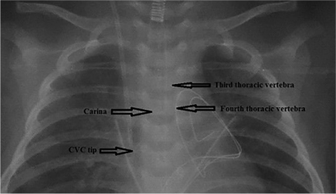
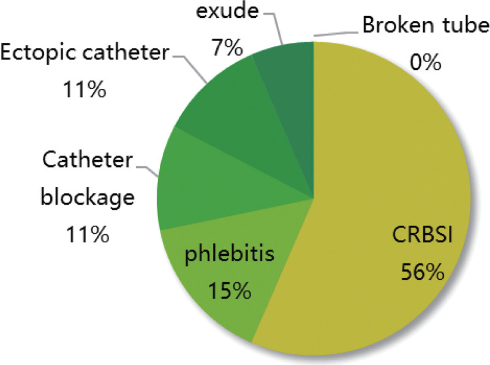
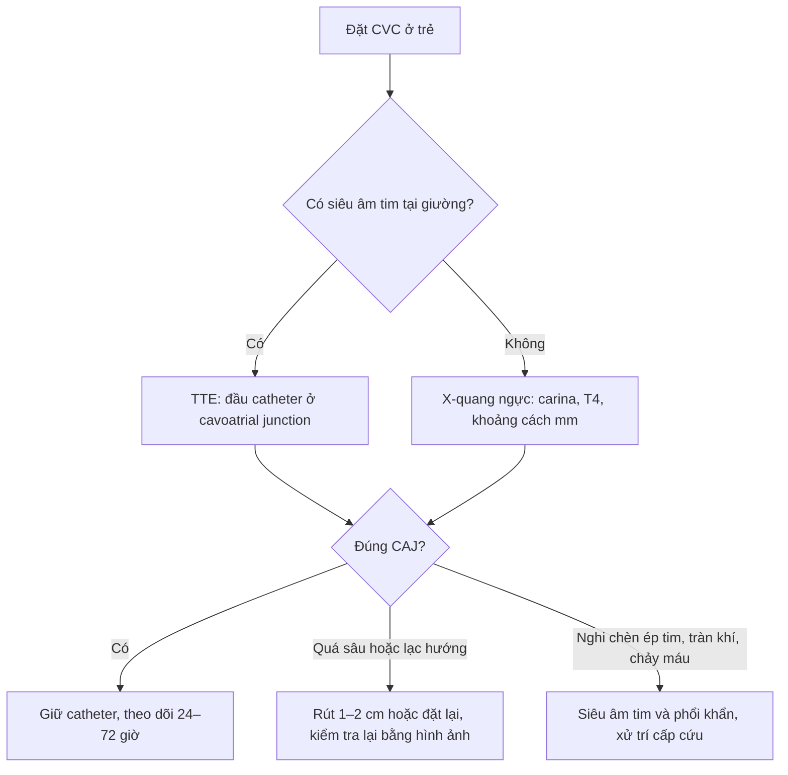
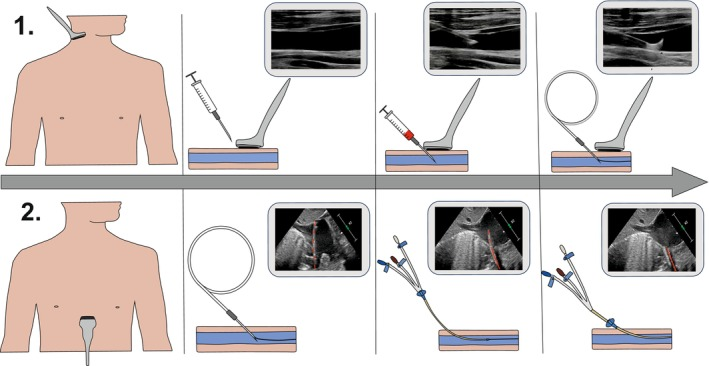
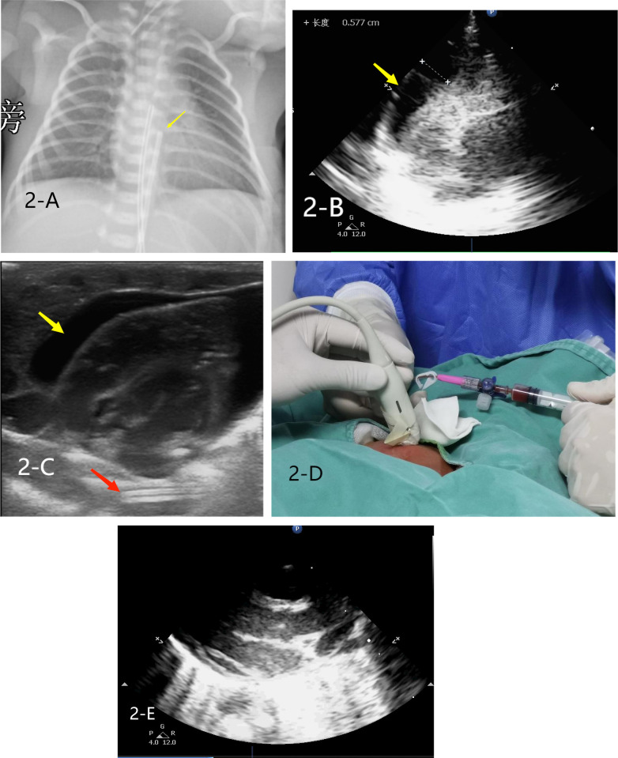

# 3044 — Catheter tĩnh mạch trung tâm ở trẻ: chọn đường vào, xác nhận đầu catheter và biến chứng sớm

**Tags:** `pattern:ong-day` `pattern:di-lac-dau-catheter` `pattern:tran-khi-mang-phoi` `pattern:huyet-khoi-tinh-mach` `vung:trung-that` `vung:nguc` `protocol:sieu-am-tai-giuong` `protocol:xq-nguc` `protocol:ECG-long-trong`
**Mức chắc chắn (certainty):** tổng hợp y văn (literature synthesis) — ghép **nghiên cứu tiến cứu định vị đầu catheter bằng siêu âm tim qua thành ngực ở trẻ** (Paediatr Anaesth 2025, PMC11883508), **mốc X-quang đốt sống ngực T4 cho catheter cảnh trong phải ở nhũ nhi** (Sci Rep 2022, PMC9418216), **đoàn hệ PICC ở trẻ** (Medicine 2023, PMC10545263), **đoàn hệ huyết khối liên quan catheter ở trẻ** (Transl Pediatr 2022, PMC9732607), **ca tử vong do chèn ép tim ở sơ sinh có catheter tĩnh mạch rốn** (Front Pediatr 2026, PMC13275663) và **kiểm toán biến chứng tức thì của chọc mạch trung tâm ở trẻ** (J Indian Assoc Pediatr Surg 2011, PMC3221157). Không có ca do nhóm tự chụp.

> **Câu hỏi thực hành:** bé **3 tháng tuổi**, sốc nhiễm khuẩn, cần **catheter tĩnh mạch trung tâm (central venous catheter, CVC)** để vận mạch + kháng sinh. Sau khi đặt qua **tĩnh mạch cảnh trong phải**, phim X-quang tại giường cho thấy **đầu catheter nằm ngang mức carina**. Câu hỏi: **như vậy là đúng chưa, có phải chụp lại không, và nếu đầu catheter nằm trong nhĩ phải thì nguy cơ gì?**
> Bài chốt **ba quyết định của người đặt đường truyền trung tâm ở trẻ**: **(1) chọn đường vào nào (cảnh trong / dưới đòn / đùi / PICC / rốn)? (2) xác nhận đầu catheter bằng gì — X-quang, siêu âm tim, hay ECG lòng mạch? (3) biến chứng nào phải lo trong 24–72 giờ đầu?** Nối [015 – Ống/dây ICU](../015-ong-day-ICU/lesson.md), [3043 – Hẹp–tắc tĩnh mạch chủ trên sau catheter](../3043-hep-tinh-mach-chu-tren-tre/lesson.md), [093 – Hội chứng tĩnh mạch chủ trên](../093-hoi-chung-tinh-mach-chu-tren/lesson.md).

## 1. Tổng quan bệnh học – cơ chế hình ảnh: vì sao "đầu catheter ở đâu" lại là chuyện sống còn

- **Đích giải phẫu:** đầu catheter phải nằm ở **ngã ba tĩnh mạch chủ trên–nhĩ phải (cavoatrial junction, CAJ)**. Ba vị trí sai đều có hậu quả riêng:
  - **Quá cao** (trong tĩnh mạch tay đầu, tĩnh mạch cảnh trong, hoặc tĩnh mạch chủ trên đoạn trên): dòng chảy chậm + thành mạch nhỏ → **huyết khối và xơ hẹp tĩnh mạch trung tâm**; đây chính là cơ chế của [3043](../3043-hep-tinh-mach-chu-tren-tre/lesson.md).
  - **Quá sâu** (trong nhĩ phải/thất phải): catheter **tì vào thành nhĩ** → **thủng thành, chèn ép tim (tamponade)**, hoặc gây **loạn nhịp** khi đầu catheter kích thích nội mạc.
  - **Lạc hướng** (tĩnh mạch bàng hệ): đầu catheter đi vào **tĩnh mạch azygos, tĩnh mạch ngực trong, tĩnh mạch nửa đơn** hoặc sang **bên đối diện** — trên phim thẳng vẫn "trông như trong trung thất", nhưng thuốc không vào tuần hoàn trung tâm.
- **TẠI SAO trẻ khác người lớn (vật lý + giải phẫu):**
  1. **Tĩnh mạch chủ trên rất ngắn** ở nhũ nhi; khoảng cách từ chỗ chọc cảnh trong đến nhĩ phải chỉ **vài cm**. Vì vậy **sai số 1 cm đã đủ đưa đầu catheter từ tĩnh mạch chủ trên vào nhĩ phải**.
  2. **Đốt sống chưa cốt hóa hoàn toàn** nên mốc X-quang phải hiệu chuẩn theo tuổi. Ở **nhũ nhi 1–12 tháng**, carina nằm **ngang đốt sống ngực T4 ở 98% (93/95 ca)**, chỉ **2% ở T3** (Sci Rep 2022, PMC9418216).
  3. **Khoảng cách đầu catheter–carina** ở nhũ nhi: **trung vị 10 mm (khoảng tứ phân vị 4–15 mm)**; **6,3% (6/95) có đầu catheter > 22 mm dưới carina**, mức mà tác giả cảnh báo **có thể đã chạm hoặc vào nhĩ phải** (Sci Rep 2022, PMC9418216).
- **TẠI SAO X-quang không đủ để "chốt" vị trí:** phim thẳng là **hình chiếu 2D**; carina chỉ là **mốc thay thế (surrogate)** cho CAJ, và mốc này **lệch theo tư thế, pha thở và độ xoay bệnh nhi**. Nghiên cứu dùng **siêu âm tim qua thực quản (transesophageal echocardiography, TEE) làm chuẩn vàng** cho thấy **định vị bằng siêu âm tim qua thành ngực (transthoracic echocardiography, TTE)** đạt **91% (136/150 trẻ)** đúng CAJ — **96% ở trẻ 0–3 tháng** nhưng chỉ **70% ở trẻ 13–14 tuổi** (Paediatr Anaesth 2025, PMC11883508). Nghĩa là **trẻ càng nhỏ, siêu âm càng có lợi** — ngược với thói quen "trẻ nhỏ thì chỉ chụp X-quang".
- **TẠI SAO ECG lòng mạch (intracavitary ECG) không thay được phim:** khi đầu catheter vào gần nút xoang, **sóng P tăng biên độ**. Ở **62 trẻ ung thư đặt PICC**, **90,32% (56/62) có sóng P đặc trưng**, nhưng khi đối chiếu phim ngực **chỉ 58,93% trong số đó có đầu catheter đúng vị trí**, **39,29% (22/56) vẫn quá sâu**, **1 ca ngoài tĩnh mạch chủ trên**; 6 ca **không có sóng P** thì đầu catheter lạc sang **tĩnh mạch cảnh trong đối diện (1), tĩnh mạch tay đầu đối diện (2), tĩnh mạch dưới đòn đối diện (1)**, quá sâu T8 (1), quá nông T4 (1) (Ann Noninvasive Electrocardiol 2022, PMC9296801). Bài học: **ECG báo "đã tới gần nhĩ", không báo "đúng CAJ"** — vẫn cần xác nhận hình ảnh.

*Phim ngực thẳng của nhũ nhi sau đặt catheter cảnh trong phải: mũi tên chỉ **carina**, **đốt sống ngực T3**, **T4** và **đầu catheter (CVC tip)**. Carina trùng mức T4 ở **98% nhũ nhi 1–12 tháng**; đầu catheter nằm **10 mm (4–15 mm)** dưới carina là vùng an toàn, **> 22 mm** thì có thể đã vào nhĩ phải. Nguồn: Sci Rep 2022 (PMC9418216), CC BY 4.0, nguyên bản.*

## 2. Mẫu hình + chẩn đoán phân biệt theo đường vào và theo thời điểm (gamut)

- **Gamut theo đường vào (chọn đường nào trước):**

| Đường vào | Ưu điểm | Bẫy riêng | Ghi chú thực hành |
|---|---|---|---|
| **Tĩnh mạch cảnh trong (internal jugular, IJ)** | Đường thẳng nhất tới CAJ; siêu âm dễ; ít tràn khí hơn dưới đòn | Chọc nhầm **động mạch cảnh**; đầu catheter vào **tĩnh mạch azygos** khi đường bên trái | Đường mặc định ở trẻ lớn và nhũ nhi có siêu âm |
| **Tĩnh mạch dưới đòn (subclavian)** | Cố định catheter tốt, sạch vùng cổ | **Tràn khí màng phổi**, **chọc nhầm động mạch dưới đòn**, **hẹp tĩnh mạch** về sau | Nguy cơ tràn khí cao hơn khi nhiều lần chọc |
| **Tĩnh mạch đùi (femoral)** | Nhanh, an toàn trong cấp cứu, siêu âm dễ | **Huyết khối tĩnh mạch đùi**, nhiễm khuẩn vùng tã | Chấp nhận được cho đường truyền ngắn hạn |
| **PICC (catheter trung tâm ngoại vi)** | Không cần gây mê, dùng dài hạn | **Lạc hướng 12,32% (302/2.451)**, bên phải **ăn sâu hơn** (30 mm so với 16,5 mm vào tim phải) | Đo chiều dài trước đặt; kiểm tra bằng X-quang/ECG |
| **Catheter rốn (UVC/UAC)** | Có sẵn ở sơ sinh | **UVC quá sâu → chèn ép tim**; UAC → **co thắt/tắc động mạch** | Kiểm vị trí ngay sau đặt, trước khi truyền bất kỳ thuốc nào |

- **Gamut theo kiểu lạc hướng (đọc phim X-quang):** **quá nông** (còn trong tĩnh mạch cảnh trong/tay đầu) · **quá sâu** (nhĩ phải, thất phải) · **vào tĩnh mạch azygos** (đi xuống dọc cột sống, "móc" ra sau) · **vào tĩnh mạch ngực trong** (chạy song song bờ xương ức) · **sang bên đối diện** qua tĩnh mạch tay đầu · **thành vòng (loop) trong nhĩ** · **ra ngoài lòng mạch** (vào màng phổi/trung thất).
- **Gamut theo thời điểm biến chứng:** **tại lúc chọc** (chọc nhầm động mạch, tràn khí, máu tụ, loạn nhịp) · **24–72 giờ** (chèn ép tim do thủng muộn, tràn dịch/tràn máu màng phổi, huyết khối sớm) · **1–4 tuần** (nhiễm khuẩn liên quan catheter, huyết khối, hẹp tĩnh mạch).

## 3. Bảng so sánh phân biệt (ma trận đối chiếu)

| Thực thể (entity) | Hình ảnh điển hình | Chốt vào (rule-in) | Chốt loại (rule-out) | Gợi ý xác nhận |
|---|---|---|---|---|
| **Đầu catheter đúng vị trí (CAJ)** | Đầu catheter ngay trên nhĩ phải, **~10 mm (4–15 mm) dưới carina** ở nhũ nhi; đường đi thẳng, không móc | **Đầu catheter ở CAJ trên TTE/TEE**; đường đi một trục từ cảnh trong phải | Đầu catheter **> 22 mm dưới carina** hoặc **móc ngược trong nhĩ** | TTE có/không bơm nước muối; TEE khi mổ tim |
| **Đầu catheter quá sâu trong nhĩ/thất phải** | Đầu catheter **dưới carina > 22 mm**, có thể **cong vào thất phải**; trên siêu âm thấy đầu catheter trong buồng tim | **Đầu catheter trong nhĩ phải/thất phải trên siêu âm** + loạn nhịp khi đẩy dây | Đầu catheter còn trong tĩnh mạch chủ trên, thẳng trục | Rút bớt **1–2 cm** rồi kiểm lại; ECG lòng mạch hỗ trợ |
| **Chèn ép tim do catheter (tamponade)** | **Dịch màng tim** quanh tim, **nhĩ phải xẹp thì tâm trương**, tụt huyết áp; ở sơ sinh: UVC quá sâu | **Dịch màng tim + sốc + đầu catheter trong nhĩ phải** | Không có dịch màng tim, huyết áp ổn định | Siêu âm tim cấp cứu; **chọc dẫn lưu màng tim** |
| **Tràn khí màng phổi (pneumothorax)** | **Khí màng phổi** cùng bên chọc, mất dấu phổi, lệch trung thất khi căng giãn | **Khí màng phổi + suy hô hấp ngay sau chọc** | Phổi nở đủ, không có dải khí | X-quang/ siêu âm phổi tại giường; chọc giải áp nếu căng giãn |
| **Huyết khối liên quan catheter (CRT)** | **Không có dòng** trong lòng mạch trên Doppler; catheter không rút được máu; chi sưng | **Thiếu dòng + bằng chứng huyết khối trên siêu âm** | Dòng chảy đầy đủ, catheter hoạt động tốt | Doppler mỗi tuần; **26,60% (158/594) trẻ có CVC** |
| **Nhiễm khuẩn liên quan catheter (CLABSI)** | Không có dấu hiệu hình ảnh đặc hiệu; **ổ nhiễm quanh catheter** hiếm khi thấy | **Cấy máu dương + sốt không ổ khác** | Cấy máu âm, ổ nhiễm khác rõ | Cấy máu 2 vị trí; mô hình dự báo **AUC 0,793–0,812** |

*Biểu đồ tần suất biến chứng của PICC ở trẻ trong đoàn hệ **584 trẻ**: **7,88% (46/584)** có biến chứng. Yếu tố nguy cơ độc lập: **chọc nhiều lần (OR 10,115)**, **rỉ máu tại điểm chọc (OR 9,217)**, **thời gian lưu catheter (OR 6,390)**, **dinh dưỡng tĩnh mạch (OR 2,593)**, **loại catheter (OR 8,588)**. Nguồn: Medicine 2023 (PMC10545263), CC BY-NC 4.0, nguyên bản.*

## 4. Protocol chụp/đặt + ngưỡng xử trí

- **Trước thủ thuật:** siêu âm đánh giá **đường kính tĩnh mạch và vị trí giải phẫu**; chọn cỡ catheter theo cân nặng; **đo chiều dài dự kiến** từ điểm chọc tới CAJ (dùng mốc carina/T4 ở nhũ nhi). Ở trẻ có bệnh tim bẩm sinh, bàn luận trước với phẫu thuật vì **đường vào có thể bị hẹp/tắc do catheter cũ** ([3043](../3043-hep-tinh-mach-chu-tren-tre/lesson.md)).
- **Trong thủ thuật:** **chọc dưới hướng dẫn siêu âm** — gộp **13 RCT/1.060 trẻ**, siêu âm **giảm số lần chọc (MD −1,34 lần)** và **rút ngắn thời gian chọc tĩnh mạch (MD −4,13 phút)**, dù tỷ lệ thành công chọc tĩnh mạch không khác biệt có ý nghĩa (RR 1,13; 95% CI 0,98–1,30) (Pediatr Cardiol 2025, PMC12296815). Với **động mạch**, siêu âm rõ ràng hơn: thành công **RR 1,31**, thành công lần đầu **RR 1,88**.
- **Xác nhận đầu catheter — 3 mức:**
  1. **TTE tại giường** (có hoặc không bơm nhanh 5–10 mL nước muối để "thấy dòng"): **91% đúng CAJ**, tốt nhất ở **0–3 tháng (96%)**, kém nhất ở **13–14 tuổi (70%)** (Paediatr Anaesth 2025, PMC11883508).
  2. **X-quang ngực** sau đặt: đọc **carina, T4, khoảng cách đầu catheter–carina (mm)**; ghi rõ **> 22 mm dưới carina = nghi vào nhĩ phải**.
  3. **ECG lòng mạch**: dùng để **hướng dẫn trong lúc đẩy dây**, nhưng **không đủ để chốt** (39,29% ca có sóng P vẫn quá sâu trên phim).
- **Ngưỡng xử trí:** đầu catheter **trong nhĩ phải** → **rút 1–2 cm** rồi kiểm lại; **đầu catheter trong thất phải/loạn nhịp** → rút ngay; **nghi chèn ép tim** → siêu âm tim khẩn + dẫn lưu; **tràn khí có triệu chứng** → chọc giải áp; **không rút được máu/không dòng** → Doppler tìm huyết khối.

- **Theo dõi sau đặt:** **siêu âm Doppler hằng tuần** tìm huyết khối — đoàn hệ **594 trẻ** cho thấy **huyết khối liên quan catheter 26,60% (158/594)**, **tích lũy 15 ngày 30,81%** và **45 ngày 46,27%**; **vận động chi (HR 0,660)** là yếu tố bảo vệ (Transl Pediatr 2022, PMC9732607). Bối cảnh chung: **huyết khối thuyên tắc tại bệnh viện ở trẻ 4,1% (95% CI 2,9–5,2)** gộp **105 bài/20,7 triệu trẻ**, với **CVC là yếu tố nguy cơ được xác định** (Res Pract Thromb Haemost 2024, PMC11470410).

## 5. Biến thể bình thường và cạm bẫy

- **Carina không luôn ở T5 như người lớn:** ở nhũ nhi **98% carina ngang T4** — dùng mốc "T5" của người lớn sẽ **đọc lệch một đốt**, đủ để bỏ qua đầu catheter đã vào nhĩ.
- **"Đầu catheter ngang carina" không đồng nghĩa "đúng":** ở trẻ nhỏ, **10 mm dưới carina** mới là vùng mong muốn; đầu catheter **ngang carina** thường còn **quá nông**.
- **Catheter trong tĩnh mạch azygos giả dạng tĩnh mạch chủ trên:** trên phim thẳng, đoạn cuối **cong ra sau và xuống dưới**; cần **phim nghiêng** hoặc **siêu âm/CTV** để phân biệt.
- **Đường bên trái dễ lạc hơn:** catheter từ cảnh trong trái phải **băng qua tĩnh mạch tay đầu trái** — nơi có thể trượt vào **tĩnh mạch ngực trong** hoặc **azygos**; luôn đọc lại toàn bộ đường đi, không chỉ đầu catheter.
- **Siêu âm tim âm tính giả khi không bơm nước muối:** đầu catheter **không thấy rõ** nếu không tạo "bóng" dòng chảy; bơm nhanh nước muối làm **tăng tỷ lệ nhận diện** (Paediatr Anaesth 2025, PMC11883508).
- **Sơ sinh: catheter rốn là "CVC đặc biệt"** — **UVC quá sâu vào nhĩ phải** có thể gây **chèn ép tim**; ca minh họa dưới đây có **đầu UVC ở bờ trên T7**, **dịch màng tim** và **sốc** (Front Pediatr 2026, PMC13275663).
- **Bẫy "thỏa mãn tìm kiếm":** thấy đầu catheter "ổn" là dừng, bỏ qua **tràn khí nhỏ ở đỉnh phổi** hoặc **dải xẹp phổi** cùng bên chọc — luôn đọc **toàn bộ hai phổi và màng phổi**.

## 6. Tự lượng giá — Blind Quiz

**Ca 1 — Nhũ nhi sau đặt catheter cảnh trong phải, kiểm tra vị trí đầu catheter.**

- Gợi ý lâm sàng: nhũ nhi 1–12 tháng, đặt catheter cảnh trong phải, chưa truyền thuốc vận mạch.
- Câu hỏi: Đầu catheter nằm ở đâu so với carina? Vị trí này đúng hay sai? Nếu sai thì rút bao nhiêu và kiểm tra lại bằng gì?

<b>Bấm để hiện đáp án (findings + chẩn đoán)</b>

- Dấu hiệu (findings): **đầu catheter nằm dưới carina khoảng 10 mm**, trong khi **carina trùng mức T4**; đường đi thẳng, không móc.
- Chẩn đoán (diagnosis): **vị trí đúng (vùng CAJ)** — trung vị khoảng cách đầu catheter–carina ở nhũ nhi là **10 mm (4–15 mm)**; chỉ khi **> 22 mm** mới nghi đã vào nhĩ phải.
- Vì sao: đầu catheter ở CAJ có **dòng chảy lớn nhất và ít tì thành** → giảm cả huyết khối (quá cao) và thủng/chèn ép tim (quá sâu).
- Nguồn ảnh: Sci Rep 2022 (PMC9418216), CC BY 4.0, nguyên bản.

**Ca 2 — Kỹ thuật đặt: siêu âm và xác nhận dây dẫn.**

- Gợi ý lâm sàng: trẻ mổ tim bẩm sinh, đặt catheter cảnh trong phải.
- Câu hỏi: Hai hàng hình mô tả hai bước nào? Sau khi có dây dẫn, bước nào xác nhận dây đã vào nhĩ phải mà không cần X-quang?

<b>Bấm để hiện đáp án</b>

- Dấu hiệu (findings): **hàng 1** — chọc tĩnh mạch cảnh trong phải **dưới hướng dẫn siêu âm** (đầu dò linear "hockey-stick"), thấy kim vào lòng mạch; **hàng 2** — luồn dây dẫn rồi **siêu âm tim qua thành ngực** thấy dây dẫn trong **nhĩ phải**.
- Chẩn đoán (diagnosis): quy trình **"chọc bằng siêu âm — xác nhận bằng siêu âm tim"**; TTE đạt **91% (136/150)** đúng CAJ so với TEE, **96% ở trẻ 0–3 tháng**.
- Vì sao: TTE nhìn trực tiếp **đầu catheter/dây dẫn trong buồng tim**, không phụ thuộc mốc đốt sống như phim thẳng.
- Nguồn ảnh: Paediatr Anaesth 2025 (PMC11883508), CC BY-NC-ND 4.0, nguyên bản (không phái sinh).

**Ca 3 — Sơ sinh đột ngột sốc sau đặt catheter tĩnh mạch rốn.**

- Gợi ý lâm sàng: sơ sinh non tháng, đang thở máy, đặt UVC; sau đó **tụt huyết áp, da tái**.
- Câu hỏi: Trên phim và siêu âm có gì? Vì sao đầu catheter "chỉ hơi sâu" lại gây sốc?

<b>Bấm để hiện đáp án</b>

- Dấu hiệu (findings): **2-A** — đầu UVC ở **bờ trên T7**; **2-B** — **dịch màng tim** (mũi tên vàng) đo được **0,577 cm**; các panel còn lại là **siêu âm tại giường** và thao tác **chọc dẫn lưu màng tim**.
- Chẩn đoán (diagnosis): **chèn ép tim do catheter rốn quá sâu** — đầu catheter tì vào thành nhĩ phải, gây thủng và tích dịch; xử trí là **dẫn lưu màng tim cấp cứu** và rút/đặt lại catheter.
- Vì sao: ở sơ sinh **thành nhĩ mỏng vài mm**, đầu catheter cứng **chỉ cần tì nhẹ** là thủng; dịch tích trong **khoang màng tim không giãn được** nên **chỉ 5–6 mm** đã đủ gây sốc.
- Phản biện nguồn: đây là **ca nguyên văn** trong bài về siêu âm tại giường ở NICU, không phải nghiên cứu dịch tễ — không dùng để suy ra tần suất.
- Nguồn ảnh: Front Pediatr 2026 (PMC13275663), CC BY 4.0, nguyên bản.

## Bài liên quan chéo
- [015 – Ống/dây ICU: đọc vị trí ống nội khí quản, catheter, dẫn lưu](../015-ong-day-ICU/lesson.md)
- [3043 – Hẹp–tắc tĩnh mạch chủ trên lành tính sau catheter trung tâm ở trẻ](../3043-hep-tinh-mach-chu-tren-tre/lesson.md)
- [093 – Hội chứng tĩnh mạch chủ trên](../093-hoi-chung-tinh-mach-chu-tren/lesson.md)
- [041 – Tràn khí màng phổi](../041-tran-khi-mang-phoi/lesson.md)
- [600 – Tổng quan Nhi khoa](../600-tong-quan-nhi-khoa/lesson.md)

> Không dùng để chẩn đoán độc lập khi chưa có người hướng dẫn.
