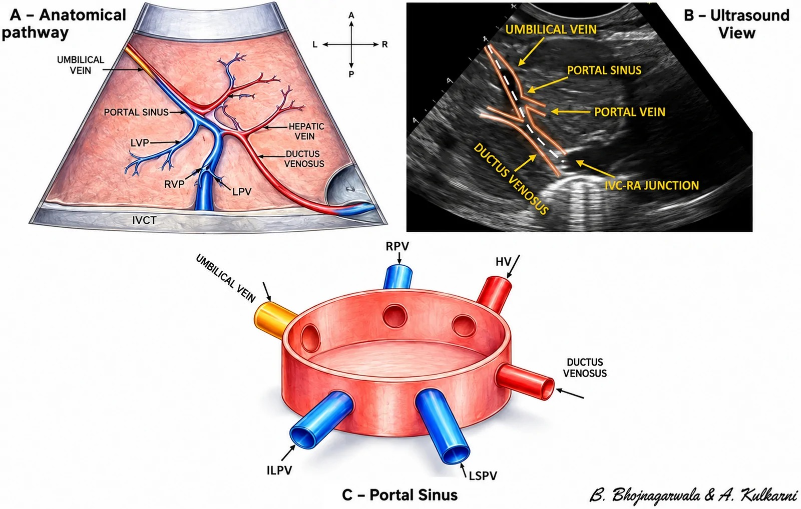
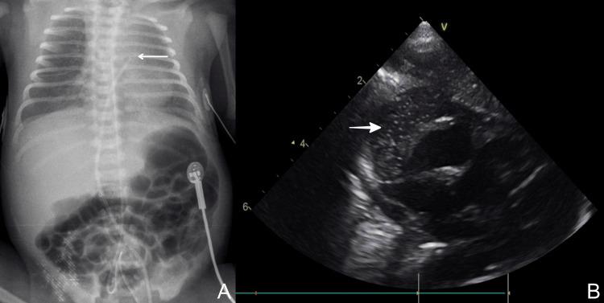
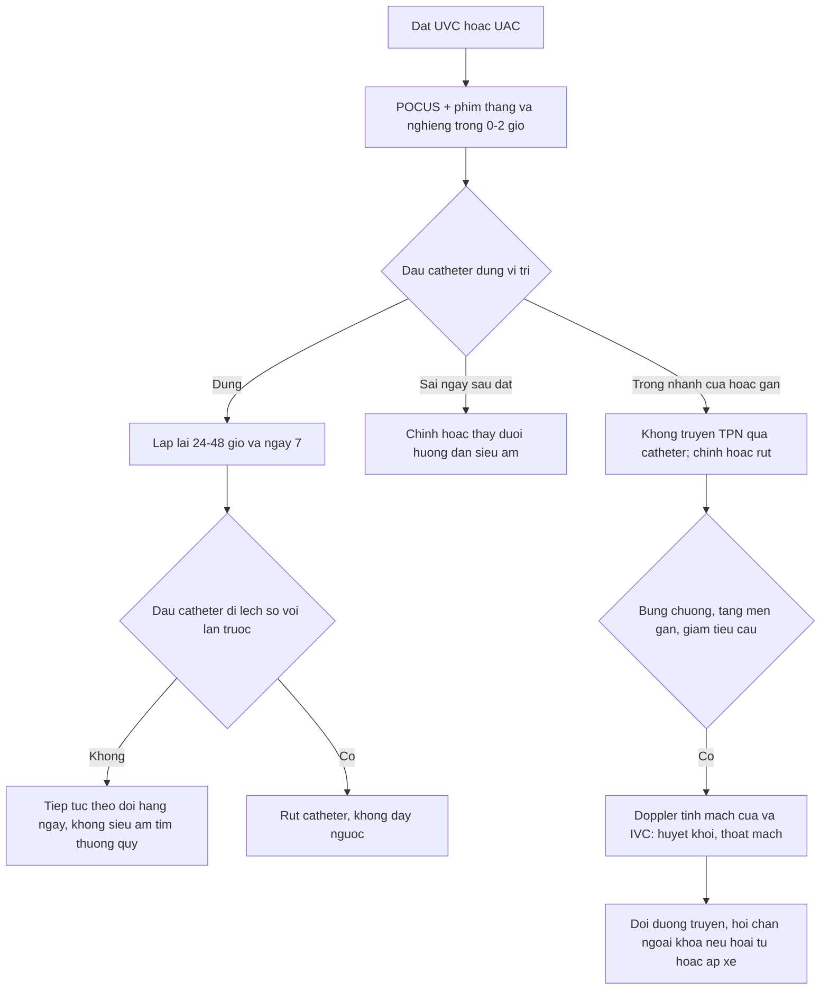
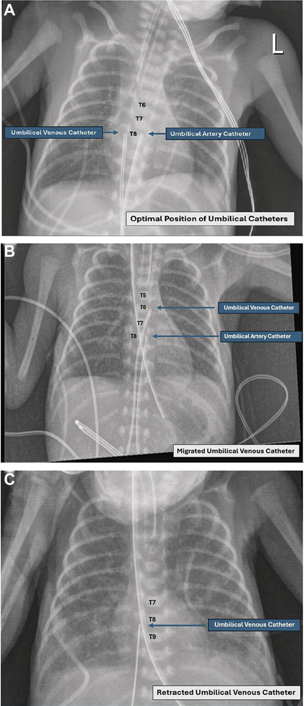
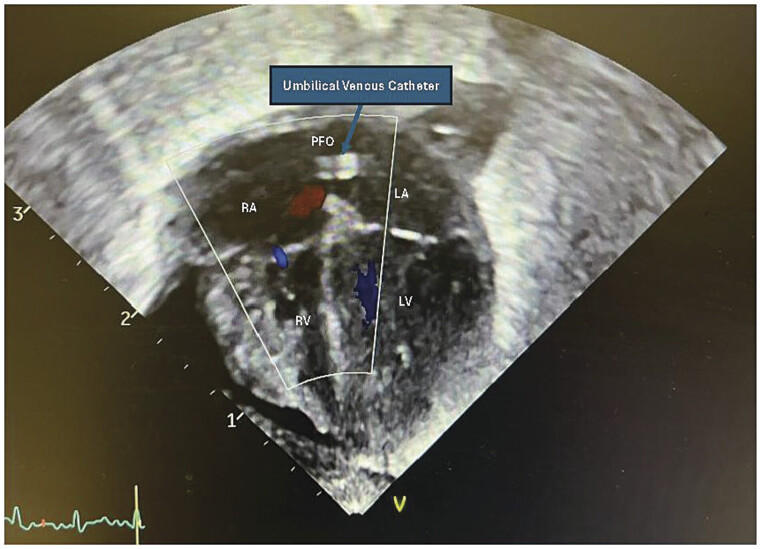
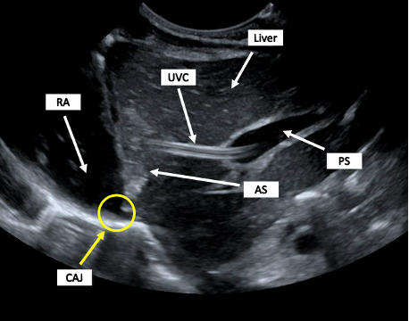

# 3045 — Catheter rốn ở sơ sinh (UVC/UAC): vị trí đúng trên phim, lạc vị trí và biến chứng sớm

**Tags:** `pattern:catheter-lac-vi-tri` `pattern:dich-mang-tim` `pattern:huyet-khoi-tinh-mach-cua` `vung:roi` `vung:gan` `vung:tim` `protocol:X-quang-nguc-bung` `protocol:POCUS` `incidentaloma:khong`
**Mức chắc chắn (certainty):** tổng hợp y văn (literature synthesis) — ghép **hướng dẫn Trung Quốc 2025 về biến chứng catheter tĩnh mạch rốn** (Pediatr Investig, PMC12921635), **ca UVC lạc vào gan được phát hiện bằng POCUS** (POCUS J 2026, PMC13161783), **ca UVC di lệch vào nhĩ trái qua lỗ bầu dục gây áp-xe cơ tim** (AJP Rep 2026, PMC12807581), **4 ca tràn dịch màng tim sau UVC** (Cureus 2025, PMC12821074) và **hai đoàn hệ lớn về vị trí catheter** (Children 2017, PMC5704133; J Vasc Access 2026, PMC13380652).

> **Câu hỏi thực hành:** sơ sinh **28 tuần**, đặt **UVC 8 cm** và **UAC 12 cm** ngày đầu. Phim thẳng: đầu UVC **ngang T7**, đầu UAC **ngang T8**. Ngày thứ 3 bé **bụng chướng, thiểu niệu, tăng men gan**, vẫn đang truyền **TPN qua UVC**. Câu hỏi: **đầu catheter có đúng chỗ không? Có cần chụp lại? Có được truyền TPN tiếp không? Khi nào rút, khi nào chỉnh?**
> Bài chốt **ba việc**: **(1) đọc đúng mốc giải phẫu trên phim** (UVC = góc IVC–nhĩ phải, **T8–T10** hoặc **0,5–1,0 cm trên cơ hoành** ở phim nghiêng; UAC cao = **T6–T9**); **(2) hiểu rằng "đúng lúc đặt" không bằng "đúng ngày thứ 3"** — **50–90% catheter di lệch trong 72 giờ đầu**; **(3) phân biệt lạc vị trí *còn dùng được* với lạc vị trí *phải rút ngay***. Nối [3044 – Catheter tĩnh mạch trung tâm ở trẻ](../3044-catheter-tinh-mach-trung-tam-o-tre/lesson.md), [6111 – Huyết khối tĩnh mạch thận sơ sinh](../6111-huyet-khoi-tinh-mach-than-so-sinh/lesson.md), [622 – Tắc ruột sơ sinh](../622-tac-ruot-so-sinh/lesson.md).

## 1. Tổng quan bệnh học – cơ chế hình ảnh: vì sao "đúng vị trí" mới là chuyện sinh tử

- **Đường đi giải phẫu của UVC ( umbilical venous catheter):** tĩnh mạch rốn → **xoang cửa (portal sinus)** → **ống tĩnh mạch (ductus venosus)** → **tĩnh mạch chủ dưới** → **góc IVC–nhĩ phải (cavoatrial junction, CAJ)**. Điểm chết người nằm ở chỗ **xoang cửa KHÔNG phải mạch lớn**: lưu lượng thấp, không pha loãng được **dịch ưu trương (TPN, glucose ưu trương, thuốc vận mạch)** → tổn thương nội mạc → **huyết khối tĩnh mạch cửa, thoát mạch, hoại tử gan**. Đây là lý do một đầu catheter "nằm trong gan" **không được dùng để truyền**, dù bệnh nhi chưa có triệu chứng.
- **TẠI SAO đầu catheter phải ở CAJ:** tại đó dòng máu lớn pha loãng dịch truyền ngay lập tức; cao hơn (**trong nhĩ phải** hoặc **qua lỗ bầu dục sang nhĩ trái**) thì đầu catheter **cọ thành nhĩ mỏng** của sơ sinh (thành nhĩ non tháng **thiếu cơ/epicardium**) → **tràn dịch màng tim, chèn ép tim, loạn nhịp, huyết khối trong tim, tắc mạch hệ thống**.
- **Đường đi của UAC (umbilical arterial catheter):** động mạch rốn → **động mạch chậu trong** → **động mạch chậu chung** → **động mạch chủ**. Vị trí **cao (high) T6–T9** đặt đầu catheter **dưới quai động mạch chủ và trên các nhánh tạng**; vị trí **thấp (low) L3–L5** đặt **dưới động mạch thận**, trên chỗ chia đôi; vị trí **cực thấp (ultralow)** ở **chỗ nối động mạch rốn – động mạch chậu trong** (Children 2017, PMC5704133; J Vasc Access 2026, PMC13380652).
- **Vì sao catheter di lệch:** dây rốn teo và khô, **bụng chướng**, thay tã, cử động, thay đổi áp lực trong lồng ngực — tất cả kéo/đẩy catheter. Hệ quả định lượng: **50–90% UVC di lệch trong 72 giờ đầu**; trong một dự án cải thiện chất lượng, **57%** catheter còn lưu vẫn lệch vào ngày 3–5, **trung bình ngày 4**; sau khi đưa POCUS vào quy trình, tỉ lệ này còn **30%** và **không còn ca thoát mạch** (Eur J Pediatr 2026, PMC13558298; BMJ Open Qual 2026, PMC12911755).
- **Thực tế "đặt đúng" thấp hơn ta tưởng:** kiểm tra 211 lần đặt ở đơn vị hồi sức sơ sinh: **đúng vị trí UVC 14% (trước can thiệp đào tạo) / 23% (sau)**, **UAC 40% / 43%** (Children 2017, PMC5704133). Nghiên cứu khác: phương pháp ước lượng bằng **mốc rốn–mũi ức** cho **lạc vị trí 60,1%** (Pediatr Investig 2025, PMC12921635).

*Ba phần của một sơ đồ: **(A)** đường đi giải phẫu **tĩnh mạch rốn → xoang cửa → ống tĩnh mạch → góc IVC–nhĩ phải**; **(B)** hình siêu âm tương ứng với các mốc đó (tĩnh mạch rốn, xoang cửa, tĩnh mạch cửa, ống tĩnh mạch, góc IVC–nhĩ phải); **(C)** mô hình xoang cửa với 5 nhánh đổ vào — chỉ cần đầu catheter trượt sang một nhánh là **lạc vào gan**. Nguồn: Eur J Pediatr 2026 (PMC13558298), CC BY 4.0, nguyên bản.*

## 2. Mẫu hình + chẩn đoán phân biệt theo vị trí (gamut)

- **Gamut theo vị trí đầu UVC:** **(a) đúng — CAJ**: đầu catheter ở **T8–T10** trên phim thẳng hoặc **0,5–1,0 cm trên cơ hoành** trên phim nghiêng; **(b) quá cao — trong nhĩ phải/nhĩ trái**: nguy cơ **chèn ép tim, loạn nhịp, huyết khối trong tim, áp-xe cơ tim**; **(c) quá thấp — trong xoang cửa/tĩnh mạch cửa**: nguy cơ **huyết khối tĩnh mạch cửa, hoại tử gan, thoát mạch dịch ổ bụng**; **(d) trong ống tĩnh mạch**: thường chấp nhận được nhưng **không ổn định**, dễ trượt; **(e) bất thường giải phẫu**: tĩnh mạch rốn đôi/động mạch rốn thừa, situs inversus — catheter đi "đúng" mà vẫn sai đích.
- **Gamut theo vị trí đầu UAC:** **(a) cao đúng — T6–T9**; **(b) quá cao — quai động mạch chủ/động mạch cảnh**: nguy cơ **thiếu máu não, co giật**; **(c) thấp — L3–L5**; **(d) cực thấp — động mạch chậu trong**: kỹ thuật mới, an toàn trong một đoàn hệ nhưng **khác hẳn "low position"** cổ điển; **(e) gập/kinking hoặc xoắn trong động mạch chậu**.
- **Gamut theo biến chứng (khi đã có triệu chứng):** **tràn dịch/chèn ép tim** (đau ngực không biểu hiện được → **tụt huyết áp, tím, nhịp nhanh, EF giảm**) · **thoát mạch dịch vào gan/ổ bụng** (bụng chướng, ascites, **dịch có glucose cao**) · **huyết khối tĩnh mạch cửa** (gan to, men gan tăng, giảm tiểu cầu) · **nhiễm khuẩn huyết liên quan catheter (CLABSI)** · **thiếu máu chi dưới do UAC** (mông/tay chân tím, **đau, liệt**) · **hoại tử ruột**.

*Một ca trong loạt 4 ca tràn dịch màng tim sau đặt UVC: **(A)** phim ngực–bụng thẳng, **đầu UVC quá cao** (mũi tên) so với vị trí mong muốn; **(B)** siêu âm tim thấy **khoảng dịch màng tim** (mũi tên). Trong loạt này 2/4 ca tiến triển **chèn ép tim**; một ca **phân suất tống máu 20% → 55%** ngay sau chọc dẫn lưu dưới hướng dẫn siêu âm. Nguồn: Cureus 2025 (PMC12821074), CC BY 4.0, nguyên bản.*

## 3. Bảng so sánh phân biệt (ma trận đối chiếu)

| Thực thể (entity) | Hình ảnh điển hình | Chốt vào (rule-in) | Chốt loại (rule-out) | Gợi ý xác nhận |
|---|---|---|---|---|
| **UVC đúng vị trí (CAJ)** | Đầu catheter **T8–T10** phim thẳng, **0,5–1,0 cm trên cơ hoành** phim nghiêng; siêu âm thấy đầu ở **góc IVC–nhĩ phải** | **Siêu âm thấy đầu catheter trong lòng IVC tại góc CAJ + bơm thử nước muối thấy luồng đi lên** | Đầu ở gan, trong nhĩ, hoặc **không thấy trên siêu âm** | POCUS 3 mặt cắt; phim thẳng + nghiêng trong **0–2 giờ** |
| **UVC quá cao (nhĩ phải/nhĩ trái)** | Đầu catheter **trên cơ hoành nhiều**, có thể **bắt chéo lỗ bầu dục**; bóng tim to, tràn dịch | **Đầu trong nhĩ + tràn dịch màng tim + tụt huyết áp** | Đầu dưới cơ hoành, không có dịch màng tim | **Siêu âm tim** (4 buồng + dưới sườn); rút/chỉnh ngay |
| **UVC lạc vào gan/xoang cửa** | Trên phim thẳng đầu catheter **vẫn ngang cột sống** (giả "đúng"); siêu âm thấy catheter **đi vào nhánh cửa rồi vào nhu mô gan** | **Bơm thử nước muối: luồng đi vào nhu mô, không về IVC** | Đầu catheter trong IVC, luồng đi lên | **POCUS + bơm thử**; không truyền TPN qua vị trí này |
| **Huyết khối tĩnh mạch cửa (PVT) sau UVC** | Tĩnh mạch cửa **giãn, có vật đặc trong lòng**, Doppler **mất/tối dòng**, gan to | **Thấy huyết khối trong tĩnh mạch cửa + giảm dòng** | Tĩnh mạch cửa trống, dòng bình thường | Siêu âm Doppler; tỉ lệ **19% (200/1052)** sau UVC |
| **UAC cao đúng (T6–T9)** | Đầu catheter **ngang T6–T9**, thẳng trục động mạch chủ | **Đầu trong động mạch chủ ngực, dưới quai** | Đầu trong quai/động mạch cảnh hoặc dưới động mạch thận | Phim thẳng + siêu âm; **kiểm tra mỗi ngày** |
| **UAC lạc/thiếu máu chi** | Đầu catheter **trong động mạch chậu trong**, hoặc gập; **mông/tay chân tím, lạnh** | **Da tím loang + mất mạch mu chân + đầu catheter sai vị trí** | Da hồng, mạch rõ, đầu catheter đúng | Doppler mạch chậu–đùi; **rút catheter** + heparin theo cân nặng |

## 4. Protocol chụp + ngưỡng xử trí

- **Xác nhận vị trí trước khi truyền bất cứ dịch gì** (Pediatr Investig 2025, khuyến cáo 1B): **phim ngực–bụng thẳng + nghiêng trong 0–2 giờ** sau đặt; **POCUS** thay thế được nếu đơn vị có người được huấn luyện. Lặp lại **24–48 giờ** và **ngày 7**.
- **Vì sao phải có phim nghiêng:** bờ **trước** cơ hoành cao hơn bờ **sau**, nên một đầu catheter "ngay trên cơ hoành" trên phim thẳng có thể **đã ở trong nhĩ phải**; và ngược lại một catheter trong **xoang cửa** vẫn **chiếu lên cột sống** trông như đúng.
- **POCUS — 3 mặt cắt, 2 đầu dò:** **(1)** mặt cắt ngang bụng ("situs") xác định tĩnh mạch rốn; **(2)** mặt cắt dưới sườn thấy **IVC và góc CAJ**; **(3)** mặt cắt vành/xiên theo dõi đường đi trong gan; dùng **đầu dò curvilinear** cho đường đi trong gan, **linear tần số cao** cho đầu catheter tại CAJ. **Bơm thử 1–2 mL nước muối** để xác nhận catheter **trong lòng mạch** (thấy luồng) hay **trong nhu mô** (không luồng, có thể thấy dịch lan trong gan).
- **Độ chính xác (ngưỡng định lượng):** so với phim, POCUS xác định góc CAJ **Se 93,3% / Sp 95,6%** còn X-quang **66,7% / 63,0%** (p < 0,001, n = 60); gộp 9 đoàn hệ (n = 782), **X-quang Se 0,70 / Sp 0,80**; **hướng dẫn siêu âm thời gian thực giảm lạc vị trí 75,9% → 9,6% (OR 29,5)** (Eur J Pediatr 2026, PMC13558298; Pediatr Investig 2025, PMC12921635).
- **Ước lượng độ sâu — đừng tin một công thức:** RCT 158 sơ sinh so **Gupta (khoảng cách rốn–núm vú − 1 cm)** với **Shukla cải tiến ((3 × cân nặng kg + 9)/2)**: đúng vị trí **62,5% vs 45,7%** (p = 0,02); ở trẻ **nhỏ so tuổi thai (SGA) 70,0% vs 42,9%** (p = 0,04); **đầu catheter quá thấp 14,8% vs 32,9%** (p = 0,02) (Cureus 2025, PMC12441985).
- **Xử trí theo vị trí — quy tắc "đặt sai thì chỉnh, di lệch muộn thì rút":**
  - **Lạc vị trí ngay sau đặt** → **chỉnh/thay ngay** dưới hướng dẫn siêu âm.
  - **Di lệch phát hiện ngày sau** → **rút catheter**, không đẩy ngược vào lòng mạch (nguy cơ nhiễm và rách nội mạc).
  - **Đầu trong xoang cửa/tĩnh mạch cửa** → **không truyền TPN/dịch ưu trương/vận mạch**, chỉnh hoặc rút.
  - **Đầu trong nhĩ phải/nhĩ trái hoặc có tràn dịch màng tim** → **rút ngay + siêu âm tim + chọc dẫn lưu nếu chèn ép**.

- **Biến chứng và con số phải nhớ:** huyết khối liên quan catheter trung tâm ở sơ sinh **9,2% (308/3332)**; ở UVC, vị trí hay gặp là **tĩnh mạch cửa 42,6%**, **IVC 22,8%**, **nhĩ phải 11,9%**, và **70–77% không tắc hoàn toàn**. **Huyết khối tĩnh mạch cửa sau UVC: 19% (200/1052, dao động 0–49%)**; **truyền máu qua catheter là yếu tố nguy cơ (p = 0,0024)**; **vị trí đầu catheter KHÔNG liên quan có ý nghĩa (p = 0,4636)** — một kết quả ngược trực giác, nghĩa là **không thể chỉ dựa vào "đầu đúng" để yên tâm** (J Pediatr 2026, PMC13285700).
- **Không tầm soát huyết khối thường quy:** nghiên cứu tiến cứu 40 sơ sinh sau UVC thấy **75% (30/40)** có huyết khối nhưng **tất cả không triệu chứng và tự tan** — vì vậy hướng dẫn **không khuyến cáo siêu âm tầm soát thường quy** (khuyến cáo 1D) (Pediatr Investig 2025).
- **UAC — thời gian lưu:** lưu **> 5 ngày** liên quan **viêm ruột hoại tử giai đoạn III (NEC-III)**: **AOR 3,8 (1,05–13,66)** so với không NEC và **5,57 (1,65–18,73)** so với NEC-II (JPGN Reports 2024, PMC11322019). Huyết khối do UAC **12,3–44%** tùy phương pháp chẩn đoán; kỹ thuật **cực thấp** ở 229 sơ sinh cho **0 huyết khối**, biến chứng khác **4,3%** (J Vasc Access 2026, PMC13380652).

## 5. Biến thể bình thường và cạm bẫy

- **"T8 trên phim thẳng" không đồng nghĩa "trong IVC":** catheter trong **xoang cửa** vẫn chiếu lên cột sống ngang T8–T9 — **luôn cần phim nghiêng hoặc siêu âm** trước khi truyền TPN.
- **Không đẩy catheter đã di lệch trở lại:** hướng dẫn 2025 nói rõ **lạc vị trí ngay sau đặt thì chỉnh**, còn **di lệch phát hiện ngày sau thì RÚT** — đẩy ngược làm tăng nguy cơ nhiễm và tổn thương nội mạc.
- **Khí trong tĩnh mạch cửa sau rút UVC là bình thường:** vài đốm khí nhỏ, tự hết trong 1–2 ngày, **không phải** khí trong hệ cửa do hoại tử ruột — đừng mổ vì "khí cửa" đơn thuần; đối chiếu bụng mềm, lactate, X-quang.
- **"Fibroelastic sleeve" không phải huyết khối:** vỏ xơ mỏng bao quanh catheter là phản ứng sinh lý, **không tắc dòng**; chỉ gọi huyết khối khi thấy **vật đặc trong lòng + mất dòng** — tránh điều trị kháng đông oan.
- **Không phải cứ "dịch ra từ ống" là dịch tiêu hóa:** một ca 27 tuần đã có **thủng ruột tự phát + dẫn lưu**, rồi **UVC di lệch vào gan gây thoát mạch**: dẫn lưu ra **dịch trong, lượng tăng bất thường (30 mL/24 giờ)** dù đã tăng dịch truyền; **rút UVC → dịch giảm rõ trong 12 giờ**. Bài học: **dẫn lưu ổ bụng "nhiều bất thường" ở trẻ có UVC phải nghĩ catheter**, không chỉ nghĩ rò tiêu hóa (World J Clin Pediatr 2026, PMC13010535).
- **Vị trí "thấp" của UVC không phải lựa chọn trung tính:** xoang cửa không phải mạch lớn, nên "thấp cho an toàn" thực ra **nguy hiểm hơn** cho TPN ưu trương.
- **UAC "thấp" (L3–L5) khác "cực thấp" (ngã ba rốn–chậu trong):** đừng dùng số liệu an toàn của kỹ thuật cực thấp để bảo vệ vị trí thấp cổ điển — hai thứ khác nhau (J Vasc Access 2026).
- **Bỏ sót sau khi đã thấy một bất thường:** đã thấy đầu UVC lạc là dừng — nhưng **UAC cùng lúc cũng có thể lạc**; luôn đọc **cả hai catheter** và **cả hai phim (thẳng + nghiêng)**.

## 6. Tự lượng giá — Blind Quiz

**Ca 1 — Sơ sinh non tháng, phim ngực–bụng ngày 1 và ngày 3.**

- Gợi ý lâm sàng: đặt UVC 8 cm và UAC 12 cm; ngày 3 bụng chướng nhẹ, vẫn truyền TPN.
- Câu hỏi: Đọc **mốc đốt sống** của hai đầu catheter trong **(A)**. Ở **(B)** có gì thay đổi? Vì sao **(C)** lại là "kéo lại" chứ không phải "đẩy vào"?

<b>Bấm để hiện đáp án (findings + chẩn đoán)</b>

- Dấu hiệu (findings): **(A)** UVC **T8**, UAC **T8** — cả hai trong khoảng mong muốn (UVC **T8–T10**, UAC cao **T6–T9**); **(B)** UVC **di lệch lên T6** (vào vùng nhĩ phải) trong khi UAC vẫn **T8**; **(C)** sau khi kéo, UVC trở lại **T8**, UAC đã rút ngày 5.
- Chẩn đoán (diagnosis): **di lệch đầu UVC sau đặt (tip migration)** — biến chứng thường gặp nhất, xảy ra ở **50–90%** trong 72 giờ đầu.
- Vì sao "kéo" không "đẩy": đầu catheter đã ở trong nhĩ; **đẩy vào** làm tăng nguy cơ **thủng nhĩ/tràn dịch màng tim** và nhiễm. Quy tắc: **lạc ngay sau đặt → chỉnh; di lệch muộn → rút**.
- Nguồn ảnh: AJP Rep 2026 (PMC12807581), CC BY 4.0, nguyên bản (giữ nhãn A/B/C và mốc T5–T8 của tác giả).

**Ca 2 — Cùng bệnh nhi ngày 5: tím tái, nhịp nhanh, tụt huyết áp.**

- Gợi ý lâm sàng: đang thở máy, vừa tăng dịch truyền qua UVC; cấy máu dương tính Streptococcus nhóm B.
- Câu hỏi: Catheter đang ở đâu? Vì sao bệnh nhi đột ngột xấu? Hai biến chứng phải loại trừ ngay trên siêu âm tim?

<b>Bấm để hiện đáp án</b>

- Dấu hiệu (findings): catheter **từ nhĩ phải bắt chéo qua lỗ bầu dục (PFO) vào nhĩ trái** (nhãn UVC, RA, LA, RV, LV).
- Chẩn đoán (diagnosis): **UVC lạc trong tim, sang nhĩ trái** — nguy cơ **tắc mạch hệ thống, huyết khối/nhiễm trong tim, áp-xe cơ tim**; ca gốc có **áp-xe cơ tim do Streptococcus nhóm B**.
- Hai biến chứng loại trừ ngay: **tràn dịch/chèn ép tim** và **huyết khối trong buồng tim** — cả hai đều thấy trên cùng mặt cắt 4 buồng + dưới sườn.
- Nguồn ảnh: AJP Rep 2026 (PMC12807581), CC BY 4.0, nguyên bản.

**Ca 3 — UVC "trông đúng" trên phim thẳng nhưng bụng chướng, men gan tăng.**

- Gợi ý lâm sàng: phim thẳng đọc "đầu catheter ngang T9"; ngày 3 bụng chướng, ALT/AST tăng, tiểu ít.
- Câu hỏi: Đầu catheter thực sự ở đâu? Dấu hiệu nào trên siêu âm chứng minh? Nếu bơm 2 mL nước muối qua catheter thì thấy gì (và không thấy gì)?

<b>Bấm để hiện đáp án</b>

- Dấu hiệu (findings): catheter đi qua **tĩnh mạch rốn (UVC)** vào **xoang cửa (PS)** rồi **vào nhu mô gan**, trong khi **góc IVC–nhĩ phải (CAJ)** — vòng tròn vàng — **không có catheter**; nhĩ phải (RA) trống.
- Chẩn đoán (diagnosis): **UVC lạc vào gan/xoang cửa** — đây là vị trí **không được truyền TPN ưu trương**; nguy cơ **huyết khối cửa, hoại tử gan, thoát mạch dịch**.
- Bơm thử: thấy **luồng/dịch lan trong nhu mô gan**, **không thấy luồng đi lên IVC** → xác nhận ngoài lòng mạch lớn.
- Xử trí: **ngừng truyền qua catheter, chỉnh dưới siêu âm hoặc rút**, chuyển sang đường truyền khác.
- Nguồn ảnh: POCUS J 2026 (PMC13161783), CC BY 4.0, nguyên bản.

## Bài liên quan chéo
- [3044 – Catheter tĩnh mạch trung tâm ở trẻ: chọn đường vào, xác nhận đầu catheter, biến chứng sớm](../3044-catheter-tinh-mach-trung-tam-o-tre/lesson.md)
- [3043 – Hẹp–tắc tĩnh mạch chủ trên lành tính sau catheter ở trẻ](../3043-hep-tinh-mach-chu-tren-tre/lesson.md)
- [6111 – Huyết khối tĩnh mạch thận ở trẻ sơ sinh](../6111-huyet-khoi-tinh-mach-than-so-sinh/lesson.md)
- [622 – Tắc ruột sơ sinh](../622-tac-ruot-so-sinh/lesson.md)
- [691 – Siêu âm và soi quanh catheter ở trẻ](../691-soi-bang-quang-va-soi-quanh-catheter-o-tre/lesson.md)
- [600 – Tổng quan Nhi khoa](../600-tong-quan-nhi-khoa/lesson.md)

## Ảnh
- 5 ảnh, tất cả **tải về nguyên bản** (không crop, không ghép), ghi nguồn + giấy phép từng ảnh trong `images/CREDITS.md`.
- **Không tạo composite:** ảnh A của PMC12807581 đã là **3 panel của cùng một bệnh nhi** (đúng → di lệch → kéo lại); ghép thêm sẽ trùng lặp và làm mất nhãn mốc đốt sống của tác giả. Sơ đồ đường đi (PMC13558298) là hình vẽ giải phẫu, **không ghép với ảnh bệnh nhân**.

> Không dùng để chẩn đoán độc lập khi chưa có người hướng dẫn.
