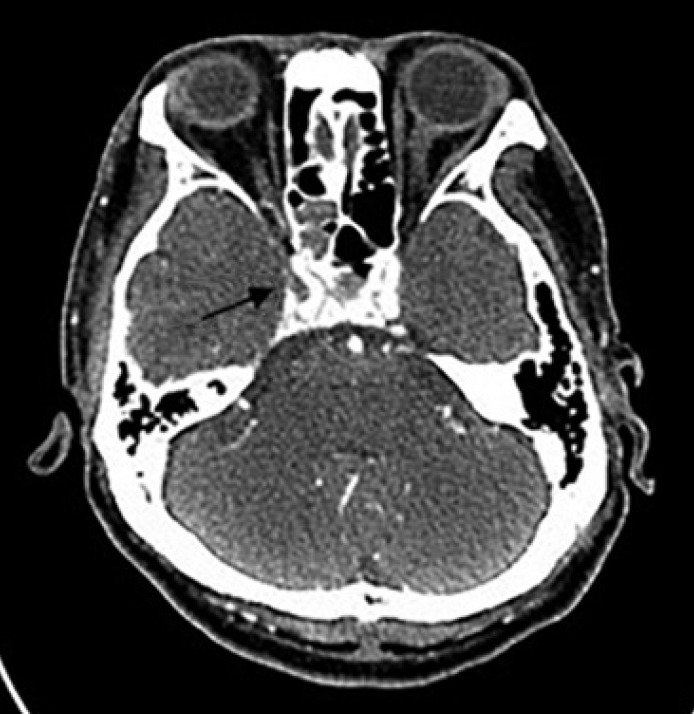
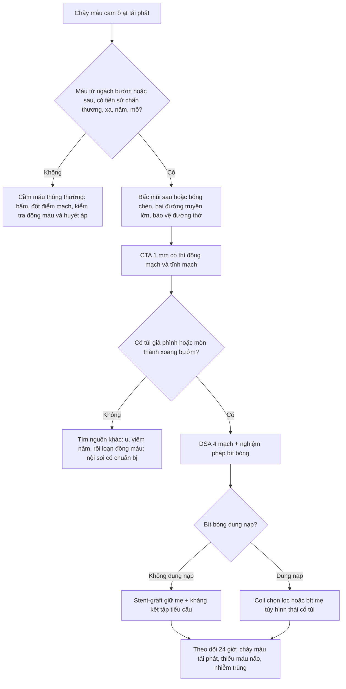
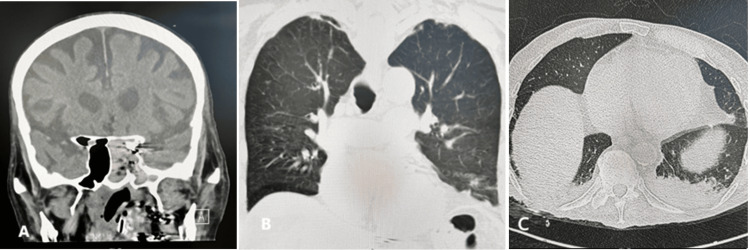
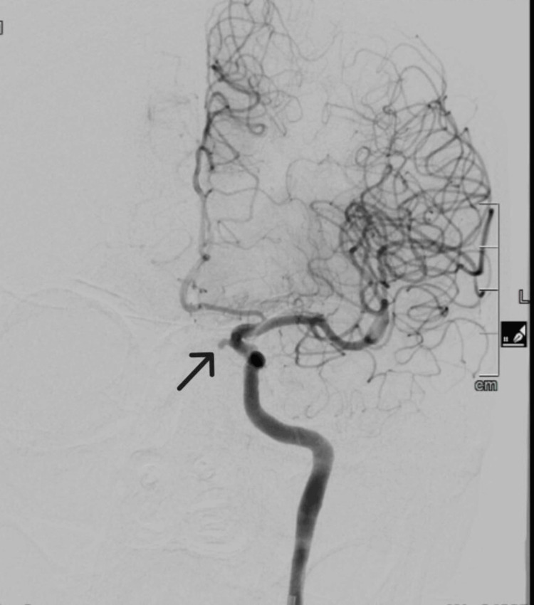
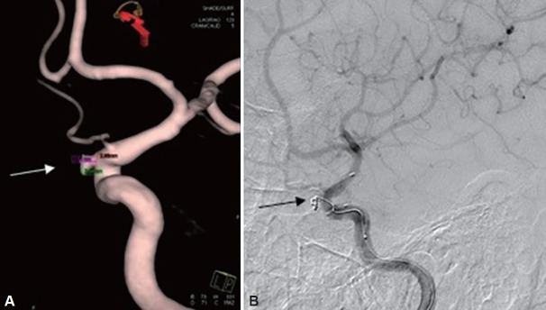

# 3046 — Chảy máu cam ồ ạt do vỡ giả phình động mạch cảnh trong vào xoang bướm

**Tags:** `pattern:chay-mau-cam` `pattern:gia-phinh` `pattern:carotid-blowout` `pattern:khong-dong-bang` `vung:xang-buom` `vung:dau-co` `protocol:CTA` `protocol:DSA`
**Mức chắc chắn (certainty):** tổng hợp y văn (literature synthesis) — ghép **ca giả phình ĐM cảnh trong đoạn trên hang vỡ vào xoang bướm kèm tổng quan y văn** (Cureus 2025, PMC12382422), **ca giả phình xoang bướm sau chấn thương được stent + coil** (J Rhinol 2024, PMC11566536), **ca giả phình đoạn hang sau chấn thương hàm mặt, mất máu 800–1.000 mL/đợt** (JNMA 2022, PMC9199992), **ca giả phình đoạn xương đá sau xạ ung thư vòm, đặt stent-graft** (Radiol Case Rep 2022, PMC9024372), **ca tử vong sau khi lấy cục máu đông trong họng** (World J Clin Cases 2022, PMC9477061), **đoàn hệ 46 ca hội chứng vỡ mạch cảnh sau xạ** (Cancer Manag Res 2025, PMC11974565), **đoàn hệ 44 ca hội chứng vỡ mạch cảnh** (Acta Otorhinolaryngol Ital 2025, PMC12673942), **đoàn hệ 1.084 bệnh nhân ung thư đầu cổ sau xạ** (Diagnostics 2024, PMC11202696) và **nghiên cứu giải phẫu xoang bướm trên 230 CT** (Head Face Med 2022, PMC9440488). Không có ca do nhóm tự chụp.

> **Câu hỏi thực hành:** nam **55 tuổi**, **chảy máu cam ồ ạt tái phát 3 lần trong 2 tuần**, mỗi lần **~500 mL**, lần này **tụt HA**, nội soi thấy **máu từ ngách bướm**, trước đó **1 năm có mổ hàm mặt sau tai nạn**. Câu hỏi: **nhồi bấc mũi sau rồi theo dõi được không, chụp gì và chụp lúc nào, và vì sao đây không phải "chảy máu cam nặng thông thường"?**
> Bài chốt **ba quyết định**: **(1) chảy máu từ đâu (ngách bướm = động mạch cảnh cho tới khi chứng minh ngược lại)? (2) cầm máu tạm bằng gì và KHÔNG được làm gì? (3) can thiệp nội mạch: bít mẹ hay giữ mẹ bằng stent-graft, và dựa vào gì để chọn?** Nối [249 – Rò động mạch cảnh–xoang hang chấn thương](../249-ro-dong-mach-canh-xoang-hang-chan-thuong/lesson.md), [248 – Can thiệp nội mạch giả phình/bóc tách động mạch cổ](../248-can-thiep-noi-mach-gia-phinh-boc-tach-dong-mach-co-dot-song/lesson.md), [3023 – Ù tai mạch đập](../3023-u-tai-mach-dap/lesson.md).

## 1. Tổng quan bệnh học – cơ chế hình ảnh: vì sao "chảy máu cam" có thể là vỡ động mạch cảnh

- **Giải phẫu quyết định tất cả:** động mạch cảnh trong (internal carotid artery, ICA) đoạn hang nằm **ngay thành bên của xoang bướm**, chỉ cách lòng xoang bằng **một lá xương mỏng — hoặc không có xương**. Trên **230 CT xoang bướm**, **lồi (protrusion) ICA gặp 26,3%**, **dehiscence (mất xương che) 0,4%**; **vách liên xoang bám vào thành ICA ở 21,6%** ca (Head Face Med 2022, PMC9440488). Nghĩa là: **1/4 người có mạch cảnh lồi vào xoang**, và khi có **chấn thương, xạ trị, nhiễm nấm xâm lấn hay phẫu thuật** thì chỗ mỏng nhất vỡ trước.
- **TẠI SAO chảy máu ồ ạt và không tự cầm:** giả phình (pseudoaneurysm) **không có thành mạch thật** — chỉ là **túi tổ chức xơ/viêm** bịt lỗ thủng. Khi vỡ, máu phun vào xoang bướm **ở áp lực động mạch (hàng trăm mmHg tâm thu)**; xoang bướm **là khoang kín đổ vào ngách bướm** nên máu **chảy ồ ạt qua mũi** chứ không tạo khối máu tụ tự cầm. Mỗi "cục máu đông bít tạm" chỉ là **nút sinh lý** — nó bong ra khi **xì mũi, ho, nội soi, hút dịch**.
- **Ngưỡng định lượng phải thuộc:**
  - **Tử vong khi không điều trị: > 50%** (tổng quan trong ca Cureus 2025); chảy máu cam ồ ạt được báo cáo ở **~9%** ca giả phình/giãn ĐM cảnh trong báo cáo y văn.
  - **Hội chứng vỡ mạch cảnh (carotid blowout syndrome, CBS) sau xạ đầu cổ:** trong đoàn hệ **1.084 bệnh nhân**, tỷ lệ **0,8%** (xạ vòm **0,9%**, không vòm **0,7%**); **tỷ lệ tích lũy gộp 5% (95% CI 3–7%)** (Diagnostics 2024, PMC11202696).
  - **44 ca CBS được can thiệp nội mạch:** **cầm máu 95%**, **biến chứng thiếu máu não 11%**, **tái chảy máu 16%**, **sống 6 tháng 28%**; thể hiện lúc đến: **chảy máu đe doạ 62%**, **"máu báo" (sentinel) 11%**, **vỡ cấp 27%** (Acta Otorhinolaryngol Ital 2025, PMC12673942).
  - **46 ca CBS sau xạ ung thư vòm** (29 coil, 17 stent-graft): **cầm máu ngay 100%**, **tái chảy 1 năm 8,6%**, **biến chứng 8,6%** (chủ yếu nhồi máu não), **sống 1 năm 89,1%**; **coil ít tái chảy hơn, stent-graft giữ được lòng mạch tốt hơn** (Cancer Manag Res 2025, PMC11974565).
- **TẠI SAO "vài tuần trước có chảy máu nhẹ" lại quan trọng:** máu báo (sentinel bleed) là **dấu hiệu cảnh báo của túi giả phình đang rò rỉ**, xuất hiện **trước khi vỡ hoàn toàn** — bỏ qua giai đoạn này là bỏ mất cơ hội can thiệp chủ động (11% ca trong loạt trên đến ở giai đoạn này, và tiên lượng tốt hơn nhiều so với vỡ cấp).
- **TẠI SAO cơ chế "nhiễm" cũng phải nhớ:** viêm xoang do nấm xâm lấn (**Aspergillus, Mucor**) ăn mòn thành mạch từ ngoài vào. Trong y văn, **Mucor gây tắc ICA tới 84%**, còn **Aspergillus 46%** nhưng **thiên về tạo phình thật/giả phình và xuất huyết dưới nhện** (Cureus 2025, PMC12382422). Vì vậy ở người suy giảm miễn dịch, **mờ xoang bướm + mòn xương + chảy máu** là **tam chứng của viêm nấm xâm lấn**, không phải "viêm xoang thường".

## 2. Mẫu hình + chẩn đoán phân biệt theo vị trí chảy máu (gamut)

- **Gamut theo vị trí giải phẫu (nội soi + CTA):**

| Vị trí nguồn | Bệnh cảnh gợi ý | Đặc điểm hình ảnh |
|---|---|---|
| **Thành bên xoang bướm (đoạn hang ICA)** | Chấn thương hàm mặt, xạ vòm, viêm nấm, phẫu thuật tuyến yên qua xoang bướm | Túi giả phình **lồi vào lòng xoang**, mòn/thủng thành xoang bướm, có thể kèm **rò cảnh–hang** |
| **Đoạn xương đá/zang (petrous, C2)** | Xạ trị vòm họng, nhiễm trùng nền sọ | Túi ở **ngang ống cảnh**, khó thấy nội soi; biểu hiện **máu chảy qua ngách bướm/vòm** |
| **Đoạn trên hang (supraclinoid)** | Viêm nấm xâm lấn, sau mổ nội soi | Vừa chảy mũi **vừa nguy cơ xuất huyết dưới nhện** (nằm trong khoang dưới nhện) |
| **Động mạch bướm khẩu cái / động mạch sàng** | Chảy máu cam thường, tăng huyết áp | Nguồn **nhỏ, không có túi**, cầm bằng bấc/nội soi đốt |
| **U mạch vách ngăn, u cuộn cảnh, u nhú đảo ngược** | Chảy máu tái phát + khối | Khối **ngấm mạnh**, không có túi mạch; **không sinh thiết mù** |

- **Gamut theo cơ chế (dùng để hỏi bệnh):**
  - **Chấn thương:** tai nạn giao thông, gãy xương hàm mặt/nền sọ, **đặt catheter, mổ nội soi xoang** (thường **1 tuần–1 năm** sau).
  - **Sau xạ trị:** ung thư vòm họng, ung thư đầu cổ — **trung vị nhiều tháng tới nhiều năm**; ca báo cáo: **31 tháng** sau hóa–xạ (Current Med Imaging 2025, PMC13223408).
  - **Nhiễm trùng:** viêm xoang nấm xâm lấn ở **người suy giảm miễn dịch** (bạch cầu cấp, ghép tạng, corticoid dài ngày), viêm mô tế bào hàm mặt.
  - **Tự phát:** phình/giả phình đoạn hang, **rò động mạch cảnh–xoang hang (CCF)** — thường kèm **ù tai mạch đập, đỏ mắt, liệt dây VI** ([3023](../3023-u-tai-mach-dap/lesson.md), [249](../249-ro-dong-mach-canh-xoang-hang-chan-thuong/lesson.md)).
- **Ba thể lúc đến (theo loạt 44 ca):** **chảy máu đe doạ (62%)** — máu rỉ qua vết thương/niêm mạc, chưa ồ ạt · **máu báo (11%)** — vài đợt nhỏ trước đó · **vỡ cấp (27%)** — ồ ạt, sốc, đường thở nguy hiểm. Thể càng muộn, tiên lượng càng xấu.

## 3. Bảng so sánh phân biệt (ma trận đối chiếu)

| Thực thể (entity) | Hình ảnh điển hình | Chốt vào (rule-in) | Chốt loại (rule-out) | Gợi ý xác nhận |
|---|---|---|---|---|
| **Giả phình ICA vỡ vào xoang bướm** | CT: xoang bướm **mờ + mòn xương** thành bên/thân xương bướm; **CTA: túi cản quang lồi khỏi lòng mạch**, cổ túi rõ | **Túi lồi từ ICA + mòn xương xoang bướm + chảy máu từ ngách bướm** | Không có túi, thành mạch đều → không phải giả phình | **CTA 1 mm** rồi **DSA** xác nhận + điều trị; **BTO** nếu tính bít mẹ |
| **Rò động mạch cảnh–xoang hang (CCF)** | Xoang hang giãn, **giãn tĩnh mạch mắt trên**, lồi mắt, giãn các xoang tĩnh mạch cùng bên; thì động mạch **và** thì tĩnh mạch đều đầy sớm | **Đầy sớm xoang hang ở thì động mạch** + lồi mắt/ù tai mạch đập | Xoang hang đầy thì tĩnh mạch bình thường → loại | DSA 4 mạch; phân loại Barrow A–D; can thiệp nội mạch |
| **Máu tụ tổ chức hoá trong xoang bướm (organized hematoma)** | Khối mô mềm **trong xoang bướm**, CT **tăng tỷ trọng không đều**, không có túi mạch; MRI có **vòng hemosiderin** | **Khối trong xoang, không có túi mạch trên CTA** | Có túi lồi từ ICA → loại | MRI + CTA; nội soi lấy bệnh phẩm **sau khi loại mạch** |
| **Viêm xoang nấm xâm lấn** | Mờ xoang + **mòn xương lan rộng**, mất vách; mô mềm lan ra ngoài xoang; **không có túi mạch** | **Mờ + mòn xương tiến triển nhanh ở người suy giảm miễn dịch** | Xương nguyên vẹn, không lan → loại | Nội soi sinh thiết + nấm học; **CTA để loại giả phình trước khi đụng vào** |
| **U mạch vách ngăn/u cuộn cảnh** | Khối ngấm mạnh, có cuống mạch nuôi; **không có túi** | **Khối ngấm + mạch nuôi**, không có cổ túi | Có cổ túi từ ICA → loại | MRI + MRA; **không sinh thiết khối đập** |
| **Chảy máu cam thông thường (điểm mạch Little)** | Niêm mạc vách trước, không tổn thương mạch lớn | Nguồn **vách trước**, bấm/nội soi đốt cầm | Máu **từ ngách bướm/sau**, tái phát, mất máu lớn → loại | Nội soi; nếu sau/về phía bướm → **CTA** |

*CTA (J Rhinol 2024, PMC11566536): **giả phình phát sinh từ đoạn hang của động mạch cảnh trong, sát vị trí vỡ vào xoang bướm** ở bệnh nhân 55 tuổi có chấn thương vùng mũi–mặt; được xử trí bằng **stent + coil**. Đây là hình mẫu "túi lồi có cổ" — khác hoàn toàn với mờ xoang đơn thuần. Nguồn: CC BY-NC 4.0, nguyên bản.*

## 4. Protocol chụp + ngưỡng xử trí

- **Bước 0 — cầm máu tạm và bảo vệ đường thở (song song với gọi điện quang):**
  1. **Bấm/nhồi bấc mũi trước**, nếu thất bại → **bấc mũi sau** hoặc **bóng chèn (Foley/balloon)** vào ngách bướm; đặt **hai đường truyền lớn**, truyền máu theo **phác đồ truyền máu khối lượng lớn**.
  2. **Đặt nội khí quản sớm** nếu chảy máu ồ ạt — đường thở là nguyên nhân tử vong nhanh nhất.
  3. **KHÔNG** làm: **sinh thiết khối trong xoang**, **hút/bóc cục máu đông ở họng hay ngách bướm**, **nội soi can thiệp vào xoang bướm khi chưa có kiểm soát mạch** — đã có ca tử vong do **hút cục máu đông khi soi thanh quản sau khi đã coil "thành công"**, bệnh nhân mất máu không hồi phục (World J Clin Cases 2022, PMC9477061).
- **Bước 1 — CTA (đầu tiên, chạy được 24/7):** lát **≤ 1 mm**, thì động mạch **và** thì tĩnh mạch muộn, cửa sổ xương; đọc **thành xoang bướm, ống cảnh, xoang hang, tĩnh mạch mắt trên**. CTA đủ để **phát hiện túi giả phình và mòn xương**, đồng thời loại nguyên nhân khác.
- **Bước 2 — DSA (chuẩn vàng, vừa chẩn đoán vừa điều trị):** chụp **4 mạch** + **nghiệm pháp bít bóng (balloon test occlusion, BTO)** khi cân nhắc **bít mẹ**. BTO **cải thiện/hợp tác tốt** là dữ liệu chọn lựa: trong loạt 12 ca diverticulum bóng cảnh, **BTO cải thiện ≥ trung bình ở 7/8 (87,5%)** — dùng như **yếu tố dự đoán**, không phải bảo đảm (Front Neurol 2026, PMC13686904).
- **Ba lựa chọn can thiệp và ngưỡng chọn:**

| Chiến lược | Khi chọn | Ưu điểm | Giá phải trả |
|---|---|---|---|
| **Stent-graft (giữ mẹ)** | **Có BTO không dung nạp**, cần giữ tưới máu; tổn thương **đoạn xương đá/đoạn hang**, cổ túi rộng | Giữ lòng mạch, **không nhồi máu**; ca báo cáo **cầm máu ngay, không biến chứng** (PMC9024372) | Cần **kháng kết tập tiểu cầu**; nguy cơ **hẹp trong stent, hở nội mạc, nhiễm stent-graft**; **không dùng khi có nhiễm trùng hoạt động** |
| **Coil ± stent (bít túi)** | Cổ túi hẹp/vừa, **dòng chảy đủ qua mẹ**, có nhiễm trùng tại chỗ | Bít túi **chọn lọc**, giữ mẹ; ca báo cáo thành công (PMC9199992, PMC11566536) | **Coil lộ ra niêm mạc** → chảy máu tái phát; **tái chảy 16%** trong loạt 44 ca |
| **Bít mẹ (parent artery occlusion)** | **BTO dung nạp**, tổn thương **không thể bít chọn lọc**, chảy máu không cầm | Cầm máu **chắc nhất** | **Nhồi máu não nếu BTO không đủ**; **11% biến chứng thiếu máu** trong loạt 44 ca |

- **Số liệu để tư vấn (không tự quyết):** **cầm máu ngay 100%** ở 46 ca sau xạ vòm; **tái chảy 1 năm 8,6%**, **biến chứng 8,6%**, **sống 1 năm 89,1%** (PMC11974565). Ở loạt 44 ca nặng hơn (84% ung thư giai đoạn muộn, 57% có mở khí quản), **sống 6 tháng chỉ 28%**, **66% tử vong do tiến triển bệnh** (PMC12673942) — nghĩa là **cầm máu thành công không đồng nghĩa sống sót**, phải bàn với gia đình.

- **Theo dõi sau can thiệp:** **24 giờ đầu** là cửa sổ tái chảy máu và thiếu máu não; chụp lại **CTA/DSA** nếu còn rỉ máu; **không hút/bóc cục máu đông** ở họng–mũi trong 48–72 giờ đầu; kiểm tra **kháng kết tập tiểu cầu** nếu đặt stent-graft.

## 5. Biến thể bình thường và cạm bẫy

- **Bẫy số 1 — "chảy máu cam nặng, nhồi bấc là xong":** bấc **bịt được lỗ vỡ** và **che mất dấu hiệu**, bệnh nhân "ổn" vài giờ rồi **vỡ lại ồ ạt**; mọi ca **tái phát + mất máu lớn + máu từ ngách bướm** phải **CTA trước khi cho về**.
- **Bẫy số 2 — bóc cục máu đông:** ca tử vong trong bài (PMC9477061) xảy ra **sau khi đã coil và túi đã tắc hoàn toàn trên DSA**, chỉ vì **hút cục máu đông khi soi thanh quản** — máu trong hốc mũi **không phải "máu cũ"** mà là nút bịt của một tổn thương chưa lành.
- **Bẫy số 3 — mờ xoang bướm đơn thuần:** ở người suy giảm miễn dịch, **mờ xoang + mòn xương** là **viêm nấm xâm lấn**, và **mòn xương thân bướm** là dấu hiệu **đe doạ mạch cảnh** — phải **CTA trước** khi nội soi làm sạch.
- **Bẫy số 4 — lồi mạch cảnh là biến thể, không phải bệnh:** **26,3% người có ICA lồi vào xoang bướm** và **21,6% có vách bám vào thành ICA**; chỉ **dehiscence (0,4%)** mới là mất xương che. Đừng gọi "nguy cơ vỡ" chỉ vì thấy lồi — **nguy cơ đến từ bệnh nền (xạ, nhiễm, chấn thương)**, không từ biến thể đơn thuần.
- **Bẫy số 5 — "đã cầm máu" trên DSA ≠ an toàn:** **16%** tái chảy trong loạt 44 ca; **coil lộ ra niêm mạc** và **nhiễm tại chỗ** là hai cơ chế tái chảy phải theo dõi.
- **Bẫy số 6 — bỏ sót tổn thương thứ hai:** sau xạ vòm, **cả hai bên** có thể có bệnh mạch; luôn chụp **4 mạch** và đọc **toàn bộ trục cảnh–sống nền**, không chỉ bên chảy máu.
- **Cạm bẫy mặt cắt:** trên **CT không cản quang**, túi giả phình **đồng tỷ trọng với máu trong xoang** và dễ bị đọc là "máu tụ"; chỉ **thì động mạch** mới tách được **túi có lòng** khỏi **máu đông**.

## 6. Tự lượng giá — Blind Quiz

**Ca 1 — Người suy giảm miễn dịch, chảy máu cam ồ ạt, xoang bướm mờ.**

- Gợi ý lâm sàng: nam 82 tuổi, ung thư tuyến tiền liệt đã xạ, suy tim; **chảy máu cam ồ ạt + ho ra máu**; nội soi thấy **nấm trong xoang bướm**.
- Câu hỏi: Trên CT (A) có hai dấu hiệu nào quan trọng nhất? Vì sao phải CTA **trước** khi làm sạch xoang?

<b>Bấm để hiện đáp án (findings + chẩn đoán)</b>

- Dấu hiệu (findings): **A** — xoang bướm trái **mờ hoàn toàn**, **mòn thân xương bướm (clivus)** và **mỏng rõ rệt thành sau xoang bướm sát đoạn trên hang của động mạch cảnh trong trái**; **B, C** — hình phổi (giãn phế quản nhẹ, tràn dịch màng phổi hai bên).
- Chẩn đoán (diagnosis): **viêm xoang nấm xâm lấn có đe doạ/đã vỡ động mạch cảnh trong** — CTA sau đó xác nhận **giả phình đoạn trên hang**, và bệnh nhân được **coil** sau khi **BTO** cho thấy tuần hoàn bàng hệ đủ.
- Vì sao: thành xoang bướm **chỉ còn một lá xương mỏng**; nấm ăn mòn từ ngoài vào → **không được nạo/sinh thiết mù** trước khi biết mạch ở đâu.
- Phản biện nguồn: đây là **ca nguyên văn** (bệnh nhân sau đó tử vong do biến chứng tim–hô hấp), **không dùng để suy ra tần suất**; **tử vong khi không điều trị > 50%** lấy từ tổng quan trong bài.
- Nguồn ảnh: Cureus 2025 (PMC12382422), CC BY 4.0.

**Ca 2 — CTA của túi giả phình đoạn hang.**

- Gợi ý lâm sàng: cùng bệnh nhân Ca 1, sau khi nấm đã được làm sạch và **chảy máu tái phát**.
- Câu hỏi: Mô tả túi. Túi nằm ở đoạn nào của động mạch cảnh? Vì sao vị trí này vừa gây chảy mũi vừa gây xuất huyết dưới nhện?

<b>Bấm để hiện đáp án</b>

- Dấu hiệu (findings): **CTA mặt phẳng vành (coronal)** — **túi cản quang lồi ra từ đoạn trên hang (supraclinoid) của động mạch cảnh trong trái**, cổ túi rõ.
- Chẩn đoán (diagnosis): **giả phình đoạn trên hang** — điều trị bằng **coil** sau **BTO**.
- Vì sao: đoạn trên hang **nằm trong khoang dưới nhện** nên vỡ gây **xuất huyết dưới nhện**, nhưng túi **cũng ăn vào xoang bướm** nên gây **chảy máu cam ồ ạt** — hai đường chảy của cùng một túi.
- Nguồn ảnh: Cureus 2025 (PMC12382422), CC BY 4.0.

**Ca 3 — Sau khi bít túi, làm gì tiếp?**

- Gợi ý lâm sàng: nam 55 tuổi, chấn thương mũi–mặt, chảy máu cam tái phát; được **stent + coil**.
- Câu hỏi: Hai hình (A) và (B) cho thấy gì? Sau thủ thuật, việc nào **tuyệt đối tránh** và vì sao?

<b>Bấm để hiện đáp án</b>

- Dấu hiệu (findings): **A** — 3D CTA: **coil trong túi** cạnh động mạch cảnh; **B** — DSA: **túi đã tắc, động mạch cảnh trong vẫn thông** (stent giữ mẹ).
- Chẩn đoán (diagnosis): **bít túi chọn lọc bằng stent + coil**, giữ nguyên dòng chảy động mạch cảnh.
- Tuyệt đối tránh: **hút/bóc cục máu đông hoặc nội soi can thiệp ở hốc mũi–họng trong những ngày đầu** — ca tử vong trong y văn xảy ra đúng ở bước này dù DSA đã "tắc hoàn toàn" (PMC9477061); coil **có thể lộ ra niêm mạc** và chảy máu lại (**tái chảy 16%** trong loạt 44 ca).
- Nguồn ảnh: J Rhinol 2024 (PMC11566536), CC BY-NC 4.0.

## Bài liên quan chéo
- [200 – Tổng quan hệ Thần kinh](../200-tong-quan-he-than-kinh/lesson.md)
- [249 – Rò động mạch cảnh–xoang hang chấn thương](../249-ro-dong-mach-canh-xoang-hang-chan-thuong/lesson.md)
- [248 – Can thiệp nội mạch giả phình/bóc tách động mạch cổ](../248-can-thiep-noi-mach-gia-phinh-boc-tach-dong-mach-co-dot-song/lesson.md)
- [247 – Bóc tách động mạch cổ](../247-boc-tach-dong-mach-co-dot-song-cervical-artery-dissection/lesson.md)
- [3023 – Ù tai mạch đập: tiếp cận hình ảnh](../3023-u-tai-mach-dap/lesson.md)
- [091 – Ho ra máu ồ ạt và nút mạch động mạch phế quản](../091-ho-ra-mau-oat-nut-mach-dong-mach-phe-quan/lesson.md)

## Ảnh
- 4 ảnh: 2 ảnh **CC BY 4.0** (Cureus 2025) + 2 ảnh **CC BY-NC 4.0** (J Rhinol 2024) — **nguyên bản**, không crop/ghép; chi tiết trong `images/CREDITS.md`.
- Không tạo ảnh ghép: hai bài gốc khác bệnh cảnh (viêm nấm xâm lấn ở người suy giảm miễn dịch vs chấn thương hàm mặt) và **một ảnh là license NC (phi thương mại)** — ghép sẽ làm mờ ranh giới bệnh cảnh.

> Không dùng để chẩn đoán độc lập khi chưa có người hướng dẫn.
